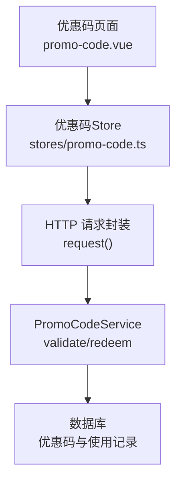
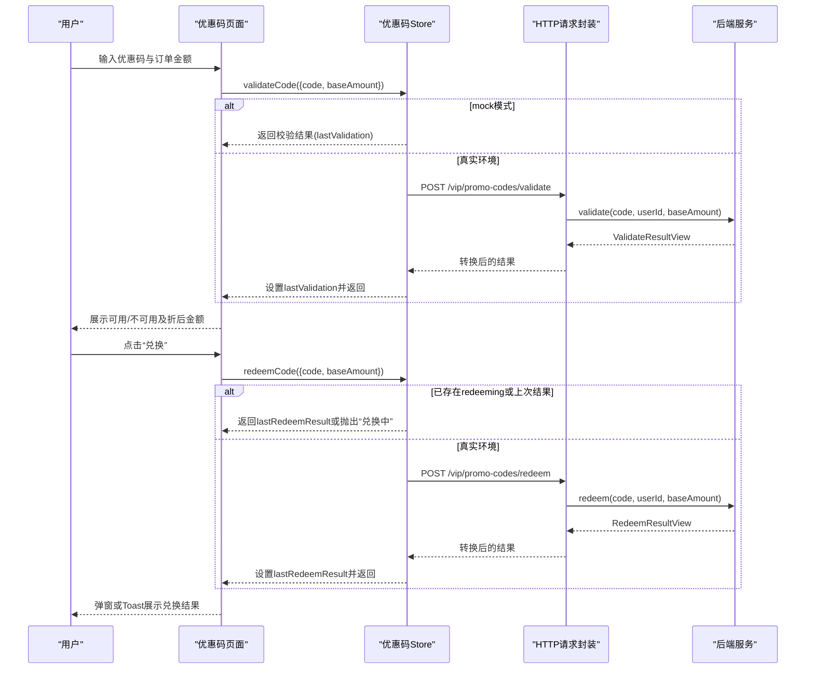
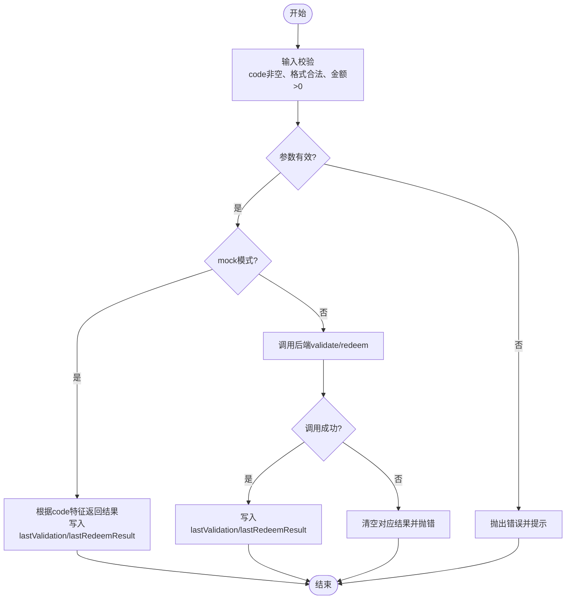
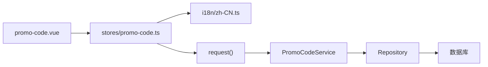

# 优惠码状态管理

<cite>
**本文引用的文件**
- [apps/client/src/stores/promo-code.ts](file://apps/client/src/stores/promo-code.ts)
- [apps/client/src/subpackages/vip/promo-code.vue](file://apps/client/src/subpackages/vip/promo-code.vue)
- [apps/client/src/i18n/locales/zh-CN.ts](file://apps/client/src/i18n/locales/zh-CN.ts)
- [apps/api/src/main/java/com/campuslove/api/vip/PromoCodeService.java](file://apps/api/src/main/java/com/campuslove/api/vip/PromoCodeService.java)
</cite>

## 目录
1. [简介](#简介)
2. [项目结构](#项目结构)
3. [核心组件](#核心组件)
4. [架构总览](#架构总览)
5. [详细组件分析](#详细组件分析)
6. [依赖关系分析](#依赖关系分析)
7. [性能考虑](#性能考虑)
8. [故障排查指南](#故障排查指南)
9. [结论](#结论)
10. [附录：接口与数据模型对照](#附录接口与数据模型对照)

## 简介
本技术文档围绕 VIP 优惠码状态管理系统，聚焦前端 Store 与页面交互、后端服务校验与兑换逻辑，系统说明以下要点：
- PromoCodeValidateView 与 PromoCodeRedeemView 的数据结构与字段含义。
- discountType（AMOUNT/PERCENT）与 discountValue 的计算规则及折后金额推导。
- 两个核心操作的状态流转：validate（只读预览）与 redeem（实际应用）。
- 防重复提交机制：redeeming 锁标志与 lastRedeemResult 结果缓存策略。
- 输入验证与错误处理：code 空值检查、baseAmount 负数检查、校验失败清空 lastValidation 的安全机制、兑换失败的异常处理流程。
- Mock 模式测试数据设计与不同优惠码字符特征的处理逻辑。
- 完整使用场景与代码片段路径指引。

## 项目结构
本功能由前端 Store、页面视图与后端服务三部分构成：
- 前端 Store：定义类型、状态、校验与兑换动作、防重入与缓存。
- 前端页面：负责用户输入、表单校验、调用 Store、展示结果与错误提示。
- 后端服务：实现优惠码查询、状态校验、折扣计算、并发安全的兑换事务。

**图表来源**
- [apps/client/src/subpackages/vip/promo-code.vue:1-200](file://apps/client/src/subpackages/vip/promo-code.vue#L1-L200)
- [apps/client/src/stores/promo-code.ts:1-120](file://apps/client/src/stores/promo-code.ts#L1-L120)
- [apps/api/src/main/java/com/campuslove/api/vip/PromoCodeService.java:1-120](file://apps/api/src/main/java/com/campuslove/api/vip/PromoCodeService.java#L1-L120)

**章节来源**
- [apps/client/src/subpackages/vip/promo-code.vue:1-200](file://apps/client/src/subpackages/vip/promo-code.vue#L1-L200)
- [apps/client/src/stores/promo-code.ts:1-120](file://apps/client/src/stores/promo-code.ts#L1-L120)
- [apps/api/src/main/java/com/campuslove/api/vip/PromoCodeService.java:1-120](file://apps/api/src/main/java/com/campuslove/api/vip/PromoCodeService.java#L1-L120)

## 核心组件
- 优惠码 Store：
  - 提供 validateCode 与 redeemCode 两个异步方法。
  - 维护 lastValidation、lastRedeemResult、validating、redeeming 等响应式状态。
  - 在 mock 模式下根据优惠码特征返回不同结果，便于联调。
- 优惠码页面：
  - 负责输入框绑定、基础格式校验、调用 Store 并展示结果。
  - 通过 i18n 文案统一提示用户。
- 后端服务：
  - 提供 validate 与 redeem 两个业务方法，包含参数校验、状态检查、折扣计算、并发安全的事务处理。

**章节来源**
- [apps/client/src/stores/promo-code.ts:1-223](file://apps/client/src/stores/promo-code.ts#L1-L223)
- [apps/client/src/subpackages/vip/promo-code.vue:1-200](file://apps/client/src/subpackages/vip/promo-code.vue#L1-L200)
- [apps/api/src/main/java/com/campuslove/api/vip/PromoCodeService.java:1-200](file://apps/api/src/main/java/com/campuslove/api/vip/PromoCodeService.java#L1-L200)

## 架构总览
前端页面通过 Store 发起校验与兑换；Store 在 mock 模式下直接返回模拟数据，否则通过 HTTP 调用后端服务。后端服务进行严格的参数校验、状态检查与折扣计算，并以事务保证兑换的原子性与并发安全。

**图表来源**
- [apps/client/src/stores/promo-code.ts:60-200](file://apps/client/src/stores/promo-code.ts#L60-L200)
- [apps/api/src/main/java/com/campuslove/api/vip/PromoCodeService.java:60-200](file://apps/api/src/main/java/com/campuslove/api/vip/PromoCodeService.java#L60-L200)

## 详细组件分析

### 数据结构与计算规则
- 折扣类型 discountType：
  - AMOUNT：满减金额，discountValue 为分。
  - PERCENT：百分比折扣，discountValue 为百分比（0~100），后端会限制最大值 100%。
- 折扣金额计算规则：
  - AMOUNT：discountAmount = min(discountValue, baseAmount)。
  - PERCENT：discountAmount = floor(baseAmount * min(discountValue, 100) / 100)，再与 baseAmount 取最小值。
- 应付金额 payableAmount：
  - payableAmount = max(0, baseAmount - discountAmount)。

这些规则在前端 Store 的 mock 实现中体现为对 baseAmount 的限制与 AMOUNT 类型的固定折扣；在后端服务中通过统一的 calculateDiscount 方法确保一致性。

**章节来源**
- [apps/client/src/stores/promo-code.ts:60-120](file://apps/client/src/stores/promo-code.ts#L60-L120)
- [apps/api/src/main/java/com/campuslove/api/vip/PromoCodeService.java:220-296](file://apps/api/src/main/java/com/campuslove/api/vip/PromoCodeService.java#L220-L296)

### 状态流转：校验与兑换
- 校验流程（只读预览）：
  - 页面触发 handleValidate，进行本地输入校验（code非空、格式合法、金额>0）。
  - Store.validateCode 执行前参数校验（code非空、baseAmount≥0）。
  - mock 模式：根据 code 特征返回无效或默认有效结果，并写入 lastValidation。
  - 真实环境：调用后端 validate，成功后写入 lastValidation；失败时清空 lastValidation 并抛错。
- 兑换流程（实际应用）：
  - 页面触发 handleRedeem，要求先完成可用校验。
  - Store.redeemCode 首先检查 redeeming 锁：若为真则复用 lastRedeemResult 或抛出“兑换中”。
  - 执行前参数校验（code非空、baseAmount≥0）。
  - mock 模式：直接返回成功结果并写入 lastRedeemResult。
  - 真实环境：调用后端 redeem，成功后写入 lastRedeemResult；失败时清空 lastRedeemResult 并抛错。

**图表来源**
- [apps/client/src/stores/promo-code.ts:60-200](file://apps/client/src/stores/promo-code.ts#L60-L200)
- [apps/client/src/subpackages/vip/promo-code.vue:120-200](file://apps/client/src/subpackages/vip/promo-code.vue#L120-L200)

**章节来源**
- [apps/client/src/stores/promo-code.ts:60-200](file://apps/client/src/stores/promo-code.ts#L60-L200)
- [apps/client/src/subpackages/vip/promo-code.vue:120-200](file://apps/client/src/subpackages/vip/promo-code.vue#L120-L200)

### 防重复提交机制
- redeeming 锁标志：
  - 在 redeemCode 开始时检测 redeeming.value，若为真则直接返回 lastRedeemResult 或抛出“兑换中”提示，避免重复提交。
  - 在 finally 块中将 redeeming.value 重置为 false，确保即使异常也能释放锁。
- lastRedeemResult 结果缓存：
  - 成功兑换时写入 lastRedeemResult，供页面展示与快速复用。
  - 兑换失败时清空 lastRedeemResult，避免陈旧结果误导用户。

**章节来源**
- [apps/client/src/stores/promo-code.ts:120-200](file://apps/client/src/stores/promo-code.ts#L120-L200)

### 输入验证与错误处理
- 输入验证：
  - code 空值检查：Store 层抛出 storeErrors.promoCode.codeEmpty。
  - baseAmount 负数检查：Store 层抛出 storeErrors.promoCode.amountNegative。
  - 页面层额外进行格式与金额校验（正则匹配、金额>0）。
- 错误处理：
  - 校验失败时清空 lastValidation，防止“过期可用”状态被复用。
  - 兑换失败时清空 lastRedeemResult，避免残留成功/失败状态。
  - 页面捕获错误并使用 i18n 文案提示用户。

**章节来源**
- [apps/client/src/stores/promo-code.ts:60-120](file://apps/client/src/stores/promo-code.ts#L60-L120)
- [apps/client/src/subpackages/vip/promo-code.vue:120-200](file://apps/client/src/subpackages/vip/promo-code.vue#L120-L200)
- [apps/client/src/i18n/locales/zh-CN.ts:4053-4056](file://apps/client/src/i18n/locales/zh-CN.ts#L4053-L4056)

### Mock 模式与优惠码字符特征
- Mock 模式下的行为：
  - 当 code 为 “INVALID” 或 “EXPIRED”（不区分大小写）时，返回不可用结果，reason 填充为“优惠码已过期或不可用”，并写入 lastValidation。
  - 其他情况默认按 AMOUNT 类型优惠 1000 分（10 元），discountAmount = min(1000, baseAmount)，payableAmount = baseAmount - discountAmount，available=true。
  - 兑换时直接返回 success=true 与相同折扣逻辑。
- 作用：便于前端联调与演示不同分支，无需启动后端。

**章节来源**
- [apps/client/src/stores/promo-code.ts:60-120](file://apps/client/src/stores/promo-code.ts#L60-L120)

### 后端服务：校验与兑换的并发安全
- 校验（validate）：
  - 读取参数并进行合法性校验（code非空、baseAmount≥0）。
  - 查询优惠码实体并校验状态、有效期、剩余次数与单用户使用次数。
  - 计算折扣金额并返回预览结果。
- 兑换（redeem）：
  - 使用悲观锁查询优惠码（SELECT ... FOR UPDATE），防止并发读取到过期状态。
  - 校验状态、有效期、剩余次数与单用户使用次数。
  - 原子扣减 remaining_uses，影响行数为 0 表示已被并发用完。
  - 累加 used_count 并保存使用记录（应用层 countByPromoCodeIdAndUserId 防重放）。
  - 捕获数据库访问异常并转换为运行时异常，便于上层统一处理。

**章节来源**
- [apps/api/src/main/java/com/campuslove/api/vip/PromoCodeService.java:60-200](file://apps/api/src/main/java/com/campuslove/api/vip/PromoCodeService.java#L60-L200)
- [apps/api/src/main/java/com/campuslove/api/vip/PromoCodeService.java:201-296](file://apps/api/src/main/java/com/campuslove/api/vip/PromoCodeService.java#L201-L296)

## 依赖关系分析
- 前端依赖：
  - 页面依赖 Store 暴露的方法与状态。
  - Store 依赖 i18n 文案与 mock 开关。
  - Store 依赖 HTTP 请求封装进行后端通信。
- 后端依赖：
  - 服务依赖仓储与时间工具类。
  - 服务使用事务注解保证兑换操作的原子性。

**图表来源**
- [apps/client/src/subpackages/vip/promo-code.vue:1-200](file://apps/client/src/subpackages/vip/promo-code.vue#L1-L200)
- [apps/client/src/stores/promo-code.ts:1-223](file://apps/client/src/stores/promo-code.ts#L1-L223)
- [apps/api/src/main/java/com/campuslove/api/vip/PromoCodeService.java:1-296](file://apps/api/src/main/java/com/campuslove/api/vip/PromoCodeService.java#L1-L296)

**章节来源**
- [apps/client/src/subpackages/vip/promo-code.vue:1-200](file://apps/client/src/subpackages/vip/promo-code.vue#L1-L200)
- [apps/client/src/stores/promo-code.ts:1-223](file://apps/client/src/stores/promo-code.ts#L1-L223)
- [apps/api/src/main/java/com/campuslove/api/vip/PromoCodeService.java:1-296](file://apps/api/src/main/java/com/campuslove/api/vip/PromoCodeService.java#L1-L296)

## 性能考虑
- 前端：
  - 使用响应式状态减少不必要的重渲染。
  - 在 mock 模式下跳过网络开销，提升联调效率。
- 后端：
  - 使用悲观锁与原子扣减保证高并发下的正确性。
  - 仅在必要时进行数据库写入，减少事务范围。

[本节为通用性能讨论，不涉及具体文件分析]

## 故障排查指南
- 常见问题：
  - 校验通过后仍无法兑换：检查 lastValidation 是否被清空；确认页面是否正确传递 baseAmount。
  - 重复兑换导致异常：检查 redeeming 锁是否生效；确认最后一步 finally 重置逻辑。
  - 后端报错：查看日志中的 DataAccessException 与错误消息映射。
- 定位步骤：
  - 前端：打开控制台查看抛出的 Error 与 i18n 文案。
  - 后端：检查 PromoCodeService 的日志输出与异常堆栈。

**章节来源**
- [apps/client/src/stores/promo-code.ts:60-200](file://apps/client/src/stores/promo-code.ts#L60-L200)
- [apps/api/src/main/java/com/campuslove/api/vip/PromoCodeService.java:120-200](file://apps/api/src/main/java/com/campuslove/api/vip/PromoCodeService.java#L120-L200)

## 结论
本系统通过 Store 抽象出优惠码的校验与兑换能力，结合页面交互与后端服务的严格校验与并发控制，实现了可靠且易用的 VIP 优惠码状态管理。Mock 模式提升了联调效率，而清晰的状态管理与错误处理确保了用户体验与数据一致性。

[本节为总结，不涉及具体文件分析]

## 附录：接口与数据模型对照
- 前端类型与后端记录：
  - PromoCodeValidateView 对应后端 ValidateResultView。
  - PromoCodeRedeemView 对应后端 RedeemResultView。
- 关键字段：
  - discountType：AMOUNT 或 PERCENT。
  - discountValue：AMOUNT 为分，PERCENT 为百分比。
  - discountAmount/payableAmount：折后金额与应付金额（分）。
- 错误信息：
  - 前端通过 i18n 文案展示给用户，如“优惠码不能为空”“订单金额不能为负数”等。

**章节来源**
- [apps/client/src/stores/promo-code.ts:1-120](file://apps/client/src/stores/promo-code.ts#L1-L120)
- [apps/api/src/main/java/com/campuslove/api/vip/PromoCodeService.java:240-296](file://apps/api/src/main/java/com/campuslove/api/vip/PromoCodeService.java#L240-L296)
- [apps/client/src/i18n/locales/zh-CN.ts:4053-4056](file://apps/client/src/i18n/locales/zh-CN.ts#L4053-L4056)