# 自动续费状态管理

<cite>
**本文引用的文件**   
- [apps/client/src/stores/vip-auto-renew.ts](file://apps/client/src/stores/vip-auto-renew.ts)
- [apps/api/src/main/java/com/campuslove/api/vip/AutoRenewController.java](file://apps/api/src/main/java/com/campuslove/api/vip/AutoRenewController.java)
- [apps/api/src/main/java/com/campuslove/api/vip/AutoRenewService.java](file://apps/api/src/main/java/com/campuslove/api/vip/AutoRenewService.java)
- [apps/client/src/subpackages/vip/index.vue](file://apps/client/src/subpackages/vip/index.vue)
</cite>

## 目录

1. [引言](#引言)
2. [项目结构](#项目结构)
3. [核心数据结构与字段语义](#核心数据结构与字段语义)
4. [系统架构总览](#系统架构总览)
5. [三种操作的状态流转](#三种操作的状态流转)
6. [请求载荷与参数校验](#请求载荷与参数校验)
7. [前端状态标志位与并发控制](#前端状态标志位与并发控制)
8. [Mock 测试数据设计](#mock-测试数据设计)
9. [真实 API 调用与错误处理](#真实-api-调用与错误处理)
10. [页面集成与使用示例](#页面集成与使用示例)
11. [依赖关系分析](#依赖关系分析)
12. [性能与并发特性](#性能与并发特性)
13. [故障排查指南](#故障排查指南)
14. [结论](#结论)

## 引言

本文面向 VIP 自动续费状态管理系统，围绕前端 `AutoRenewStatusView`、后端控制器与服务层、以及 VIP 开通页面的集成方式，完整梳理自动续费的查询、开启和关闭流程。重点包括：

- `enabled`、`planId`、`nextBillingAt`、`paymentMethod` 等字段的业务含义；
- `fetchStatus`、`enableAutoRenew`、`disableAutoRenew` 三种操作的前后端交互；
- `EnableAutoRenewPayload.planId` 必填校验与旧版 `setEnabled` 的兼容逻辑；
- `loading`、`updating`、`loaded` 标志位的生命周期与并发防护；
- Mock 模式下的测试数据构造；
- 真实 API 调用的异常路径及页面级使用方式。

## 项目结构

自动续费功能横跨客户端 Pinia Store、VIP 开通页面、后端 REST 控制器和服务层：

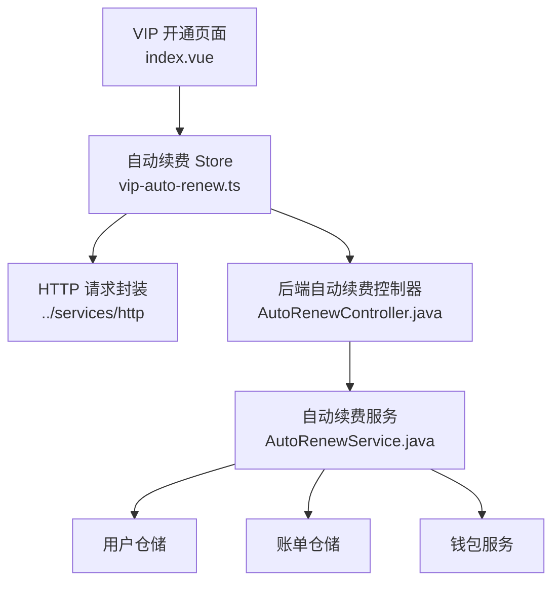

**图表来源**
- [apps/client/src/subpackages/vip/index.vue:39-309](file://apps/client/src/subpackages/vip/index.vue#L39-L309)
- [apps/client/src/stores/vip-auto-renew.ts:1-222](file://apps/client/src/stores/vip-auto-renew.ts#L1-L222)
- [apps/api/src/main/java/com/campuslove/api/vip/AutoRenewController.java:1-111](file://apps/api/src/main/java/com/campuslove/api/vip/AutoRenewController.java#L1-L111)
- [apps/api/src/main/java/com/campuslove/api/vip/AutoRenewService.java:1-200](file://apps/api/src/main/java/com/campuslove/api/vip/AutoRenewService.java#L1-L200)

**章节来源**
- [apps/client/src/stores/vip-auto-renew.ts:1-222](file://apps/client/src/stores/vip-auto-renew.ts#L1-L222)
- [apps/api/src/main/java/com/campuslove/api/vip/AutoRenewController.java:1-111](file://apps/api/src/main/java/com/campuslove/api/vip/AutoRenewController.java#L1-L111)
- [apps/api/src/main/java/com/campuslove/api/vip/AutoRenewService.java:1-200](file://apps/api/src/main/java/com/campuslove/api/vip/AutoRenewService.java#L1-L200)
- [apps/client/src/subpackages/vip/index.vue:39-309](file://apps/client/src/subpackages/vip/index.vue#L39-L309)

## 核心数据结构与字段语义

### AutoRenewStatusView

`AutoRenewStatusView` 是自动续费状态视图模型，既是前端 Store 的状态载体，也是后端返回给前端的响应视图。其字段语义如下：

| 字段 | 类型 | 是否必填 | 含义 |
|---|---|---:|---|
| `enabled` | `boolean` | 是 | 当前用户是否已开启自动续费。前端根据该值决定是否显示“下次扣费时间”、是否禁用或启用开关。 |
| `planId` | `string \| null` | 否 | 当前关联的套餐 ID。用于展示或后续扩展绑定支付渠道。 |
| `planName` | `string \| null` | 否 | 当前套餐名称，供 UI 直接展示。 |
| `nextBillingAt` | `string \| null` | 否 | 下次扣费时间，使用 ISO 字符串表示，可为空。当 `enabled` 为真时通常有值；关闭后应为空。 |
| `nextBillingAmount` | `number \| null` | 否 | 下次扣费金额，单位为分。 |
| `paymentMethod` | `string \| null` | 否 | 绑定的支付方式，例如 `WECHAT`。 |

默认初始状态为未开启自动续费，所有可选字段均为 `null`。这意味着前端不应把 `planId` 或 `nextBillingAt` 当作始终存在的字段。

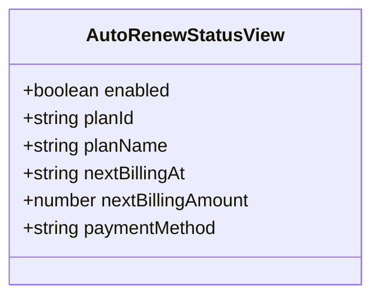

**图表来源**
- [apps/client/src/stores/vip-auto-renew.ts:23-46](file://apps/client/src/stores/vip-auto-renew.ts#L23-L46)
- [apps/api/src/main/java/com/campuslove/api/vip/AutoRenewService.java:200-320](file://apps/api/src/main/java/com/campuslove/api/vip/AutoRenewService.java#L200-L320)

### EnableAutoRenewPayload

`EnableAutoRenewPayload` 是前端发起“开启自动续费”时的请求体定义：

| 字段 | 类型 | 是否必填 | 含义 |
|---|---|---:|---|
| `planId` | `string` | 是 | 要开启自动续费所对应的套餐 ID。后端会用它记录或扩展支付渠道绑定。 |

该类型只包含 `planId`，因此前端在调用前必须确保它存在且非空。

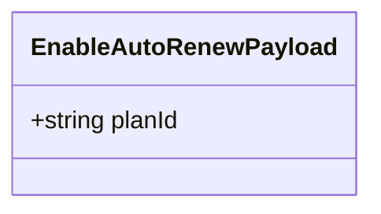

**图表来源**
- [apps/client/src/stores/vip-auto-renew.ts:48-53](file://apps/client/src/stores/vip-auto-renew.ts#L48-L53)

**章节来源**
- [apps/client/src/stores/vip-auto-renew.ts:23-53](file://apps/client/src/stores/vip-auto-renew.ts#L23-L53)
- [apps/api/src/main/java/com/campuslove/api/vip/AutoRenewController.java:95-111](file://apps/api/src/main/java/com/campuslove/api/vip/AutoRenewController.java#L95-L111)
- [apps/api/src/main/java/com/campuslove/api/vip/AutoRenewService.java:200-320](file://apps/api/src/main/java/com/campuslove/api/vip/AutoRenewService.java#L200-L320)

## 系统架构总览

自动续费状态管理采用典型的前端 Store 驱动 UI、后端控制器暴露 REST 接口、服务层执行业务逻辑的分层结构：

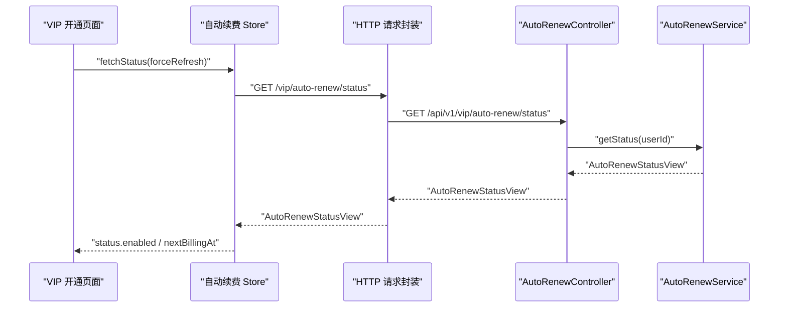

**图表来源**
- [apps/client/src/stores/vip-auto-renew.ts:60-113](file://apps/client/src/stores/vip-auto-renew.ts#L60-L113)
- [apps/api/src/main/java/com/campuslove/api/vip/AutoRenewController.java:45-60](file://apps/api/src/main/java/com/campuslove/api/vip/AutoRenewController.java#L45-L60)
- [apps/api/src/main/java/com/campuslove/api/vip/AutoRenewService.java:200-260](file://apps/api/src/main/java/com/campuslove/api/vip/AutoRenewService.java#L200-L260)

**章节来源**
- [apps/client/src/stores/vip-auto-renew.ts:60-113](file://apps/client/src/stores/vip-auto-renew.ts#L60-L113)
- [apps/api/src/main/java/com/campuslove/api/vip/AutoRenewController.java:45-60](file://apps/api/src/main/java/com/campuslove/api/vip/AutoRenewController.java#L45-L60)
- [apps/api/src/main/java/com/campuslove/api/vip/AutoRenewService.java:200-260](file://apps/api/src/main/java/com/campuslove/api/vip/AutoRenewService.java#L200-L260)

## 三种操作的状态流转

自动续费涉及三个关键操作：查询状态、开启自动续费、关闭自动续费。它们共同维护 `AutoRenewStatusView.enabled` 这一核心布尔状态。

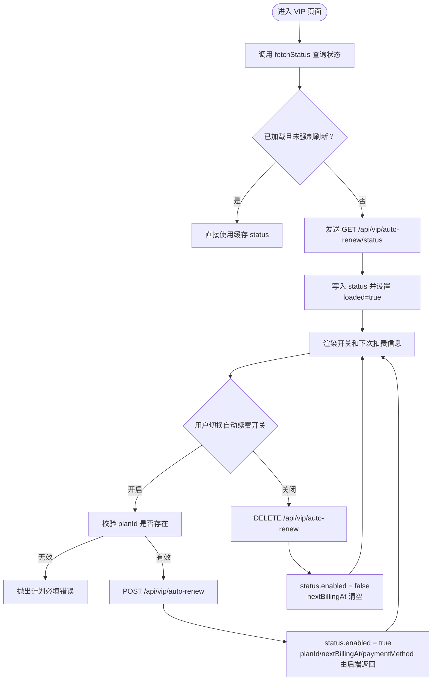

**图表来源**
- [apps/client/src/stores/vip-auto-renew.ts:60-190](file://apps/client/src/stores/vip-auto-renew.ts#L60-L190)
- [apps/client/src/subpackages/vip/index.vue:272-359](file://apps/client/src/subpackages/vip/index.vue#L272-L359)

### 查询状态：fetchStatus

`fetchStatus` 负责读取当前自动续费状态：

- 若 `loaded` 为真且未传入 `forceRefresh`，直接返回缓存状态；
- 若正在 `loading`，避免重复请求，返回当前状态；
- Mock 模式下直接构造模拟数据并标记 `loaded`；
- 真实模式下设置 `loading=true`，调用 `/vip/auto-renew/status`，成功后更新 `status` 和 `loaded`；
- `finally` 中保证 `loading=false`。

### 开启自动续费：enableAutoRenew

`enableAutoRenew` 负责开启自动续费：

- 先校验 `payload` 和 `payload.planId`，缺失则抛出 i18n 翻译后的错误；
- Mock 模式下构造 `enabled=true` 的模拟状态；
- 真实模式下设置 `updating=true`，调用 `POST /vip/auto-renew`；
- 成功后用后端返回的 `AutoRenewStatusView` 替换 `status.value`；
- `finally` 中恢复 `updating=false`。

### 关闭自动续费：disableAutoRenew

`disableAutoRenew` 负责关闭自动续费：

- Mock 模式下构造 `enabled=false`、`nextBillingAt=null` 的模拟状态；
- 真实模式下设置 `updating=true`，调用 `DELETE /vip/auto-renew`；
- 成功后用后端返回状态覆盖本地状态；
- `finally` 中恢复 `updating=false`。

**章节来源**
- [apps/client/src/stores/vip-auto-renew.ts:60-190](file://apps/client/src/stores/vip-auto-renew.ts#L60-L190)
- [apps/api/src/main/java/com/campuslove/api/vip/AutoRenewController.java:45-94](file://apps/api/src/main/java/com/campuslove/api/vip/AutoRenewController.java#L45-L94)
- [apps/api/src/main/java/com/campuslove/api/vip/AutoRenewService.java:200-320](file://apps/api/src/main/java/com/campuslove/api/vip/AutoRenewService.java#L200-L320)

## 请求载荷与参数校验

### 前端校验：EnableAutoRenewPayload

前端在 `enableAutoRenew` 中执行轻量前置校验：

- 检查 `payload` 是否存在；
- 检查 `payload.planId` 是否存在；
- 不满足条件时抛出基于 i18n 的错误消息，键为 `storeErrors.vip.planRequired`。

这是第一道防线，目的是避免前端向服务端发送非法请求。

### 后端校验：EnableAutoRenewRequest

后端控制器中的 `EnableAutoRenewRequest` 使用 Jakarta Validation：

- `planId` 标注为 `@NotBlank`；
- `planId` 最大长度为 64；
- 服务层 `AutoRenewService.enable` 进一步检查 `userId` 和 `planId`；
- 如果 `planId` 为空或空白，抛出业务异常；
- 最终将用户 `autoRenewEnabled` 设置为 `true` 并持久化。

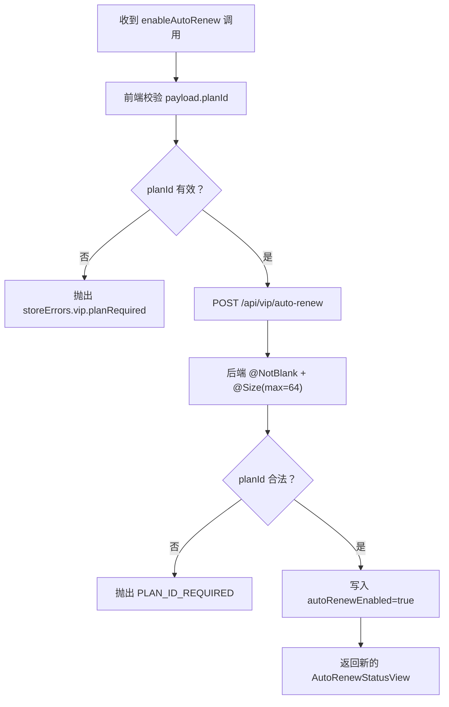

**图表来源**
- [apps/client/src/stores/vip-auto-renew.ts:115-150](file://apps/client/src/stores/vip-auto-renew.ts#L115-L150)
- [apps/api/src/main/java/com/campuslove/api/vip/AutoRenewController.java:95-111](file://apps/api/src/main/java/com/campuslove/api/vip/AutoRenewController.java#L95-L111)
- [apps/api/src/main/java/com/campuslove/api/vip/AutoRenewService.java:260-320](file://apps/api/src/main/java/com/campuslove/api/vip/AutoRenewService.java#L260-L320)

**章节来源**
- [apps/client/src/stores/vip-auto-renew.ts:115-150](file://apps/client/src/stores/vip-auto-renew.ts#L115-L150)
- [apps/api/src/main/java/com/campuslove/api/vip/AutoRenewController.java:95-111](file://apps/api/src/main/java/com/campuslove/api/vip/AutoRenewController.java#L95-L111)
- [apps/api/src/main/java/com/campuslove/api/vip/AutoRenewService.java:260-320](file://apps/api/src/main/java/com/campuslove/api/vip/AutoRenewService.java#L260-L320)

## 前端状态标志位与并发控制

Store 暴露四个状态标志：

| 标志 | 类型 | 含义 |
|---|---|---|
| `status` | `AutoRenewStatusView` | 当前自动续费状态数据。 |
| `loading` | `boolean` | 是否正在查询状态。 |
| `updating` | `boolean` | 是否正在开启或关闭自动续费。 |
| `loaded` | `boolean` | 是否已经完成过一次成功加载。 |

### 并发控制机制

#### 查询并发：`loading` 与 `loaded`

`fetchStatus` 通过两个条件避免重复请求：

1. `loaded && !forceRefresh`：已加载且未强制刷新时直接返回缓存；
2. `loading`：已有查询进行中时直接返回当前状态。

这防止了同一时刻多次触发状态查询。

#### 写操作并发：`updating`

`enableAutoRenew` 和 `disableAutoRenew` 都使用 `updating` 包裹写操作。页面侧也通过 `autoRenewStore.updating` 禁用开关按钮，从而形成前端交互层面的防抖。

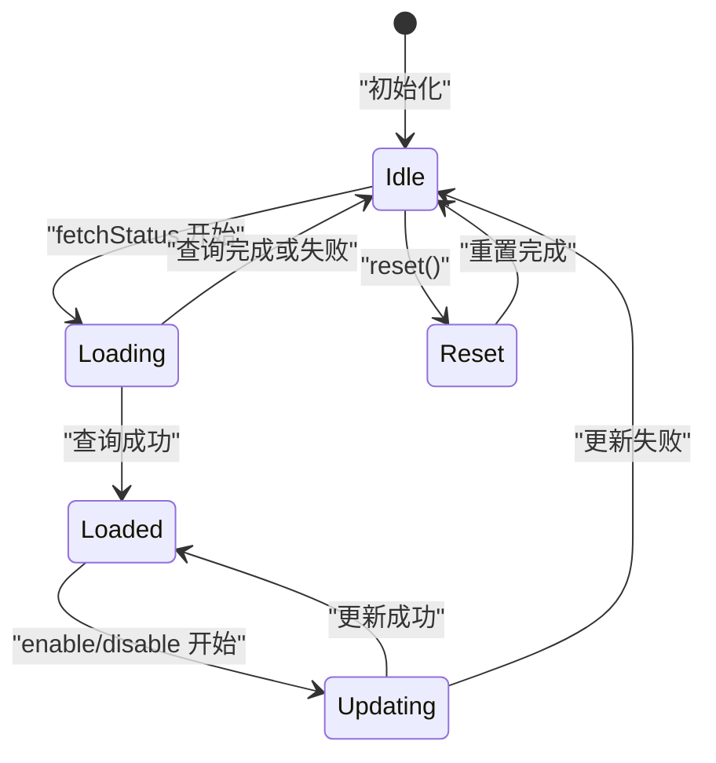

**图表来源**
- [apps/client/src/stores/vip-auto-renew.ts:55-222](file://apps/client/src/stores/vip-auto-renew.ts#L55-L222)

### 兼容方法：setEnabled

`setEnabled` 是一个兼容旧调用的方法：

- 如果 `payload.enabled` 为真，则要求 `planId` 存在且非空；
- 否则调用 `enableAutoRenew`；
- 如果 `payload.enabled` 为假，则调用 `disableAutoRenew`；
- 该方法标记为弃用，推荐直接调用 `enableAutoRenew` 或 `disableAutoRenew`。

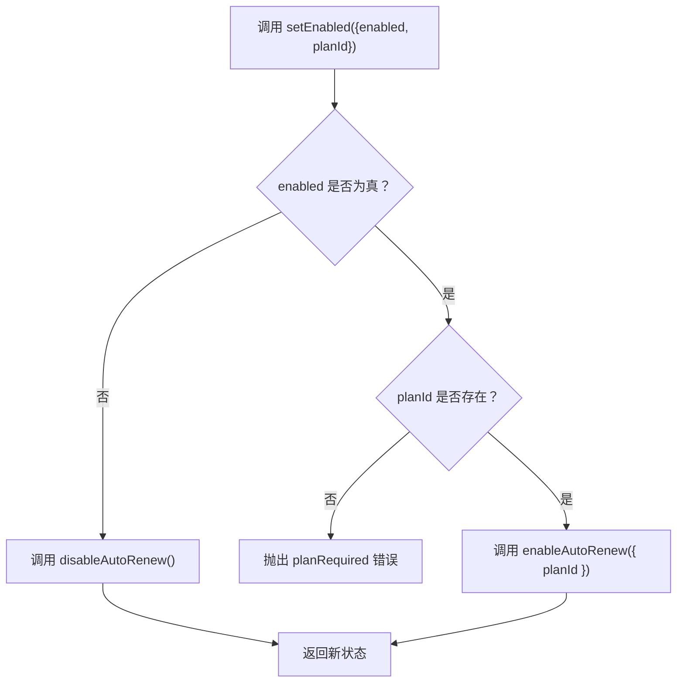

**图表来源**
- [apps/client/src/stores/vip-auto-renew.ts:160-190](file://apps/client/src/stores/vip-auto-renew.ts#L160-L190)

**章节来源**
- [apps/client/src/stores/vip-auto-renew.ts:55-222](file://apps/client/src/stores/vip-auto-renew.ts#L55-L222)

## Mock 测试数据设计

Store 通过 `useMock()` 判断是否处于 mock 模式。Mock 分支用于开发调试和功能演示，不需要真实后端。

### 查询状态 Mock

Mock 查询返回一个已关闭但带有套餐信息的状态：

| 字段 | Mock 值 |
|---|---|
| `enabled` | `false` |
| `planId` | `"quarterly"` |
| `planName` | `"季度会员"` |
| `nextBillingAt` | 当前时间加 30 天的 ISO 字符串 |
| `nextBillingAmount` | `4800`（单位：分） |
| `paymentMethod` | `"WECHAT"` |

### 开启自动续费 Mock

Mock 开启后状态变为：

| 字段 | Mock 行为 |
|---|---|
| `enabled` | `true` |
| `planId` | 使用调用方传入的 `payload.planId` |
| `planName` | 优先使用当前状态中的 `planName`，否则回退到 `"季度会员"` |
| `nextBillingAt` | 当前时间加 30 天 |
| `nextBillingAmount` | `4800` |
| `paymentMethod` | `"WECHAT"` |

### 关闭自动续费 Mock

Mock 关闭后：

| 字段 | Mock 行为 |
|---|---|
| `enabled` | `false` |
| `planId` | 保留当前状态中的 `planId` |
| `planName` | 保留当前状态中的 `planName` |
| `nextBillingAt` | `null` |
| `nextBillingAmount` | `null` |
| `paymentMethod` | 保留当前状态中的 `paymentMethod` |

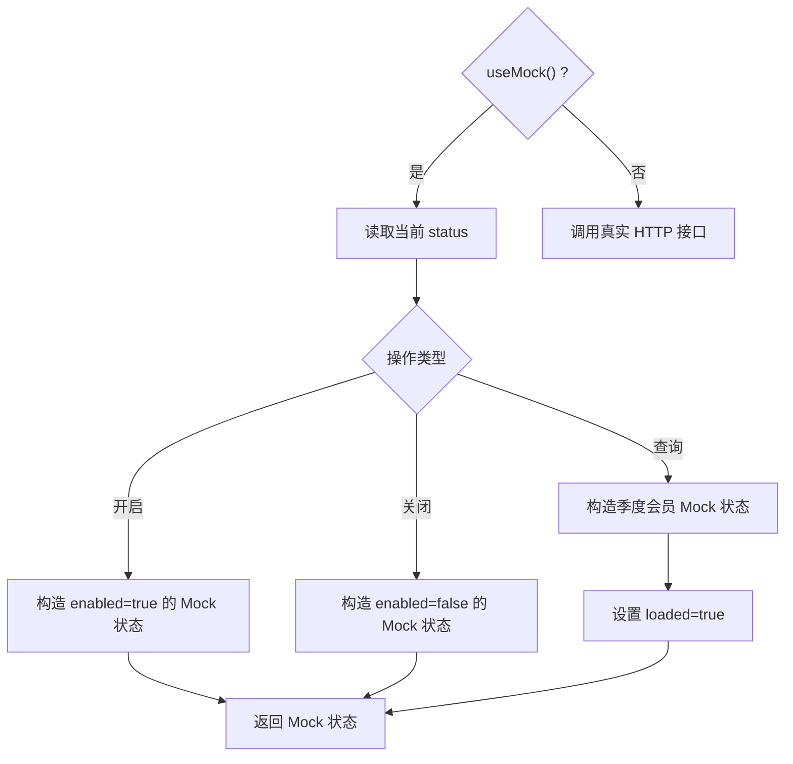

**图表来源**
- [apps/client/src/stores/vip-auto-renew.ts:60-190](file://apps/client/src/stores/vip-auto-renew.ts#L60-L190)

**章节来源**
- [apps/client/src/stores/vip-auto-renew.ts:60-190](file://apps/client/src/stores/vip-auto-renew.ts#L60-L190)

## 真实 API 调用与错误处理

### 后端接口契约

| 方法 | 路径 | 权限 | 说明 |
|---|---|---|---|
| `GET` | `/api/v1/vip/auto-renew/status` | 已认证用户 | 查询当前用户的自动续费状态。 |
| `POST` | `/api/v1/vip/auto-renew` | 角色 `USER` | 开启自动续费，请求体为 `EnableAutoRenewRequest`。 |
| `DELETE` | `/api/v1/vip/auto-renew` | 角色 `USER` | 关闭自动续费。 |
| `POST` | `/api/v1/vip/auto-renew/trigger` | 角色 `ADMIN` | 手动触发续费扫描，用于运维补跑。 |

控制器仅在 `real` profile 下激活，并通过 `SecurityUtils.getCurrentUserId()` 从 JWT 上下文获取用户身份，防止客户端伪造身份。

### 服务层错误处理

`AutoRenewService` 对数据库访问和业务参数做了分层保护：

- 用户 ID 为空：抛出 `IllegalArgumentException`；
- 用户不存在：抛出 `IllegalArgumentException`；
- 数据库查询失败：记录日志并抛出包装后的 `RuntimeException`；
- 开启/关闭自动续费失败：捕获 `DataAccessException`，记录日志并抛出带中文提示的运行时异常。

这些异常通常由全局异常处理器转换为标准 HTTP 响应。

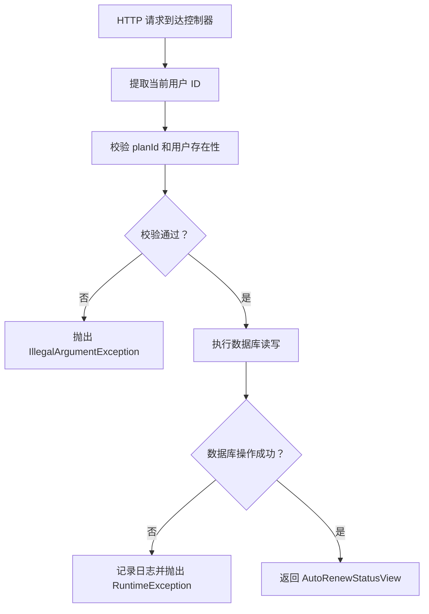

**图表来源**
- [apps/api/src/main/java/com/campuslove/api/vip/AutoRenewController.java:45-94](file://apps/api/src/main/java/com/campuslove/api/vip/AutoRenewController.java#L45-L94)
- [apps/api/src/main/java/com/campuslove/api/vip/AutoRenewService.java:200-320](file://apps/api/src/main/java/com/campuslove/api/vip/AutoRenewService.java#L200-L320)

**章节来源**
- [apps/api/src/main/java/com/campuslove/api/vip/AutoRenewController.java:1-111](file://apps/api/src/main/java/com/campuslove/api/vip/AutoRenewController.java#L1-L111)
- [apps/api/src/main/java/com/campuslove/api/vip/AutoRenewService.java:200-320](file://apps/api/src/main/java/com/campuslove/api/vip/AutoRenewService.java#L200-L320)

## 页面集成与使用示例

VIP 开通页面通过 `useAutoRenewStore()` 获取 Store 实例，并将其状态绑定到开关组件：

- 使用 `autoRenewStore.status.enabled` 决定开关选中状态；
- 使用 `autoRenewStore.status.nextBillingAt` 计算并展示下次扣费日期；
- 使用 `autoRenewStore.updating` 禁用开关，防止重复提交；
- 使用 `autoRenewStore.fetchStatus()` 在页面加载时拉取状态；
- 使用 `autoRenewStore.setEnabled({ enabled, planId })` 统一处理开启和关闭逻辑。

### 页面关键集成点

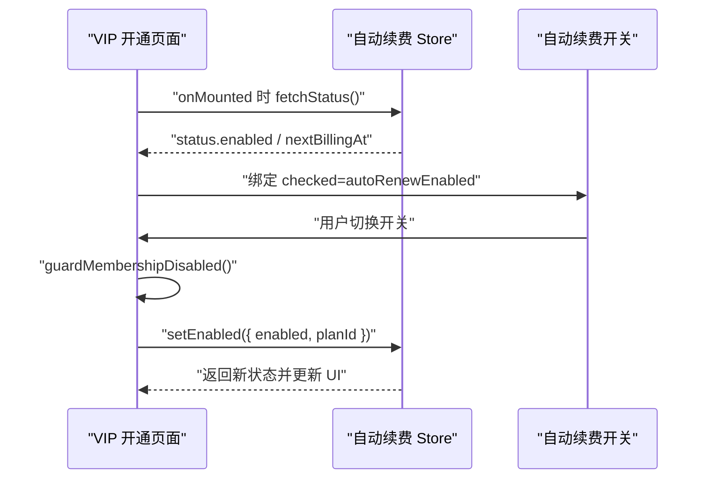

**图表来源**
- [apps/client/src/subpackages/vip/index.vue:39-359](file://apps/client/src/subpackages/vip/index.vue#L39-L359)
- [apps/client/src/stores/vip-auto-renew.ts:160-190](file://apps/client/src/stores/vip-auto-renew.ts#L160-L190)

### 正确使用步骤

1. 在页面顶部引入并使用 `useAutoRenewStore()`。
2. 在页面加载时调用 `fetchStatus()`。
3. 将 `status.enabled` 绑定到开关的 `checked`。
4. 在开关变更事件中调用 `setEnabled`，并传入当前选中的 `planId`。
5. 通过 `updating` 禁用开关，避免重复点击。
6. 通过 `membershipDisabled` 在会员功能未启用时整体短路。

### 错误处理建议

- 前端 Store 在参数校验失败时直接抛出错误；
- 页面应捕获 `fetchStatus`、`enableAutoRenew`、`disableAutoRenew` 的异常；
- 对于网络错误、权限错误或后端业务异常，应使用 toast 或错误提示告知用户；
- 不要忽略 `.catch(() => {...})` 中的错误路径，尤其是异步状态更新后 UI 可能停留在中间态。

**章节来源**
- [apps/client/src/subpackages/vip/index.vue:39-359](file://apps/client/src/subpackages/vip/index.vue#L39-L359)
- [apps/client/src/stores/vip-auto-renew.ts:160-190](file://apps/client/src/stores/vip-auto-renew.ts#L160-L190)

## 依赖关系分析

### 模块依赖图

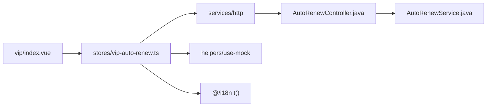

**图表来源**
- [apps/client/src/subpackages/vip/index.vue:39-309](file://apps/client/src/subpackages/vip/index.vue#L39-L309)
- [apps/client/src/stores/vip-auto-renew.ts:1-20](file://apps/client/src/stores/vip-auto-renew.ts#L1-L20)
- [apps/api/src/main/java/com/campuslove/api/vip/AutoRenewController.java:1-44](file://apps/api/src/main/java/com/campuslove/api/vip/AutoRenewController.java#L1-L44)
- [apps/api/src/main/java/com/campuslove/api/vip/AutoRenewService.java:1-120](file://apps/api/src/main/java/com/campuslove/api/vip/AutoRenewService.java#L1-L120)

### 耦合性与内聚性

- `vip-auto-renew.ts` 内聚地管理自动续费状态和相关副作用；
- `index.vue` 只消费 Store，不直接构造请求载荷；
- 控制器职责单一，仅做参数接收、鉴权和委托服务层；
- 服务层集中处理事务、锁、日志和异常转换。

潜在风险：

- 如果页面直接修改 `status` 而不经过 Store 方法，会导致 `loading`、`updating`、`loaded` 不一致；
- 如果多个页面同时调用 `fetchStatus(forceRefresh=true)`，可能产生短暂并发查询；
- Mock 模式和真实模式共享同一 Store，需确保测试环境正确切换。

**章节来源**
- [apps/client/src/stores/vip-auto-renew.ts:1-222](file://apps/client/src/stores/vip-auto-renew.ts#L1-L222)
- [apps/client/src/subpackages/vip/index.vue:39-359](file://apps/client/src/subpackages/vip/index.vue#L39-L359)
- [apps/api/src/main/java/com/campuslove/api/vip/AutoRenewController.java:1-111](file://apps/api/src/main/java/com/campuslove/api/vip/AutoRenewController.java#L1-L111)
- [apps/api/src/main/java/com/campuslove/api/vip/AutoRenewService.java:1-200](file://apps/api/src/main/java/com/campuslove/api/vip/AutoRenewService.java#L1-L200)

## 性能与并发特性

### 前端性能

- `fetchStatus` 使用 `loaded` 缓存结果，避免重复网络请求；
- `loading` 防止同一次查询被重复触发；
- `updating` 防止开启或关闭操作的重复提交；
- Mock 模式完全本地执行，无网络开销。

### 后端并发特性

虽然自动续费开关操作本身是简单字段更新，但 `AutoRenewService` 还实现了自动续费定时扫描逻辑，具备更强的并发控制能力：

- 使用 Redisson 分布式锁，key 为 `auto-renew:{userId}`；
- 锁等待时间为 5 秒；
- 锁持有时间为 30 秒；
- 通过 `TransactionSynchronizationManager` 在事务提交或回滚后释放锁；
- 同一用户重复触发续费时，快速失败而不是堆积。

这说明自动续费系统的后端具备处理高并发续费扫描的能力，而前端 Store 则负责更细粒度的用户交互状态。

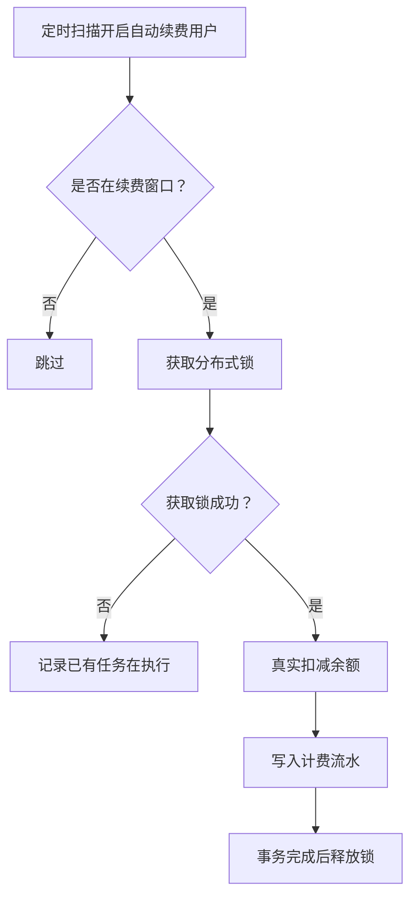

**图表来源**
- [apps/api/src/main/java/com/campuslove/api/vip/AutoRenewService.java:200-420](file://apps/api/src/main/java/com/campuslove/api/vip/AutoRenewService.java#L200-L420)

**章节来源**
- [apps/client/src/stores/vip-auto-renew.ts:60-222](file://apps/client/src/stores/vip-auto-renew.ts#L60-L222)
- [apps/api/src/main/java/com/campuslove/api/vip/AutoRenewService.java:200-420](file://apps/api/src/main/java/com/campuslove/api/vip/AutoRenewService.java#L200-L420)

## 故障排查指南

### 常见问题与定位方式

| 现象 | 可能原因 | 排查位置 |
|---|---|---|
| 自动续费开关一直禁用 | `updating` 为真且未恢复 | 检查 `enableAutoRenew` 或 `disableAutoRenew` 的 `finally` 分支 |
| 开启自动续费报错 | `payload.planId` 为空或未传 | 检查 `setEnabled` 或页面调用处传入的 `planId` |
| 页面显示已开启但后端未生效 | 使用了 Mock 模式 | 检查 `useMock()` 或运行环境配置 |
| 下次扣费时间不更新 | 没有调用 `fetchStatus(forceRefresh=true)` | 检查页面加载逻辑 |
| 后端返回用户不存在 | JWT 用户上下文失效 | 检查控制器中 `SecurityUtils.getCurrentUserId()` |
| 数据库操作失败 | 连接异常或约束冲突 | 检查 `AutoRenewService` 的 `DataAccessException` 分支 |

### 前端错误处理建议

- 对 `fetchStatus` 添加 `.catch`，在网络失败时保留上次可用状态；
- 对 `enableAutoRenew` 和 `disableAutoRenew` 明确区分“参数错误”和“网络错误”；
- 如果发生异常，确保 `updating` 能恢复，避免开关永久锁定；
- 使用 i18n 错误键 `storeErrors.vip.planRequired`，避免硬编码中文文案。

### 后端错误处理建议

- 保持 `IllegalArgumentException` 作为参数错误；
- 保持 `RuntimeException` 作为基础设施异常；
- 确保 `GlobalExceptionHandler` 能将这些异常映射为清晰的 HTTP 状态码；
- 对于自动续费开关操作，尽量保持事务原子性，避免部分写入。

**章节来源**
- [apps/client/src/stores/vip-auto-renew.ts:60-222](file://apps/client/src/stores/vip-auto-renew.ts#L60-L222)
- [apps/api/src/main/java/com/campuslove/api/vip/AutoRenewService.java:200-320](file://apps/api/src/main/java/com/campuslove/api/vip/AutoRenewService.java#L200-L320)

## 结论

自动续费状态管理系统以 `AutoRenewStatusView` 为核心数据结构，以 `fetchStatus`、`enableAutoRenew`、`disableAutoRenew` 为核心操作，形成了清晰的前后端状态同步路径。前端通过 `loading`、`updating`、`loaded` 三个标志位管理加载和写操作的生命周期，并通过 Mock 模式支持开发和测试。后端通过控制器接收请求、服务层执行业务逻辑，并在定时续费场景中提供分布式锁和事务保障。

最佳实践包括：

- 始终通过 Store 方法修改状态，避免直接赋值 `status.value`；
- 开启自动续费时必须显式传入 `planId`；
- 页面侧结合 `updating` 和 `membershipDisabled` 控制交互可用性；
- 正确处理 Mock 与真实环境的差异；
- 对网络异常、参数校验异常和业务异常分别给出可理解的用户反馈。