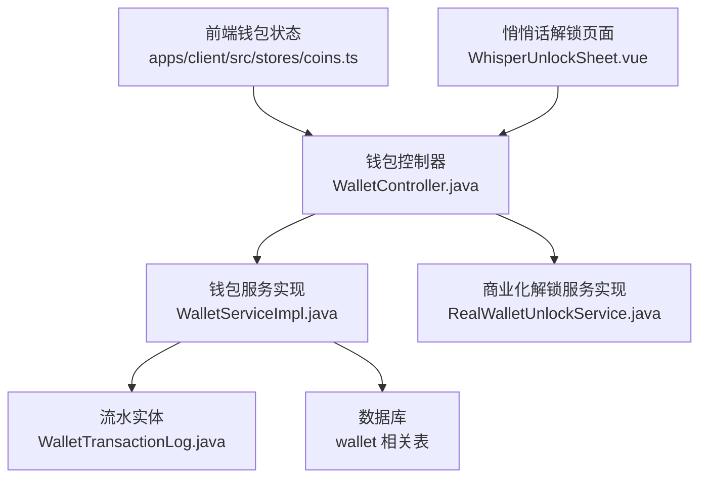
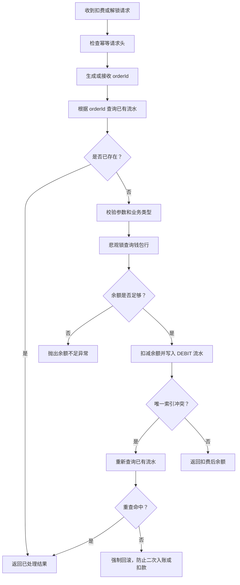
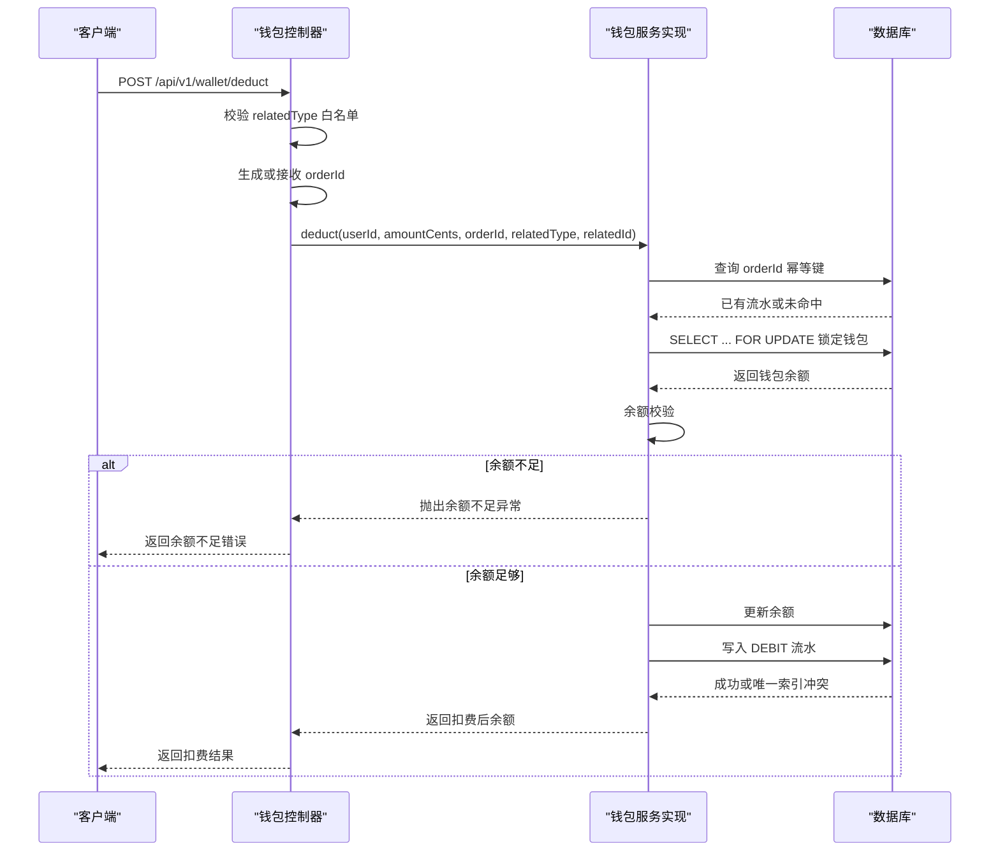
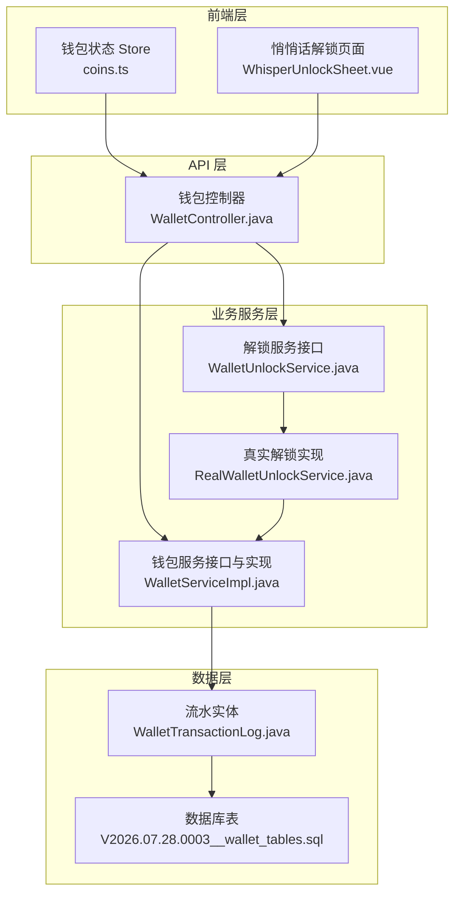
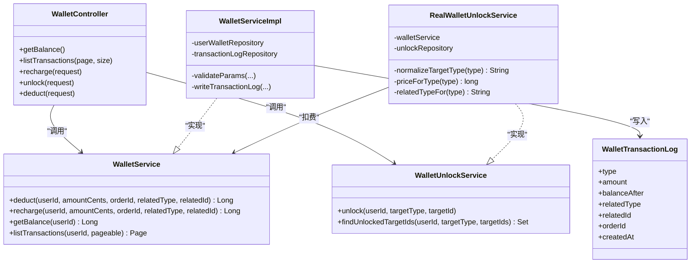

# 虚拟货币状态管理

<cite>
**本文引用的文件**   
- [apps/api/src/main/java/com/campuslove/api/wallet/WalletController.java](file://apps/api/src/main/java/com/campuslove/api/wallet/WalletController.java)
- [apps/api/src/main/java/com/campuslove/api/wallet/WalletServiceImpl.java](file://apps/api/src/main/java/com/campuslove/api/wallet/WalletServiceImpl.java)
- [apps/api/src/main/java/com/campuslove/api/wallet/WalletUnlockService.java](file://apps/api/src/main/java/com/campuslove/api/wallet/WalletUnlockService.java)
- [apps/api/src/main/java/com/campuslove/api/wallet/RealWalletUnlockService.java](file://apps/api/src/main/java/com/campuslove/api/wallet/RealWalletUnlockService.java)
- [apps/api/src/main/java/com/campuslove/api/wallet/WalletTransactionLog.java](file://apps/api/src/main/java/com/campuslove/api/wallet/WalletTransactionLog.java)
- [apps/client/src/stores/coins.ts](file://apps/client/src/stores/coins.ts)
- [apps/client/src/components/discover/WhisperUnlockSheet.vue](file://apps/client/src/components/discover/WhisperUnlockSheet.vue)
- [database/flyway/sql/V2026.07.28.0003__wallet_tables.sql](file://database/flyway/sql/V2026.07.28.0003__wallet_tables.sql)
</cite>

## 目录

1. [引言](#引言)
2. [项目结构](#项目结构)
3. [核心组件](#核心组件)
4. [架构总览](#架构总览)
5. [详细组件分析](#详细组件分析)
6. [依赖关系分析](#依赖关系分析)
7. [性能与并发特性](#性能与并发特性)
8. [故障排查指南](#故障排查指南)
9. [最佳实践与使用示例](#最佳实践与使用示例)
10. [结论](#结论)

## 引言

本文面向交友币虚拟货币状态管理系统，重点围绕以下目标展开：

- 深入解释钱包流水记录 `WalletTransactionItem` 的数据结构，包括交易类型 `CREDIT` / `DEBIT`、金额字段 `amount`、余额变更字段 `balanceAfter`，以及关联业务类型 `relatedType`。
- 说明解锁场景 `UnlockScene`（MESSAGE、VISITORS、LIKES、WHISPER）的定价策略和价格表设计，并明确服务端定价与客户端镜像定价的选择逻辑。
- 文档化幂等性保证机制，包括订单号生成规则、`buildUnlockOrderId` 语义、`orderId` 去重策略，以及数据库唯一索引如何兜底重复调用。
- 梳理解锁目标类型映射 `UNLOCK_TARGET_TYPE`，以及与钱包流水 `relatedType` 的关系。
- 完整描述 `spend` 扣费流程：余额校验、目标类型判断、服务端定价与客户端镜像定价路由、错误处理。
- 覆盖余额查询 `fetchBalance`、流水分页 `transactions` 的实现方式，并提供解锁、余额查询、流水记录的代码级参考路径和使用建议。

该系统由前端客户端与后端 Java API 共同组成：前端通过 Pinia Store 和页面组件发起请求，后端通过控制器暴露 HTTP 接口，服务层实现资金操作、流水持久化和商业化解锁逻辑。

## 项目结构

与虚拟货币状态管理直接相关的代码主要分布在以下位置：

| 层次 | 关键路径 | 职责 |
|---|---|---|
| 前端 | `apps/client/src/stores/coins.ts` | 封装钱包余额、充值、扣费、流水查询等客户端状态与 API 调用 |
| 前端 | `apps/client/src/components/discover/WhisperUnlockSheet.vue` | 悄悄话解锁相关交互与定价展示 |
| 后端控制器 | `apps/api/.../wallet/WalletController.java` | 暴露 `/api/v1/wallet/balance`、`/transactions`、`/recharge`、`/unlock`、`/deduct` 等接口 |
| 后端服务实现 | `apps/api/.../wallet/WalletServiceImpl.java` | 实现余额扣减、充值、余额查询、流水分页、事务与异常处理 |
| 解锁服务接口 | `apps/api/.../wallet/WalletUnlockService.java` | 定义“喜欢我列表 / 访客列表”商业化解锁能力 |
| 解锁服务实现 | `apps/api/.../wallet/RealWalletUnlockService.java` | 真实解锁流程：已解锁放行、按配置单价扣费、写入解锁记录 |
| 流水实体 | `apps/api/.../wallet/WalletTransactionLog.java` | 定义流水表结构、交易类型、业务类型常量、索引与幂等约束 |
| 数据库脚本 | `database/flyway/sql/V2026.07.28.0003__wallet_tables.sql` | 创建钱包表、流水表及索引 |

**图表来源**   
- [apps/client/src/stores/coins.ts](file://apps/client/src/stores/coins.ts)
- [apps/client/src/components/discover/WhisperUnlockSheet.vue](file://apps/client/src/components/discover/WhisperUnlockSheet.vue)
- [apps/api/src/main/java/com/campuslove/api/wallet/WalletController.java](file://apps/api/src/main/java/com/campuslove/api/wallet/WalletController.java)
- [apps/api/src/main/java/com/campuslove/api/wallet/WalletServiceImpl.java](file://apps/api/src/main/java/com/campuslove/api/wallet/WalletServiceImpl.java)
- [apps/api/src/main/java/com/campuslove/api/wallet/RealWalletUnlockService.java](file://apps/api/src/main/java/com/campuslove/api/wallet/RealWalletUnlockService.java)
- [apps/api/src/main/java/com/campuslove/api/wallet/WalletTransactionLog.java](file://apps/api/src/main/java/com/campuslove/api/wallet/WalletTransactionLog.java)

**章节来源**   
- [apps/api/src/main/java/com/campuslove/api/wallet/WalletController.java:1-458](file://apps/api/src/main/java/com/campuslove/api/wallet/WalletController.java#L1-L458)
- [apps/api/src/main/java/com/campuslove/api/wallet/WalletServiceImpl.java:1-365](file://apps/api/src/main/java/com/campuslove/api/wallet/WalletServiceImpl.java#L1-L365)
- [apps/api/src/main/java/com/campuslove/api/wallet/WalletUnlockService.java:1-43](file://apps/api/src/main/java/com/campuslove/api/wallet/WalletUnlockService.java#L1-L43)
- [apps/api/src/main/java/com/campuslove/api/wallet/RealWalletUnlockService.java:1-145](file://apps/api/src/main/java/com/campuslove/api/wallet/RealWalletUnlockService.java#L1-L145)
- [apps/api/src/main/java/com/campuslove/api/wallet/WalletTransactionLog.java:1-262](file://apps/api/src/main/java/com/campuslove/api/wallet/WalletTransactionLog.java#L1-L262)

## 核心组件

### 钱包流水记录结构

钱包流水记录在控制器中通过视图对象暴露给前端，对应后端实体的关键字段如下：

| 字段 | 含义 | 取值或约束 |
|---|---|---|
| `id` | 流水主键 | 自增数字 |
| `type` | 交易类型 | `CREDIT` 表示充值入账；`DEBIT` 表示扣减出账 |
| `amount` | 交易金额 | 单位为分，必须为正数 |
| `balanceAfter` | 交易后余额 | 单位为分，便于审计追溯当前用户余额变化结果 |
| `relatedType` | 关联业务类型 | 例如 `WALLET_RECHARGE`、`VIP_RENEW`、`UNLOCK_LIKED_ME`、`MESSAGE_UNLOCK`、`WHISPER_UNLOCK` 等 |
| `relatedId` | 关联业务实体 ID | 如目标用户 ID、任务编码、订单号等，可为空 |
| `orderId` | 幂等订单号 | 唯一索引，用于防止同一业务请求重复处理 |
| `remark` | 备注 | 包含业务语义与订单号等辅助信息 |
| `createdAt` | 创建时间 | 流水发生时间 |
| `updatedAt` | 更新时间 | 最后修改时间 |

其中：

- `CREDIT` 流水通常出现在充值、奖励入账等增加余额的场景。
- `DEBIT` 流水通常出现在扣费、续费、解锁消费等减少余额的场景。
- `balanceAfter` 是每次写操作后的最终余额，而不是本次变动值；对账时可通过相邻流水差额推算单次变动，但更推荐直接使用该字段作为“某笔交易完成后用户的余额快照”。
- `relatedType` 是区分不同业务的关键维度，例如：
  - `WALLET_RECHARGE`：演示充值入账。
  - `VIP_RENEW`：VIP 自动续费。
  - `UNLOCK_LIKED_ME` / `UNLOCK_VISITOR`：商业化解锁喜欢我列表或访客列表。
  - `MESSAGE_UNLOCK`：客户端直调通用扣费端点解锁私信。
  - `WHISPER_UNLOCK`：悄悄话解锁。
  - `WHISPER_SEND`：悄悄话付费留言发送。

**章节来源**   
- [apps/api/src/main/java/com/campuslove/api/wallet/WalletController.java:330-458](file://apps/api/src/main/java/com/campuslove/api/wallet/WalletController.java#L330-L458)
- [apps/api/src/main/java/com/campuslove/api/wallet/WalletServiceImpl.java:300-365](file://apps/api/src/main/java/com/campuslove/api/wallet/WalletServiceImpl.java#L300-L365)
- [apps/api/src/main/java/com/campuslove/api/wallet/WalletTransactionLog.java:1-262](file://apps/api/src/main/java/com/campuslove/api/wallet/WalletTransactionLog.java#L1-L262)

### 解锁场景与定价策略

系统支持四类解锁场景：

| 解锁场景 | 客户端语义 | 服务端处理路径 | 典型用途 |
|---|---|---|---|
| MESSAGE | 私信解锁 | 客户端通过 `/api/v1/wallet/deduct` 传入 `relatedType=MESSAGE_UNLOCK` | 解锁与某个用户的私信能力 |
| VISITORS | 访客列表解锁 | 服务端商业化解锁接口 `/api/v1/wallet/unlock`，内部使用 `UNLOCK_VISITOR` | 查看访客列表中未授权用户 |
| LIKES | 喜欢我列表解锁 | 服务端商业化解锁接口 `/api/v1/wallet/unlock`，内部使用 `UNLOCK_LIKED_ME` | 查看喜欢我列表中未授权用户 |
| WHISPER | 悄悄话解锁 | 客户端通过 `/api/v1/wallet/deduct` 传入 `relatedType=WHISPER_UNLOCK` | 解锁悄悄话能力 |

需要特别注意：**当前代码库中的商业化解锁服务仅显式支持 `LIKED_ME` 和 `VISITOR` 两种目标类型**，而 `MESSAGE` 和 `WHISPER` 更多是通过通用扣费端点 `/wallet/deduct` 直接消费交友币，并由流水 `relatedType` 表达解锁语义。

商业化解锁的价格来自配置项：

| 配置项 | 默认行为 | 含义 |
|---|---|---|
| `app.unlock-price.liked-me` | 使用 `WalletUnlock.DEFAULT_UNLOCK_PRICE_CENTS` | 喜欢我列表解锁单价（分） |
| `app.unlock-price.visitor` | 使用 `WalletUnlock.DEFAULT_UNLOCK_PRICE_CENTS` | 访客列表解锁单价（分） |

这意味着解锁价格不是硬编码在前端或单一类中，而是通过 Spring 配置注入到 `RealWalletUnlockService` 中。若未来需要扩展 `MESSAGE` / `WHISPER` 的商业化解锁定价，应新增对应的配置项并在解锁服务中补充映射。

**章节来源**   
- [apps/api/src/main/java/com/campuslove/api/wallet/RealWalletUnlockService.java:1-145](file://apps/api/src/main/java/com/campuslove/api/wallet/RealWalletUnlockService.java#L1-L145)
- [apps/api/src/main/java/com/campuslove/api/wallet/WalletUnlockService.java:1-43](file://apps/api/src/main/java/com/campuslove/api/wallet/WalletUnlockService.java#L1-L43)
- [apps/api/src/main/java/com/campuslove/api/wallet/WalletController.java:260-320](file://apps/api/src/main/java/com/campuslove/api/wallet/WalletController.java#L260-L320)

### 幂等性保证机制

系统从三个层面保证幂等：

1. **客户端幂等头**  
   控制器上的幂等注解要求客户端携带 `Idempotency-Key` 请求头，防止网络重试导致重复提交。

2. **服务端 `orderId` 唯一索引**  
   流水表对 `order_id` 建立唯一约束。同一个 `orderId` 重复调用时，第二次插入会触发唯一键冲突；服务层捕获该冲突后重新查询已有流水，返回之前处理的结果。

3. **业务层唯一约束**  
   商业化解锁还依赖 `uk_user_target` 唯一约束，防止同一用户对同一目标重复解锁。

订单号生成规则：

| 场景 | 订单号规则 | 说明 |
|---|---|---|
| 演示充值 | `WALLET-RECHARGE-{UUID}` | 服务端生成随机订单号 |
| 商业化解锁 | `UNLOCK-{targetType}-{targetId}` | 客户端与服务端共享同一语义，避免重复扣费 |
| 通用扣费 | 客户端可传 `orderId`；为空时服务端生成 `UNLOCK-{UUID}` | 建议客户端自行生成稳定幂等键 |
| 消息/悄悄话解锁 | 建议采用 `UNLOCK-MESSAGE-{targetUserId}` 或 `UNLOCK-WHISPER-{targetUserId}` | 控制器注释给出约定格式 |

虽然需求中提到了 `buildUnlockOrderId`，但在当前仓库中未发现名为 `buildUnlockOrderId` 的方法定义。与之最接近的是商业化解锁服务中构造订单号的逻辑：以 `UNLOCK-` 前缀加上目标类型和目标 ID。客户端在调用 `/wallet/deduct` 时也应遵循类似规则，确保同一业务操作不会因重试产生重复扣费。

**图表来源**   
- [apps/api/src/main/java/com/campuslove/api/wallet/WalletController.java:280-360](file://apps/api/src/main/java/com/campuslove/api/wallet/WalletController.java#L280-L360)
- [apps/api/src/main/java/com/campuslove/api/wallet/WalletServiceImpl.java:90-200](file://apps/api/src/main/java/com/campuslove/api/wallet/WalletServiceImpl.java#L90-L200)

**章节来源**   
- [apps/api/src/main/java/com/campuslove/api/wallet/WalletController.java:1-200](file://apps/api/src/main/java/com/campuslove/api/wallet/WalletController.java#L1-L200)
- [apps/api/src/main/java/com/campuslove/api/wallet/WalletServiceImpl.java:1-200](file://apps/api/src/main/java/com/campuslove/api/wallet/WalletServiceImpl.java#L1-L200)
- [apps/api/src/main/java/com/campuslove/api/wallet/WalletTransactionLog.java:1-120](file://apps/api/src/main/java/com/campuslove/api/wallet/WalletTransactionLog.java#L1-L120)

### 解锁目标类型映射与镜像路径选择

#### 解锁目标类型映射

商业化解锁服务将前端传入的目标类型归一化为内部白名单类型：

| 前端目标类型 | 内部归一化类型 | 流水 `relatedType` | 说明 |
|---|---|---|---|
| `LIKED_ME` | `LIKED_ME` | `UNLOCK_LIKED_ME` | 喜欢我列表解锁 |
| `VISITOR` | `VISITOR` | `UNLOCK_VISITOR` | 访客列表解锁 |
| `MESSAGE` | 不经过商业化解锁服务 | `MESSAGE_UNLOCK` | 通过通用扣费端点解锁 |
| `WHISPER` | 不经过商业化解锁服务 | `WHISPER_UNLOCK` | 通过通用扣费端点解锁 |

注意：`MESSAGE` 和 `WHISPER` 在控制器中被允许进入通用扣费端点的客户端白名单，但它们并不走 `RealWalletUnlockService.unlock` 的已解锁检查路径；它们的“已解锁”语义更多依赖对应流水是否存在，以及业务层其他状态。

#### 服务端定价与客户端镜像定价

当前代码库中：

- 商业化解锁 `/wallet/unlock` 的价格完全由服务端配置决定，即 `app.unlock-price.liked-me` 和 `app.unlock-price.visitor`。
- 通用扣费 `/wallet/deduct` 的金额由客户端传入，因此客户端侧存在“镜像定价”的风险：如果客户端本地缓存或硬编码价格与服务端不一致，可能绕过服务端定价策略。
- 控制器的客户端白名单只限制 `relatedType`，不校验金额是否与目标类型匹配；因此，**真正保护定价安全的核心应在业务入口统一计算价格，而不是信任任意客户端传入的金额**。

对于 `MESSAGE` 和 `WHISPER`，当前实现更接近“客户端直接传金额 + 服务端白名单放行”，这类场景更适合改为服务端定价入口，以避免客户端篡改金额。

**章节来源**   
- [apps/api/src/main/java/com/campuslove/api/wallet/RealWalletUnlockService.java:60-145](file://apps/api/src/main/java/com/campuslove/api/wallet/RealWalletUnlockService.java#L60-L145)
- [apps/api/src/main/java/com/campuslove/api/wallet/WalletController.java:240-360](file://apps/api/src/main/java/com/campuslove/api/wallet/WalletController.java#L240-L360)

### spend 方法扣费流程分析

在当前仓库中未发现名为 `spend` 的方法，但与“交友币消费”语义最接近的是控制器中的通用扣费端点 `/wallet/deduct` 和服务层 `WalletServiceImpl.deduct`。其处理流程如下：

1. **参数校验**  
   校验用户 ID、金额、订单号、业务类型非空且金额大于零。
2. **客户端白名单校验**  
   仅允许 `MESSAGE_UNLOCK`、`VISITORS_UNLOCK`、`LIKES_UNLOCK`、`WHISPER_UNLOCK` 四种客户端语义类型。
3. **订单号生成**  
   若客户端未传 `orderId`，服务端生成 `UNLOCK-{UUID}`。
4. **服务层白名单校验**  
   服务层维护更完整的 `DEDUCT_RELATED_TYPE_WHITELIST`，防止伪造业务类型。
5. **幂等检查**  
   先按 `orderId` 查询流水；若命中则直接返回历史 `balanceAfter`。
6. **悲观锁查询钱包**  
   使用数据库行级锁防止并发修改。
7. **余额校验**  
   余额不足时抛出余额不足异常。
8. **扣减余额并写流水**  
   写入 `DEBIT` 流水，包含 `amount`、`balanceAfter`、`relatedType`、`relatedId`、`orderId`。
9. **唯一索引冲突处理**  
   若并发下另一个事务先写入流水，捕获唯一键冲突并重查；若重查命中则返回幂等结果，否则强制回滚。

**图表来源**   
- [apps/api/src/main/java/com/campuslove/api/wallet/WalletController.java:300-360](file://apps/api/src/main/java/com/campuslove/api/wallet/WalletController.java#L300-L360)
- [apps/api/src/main/java/com/campuslove/api/wallet/WalletServiceImpl.java:90-200](file://apps/api/src/main/java/com/campuslove/api/wallet/WalletServiceImpl.java#L90-L200)

**章节来源**   
- [apps/api/src/main/java/com/campuslove/api/wallet/WalletController.java:300-360](file://apps/api/src/main/java/com/campuslove/api/wallet/WalletController.java#L300-L360)
- [apps/api/src/main/java/com/campuslove/api/wallet/WalletServiceImpl.java:90-200](file://apps/api/src/main/java/com/campuslove/api/wallet/WalletServiceImpl.java#L90-L200)

### fetchBalance 余额查询

余额查询通过 `/api/v1/wallet/balance` 暴露：

- 控制器从 JWT 上下文获取当前用户 ID。
- 调用 `WalletService.getBalance`。
- 服务层查询用户钱包；若钱包不存在则返回 `0`，不会自动创建。
- 返回值为分单位，前端展示时需转换为元。

该接口是只读操作，不会创建钱包记录，也不会写入流水。

**章节来源**   
- [apps/api/src/main/java/com/campuslove/api/wallet/WalletController.java:120-160](file://apps/api/src/main/java/com/campuslove/api/wallet/WalletController.java#L120-L160)
- [apps/api/src/main/java/com/campuslove/api/wallet/WalletServiceImpl.java:240-270](file://apps/api/src/main/java/com/campuslove/api/wallet/WalletServiceImpl.java#L240-L270)

### transactions 流水分页

流水分页通过 `/api/v1/wallet/transactions` 暴露：

- 参数：
  - `page`：页码，从 0 开始，默认 0。
  - `size`：每页大小，默认 20，最大 100。
- 返回结构对齐 VIP 账单：`items`、`total`、`page`、`size`、`totalPages`。
- 每条流水映射为 `WalletTransactionItemView`，包含 `id`、`type`、`amount`、`balanceAfter`、`relatedType`、`relatedId`、`orderId`、`remark`、`createdAt`。
- 查询按创建时间倒序，适合账单页从最新流水开始加载。

**章节来源**   
- [apps/api/src/main/java/com/campuslove/api/wallet/WalletController.java:160-200](file://apps/api/src/main/java/com/campuslove/api/wallet/WalletController.java#L160-L200)
- [apps/api/src/main/java/com/campuslove/api/wallet/WalletController.java:330-458](file://apps/api/src/main/java/com/campuslove/api/wallet/WalletController.java#L330-L458)
- [apps/api/src/main/java/com/campuslove/api/wallet/WalletServiceImpl.java:270-300](file://apps/api/src/main/java/com/campuslove/api/wallet/WalletServiceImpl.java#L270-L300)

## 架构总览

虚拟货币状态管理的整体架构可以分为四层：

**图表来源**   
- [apps/client/src/stores/coins.ts](file://apps/client/src/stores/coins.ts)
- [apps/client/src/components/discover/WhisperUnlockSheet.vue](file://apps/client/src/components/discover/WhisperUnlockSheet.vue)
- [apps/api/src/main/java/com/campuslove/api/wallet/WalletController.java](file://apps/api/src/main/java/com/campuslove/api/wallet/WalletController.java)
- [apps/api/src/main/java/com/campuslove/api/wallet/WalletServiceImpl.java](file://apps/api/src/main/java/com/campuslove/api/wallet/WalletServiceImpl.java)
- [apps/api/src/main/java/com/campuslove/api/wallet/WalletUnlockService.java](file://apps/api/src/main/java/com/campuslove/api/wallet/WalletUnlockService.java)
- [apps/api/src/main/java/com/campuslove/api/wallet/RealWalletUnlockService.java](file://apps/api/src/main/java/com/campuslove/api/wallet/RealWalletUnlockService.java)
- [apps/api/src/main/java/com/campuslove/api/wallet/WalletTransactionLog.java](file://apps/api/src/main/java/com/campuslove/api/wallet/WalletTransactionLog.java)
- [database/flyway/sql/V2026.07.28.0003__wallet_tables.sql](file://database/flyway/sql/V2026.07.28.0003__wallet_tables.sql)

## 详细组件分析

### 钱包控制器

钱包控制器承担以下职责：

- 暴露余额查询、流水分页、演示充值、商业化解锁、通用扣费五个核心接口。
- 从认证上下文提取当前用户 ID。
- 对通用扣费的 `relatedType` 做客户端白名单校验。
- 将服务层实体映射为前端视图对象。
- 对演示充值进行开关控制和每日限额控制。

关键接口：

| 接口 | 方法 | 功能 |
|---|---|---|
| `/api/v1/wallet/balance` | GET | 查询当前用户余额 |
| `/api/v1/wallet/transactions` | GET | 分页查询流水 |
| `/api/v1/wallet/recharge` | POST | 演示充值 |
| `/api/v1/wallet/unlock` | POST | 商业化解锁 |
| `/api/v1/wallet/deduct` | POST | 通用扣费 |

**章节来源**   
- [apps/api/src/main/java/com/campuslove/api/wallet/WalletController.java:1-458](file://apps/api/src/main/java/com/campuslove/api/wallet/WalletController.java#L1-L458)

### 钱包服务实现

钱包服务实现是资金操作的核心，提供：

- `deduct`：扣减余额，写 `DEBIT` 流水。
- `recharge`：充值余额，写 `CREDIT` 流水。
- `getBalance`：读取余额。
- `listTransactions`：分页查询流水。
- 内部初始化钱包记录、参数校验、流水写入。

并发安全关键点：

- 使用数据库悲观锁锁定用户钱包行。
- 使用 `orderId` 唯一索引保证幂等。
- 使用 Spring 事务保证余额更新和流水写入原子提交。
- 对唯一键冲突进行特殊处理：命中则幂等返回，未命中则强制回滚。

**章节来源**   
- [apps/api/src/main/java/com/campuslove/api/wallet/WalletServiceImpl.java:1-365](file://apps/api/src/main/java/com/campuslove/api/wallet/WalletServiceImpl.java#L1-L365)

### 商业化解锁服务

解锁服务接口定义了：

- `unlock`：执行解锁，已解锁直接返回，未解锁扣费并记录。
- `findUnlockedTargetIds`：批量查询已解锁目标 ID。

真实实现负责：

- 白名单校验目标类型。
- 查询是否已解锁。
- 根据配置计算价格。
- 调用钱包服务扣费。
- 写入解锁记录。
- 处理并发重复解锁的唯一键冲突。

**章节来源**   
- [apps/api/src/main/java/com/campuslove/api/wallet/WalletUnlockService.java:1-43](file://apps/api/src/main/java/com/campuslove/api/wallet/WalletUnlockService.java#L1-L43)
- [apps/api/src/main/java/com/campuslove/api/wallet/RealWalletUnlockService.java:1-145](file://apps/api/src/main/java/com/campuslove/api/wallet/RealWalletUnlockService.java#L1-L145)

### 流水实体与数据库约束

流水实体定义了交易类型枚举、业务类型常量、数据库表结构、索引和唯一约束。重要约束包括：

- `order_id` 唯一索引：保证幂等。
- `user_id` + `created_at` 索引：加速用户流水分页。
- `related_type` 索引：便于按业务类型对账。
- `related_id` 索引：便于按业务实体反查。

**章节来源**   
- [apps/api/src/main/java/com/campuslove/api/wallet/WalletTransactionLog.java:1-262](file://apps/api/src/main/java/com/campuslove/api/wallet/WalletTransactionLog.java#L1-L262)
- [database/flyway/sql/V2026.07.28.0003__wallet_tables.sql](file://database/flyway/sql/V2026.07.28.0003__wallet_tables.sql)

## 依赖关系分析

**图表来源**   
- [apps/api/src/main/java/com/campuslove/api/wallet/WalletController.java](file://apps/api/src/main/java/com/campuslove/api/wallet/WalletController.java)
- [apps/api/src/main/java/com/campuslove/api/wallet/WalletServiceImpl.java](file://apps/api/src/main/java/com/campuslove/api/wallet/WalletServiceImpl.java)
- [apps/api/src/main/java/com/campuslove/api/wallet/WalletUnlockService.java](file://apps/api/src/main/java/com/campuslove/api/wallet/WalletUnlockService.java)
- [apps/api/src/main/java/com/campuslove/api/wallet/RealWalletUnlockService.java](file://apps/api/src/main/java/com/campuslove/api/wallet/RealWalletUnlockService.java)
- [apps/api/src/main/java/com/campuslove/api/wallet/WalletTransactionLog.java](file://apps/api/src/main/java/com/campuslove/api/wallet/WalletTransactionLog.java)

**章节来源**   
- [apps/api/src/main/java/com/campuslove/api/wallet/WalletController.java:1-458](file://apps/api/src/main/java/com/campuslove/api/wallet/WalletController.java#L1-L458)
- [apps/api/src/main/java/com/campuslove/api/wallet/WalletServiceImpl.java:1-365](file://apps/api/src/main/java/com/campuslove/api/wallet/WalletServiceImpl.java#L1-L365)
- [apps/api/src/main/java/com/campuslove/api/wallet/WalletUnlockService.java:1-43](file://apps/api/src/main/java/com/campuslove/api/wallet/WalletUnlockService.java#L1-L43)
- [apps/api/src/main/java/com/campuslove/api/wallet/RealWalletUnlockService.java:1-145](file://apps/api/src/main/java/com/campuslove/api/wallet/RealWalletUnlockService.java#L1-L145)

## 性能与并发特性

### 并发特性

- 钱包余额更新使用数据库悲观锁，同一用户同时只有一个事务能修改余额。
- 流水写入通过 `orderId` 唯一索引避免重复入账或扣款。
- 商业化解锁通过 `uk_user_target` 唯一约束避免重复解锁。
- 演示充值使用 Redis 计数，Redis 不可用时拒绝服务而非降级到本地内存，防止多实例突破限额。

### 性能特性

- 流水分页使用数据库索引 `idx_wallet_log_user_created`，按用户和时间排序。
- 余额查询是简单单行读取，无副作用。
- 流水分页默认每页 20 条，最大 100 条，避免一次性加载过多数据。

### 优化建议

- 若高频场景需要频繁展示用户余额，可在应用层引入短期缓存，但需考虑过期一致性和并发更新时的刷新策略。
- 若流水量增长很快，可考虑按月或按用户归档历史流水。
- 对通用扣费端点建议进一步收敛价格计算逻辑，避免客户端镜像定价成为安全漏洞。

[本节为通用性能讨论，不直接分析具体文件]

## 故障排查指南

### 常见问题

| 问题 | 可能原因 | 排查建议 |
|---|---|---|
| 解锁重复扣费 | 客户端未正确复用 `orderId` | 检查客户端订单号生成逻辑 |
| 扣费返回余额不足 | 用户余额小于请求金额 | 检查 `fetchBalance` 和扣费顺序 |
| 流水幂等冲突但结果为空 | 唯一键冲突并非 `order_id` 冲突 | 查看服务层强制回滚日志 |
| 演示充值被拒绝 | 开关关闭或每日限额超限 | 检查配置和 Redis 计数 |
| 解锁目标类型不支持 | 传入类型不在白名单 | 检查 `normalizeTargetType` |
| 流水分页为空 | 用户尚未产生任何流水 | 正常现象，前端应显示空账单 |

### 关键日志

- 扣费幂等命中日志。
- 余额不足日志。
- 唯一索引冲突重查日志。
- 强制回滚日志。
- 解锁已命中或并发冲突日志。
- 演示充值计数失败日志。

**章节来源**   
- [apps/api/src/main/java/com/campuslove/api/wallet/WalletServiceImpl.java:120-200](file://apps/api/src/main/java/com/campuslove/api/wallet/WalletServiceImpl.java#L120-L200)
- [apps/api/src/main/java/com/campuslove/api/wallet/WalletServiceImpl.java:200-365](file://apps/api/src/main/java/com/campuslove/api/wallet/WalletServiceImpl.java#L200-L365)
- [apps/api/src/main/java/com/campuslove/api/wallet/RealWalletUnlockService.java:80-145](file://apps/api/src/main/java/com/campuslove/api/wallet/RealWalletUnlockService.java#L80-L145)

## 最佳实践与使用示例

### 解锁功能

推荐做法：

1. 对 `LIKED_ME` / `VISITOR` 使用 `/api/v1/wallet/unlock`，让服务端统一计算价格。
2. 对 `MESSAGE` / `WHISPER`，若仍走 `/api/v1/wallet/deduct`，应确保：
   - 客户端生成的 `orderId` 稳定且唯一。
   - `relatedType` 使用 `MESSAGE_UNLOCK` 或 `WHISPER_UNLOCK`。
   - `relatedId` 填写目标用户 ID。
3. 扣费成功后刷新余额并更新本地解锁状态。

参考路径：

- [apps/api/src/main/java/com/campuslove/api/wallet/WalletController.java:260-360](file://apps/api/src/main/java/com/campuslove/api/wallet/WalletController.java#L260-L360)
- [apps/api/src/main/java/com/campuslove/api/wallet/RealWalletUnlockService.java:60-145](file://apps/api/src/main/java/com/campuslove/api/wallet/RealWalletUnlockService.java#L60-L145)
- [apps/client/src/components/discover/WhisperUnlockSheet.vue](file://apps/client/src/components/discover/WhisperUnlockSheet.vue)

### 余额查询

推荐做法：

1. 在解锁前调用 `/api/v1/wallet/balance` 预检余额。
2. 余额单位是分，展示时除以 100 转为元。
3. 余额查询不应自动创建钱包，也不应产生副作用。

参考路径：

- [apps/api/src/main/java/com/campuslove/api/wallet/WalletController.java:120-160](file://apps/api/src/main/java/com/campuslove/api/wallet/WalletController.java#L120-L160)
- [apps/api/src/main/java/com/campuslove/api/wallet/WalletServiceImpl.java:240-270](file://apps/api/src/main/java/com/campuslove/api/wallet/WalletServiceImpl.java#L240-L270)
- [apps/client/src/stores/coins.ts](file://apps/client/src/stores/coins.ts)

### 流水记录

推荐做法：

1. 使用 `/api/v1/wallet/transactions?page=0&size=20` 拉取最新流水。
2. 使用 `type=CREDIT` 筛选充值入账。
3. 使用 `type=DEBIT` 筛选扣费出账。
4. 使用 `relatedType` 区分不同业务场景。
5. 使用 `orderId` 对账单笔业务。
6. 前端应根据 `createdAt` 倒序渲染账单。

参考路径：

- [apps/api/src/main/java/com/campuslove/api/wallet/WalletController.java:160-200](file://apps/api/src/main/java/com/campuslove/api/wallet/WalletController.java#L160-L200)
- [apps/api/src/main/java/com/campuslove/api/wallet/WalletServiceImpl.java:270-300](file://apps/api/src/main/java/com/campuslove/api/wallet/WalletServiceImpl.java#L270-L300)
- [apps/api/src/main/java/com/campuslove/api/wallet/WalletTransactionLog.java:1-262](file://apps/api/src/main/java/com/campuslove/api/wallet/WalletTransactionLog.java#L1-L262)
- [apps/client/src/stores/coins.ts](file://apps/client/src/stores/coins.ts)

### 幂等键生成建议

建议客户端在解锁或扣费时生成稳定的幂等键：

| 场景 | 建议 `orderId` 格式 |
|---|---|
| 解锁喜欢我列表 | `UNLOCK-LIKED_ME-{targetUserId}` |
| 解锁访客列表 | `UNLOCK-VISITOR-{targetUserId}` |
| 解锁私信 | `UNLOCK-MESSAGE-{targetUserId}` |
| 解锁悄悄话 | `UNLOCK-WHISPER-{targetUserId}` |
| 通用重试场景 | 使用业务请求 ID，避免每次重试生成新 ID |

注意：若客户端无法保证幂等键稳定，应避免在服务端自动生成 UUID 后返回给客户端继续重试；更稳妥的方式是由客户端生成一次性的业务请求 ID 并透传到服务端。

**章节来源**   
- [apps/api/src/main/java/com/campuslove/api/wallet/WalletController.java:300-360](file://apps/api/src/main/java/com/campuslove/api/wallet/WalletController.java#L300-L360)
- [apps/api/src/main/java/com/campuslove/api/wallet/WalletServiceImpl.java:90-200](file://apps/api/src/main/java/com/campuslove/api/wallet/WalletServiceImpl.java#L90-L200)

## 结论

交友币虚拟货币状态管理系统通过控制器、服务层、解锁服务和流水实体形成清晰的分层架构。核心保障在于：

- 流水结构统一，`CREDIT` / `DEBIT`、`amount`、`balanceAfter`、`relatedType` 构成对账和审计基础。
- 商业化解锁由服务端定价，避免客户端镜像定价带来的安全风险。
- 幂等性通过客户端幂等头、服务端 `orderId` 唯一索引和业务层唯一约束三重保障。
- 通用扣费端点需配合严格的白名单和定价策略，避免业务类型伪造和金额篡改。
- 余额查询和流水分页提供稳定的只读能力，支撑前端钱包、账单和解锁状态展示。

未来若扩展 `MESSAGE` / `WHISPER` 的商业化解锁，建议将其纳入服务端定价入口，并与现有 `UNLOCK_TARGET_TYPE` 映射保持一致，从而降低客户端镜像定价风险，提升系统安全性和一致性。