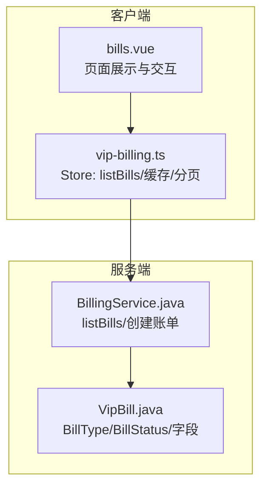
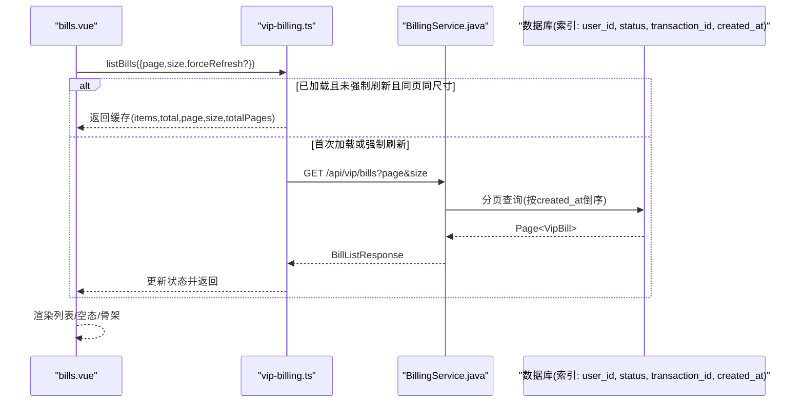
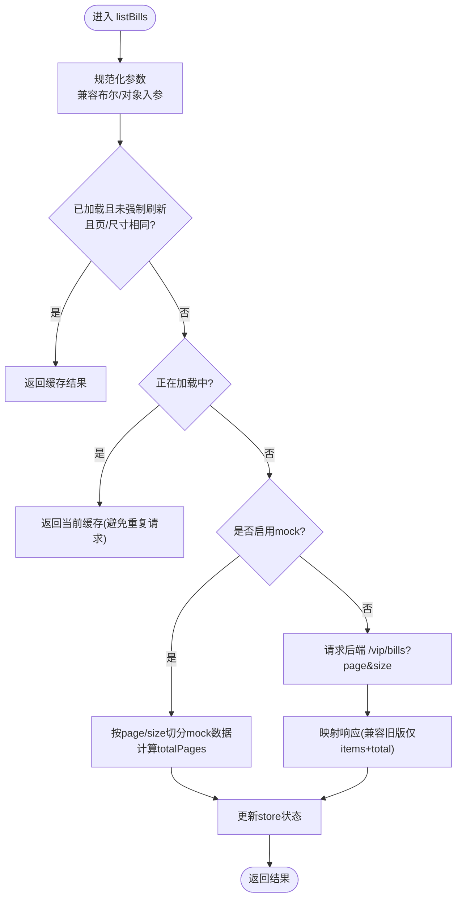
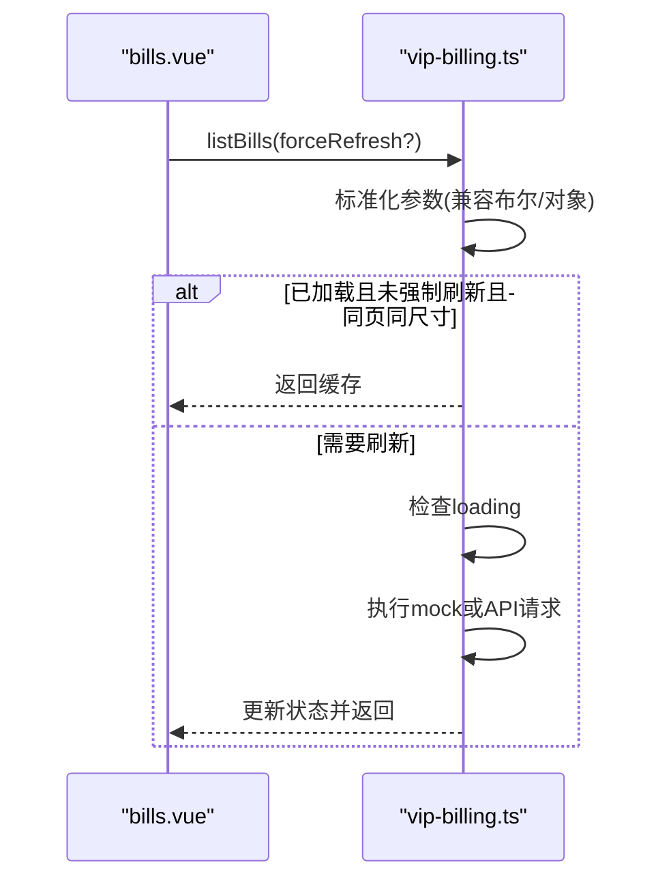
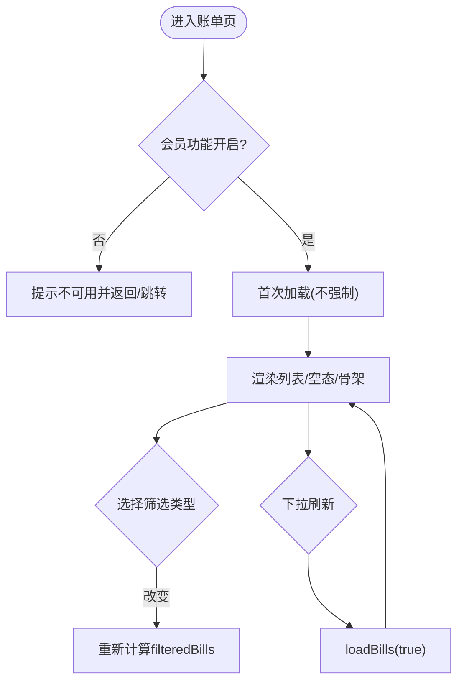
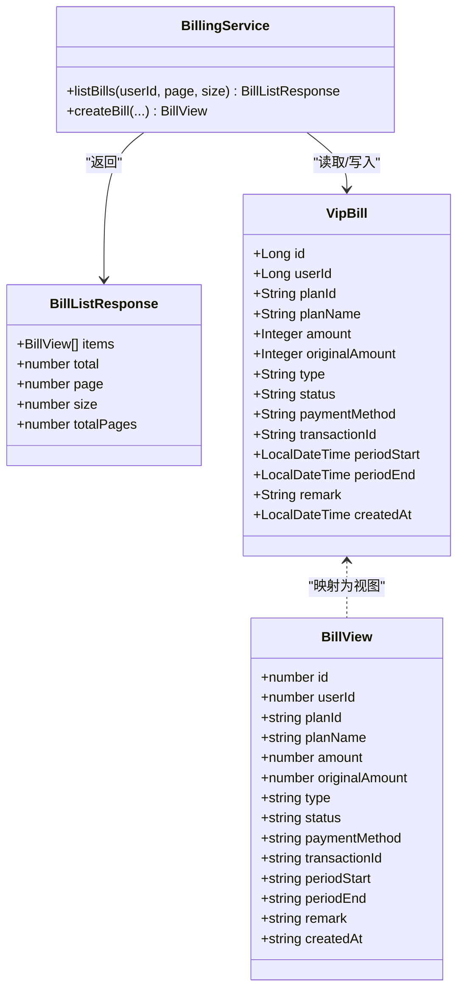
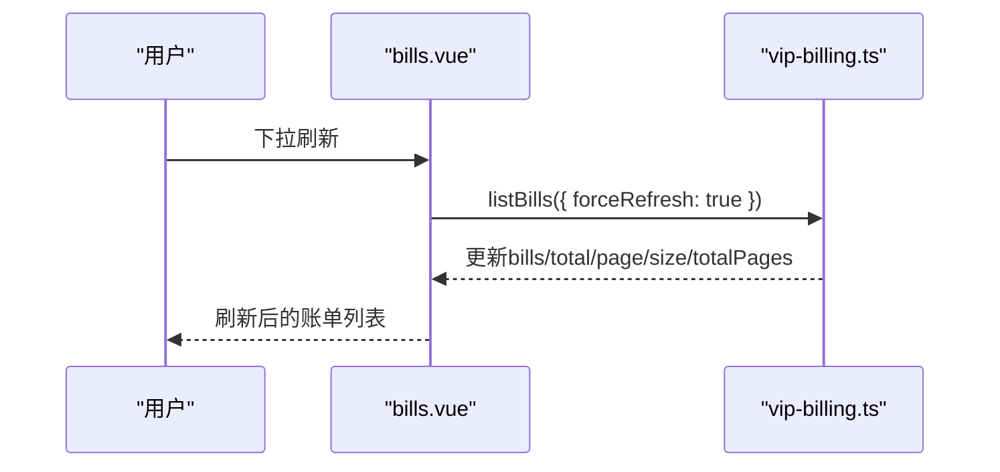

# 账单管理状态

<cite>
**本文引用的文件**
- [apps/client/src/stores/vip-billing.ts](file://apps/client/src/stores/vip-billing.ts)
- [apps/client/src/subpackages/vip/bills.vue](file://apps/client/src/subpackages/vip/bills.vue)
- [apps/api/src/main/java/com/campuslove/api/vip/BillingService.java](file://apps/api/src/main/java/com/campuslove/api/vip/BillingService.java)
- [apps/api/src/main/java/com/campuslove/api/entity/VipBill.java](file://apps/api/src/main/java/com/campuslove/api/entity/VipBill.java)
</cite>

## 目录
1. [简介](#简介)
2. [项目结构](#项目结构)
3. [核心组件](#核心组件)
4. [架构总览](#架构总览)
5. [详细组件分析](#详细组件分析)
6. [依赖关系分析](#依赖关系分析)
7. [性能考虑](#性能考虑)
8. [故障排查指南](#故障排查指南)
9. [结论](#结论)
10. [附录：使用示例与场景](#附录使用示例与场景)

## 简介
本技术文档围绕 VIP 账单管理状态系统，聚焦客户端 Store、页面渲染与服务端查询的完整链路。重点解析以下方面：
- 数据结构：BillView、BillListResponse 的字段含义与用途
- 枚举与业务语义：BillType（SUBSCRIBE/RENEW/REFUND）与 BillStatus（SUCCESS/FAILED/REFUNDED）的业务含义
- 分页机制：BillListParams、page/pageSize 的分页逻辑与 totalPages 计算
- Mock 数据：buildMockBills 生成的测试数据及 toLocalIso 相对时间生成逻辑
- 兼容性设计：listBills 方法的布尔参数 vs 对象参数兼容策略
- 缓存与刷新：loaded 标志与 forceRefresh 强制刷新逻辑
- 加载状态、错误处理与 API 响应映射流程
- 前端渲染：账单列表展示、筛选过滤、下拉刷新与导航行为

## 项目结构
本功能横跨前端与后端两部分：
- 前端（客户端）
  - 状态与数据获取：stores/vip-billing.ts
  - 页面展示与交互：subpackages/vip/bills.vue
- 后端（API）
  - 服务层：vip/BillingService.java（含 listBills 分页查询、createBill 写入等）
  - 实体定义：entity/VipBill.java（包含 BillType、BillStatus 枚举与字段映射）

**图示来源**
- [apps/client/src/stores/vip-billing.ts:1-254](file://apps/client/src/stores/vip-billing.ts#L1-L254)
- [apps/client/src/subpackages/vip/bills.vue:1-536](file://apps/client/src/subpackages/vip/bills.vue#L1-L536)
- [apps/api/src/main/java/com/campuslove/api/vip/BillingService.java:1-360](file://apps/api/src/main/java/com/campuslove/api/vip/BillingService.java#L1-L360)
- [apps/api/src/main/java/com/campuslove/api/entity/VipBill.java:1-200](file://apps/api/src/main/java/com/campuslove/api/entity/VipBill.java#L1-L200)

**章节来源**
- [apps/client/src/stores/vip-billing.ts:1-254](file://apps/client/src/stores/vip-billing.ts#L1-L254)
- [apps/client/src/subpackages/vip/bills.vue:1-536](file://apps/client/src/subpackages/vip/bills.vue#L1-L536)
- [apps/api/src/main/java/com/campuslove/api/vip/BillingService.java:1-360](file://apps/api/src/main/java/com/campuslove/api/vip/BillingService.java#L1-L360)
- [apps/api/src/main/java/com/campuslove/api/entity/VipBill.java:1-200](file://apps/api/src/main/java/com/campuslove/api/entity/VipBill.java#L1-L200)

## 核心组件
- Store（vip-billing.ts）
  - 提供 listBills(params) 统一入口，支持分页、缓存、强制刷新
  - 维护 bills、total、page、size、totalPages、loading、loaded 等响应式状态
  - 在 mock 模式下使用 buildMockBills() 生成按相对时间的账单数据
- 页面（bills.vue）
  - 负责类型筛选（ALL/SUBSCRIBE/RENEW/REFUND）、下拉刷新、空态与骨架屏展示
  - 将金额由分转元显示，日期格式化输出
- 服务层（BillingService.java）
  - listBills(userId, page, size) 返回分页结果，按 created_at 倒序
  - createBill 用于支付成功后写账，校验并记录 periodStart/periodEnd
- 实体（VipBill.java）
  - 定义 BillType 与 BillStatus 枚举，以及账单字段映射

**章节来源**
- [apps/client/src/stores/vip-billing.ts:1-254](file://apps/client/src/stores/vip-billing.ts#L1-L254)
- [apps/client/src/subpackages/vip/bills.vue:1-536](file://apps/client/src/subpackages/vip/bills.vue#L1-L536)
- [apps/api/src/main/java/com/campuslove/api/vip/BillingService.java:1-360](file://apps/api/src/main/java/com/campuslove/api/vip/BillingService.java#L1-L360)
- [apps/api/src/main/java/com/campuslove/api/entity/VipBill.java:1-200](file://apps/api/src/main/java/com/campuslove/api/entity/VipBill.java#L1-L200)

## 架构总览
客户端通过 Store 发起账单列表请求；在服务端由 BillingService 执行分页查询并按需转换为视图对象返回。页面根据 Store 暴露的状态进行渲染与交互。

**图示来源**
- [apps/client/src/stores/vip-billing.ts:1-254](file://apps/client/src/stores/vip-billing.ts#L1-L254)
- [apps/api/src/main/java/com/campuslove/api/vip/BillingService.java:201-360](file://apps/api/src/main/java/com/campuslove/api/vip/BillingService.java#L201-L360)
- [apps/client/src/subpackages/vip/bills.vue:1-536](file://apps/client/src/subpackages/vip/bills.vue#L1-L536)

## 详细组件分析

### 数据结构：BillView 与 BillListResponse
- BillView
  - id：账单唯一标识
  - userId：用户 ID
  - planId/planName：套餐标识与名称（冗余便于历史展示）
  - amount/originalAmount：实付金额与原价（单位：分），用于折扣展示
  - type：SUBSCRIBE/RENEW/REFUND
  - status：SUCCESS/FAILED/REFUNDED
  - paymentMethod：支付方式（如 WECHAT/ALIPAY）
  - transactionId：第三方交易号
  - periodStart/periodEnd：VIP 有效期起止时间（ISO 字符串）
  - remark：备注信息
  - createdAt：账单创建时间
- BillListResponse
  - items：当前页账单集合
  - total：总记录数
  - page：当前页码（从 0 开始）
  - size：每页大小
  - totalPages：总页数

业务含义说明：
- BillType
  - SUBSCRIBE：订阅（首次开通）
  - RENEW：续费
  - REFUND：退款
- BillStatus
  - SUCCESS：成功
  - FAILED：失败
  - REFUNDED：已退款

**章节来源**
- [apps/client/src/stores/vip-billing.ts:1-120](file://apps/client/src/stores/vip-billing.ts#L1-L120)
- [apps/api/src/main/java/com/campuslove/api/entity/VipBill.java:1-200](file://apps/api/src/main/java/com/campuslove/api/entity/VipBill.java#L1-L200)

### 分页机制：BillListParams、page/pageSize 与 totalPages
- BillListParams
  - page：页码（默认 0）
  - size：每页大小（默认 20，最大 100）
  - forceRefresh：是否强制刷新（忽略缓存）
- 分页逻辑
  - 客户端 store 在 mock 模式下使用 requestedPage * requestedSize 作为切片起点，end = start + size
  - 总页数计算：Math.max(1, Math.ceil(totalCount / requestedSize))
  - 真实模式：调用后端 GET /api/vip/bills?page=...&size=...，后端返回包含 total、page、size、totalPages 的响应
  - 兼容性：若后端仅返回 items 与 total，store 会回退设置 page、size、totalPages 为合理默认值
- 服务端实现
  - 使用 PageRequest.of(page, size) 构建分页
  - 按 created_at 倒序分页查询，返回 Page<VipBill>，再转换为 List<BillView> 与 BillListResponse

**图示来源**
- [apps/client/src/stores/vip-billing.ts:120-254](file://apps/client/src/stores/vip-billing.ts#L120-L254)
- [apps/api/src/main/java/com/campuslove/api/vip/BillingService.java:201-360](file://apps/api/src/main/java/com/campuslove/api/vip/BillingService.java#L201-L360)

**章节来源**
- [apps/client/src/stores/vip-billing.ts:120-254](file://apps/client/src/stores/vip-billing.ts#L120-L254)
- [apps/api/src/main/java/com/campuslove/api/vip/BillingService.java:201-360](file://apps/api/src/main/java/com/campuslove/api/vip/BillingService.java#L201-L360)

### Mock 数据与相对时间生成：buildMockBills 与 toLocalIso
- buildMockBills
  - 生成多条测试账单，覆盖订阅、续费、退款场景
  - 包含金额、原价、支付方式、交易号、有效期区间、备注与创建时间
- toLocalIso
  - 以当前时间为基准，按 offsetDays 生成 ISO 格式的本地时间字符串
  - 采用 pad 补齐两位数字，保证格式稳定
  - 目的：避免硬编码日期随时间过期，使测试数据始终“新鲜”

使用建议：
- 开发阶段启用 mock 时，可通过调整 offsetDays 构造不同时间跨度的账单数据
- 生产环境关闭 mock，直接走后端接口

**章节来源**
- [apps/client/src/stores/vip-billing.ts:1-120](file://apps/client/src/stores/vip-billing.ts#L1-L120)

### listBills 兼容性设计、缓存与 forceRefresh
- 兼容性
  - 接受两种入参：
    - 布尔：listBills(true/false)，表示是否强制刷新
    - 对象：listBills({ page, size, forceRefresh })，支持分页
  - 内部自动将布尔转为对象参数，确保向后兼容
- 缓存策略
  - loaded 标志：首次加载后标记为 true
  - 当 loaded=true 且未强制刷新且 page/size 未变化时，直接返回缓存
- 强制刷新
  - forceRefresh=true 时绕过缓存，重新拉取最新数据
- 并发保护
  - loading=true 时直接返回当前缓存，避免重复请求

**图示来源**
- [apps/client/src/stores/vip-billing.ts:120-254](file://apps/client/src/stores/vip-billing.ts#L120-L254)

**章节来源**
- [apps/client/src/stores/vip-billing.ts:120-254](file://apps/client/src/stores/vip-billing.ts#L120-L254)

### 加载状态、错误处理与 API 响应映射
- 加载状态
  - loading：请求期间为 true，完成后置 false
  - 页面在 isLoading && isEmpty 时显示骨架/加载中提示
- 错误处理
  - 页面捕获异常并 toast 提示，避免崩溃
  - 后端对非法参数抛出异常，统一转换为 HTTP 错误
- 响应映射
  - 优先使用后端返回的 items、total、page、size、totalPages
  - 若后端仅返回 items 与 total，则回退设置 page、size、totalPages 为合理默认值，保证 UI 正常渲染

**章节来源**
- [apps/client/src/subpackages/vip/bills.vue:1-200](file://apps/client/src/subpackages/vip/bills.vue#L1-L200)
- [apps/client/src/stores/vip-billing.ts:201-254](file://apps/client/src/stores/vip-billing.ts#L201-L254)
- [apps/api/src/main/java/com/campuslove/api/vip/BillingService.java:201-360](file://apps/api/src/main/java/com/campuslove/api/vip/BillingService.java#L201-L360)

### 账单列表渲染、筛选与刷新操作
- 筛选
  - 支持 ALL/SUBSCRIBE/RENEW/REFUND 四类筛选
  - 通过 computed 过滤当前 store.bills，实现实时切换
- 渲染
  - 卡片展示计划名、金额、原价、有效期、支付方式、交易号、备注、创建时间
  - 金额由分转元显示，日期格式化输出
- 刷新
  - 下拉触发 onPullDownRefresh → loadBills(true) 强制刷新
  - onShow 中首次进入页面也触发加载
- 导航
  - 返回上一页或兜底跳转至个人主页

**图示来源**
- [apps/client/src/subpackages/vip/bills.vue:1-200](file://apps/client/src/subpackages/vip/bills.vue#L1-L200)
- [apps/client/src/subpackages/vip/bills.vue:201-536](file://apps/client/src/subpackages/vip/bills.vue#L201-L536)

**章节来源**
- [apps/client/src/subpackages/vip/bills.vue:1-536](file://apps/client/src/subpackages/vip/bills.vue#L1-L536)

## 依赖关系分析
- 前端依赖
  - bills.vue 依赖 vip-billing.ts 暴露的响应式状态与方法
  - 页面使用 uni-app 生命周期与 i18n 能力
- 后端依赖
  - BillingService 依赖 VipBillRepository、PaymentCallbackLogRepository、WalletService、PromoCodeService（可选注入）
  - 实体 VipBill 与数据库表 vip_bills 严格对应，并使用索引优化查询

**图示来源**
- [apps/client/src/stores/vip-billing.ts:1-120](file://apps/client/src/stores/vip-billing.ts#L1-L120)
- [apps/api/src/main/java/com/campuslove/api/vip/BillingService.java:1-360](file://apps/api/src/main/java/com/campuslove/api/vip/BillingService.java#L1-L360)
- [apps/api/src/main/java/com/campuslove/api/entity/VipBill.java:1-200](file://apps/api/src/main/java/com/campuslove/api/entity/VipBill.java#L1-L200)

**章节来源**
- [apps/client/src/stores/vip-billing.ts:1-120](file://apps/client/src/stores/vip-billing.ts#L1-L120)
- [apps/api/src/main/java/com/campuslove/api/vip/BillingService.java:1-360](file://apps/api/src/main/java/com/campuslove/api/vip/BillingService.java#L1-L360)
- [apps/api/src/main/java/com/campuslove/api/entity/VipBill.java:1-200](file://apps/api/src/main/java/com/campuslove/api/entity/VipBill.java#L1-L200)

## 性能考虑
- 分页查询
  - 后端使用 PageRequest 限制单次返回量，避免全量数据膨胀
  - 使用 created_at 索引提升排序与分页性能
- 缓存与刷新
  - 前端基于 loaded 与 forceRefresh 控制缓存命中，减少不必要请求
  - 同一页同尺寸下复用缓存，降低网络开销
- Mock 模式
  - 开发期使用内存切片模拟分页，避免后端压力
- 错误快速失败
  - 参数校验失败立即返回，缩短无效请求路径

[本节为通用指导，无需特定文件引用]

## 故障排查指南
- 页面一直显示“暂无账单”
  - 检查 featureFlags.membershipEnabled 是否开启
  - 确认 onShow 是否正确触发 loadBills()
  - 查看 store.loading 与 store.loaded 状态变化
- 刷新无效
  - 确认传入的 forceRefresh 是否为 true
  - 检查是否处于 loading 状态导致被拦截
- 后端报错
  - 关注非法参数（userId、page、size）导致的 400 错误
  - 数据库访问异常会被包装为运行时异常并返回错误信息
- 金额显示异常
  - 确认前端将分转为元显示
  - 核对后端 amount/originalAmount 字段是否正确填充

**章节来源**
- [apps/client/src/subpackages/vip/bills.vue:1-200](file://apps/client/src/subpackages/vip/bills.vue#L1-L200)
- [apps/client/src/stores/vip-billing.ts:201-254](file://apps/client/src/stores/vip-billing.ts#L201-L254)
- [apps/api/src/main/java/com/campuslove/api/vip/BillingService.java:201-360](file://apps/api/src/main/java/com/campuslove/api/vip/BillingService.java#L201-L360)

## 结论
该账单管理状态系统通过清晰的数据结构与分层设计，实现了稳定的分页查询、灵活的缓存与刷新策略，以及友好的前端渲染体验。后端通过严格的参数校验与索引优化保障了查询性能与一致性。前后端协同提供了可扩展的账单管理能力，便于后续扩展更多筛选条件与报表功能。

[本节为总结性内容，无需特定文件引用]

## 附录：使用示例与场景
- 首次进入账单页
  - 触发 onShow → loadBills() → listBills(false)
  - 若未加载过，请求后端或 mock 数据并渲染
- 下拉刷新
  - 触发 onPullDownRefresh → loadBills(true) → listBills({ forceRefresh: true })
  - 强制刷新并更新列表
- 切换筛选类型
  - 点击筛选 chip → 更新 filterType → computed 重新计算 filteredBills
- 分页导航
  - 在外部组件中调用 listBills({ page, size })，配合 store.page/store.size 更新状态
  - 根据返回的 total、totalPages 计算下一页按钮可用性

**图示来源**
- [apps/client/src/subpackages/vip/bills.vue:1-200](file://apps/client/src/subpackages/vip/bills.vue#L1-L200)
- [apps/client/src/stores/vip-billing.ts:120-254](file://apps/client/src/stores/vip-billing.ts#L120-L254)