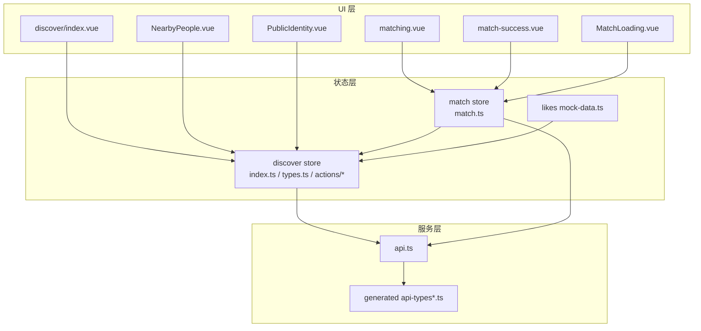
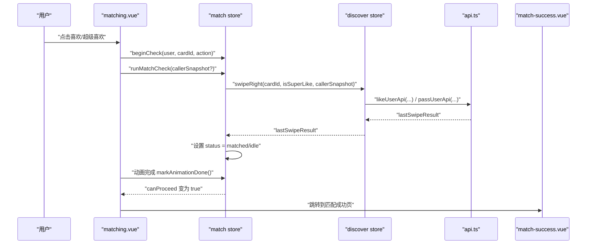
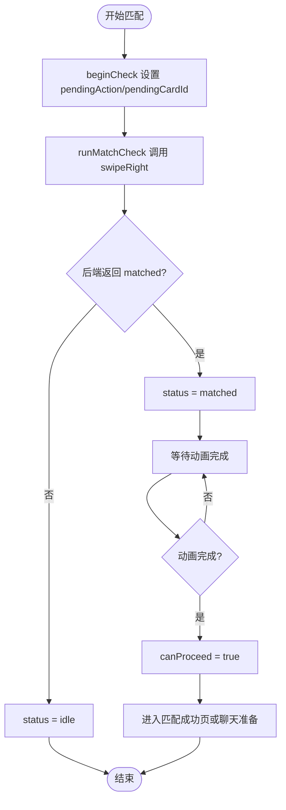
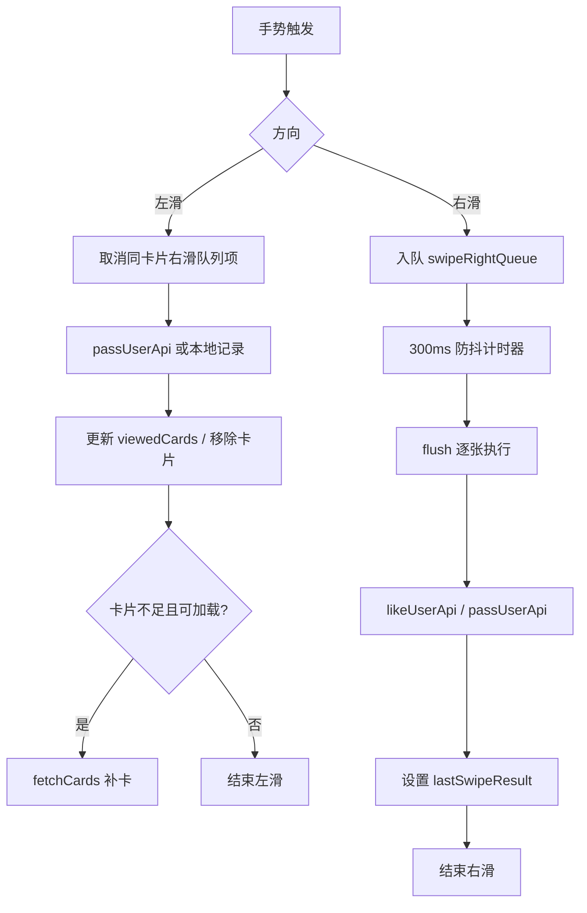
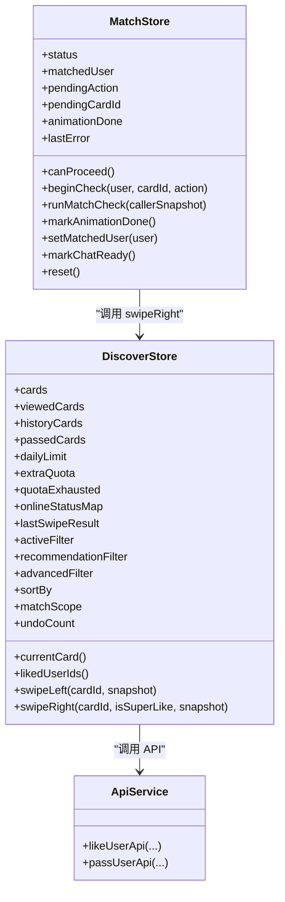

# 发现匹配状态

<cite>
**本文引用的文件**   
- [apps/client/src/stores/match.ts](file://apps/client/src/stores/match.ts)
- [apps/client/src/stores/discover/index.ts](file://apps/client/src/stores/discover/index.ts)
- [apps/client/src/stores/discover/types.ts](file://apps/client/src/stores/discover/types.ts)
- [apps/client/src/stores/discover/actions/swipe.ts](file://apps/client/src/stores/discover/actions/swipe.ts)
- [apps/client/src/subpackages/discover-extra/discover/matching.vue](file://apps/client/src/subpackages/discover-extra/discover/matching.vue)
- [apps/client/src/subpackages/discover-extra/discover/match-success.vue](file://apps/client/src/subpackages/discover-extra/discover/match-success.vue)
- [apps/client/src/components/match/MatchLoading.vue](file://apps/client/src/components/match/MatchLoading.vue)
- [apps/client/src/pages/discover/index.vue](file://apps/client/src/pages/discover/index.vue)
- [apps/client/src/components/home/NearbyPeople.vue](file://apps/client/src/components/home/NearbyPeople.vue)
- [apps/client/src/components/profile/public/PublicIdentity.vue](file://apps/client/src/components/profile/public/PublicIdentity.vue)
- [apps/client/src/services/api.ts](file://apps/client/src/services/api.ts)
- [apps/client/src/stores/likes/mock-data.ts](file://apps/client/src/stores/likes/mock-data.ts)
</cite>

## 目录
1. [引言](#引言)
2. [项目结构与边界](#项目结构与边界)
3. [核心状态模型](#核心状态模型)
4. [架构总览](#架构总览)
5. [关键组件与流程分析](#关键组件与流程分析)
6. [依赖关系分析](#依赖关系分析)
7. [性能与实时性](#性能与实时性)
8. [调试、监控与异常处理](#调试监控与异常处理)
9. [A/B 测试、配置驱动与扩展点](#ab-测试配置驱动与扩展点)
10. [结论](#结论)

## 引言
本技术文档聚焦“发现与匹配”功能的状态管理系统，围绕以下目标展开：
- 解释匹配算法的状态表示、滑动匹配界面的状态管理。
- 说明双向喜欢解锁机制的实现路径。
- 深入分析用户资料展示状态、匹配历史记录、喜欢列表的管理逻辑。
- 文档化匹配过滤条件、推荐算法相关的状态计算和实时更新机制。
- 覆盖匹配动画状态、手势交互反馈和用户体验优化。
- 提供匹配状态调试工具、性能监控方法和异常处理策略。
- 涵盖 A/B 测试支持、配置驱动的状态行为和扩展点设计。

该项目采用 Pinia + Vue 的客户端状态管理模式，将“发现页卡片流”与“匹配确认流程”拆分为两个 Store：`discover` 负责推荐卡片、滑动操作、筛选与配额；`match` 负责一次匹配的短时状态机。两者通过 API 调用与 UI 组件协作，形成从“浏览卡片 → 表达喜欢 → 等待双向喜欢 → 进入聊天或继续浏览”的完整闭环。

## 项目结构与边界
与“发现匹配状态”直接相关的代码主要位于 `apps/client/src`：
- 状态层：`stores/discover/*`、`stores/match.ts`、`stores/likes/*`。
- 页面与组件层：`pages/discover/index.vue`、`subpackages/discover-extra/discover/*.vue`、`components/match/MatchLoading.vue`。
- 数据与服务层：`services/api.ts`、`services/generated/api-types*.ts`。
- 测试与 Mock：`tests/stores/match.spec.ts`、`stores/likes/mock-data.ts`。

**图示来源**
- [apps/client/src/stores/discover/index.ts:1-200](file://apps/client/src/stores/discover/index.ts#L1-L200)
- [apps/client/src/stores/match.ts:1-112](file://apps/client/src/stores/match.ts#L1-L112)
- [apps/client/src/pages/discover/index.vue](file://apps/client/src/pages/discover/index.vue)
- [apps/client/src/subpackages/discover-extra/discover/matching.vue](file://apps/client/src/subpackages/discover-extra/discover/matching.vue)
- [apps/client/src/subpackages/discover-extra/discover/match-success.vue](file://apps/client/src/subpackages/discover-extra/discover/match-success.vue)
- [apps/client/src/components/match/MatchLoading.vue](file://apps/client/src/components/match/MatchLoading.vue)
- [apps/client/src/components/home/NearbyPeople.vue](file://apps/client/src/components/home/NearbyPeople.vue)
- [apps/client/src/components/profile/public/PublicIdentity.vue](file://apps/client/src/components/profile/public/PublicIdentity.vue)
- [apps/client/src/services/api.ts](file://apps/client/src/services/api.ts)
- [apps/client/src/stores/likes/mock-data.ts](file://apps/client/src/stores/likes/mock-data.ts)

**章节来源**
- [apps/client/src/stores/discover/index.ts:1-200](file://apps/client/src/stores/discover/index.ts#L1-L200)
- [apps/client/src/stores/match.ts:1-112](file://apps/client/src/stores/match.ts#L1-L112)

## 核心状态模型
### 1. 匹配状态机（match store）
`useMatchStore` 维护一次匹配的短时状态机，核心字段包括：
- `status`：`idle | checking | matched | failed | chat_ready`。
- `matchedUser`：当前匹配成功的用户对象。
- `pendingAction`：待确认的喜欢动作，如普通喜欢或超级喜欢。
- `pendingCardId`：触发匹配的卡片 ID。
- `animationDone`：是否已完成匹配动画。
- `lastError`：最近一次错误信息。
- `canProceed`：派生状态，仅在 `matched` 且动画完成后允许进入下一步。

关键行为：
- `beginCheck(user, cardId, action)`：初始化一次匹配检查。
- `runMatchCheck(callerSnapshot?)`：发起匹配确认，调用 discover store 的右滑接口并解析结果。
- `markAnimationDone()`：通知动画完成。
- `setMatchedUser(user)`：唯一写入 `matchedUser` 的方法。
- `markChatReady()`：将 `matched` 推进到 `chat_ready`。
- `reset()`：清空本次匹配状态。

该状态机的约束是：只有当后端返回匹配成功时，才会进入 `matched`；否则回到 `idle`。动画未完成前不允许跳转。

**章节来源**
- [apps/client/src/stores/match.ts:1-112](file://apps/client/src/stores/match.ts#L1-L112)

### 2. 发现卡片状态（discover store）
`discover` store 管理推荐卡片流、滑动操作、每日限量、筛选条件、历史与在线状态等。其核心状态类型定义在 `DiscoverState`，包括：
- `cards`：当前推荐卡片队列。
- `viewedCards`：已查看卡片记录，用于 rewind、历史回看、本地存储。
- `historyCards`：今日已看过卡片的汇总。
- `passedCards`：已拒绝卡片。
- `dailyLimit`、`extraQuota`、`usedCount`、`remainingCount`、`isLimitReached`：配额与计数。
- `quotaExhausted`：后端推荐配额耗尽标记。
- `onlineStatusMap`：用户在线状态映射。
- `lastSwipeResult`：最近一次滑动结果，包含是否匹配、匹配 ID、对方姓名、卡片 ID 等。
- `activeFilter`、`recommendationFilter`、`advancedFilter`、`searchKeyword`：筛选与搜索。
- `sortBy`、`matchScope`：排序规则与匹配范围。
- `undoCount`：会话内反悔次数。
- `isFilterDrawerOpen`：筛选抽屉显隐。

重要 getter：
- `currentCard`：当前展示的卡片。
- `likedUserIds`：已喜欢的用户 ID 集合。
- `countdownSeconds`、`countdownText`：下次刷新倒计时。

**章节来源**
- [apps/client/src/stores/discover/types.ts:1-200](file://apps/client/src/stores/discover/types.ts#L1-L200)
- [apps/client/src/stores/discover/types.ts:200-350](file://apps/client/src/stores/discover/types.ts#L200-L350)
- [apps/client/src/stores/discover/index.ts:1-200](file://apps/client/src/stores/discover/index.ts#L1-L200)

### 3. 滑动动作与幂等队列
`swipeLeft` 与 `swipeRight` 是滑动行为的实现入口：
- 左滑会调用 pass 接口、更新 `viewedCards`、移除卡片、必要时自动补卡。
- 右滑使用防抖窗口内的幂等队列：同一卡片重复触发会被合并；不同卡片各自入队；队列结束时统一 flush。
- 若执行时卡片已从队列移除，则使用快照兜底，避免误报“卡片不存在”。
- 游客模式左滑放行但不调后端；右滑仍受登录守卫限制。

此外，左滑会取消同卡片在右滑队列中的待执行项，解决手势冲突。

**章节来源**
- [apps/client/src/stores/discover/actions/swipe.ts:1-200](file://apps/client/src/stores/discover/actions/swipe.ts#L1-L200)

## 架构总览
匹配流程由三个层次协同：
1. UI 层：`matching.vue`、`match-success.vue`、`MatchLoading.vue`、`discover/index.vue`。
2. 状态层：`match store` 与 `discover store`。
3. 服务层：`api.ts` 与后端接口，以及生成类型。

**图示来源**
- [apps/client/src/subpackages/discover-extra/discover/matching.vue](file://apps/client/src/subpackages/discover-extra/discover/matching.vue)
- [apps/client/src/subpackages/discover-extra/discover/match-success.vue](file://apps/client/src/subpackages/discover-extra/discover/match-success.vue)
- [apps/client/src/components/match/MatchLoading.vue](file://apps/client/src/components/match/MatchLoading.vue)
- [apps/client/src/stores/match.ts:1-112](file://apps/client/src/stores/match.ts#L1-L112)
- [apps/client/src/stores/discover/actions/swipe.ts:1-200](file://apps/client/src/stores/discover/actions/swipe.ts#L1-L200)
- [apps/client/src/services/api.ts](file://apps/client/src/services/api.ts)

## 关键组件与流程分析

### 匹配动画与双向喜欢解锁
匹配动画由 `MatchLoading.vue` 控制，动画完成后向 `match store` 发送完成信号，使 `canProceed` 变为真，从而允许 UI 进入下一步。双向喜欢解锁发生在后端侧，前端通过 `discover.store.lastSwipeResult.matched` 判断是否匹配成功。

**图示来源**
- [apps/client/src/stores/match.ts:1-112](file://apps/client/src/stores/match.ts#L1-L112)
- [apps/client/src/components/match/MatchLoading.vue](file://apps/client/src/components/match/MatchLoading.vue)
- [apps/client/src/subpackages/discover-extra/discover/matching.vue](file://apps/client/src/subpackages/discover-extra/discover/matching.vue)
- [apps/client/src/subpackages/discover-extra/discover/match-success.vue](file://apps/client/src/subpackages/discover-extra/discover/match-success.vue)

### 滑动界面状态管理与手势冲突处理
- 左滑与右滑在同一卡片上存在冲突时，左滑会取消右滑队列中该卡片的待执行项，并以“已取消”语义 settle 调用方，避免延迟 like 与左滑矛盾。
- 右滑使用 300ms 防抖窗口内的幂等队列：同一卡片重复触发合并为一次请求；不同卡片各自入队；flush 时逐张执行，避免“最后一击”导致先前的喜欢丢失。
- 若执行时卡片已被移除，则使用调用方传入的 `callerSnapshot` 或之前快照兜底，保证不会误报“卡片不存在”。

**图示来源**
- [apps/client/src/stores/discover/actions/swipe.ts:1-200](file://apps/client/src/stores/discover/actions/swipe.ts#L1-L200)

### 用户资料展示状态与匹配历史
- `DiscoverCard` 与 `RecommendedPersonView` 定义了丰富的展示字段：头像、照片墙、认证徽章、MBTI、星座、职业、收入区间、IP 属地、活跃文案、距离文案、期待画像、私信开关等。
- `onlineStatusMap` 用于展示在线状态，配合 `fetchOnlineStatus` 更新。
- `viewedCards` 与 `historyCards` 维护历史，支持 rewind 反悔与历史回看。
- `PublicIdentity.vue` 消费他人主页相关字段，`NearbyPeople.vue` 消费附近人展示。

**章节来源**
- [apps/client/src/stores/discover/types.ts:1-200](file://apps/client/src/stores/discover/types.ts#L1-L200)
- [apps/client/src/stores/discover/types.ts:200-350](file://apps/client/src/stores/discover/types.ts#L200-L350)
- [apps/client/src/components/profile/public/PublicIdentity.vue](file://apps/client/src/components/profile/public/PublicIdentity.vue)
- [apps/client/src/components/home/NearbyPeople.vue](file://apps/client/src/components/home/NearbyPeople.vue)

### 喜欢列表与双向解锁
- `likedUserIds` 根据 `viewedCards` 中方向为 right 的记录计算已喜欢用户集合。
- 双向喜欢解锁由后端决定，前端通过 `lastSwipeResult.matched` 判断并进入匹配成功状态。
- `match store` 的 `matchedUser` 是唯一写入口，避免页面直写 state 旁路。

**章节来源**
- [apps/client/src/stores/discover/index.ts:1-200](file://apps/client/src/stores/discover/index.ts#L1-L200)
- [apps/client/src/stores/match.ts:1-112](file://apps/client/src/stores/match.ts#L1-L112)

### 匹配过滤条件与推荐状态计算
- `activeFilter` 仅用于 UI chip 高亮，不影响 API 参数。
- `recommendationFilter` 是传递给后端的真实筛选对象，包含身高、学历、感情状态、籍贯、未来城市等。
- `advancedFilter` 作为独立 slice，供高级筛选组件 v-model 双向绑定，并通过 `setAdvancedFilter`/`resetAdvancedFilter` 与 `recommendationFilter` 同步。
- `sortBy` 支持匹配度优先、最新注册、最活跃。
- `matchScope` 支持不限、附近、同城、同校。
- `quotaExhausted` 与后端 recommend-quota 同源，配额耗尽时展示“今日次数已用完”，避免误导。

**章节来源**
- [apps/client/src/stores/discover/types.ts:200-350](file://apps/client/src/stores/discover/types.ts#L200-L350)
- [apps/client/src/stores/discover/index.ts:1-200](file://apps/client/src/stores/discover/index.ts#L1-L200)

### 实时更新机制
- `watch(viewedCards, hasRewoundToday, lastRefreshTime)` 自动触发防抖存储同步，避免手动遗漏。
- `onlineStatusMap` 可通过 `fetchOnlineStatus` 更新，反映用户在线状态。
- `nextRefreshTime` 与 `countdownSeconds`/`countdownText` 提供刷新倒计时，结合配额耗尽标记控制体验。

**章节来源**
- [apps/client/src/stores/discover/index.ts:200-294](file://apps/client/src/stores/discover/index.ts#L200-L294)

## 依赖关系分析

**图示来源**
- [apps/client/src/stores/match.ts:1-112](file://apps/client/src/stores/match.ts#L1-L112)
- [apps/client/src/stores/discover/index.ts:1-200](file://apps/client/src/stores/discover/index.ts#L1-L200)
- [apps/client/src/services/api.ts](file://apps/client/src/services/api.ts)

**章节来源**
- [apps/client/src/stores/match.ts:1-112](file://apps/client/src/stores/match.ts#L1-L112)
- [apps/client/src/stores/discover/index.ts:1-200](file://apps/client/src/stores/discover/index.ts#L1-L200)
- [apps/client/src/services/api.ts](file://apps/client/src/services/api.ts)

## 性能与实时性
- 防抖与队列：右滑使用 300ms 防抖窗口内的幂等队列，避免重复请求与“最后一击”问题；左滑取消同卡片右滑项，减少不一致。
- 自动补卡：当卡片不足且仍可加载时自动拉取新卡片，降低空屏概率。
- 防抖存储：通过 watch 监听 key state 变更，300ms 防抖写入本地存储，减少 I/O。
- 配额与限额：`isLimitReached`、`remainingCount`、`quotaExhausted` 共同控制配额显示与行为，避免无效请求。
- 在线状态：按需更新 `onlineStatusMap`，避免全量刷新。

建议：
- 对大卡片列表渲染进行虚拟滚动或分页加载。
- 对图片资源做懒加载与占位图。
- 对网络请求增加重试与超时控制。
- 对状态变更日志与埋点进行采样上报，避免影响主线程。

[本节为通用性能建议，不直接分析具体文件]

## 调试、监控与异常处理

### 调试工具
- 使用单元测试验证 match store 行为：`tests/stores/match.spec.ts`。
- 使用 Mock 数据辅助调试 likes 相关逻辑：`stores/likes/mock-data.ts`。
- 通过 `lastError`、`errorMessage`、`lastSwipeResult` 观察状态变化与错误信息。
- 在开发环境中可使用控制台输出或浏览器 DevTools 观测 Pinia store 状态。

**章节来源**
- [apps/client/src/stores/match.ts:1-112](file://apps/client/src/stores/match.ts#L1-L112)
- [apps/client/src/stores/likes/mock-data.ts](file://apps/client/src/stores/likes/mock-data.ts)

### 异常处理策略
- `runMatchCheck` 捕获错误并将 `status` 设为 `failed`，同时记录 `lastError`。
- `swipeLeft`/`swipeRight` 捕获错误并设置 `errorMessage`，抛出明确错误信息。
- 参数校验失败时立即返回错误，避免无效请求。
- 卡片不存在时使用快照兜底，避免误报。

**章节来源**
- [apps/client/src/stores/match.ts:1-112](file://apps/client/src/stores/match.ts#L1-L112)
- [apps/client/src/stores/discover/actions/swipe.ts:1-200](file://apps/client/src/stores/discover/actions/swipe.ts#L1-L200)

### 性能监控方法
- 监控 `remainingCount`、`quotaExhausted`、`loading`、`hasMore` 等状态，评估配额与加载情况。
- 统计滑动成功率、匹配率、动画完成率。
- 记录错误发生位置与频率，便于定位问题。
- 监控在线状态更新频率与大小，避免过度刷新。

[本节为通用监控建议，不直接分析具体文件]

## A/B 测试、配置驱动与扩展点

### A/B 测试支持
- 通过 session 中的 `isSuperTestAccount` 提供本地联调放行，超级测试账号匹配次数无限，便于联调与 A/B 实验。
- 常量 `SUPER_TEST_UNLIMITED_REMAINING` 用于超测账户的剩余次数旁路。
- 可在 UI 层通过特征开关切换不同推荐策略或筛选默认值。

**章节来源**
- [apps/client/src/stores/discover/index.ts:1-200](file://apps/client/src/stores/discover/index.ts#L1-L200)

### 配置驱动的状态行为
- `DAILY_LIMIT_TOTAL`、`SWIPE_RIGHT_DEBOUNCE_MS`、`MOCK_MATCH_PROBABILITY` 等常量驱动行为。
- `recommendationFilter`、`advancedFilter`、`sortBy`、`matchScope` 等状态字段可作为配置入口，驱动后端推荐与前端展示。
- `EMPTY_RECOMMENDATION_FILTER` 提供默认筛选模板，便于重置与初始化。

**章节来源**
- [apps/client/src/stores/discover/index.ts:1-200](file://apps/client/src/stores/discover/index.ts#L1-L200)
- [apps/client/src/stores/discover/types.ts:200-350](file://apps/client/src/stores/discover/types.ts#L200-L350)

### 扩展点设计
- `DiscoverCard` 与 `RecommendedPersonView` 预留大量可选字段，便于新增展示能力而不破坏现有结构。
- `lastSwipeResult` 可扩展匹配详情字段，支撑更多匹配维度。
- `match store` 的 `status` 与 `canProceed` 提供清晰的扩展入口，便于新增步骤（例如付费解锁、邀请好友等）。
- `actions/filter` 提供筛选相关 action，便于新增筛选维度与联动逻辑。

**章节来源**
- [apps/client/src/stores/discover/types.ts:1-200](file://apps/client/src/stores/discover/types.ts#L1-L200)
- [apps/client/src/stores/match.ts:1-112](file://apps/client/src/stores/match.ts#L1-L112)

## 结论
该“发现与匹配”状态系统以 `discover` store 为核心管理推荐卡片与滑动行为，以 `match store` 为核心管理一次匹配的短时状态机，二者通过 API 调用与 UI 组件协作，实现了从浏览、喜欢、匹配到聊天准备的完整流程。系统具备：
- 清晰的状态表示与状态机约束。
- 幂等防抖与手势冲突处理。
- 配置驱动的筛选与推荐状态。
- 实时更新与防抖存储机制。
- 完善的异常处理与调试支持。
- 可扩展的字段与行为设计。

在实际使用中，建议关注配额与限额状态、错误信息与匹配成功率，并结合 A/B 测试与配置驱动特性持续优化用户体验与匹配效果。