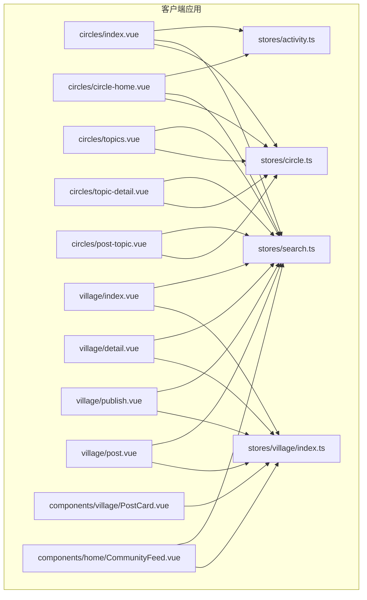
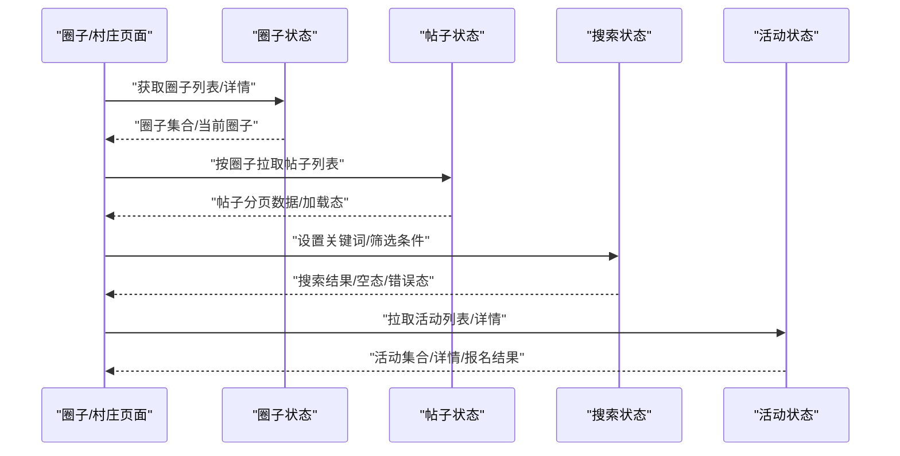
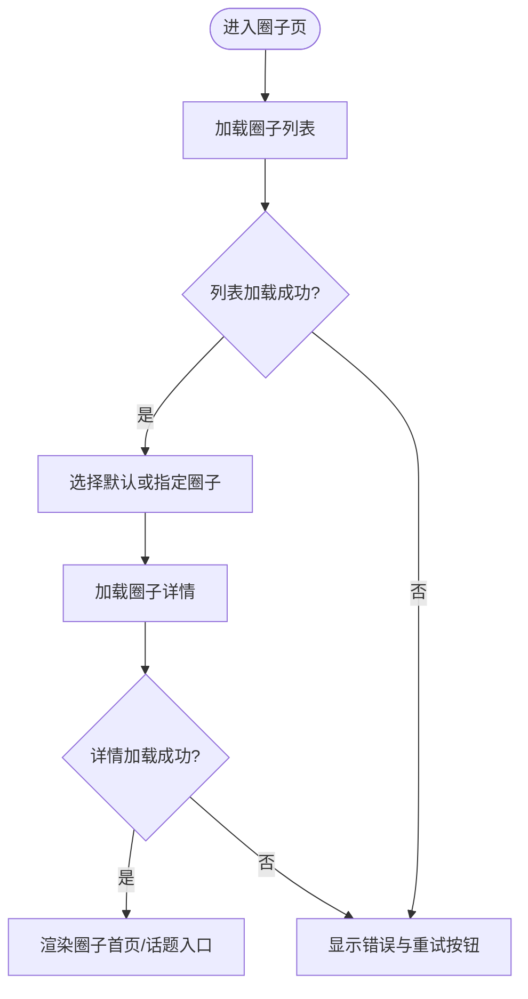
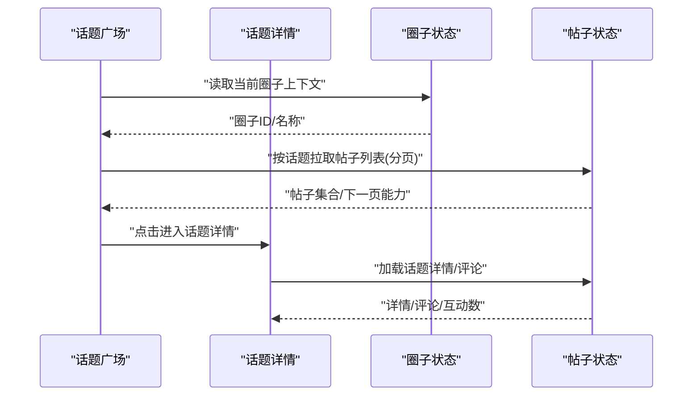
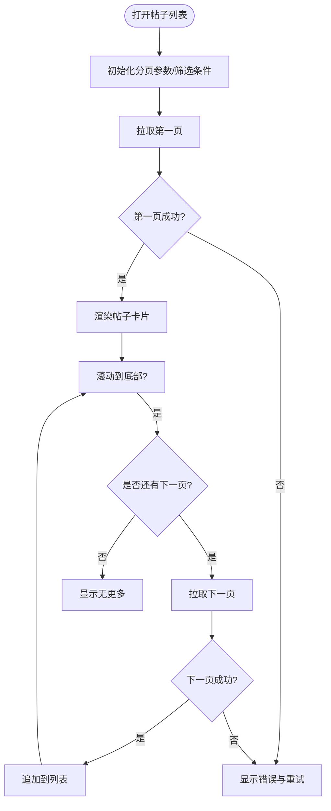
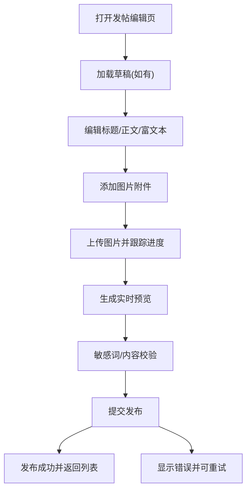
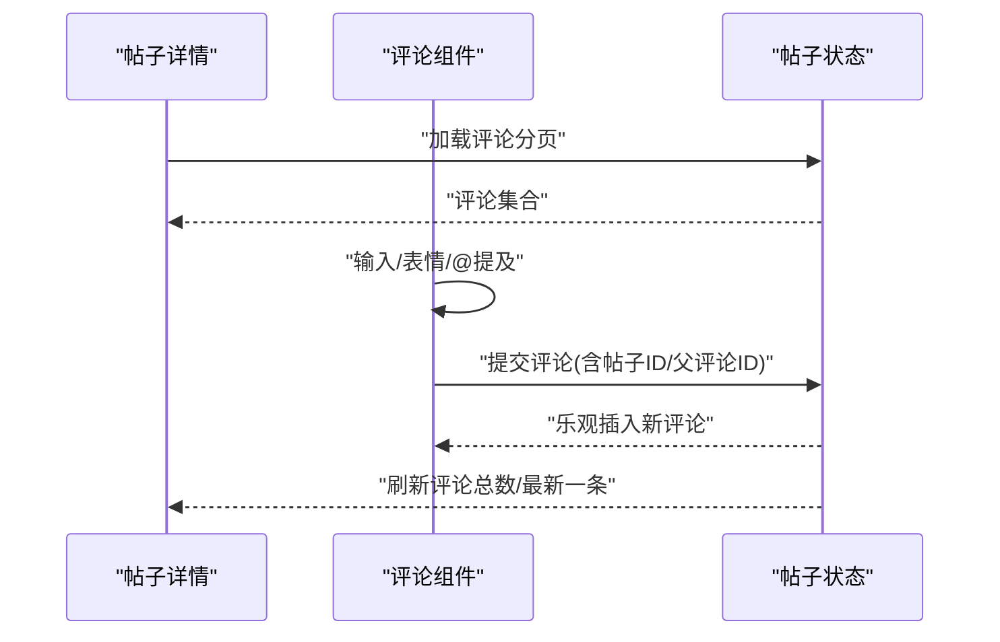
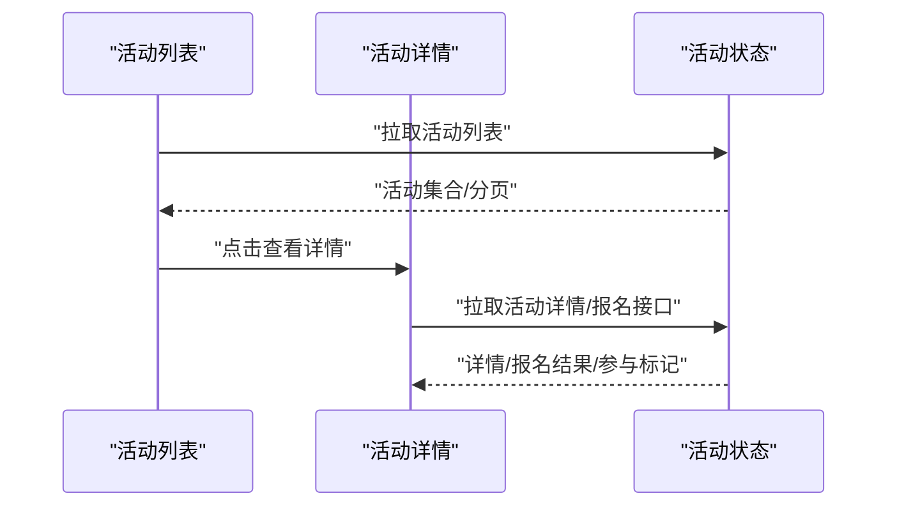
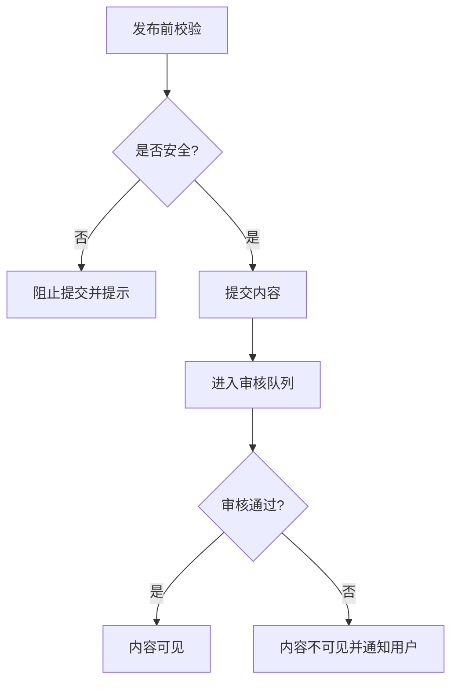
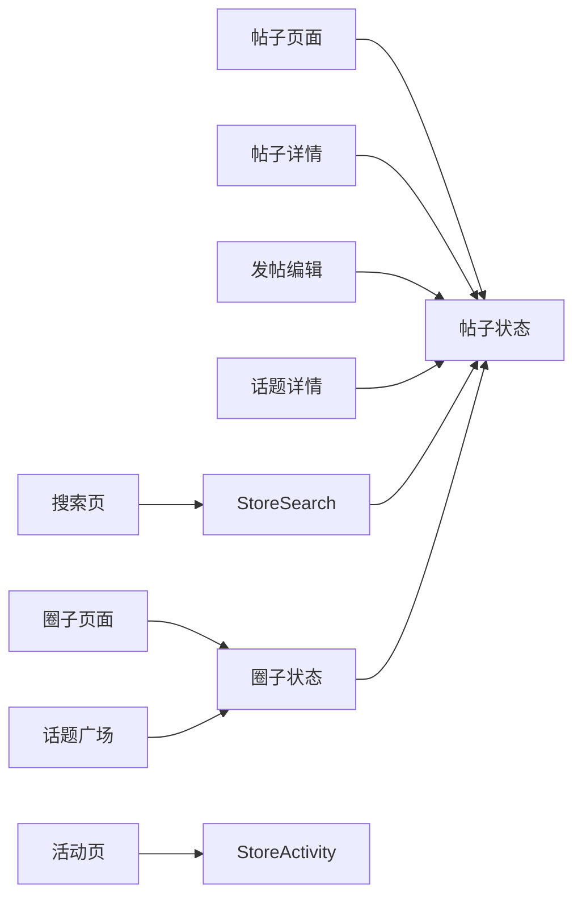

# 圈子社区状态

<cite>
**本文引用的文件**   
- [apps/client/src/stores/circle.ts](file://apps/client/src/stores/circle.ts)
- [apps/client/src/stores/village/index.ts](file://apps/client/src/stores/village/index.ts)
- [apps/client/src/stores/search.ts](file://apps/client/src/stores/search.ts)
- [apps/client/src/stores/activity.ts](file://apps/client/src/stores/activity.ts)
- [apps/client/src/subpackages/circles/circles/index.vue](file://apps/client/src/subpackages/circles/circles/index.vue)
- [apps/client/src/subpackages/circles/circles/circle-home.vue](file://apps/client/src/subpackages/circles/circles/circle-home.vue)
- [apps/client/src/subpackages/circles/circles/topics.vue](file://apps/client/src/subpackages/circles/circles/topics.vue)
- [apps/client/src/subpackages/circles/circles/topic-detail.vue](file://apps/client/src/subpackages/circles/circles/topic-detail.vue)
- [apps/client/src/subpackages/circles/circles/post-topic.vue](file://apps/client/src/subpackages/circles/circles/post-topic.vue)
- [apps/client/src/subpackages/village/village/index.vue](file://apps/client/src/subpackages/village/village/index.vue)
- [apps/client/src/subpackages/village/village/detail.vue](file://apps/client/src/subpackages/village/village/detail.vue)
- [apps/client/src/subpackages/village/village/publish.vue](file://apps/client/src/subpackages/village/village/publish.vue)
- [apps/client/src/subpackages/village/village/post.vue](file://apps/client/src/subpackages/village/village/post.vue)
- [apps/client/src/components/village/PostCard.vue](file://apps/client/src/components/village/PostCard.vue)
- [apps/client/src/components/home/CommunityFeed.vue](file://apps/client/src/components/home/CommunityFeed.vue)
- [apps/client/src/stores/circle/mock-data.ts](file://apps/client/src/stores/circle/mock-data.ts)
- [apps/client/src/stores/village/mock-data.ts](file://apps/client/src/stores/village/mock-data.ts)
</cite>

## 目录
1. [引言](#引言)
2. [项目结构](#项目结构)
3. [核心组件](#核心组件)
4. [架构总览](#架构总览)
5. [详细组件分析](#详细组件分析)
6. [依赖关系分析](#依赖关系分析)
7. [性能与缓存策略](#性能与缓存策略)
8. [故障排查指南](#故障排查指南)
9. [结论](#结论)

## 引言
本文围绕“圈子社区”功能的状态管理系统，梳理帖子列表、分页加载、搜索过滤、圈子详情、发帖编辑、评论互动、活动管理、话题广场和内容审核等模块的状态设计与流转。文档从状态定义、数据流、交互序列到缓存优化、内存管理与内容安全校验进行系统化说明，帮助读者快速理解整体架构并定位问题。

## 项目结构
圈子社区相关的前端代码主要位于客户端应用内：
- 状态层：Pinia Store（圈子、村庄/帖子、搜索、活动等）
- 视图层：圈子子包与村庄子包的页面与组件
- 共享组件：帖子卡片、社区信息流等
- 测试与模拟数据：单测与 Mock 数据

**图表来源**
- [apps/client/src/stores/circle.ts](file://apps/client/src/stores/circle.ts)
- [apps/client/src/stores/village/index.ts](file://apps/client/src/stores/village/index.ts)
- [apps/client/src/stores/search.ts](file://apps/client/src/stores/search.ts)
- [apps/client/src/stores/activity.ts](file://apps/client/src/stores/activity.ts)
- [apps/client/src/subpackages/circles/circles/index.vue](file://apps/client/src/subpackages/circles/circles/index.vue)
- [apps/client/src/subpackages/circles/circles/circle-home.vue](file://apps/client/src/subpackages/circles/circles/circle-home.vue)
- [apps/client/src/subpackages/circles/circles/topics.vue](file://apps/client/src/subpackages/circles/circles/topics.vue)
- [apps/client/src/subpackages/circles/circles/topic-detail.vue](file://apps/client/src/subpackages/circles/circles/topic-detail.vue)
- [apps/client/src/subpackages/circles/circles/post-topic.vue](file://apps/client/src/subpackages/circles/circles/post-topic.vue)
- [apps/client/src/subpackages/village/village/index.vue](file://apps/client/src/subpackages/village/village/index.vue)
- [apps/client/src/subpackages/village/village/detail.vue](file://apps/client/src/subpackages/village/village/detail.vue)
- [apps/client/src/subpackages/village/village/publish.vue](file://apps/client/src/subpackages/village/village/publish.vue)
- [apps/client/src/subpackages/village/village/post.vue](file://apps/client/src/subpackages/village/village/post.vue)
- [apps/client/src/components/village/PostCard.vue](file://apps/client/src/components/village/PostCard.vue)
- [apps/client/src/components/home/CommunityFeed.vue](file://apps/client/src/components/home/CommunityFeed.vue)

**章节来源**
- [apps/client/src/stores/circle.ts](file://apps/client/src/stores/circle.ts)
- [apps/client/src/stores/village/index.ts](file://apps/client/src/stores/village/index.ts)
- [apps/client/src/stores/search.ts](file://apps/client/src/stores/search.ts)
- [apps/client/src/stores/activity.ts](file://apps/client/src/stores/activity.ts)
- [apps/client/src/subpackages/circles/circles/index.vue](file://apps/client/src/subpackages/circles/circles/index.vue)
- [apps/client/src/subpackages/circles/circles/circle-home.vue](file://apps/client/src/subpackages/circles/circles/circle-home.vue)
- [apps/client/src/subpackages/circles/circles/topics.vue](file://apps/client/src/subpackages/circles/circles/topics.vue)
- [apps/client/src/subpackages/circles/circles/topic-detail.vue](file://apps/client/src/subpackages/circles/circles/topic-detail.vue)
- [apps/client/src/subpackages/circles/circles/post-topic.vue](file://apps/client/src/subpackages/circles/circles/post-topic.vue)
- [apps/client/src/subpackages/village/village/index.vue](file://apps/client/src/subpackages/village/village/index.vue)
- [apps/client/src/subpackages/village/village/detail.vue](file://apps/client/src/subpackages/village/village/detail.vue)
- [apps/client/src/subpackages/village/village/publish.vue](file://apps/client/src/subpackages/village/village/publish.vue)
- [apps/client/src/subpackages/village/village/post.vue](file://apps/client/src/subpackages/village/village/post.vue)
- [apps/client/src/components/village/PostCard.vue](file://apps/client/src/components/village/PostCard.vue)
- [apps/client/src/components/home/CommunityFeed.vue](file://apps/client/src/components/home/CommunityFeed.vue)

## 核心组件
本节聚焦与圈子社区状态直接相关的四个核心 Store 及关键页面/组件：
- 圈子状态 Store：维护圈子列表、当前选中圈子、圈子详情、话题列表、收藏与权限等
- 村庄/帖子状态 Store：维护帖子列表、分页、排序、筛选、发布、编辑、评论、点赞等
- 搜索状态 Store：维护关键词、筛选条件、搜索结果集、分页与加载态
- 活动状态 Store：维护活动列表、详情、报名、提醒与状态变更

各页面通过调用对应 Store 的 actions 与 getters 完成状态读写，视图只负责展示与触发用户行为。

**章节来源**
- [apps/client/src/stores/circle.ts](file://apps/client/src/stores/circle.ts)
- [apps/client/src/stores/village/index.ts](file://apps/client/src/stores/village/index.ts)
- [apps/client/src/stores/search.ts](file://apps/client/src/stores/search.ts)
- [apps/client/src/stores/activity.ts](file://apps/client/src/stores/activity.ts)

## 架构总览
下图展示了用户操作如何驱动状态变化，以及数据在 Store 与页面之间的流动。

**图表来源**
- [apps/client/src/subpackages/circles/circles/index.vue](file://apps/client/src/subpackages/circles/circles/index.vue)
- [apps/client/src/subpackages/circles/circles/circle-home.vue](file://apps/client/src/subpackages/circles/circles/circle-home.vue)
- [apps/client/src/subpackages/village/village/index.vue](file://apps/client/src/subpackages/village/village/index.vue)
- [apps/client/src/stores/circle.ts](file://apps/client/src/stores/circle.ts)
- [apps/client/src/stores/village/index.ts](file://apps/client/src/stores/village/index.ts)
- [apps/client/src/stores/search.ts](file://apps/client/src/stores/search.ts)
- [apps/client/src/stores/activity.ts](file://apps/client/src/stores/activity.ts)

## 详细组件分析

### 圈子列表与圈子详情状态
- 圈子列表：维护可切换的圈子集合、当前选中圈子的标识与基础信息；支持初始化加载、刷新与失败重试。
- 圈子详情：包含封面、简介、成员数、关注状态、权限标记等；进入圈子时根据当前上下文决定是否需要鉴权或引导登录。
- 话题入口：从圈子首页跳转至话题广场，保持圈子上下文参数传递。

**图表来源**
- [apps/client/src/subpackages/circles/circles/index.vue](file://apps/client/src/subpackages/circles/circles/index.vue)
- [apps/client/src/subpackages/circles/circles/circle-home.vue](file://apps/client/src/subpackages/circles/circles/circle-home.vue)
- [apps/client/src/stores/circle.ts](file://apps/client/src/stores/circle.ts)

**章节来源**
- [apps/client/src/subpackages/circles/circles/index.vue](file://apps/client/src/subpackages/circles/circles/index.vue)
- [apps/client/src/subpackages/circles/circles/circle-home.vue](file://apps/client/src/subpackages/circles/circles/circle-home.vue)
- [apps/client/src/stores/circle.ts](file://apps/client/src/stores/circle.ts)

### 话题广场与话题详情状态
- 话题广场：基于当前圈子维度拉取话题列表，支持分页加载与空态提示。
- 话题详情：加载话题正文、关联帖子、评论与互动统计；离开页面时清理局部状态，避免跨页面污染。

**图表来源**
- [apps/client/src/subpackages/circles/circles/topics.vue](file://apps/client/src/subpackages/circles/circles/topics.vue)
- [apps/client/src/subpackages/circles/circles/topic-detail.vue](file://apps/client/src/subpackages/circles/circles/topic-detail.vue)
- [apps/client/src/stores/circle.ts](file://apps/client/src/stores/circle.ts)
- [apps/client/src/stores/village/index.ts](file://apps/client/src/stores/village/index.ts)

**章节来源**
- [apps/client/src/subpackages/circles/circles/topics.vue](file://apps/client/src/subpackages/circles/circles/topics.vue)
- [apps/client/src/subpackages/circles/circles/topic-detail.vue](file://apps/client/src/subpackages/circles/circles/topic-detail.vue)
- [apps/client/src/stores/circle.ts](file://apps/client/src/stores/circle.ts)
- [apps/client/src/stores/village/index.ts](file://apps/client/src/stores/village/index.ts)

### 帖子列表、分页与搜索过滤
- 帖子列表：由村庄状态 Store 维护，包含帖子数组、分页游标、加载态、错误态、排序与筛选条件。
- 分页加载：上拉触底时请求下一页；若已无更多数据则停止滚动并给出结束提示。
- 搜索过滤：搜索 Store 统一维护关键词与筛选器；当条件变化时触发帖子 Store 重新拉取或本地过滤后分页。

**图表来源**
- [apps/client/src/subpackages/village/village/index.vue](file://apps/client/src/subpackages/village/village/index.vue)
- [apps/client/src/components/village/PostCard.vue](file://apps/client/src/components/village/PostCard.vue)
- [apps/client/src/stores/village/index.ts](file://apps/client/src/stores/village/index.ts)
- [apps/client/src/stores/search.ts](file://apps/client/src/stores/search.ts)

**章节来源**
- [apps/client/src/subpackages/village/village/index.vue](file://apps/client/src/subpackages/village/village/index.vue)
- [apps/client/src/components/village/PostCard.vue](file://apps/client/src/components/village/PostCard.vue)
- [apps/client/src/stores/village/index.ts](file://apps/client/src/stores/village/index.ts)
- [apps/client/src/stores/search.ts](file://apps/client/src/stores/search.ts)

### 发帖编辑与富文本状态
- 编辑器状态：标题、正文、富文本片段、图片附件、位置标签、可见范围等。
- 图片上传进度：每个附件维护上传状态、进度百分比、失败重试；成功后替换为远程资源地址。
- 实时预览：监听编辑器内容变化，生成预览图或摘要用于发布前确认。
- 草稿与恢复：未发布时自动保存草稿，返回上一页时恢复上次编辑内容。

**图表来源**
- [apps/client/src/subpackages/village/village/publish.vue](file://apps/client/src/subpackages/village/village/publish.vue)
- [apps/client/src/stores/village/index.ts](file://apps/client/src/stores/village/index.ts)

**章节来源**
- [apps/client/src/subpackages/village/village/publish.vue](file://apps/client/src/subpackages/village/village/publish.vue)
- [apps/client/src/stores/village/index.ts](file://apps/client/src/stores/village/index.ts)

### 评论互动与回复状态
- 评论列表：按时间倒序分页加载，支持嵌套回复。
- 发送评论：输入框状态、@提及、表情面板、防抖提交、乐观更新与回滚。
- 点赞与举报：对帖子与评论的点赞计数实时更新；举报流程记录状态与反馈。

**图表来源**
- [apps/client/src/subpackages/village/village/post.vue](file://apps/client/src/subpackages/village/village/post.vue)
- [apps/client/src/subpackages/village/village/detail.vue](file://apps/client/src/subpackages/village/village/detail.vue)
- [apps/client/src/stores/village/index.ts](file://apps/client/src/stores/village/index.ts)

**章节来源**
- [apps/client/src/subpackages/village/village/post.vue](file://apps/client/src/subpackages/village/village/post.vue)
- [apps/client/src/subpackages/village/village/detail.vue](file://apps/client/src/subpackages/village/village/detail.vue)
- [apps/client/src/stores/village/index.ts](file://apps/client/src/stores/village/index.ts)

### 活动管理与话题联动
- 活动列表与详情：活动基本信息、参与人数、报名状态、倒计时、提醒开关。
- 话题联动：活动详情页可关联话题或圈子，便于沉淀讨论。
- 状态同步：报名成功后更新活动状态与用户侧的活动参与标记。

**图表来源**
- [apps/client/src/stores/activity.ts](file://apps/client/src/stores/activity.ts)

**章节来源**
- [apps/client/src/stores/activity.ts](file://apps/client/src/stores/activity.ts)

### 内容审核与安全校验状态
- 前置校验：发布前执行敏感词检查、违规图片检测；失败则阻断提交并提示修改。
- 后置审核：提交后进入待审/已通过/拒绝等状态；用户在详情页可查看审核结果与原因。
- 处理流程：用户可对违规内容进行申诉或修改后重新提交。

**图表来源**
- [apps/client/src/subpackages/village/village/publish.vue](file://apps/client/src/subpackages/village/village/publish.vue)
- [apps/client/src/subpackages/village/village/detail.vue](file://apps/client/src/subpackages/village/village/detail.vue)
- [apps/client/src/stores/village/index.ts](file://apps/client/src/stores/village/index.ts)

**章节来源**
- [apps/client/src/subpackages/village/village/publish.vue](file://apps/client/src/subpackages/village/village/publish.vue)
- [apps/client/src/subpackages/village/village/detail.vue](file://apps/client/src/subpackages/village/village/detail.vue)
- [apps/client/src/stores/village/index.ts](file://apps/client/src/stores/village/index.ts)

## 依赖关系分析
- 低耦合：页面仅消费 Store 暴露的 state/getters/actions，不直接持有业务数据。
- 高内聚：圈子与帖子状态分别独立管理各自领域数据，减少相互干扰。
- 搜索与筛选：搜索 Store 作为横切关注点，向其他 Store 提供统一的查询上下文。
- 活动与社区：活动 Store 与圈子/帖子 Store 弱耦合，通过 ID 引用关联实体。

**图表来源**
- [apps/client/src/subpackages/circles/circles/index.vue](file://apps/client/src/subpackages/circles/circles/index.vue)
- [apps/client/src/subpackages/circles/circles/topics.vue](file://apps/client/src/subpackages/circles/circles/topics.vue)
- [apps/client/src/subpackages/circles/circles/topic-detail.vue](file://apps/client/src/subpackages/circles/circles/topic-detail.vue)
- [apps/client/src/subpackages/village/village/index.vue](file://apps/client/src/subpackages/village/village/index.vue)
- [apps/client/src/subpackages/village/village/detail.vue](file://apps/client/src/subpackages/village/village/detail.vue)
- [apps/client/src/subpackages/village/village/publish.vue](file://apps/client/src/subpackages/village/village/publish.vue)
- [apps/client/src/stores/circle.ts](file://apps/client/src/stores/circle.ts)
- [apps/client/src/stores/village/index.ts](file://apps/client/src/stores/village/index.ts)
- [apps/client/src/stores/search.ts](file://apps/client/src/stores/search.ts)
- [apps/client/src/stores/activity.ts](file://apps/client/src/stores/activity.ts)

**章节来源**
- [apps/client/src/stores/circle.ts](file://apps/client/src/stores/circle.ts)
- [apps/client/src/stores/village/index.ts](file://apps/client/src/stores/village/index.ts)
- [apps/client/src/stores/search.ts](file://apps/client/src/stores/search.ts)
- [apps/client/src/stores/activity.ts](file://apps/client/src/stores/activity.ts)

## 性能与缓存策略
- 列表分页与去重：使用游标或时间戳作为分页键，避免重复条目；合并增量数据时按 ID 去重。
- 懒加载：图片与长文摘要先占位，进入视口再加载真实资源；大图缩略图优先。
- 本地缓存：对热点圈子与热门帖子做短期缓存，结合失效策略（如 TTL、版本号）。
- 内存管理：离开页面时主动释放大对象引用（如图片二进制、富文本 DOM），清空定时器与事件监听。
- 网络优化：并发请求限制、失败重试与退避、断网降级与骨架屏。
- 富文本与预览：将富文本内容序列化后缓存，减少重建成本；预览图按需生成与复用。

[本节为通用性能建议，不涉及具体文件]

## 故障排查指南
- 列表不更新：检查分页游标是否正确递增、是否有重复 ID 导致覆盖。
- 搜索无效：确认搜索 Store 的关键词与筛选器是否被正确传入，是否存在异步竞态。
- 图片上传卡住：检查每张图片的上传状态与进度字段，查看失败重试逻辑与网络错误码。
- 评论不同步：确认乐观更新后的回滚分支是否执行，服务端返回结构与前端预期是否一致。
- 审核状态异常：核对前后端状态映射，确保待审/通过/拒绝等枚举值一致。

[本节为通用排错建议，不涉及具体文件]

## 结论
本方案以 Store 为中心组织圈子社区的状态，清晰分离圈子、帖子、搜索与活动的职责边界，并通过统一的交互序列与流程图描述状态流转。在此基础上，结合分页、懒加载、缓存与内存管理策略，保证用户体验与性能；同时通过内容安全校验与审核状态管理，保障社区内容质量与合规性。后续可在多端一致性、离线缓存与更细粒度的权限控制方面持续演进。