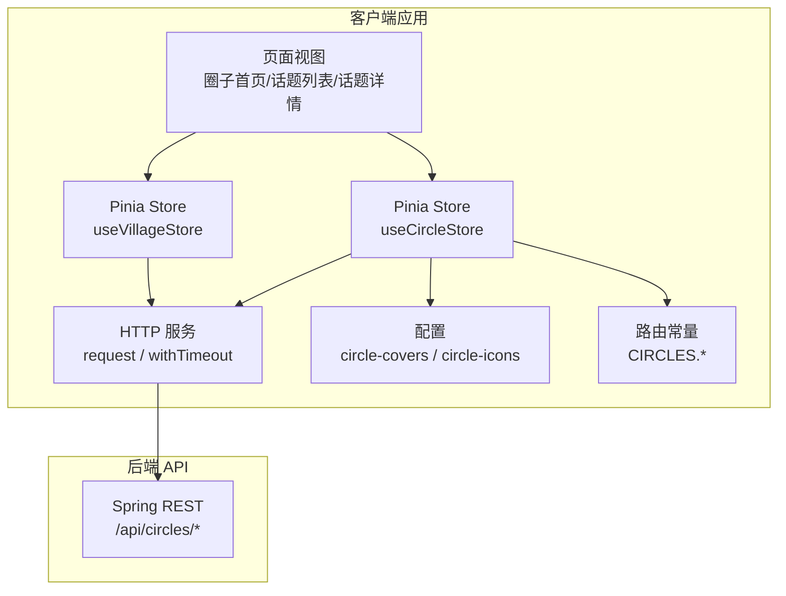
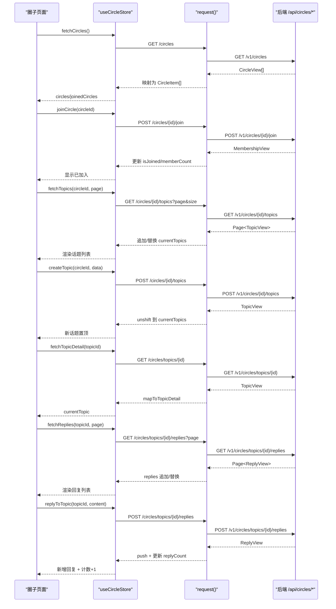
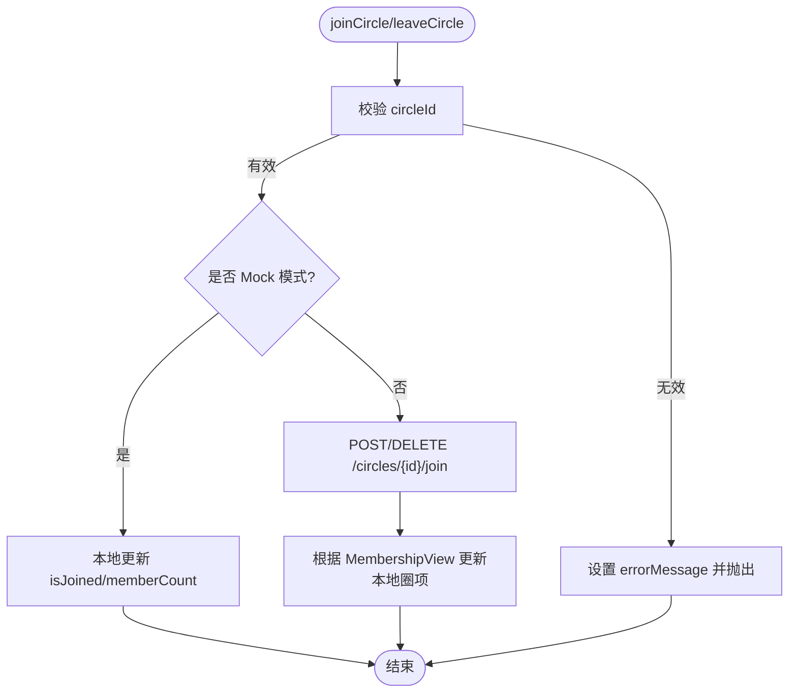
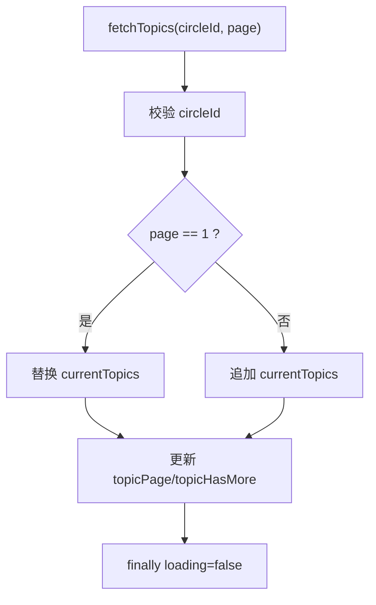
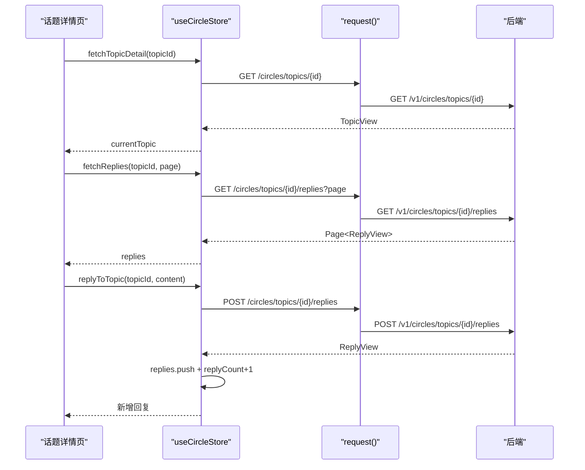
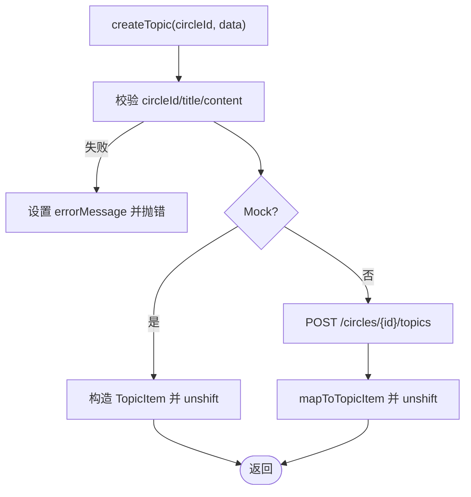
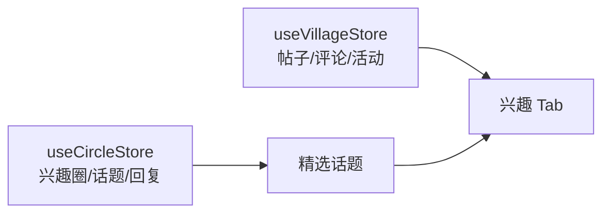
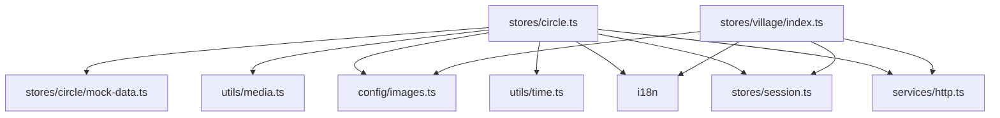

# 圈子话题状态

<cite>
**本文引用的文件**   
- [apps/client/src/stores/circle.ts](file://apps/client/src/stores/circle.ts)
- [apps/client/src/stores/circle/mock-data.ts](file://apps/client/src/stores/circle/mock-data.ts)
- [apps/client/src/stores/village/index.ts](file://apps/client/src/stores/village/index.ts)
- [apps/client/src/stores/village/types.ts](file://apps/client/src/stores/village/types.ts)
- [apps/client/src/stores/village/api.ts](file://apps/client/src/stores/village/api.ts)
- [apps/client/src/stores/village/constants.ts](file://apps/client/src/stores/village/constants.ts)
- [apps/client/src/services/api.ts](file://apps/client/src/services/api.ts)
- [apps/client/src/services/http.ts](file://apps/client/src/services/http.ts)
- [apps/client/src/config/circle-covers.ts](file://apps/client/src/config/circle-covers.ts)
- [apps/client/src/config/circle-icons.ts](file://apps/client/src/config/circle-icons.ts)
- [apps/client/src/constants/routes.ts](file://apps/client/src/constants/routes.ts)
</cite>

## 目录
1. [引言](#引言)
2. [项目结构](#项目结构)
3. [核心组件](#核心组件)
4. [架构总览](#架构总览)
5. [详细组件分析](#详细组件分析)
6. [依赖关系分析](#依赖关系分析)
7. [性能与缓存策略](#性能与缓存策略)
8. [权限、可见性与互动限制](#权限可见性与互动限制)
9. [错误处理与排障指南](#错误处理与排障指南)
10. [结论](#结论)

## 引言
本文件聚焦“兴趣圈/圈子”和“话题/回复”的前端状态管理，围绕以下目标展开：
- 兴趣圈列表、加入/退出状态。
- 圈子内话题列表、分页加载、详情与回复管理。
- 话题发布、评论互动的乐观更新与回滚。
- 活动管理、话题广场（精选话题）、内容审核等状态的统一协调。
- 数据模型映射、后端 Circle API 集成方式、错误处理策略。
- 缓存策略、分页优化和性能调优建议。

## 项目结构
前端使用 Pinia 进行状态管理，核心模块集中在 `apps/client/src/stores`：
- `stores/circle.ts`：兴趣圈、话题、回复的状态定义、映射函数、API 调用、Mock 分支。
- `stores/village/*`：村口社区帖子、评论、分类、活动、热度榜等；与圈子话题在页面层协作。
- `services/http.ts`：统一 HTTP 请求封装、拦截器、Token 刷新、错误分类。
- `services/api.ts`：通用服务入口、上传、环境判断、i18n 错误提示。
- `config/circle-covers.ts`、`config/circle-icons.ts`：圈子封面与图标解析。
- `constants/routes.ts`：圈子模块路由常量。

**图示来源**
- [apps/client/src/stores/circle.ts:201-450](file://apps/client/src/stores/circle.ts#L201-L450)
- [apps/client/src/stores/village/index.ts:201-574](file://apps/client/src/stores/village/index.ts#L201-L574)
- [apps/client/src/services/http.ts:1-150](file://apps/client/src/services/http.ts#L1-L150)
- [apps/client/src/config/circle-covers.ts:1-45](file://apps/client/src/config/circle-covers.ts#L1-L45)
- [apps/client/src/config/circle-icons.ts:1-70](file://apps/client/src/config/circle-icons.ts#L1-L70)
- [apps/client/src/constants/routes.ts:120-150](file://apps/client/src/constants/routes.ts#L120-L150)

**章节来源**
- [apps/client/src/stores/circle.ts:201-771](file://apps/client/src/stores/circle.ts#L201-L771)
- [apps/client/src/stores/village/index.ts:1-200](file://apps/client/src/stores/village/index.ts#L1-L200)
- [apps/client/src/services/http.ts:1-150](file://apps/client/src/services/http.ts#L1-L150)
- [apps/client/src/config/circle-covers.ts:1-45](file://apps/client/src/config/circle-covers.ts#L1-L45)
- [apps/client/src/config/circle-icons.ts:1-70](file://apps/client/src/config/circle-icons.ts#L1-L70)
- [apps/client/src/constants/routes.ts:120-150](file://apps/client/src/constants/routes.ts#L120-L150)

## 核心组件
### useCircleStore
负责兴趣圈与话题的全局状态：
- 状态字段：
  - `circles`：兴趣圈列表。
  - `currentTopics`：当前圈子话题列表。
  - `currentTopic`：当前话题详情。
  - `replies`：当前话题的回复列表。
  - `loading`、`errorMessage`、`topicPage`、`topicHasMore`：加载与分页状态。
- Getter：
  - `joinedCircles`：已加入的兴趣圈过滤。
- Actions：
  - `fetchCircles`：获取兴趣圈列表。
  - `joinCircle` / `leaveCircle`：加入/退出兴趣圈。
  - `fetchTopics`：按圈拉取话题分页。
  - `createTopic`：发布新话题。
  - `fetchTopicDetail`：拉取话题详情。
  - `fetchReplies`：拉取回复分页。
  - `replyToTopic`：发表回复并同步计数。
  - `fetchFeaturedTopics`：拉取精选话题用于“兴趣”分类。
  - `clearCurrentTopic`：清理当前话题与回复。

### useVillageStore
负责村口社区帖子、评论、活动、热度榜等；与圈子话题协同：
- 提供帖子列表、分页、附近动态、热度榜、发帖、点赞、收藏、关注等能力。
- 通过 `selfPendingPosts` 承载刚发布且处于审核中的帖子，解决“发完消失”的体验问题。

**章节来源**
- [apps/client/src/stores/circle.ts:201-450](file://apps/client/src/stores/circle.ts#L201-L450)
- [apps/client/src/stores/circle.ts:451-771](file://apps/client/src/stores/circle.ts#L451-L771)
- [apps/client/src/stores/village/index.ts:1-200](file://apps/client/src/stores/village/index.ts#L1-L200)
- [apps/client/src/stores/village/types.ts:1-200](file://apps/client/src/stores/village/types.ts#L1-L200)

## 架构总览

**图示来源**
- [apps/client/src/stores/circle.ts:201-450](file://apps/client/src/stores/circle.ts#L201-L450)
- [apps/client/src/stores/circle.ts:451-771](file://apps/client/src/stores/circle.ts#L451-L771)
- [apps/client/src/services/http.ts:1-150](file://apps/client/src/services/http.ts#L1-L150)

## 详细组件分析

### 兴趣圈列表与成员状态
- 数据模型：
  - 后端 `BackendCircleView` 映射为前端 `CircleItem`。
  - 后端 `BackendCircleMembershipView` 返回 `joined` 与 `memberCount`，用于局部更新本地状态。
- 行为：
  - `fetchCircles`：请求 `/circles`，失败时设置 `errorMessage`，最终恢复 `loading=false`。
  - `joinCircle` / `leaveCircle`：校验 `circleId`，Mock 模式直接改 `isJoined` 与 `memberCount`；真实模式调用 `/circles/{id}/join`（POST/DELETE），再根据返回结果更新本地圈项。
  - `joinedCircles`：计算属性过滤已加入圈子。

**图示来源**
- [apps/client/src/stores/circle.ts:201-450](file://apps/client/src/stores/circle.ts#L201-L450)

**章节来源**
- [apps/client/src/stores/circle.ts:201-450](file://apps/client/src/stores/circle.ts#L201-L450)

### 话题列表、分页与精选话题
- 数据模型：
  - `BackendCircleTopicView` 映射为 `TopicItem` 与 `TopicDetail`。
  - 图片 URL 经 `resolveMediaUrl` 解析，头像透传后端值。
- 行为：
  - `fetchTopics(circleId, page)`：
    - 第 1 页替换 `currentTopics`，后续页追加。
    - `topicHasMore = content.length >= TOPIC_PAGE_SIZE`。
    - 参数校验失败向上抛错，避免测试或调用方无法捕获。
  - `fetchFeaturedTopics(page)`：
    - 拉取 `/circles/featured`，用于村口“兴趣”分类展示精选话题。
    - 复用 `currentTopics` 与分页状态。

**图示来源**
- [apps/client/src/stores/circle.ts:451-771](file://apps/client/src/stores/circle.ts#L451-L771)

**章节来源**
- [apps/client/src/stores/circle.ts:451-771](file://apps/client/src/stores/circle.ts#L451-L771)

### 话题详情与回复管理
- 数据模型：
  - `BackendCircleReplyView` 映射为 `ReplyItem`，包含作者信息与头像。
- 行为：
  - `fetchTopicDetail(topicId)`：
    - 校验 topicId，Mock 模式下有多重兜底（当前列表、全量 mock、数字 ID 归一）。
    - 真实模式调用 `/circles/topics/{topicId}`，映射为 `TopicDetail`。
  - `fetchReplies(topicId, page)`：
    - 第 1 页替换 `replies`，后续页追加。
  - `replyToTopic(topicId, content)`：
    - 校验 topicId 与 content。
    - Mock 模式立即插入回复，并同步更新 `currentTopic.replyCount` 与 `currentTopics` 中对应话题的 `replyCount`。
    - 真实模式调用 `/circles/topics/{topicId}/replies`，成功后同样做本地同步。

**图示来源**
- [apps/client/src/stores/circle.ts:451-771](file://apps/client/src/stores/circle.ts#L451-L771)

**章节来源**
- [apps/client/src/stores/circle.ts:451-771](file://apps/client/src/stores/circle.ts#L451-L771)

### 话题发布
- 前置校验：
  - `circleId`、`title`、`content` 非空校验，失败即设置 `errorMessage` 并抛错。
- Mock 模式：
  - 从会话生成作者信息，将新话题 `unshift` 到 `currentTopics`，返回附加 `tags`/`favorite` 的对象。
- 真实模式：
  - 调用 `POST /circles/{circleId}/topics`，请求体仅含 `title`、`content`、`images`。
  - 成功后将结果映射为 `TopicItem` 并置顶。

**图示来源**
- [apps/client/src/stores/circle.ts:451-771](file://apps/client/src/stores/circle.ts#L451-L771)

**章节来源**
- [apps/client/src/stores/circle.ts:451-771](file://apps/client/src/stores/circle.ts#L451-L771)

### 与村口社区（Village）的协作
- Village Store 提供：
  - 帖子列表、分页、附近动态、热度榜、发帖、点赞、收藏、关注。
  - `selfPendingPosts`：发布后本地立即可见，带“审核中”标记，服务端审核通过后自然接管。
- 与 Circle Store 的关系：
  - Circle Store 的 `fetchFeaturedTopics` 可用于村口“兴趣”分类的精选话题聚合。
  - 两者共享统一的 HTTP 层、i18n 错误消息、Mock 开关。

**图示来源**
- [apps/client/src/stores/circle.ts:451-771](file://apps/client/src/stores/circle.ts#L451-L771)
- [apps/client/src/stores/village/index.ts:201-574](file://apps/client/src/stores/village/index.ts#L201-L574)

**章节来源**
- [apps/client/src/stores/village/index.ts:201-574](file://apps/client/src/stores/village/index.ts#L201-L574)
- [apps/client/src/stores/village/types.ts:1-200](file://apps/client/src/stores/village/types.ts#L1-L200)

## 依赖关系分析
- 内部依赖：
  - `stores/circle.ts` 依赖：
    - `services/http`：`request` 发起网络请求。
    - `stores/session`：Mock 下读取当前用户信息。
    - `utils/time`：相对时间格式化。
    - `utils/media`：媒体 URL 解析。
    - `i18n`：错误文案翻译。
    - `stores/circle/mock-data.ts`：Mock 数据与 ID 归一。
    - `config/images`：默认头像与资源路径。
  - `stores/village/*` 依赖：
    - `services/http`：通过 `fetchPostsApi`、`getHotBoardApi` 等访问后端。
    - `stores/session`：校园分类时读取用户学校信息。
    - `i18n`：错误文案。
    - `config/images`：Mock 头像路径。
- 外部依赖：
  - 后端 REST：`/api/circles/*`、`/api/posts/*`、`/api/campus/feed` 等。
  - OpenAPI 类型：`services/generated/api-types.ts` 由工具生成，不直接编辑。

**图示来源**
- [apps/client/src/stores/circle.ts:1-200](file://apps/client/src/stores/circle.ts#L1-L200)
- [apps/client/src/stores/village/index.ts:1-200](file://apps/client/src/stores/village/index.ts#L1-L200)
- [apps/client/src/services/http.ts:1-150](file://apps/client/src/services/http.ts#L1-L150)

**章节来源**
- [apps/client/src/stores/circle.ts:1-200](file://apps/client/src/stores/circle.ts#L1-L200)
- [apps/client/src/stores/village/index.ts:1-200](file://apps/client/src/stores/village/index.ts#L1-L200)
- [apps/client/src/services/http.ts:1-150](file://apps/client/src/services/http.ts#L1-L150)

## 性能与缓存策略

### 分页加载优化
- Circle Store：
  - `TOPIC_PAGE_SIZE = 10`，`fetchTopics` 与 `fetchFeaturedTopics` 均按页追加，避免覆盖历史数据。
  - `topicHasMore` 基于返回数量判断是否还有更多。
- Village Store：
  - `PAGE_SIZE = 20`，`fetchPosts` 与 `fetchHotBoard` 支持 reset 与追加两种语义。
  - `loadMore` 在失败时回退 `page`，保留已加载项供重试。

### 请求竞态控制
- Village Store：
  - 全局 `fetchPostsController` 保存当前请求的 `AbortController`，新请求发起前 abort 旧请求，避免旧响应覆盖新列表。
  - `likingPostIds`、`likingCommentIds`、`favoritingPostIds` 作为幂等守卫，防止并发重复操作。

### 数据映射与资源解析
- 所有后端实体在前端均有明确映射函数：
  - `mapToCircleItem`、`mapToTopicItem`、`mapToTopicDetail`、`mapToReplyItem`。
- 媒体 URL 统一经 `resolveMediaUrl` 解析，避免裂图与鉴权问题。
- 头像字段透传后端值，Mock 模式下回退默认头像。

### 缓存建议
- 当前实现以内存状态为主，未引入持久化缓存；建议在以下场景考虑：
  - 已加入圈子列表：可短期缓存（如 5 分钟），减少频繁刷新。
  - 精选话题：可按分类缓存，结合失效策略（如用户切换分类时失效）。
  - 话题详情：按 `topicId` 缓存，避免返回列表跳转详情时重复请求。
  - 回复列表：可按 `topicId + page` 组合键缓存，支持下拉加载更多。

[本节为通用性能指导，无需具体代码引用]

## 权限、可见性与互动限制

### 用户权限控制
- 加入/退出圈子：
  - 后端通过 JWT 识别用户，前端不传 userId。
  - 失败时通过 `errorMessage` 暴露错误，调用方可根据业务逻辑决定提示或重试。
- 话题发布与回复：
  - 参数校验严格，非法输入直接抛错，避免无效请求。
  - Mock 模式下模拟当前用户身份，真实模式依赖后端鉴权。

### 内容可见性
- Village Store：
  - 帖子支持 `visibility`、`targetType`、`targetId`，用于公开、校内、兴趣圈等可见范围。
  - 自己刚发布的帖子进入 `selfPendingPosts`，带“审核中”徽标，提升发布反馈体验。

### 互动限制
- 点赞/收藏：
  - Village Store 对点赞、收藏、评论点赞均实现乐观更新与失败回滚。
  - 并发保护通过 Set 记录 in-flight 操作 ID，重复触发直接跳过。
- 评论防抖：
  - `COMMENT_DEBOUNCE_MS = 500ms`，防止快速点击造成重复评论。

**章节来源**
- [apps/client/src/stores/village/index.ts:201-574](file://apps/client/src/stores/village/index.ts#L201-L574)
- [apps/client/src/stores/village/constants.ts:1-59](file://apps/client/src/stores/village/constants.ts#L1-L59)

## 错误处理与排障指南

### 错误分类与统一处理
- HTTP 层：
  - `EnhancedApiError` 携带 `category`（network/auth/business）。
  - 401/403 归类为 auth，0 归类为 network，其他为 business。
  - Token 过期时自动刷新，刷新超时 8s，避免阻塞并发请求。
- Store 层：
  - 每个 action 捕获异常，设置 `errorMessage`，部分动作向上抛错以便调用方感知。
  - Mock 模式与真实模式错误文案均走 i18n。

### 常见问题排查
- 圈子详情为空：
  - 检查 `topicId` 是否有效；Mock 模式下有数字 ID 归一逻辑。
- 话题列表无数据：
  - 检查 `circleId` 是否为标准 ID；Mock 模式下数字 ID 会被归一。
- 发布话题后不可见：
  - Village Store 中发帖会置 `auditStatus=pending` 并插入 `selfPendingPosts`；若仍不可见，检查后端审核流与列表去重逻辑。
- 点赞重复：
  - 检查是否在短时间内多次点击；Village Store 已有幂等守卫，若仍有问题需检查调用方是否绕过 store。

**章节来源**
- [apps/client/src/services/http.ts:1-150](file://apps/client/src/services/http.ts#L1-L150)
- [apps/client/src/stores/circle.ts:201-771](file://apps/client/src/stores/circle.ts#L201-L771)
- [apps/client/src/stores/village/index.ts:201-574](file://apps/client/src/stores/village/index.ts#L201-L574)

## 结论
本方案通过 Pinia Store 统一管理兴趣圈、话题、回复状态，配合统一 HTTP 层、i18n 错误消息与 Mock 机制，形成清晰的职责边界与可扩展的数据流。Circle Store 专注圈子与话题生命周期，Village Store 负责社区帖子与互动，两者通过精选话题与路由协作。未来可在现有内存状态基础上引入分级缓存、更细粒度的失效策略，并持续优化分页与并发控制，以提升用户体验与系统稳定性。