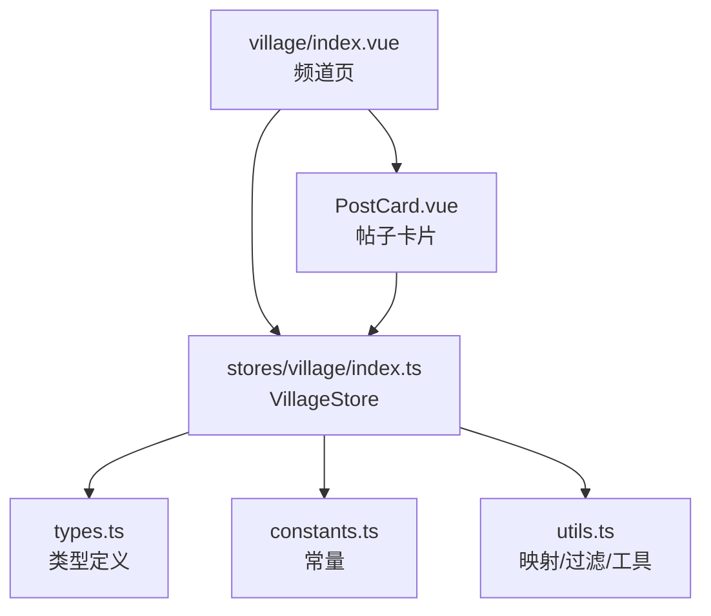
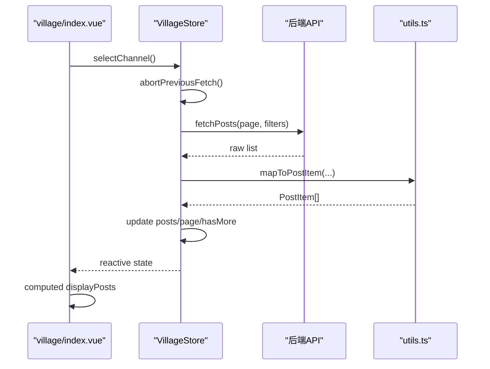
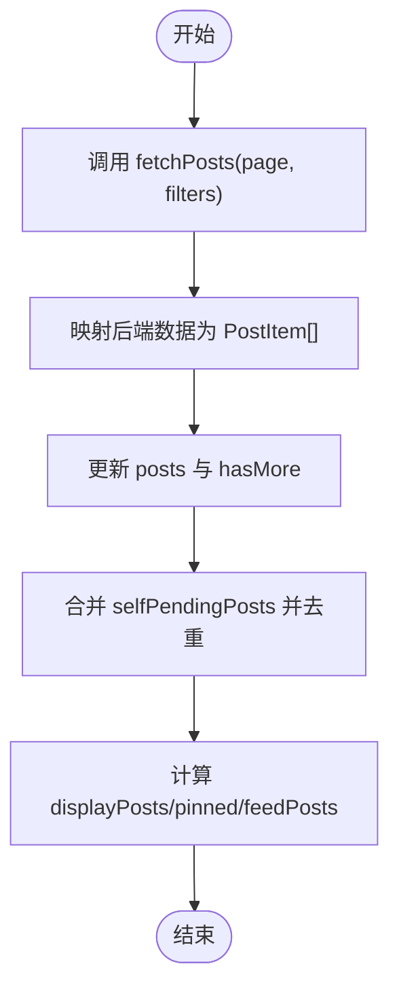
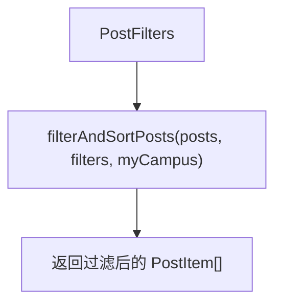
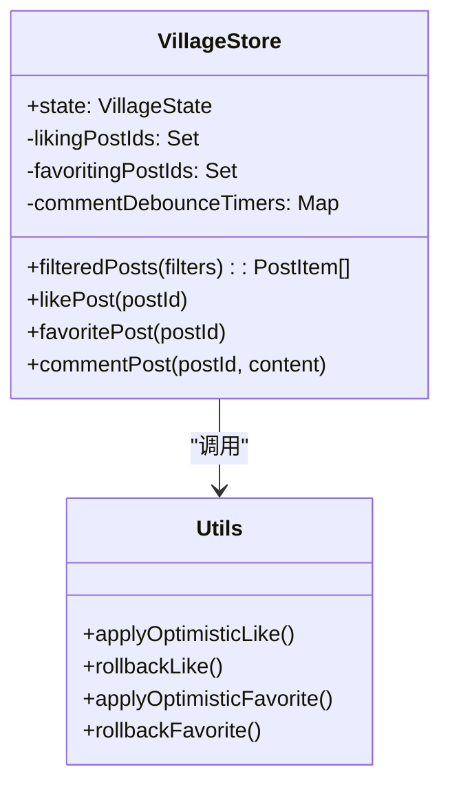
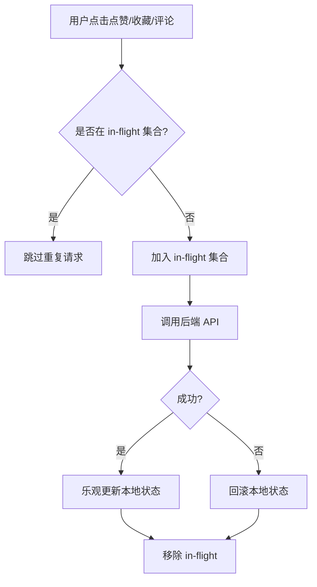
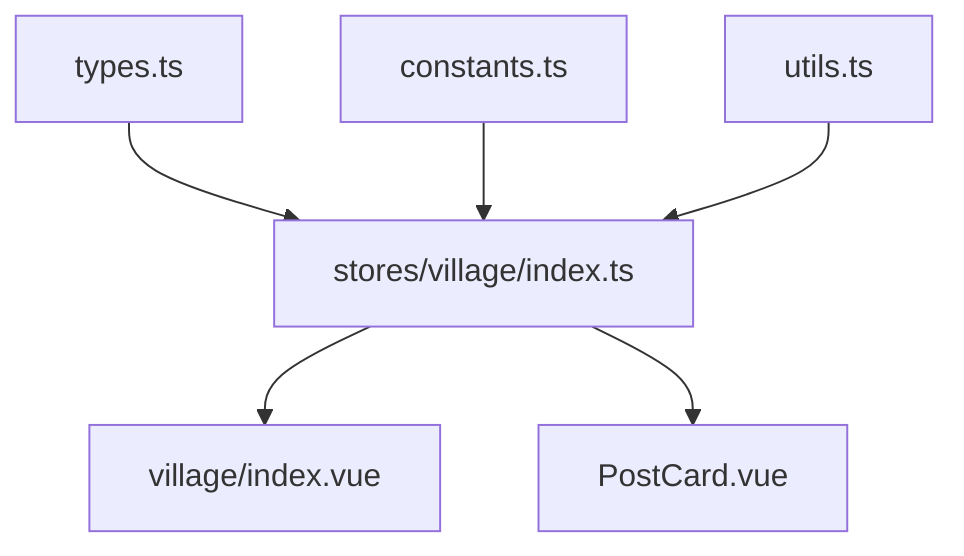

# 帖子管理状态

<cite>
**本文引用的文件**
- [apps/client/src/stores/village/index.ts](file://apps/client/src/stores/village/index.ts)
- [apps/client/src/stores/village/types.ts](file://apps/client/src/stores/village/types.ts)
- [apps/client/src/stores/village/constants.ts](file://apps/client/src/stores/village/constants.ts)
- [apps/client/src/stores/village/utils.ts](file://apps/client/src/stores/village/utils.ts)
- [apps/client/src/subpackages/village/village/index.vue](file://apps/client/src/subpackages/village/village/index.vue)
- [apps/client/src/components/village/PostCard.vue](file://apps/client/src/components/village/PostCard.vue)
</cite>

## 目录
1. [引言](#引言)
2. [项目结构](#项目结构)
3. [核心组件](#核心组件)
4. [架构总览](#架构总览)
5. [详细组件分析](#详细组件分析)
6. [依赖关系分析](#依赖关系分析)
7. [性能与缓存](#性能与缓存)
8. [故障排查指南](#故障排查指南)
9. [结论](#结论)

## 引言
本技术文档围绕“帖子管理状态子系统”，聚焦村口社区（Village）的帖子列表、分页加载、搜索过滤、排序、CRUD 乐观更新、错误回滚、并发控制，以及分类管理、标签系统、热门话题、图片上传进度、富文本编辑状态、实时预览、内容安全校验、敏感词过滤和违规处理等状态流转。该子系统以 Pinia store 为核心，结合页面视图与卡片组件，实现从数据获取、转换、展示到用户交互的全链路状态管理。

## 项目结构
帖子管理状态主要分布在以下模块：
- Store 层：`stores/village/index.ts` 为主入口，集中管理帖子、评论、分类、历史记录、附近动态、待审核新帖等全局状态，并提供分页、筛选、排序、点赞收藏、评论发送等动作。
- 类型定义：`stores/village/types.ts` 定义 PostItem、CommentItem、PostFilters、VillageState 等核心类型。
- 常量配置：`stores/village/constants.ts` 集中内容长度、图片数量、防抖延迟、分页大小、分类 ID 等常量。
- 工具函数：`stores/village/utils.ts` 提供后端视图到前端模型映射、过滤排序、相对时间格式化、Mock 数据等纯函数。
- 页面视图：`subpackages/village/village/index.vue` 负责频道切换、筛选条件绑定、数据加载、置顶/非置顶分离、待审核新帖置顶展示等。
- 帖子卡片：`components/village/PostCard.vue` 负责单条帖子渲染、作者信息、图片九宫格、互动按钮、事件派发等。

**图表来源**
- [apps/client/src/subpackages/village/village/index.vue:1-100](file://apps/client/src/subpackages/village/village/index.vue#L1-L100)
- [apps/client/src/stores/village/index.ts:1-120](file://apps/client/src/stores/village/index.ts#L1-L120)
- [apps/client/src/components/village/PostCard.vue:1-80](file://apps/client/src/components/village/PostCard.vue#L1-L80)

**章节来源**
- [apps/client/src/stores/village/index.ts:1-120](file://apps/client/src/stores/village/index.ts#L1-L120)
- [apps/client/src/stores/village/types.ts:1-120](file://apps/client/src/stores/village/types.ts#L1-L120)
- [apps/client/src/stores/village/constants.ts:1-59](file://apps/client/src/stores/village/constants.ts#L1-L59)
- [apps/client/src/stores/village/utils.ts:1-120](file://apps/client/src/stores/village/utils.ts#L1-L120)
- [apps/client/src/subpackages/village/village/index.vue:1-120](file://apps/client/src/subpackages/village/village/index.vue#L1-L120)
- [apps/client/src/components/village/PostCard.vue:1-100](file://apps/client/src/components/village/PostCard.vue#L1-L100)

## 核心组件
- VillageStore：统一管理帖子列表、当前帖子详情、评论、分类、分页参数、是否还有更多、校园动态流、相似作者、浏览记录、附近动态、待审核新帖等状态；暴露 getters 与 actions。
- 页面视图（village/index.vue）：频道 Tab、筛选条件绑定、频道切换、滚动位置保存恢复、加载频道数据、置顶与非置顶分离、待审核新帖置顶显示。
- 帖子卡片（PostCard.vue）：作者信息、正文、图片九宫格、活动卡内嵌、评论预览、点赞动画、关注按钮、分享收藏等交互事件。

关键职责划分：
- 数据获取与状态变更集中在 Store。
- 页面视图仅做 UI 编排与触发 Store action。
- 卡片组件专注单条帖子展示与轻量交互，通过事件向父级或 Store 传递。

**章节来源**
- [apps/client/src/stores/village/index.ts:120-300](file://apps/client/src/stores/village/index.ts#L120-L300)
- [apps/client/src/subpackages/village/village/index.vue:100-220](file://apps/client/src/subpackages/village/village/index.vue#L100-L220)
- [apps/client/src/components/village/PostCard.vue:80-160](file://apps/client/src/components/village/PostCard.vue#L80-L160)

## 架构总览
帖子管理状态的核心流程如下：
- 页面初始化时按频道拉取数据（今日广场/兴趣圈/学校圈/活动）。
- Store 中 fetchPosts 使用 AbortController 取消旧请求，避免竞态覆盖。
- 后端数据经 utils.ts 映射为前端 PostItem，再进入 posts 数组。
- 页面通过 filteredPosts getter 应用过滤与排序；频道为热度榜时直接展示已排序结果。
- 用户操作（点赞、收藏、评论、关注）由 Store 执行乐观更新并维护幂等守卫集合，失败时回滚。
- 图片与媒体资源统一通过 resolveMediaUrl 与 SafeImage 渲染，支持懒加载与错误兜底。

**图表来源**
- [apps/client/src/stores/village/index.ts:120-220](file://apps/client/src/stores/village/index.ts#L120-L220)
- [apps/client/src/stores/village/utils.ts:120-220](file://apps/client/src/stores/village/utils.ts#L120-L220)
- [apps/client/src/subpackages/village/village/index.vue:200-320](file://apps/client/src/subpackages/village/village/index.vue#L200-L320)

## 详细组件分析

### 帖子列表与分页加载
- 分页参数：page 初始为 1，PAGE_SIZE=20；hasMore 控制是否继续加载。
- 分页策略：fetchPosts 接收 page 与 filters，调用后端接口，将结果映射为 PostItem 后追加或替换列表；当返回不足 PAGE_SIZE 时置 hasMore=false。
- 去重与置顶：页面侧对 selfPendingPosts（自己刚发布且仍在审核中的帖子）与 posts 合并并按 id 去重，pending 项置顶展示，审核通过后由服务端列表接管。

**图表来源**
- [apps/client/src/stores/village/index.ts:120-220](file://apps/client/src/stores/village/index.ts#L120-L220)
- [apps/client/src/subpackages/village/village/index.vue:220-340](file://apps/client/src/subpackages/village/village/index.vue#L220-L340)

**章节来源**
- [apps/client/src/stores/village/index.ts:120-220](file://apps/client/src/stores/village/index.ts#L120-L220)
- [apps/client/src/stores/village/constants.ts:35-59](file://apps/client/src/stores/village/constants.ts#L35-L59)
- [apps/client/src/subpackages/village/village/index.vue:220-340](file://apps/client/src/subpackages/village/village/index.vue#L220-L340)

### 搜索过滤与排序
- 过滤条件：PostFilters 包含 categoryId、keyword、sortBy、userId、city、discoverSub。
- 过滤逻辑：getters.filteredPosts 委托 filterAndSortPosts，确保与 fetchPosts 过滤语义一致，避免双重过滤导致空列表。
- 排序选项：SORT_OPTIONS 包含 latest 与 hot；热度榜频道直接使用服务端排序结果，不重复过滤。

**图表来源**
- [apps/client/src/stores/village/types.ts:120-180](file://apps/client/src/stores/village/types.ts#L120-L180)
- [apps/client/src/stores/village/utils.ts:1-120](file://apps/client/src/stores/village/utils.ts#L1-L120)
- [apps/client/src/stores/village/index.ts:180-240](file://apps/client/src/stores/village/index.ts#L180-L240)

**章节来源**
- [apps/client/src/stores/village/types.ts:120-180](file://apps/client/src/stores/village/types.ts#L120-L180)
- [apps/client/src/stores/village/utils.ts:1-120](file://apps/client/src/stores/village/utils.ts#L1-L120)
- [apps/client/src/stores/village/index.ts:180-240](file://apps/client/src/stores/village/index.ts#L180-L240)

### 帖子 CRUD 与乐观更新
- 创建帖子：createPostApi 成功后将新帖加入 selfPendingPosts，并在 feed 顶部展示；审核通过后服务端列表自然接管。
- 点赞与收藏：Store 维护 likingPostIds、favoritingPostIds 等 in-flight 集合，同一帖子并发请求直接跳过；乐观更新本地 isLiked/isFavorite 与计数，失败时 rollbackLike/rollbackFavorite 回滚。
- 评论发送：COMMENT_DEBOUNCE_MS=500ms 防抖；per-post 防抖映射表避免重复提交；成功时在 comments 列表追加并刷新 currentPostComments。

**图表来源**
- [apps/client/src/stores/village/index.ts:240-420](file://apps/client/src/stores/village/index.ts#L240-L420)
- [apps/client/src/stores/village/utils.ts:200-360](file://apps/client/src/stores/village/utils.ts#L200-L360)

**章节来源**
- [apps/client/src/stores/village/index.ts:240-420](file://apps/client/src/stores/village/index.ts#L240-L420)
- [apps/client/src/stores/village/utils.ts:200-360](file://apps/client/src/stores/village/utils.ts#L200-L360)
- [apps/client/src/stores/village/constants.ts:15-35](file://apps/client/src/stores/village/constants.ts#L15-L35)

### 并发请求与幂等保护
- 列表加载：AbortController 取消旧请求，避免旧响应覆盖新响应。
- 点赞/收藏/评论：Set 跟踪 in-flight 的 postId/commentId，拒绝重复触发；防抖定时器映射表 per-post 隔离不同帖子。
- 评论防抖：若 Promise 被覆盖则显式 resolve 旧 Promise，避免永不 settle。

**图表来源**
- [apps/client/src/stores/village/index.ts:120-220](file://apps/client/src/stores/village/index.ts#L120-L220)
- [apps/client/src/stores/village/index.ts:240-420](file://apps/client/src/stores/village/index.ts#L240-L420)

**章节来源**
- [apps/client/src/stores/village/index.ts:120-220](file://apps/client/src/stores/village/index.ts#L120-L220)
- [apps/client/src/stores/village/index.ts:240-420](file://apps/client/src/stores/village/index.ts#L240-L420)

### 帖子分类管理与标签系统
- 分类常量：CATEGORY_ALL_ID、CATEGORY_CAMPUS_ID、FOLLOWING_CATEGORY_ID、SAME_CITY_CATEGORY_ID、DISCOVER_CATEGORY_ID、MINE_CATEGORY_ID 用于不同 Tab 与筛选。
- 频道与分类联动：currentFilters 根据 channel.postCategory 生成 categoryId，并与 sortBy 组合。
- 标签展示：PostItem.tags 在 PostCard 中渲染；buddyTags 与 author.interests 参与搭子圈判定。

**图表来源**
- [apps/client/src/subpackages/village/village/index.vue:120-200](file://apps/client/src/subpackages/village/village/index.vue#L120-L200)
- [apps/client/src/stores/village/constants.ts:35-59](file://apps/client/src/stores/village/constants.ts#L35-L59)
- [apps/client/src/stores/village/types.ts:120-180](file://apps/client/src/stores/village/types.ts#L120-L180)

**章节来源**
- [apps/client/src/subpackages/village/village/index.vue:120-200](file://apps/client/src/subpackages/village/village/index.vue#L120-L200)
- [apps/client/src/stores/village/constants.ts:35-59](file://apps/client/src/stores/village/constants.ts#L35-L59)
- [apps/client/src/stores/village/types.ts:120-180](file://apps/client/src/stores/village/types.ts#L120-L180)

### 热门话题排序
- 热度榜频道 dataSource="hot-board"：displayPosts 直接返回 villageStore.posts，不再二次过滤。
- 排序选项 SORT_OPTIONS 包含 latest 与 hot；后端或频道默认 sortBy 决定初始排序。

**章节来源**
- [apps/client/src/subpackages/village/village/index.vue:200-320](file://apps/client/src/subpackages/village/village/index.vue#L200-L320)
- [apps/client/src/stores/village/constants.ts:45-59](file://apps/client/src/stores/village/constants.ts#L45-L59)

### 图片上传进度、富文本编辑状态、实时预览
- 图片展示：PostCard 使用 SafeImage 与 lazy-load，resolveMediaUrl 统一处理 URL；最多显示 9 张，超出以“+N”提示。
- 上传进度与富文本编辑状态：在当前仓库快照中未发现独立的富文本编辑器或上传进度 Store；相关能力可基于现有 IMAGE_PATHS 与 SafeImage 扩展。
- 实时预览：可通过监听输入框变化并结合 mapToPostItem/mapDetailToPostItem 生成的 PostItem 字段进行预览渲染。

**章节来源**
- [apps/client/src/components/village/PostCard.vue:1-160](file://apps/client/src/components/village/PostCard.vue#L1-L160)
- [apps/client/src/stores/village/utils.ts:120-220](file://apps/client/src/stores/village/utils.ts#L120-L220)

### 内容安全校验、敏感词过滤与违规处理
- 当前代码未直接实现敏感词过滤或内容安全校验逻辑；可在 createPostApi 前增加本地校验与拦截，或将违规标记透传至 auditStatus 与前端徽标展示。
- 建议状态流转：草稿 → 安全校验中 → 校验通过/拒绝 → 发布/退回修改。

[本节为通用设计建议，不直接分析具体源码]

## 依赖关系分析

**图表来源**
- [apps/client/src/stores/village/types.ts:1-120](file://apps/client/src/stores/village/types.ts#L1-L120)
- [apps/client/src/stores/village/constants.ts:1-59](file://apps/client/src/stores/village/constants.ts#L1-L59)
- [apps/client/src/stores/village/utils.ts:1-120](file://apps/client/src/stores/village/utils.ts#L1-L120)
- [apps/client/src/stores/village/index.ts:1-120](file://apps/client/src/stores/village/index.ts#L1-L120)
- [apps/client/src/subpackages/village/village/index.vue:1-120](file://apps/client/src/subpackages/village/village/index.vue#L1-L120)
- [apps/client/src/components/village/PostCard.vue:1-100](file://apps/client/src/components/village/PostCard.vue#L1-L100)

**章节来源**
- [apps/client/src/stores/village/index.ts:1-120](file://apps/client/src/stores/village/index.ts#L1-L120)
- [apps/client/src/stores/village/types.ts:1-120](file://apps/client/src/stores/village/types.ts#L1-L120)
- [apps/client/src/stores/village/constants.ts:1-59](file://apps/client/src/stores/village/constants.ts#L1-L59)
- [apps/client/src/stores/village/utils.ts:1-120](file://apps/client/src/stores/village/utils.ts#L1-L120)
- [apps/client/src/subpackages/village/village/index.vue:1-120](file://apps/client/src/subpackages/village/village/index.vue#L1-L120)
- [apps/client/src/components/village/PostCard.vue:1-100](file://apps/client/src/components/village/PostCard.vue#L1-L100)

## 性能与缓存
- 列表去重：selfPendingPosts 与 posts 合并时使用 Set 去重，避免双份展示。
- 懒加载：SafeImage 与 image lazy-load 属性减少首屏压力。
- 频道数据缓存：页面使用 isCacheFresh/setCachedValue 对频道数据进行 TTL 缓存，onShow 免重复全量拉取。
- 内存管理：in-flight 集合及时清理；防抖定时器映射表避免泄漏。

**章节来源**
- [apps/client/src/subpackages/village/village/index.vue:1-120](file://apps/client/src/subpackages/village/village/index.vue#L1-L120)
- [apps/client/src/components/village/PostCard.vue:1-100](file://apps/client/src/components/village/PostCard.vue#L1-L100)
- [apps/client/src/stores/village/index.ts:120-220](file://apps/client/src/stores/village/index.ts#L120-L220)

## 故障排查指南
- 列表覆盖问题：确认 fetchPosts 是否正确使用 AbortController；检查旧请求 catch 分支是否判断 signal.aborted 并跳过状态修改。
- 重复评论：检查 COMMENT_DEBOUNCE_MS 防抖映射表是否 per-post 隔离；确认 resolve 旧 Promise 的逻辑生效。
- 重复点赞/收藏：检查 likingPostIds/favoritingPostIds 是否正确维护；失败路径是否调用 rollback 回滚。
- 频道切换失效：确认 selectChannel 是否先保存滚动位置、恢复目标频道滚动位置，再加载数据；避免 v-model 与 @change 同步导致的守卫恒真跳过。
- 图片加载失败：检查 SafeImage 与 useImageFallback 的错误回调；确认 resolveMediaUrl 返回值有效。

**章节来源**
- [apps/client/src/stores/village/index.ts:120-220](file://apps/client/src/stores/village/index.ts#L120-L220)
- [apps/client/src/stores/village/index.ts:240-420](file://apps/client/src/stores/village/index.ts#L240-L420)
- [apps/client/src/subpackages/village/village/index.vue:100-220](file://apps/client/src/subpackages/village/village/index.vue#L100-L220)
- [apps/client/src/components/village/PostCard.vue:1-160](file://apps/client/src/components/village/PostCard.vue#L1-L160)

## 结论
帖子管理状态子系统以 VillageStore 为核心，结合类型、常量与工具函数，实现了完整的帖子列表、分页、过滤、排序、CRUD 乐观更新、并发保护与错误回滚。页面视图负责频道编排与 UI 展示，卡片组件专注单帖渲染与轻量交互。建议在后续迭代中补充富文本编辑器与图片上传进度的独立状态管理，并引入内容安全校验与敏感词过滤的状态流转，以提升整体安全性与用户体验。