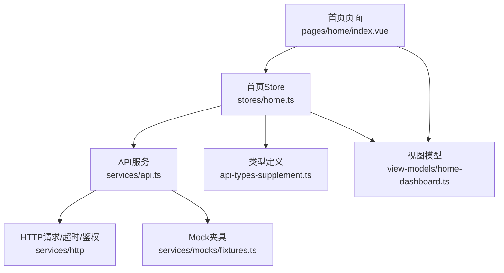
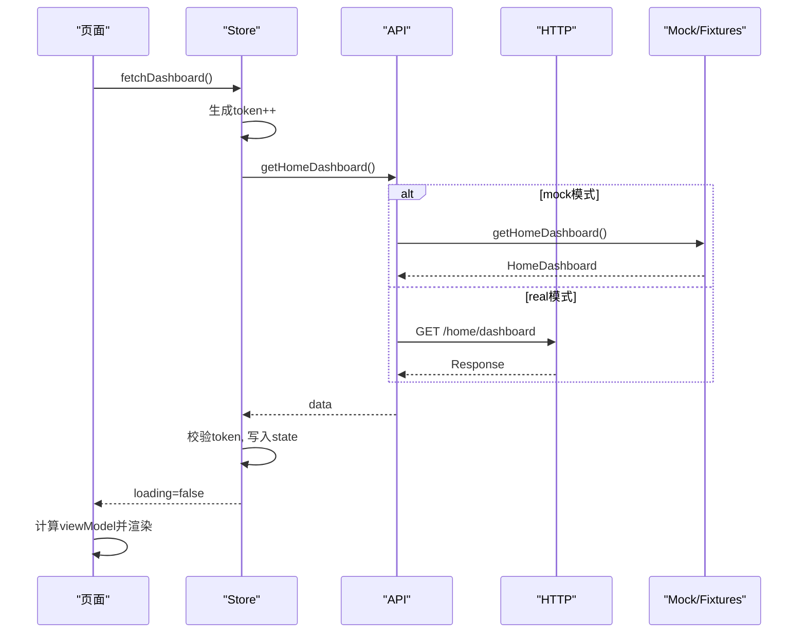
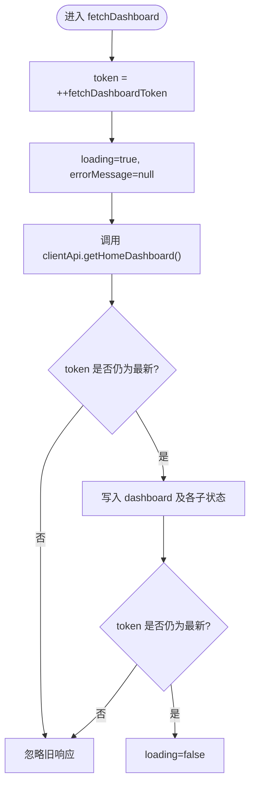
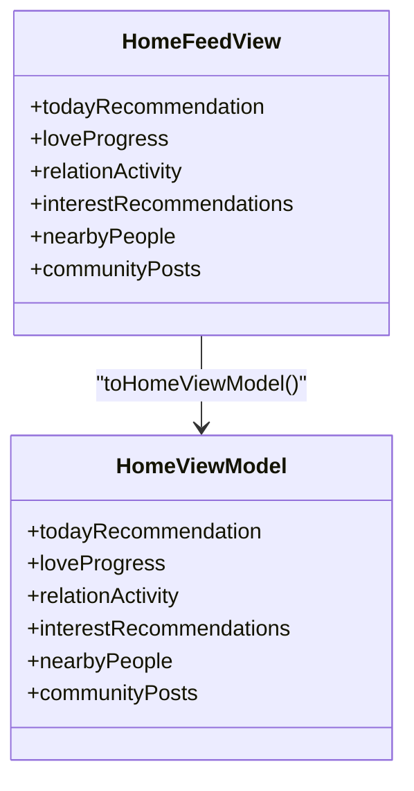
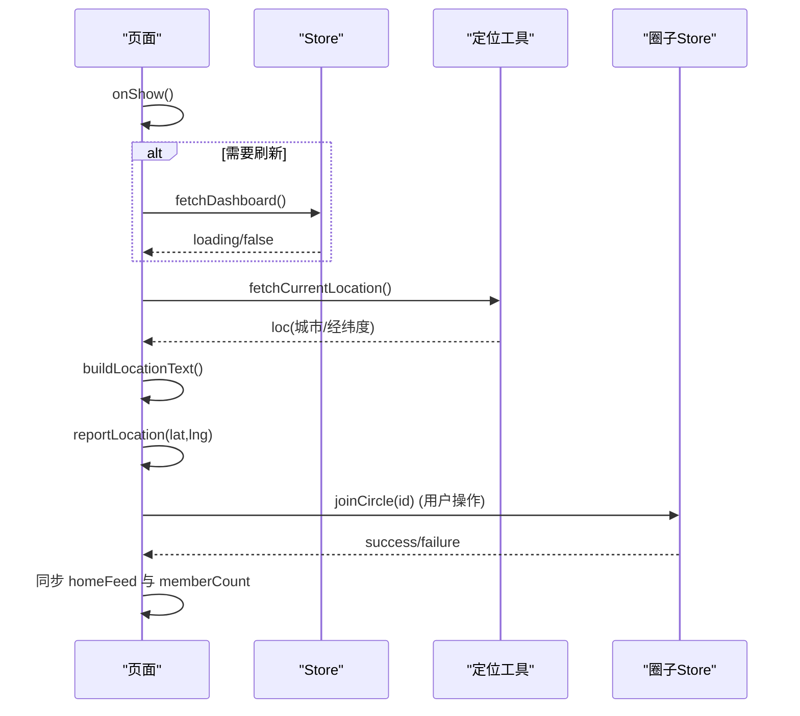
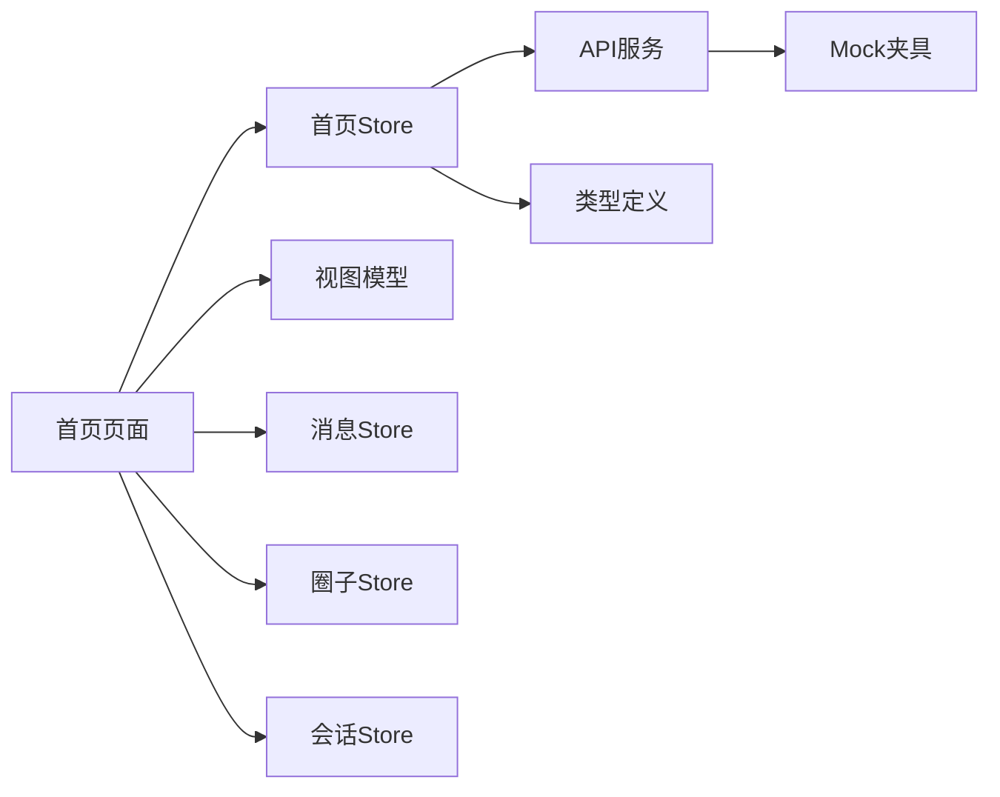

# 首页仪表盘状态

<cite>
**本文引用的文件**
- [apps/client/src/stores/home.ts](file://apps/client/src/stores/home.ts)
- [apps/client/src/view-models/home-dashboard.ts](file://apps/client/src/view-models/home-dashboard.ts)
- [apps/client/src/pages/home/index.vue](file://apps/client/src/pages/home/index.vue)
- [apps/client/src/services/api.ts](file://apps/client/src/services/api.ts)
- [apps/client/src/services/generated/api-types-supplement.ts](file://apps/client/src/services/generated/api-types-supplement.ts)
- [apps/client/src/services/mocks/fixtures.ts](file://apps/client/src/services/mocks/fixtures.ts)
- [apps/client/src/tests/home-feed-contract.spec.ts](file://apps/client/src/tests/home-feed-contract.spec.ts)
</cite>

## 目录
1. [简介](#简介)
2. [项目结构](#项目结构)
3. [核心组件](#核心组件)
4. [架构总览](#架构总览)
5. [详细组件分析](#详细组件分析)
6. [依赖关系分析](#依赖关系分析)
7. [性能与缓存策略](#性能与缓存策略)
8. [错误处理与重试机制](#错误处理与重试机制)
9. [故障排查指南](#故障排查指南)
10. [结论](#结论)

## 简介
本文件为“首页仪表盘”状态管理的技术文档，聚焦首页 Dashboard 的数据状态结构设计、状态更新流程、竞态控制、请求取消/覆盖策略、数据同步方案，以及与 Home Dashboard API 的集成方式。内容涵盖课表摘要、推荐人员、AI 计划、活动预览、讨论热度、匹配中心聚合、首页 Feed 聚合、今日推荐轮换等模块的状态协调；并给出预加载、缓存、性能优化、错误处理、重试与用户体验优化的实践建议。

## 项目结构
围绕首页仪表盘的关键代码组织如下：
- Store 层：home store 负责拉取与拆分 dashboard 数据、维护 loading/error、暴露 rotateTodayRecommendation 等动作。
- ViewModel 层：将后端 feed 数据转换为页面友好的视图模型（含相对时间、去重、默认值）。
- 页面层：home/index.vue 负责生命周期触发刷新、下拉刷新、登录态监听补拉、定位上报、交互防抖与 UI 编排。
- API 层：统一封装 getHomeDashboard、rotateTodayRecommendation，并在 mock 模式下返回 fixtures。
- 类型定义：api-types-supplement 中定义了 HomeDashboardWithDiscussion、HomeFeedView、TodayRecommendationView 等类型。
- Mock 数据：fixtures 提供 home dashboard 及轮换数据的种子数据，用于开发与测试。

**图示来源**
- [apps/client/src/stores/home.ts:1-117](file://apps/client/src/stores/home.ts#L1-L117)
- [apps/client/src/services/api.ts:437-452](file://apps/client/src/services/api.ts#L437-L452)
- [apps/client/src/view-models/home-dashboard.ts:1-128](file://apps/client/src/view-models/home-dashboard.ts#L1-L128)
- [apps/client/src/pages/home/index.vue:1-200](file://apps/client/src/pages/home/index.vue#L1-L200)

**章节来源**
- [apps/client/src/stores/home.ts:1-117](file://apps/client/src/stores/home.ts#L1-L117)
- [apps/client/src/services/api.ts:437-452](file://apps/client/src/services/api.ts#L437-L452)
- [apps/client/src/view-models/home-dashboard.ts:1-128](file://apps/client/src/view-models/home-dashboard.ts#L1-L128)
- [apps/client/src/pages/home/index.vue:1-200](file://apps/client/src/pages/home/index.vue#L1-L200)

## 核心组件
- 首页 Store（useHomeStore）
  - 状态：dashboard、loading、errorMessage、scheduleSummary、recommendedPeople、aiPlan、activityPreview、discussionHeat、matchCenter、homeFeed。
  - 动作：fetchDashboard、rotateTodayRecommendation。
  - 关键特性：使用 token 计数解决竞态问题；对非数组字段做防御性转换；错误与 loading 仅由最新请求生效。
- 视图模型（toHomeViewModel）
  - 将 HomeFeedView 转为 HomeViewModel，完成时间相对化、去重（nearbyPeople）、空值兜底。
- 页面（home/index.vue）
  - onShow/onPullDownRefresh/watch 登录态变化时触发刷新；设置 30s 陈旧阈值；定位获取与上报；交互防抖（like、rotate、joinCircle）。
- API（clientApi）
  - getHomeDashboard：mock 或 /home/dashboard。
  - rotateTodayRecommendation：mock 或 POST /home/today-recommendation/rotate。
- 类型（api-types-supplement）
  - HomeDashboardWithDiscussion、HomeFeedView、TodayRecommendationView 等，作为前后端契约的补充来源。

**章节来源**
- [apps/client/src/stores/home.ts:1-117](file://apps/client/src/stores/home.ts#L1-L117)
- [apps/client/src/view-models/home-dashboard.ts:1-128](file://apps/client/src/view-models/home-dashboard.ts#L1-L128)
- [apps/client/src/pages/home/index.vue:1-200](file://apps/client/src/pages/home/index.vue#L1-L200)
- [apps/client/src/services/api.ts:437-452](file://apps/client/src/services/api.ts#L437-L452)
- [apps/client/src/services/generated/api-types-supplement.ts:212-308](file://apps/client/src/services/generated/api-types-supplement.ts#L212-L308)

## 架构总览
首页仪表盘数据流遵循“页面触发 → Store 拉取 → API 调用 → 类型约束 → 视图模型转换 → 页面渲染”的单向数据流。Store 内部以 token 保证竞态安全，避免旧请求覆盖新状态；页面在 onShow、下拉刷新、登录态变化时进行数据刷新与定位上报；交互操作（如“换一位”）通过防抖与 pending 标志防止重复提交。

**图示来源**
- [apps/client/src/stores/home.ts:40-90](file://apps/client/src/stores/home.ts#L40-L90)
- [apps/client/src/services/api.ts:437-452](file://apps/client/src/services/api.ts#L437-L452)
- [apps/client/src/services/mocks/fixtures.ts:1443-1450](file://apps/client/src/services/mocks/fixtures.ts#L1443-L1450)

**章节来源**
- [apps/client/src/stores/home.ts:40-90](file://apps/client/src/stores/home.ts#L40-L90)
- [apps/client/src/services/api.ts:437-452](file://apps/client/src/services/api.ts#L437-L452)
- [apps/client/src/services/mocks/fixtures.ts:1443-1450](file://apps/client/src/services/mocks/fixtures.ts#L1443-L1450)

## 详细组件分析

### Store：首页状态与竞态控制
- 状态设计
  - dashboard：原始 HomeDashboard（包含 scheduleSummary、freeSlots、aiPlan、recommendedPeople、activityPreview、discussionHeat、matchCenter、homeFeed 等）。
  - 分片子状态：scheduleSummary、recommendedPeople、aiPlan、activityPreview、discussionHeat、matchCenter、homeFeed。
  - 通用状态：loading、errorMessage。
- 竞态控制
  - fetchDashboardToken：每次进入递增，仅当 token 与当前一致时才允许更新 state，确保快速切换/下拉刷新不会发生旧响应覆盖新结果。
  - 错误与 loading 同样受 token 保护。
- 数据转换与健壮性
  - recommendedPeople、activityPreview、discussionHeat 使用 Array.isArray 防护，避免非数组导致的方法调用失败。
  - discussionHeat 实际存在但 OpenAPI 未同步，使用类型断言收敛访问。
- 动作
  - rotateTodayRecommendation：调用 API 旋转今日推荐，并局部更新 homeFeed.todayRecommendation。

**图示来源**
- [apps/client/src/stores/home.ts:40-90](file://apps/client/src/stores/home.ts#L40-L90)

**章节来源**
- [apps/client/src/stores/home.ts:1-117](file://apps/client/src/stores/home.ts#L1-L117)

### 视图模型：首页 Feed 聚合
- toHomeViewModel 将 HomeFeedView 映射到 HomeViewModel：
  - todayRecommendation：直接透传或 null。
  - loveProgress：保持 completed/total/steps，缺失时提供默认值。
  - relationActivity：缺失时提供默认对象。
  - interestRecommendations：兴趣圈推荐列表。
  - nearbyPeople：按 userId 去重，避免后端硬编码导致的重复。
  - communityPosts：时间文本相对化、头像空值兜底。
- 优势
  - 将展示逻辑与业务数据分离，便于单元测试与 i18n 兼容。
  - 去重与默认值保障 UI 稳定性。

**图示来源**
- [apps/client/src/view-models/home-dashboard.ts:1-128](file://apps/client/src/view-models/home-dashboard.ts#L1-L128)
- [apps/client/src/services/generated/api-types-supplement.ts:260-281](file://apps/client/src/services/generated/api-types-supplement.ts#L260-L281)

**章节来源**
- [apps/client/src/view-models/home-dashboard.ts:1-128](file://apps/client/src/view-models/home-dashboard.ts#L1-L128)
- [apps/client/src/services/generated/api-types-supplement.ts:260-281](file://apps/client/src/services/generated/api-types-supplement.ts#L260-L281)

### 页面：首页交互与生命周期
- 数据刷新策略
  - onShow：若 homeFeed 为空、有错误或超过 30s 陈旧阈值，则静默重拉。
  - onPullDownRefresh：立即刷新并停止下拉动画。
  - watch(sessionStore.isLoggedIn)：登录后若无数据则补拉。
- 定位相关
  - 初始化与 BottomSheet 内主动刷新；失败降级为默认文案；上报坐标（节流）。
- 交互防抖与守卫
  - likeToday：登录检查、防重复点击、失败 toast。
  - rotateToday：登录检查、防重入、失败 toast。
  - joinCircle：pending 集合避免重复加入，成功后同步 homeFeed 与 circle store 数据。
- 路由跳转
  - 统一 openAppPath，带 fail 回调提示，避免静默失败。

**图示来源**
- [apps/client/src/pages/home/index.vue:1-200](file://apps/client/src/pages/home/index.vue#L1-L200)
- [apps/client/src/pages/home/index.vue:200-450](file://apps/client/src/pages/home/index.vue#L200-L450)

**章节来源**
- [apps/client/src/pages/home/index.vue:1-200](file://apps/client/src/pages/home/index.vue#L1-L200)
- [apps/client/src/pages/home/index.vue:200-450](file://apps/client/src/pages/home/index.vue#L200-L450)

### API：首页与轮换接口
- getHomeDashboard
  - mock：返回 fixtures 构建的 HomeDashboard。
  - real：GET /home/dashboard，返回 HomeDashboard。
- rotateTodayRecommendation
  - mock：返回 fixtures 提供的轮换数据。
  - real：POST /home/today-recommendation/rotate，返回 TodayRecommendationView | null。

**章节来源**
- [apps/client/src/services/api.ts:437-452](file://apps/client/src/services/api.ts#L437-L452)
- [apps/client/src/services/mocks/fixtures.ts:1443-1450](file://apps/client/src/services/mocks/fixtures.ts#L1443-L1450)

### 类型：HomeDashboardWithDiscussion 与 HomeFeedView
- HomeDashboardWithDiscussion：包含 scheduleSummary、freeSlots、aiPlan、recommendedPeople、activityPreview、discussionHeat、matchCenter、homeFeed。
- HomeFeedView：包含 todayRecommendation、loveProgress、relationActivity、interestRecommendations、nearbyPeople、communityPosts。
- TodayRecommendationView：描述今日推荐人物信息（userId/name/age/campusName/tags/bio/distance/photoUrl 等）。

**章节来源**
- [apps/client/src/services/generated/api-types-supplement.ts:212-308](file://apps/client/src/services/generated/api-types-supplement.ts#L212-L308)

## 依赖关系分析
- Store 依赖 API 与类型定义；页面依赖 Store 与 ViewModel；API 在 mock/real 间切换。
- 页面还依赖消息、圈子、会话 Store 以及定位工具；交互涉及 likes 与 circles。

**图示来源**
- [apps/client/src/stores/home.ts:1-117](file://apps/client/src/stores/home.ts#L1-L117)
- [apps/client/src/services/api.ts:437-452](file://apps/client/src/services/api.ts#L437-L452)
- [apps/client/src/pages/home/index.vue:1-200](file://apps/client/src/pages/home/index.vue#L1-L200)

**章节来源**
- [apps/client/src/stores/home.ts:1-117](file://apps/client/src/stores/home.ts#L1-L117)
- [apps/client/src/services/api.ts:437-452](file://apps/client/src/services/api.ts#L437-L452)
- [apps/client/src/pages/home/index.vue:1-200](file://apps/client/src/pages/home/index.vue#L1-L200)

## 性能与缓存策略
- 陈旧阈值刷新
  - 页面维护 lastFeedFetchTs，超过 30s 即静默重拉，避免论坛图片/首页数据更新不及时的问题。
- 预加载
  - onShow 中根据条件提前触发 fetchDashboard；登录态变化时自动补拉，保证登录后即刻呈现完整数据。
- 防抖与节流
  - 旋转推荐、点赞、加入圈子均具备防抖/pending 保护，避免并发请求与 UI 抖动。
- 数据去重
  - nearbyPeople 按 userId 去重，避免后端硬编码导致的重复显示。
- 资源与渲染
  - 社区动态时间相对化、头像空值兜底，减少异常渲染；BottomSheet 滚动遮罩提升可读性。

[本节为通用性能指导，无需特定文件引用]

## 错误处理与重试机制
- Store 错误处理
  - errorMessage 仅在最新 token 的请求中设置；错误信息来源于 Error.message 或默认文案；日志输出便于调试。
- 页面错误处理
  - 交互失败统一 uni.showToast 提示；路由跳转带 fail 回调提示；社区动态支持“重试”按钮触发 fetchDashboard。
- 登录门控
  - 未登录时不发受保护请求（getToken 守卫），避免 401 频繁出现；必要时引导登录。
- 重试建议
  - 对于网络异常或 5xx，可在 API 层增加指数退避重试；对 401 走刷新令牌流程或强踢登录页。
  - 对轮询场景（如定时刷新）可结合陈旧阈值与最小间隔，避免过度请求。

**章节来源**
- [apps/client/src/stores/home.ts:70-100](file://apps/client/src/stores/home.ts#L70-L100)
- [apps/client/src/pages/home/index.vue:1-200](file://apps/client/src/pages/home/index.vue#L1-L200)
- [apps/client/src/pages/home/index.vue:200-450](file://apps/client/src/pages/home/index.vue#L200-L450)

## 故障排查指南
- 现象：首页数据不更新
  - 检查 lastFeedFetchTs 是否被重置；确认 onShow 条件与 stale 阈值；查看 errorMessage 是否存在。
- 现象：下拉刷新无效
  - 确认 stopPullDownRefresh 调用；检查 loading 标志位与 token 是否被正确设置。
- 现象：旋转推荐无效果或乱序
  - 检查 rotateLoading 防重入标志；确认 API 返回值与 homeFeed.todayRecommendation 更新逻辑。
- 现象：加入圈子后人数不同步
  - 检查 joinPendingIds 与 homeFeed 同步逻辑；确认 circle store 成员数回填。
- 现象：定位信息不正确或未上报
  - 检查 fetchCurrentLocation 返回值；确认 reportLocation 调用与节流策略；城市来源区分（GPS/IP）。

**章节来源**
- [apps/client/src/pages/home/index.vue:1-200](file://apps/client/src/pages/home/index.vue#L1-L200)
- [apps/client/src/pages/home/index.vue:200-450](file://apps/client/src/pages/home/index.vue#L200-L450)
- [apps/client/src/stores/home.ts:40-100](file://apps/client/src/stores/home.ts#L40-L100)

## 结论
首页仪表盘的状态管理以 Store 为核心，配合 ViewModel 与页面生命周期，实现了高鲁棒性的数据流与交互体验。通过 token 竞态控制、陈旧阈值刷新、防抖与去重、错误提示与重试建议，保障了在多端环境下的稳定性与一致性。后续可继续完善 API 层重试策略、离线缓存与更细粒度的增量更新，进一步提升性能与用户体验。

[本节为总结性内容，无需特定文件引用]