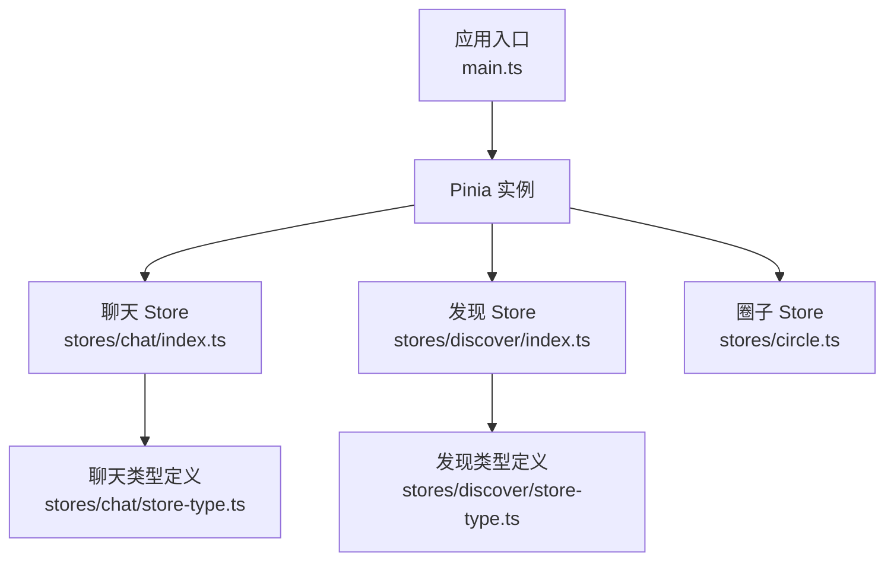
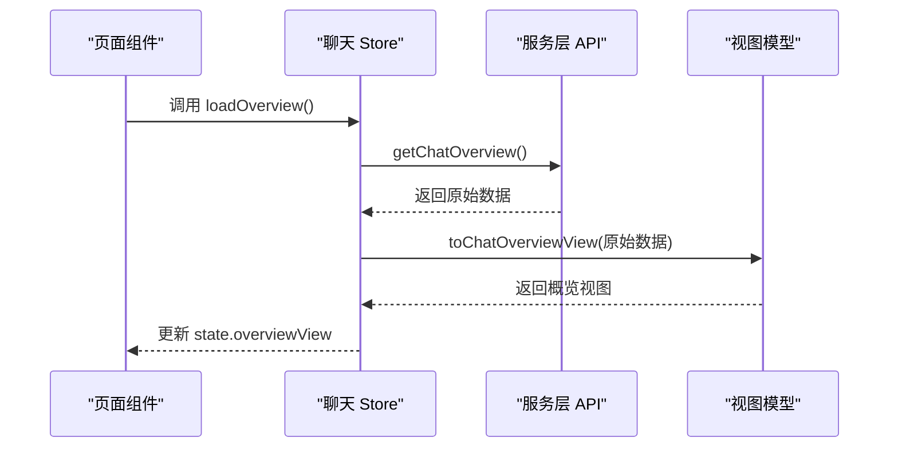
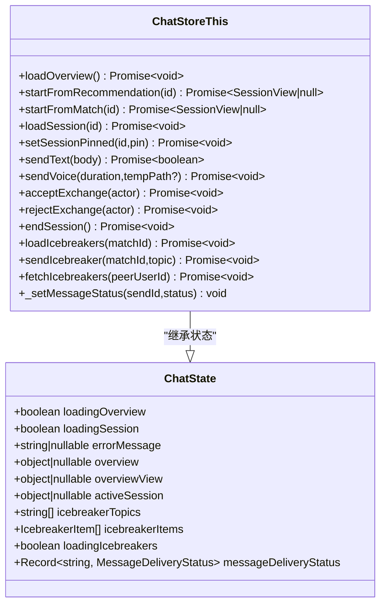
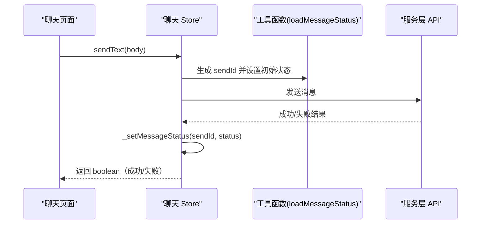
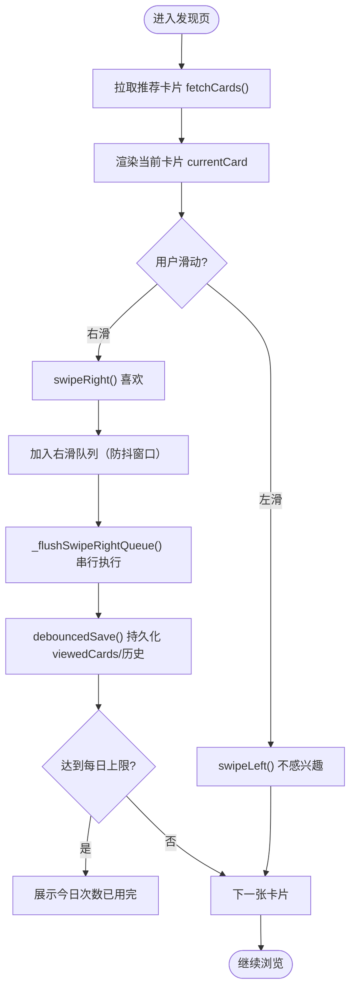
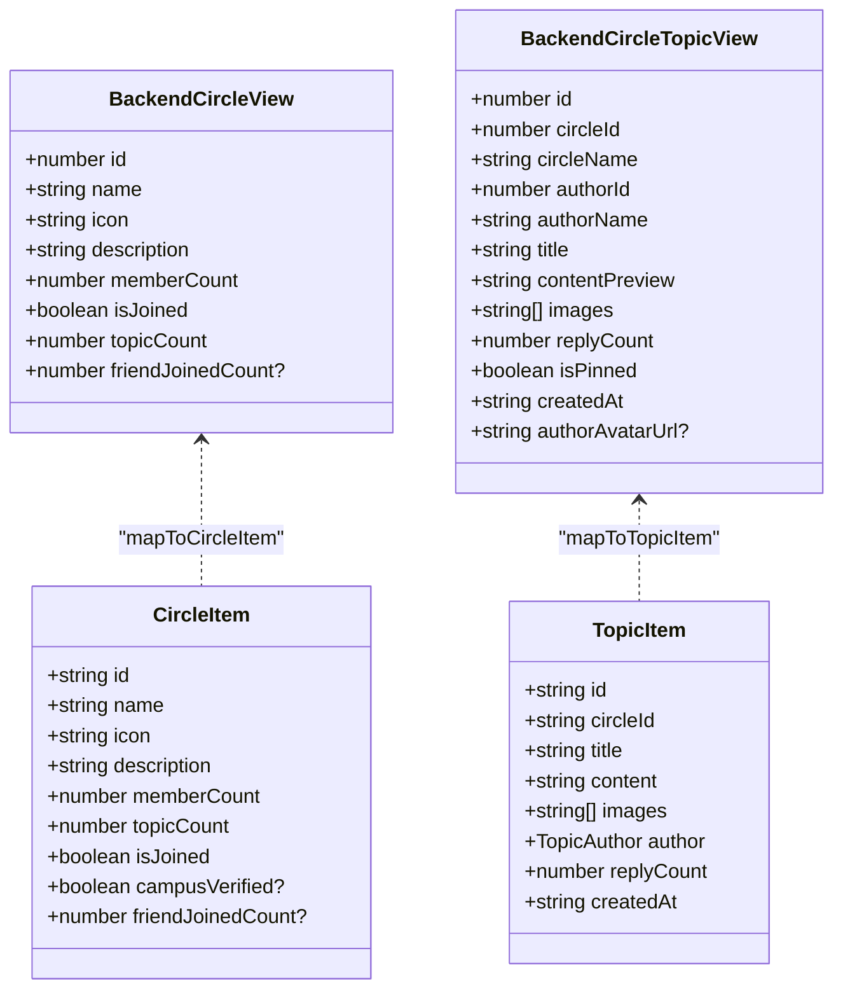
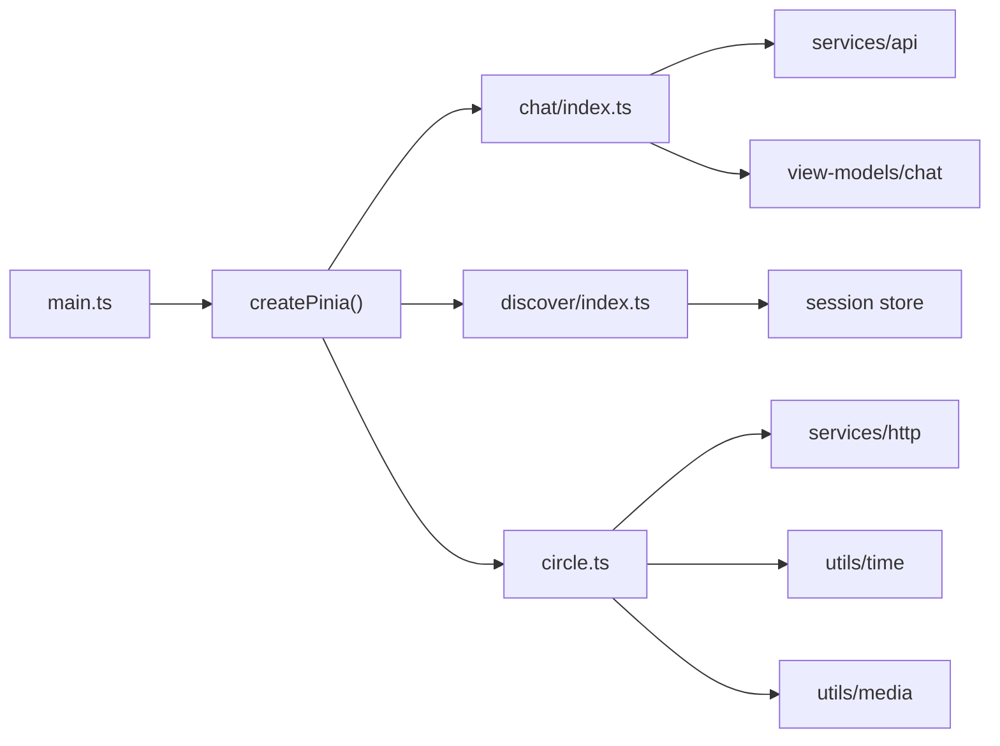

# 状态管理

<cite>
**本文引用的文件**
- [apps/client/src/main.ts](file://apps/client/src/main.ts)
- [apps/client/src/stores/chat/index.ts](file://apps/client/src/stores/chat/index.ts)
- [apps/client/src/stores/chat/store-type.ts](file://apps/client/src/stores/chat/store-type.ts)
- [apps/client/src/stores/discover/index.ts](file://apps/client/src/stores/discover/index.ts)
- [apps/client/src/stores/discover/store-type.ts](file://apps/client/src/stores/discover/store-type.ts)
- [apps/client/src/stores/circle.ts](file://apps/client/src/stores/circle.ts)
</cite>

## 目录
1. [简介](#简介)
2. [项目结构](#项目结构)
3. [核心组件](#核心组件)
4. [架构总览](#架构总览)
5. [详细组件分析](#详细组件分析)
6. [依赖关系分析](#依赖关系分析)
7. [性能考量](#性能考量)
8. [故障排查指南](#故障排查指南)
9. [结论](#结论)
10. [附录](#附录)

## 简介
本技术文档围绕 Pinia 状态管理系统，系统化梳理应用的状态管理模式、模块化设计与状态持久化策略。重点覆盖以下领域：
- 聊天状态（会话生命周期、消息发送、联系方式交换、破冰话题）
- 发现匹配状态（推荐卡片、滑动操作、每日限量与时间门控、回看与筛选）
- 圈子状态（圈列表、话题与回复的建模与渲染映射）
- 类型定义、Action 设计模式、异步状态处理
- 状态同步机制、数据缓存策略、状态恢复逻辑
- 跨组件共享、监听与响应式更新
- 调试工具、性能优化技巧、常见陷阱
- 单元测试编写、Mock 数据管理与状态迁移方案

## 项目结构
Pinia 在应用中通过入口初始化并挂载到 Vue 实例；各业务模块以独立 store 文件组织，按“store 主体 + actions 拆分 + 类型定义”的结构进行解耦。关键路径：
- 应用入口：创建 Pinia 实例、注册主题等全局能力
- 聊天 Store：集中管理会话与消息流
- 发现 Store：负责推荐卡片与滑动交互
- 圈子 Store：负责兴趣圈、话题与回复的数据建模与视图映射

**图表来源**
- [apps/client/src/main.ts:1-122](file://apps/client/src/main.ts#L1-L122)
- [apps/client/src/stores/chat/index.ts:1-131](file://apps/client/src/stores/chat/index.ts#L1-L131)
- [apps/client/src/stores/discover/index.ts:1-200](file://apps/client/src/stores/discover/index.ts#L1-L200)
- [apps/client/src/stores/circle.ts:1-200](file://apps/client/src/stores/circle.ts#L1-L200)

**章节来源**
- [apps/client/src/main.ts:1-122](file://apps/client/src/main.ts#L1-L122)

## 核心组件
- 聊天 Store
  - 职责：概览加载、会话生命周期、消息发送、联系方式交换、破冰话题
  - 特点：消息投递状态持久化，支持刷新后恢复；actions 拆分为 session/messaging/exchange/icebreakers
- 发现 Store
  - 职责：推荐卡片获取、滑动操作、每日限量与倒计时、历史与在线状态、筛选与搜索
  - 特点：本地存储防抖保存、配额耗尽标记、队列化右滑串行执行
- 圈子 Store
  - 职责：圈列表、话题与回复的数据建模与视图映射、头像与媒体解析
  - 特点：后端视图到前端类型的转换函数集中，便于统一格式化和扩展

**章节来源**
- [apps/client/src/stores/chat/index.ts:1-131](file://apps/client/src/stores/chat/index.ts#L1-L131)
- [apps/client/src/stores/discover/index.ts:1-200](file://apps/client/src/stores/discover/index.ts#L1-L200)
- [apps/client/src/stores/circle.ts:1-200](file://apps/client/src/stores/circle.ts#L1-L200)

## 架构总览
Pinia 作为全局状态容器，在各 store 中以 defineStore 声明 state/getters/actions。store 间可通过 useSessionStore 等组合式接口共享会话上下文；store 内部 action 可调用 services/api 或自定义 request 进行网络请求，并通过 view-models 或映射函数将后端数据转换为前端模型。

**图表来源**
- [apps/client/src/stores/chat/index.ts:1-131](file://apps/client/src/stores/chat/index.ts#L1-L131)

## 详细组件分析

### 聊天状态（Chat Store）
- 状态设计
  - 概览与活跃会话：loadingOverview/loadingSession、overview、overviewView、activeSession
  - 破冰话题：icebreakerTopics、icebreakerItems、loadingIcebreakers
  - 消息投递状态：messageDeliveryStatus（sendId -> status），支持持久化恢复
- Action 装配
  - 会话生命周期：loadOverview、startFromRecommendation、startFromMatch、startFromSignal、loadSession、setSessionPinned、endSession
  - 消息发送：sendText、sendVoice、_setMessageStatus
  - 联系方式交换：acceptExchange、rejectExchange
  - 破冰话题：loadIcebreakers、sendIcebreaker、fetchIcebreakers
- 类型系统
  - 通过 store-type.ts 显式声明 ChatStoreThis，保证拆分 action 文件的 this 类型安全
  - 包含 IcebreakerItem、MessageDeliveryStatus 等类型

**图表来源**
- [apps/client/src/stores/chat/store-type.ts:1-129](file://apps/client/src/stores/chat/store-type.ts#L1-L129)
- [apps/client/src/stores/chat/index.ts:1-131](file://apps/client/src/stores/chat/index.ts#L1-L131)

**章节来源**
- [apps/client/src/stores/chat/index.ts:1-131](file://apps/client/src/stores/chat/index.ts#L1-L131)
- [apps/client/src/stores/chat/store-type.ts:1-129](file://apps/client/src/stores/chat/store-type.ts#L1-L129)

#### 聊天消息发送流程（序列图）

**图表来源**
- [apps/client/src/stores/chat/index.ts:1-131](file://apps/client/src/stores/chat/index.ts#L1-L131)
- [apps/client/src/stores/chat/store-type.ts:1-129](file://apps/client/src/stores/chat/store-type.ts#L1-L129)

### 发现匹配状态（Discover Store）
- 状态设计
  - 卡片与历史：cards、historyCards、passedCards、viewedCards
  - 配额与时间：dailyLimit、extraQuota、quotaExhausted、nextRefreshTime、countdownSeconds/countdownText
  - 过滤与搜索：activeFilter、recommendationFilter、advancedFilter、searchKeyword
  - 在线状态：onlineStatusMap、lastSwipeResult、undoCount
- Getters
  - currentCard、usedCount、remainingCount、isLimitReached、likedUserIds、countdownSeconds、countdownText
- Action 装配
  - 卡片获取：fetchCards、syncHistoryCards
  - 滑动操作：swipeLeft、swipeRight、_doSwipeRight、_flushSwipeRightQueue
  - 反悔与重置：resetLastResult、rewindCard
  - 存储相关：resetDailyLimit、debouncedSave、saveToStorage、forceResetDailyLimit、dispose
  - 历史与在线：loadHistory、fetchOnlineStatus、setExtraQuota
  - 筛选相关：setFilter、setRecommendationFilter、setSortBy、setMatchScope、setNearbyScope、setDiscoverMode、resetFilter、setAdvancedFilter、resetAdvancedFilter、openFilterDrawer、closeFilterDrawer、setSearchKeyword、applyQuickFilter

**图表来源**
- [apps/client/src/stores/discover/index.ts:1-200](file://apps/client/src/stores/discover/index.ts#L1-L200)
- [apps/client/src/stores/discover/store-type.ts:1-97](file://apps/client/src/stores/discover/store-type.ts#L1-L97)

**章节来源**
- [apps/client/src/stores/discover/index.ts:1-200](file://apps/client/src/stores/discover/index.ts#L1-L200)
- [apps/client/src/stores/discover/store-type.ts:1-97](file://apps/client/src/stores/discover/store-type.ts#L1-L97)

### 圈子状态（Circle Store）
- 数据建模
  - 后端视图类型：BackendCircleView、BackendCircleTopicView、BackendCircleReplyView、BackendCircleMembershipView
  - 前端模型：CircleItem、TopicAuthor、TopicItem、TopicDetail、ReplyItem
- 映射函数
  - mapToCircleItem、mapToTopicItem、mapToTopicDetail、mapToReplyItem
- 资源解析
  - 头像与媒体 URL 经 resolveMediaUrl 统一解析，避免裂图与鉴权问题
- 行为
  - 圈列表加载、话题详情加载、回复列表加载与提交（由具体 action 实现，此处聚焦数据结构）

**图表来源**
- [apps/client/src/stores/circle.ts:1-200](file://apps/client/src/stores/circle.ts#L1-L200)

**章节来源**
- [apps/client/src/stores/circle.ts:1-200](file://apps/client/src/stores/circle.ts#L1-L200)

## 依赖关系分析
- 应用入口 main.ts 创建 Pinia 并注入主题初始化，随后安装 i18n 与 Sentry，形成全局错误上报通道
- 聊天 Store 依赖 services/api 与 view-models/chat，通过 toChatOverviewView/toChatSessionView 完成数据到视图模型的转换
- 发现 Store 依赖 session store 获取超级测试账号旁路，使用 timers 与 utils 实现防抖与本地存储
- 圈子 Store 依赖 http/request、utils/time、utils/media 及 i18n，进行时间格式化与媒体解析

**图表来源**
- [apps/client/src/main.ts:1-122](file://apps/client/src/main.ts#L1-L122)
- [apps/client/src/stores/chat/index.ts:1-131](file://apps/client/src/stores/chat/index.ts#L1-L131)
- [apps/client/src/stores/discover/index.ts:1-200](file://apps/client/src/stores/discover/index.ts#L1-L200)
- [apps/client/src/stores/circle.ts:1-200](file://apps/client/src/stores/circle.ts#L1-L200)

**章节来源**
- [apps/client/src/main.ts:1-122](file://apps/client/src/main.ts#L1-L122)
- [apps/client/src/stores/chat/index.ts:1-131](file://apps/client/src/stores/chat/index.ts#L1-L131)
- [apps/client/src/stores/discover/index.ts:1-200](file://apps/client/src/stores/discover/index.ts#L1-L200)
- [apps/client/src/stores/circle.ts:1-200](file://apps/client/src/stores/circle.ts#L1-L200)

## 性能考量
- 聊天 Store
  - 消息投递状态持久化减少重复请求与误判，提升用户体验
  - 使用 view-models 转换数据，避免在模板中做复杂计算
- 发现 Store
  - 右滑队列串行执行，避免并发请求导致的状态不一致
  - debouncedSave 降低本地存储写入频率，提高滚动与滑动流畅度
  - 配额耗尽标记防止误导性的“暂无推荐”，减少无效渲染
- 圈子 Store
  - 统一媒体 URL 解析，减少图片加载失败与鉴权问题导致的重绘
  - 时间格式化收敛至单一实现，避免重复计算

[本节为通用指导，不直接分析具体代码文件]

## 故障排查指南
- 应用启动阶段
  - 确认 main.ts 中 createPinia 与 useThemeStore 初始化顺序正确，确保主题状态在 store 使用前可用
  - 全局错误处理器 uni.onError 与 uni.onUnhandledRejection 是否注册，确保未捕获异常能上报
- 聊天 Store
  - 若消息状态丢失，检查 messageDeliveryStatus 的持久化与恢复逻辑（loadMessageStatus）
  - 若 sendText 返回值不符合预期，确认 action 返回布尔值用于页面差分检测
- 发现 Store
  - 若滑动无响应，检查右滑队列 flush 是否被触发以及防抖窗口配置
  - 若配额显示异常，核对 dailyLimit、extraQuota 与 viewedCards 的计算逻辑
- 圈子 Store
  - 若头像或图片裂图，确认 resolveMediaUrl 是否正确解析后端返回的路径

**章节来源**
- [apps/client/src/main.ts:1-122](file://apps/client/src/main.ts#L1-L122)
- [apps/client/src/stores/chat/index.ts:1-131](file://apps/client/src/stores/chat/index.ts#L1-L131)
- [apps/client/src/stores/discover/index.ts:1-200](file://apps/client/src/stores/discover/index.ts#L1-L200)
- [apps/client/src/stores/circle.ts:1-200](file://apps/client/src/stores/circle.ts#L1-L200)

## 结论
本项目基于 Pinia 构建了清晰的状态管理体系：以 store 为单位划分职责，通过类型定义保障拆分 action 的类型安全，结合 view-models 与映射函数完成后端数据到前端模型的转换。聊天、发现、圈子三大模块分别覆盖了即时通讯、匹配推荐与社区内容场景，具备完善的异步处理、持久化与性能优化策略。建议在后续迭代中持续完善单元测试、Mock 数据与状态迁移方案，确保状态演进的稳定性与可维护性。

## 附录
- 单元测试建议
  - 针对每个 store 的 action 编写用例，模拟 API 返回与本地存储变化
  - 对异步流程（如消息发送、右滑队列）断言状态变更时序
- Mock 数据管理
  - 将 mock 数据集中在 stores/*/mock-data.ts，按需导入，避免污染真实环境
  - 在 chat store 中限制 mock 数据的通配 re-export，明确引用面
- 状态迁移方案
  - 对 store 版本进行编号，迁移脚本读取旧版状态并映射到新版结构
  - 在应用启动时执行迁移，确保兼容历史数据

[本节为通用指导，不直接分析具体代码文件]