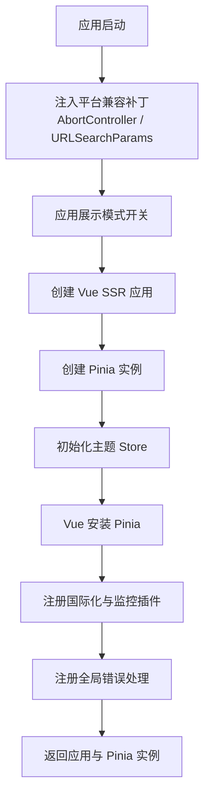
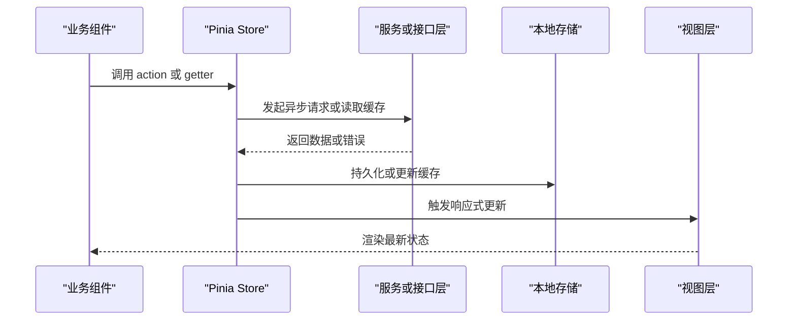
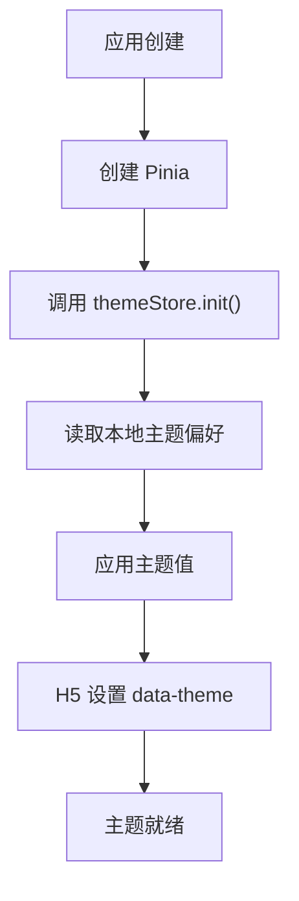
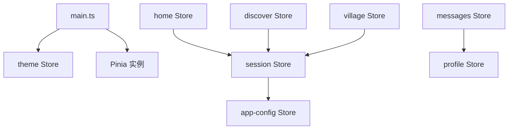
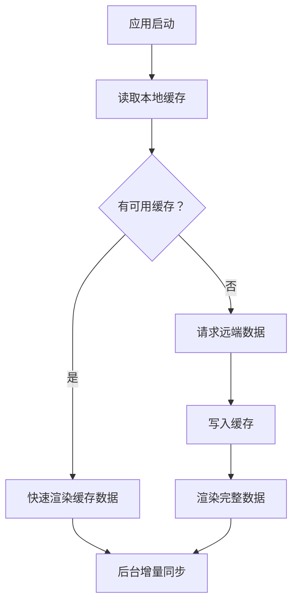
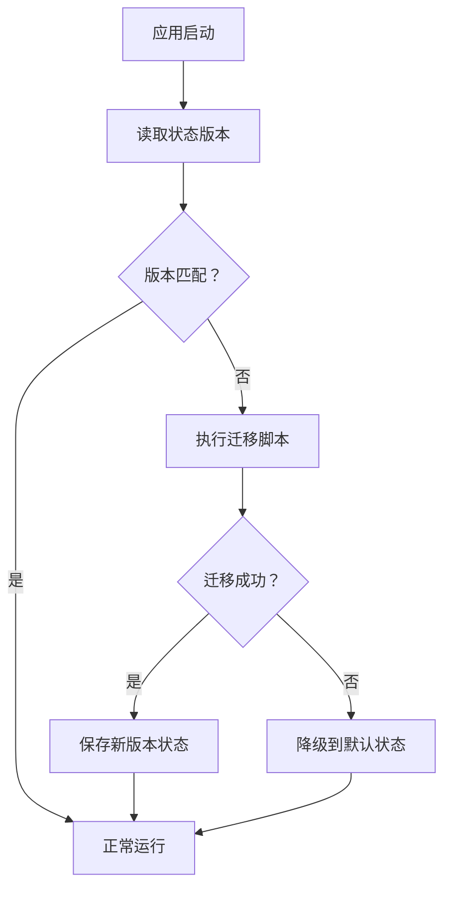

# 状态管理概览

<cite>
**本文引用的文件**   
- [apps/client/src/main.ts](file://apps/client/src/main.ts)
- [apps/client/src/stores/session.ts](file://apps/client/src/stores/session.ts)
- [apps/client/src/stores/app-config.ts](file://apps/client/src/stores/app-config.ts)
- [apps/client/src/stores/theme.ts](file://apps/client/src/stores/theme.ts)
- [apps/client/src/stores/home.ts](file://apps/client/src/stores/home.ts)
- [apps/client/src/stores/messages.ts](file://apps/client/src/stores/messages.ts)
- [apps/client/src/stores/profile.ts](file://apps/client/src/stores/profile.ts)
- [apps/client/src/stores/discover/index.ts](file://apps/client/src/stores/discover/index.ts)
- [apps/client/src/stores/village/index.ts](file://apps/client/src/stores/village/index.ts)
- [scripts/eval_pinia.ps1](file://scripts/eval_pinia.ps1)
</cite>

## 目录
1. [引言](#引言)
2. [项目结构与 Pinia 初始化位置](#项目结构与-pinia-初始化位置)
3. [核心 Store 总览](#核心-store-总览)
4. [架构与数据流](#架构与数据流)
5. [关键 Store 设计分析](#关键-store-设计分析)
6. [依赖关系、异步处理与错误处理](#依赖关系异步处理与错误处理)
7. [状态持久化与缓存策略](#状态持久化与缓存策略)
8. [调试、性能优化与最佳实践](#调试性能优化与最佳实践)
9. [状态迁移、版本管理与测试策略](#状态迁移版本管理与测试策略)
10. [故障排查指南](#故障排查指南)
11. [结论](#结论)

## 引言
本文面向使用 Vue 与 Pinia 的前端客户端，目标是给出一个完整的“状态管理概览”。文档不仅解释 Store 的组织方式、注册流程和全局状态管理模式，还会深入分析 session、app-config、theme 三个核心 Store 的设计理念与实现模式，并覆盖状态持久化、同步机制、缓存方案、Store 间依赖、异步操作、错误处理、调试工具、性能优化、状态迁移和测试策略。

该应用采用 Pinia 作为单一状态源，结合小程序与 H5 多端运行时环境；状态初始化发生在应用创建阶段，并在主题等模块中直接操作运行期平台能力（例如 data-theme）。

## 项目结构与 Pinia 初始化位置
Pinia 的实例化与应用挂载流程集中在客户端入口文件中。整体顺序为：
1. 注入 AbortController 与 URLSearchParams polyfill，确保后续 store/service 能安全使用网络与 URL API。
2. 应用展示模式开关。
3. 创建 SSR 应用实例。
4. 创建 Pinia 实例。
5. 立即初始化 theme Store，以便在挂载前恢复上次主题并设置 H5 data-theme。
6. 将 Pinia 安装到 Vue 应用。
7. 注册 i18n、Sentry、全局错误处理器与小程序全局错误监听。

**图表来源**
- [apps/client/src/main.ts:1-122](file://apps/client/src/main.ts#L1-L122)

**章节来源**
- [apps/client/src/main.ts:1-122](file://apps/client/src/main.ts#L1-L122)

## 核心 Store 总览
当前仓库中存在大量按业务域划分的 Store，包括但不限于 session、app-config、theme、home、messages、profile、discover、village、circle、likes、activity、checkin、campus、report、vip、social-progress、schedule、unlock-guide、promo-code、search、daily-question、chat、campus-wall 等。其中 session、app-config、theme 属于系统级基础状态，其余多为功能域状态。

| 类别 | 典型 Store | 职责概述 |
| --- | --- | --- |
| 系统级基础状态 | session、app-config、theme | 会话身份、应用配置、主题与显示模式 |
| 页面级状态 | home、discover、village | 首页、发现页、村庄等页面的列表、分页与交互态 |
| 消息与社交状态 | messages、likes、social-progress | 消息、点赞、社交进度等跨页面共享状态 |
| 用户与资料状态 | profile | 用户资料、认证、头像等信息 |
| 运营与活动状态 | activity、checkin、daily-question、promo-code | 签到、每日任务、活动、优惠码等业务状态 |
| 会员与计费状态 | vip、vip-billing、vip-auto-renew | 会员权益、账单与自动续费状态 |
| 内容与管理状态 | circle、campus、report、feedback | 圈子、校园墙、举报反馈等内容治理状态 |
| 工具与辅助状态 | search、schedule、unlock-guide、coins | 搜索、日程、解锁引导、金币等辅助状态 |

从组织方式看，Store 以“功能域 + 子模块”为主：顶层 stores 目录下按领域放置单个 Store 文件，部分复杂领域（如 discover、village、chat）再拆分为 index 与类型定义文件。

**章节来源**
- [apps/client/src/stores/session.ts](file://apps/client/src/stores/session.ts)
- [apps/client/src/stores/app-config.ts](file://apps/client/src/stores/app-config.ts)
- [apps/client/src/stores/theme.ts](file://apps/client/src/stores/theme.ts)
- [apps/client/src/stores/home.ts](file://apps/client/src/stores/home.ts)
- [apps/client/src/stores/messages.ts](file://apps/client/src/stores/messages.ts)
- [apps/client/src/stores/profile.ts](file://apps/client/src/stores/profile.ts)
- [apps/client/src/stores/discover/index.ts](file://apps/client/src/stores/discover/index.ts)
- [apps/client/src/stores/village/index.ts](file://apps/client/src/stores/village/index.ts)

## 架构与数据流
Pinia 在该应用中承担“全局状态容器”的角色，组件通过组合式 API 获取 Store，修改状态后由响应式驱动视图更新。数据流向通常如下：

该流程强调：
- Store 是组件与服务之间的中介，避免组件直接耦合网络或服务逻辑。
- 需要跨页面共享的数据放在 Store，而非组件内部状态。
- 异步结果应先落盘或进入缓存，再交给视图消费，保证刷新与回退一致性。

**图表来源**
- [apps/client/src/main.ts:1-122](file://apps/client/src/main.ts#L1-L122)

## 关键 Store 设计分析

### session Store：会话与会话生命周期
session Store 负责维护登录态、用户标识、权限、临时令牌等会话信息。它通常承担以下职责：
- 登录后写入用户基本信息。
- 登出时清理敏感状态。
- 根据后端返回的会话结构适配前端字段。
- 与 app-config 或 theme 协作，决定登录后是否跳转到指定页面。

典型行为包括：
- 初始化时检查本地是否存在有效会话。
- 提供 login、logout、refreshSession 等 action。
- 暴露 isLogin、userInfo、token 等 getter。

由于该 Store 涉及安全信息，应避免将其持久化为明文；必要时仅保存 token 或加密后的会话摘要，并配合过期校验。

**章节来源**
- [apps/client/src/stores/session.ts](file://apps/client/src/stores/session.ts)

### app-config Store：应用配置与运行时开关
app-config Store 负责集中管理应用级配置，例如：
- 功能开关。
- 服务端地址与环境标识。
- 展示模式、灰度实验、A/B 分组。
- 可动态下发的运行时配置。

其设计要点：
- 区分“构建期配置”和“运行期配置”，后者应支持远程拉取并缓存。
- 提供 getConfig、setConfig、resetConfig 等方法。
- 对敏感配置做最小化暴露，避免组件随意修改。
- 与其他 Store 解耦，只通过 getter 输出稳定结构。

**章节来源**
- [apps/client/src/stores/app-config.ts](file://apps/client/src/stores/app-config.ts)

### theme Store：主题初始化与平台适配
theme Store 负责主题选择、深色模式、H5 data-theme 设置等。入口文件会在 Pinia 创建后立即调用 theme Store 的 init 方法，说明其初始化时机早于组件挂载。

典型职责包括：
- 从本地存储恢复上次主题。
- 在 H5 环境设置 documentElement 或根节点 data-theme。
- 在小程序或其他平台映射主题值。
- 提供 switchTheme、init、getTheme 等方法。

**图表来源**
- [apps/client/src/main.ts:1-122](file://apps/client/src/main.ts#L1-L122)
- [apps/client/src/stores/theme.ts](file://apps/client/src/stores/theme.ts)

**章节来源**
- [apps/client/src/main.ts:1-122](file://apps/client/src/main.ts#L1-L122)
- [apps/client/src/stores/theme.ts](file://apps/client/src/stores/theme.ts)

## 依赖关系、异步处理与错误处理

### Store 间依赖关系
- theme Store 依赖应用初始化时机，由 main.ts 主动调用 init。
- session Store 可能与 app-config Store 协作，依据配置判断是否需要强制登录、跳转或降级。
- 业务 Store（如 home、discover、village）可能依赖 session 判断是否拉取用户相关数据。
- messages、profile、likes 等 Store 之间可能存在间接依赖，但应尽量避免循环依赖，优先通过服务层或事件总线协调。

**图表来源**
- [apps/client/src/main.ts:1-122](file://apps/client/src/main.ts#L1-L122)
- [apps/client/src/stores/theme.ts](file://apps/client/src/stores/theme.ts)
- [apps/client/src/stores/session.ts](file://apps/client/src/stores/session.ts)
- [apps/client/src/stores/app-config.ts](file://apps/client/src/stores/app-config.ts)
- [apps/client/src/stores/home.ts](file://apps/client/src/stores/home.ts)
- [apps/client/src/stores/messages.ts](file://apps/client/src/stores/messages.ts)
- [apps/client/src/stores/profile.ts](file://apps/client/src/stores/profile.ts)
- [apps/client/src/stores/discover/index.ts](file://apps/client/src/stores/discover/index.ts)
- [apps/client/src/stores/village/index.ts](file://apps/client/src/stores/village/index.ts)

### 异步操作处理
Store 中的异步 action 建议遵循统一模式：
- 使用 loading 标志区分初始加载、下拉刷新、分页加载更多。
- 明确 error 字段记录失败原因，便于 UI 提示与上报。
- 成功路径先更新本地缓存，再更新视图状态，保证弱网体验。
- 对于幂等操作，可结合 key 去重，防止重复请求。

### 错误处理模式
应用已在入口层注册全局错误处理：
- Vue 组件内未捕获错误通过 app.config.errorHandler 上报。
- 小程序环境中 uni.onError 与 uni.onUnhandledRejection 也被接入统一上报通道。
- Store 内部应继续细化错误分类，例如网络错误、业务错误、权限错误，并向上抛出结构化错误对象。

**章节来源**
- [apps/client/src/main.ts:1-122](file://apps/client/src/main.ts#L1-L122)

## 状态持久化与缓存策略

### 持久化策略
建议将状态分层：
- 热状态：仅内存保存，如当前 tab、弹窗状态、表单草稿。
- 会话状态：token、userId 等，需持久化但注意脱敏与过期。
- 配置状态：app-config、theme 等，适合持久化并支持远端覆盖。
- 列表缓存：home、discover、village 等分页数据，按业务 key 缓存，设置 TTL。

推荐规则：
- 不要无脑持久化整个 Store，避免体积膨胀。
- 对大数组使用分页键，例如“话题列表_第N页”。
- 对敏感数据使用加密或仅保留引用。
- 升级时执行迁移脚本，清除不兼容旧字段。

### 同步机制
- 首次启动：优先读本地缓存，再与远端同步。
- 后台切换：onShow 或 onLaunch 时触发增量同步。
- 冲突解决：以服务端时间戳为准，合并差异字段。
- 离线降级：网络失败时使用缓存，并标记待同步。

[本图为概念流程图，不直接对应具体源码文件]

## 调试、性能优化与最佳实践

### 调试工具
- 使用浏览器 DevTools 或小程序开发者工具的 Pinia 面板查看状态树。
- 使用仓库提供的评估脚本 inspect 状态，例如 eval_pinia.ps1。
- 在开发环境开启 Pinia Devtools，便于追踪 mutation 与 action。
- 对热点 Store 添加日志埋点，记录关键 action 的入参、耗时与错误。

**章节来源**
- [scripts/eval_pinia.ps1](file://scripts/eval_pinia.ps1)

### 性能优化技巧
- 按需引入 Store，避免一次性 import 全部 store 导致打包体积过大。
- 使用 getters 计算派生状态，减少重复计算。
- 对大列表使用虚拟滚动与分页加载。
- 避免在高频回调中频繁读写 Store，尽量批量更新。
- 对不可变数据结构使用浅比较，降低响应式开销。
- 将不常变化的配置放入 app-config，减少重复请求。

### 最佳实践
- 每个 Store 职责单一，命名清晰。
- action 表达意图，mutation 只改状态。
- 错误信息结构化，包含 code、message、retryable。
- 状态迁移集中管理，避免散落在各 Store。
- 对关键 Store 编写单元测试与集成测试。

## 状态迁移、版本管理与测试策略

### 状态迁移
建议为持久化状态增加 version 字段，并在应用启动时执行迁移：
- 新增字段：赋予默认值。
- 删除字段：忽略旧字段。
- 字段改名：按旧键名读取并写入新键名。
- 数据结构升级：遍历数组逐项转换。
- 失败保护：迁移失败时回滚或降级到空状态。

[本图为概念流程图，不直接对应具体源码文件]

### 版本管理
- 使用语义化版本号管理状态 schema。
- 迁移脚本与业务版本绑定，发布前验证。
- 保留历史迁移记录，方便回溯问题。
- 对多端环境分别验证迁移结果。

### 测试策略
- 单元测试：针对 Store 的 action、getter、迁移函数。
- 集成测试：模拟网络返回、本地缓存、主题初始化。
- 端到端测试：覆盖登录、主题切换、列表加载等关键流程。
- 快照测试：用于确认 Store 输出结构稳定，避免无意破坏。

**章节来源**
- [apps/client/src/stores/theme.ts](file://apps/client/src/stores/theme.ts)
- [apps/client/src/stores/app-config.ts](file://apps/client/src/stores/app-config.ts)
- [apps/client/src/stores/session.ts](file://apps/client/src/stores/session.ts)

## 故障排查指南

| 现象 | 可能原因 | 排查步骤 | 建议修复 |
| --- | --- | --- | --- |
| 主题未生效 | themeStore.init 未执行或平台不支持 data-theme | 检查 main.ts 中 Pinia 创建后是否调用 themeStore.init | 确保初始化顺序正确，并兼容平台差异 |
| 登录后仍显示未登录 | session 状态未持久化或已过期 | 检查 session Store 的登录 action 与本地存储 | 完善 token 校验与自动刷新逻辑 |
| 列表反复请求 | 缓存 key 不一致或未设置过期 | 检查 Store 中分页 key 与缓存策略 | 规范化 key 生成与 TTL 管理 |
| 全局错误未上报 | 错误未在 errorHandler 或小程序监听中捕获 | 检查入口错误处理器注册 | 统一错误出口并记录上下文 |
| Pinia 状态为空 | 应用启动时未初始化或缓存损坏 | 使用 eval_pinia.ps1 检查状态树 | 清理无效缓存并重试迁移 |

**章节来源**
- [apps/client/src/main.ts:1-122](file://apps/client/src/main.ts#L1-L122)
- [scripts/eval_pinia.ps1](file://scripts/eval_pinia.ps1)

## 结论
该项目的 Pinia 状态管理以 session、app-config、theme 为核心基础，围绕业务域进一步拆分多个 Store。入口文件负责 Pinia 初始化与全局错误处理，theme Store 在应用早期完成主题恢复与平台适配。状态管理的关键在于明确的职责边界、合理的持久化与缓存策略、统一的异步与错误处理模式，以及完善的调试、迁移与测试体系。通过本文档的架构梳理与实践建议，团队可以在现有基础上持续提升状态的可维护性、性能与稳定性。