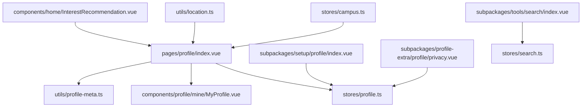
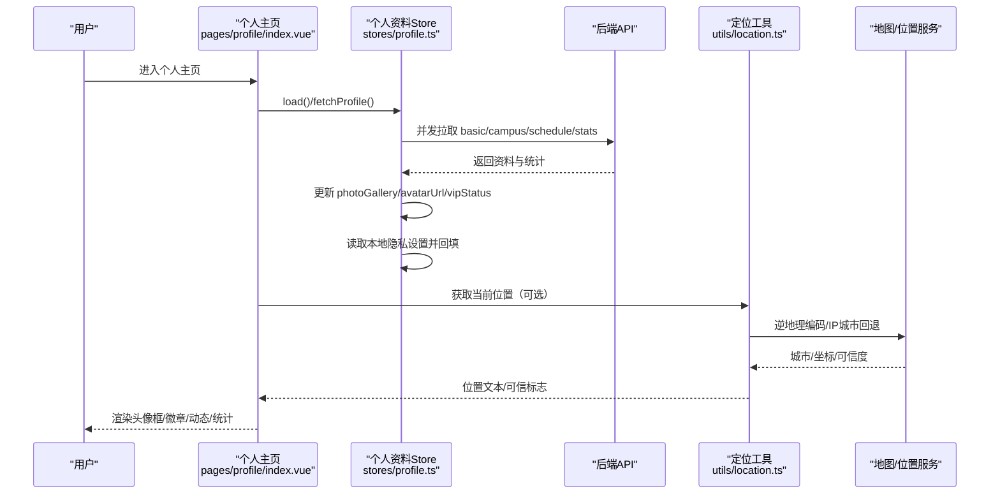
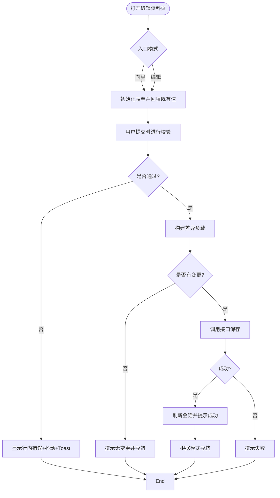
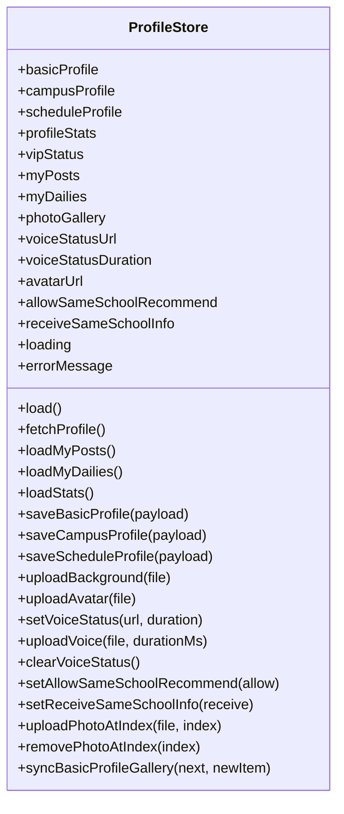
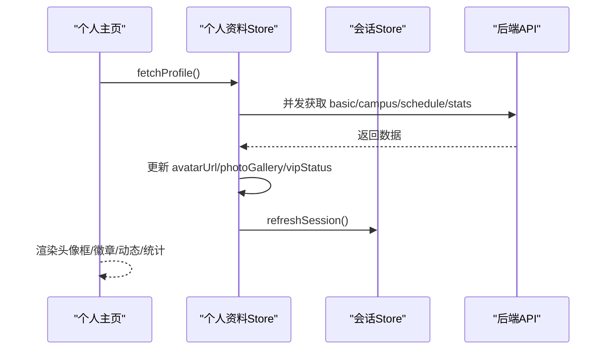
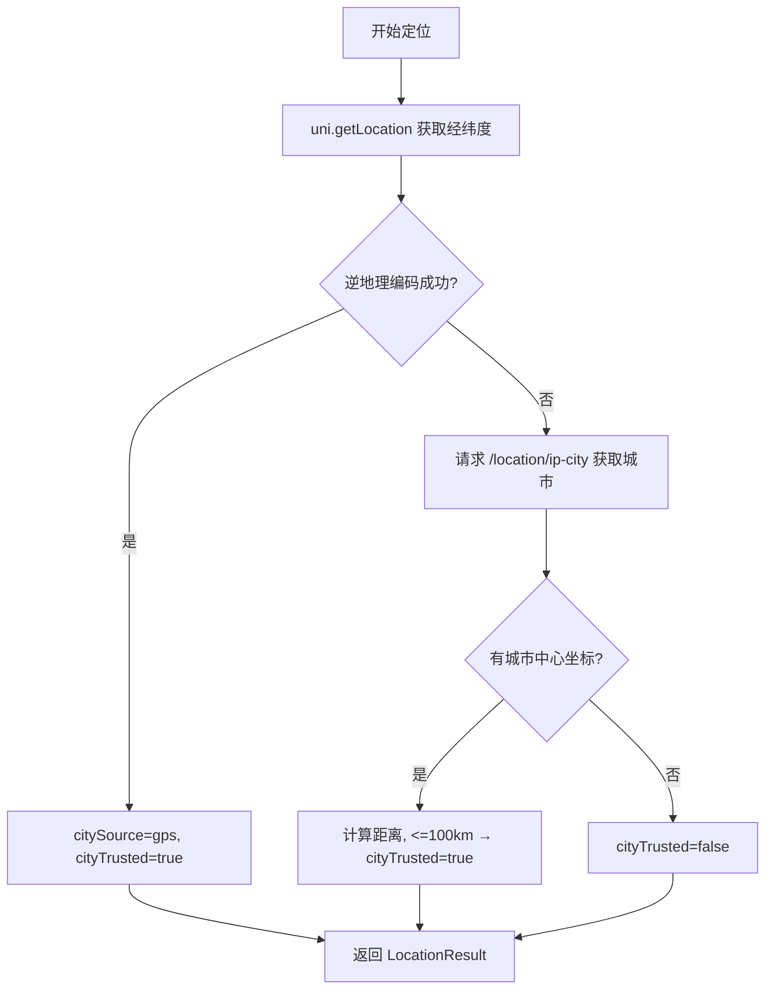
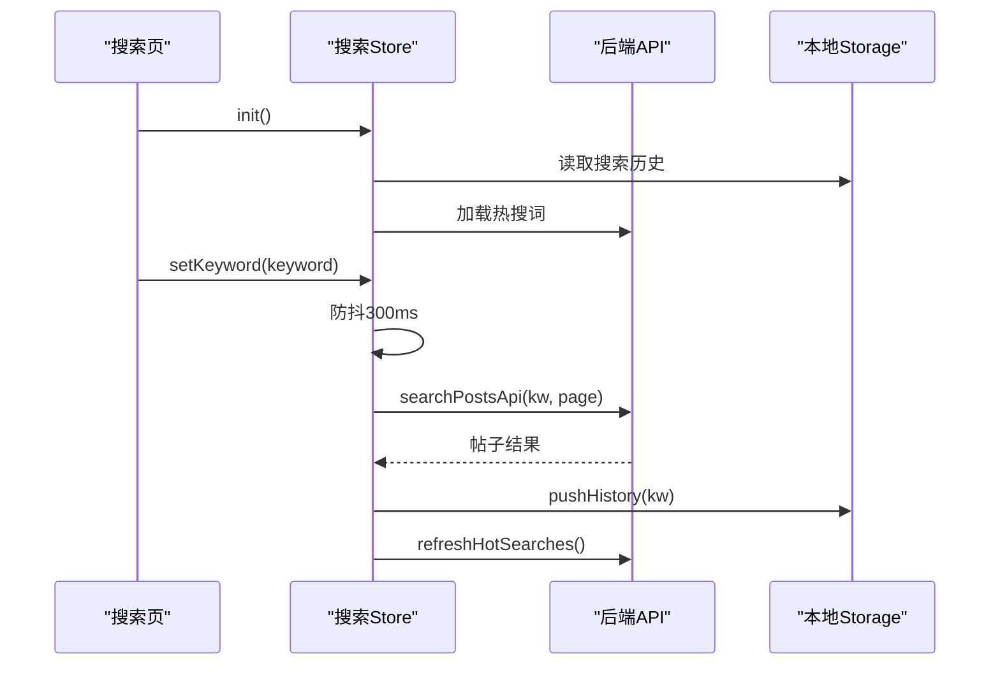
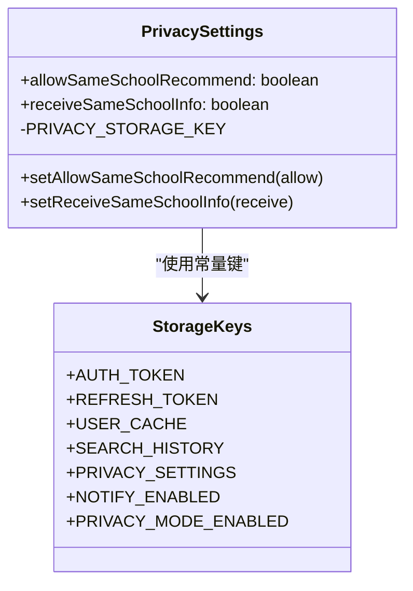
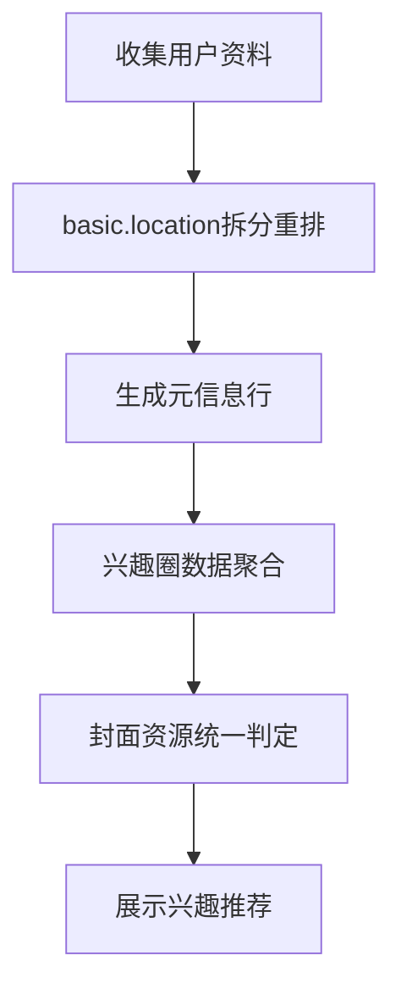
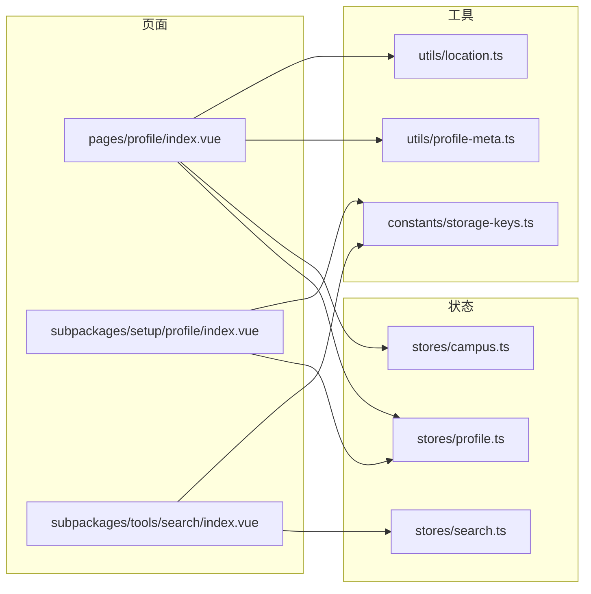

# 用户档案状态

<cite>
**本文引用的文件**
- [apps/client/src/stores/profile.ts](file://apps/client/src/stores/profile.ts)
- [apps/client/src/subpackages/setup/profile/index.vue](file://apps/client/src/subpackages/setup/profile/index.vue)
- [apps/client/src/pages/profile/index.vue](file://apps/client/src/pages/profile/index.vue)
- [apps/client/src/components/profile/mine/MyProfile.vue](file://apps/client/src/components/profile/mine/MyProfile.vue)
- [apps/client/src/utils/profile-meta.ts](file://apps/client/src/utils/profile-meta.ts)
- [apps/client/src/stores/campus.ts](file://apps/client/src/stores/campus.ts)
- [apps/client/src/subpackages/profile-extra/profile/privacy.vue](file://apps/client/src/subpackages/profile-extra/profile/privacy.vue)
- [apps/client/src/constants/storage-keys.ts](file://apps/client/src/constants/storage-keys.ts)
- [apps/client/src/stores/search.ts](file://apps/client/src/stores/search.ts)
- [apps/client/src/subpackages/tools/search/index.vue](file://apps/client/src/subpackages/tools/search/index.vue)
- [apps/client/src/utils/location.ts](file://apps/client/src/utils/location.ts)
- [apps/client/src/components/home/InterestRecommendation.vue](file://apps/client/src/components/home/InterestRecommendation.vue)
</cite>

## 目录
1. [简介](#简介)
2. [项目结构](#项目结构)
3. [核心组件](#核心组件)
4. [架构总览](#架构总览)
5. [详细组件分析](#详细组件分析)
6. [依赖关系分析](#依赖关系分析)
7. [性能考虑](#性能考虑)
8. [故障排查指南](#故障排查指南)
9. [结论](#结论)
10. [附录](#附录)

## 简介
本技术文档围绕“用户档案与校园信息”的状态管理展开，覆盖资料编辑、验证、保存的全流程；校园信息选择与地理位置状态处理；搜索历史、热门搜索与智能推荐的状态支撑；隐私设置、权限控制与数据安全；以及用户画像构建、偏好学习与个性化推荐的底层状态支持。同时说明数据同步策略、冲突解决和本地缓存更新机制。

## 项目结构
本仓库前端基于 uni-app + Vue 3 + Pinia，用户档案与校园信息相关代码集中在 client 应用：
- 个人资料 Store：集中管理基本资料、校区资料、日程资料、统计数据、VIP 状态、照片墙等
- 编辑页：注册向导/编辑资料页，负责表单校验、媒体上传、差异提交
- 个人主页：聚合展示头像、资料完成度、动态、统计、认证徽章等
- 校园模块：话题、认证、回复等状态与映射
- 搜索模块：搜索历史、热搜词、帖子搜索结果分页
- 定位工具：坐标获取、逆地理编码、城市可信度判断与上报节流
- 兴趣推荐：首页兴趣圈卡片渲染与封面来源统一化

**图表来源**
- [apps/client/src/pages/profile/index.vue:1-200](file://apps/client/src/pages/profile/index.vue#L1-L200)
- [apps/client/src/stores/profile.ts:201-590](file://apps/client/src/stores/profile.ts#L201-L590)
- [apps/client/src/subpackages/setup/profile/index.vue:200-617](file://apps/client/src/subpackages/setup/profile/index.vue#L200-L617)
- [apps/client/src/subpackages/profile-extra/profile/privacy.vue:1-194](file://apps/client/src/subpackages/profile-extra/profile/privacy.vue#L1-L194)
- [apps/client/src/stores/campus.ts:1-200](file://apps/client/src/stores/campus.ts#L1-L200)
- [apps/client/src/subpackages/tools/search/index.vue:1-200](file://apps/client/src/subpackages/tools/search/index.vue#L1-L200)
- [apps/client/src/stores/search.ts:1-200](file://apps/client/src/stores/search.ts#L1-L200)
- [apps/client/src/utils/location.ts:1-200](file://apps/client/src/utils/location.ts#L1-L200)
- [apps/client/src/components/home/InterestRecommendation.vue:1-200](file://apps/client/src/components/home/InterestRecommendation.vue#L1-L200)

**章节来源**
- [apps/client/src/pages/profile/index.vue:1-200](file://apps/client/src/pages/profile/index.vue#L1-L200)
- [apps/client/src/stores/profile.ts:201-590](file://apps/client/src/stores/profile.ts#L201-L590)

## 核心组件
- 个人资料 Store（profile）：加载/保存基本、校区、日程资料，统计数据，VIP 状态，照片墙与语音状态，隐私开关本地持久化
- 编辑资料页（setup/profile）：表单校验、行内错误提示、抖动反馈、差异提交、头像/照片墙上传、身份分流（学生/非学生）
- 个人主页（pages/profile）：组合 MyProfile 子组件，渲染头像框、背景图、认证徽章、动态预览、统计、功能入口
- 校园信息 Store（campus）：话题列表/详情、认证状态映射、图片字段解析、作者信息映射
- 搜索 Store（search）：关键词防抖搜索、热搜加载、搜索历史本地存储、分页加载更多
- 定位工具（location）：GPS 定位、逆地理编码、IP 城市回退、城市可信度判定、坐标上报节流
- 兴趣推荐（home/InterestRecommendation）：兴趣圈封面单一来源、成员数格式化、加入态展示

**章节来源**
- [apps/client/src/stores/profile.ts:201-590](file://apps/client/src/stores/profile.ts#L201-L590)
- [apps/client/src/subpackages/setup/profile/index.vue:200-617](file://apps/client/src/subpackages/setup/profile/index.vue#L200-L617)
- [apps/client/src/pages/profile/index.vue:1-200](file://apps/client/src/pages/profile/index.vue#L1-L200)
- [apps/client/src/stores/campus.ts:1-200](file://apps/client/src/stores/campus.ts#L1-L200)
- [apps/client/src/stores/search.ts:1-200](file://apps/client/src/stores/search.ts#L1-L200)
- [apps/client/src/utils/location.ts:1-200](file://apps/client/src/utils/location.ts#L1-L200)
- [apps/client/src/components/home/InterestRecommendation.vue:1-200](file://apps/client/src/components/home/InterestRecommendation.vue#L1-L200)

## 架构总览

**图表来源**
- [apps/client/src/pages/profile/index.vue:1-200](file://apps/client/src/pages/profile/index.vue#L1-L200)
- [apps/client/src/stores/profile.ts:201-590](file://apps/client/src/stores/profile.ts#L201-L590)
- [apps/client/src/utils/location.ts:1-200](file://apps/client/src/utils/location.ts#L1-L200)

## 详细组件分析

### 个人资料编辑与保存流程（表单状态、验证、错误提示）
- 页面模式：支持“注册向导”和“编辑资料”两种模式，从不同入口进入时行为不同（向导跳转下一步，编辑返回上一页或我的页）
- 输入校验：昵称、个性签名、年级、称呼偏好、身高为必填项；长度限制对齐后端契约；失败时显示行内错误文案并触发抖动动画，同时 Toast 提示
- 差异提交：记录初始快照，仅提交变更字段，避免无谓请求与误清空；必填字段每次全量携带以兼容后端替换语义
- 媒体上传：头像与照片墙走隐私授权→选图→上传链路；上传中状态与槽位 loading 控制；删除照片按索引移除并压缩数组
- 身份分流：学生进入校园认证分支，非学生跳过直接进入时间安排，保证注册流程完整度推进

**图表来源**
- [apps/client/src/subpackages/setup/profile/index.vue:200-617](file://apps/client/src/subpackages/setup/profile/index.vue#L200-L617)
- [apps/client/src/subpackages/setup/profile/index.vue:618-998](file://apps/client/src/subpackages/setup/profile/index.vue#L618-L998)

**章节来源**
- [apps/client/src/subpackages/setup/profile/index.vue:200-617](file://apps/client/src/subpackages/setup/profile/index.vue#L200-L617)
- [apps/client/src/subpackages/setup/profile/index.vue:618-998](file://apps/client/src/subpackages/setup/profile/index.vue#L618-L998)

### 个人资料 Store 状态与数据流
- 加载：并发守卫防止重复请求；60s TTL 缓存减少切换 Tab 时的重复拉取；Mock 与 Real 双路径；加载后更新 avatarUrl、photoGallery、vipStatus，并回填本地隐私设置
- 保存：基本/校区/日程资料保存成功后刷新会话；错误时设置 errorMessage 并保持 UI 可用
- 媒体：背景图、头像、照片墙上传；照片墙保持稠密数组结构；新增审核项默认 pending
- 语音：设置/上传/清除语音状态，时长上限收敛到 60 秒
- 隐私：允许推荐给本校/接收同校信息开关本地持久化，读/写均带容错

**图表来源**
- [apps/client/src/stores/profile.ts:201-590](file://apps/client/src/stores/profile.ts#L201-L590)
- [apps/client/src/stores/profile.ts:590-955](file://apps/client/src/stores/profile.ts#L590-L955)

**章节来源**
- [apps/client/src/stores/profile.ts:201-590](file://apps/client/src/stores/profile.ts#L201-L590)
- [apps/client/src/stores/profile.ts:590-955](file://apps/client/src/stores/profile.ts#L590-L955)

### 个人主页展示与交互
- 组合 MyProfile 子组件，展示头部、完成度、动态、互动、更多菜单
- 头像框：本人态依据校园认证状态决定品牌青绿框；他人态依据对方公开视图的认证等级
- 背景图：未加载前渐变兜底，加载完成后淡入；上传成功后即时更新
- 认证徽章：三级认证名牌行 + 半屏专业详情面板
- 动态/日常：懒加载“我的动态”与“我的日常”，失败不阻塞主渲染

**图表来源**
- [apps/client/src/pages/profile/index.vue:1-200](file://apps/client/src/pages/profile/index.vue#L1-L200)
- [apps/client/src/stores/profile.ts:201-590](file://apps/client/src/stores/profile.ts#L201-L590)

**章节来源**
- [apps/client/src/pages/profile/index.vue:1-200](file://apps/client/src/pages/profile/index.vue#L1-L200)
- [apps/client/src/components/profile/mine/MyProfile.vue:1-76](file://apps/client/src/components/profile/mine/MyProfile.vue#L1-L76)

### 校园信息选择与地理位置状态
- 校园话题与认证：话题分类映射、认证状态映射、图片字段兼容解析、作者信息映射
- 位置工具：优先 GPS 逆地理编码；失败则回退 IP 城市；计算城市与坐标同源可信度（阈值 100km）；坐标上报节流 5 分钟
- 位置文案：优先城市名，其次校园名，最后默认文案

**图表来源**
- [apps/client/src/utils/location.ts:1-200](file://apps/client/src/utils/location.ts#L1-L200)
- [apps/client/src/stores/campus.ts:1-200](file://apps/client/src/stores/campus.ts#L1-L200)

**章节来源**
- [apps/client/src/stores/campus.ts:1-200](file://apps/client/src/stores/campus.ts#L1-L200)
- [apps/client/src/utils/location.ts:1-200](file://apps/client/src/utils/location.ts#L1-L200)

### 搜索历史、热门搜索、智能推荐
- 搜索历史：本地 storage 维护最近 10 条；点击热搜词/历史词立即搜索；清空历史可持久化清理
- 热门搜索：首次进入搜索页加载；搜索成功后刷新热搜；失败忽略不影响主流程
- 智能推荐：搜索页可按学校过滤推荐用户；首页兴趣推荐统一封面来源，避免 emoji/svg 误用

**图表来源**
- [apps/client/src/stores/search.ts:1-200](file://apps/client/src/stores/search.ts#L1-L200)
- [apps/client/src/subpackages/tools/search/index.vue:1-200](file://apps/client/src/subpackages/tools/search/index.vue#L1-L200)
- [apps/client/src/constants/storage-keys.ts:70-80](file://apps/client/src/constants/storage-keys.ts#L70-L80)

**章节来源**
- [apps/client/src/stores/search.ts:1-200](file://apps/client/src/stores/search.ts#L1-L200)
- [apps/client/src/subpackages/tools/search/index.vue:1-200](file://apps/client/src/subpackages/tools/search/index.vue#L1-L200)
- [apps/client/src/components/home/InterestRecommendation.vue:1-200](file://apps/client/src/components/home/InterestRecommendation.vue#L1-L200)

### 隐私设置、权限控制与数据安全
- 隐私开关：允许推荐给本校/接收同校信息，当前仅本机持久化，文案如实说明；读写均有容错
- 权限前置：头像/照片上传前需检查隐私授权，拒绝时友好提示
- 数据安全：Token/刷新 Token/用户缓存等键集中管理；隐私设置、主题、通知开关等统一在 STORAGE_KEYS 下维护

**图表来源**
- [apps/client/src/subpackages/profile-extra/profile/privacy.vue:1-194](file://apps/client/src/subpackages/profile-extra/profile/privacy.vue#L1-L194)
- [apps/client/src/constants/storage-keys.ts:1-133](file://apps/client/src/constants/storage-keys.ts#L1-L133)
- [apps/client/src/stores/profile.ts:590-955](file://apps/client/src/stores/profile.ts#L590-L955)

**章节来源**
- [apps/client/src/subpackages/profile-extra/profile/privacy.vue:1-194](file://apps/client/src/subpackages/profile-extra/profile/privacy.vue#L1-L194)
- [apps/client/src/constants/storage-keys.ts:1-133](file://apps/client/src/constants/storage-keys.ts#L1-L133)
- [apps/client/src/stores/profile.ts:590-955](file://apps/client/src/stores/profile.ts#L590-L955)

### 用户画像构建、偏好学习与个性化推荐
- 基础元信息：年龄、学校、城市统一拼接，避免顺序错误导致展示异常
- 兴趣圈：首页兴趣推荐基于后端返回的兴趣圈数据，封面来源统一化，成员数量格式化
- 推荐联动：搜索页按学校过滤推荐用户；个人主页“我的动态/日常”用于社交升温与匹配加分

**图表来源**
- [apps/client/src/utils/profile-meta.ts:1-25](file://apps/client/src/utils/profile-meta.ts#L1-L25)
- [apps/client/src/components/home/InterestRecommendation.vue:1-200](file://apps/client/src/components/home/InterestRecommendation.vue#L1-L200)

**章节来源**
- [apps/client/src/utils/profile-meta.ts:1-25](file://apps/client/src/utils/profile-meta.ts#L1-L25)
- [apps/client/src/components/home/InterestRecommendation.vue:1-200](file://apps/client/src/components/home/InterestRecommendation.vue#L1-L200)

### 数据同步策略、冲突解决与本地缓存更新
- 并发守卫：个人资料加载保存 in-flight Promise，避免重复请求与状态覆盖
- TTL 缓存：个人资料 60s 内命中直接返回，提升切换速度
- 差异提交：编辑资料仅提交变更字段，避免无谓请求
- 本地持久化：搜索历史、隐私设置、主题/通知开关等通过统一键管理，失败静默容错
- 图片/媒体：上传后同步 store 与 session，确保跨组件一致性

**章节来源**
- [apps/client/src/stores/profile.ts:201-590](file://apps/client/src/stores/profile.ts#L201-L590)
- [apps/client/src/stores/search.ts:1-200](file://apps/client/src/stores/search.ts#L1-L200)
- [apps/client/src/constants/storage-keys.ts:1-133](file://apps/client/src/constants/storage-keys.ts#L1-L133)

## 依赖关系分析

**图表来源**
- [apps/client/src/pages/profile/index.vue:1-200](file://apps/client/src/pages/profile/index.vue#L1-L200)
- [apps/client/src/subpackages/setup/profile/index.vue:200-617](file://apps/client/src/subpackages/setup/profile/index.vue#L200-L617)
- [apps/client/src/subpackages/tools/search/index.vue:1-200](file://apps/client/src/subpackages/tools/search/index.vue#L1-L200)
- [apps/client/src/stores/profile.ts:201-590](file://apps/client/src/stores/profile.ts#L201-L590)
- [apps/client/src/stores/search.ts:1-200](file://apps/client/src/stores/search.ts#L1-L200)
- [apps/client/src/stores/campus.ts:1-200](file://apps/client/src/stores/campus.ts#L1-L200)
- [apps/client/src/utils/profile-meta.ts:1-25](file://apps/client/src/utils/profile-meta.ts#L1-L25)
- [apps/client/src/utils/location.ts:1-200](file://apps/client/src/utils/location.ts#L1-L200)
- [apps/client/src/constants/storage-keys.ts:1-133](file://apps/client/src/constants/storage-keys.ts#L1-L133)

**章节来源**
- [apps/client/src/stores/profile.ts:201-590](file://apps/client/src/stores/profile.ts#L201-L590)
- [apps/client/src/stores/search.ts:1-200](file://apps/client/src/stores/search.ts#L1-L200)
- [apps/client/src/stores/campus.ts:1-200](file://apps/client/src/stores/campus.ts#L1-L200)

## 性能考虑
- 个人资料加载：并发守卫 + 60s TTL 缓存，显著降低重复网络开销
- 搜索防抖：300ms 防抖减少频繁请求；AbortController 取消旧请求
- 图片资源：兴趣推荐封面统一来源，避免破图与无效请求
- 定位上报：节流 5 分钟，避免高频上报造成资源浪费

[本节为通用性能建议，不直接分析具体文件]

## 故障排查指南
- 资料加载失败：检查 store.errorMessage 与日志；确认并发守卫未阻塞；核对后端接口可用性
- 编辑保存失败：确认必填字段与长度限制；检查差异负载是否为空；查看 Toast 提示与网络响应
- 照片上传失败：确认隐私授权已通过；检查上传槽位索引范围；查看上传中状态与重试逻辑
- 搜索结果为空：确认关键词非空；检查热搜加载是否成功；查看分页 hasMore 状态
- 位置显示异常：检查逆地理编码是否成功；若 IP 回退，确认城市可信度标记；必要时降级文案

**章节来源**
- [apps/client/src/stores/profile.ts:201-590](file://apps/client/src/stores/profile.ts#L201-L590)
- [apps/client/src/stores/profile.ts:590-955](file://apps/client/src/stores/profile.ts#L590-L955)
- [apps/client/src/subpackages/setup/profile/index.vue:200-617](file://apps/client/src/subpackages/setup/profile/index.vue#L200-L617)
- [apps/client/src/stores/search.ts:1-200](file://apps/client/src/stores/search.ts#L1-L200)
- [apps/client/src/utils/location.ts:1-200](file://apps/client/src/utils/location.ts#L1-L200)

## 结论
本系统围绕用户档案与校园信息构建了清晰的状态分层：Store 负责数据与业务逻辑，页面负责交互与展示，工具函数提供定位与元信息处理能力。通过并发守卫、TTL 缓存、差异提交、本地持久化等手段，实现了高可用的状态管理与良好的用户体验。隐私设置与权限控制贯穿全流程，保障数据安全。搜索与推荐功能依托统一的 Store 与工具，形成完整的闭环。

[本节为总结性内容，不直接分析具体文件]

## 附录
- 关键常量：STORAGE_KEYS 统一管理本地存储键名，便于审计与维护
- 类型定义：后端视图类型在前端映射，确保数据结构一致性与可读性
- i18n：错误提示与界面文案国际化，提升多语言体验

[本节为补充说明，不直接分析具体文件]