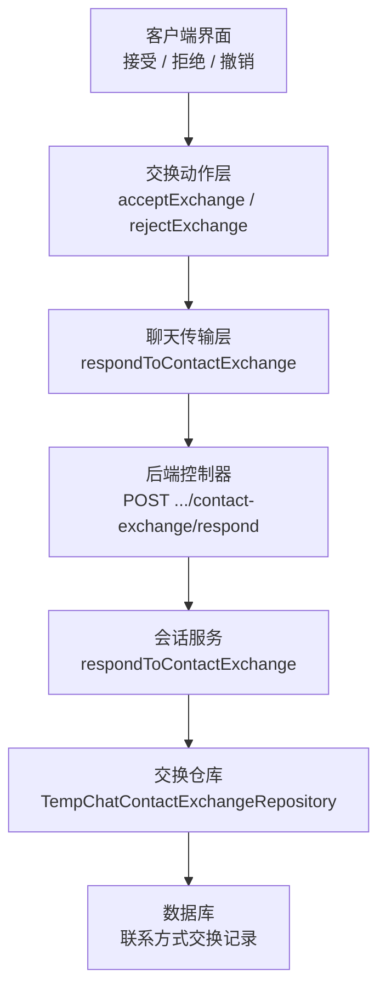
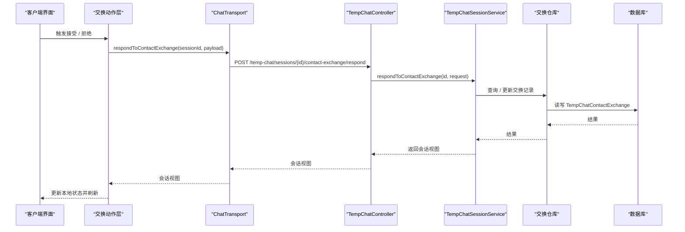
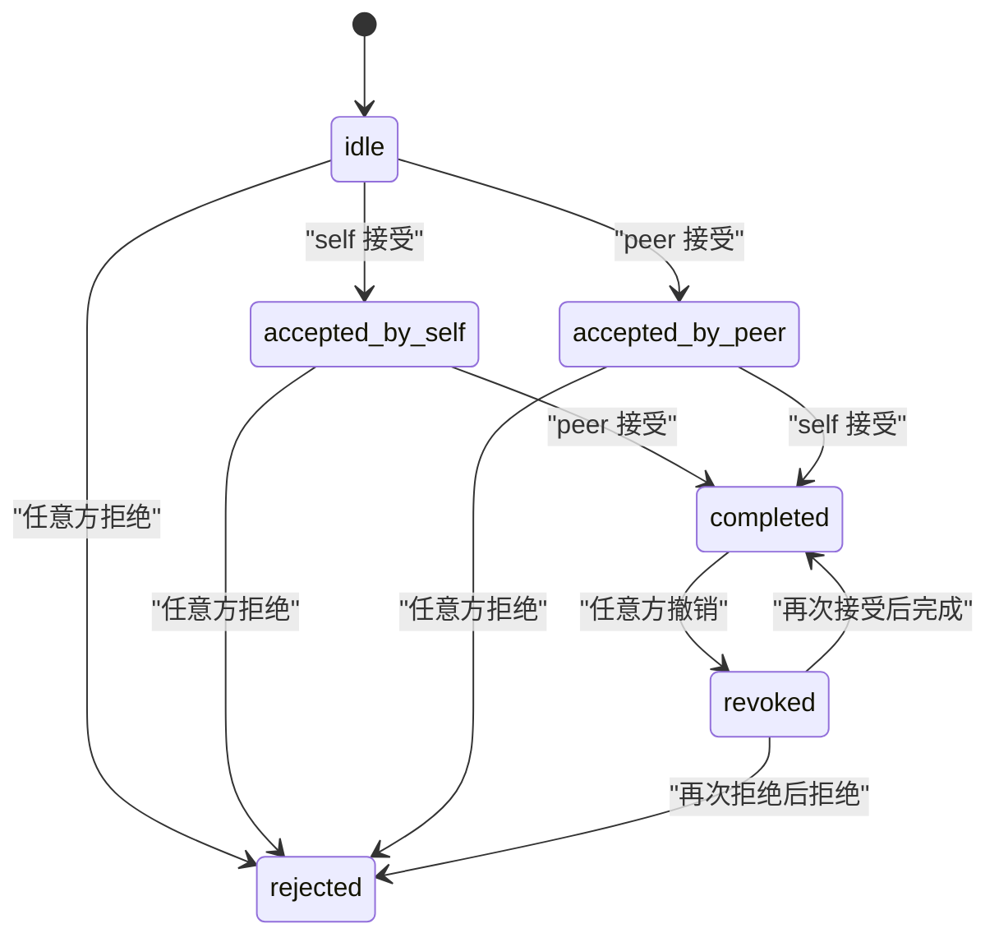
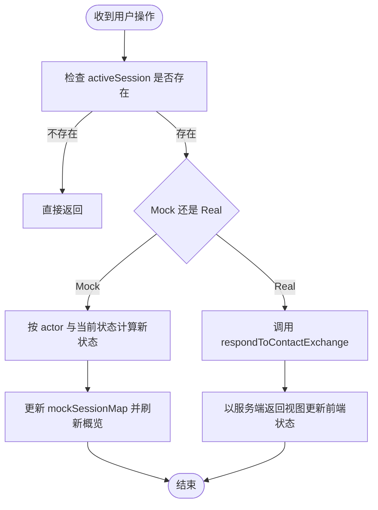

# 交换机制实现

<cite>
**本文引用的文件**   
- [exchange.ts](file://apps/client/src/stores/chat/actions/exchange.ts)
- [transport.ts](file://apps/client/src/features/chat/transport.ts)
- [types.ts](file://apps/client/src/stores/chat/types.ts)
- [TempChatController.java](file://apps/api/src/main/java/com/campuslove/api/chat/TempChatController.java)
- [TempChatSessionService.java](file://apps/api/src/main/java/com/campuslove/api/chat/TempChatSessionService.java)
- [TempChatContactExchangeRepository.java](file://apps/api/src/main/java/com/campuslove/api/repository/TempChatContactExchangeRepository.java)
- [TempChatContactExchange.java](file://apps/api/src/main/java/com/campuslove/api/entity/TempChatContactExchange.java)
</cite>

## 目录
1. [引言](#引言)
2. [项目结构与定位](#项目结构与定位)
3. [核心组件与职责边界](#核心组件与职责边界)
4. [架构总览](#架构总览)
5. [交换状态生命周期](#交换状态生命周期)
6. [交换请求与确认流程](#交换请求与确认流程)
7. [安全验证与防作弊设计](#安全验证与防作弊设计)
8. [异常处理、超时控制与补偿](#异常处理超时控制与补偿)
9. [性能优化策略](#性能优化策略)
10. [并发安全保障](#并发安全保障)
11. [用户体验改进方案](#用户体验改进方案)
12. [故障排查指南](#故障排查指南)
13. [结论](#结论)

## 引言
本文聚焦“临时聊天会话中的联系方式交换”机制，面向开发者与产品测试人员，从客户端动作、传输层接口、后端控制器与服务、持久化实体四个层面，完整说明交换的发起、确认、拒绝、撤销、完成及取消路径。文档同时给出状态机、权限校验、幂等与安全约束、失败恢复和性能优化建议，帮助读者在不直接阅读源码的情况下理解该功能的运行方式。

## 项目结构与定位
交换功能横跨前端与后端：
- 前端负责用户交互、本地状态更新、Mock 模式切换，并通过 ChatTransport 调用后端接口。
- 后端通过 Spring Controller 暴露临时聊天会话的联系方式交换接口，由 TempChatSessionService 执行业务规则，并依赖仓库访问交换记录。

**图表来源**
- [exchange.ts:1-110](file://apps/client/src/stores/chat/actions/exchange.ts#L1-L110)
- [transport.ts:1-125](file://apps/client/src/features/chat/transport.ts#L1-L125)
- [TempChatController.java:1-174](file://apps/api/src/main/java/com/campuslove/api/chat/TempChatController.java#L1-L174)
- [TempChatSessionService.java:1-200](file://apps/api/src/main/java/com/campuslove/api/chat/TempChatSessionService.java#L1-L200)

**章节来源**
- [exchange.ts:1-110](file://apps/client/src/stores/chat/actions/exchange.ts#L1-L110)
- [transport.ts:1-125](file://apps/client/src/features/chat/transport.ts#L1-L125)
- [TempChatController.java:1-174](file://apps/api/src/main/java/com/campuslove/api/chat/TempChatController.java#L1-L174)

## 核心组件与职责边界
- 交换动作层（前端）
  - 提供 acceptExchange 与 rejectExchange，封装 Mock 与真实模式切换，统一刷新概览与会话视图。
  - 维护基于 actor（self / peer）的状态转换表，避免嵌套分支导致可读性差。
- 传输层（前端）
  - 定义 ChatTransport 接口，隔离 Mock 与 Real 实现；respondToContactExchange 将决策发送到后端。
- 控制器（后端）
  - 暴露 /api/v1/temp-chat/sessions/{id}/contact-exchange/respond，要求 USER 角色，校验请求体字段。
- 会话服务（后端）
  - 封装交换业务规则、会话参与者校验、过期标记、WebSocket 通知、视图转换等。
- 数据层
  - TempChatContactExchange 实体 + TempChatContactExchangeRepository 仓库，存储每次交换的状态与时间戳。

**章节来源**
- [exchange.ts:1-110](file://apps/client/src/stores/chat/actions/exchange.ts#L1-L110)
- [transport.ts:1-125](file://apps/client/src/features/chat/transport.ts#L1-L125)
- [TempChatController.java:1-174](file://apps/api/src/main/java/com/campuslove/api/chat/TempChatController.java#L1-L174)
- [TempChatSessionService.java:1-200](file://apps/api/src/main/java/com/campuslove/api/chat/TempChatSessionService.java#L1-L200)
- [TempChatContactExchangeRepository.java](file://apps/api/src/main/java/com/campuslove/api/repository/TempChatContactExchangeRepository.java)
- [TempChatContactExchange.java](file://apps/api/src/main/java/com/campuslove/api/entity/TempChatContactExchange.java)

## 架构总览
交换流程采用“前端动作 → 传输层 → 后端控制器 → 会话服务 → 仓库 → 数据库”的分层结构。前端支持 Mock 模式快速验证，后端使用 Spring Security 鉴权，并在服务层做参与者校验与业务规则判断。

**图表来源**
- [exchange.ts:1-110](file://apps/client/src/stores/chat/actions/exchange.ts#L1-L110)
- [transport.ts:1-125](file://apps/client/src/features/chat/transport.ts#L1-L125)
- [TempChatController.java:1-174](file://apps/api/src/main/java/com/campuslove/api/chat/TempChatController.java#L1-L174)
- [TempChatSessionService.java:1-200](file://apps/api/src/main/java/com/campuslove/api/chat/TempChatSessionService.java#L1-L200)

## 交换状态生命周期
交换状态围绕“谁先发起”和“对方是否同意”展开。根据前端动作层的实现，可归纳为如下状态机：

关键语义：
- idle：尚未有任何一方表达接受。
- accepted_by_self / accepted_by_peer：仅有一方接受，等待对方回应。
- completed：双方都接受，交换成功。
- rejected：任一方拒绝，交换终止。
- revoked：已完成或已接受的交换被撤销，后续可再次进入接受或拒绝分支。

注意：当前前端 actions 中未出现显式的 revoke 分支；后端控制器允许 decision 为 accept | reject | revoke，但动作层未暴露撤销入口。若需支持撤销，应扩展前端动作层并与后端保持一致。

**图表来源**
- [exchange.ts:1-110](file://apps/client/src/stores/chat/actions/exchange.ts#L1-L110)
- [TempChatController.java:1-174](file://apps/api/src/main/java/com/campuslove/api/chat/TempChatController.java#L1-L174)

**章节来源**
- [exchange.ts:1-110](file://apps/client/src/stores/chat/actions/exchange.ts#L1-L110)
- [TempChatController.java:1-174](file://apps/api/src/main/java/com/campuslove/api/chat/TempChatController.java#L1-L174)

## 交换请求与确认流程
### 前端动作层
- acceptExchange(actor)
  - 若无活跃会话则静默返回。
  - Mock 模式：按 actor 与当前 status 查表得到新状态，写入 mockSessionMap，再触发概览刷新。
  - Real 模式：调用 chatTransport.respondToContactExchange，传入 actor 与 decision=accept。
- rejectExchange(actor)
  - 若无活跃会话则静默返回。
  - Mock 模式：将 contactExchange.status 置为 rejected。
  - Real 模式：调用 chatTransport.respondToContactExchange，decision=reject。

**图表来源**
- [exchange.ts:1-110](file://apps/client/src/stores/chat/actions/exchange.ts#L1-L110)

**章节来源**
- [exchange.ts:1-110](file://apps/client/src/stores/chat/actions/exchange.ts#L1-L110)

### 传输层
- ChatTransport.respondToContactExchange(sessionId, payload)
  - Mock 实现：委托给 fixtures.respondToContactExchange，模拟状态变化。
  - Real 实现：POST /temp-chat/sessions/{sessionId}/contact-exchange/respond，携带 ContactExchangeDecisionRequest。

**章节来源**
- [transport.ts:1-125](file://apps/client/src/features/chat/transport.ts#L1-L125)

### 后端控制器
- POST /api/v1/temp-chat/sessions/{id}/contact-exchange/respond
  - 权限：@PreAuthorize("hasRole('USER')")。
  - 入参：ContactExchangeDecisionRequest，包含 actor 与 decision。
  - 返回：TempChatSessionView，供前端渲染最新会话视图。

**章节来源**
- [TempChatController.java:1-174](file://apps/api/src/main/java/com/campuslove/api/chat/TempChatController.java#L1-L174)

### 后端服务与数据层
- TempChatSessionService.respondToContactExchange
  - 负责会话参与校验、交换状态变更、消息与视图同步。
- TempChatContactExchangeRepository
  - 访问 TempChatContactExchange 实体，保存交换状态、提议者、时间戳等信息。

**章节来源**
- [TempChatSessionService.java:1-200](file://apps/api/src/main/java/com/campuslove/api/chat/TempChatSessionService.java#L1-L200)
- [TempChatContactExchangeRepository.java](file://apps/api/src/main/java/com/campuslove/api/repository/TempChatContactExchangeRepository.java)
- [TempChatContactExchange.java](file://apps/api/src/main/java/com/campuslove/api/entity/TempChatContactExchange.java)

## 安全验证与防作弊设计
### 身份认证
- 所有临时聊天相关接口均要求 USER 角色，防止匿名用户或无权限用户发起交换。
- 控制器层通过 Spring Security 注解进行基础权限拦截。

**章节来源**
- [TempChatController.java:1-174](file://apps/api/src/main/java/com/campuslove/api/chat/TempChatController.java#L1-L174)

### 会话参与者校验
- 服务层 resolveSessionForCurrentUser 会校验当前登录用户是否为会话的 userA 或 userB。
- 若不是参与者，抛出 OperationForbiddenException，防止 IDOR 越权查看或修改他人会话。

**章节来源**
- [TempChatSessionService.java:1-200](file://apps/api/src/main/java/com/campuslove/api/chat/TempChatSessionService.java#L1-L200)

### 请求参数校验
- ContactExchangeDecisionRequest 对 actor 长度与 decision 值进行正则校验，只允许 accept、reject、revoke。
- TempChatController 同时校验会话 ID、消息 kind、body 长度等输入，降低恶意输入风险。

**章节来源**
- [TempChatController.java:1-174](file://apps/api/src/main/java/com/campuslove/api/chat/TempChatController.java#L1-L174)

### 防作弊机制
- 会话创建时会对推荐人、matchId、signalId 进行严格解析与校验，防止绕过推荐体系拉入陌生人。
- exchange.ts 中状态转换使用显式映射表，避免随意拼接状态值，降低前端状态被篡改的风险。
- 服务端在创建会话时初始化 TempChatContactExchange，初始状态为 idle，确保每条会话都有明确的交换基线。

**章节来源**
- [TempChatSessionService.java:1-200](file://apps/api/src/main/java/com/campuslove/api/chat/TempChatSessionService.java#L1-L200)
- [exchange.ts:1-110](file://apps/client/src/stores/chat/actions/exchange.ts#L1-L110)

## 异常处理、超时控制与补偿
### 异常处理
- 前端
  - 若 activeSession 为空，accept/reject 直接返回，不触发网络请求。
  - withMockMode 统一处理 Mock/Real 切换、会话更新与概览刷新，减少重复错误处理逻辑。
- 后端
  - 控制器层使用 Jakarta Validation 校验入参，非法参数直接返回校验错误。
  - 服务层对会话不存在、非参与者、信号无效等情况抛出明确异常，便于上层统一处理。

**章节来源**
- [exchange.ts:1-110](file://apps/client/src/stores/chat/actions/exchange.ts#L1-L110)
- [TempChatController.java:1-174](file://apps/api/src/main/java/com/campuslove/api/chat/TempChatController.java#L1-L174)
- [TempChatSessionService.java:1-200](file://apps/api/src/main/java/com/campuslove/api/chat/TempChatSessionService.java#L1-L200)

### 超时控制
- 会话具有 closesAt 过期时间，服务层提供 isSessionExpired 与 markExpiredIfDue，惰性标记过期。
- 过期会话的消息列表会被清空，交换状态仍保留，但会话不再可用。
- 前端应在加载会话后检查过期状态，禁用不可用操作的交互。

**章节来源**
- [TempChatSessionService.java:401-566](file://apps/api/src/main/java/com/campuslove/api/chat/TempChatSessionService.java#L401-L566)

### 补偿机制
- 前端 Mock 模式下，withMockMode 保证本地状态与服务端行为一致，便于离线调试与回归测试。
- 后端通过事务注解 @Transactional 保证会话、消息、交换记录的原子性更新。
- WebSocket 推送用于会话创建、结束等事件，交换完成后应由服务层通过 messagingTemplate 通知对方，确保两端状态同步。

**章节来源**
- [exchange.ts:1-110](file://apps/client/src/stores/chat/actions/exchange.ts#L1-L110)
- [TempChatSessionService.java:1-200](file://apps/api/src/main/java/com/campuslove/api/chat/TempChatSessionService.java#L1-L200)

## 性能优化策略
- 批量预加载对方用户信息
  - listSessions 中通过 viewMapper.loadPartnerInfoMap 预加载对方信息，避免 N+1 查询。
- 视图转换解耦
  - toSessionView / toSummary 委托给 TempChatViewMapper，集中处理字段映射，减少服务层重复逻辑。
- 前端状态更新最小化
  - exchange.ts 使用映射表决定新状态，避免复杂条件分支，提升可读性与执行效率。
- Mock 模式快速反馈
  - 开发阶段使用 Mock 模式即时更新本地状态，缩短调试链路。

**章节来源**
- [TempChatSessionService.java:1-200](file://apps/api/src/main/java/com/campuslove/api/chat/TempChatSessionService.java#L1-L200)
- [exchange.ts:1-110](file://apps/client/src/stores/chat/actions/exchange.ts#L1-L110)

## 并发安全保障
- 会话参与者校验
  - 所有会话操作必须经过 requireParticipant，防止并发下不同用户误改他人会话。
- 事务保护
  - 会话创建、结束、交换响应等方法使用 @Transactional，保证数据一致性。
- 幂等键与重发防护
  - 虽然消息发送使用 Idempotency-Key，交换响应本身也应考虑幂等：同一 session 在同一时刻多次接受不应产生冲突状态。
- 状态机收敛
  - 使用显式状态映射表限制状态取值，降低并发下的非法状态组合。

**章节来源**
- [TempChatSessionService.java:1-200](file://apps/api/src/main/java/com/campuslove/api/chat/TempChatSessionService.java#L1-L200)
- [exchange.ts:1-110](file://apps/client/src/stores/chat/actions/exchange.ts#L1-L110)

## 用户体验改进方案
- 明确展示交换进度
  - 在 accepted_by_self / accepted_by_peer 状态下显示“等待对方确认”。
- 失败提示友好化
  - 当会话过期或非参与者时，禁用交换按钮并提示原因。
- 撤销与重试
  - 若需求允许撤销，前端应增加撤销按钮，并在成功后回到可重新接受的状态。
- 实时同步
  - 通过 WebSocket 推送对方接受/拒绝结果，减少手动刷新带来的体验摩擦。

[本节为通用体验建议，不直接分析具体文件]

## 故障排查指南
- 现象：点击接受后无反应
  - 检查 activeSession 是否为空；若为空，前端会直接返回。
  - 检查 Mock/Real 模式是否正确切换。
- 现象：后端返回权限错误
  - 确认用户是否具备 USER 角色。
  - 检查会话参与者校验是否通过。
- 现象：交换状态不一致
  - 核对前端状态映射表与后端允许的 decision 值。
  - 检查是否有人通过非预期接口修改 TempChatContactExchange。
- 现象：会话过期后仍可交换
  - 检查前端是否在加载会话后调用 isSessionExpired 并禁用相关操作。
  - 检查后端 markExpiredIfDue 是否被执行。

**章节来源**
- [exchange.ts:1-110](file://apps/client/src/stores/chat/actions/exchange.ts#L1-L110)
- [TempChatController.java:1-174](file://apps/api/src/main/java/com/campuslove/api/chat/TempChatController.java#L1-L174)
- [TempChatSessionService.java:1-200](file://apps/api/src/main/java/com/campuslove/api/chat/TempChatSessionService.java#L1-L200)

## 结论
交换机制通过清晰的前后端分层与严格的权限校验，保证了临时聊天中联系方式交换的安全性与一致性。前端动作层提供简洁的接受与拒绝入口，传输层屏蔽 Mock/Real 差异，后端控制器与服务层配合仓库完成状态变更与视图返回。未来可在以下方向继续增强：
- 在前端补充撤销入口，与后端 decision=revoke 对齐。
- 强化交换响应的幂等保护，避免并发重复提交导致状态抖动。
- 完善 WebSocket 推送，使交换结果实时同步到对方。
- 增加更丰富的失败提示与可观测日志，便于问题定位。

[本节为总结性内容，不直接分析具体文件]