# 会话生命周期管理

<cite>
**本文引用的文件**   
- [apps/client/src/stores/chat/index.ts](file://apps/client/src/stores/chat/index.ts)
- [apps/client/src/stores/chat/store-type.ts](file://apps/client/src/stores/chat/store-type.ts)
- [apps/client/src/stores/chat/types.ts](file://apps/client/src/stores/chat/types.ts)
- [apps/client/src/stores/chat/actions/session.ts](file://apps/client/src/stores/chat/actions/session.ts)
- [apps/client/src/stores/chat/actions/messaging.ts](file://apps/client/src/stores/chat/actions/messaging.ts)
- [apps/client/src/stores/chat/higher-order.ts](file://apps/client/src/stores/chat/higher-order.ts)
- [apps/client/src/stores/chat/utils.ts](file://apps/client/src/stores/chat/utils.ts)
- [apps/client/src/features/chat/transport.ts](file://apps/client/src/features/chat/transport.ts)
- [apps/client/src/subpackages/chat/chat-session/api.ts](file://apps/client/src/subpackages/chat/chat-session/api.ts)
- [apps/client/src/subpackages/chat/chat-session/dto.ts](file://apps/client/src/subpackages/chat/chat-session/dto.ts)
- [apps/client/src/subpackages/chat/chat-session/types.ts](file://apps/client/src/subpackages/chat/chat-session/types.ts)
- [apps/client/src/subpackages/chat/chat-session/view-models.ts](file://apps/client/src/subpackages/chat/chat-session/view-models.ts)
- [apps/client/src/stores/messages.ts](file://apps/client/src/stores/messages.ts)
- [apps/client/src/services/websocket/index.ts](file://apps/client/src/services/websocket/index.ts)
- [apps/client/src/services/websocket/store-dispatch.ts](file://apps/client/src/services/websocket/store-dispatch.ts)
- [apps/client/src/services/websocket/ws-message-adapter.ts](file://apps/client/src/services/websocket/ws-message-adapter.ts)
- [apps/client/src/constants/growth.ts](file://apps/client/src/constants/growth.ts)
</cite>

## 目录

1. [引言](#引言)
2. [项目结构与职责边界](#项目结构与职责边界)
3. [会话模型与核心状态](#会话模型与核心状态)
4. [完整会话生命周期](#完整会话生命周期)
5. [临时匿名聊天特殊机制](#临时匿名聊天特殊机制)
6. [WebSocket 连接与会话绑定](#websocket-连接与会话绑定)
7. [持久化、断线恢复与内存泄漏防护](#持久化断线恢复与内存泄漏防护)
8. [架构总览图](#架构总览图)
9. [关键流程时序图](#关键流程时序图)
10. [性能与资源特性](#性能与资源特性)
11. [调试工具与监控指标](#调试工具与监控指标)
12. [常见问题排查](#常见问题排查)
13. [结论](#结论)

## 引言

本技术文档聚焦于聊天系统的**会话生命周期管理**，围绕以下目标展开：

- 梳理会话从创建、激活、暂停、恢复到关闭的完整生命周期。
- 解释临时匿名聊天的会话模型、ID 生成策略、过期时间控制与资源清理逻辑。
- 说明会话与 WebSocket 连接的绑定关系，以及会话切换时的状态同步机制。
- 总结会话相关数据的持久化策略、断线重连后的恢复方式，以及内存泄漏防护措施。
- 给出可操作的调试建议、性能关注点与常见故障排查路径。

需要明确的是：当前代码库中的“聊天”主要实现为**临时匿名聊天会话**（`temp_anonymous`），其入口通过 `chatStore` 的 `startFromRecommendation`、`startFromMatch`、`startFromSignal` 创建；而通用的私信会话体系由 `messagesStore` 管理，两者共享部分消息展示类型，但生命周期和后端端点不同。

**章节来源**
- [apps/client/src/stores/messages.ts:1-120](file://apps/client/src/stores/messages.ts#L1-L120)
- [apps/client/src/stores/chat/index.ts:1-131](file://apps/client/src/stores/chat/index.ts#L1-L131)

## 项目结构与职责边界

聊天会话生命周期涉及客户端 Store、传输层、WebSocket 子系统、视图模型及页面 DTO 转换层。整体职责如下：

| 层级 | 主要文件 | 职责 |
|---|---|---|
| 聊天 Store 入口 | [apps/client/src/stores/chat/index.ts](file://apps/client/src/stores/chat/index.ts) | 装配聊天概览、活跃会话、消息发送、联系方式交换、破冰话题等 action |
| Store 类型定义 | [apps/client/src/stores/chat/types.ts](file://apps/client/src/stores/chat/types.ts) | 定义 `TempChatSession`、`SendMessageRequest`、`MessageDeliveryStatus` 等 |
| Store 实例类型 | [apps/client/src/stores/chat/store-type.ts](file://apps/client/src/stores/chat/store-type.ts) | 声明 Pinia store 的 state 与 action 签名 |
| 会话生命周期 Action | [apps/client/src/stores/chat/actions/session.ts](file://apps/client/src/stores/chat/actions/session.ts) | 创建、加载、置顶、结束会话 |
| 消息发送 Action | [apps/client/src/stores/chat/actions/messaging.ts](file://apps/client/src/stores/chat/actions/messaging.ts) | 文本、语音、表情消息发送与投递状态跟踪 |
| 高阶函数与传输层工厂 | [apps/client/src/stores/chat/higher-order.ts](file://apps/client/src/stores/chat/higher-order.ts) | `withErrorHandling`、`withMockMode`、`chatTransport` 单例 |
| 聊天传输层 | [apps/client/src/features/chat/transport.ts](file://apps/client/src/features/chat/transport.ts) | 临时会话 HTTP API 封装 |
| 聊天会话页 API | [apps/client/src/subpackages/chat/chat-session/api.ts](file://apps/client/src/subpackages/chat/chat-session/api.ts) | 页面级纯 API 调用（如撤回消息） |
| 会话页 DTO 转换 | [apps/client/src/subpackages/chat/chat-session/dto.ts](file://apps/client/src/subpackages/chat/chat-session/dto.ts) | 后端 DTO 到视图模型的转换 |
| 会话页类型 | [apps/client/src/subpackages/chat/chat-session/types.ts](file://apps/client/src/subpackages/chat/chat-session/types.ts) | 视图层消息状态、长按菜单、录音状态等类型 |
| 会话页视图模型 | [apps/client/src/subpackages/chat/chat-session/view-models.ts](file://apps/client/src/subpackages/chat/chat-session/view-models.ts) | 倒计时、引用上下文、时间分隔条等纯逻辑 |
| 通用消息 Store | [apps/client/src/stores/messages.ts](file://apps/client/src/stores/messages.ts) | 私信会话列表、消息流、未读数、typing 状态 |
| WebSocket 客户端 | [apps/client/src/services/websocket/index.ts](file://apps/client/src/services/websocket/index.ts) | STOMP 连接、心跳、重连、订阅 |
| WebSocket 消息分发 | [apps/client/src/services/websocket/store-dispatch.ts](file://apps/client/src/services/websocket/store-dispatch.ts) | 按队列路由到各 Pinia Store |
| WebSocket 消息适配 | [apps/client/src/services/websocket/ws-message-adapter.ts](file://apps/client/src/services/websocket/ws-message-adapter.ts) | 外部 WS 载荷转换为内部 `MessageItem` |
| 临时会话时长常量 | [apps/client/src/constants/growth.ts](file://apps/client/src/constants/growth.ts) | 默认 24 小时临时会话时长 |

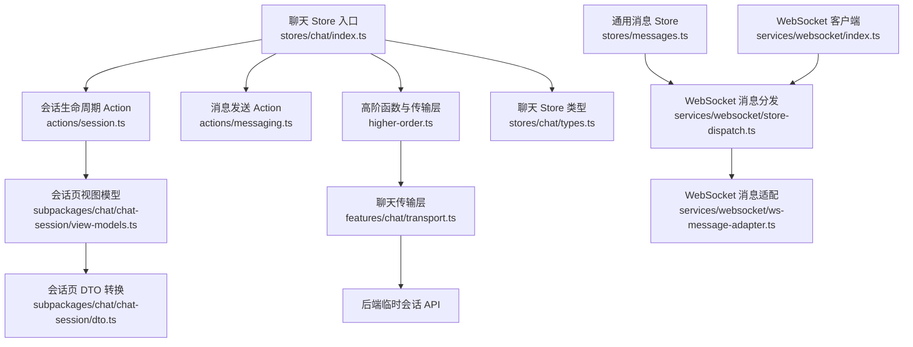

**图表来源**
- [apps/client/src/stores/chat/index.ts:1-131](file://apps/client/src/stores/chat/index.ts#L1-L131)
- [apps/client/src/stores/chat/actions/session.ts:1-314](file://apps/client/src/stores/chat/actions/session.ts#L1-L314)
- [apps/client/src/stores/chat/actions/messaging.ts:1-229](file://apps/client/src/stores/chat/actions/messaging.ts#L1-L229)
- [apps/client/src/stores/chat/higher-order.ts:1-142](file://apps/client/src/stores/chat/higher-order.ts#L1-L142)
- [apps/client/src/features/chat/transport.ts:1-125](file://apps/client/src/features/chat/transport.ts#L1-L125)
- [apps/client/src/subpackages/chat/chat-session/view-models.ts:1-200](file://apps/client/src/subpackages/chat/chat-session/view-models.ts#L1-L200)
- [apps/client/src/subpackages/chat/chat-session/dto.ts:1-200](file://apps/client/src/subpackages/chat/chat-session/dto.ts#L1-L200)
- [apps/client/src/stores/messages.ts:1-120](file://apps/client/src/stores/messages.ts#L1-L120)
- [apps/client/src/services/websocket/index.ts:1-200](file://apps/client/src/services/websocket/index.ts#L1-L200)
- [apps/client/src/services/websocket/store-dispatch.ts:1-200](file://apps/client/src/services/websocket/store-dispatch.ts#L1-L200)
- [apps/client/src/services/websocket/ws-message-adapter.ts:1-114](file://apps/client/src/services/websocket/ws-message-adapter.ts#L1-L114)

**章节来源**
- [apps/client/src/stores/chat/index.ts:1-131](file://apps/client/src/stores/chat/index.ts#L1-L131)
- [apps/client/src/stores/chat/types.ts:1-86](file://apps/client/src/stores/chat/types.ts#L1-L86)
- [apps/client/src/stores/chat/store-type.ts:1-129](file://apps/client/src/stores/chat/store-type.ts#L1-L129)
- [apps/client/src/features/chat/transport.ts:1-125](file://apps/client/src/features/chat/transport.ts#L1-L125)
- [apps/client/src/stores/messages.ts:1-120](file://apps/client/src/stores/messages.ts#L1-L120)
- [apps/client/src/services/websocket/index.ts:1-200](file://apps/client/src/services/websocket/index.ts#L1-L200)

## 会话模型与核心状态

### 临时会话数据模型

临时聊天会话在后端 OpenAPI 中对应 `TempChatSession`，前端通过 `chatStore` 将其转为视图模型后保存在 `activeSession`。该会话包含以下关键信息：

| 字段或行为 | 含义 | 生命周期影响 |
|---|---|---|
| `id` | 后端返回的会话 ID | 用于加载、发消息、结束会话、标记已读 |
| `recommendedPersonId` / `signalId` / `matchId` | 会话来源标识 | 决定创建入口 |
| `partnerName` / `partnerHeadline` | 对方昵称与简介 | 会话概览展示 |
| `phase` | 会话阶段 | 通常从 `matching` 进入 `active`，结束时变为 `closed` |
| `closesAt` | 会话关闭时间 | 用于倒计时与过期判断 |
| `closedReason` | 关闭原因 | `expired`、`ended` 或空 |
| `messages` | 消息列表 | 会话加载与渲染 |
| `contactExchange` | 联系方式交换状态 | 决定交换流程是否可发起 |

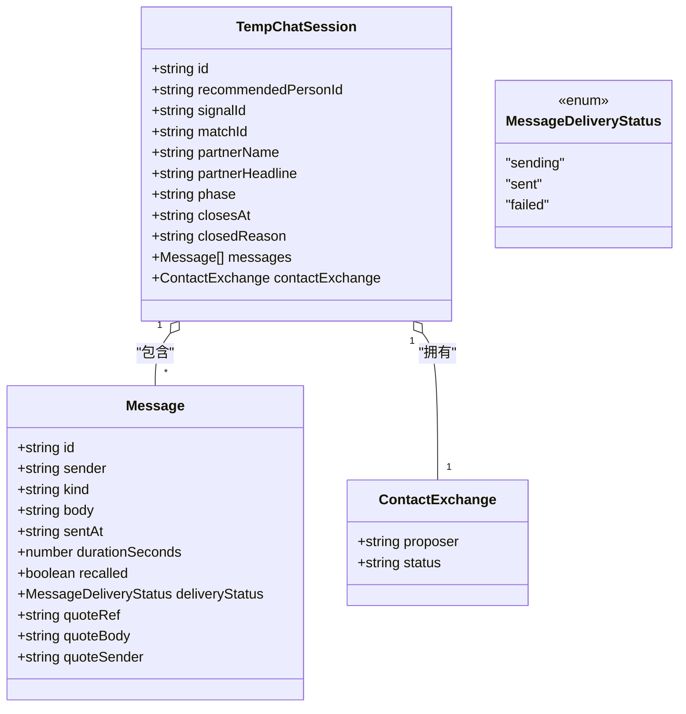

**图表来源**
- [apps/client/src/stores/chat/types.ts:1-86](file://apps/client/src/stores/chat/types.ts#L1-L86)
- [apps/client/src/subpackages/chat/chat-session/types.ts:1-112](file://apps/client/src/subpackages/chat/chat-session/types.ts#L1-L112)
- [apps/client/src/subpackages/chat/chat-session/dto.ts:1-200](file://apps/client/src/subpackages/chat/chat-session/dto.ts#L1-L200)

### 聊天 Store 核心状态

`useChatStore` 是聊天模块的 Pinia store，其核心状态包括：

| 状态字段 | 类型 | 作用 |
|---|---|---|
| `loadingOverview` | `boolean` | 聊天概览加载中 |
| `loadingSession` | `boolean` | 单个会话加载中 |
| `errorMessage` | `string \| null` | 统一错误提示 |
| `overview` | `ChatOverview \| null` | 后端原始概览数据 |
| `overviewView` | `OverviewView \| null` | 视图层概览模型 |
| `activeSession` | `SessionView \| null` | 当前活跃临时会话 |
| `icebreakerTopics` | `string[]` | 当前匹配可用的破冰话题文案 |
| `icebreakerItems` | `IcebreakerItem[]` | 带分类和来源的破冰话题项 |
| `loadingIcebreakers` | `boolean` | 破冰话题加载中 |
| `messageDeliveryStatus` | `Record<string, MessageDeliveryStatus>` | 消息投递状态映射表 |

其中，`messageDeliveryStatus` 对会话体验非常关键：它使用客户端生成的 `sendId` 作为键，跟踪每条消息的 `sending`、`sent`、`failed` 状态，并持久化到本地存储。这样在页面刷新或切换会话后，用户仍能看到上一条消息的状态。

**章节来源**
- [apps/client/src/stores/chat/index.ts:60-131](file://apps/client/src/stores/chat/index.ts#L60-L131)
- [apps/client/src/stores/chat/store-type.ts:54-129](file://apps/client/src/stores/chat/store-type.ts#L54-L129)
- [apps/client/src/stores/chat/types.ts:24-86](file://apps/client/src/stores/chat/types.ts#L24-L86)
- [apps/client/src/stores/chat/utils.ts:30-97](file://apps/client/src/stores/chat/utils.ts#L30-L97)

## 完整会话生命周期

会话生命周期分为五个阶段：**创建、激活、暂停、恢复、关闭**。下面分别说明其实现路径。

### 创建会话

临时会话可以通过三种入口创建：

1. **从推荐人创建**：`startFromRecommendation(recommendedPersonId)`
2. **从心动信号创建**：`startFromSignal(signalId)`
3. **从匹配创建**：`startFromMatch(matchId)`

这些方法都通过 `withMockMode` 统一处理 Mock 与 Real 模式：

- **Mock 模式**：构造一个本地临时会话，设置 `phase = "matching"`，并赋予未来 24 小时的 `closesAt`。
- **Real 模式**：调用 `chatTransport.createSession(payload)`，后端返回真实 `TempChatSession`。

创建成功后，`withMockMode` 会将结果转换为 `toChatSessionView` 并写入 `chatStore.activeSession`，同时刷新聊天概览。

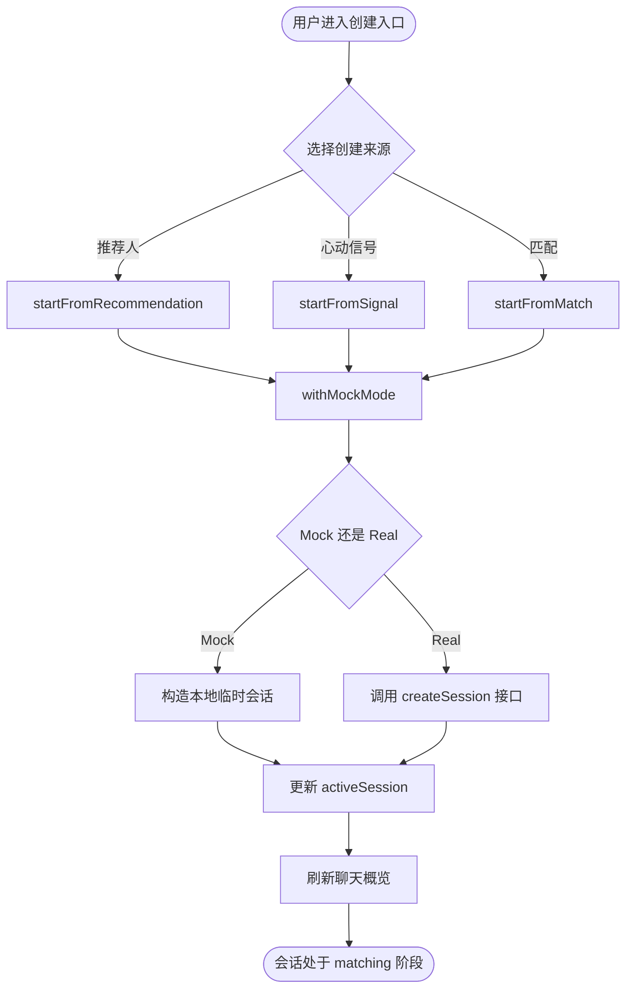

**图表来源**
- [apps/client/src/stores/chat/actions/session.ts:52-199](file://apps/client/src/stores/chat/actions/session.ts#L52-L199)
- [apps/client/src/stores/chat/higher-order.ts:84-142](file://apps/client/src/stores/chat/higher-order.ts#L84-L142)
- [apps/client/src/features/chat/transport.ts:20-125](file://apps/client/src/features/chat/transport.ts#L20-L125)

**章节来源**
- [apps/client/src/stores/chat/actions/session.ts:52-199](file://apps/client/src/stores/chat/actions/session.ts#L52-L199)
- [apps/client/src/stores/chat/higher-order.ts:84-142](file://apps/client/src/stores/chat/higher-order.ts#L84-L142)

### 激活会话

激活会话主要通过两个动作体现：

1. **加载指定会话**：`loadSession(sessionId)`
2. **首次发送消息**：`sendText` 将 `phase` 从 `matching` 推进到 `active`

`loadSession` 负责：

- 根据 `sessionId` 拉取会话详情。
- 调用后端接口标记临时会话为已读。
- 若加载失败，显式清空 `activeSession`，避免旧会话残留。
- 若 mock 模式下找不到对应 `sessionId`，也清空 `activeSession` 并抛出错误。

`sendText` 在 Real 模式成功发送消息后，会更新消息投递状态为 `sent`，并在 Mock 模式中把会话 `phase` 设为 `active`。

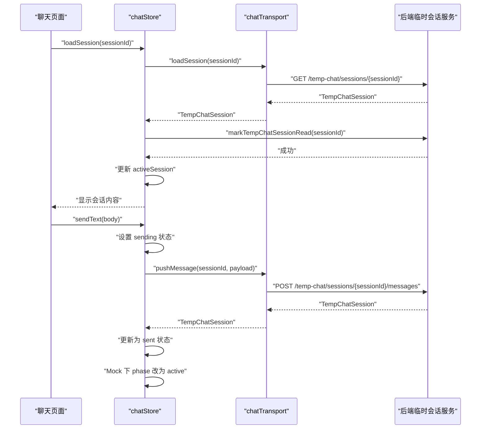

**图表来源**
- [apps/client/src/stores/chat/actions/session.ts:170-255](file://apps/client/src/stores/chat/actions/session.ts#L170-L255)
- [apps/client/src/stores/chat/actions/messaging.ts:45-145](file://apps/client/src/stores/chat/actions/messaging.ts#L45-L145)
- [apps/client/src/features/chat/transport.ts:45-85](file://apps/client/src/features/chat/transport.ts#L45-L85)

**章节来源**
- [apps/client/src/stores/chat/actions/session.ts:170-255](file://apps/client/src/stores/chat/actions/session.ts#L170-L255)
- [apps/client/src/stores/chat/actions/messaging.ts:1-229](file://apps/client/src/stores/chat/actions/messaging.ts#L1-L229)

### 暂停会话

在当前实现中，“暂停”并不是一个显式的后端状态变更，而是**前端不再持有活跃会话**的行为。典型场景包括：

- 用户离开聊天会话页面。
- 切换到其他会话。
- 会话加载失败时主动清空 `activeSession`。
- 会话过期或被标记为已结束。

暂停期间的关键点是：

- `activeSession` 被置空或替换。
- 聊天概览中的会话摘要仍保留，供用户再次进入。
- 消息投递状态映射表通过本地存储持久化，不会因页面刷新丢失。

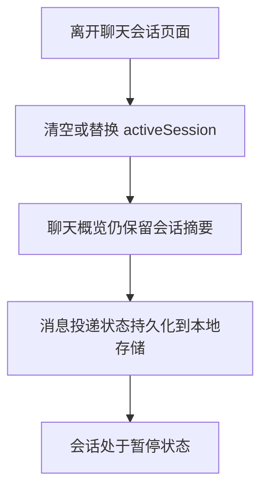

**图表来源**
- [apps/client/src/stores/chat/index.ts:78-110](file://apps/client/src/stores/chat/index.ts#L78-L110)
- [apps/client/src/stores/chat/utils.ts:30-68](file://apps/client/src/stores/chat/utils.ts#L30-L68)

**章节来源**
- [apps/client/src/stores/chat/index.ts:60-131](file://apps/client/src/stores/chat/index.ts#L60-L131)
- [apps/client/src/stores/chat/utils.ts:30-68](file://apps/client/src/stores/chat/utils.ts#L30-L68)

### 恢复会话

恢复会话即重新加载一个已有会话：

1. 用户从聊天概览点击某个会话。
2. 调用 `loadSession(sessionId)`。
3. 如果后端返回有效会话，`activeSession` 被更新为新的会话视图模型。
4. 如果是临时会话，后端还会标记为已读。
5. 聊天概览会被刷新，以反映最后一条预览消息和未读计数。

需要注意：临时会话的消息实时推送走 `/queue/temp-chat/messages`，但如果消息无法归因到具体 `sessionId`，调用方会静默丢弃，等待用户进入会话后通过全量加载兜底。

**章节来源**
- [apps/client/src/stores/chat/actions/session.ts:170-255](file://apps/client/src/stores/chat/actions/session.ts#L170-L255)
- [apps/client/src/services/websocket/store-dispatch.ts:60-150](file://apps/client/src/services/websocket/store-dispatch.ts#L60-L150)
- [apps/client/src/services/websocket/ws-message-adapter.ts:60-114](file://apps/client/src/services/websocket/ws-message-adapter.ts#L60-L114)

### 关闭会话

会话关闭有两种语义：

| 关闭方式 | 触发方 | 行为 |
|---|---|---|
| 手动结束 | 用户主动结束会话 | 调用 `endSession()`，Real 模式调用后端 `/temp-chat/sessions/{sessionId}/end` |
| 自动过期 | 系统或 UI 根据 `closesAt` 判断 | Mock 模式下将 `phase` 设为 `closed`，`closedReason` 设为 `ended` |

`endSession` 的逻辑：

- 若没有 `activeSession`，直接返回。
- Mock 模式：更新本地会话的 `phase`、`closesAt`、`closedReason`。
- Real 模式：调用 `chatTransport.endSession(this.activeSession.id)`。
- 由于 `withMockMode` 默认会刷新概览并更新活跃会话，因此结束会话后会看到会话状态变化。

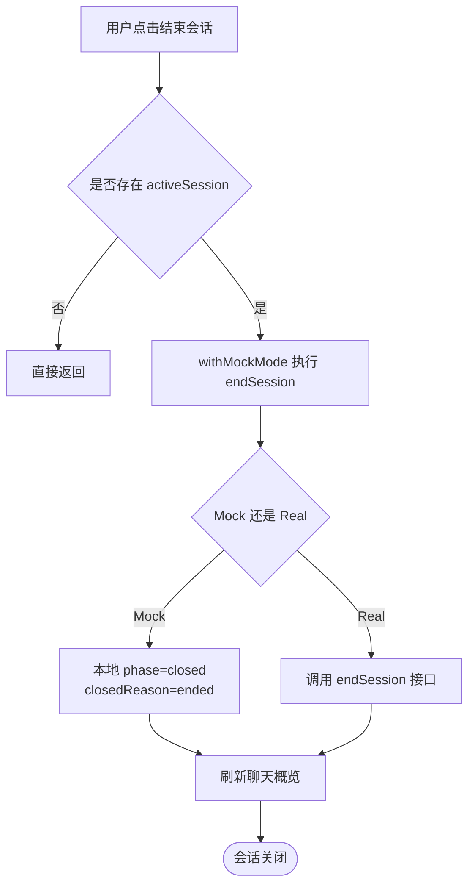

**图表来源**
- [apps/client/src/stores/chat/actions/session.ts:270-314](file://apps/client/src/stores/chat/actions/session.ts#L270-L314)
- [apps/client/src/stores/chat/higher-order.ts:84-142](file://apps/client/src/stores/chat/higher-order.ts#L84-L142)
- [apps/client/src/features/chat/transport.ts:85-125](file://apps/client/src/features/chat/transport.ts#L85-L125)

**章节来源**
- [apps/client/src/stores/chat/actions/session.ts:270-314](file://apps/client/src/stores/chat/actions/session.ts#L270-L314)
- [apps/client/src/features/chat/transport.ts:85-125](file://apps/client/src/features/chat/transport.ts#L85-L125)

## 临时匿名聊天特殊机制

### 会话 ID 生成策略

临时会话的 `id` 由后端创建会话接口返回。前端不自行生成业务会话 ID，只负责：

- 保存后端返回的 `id`。
- 使用该 `id` 调用后续接口：加载、发消息、结束、标记已读。
- 在 Mock 模式下，使用类似 `mock-session-${Date.now()}-${++mockSessionSeq}` 的形式构造唯一 ID，避免同毫秒重复。

消息层面的客户端唯一 ID 则采用 `send-${Date.now()}-${++messageIdSeq}`，用于跟踪消息投递状态，而不是会话 ID。

**章节来源**
- [apps/client/src/stores/chat/actions/session.ts:52-110](file://apps/client/src/stores/chat/actions/session.ts#L52-L110)
- [apps/client/src/stores/chat/actions/messaging.ts:45-75](file://apps/client/src/stores/chat/actions/messaging.ts#L45-L75)

### 过期时间控制

临时会话默认时长来自常量 `TEMP_SESSION_DURATION_MS`，值为 **24 小时**。创建 Mock 会话时，`closesAt` 设置为 `Date.now() + TEMP_SESSION_DURATION_MS`。

会话页视图模型提供倒计时辅助函数：

- `computeRemainingMs(closesAt, now)`：计算剩余毫秒数。
- `formatTempCountdown(diffMs)`：将剩余毫秒格式化为 `HH:mm:ss`；已结束时返回 `null`。

UI 层应结合这两个函数渲染倒计时，并在剩余时间为负或零时引导用户结束会话或提示会话已过期。

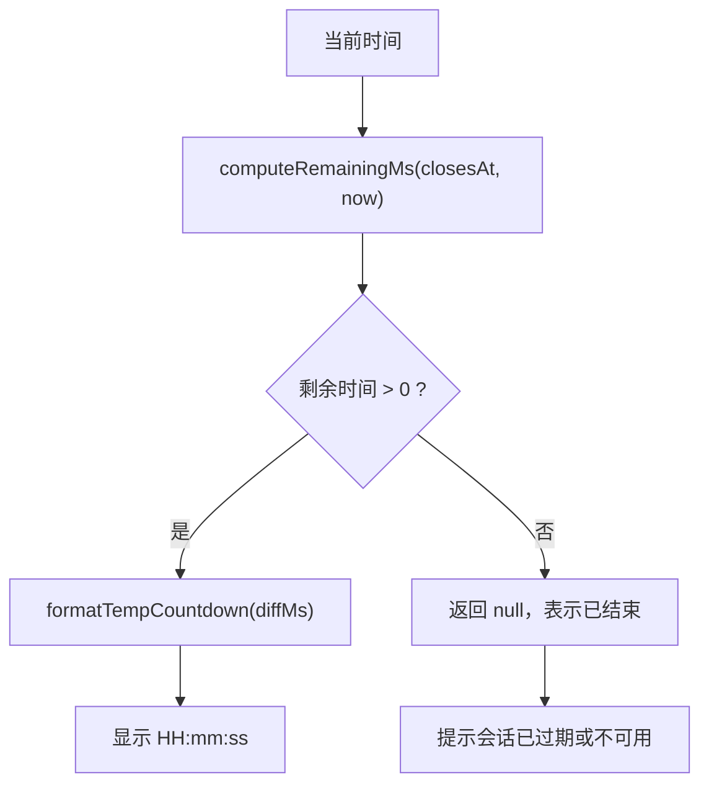

**图表来源**
- [apps/client/src/subpackages/chat/chat-session/view-models.ts:100-150](file://apps/client/src/subpackages/chat/chat-session/view-models.ts#L100-L150)
- [apps/client/src/constants/growth.ts:30-40](file://apps/client/src/constants/growth.ts#L30-L40)

**章节来源**
- [apps/client/src/subpackages/chat/chat-session/view-models.ts:100-150](file://apps/client/src/subpackages/chat/chat-session/view-models.ts#L100-L150)
- [apps/client/src/constants/growth.ts:30-40](file://apps/client/src/constants/growth.ts#L30-L40)

### 资源清理逻辑

临时会话的资源清理主要体现在以下几处：

1. **会话关闭**：手动调用 `endSession` 将会话标记为 `closed`。
2. **会话加载失败**：`loadSession` 在 Real 模式加载失败时显式清空 `activeSession`，防止旧会话被误用。
3. **未知会话 ID**：Mock 模式下找不到对应 `sessionId` 时，清空 `activeSession` 并抛出错误。
4. **会话过期**：UI 可根据 `closesAt` 判断并提示；当前代码未实现服务端定时回收的自动清理回调，但提供了关闭时间与状态字段供上层消费。
5. **WebSocket 连接释放**：WebSocket 客户端在断开或达到最大重连次数时会停止自动重连，避免长期占用连接。

需要注意的是：临时会话的 WebSocket 新消息如果没有 `sessionId`，调用方会静默忽略，这属于预期降级——临时会话未读以服务端计数为准，进入会话后通过 `loadSession` 全量刷新。

**章节来源**
- [apps/client/src/stores/chat/actions/session.ts:170-255](file://apps/client/src/stores/chat/actions/session.ts#L170-L255)
- [apps/client/src/stores/chat/actions/session.ts:270-314](file://apps/client/src/stores/chat/actions/session.ts#L270-L314)
- [apps/client/src/services/websocket/store-dispatch.ts:90-150](file://apps/client/src/services/websocket/store-dispatch.ts#L90-L150)
- [apps/client/src/services/websocket/ws-message-adapter.ts:90-114](file://apps/client/src/services/websocket/ws-message-adapter.ts#L90-L114)

## WebSocket 连接与会话绑定

### WebSocket 连接的生命周期

WebSocket 客户端位于 `services/websocket/index.ts`，核心职责包括：

- 建立 WebSocket 连接。
- 通过子协议传递认证 token。
- 发送 STOMP CONNECT 帧。
- 维护心跳 ping/pong。
- 管理自动重连。
- 订阅用户私有频道。
- 将收到的消息分发到对应的 Pinia Store。

连接建立流程大致为：

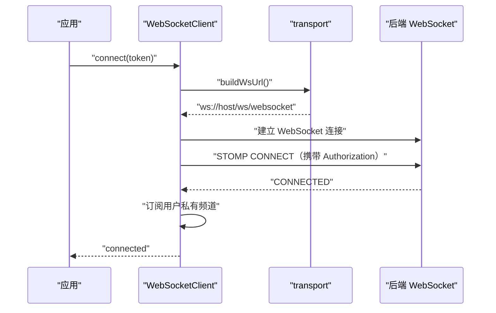

**图表来源**
- [apps/client/src/services/websocket/index.ts:120-220](file://apps/client/src/services/websocket/index.ts#L120-L220)
- [apps/client/src/services/websocket/transport.ts:120-200](file://apps/client/src/services/websocket/transport.ts#L120-L200)

**章节来源**
- [apps/client/src/services/websocket/index.ts:1-200](file://apps/client/src/services/websocket/index.ts#L1-L200)
- [apps/client/src/services/websocket/transport.ts:1-200](file://apps/client/src/services/websocket/transport.ts#L1-L200)

### 会话与 WebSocket 的绑定关系

需要区分两类绑定：

| 绑定类型 | 绑定对象 | 说明 |
|---|---|---|
| WebSocket 认证绑定 | 用户 token | 握手阶段通过子协议、STOMP CONNECT 帧认证 |
| 会话数据绑定 | `chatStore.activeSession` | 当前聊天页面正在查看的临时会话 |
| 消息归属绑定 | `MessageItem.sessionId` | 私信消息通过 `conversationId` 映射到会话 |
| 临时会话消息归属 | 当前活跃会话 | 临时会话 WS 消息可能无 `sessionId`，回退到 `chatStore.activeSession.id` |

临时会话的新消息队列是 `/user/{userId}/queue/temp-chat/messages`。当消息没有 `sessionId` 时，`resolveWsSessionId` 会检查：

1. 消息是否来自 `temp-chat` 队列。
2. 发送方是否为 peer。
3. 当前 `chatStore.activeSession` 是否命中。

只有三者满足时，才会把临时会话消息归因到当前会话；否则返回空字符串，调用方丢弃该消息。这是为了在未进入会话页时，避免把临时会话消息错误地注入到其他会话。

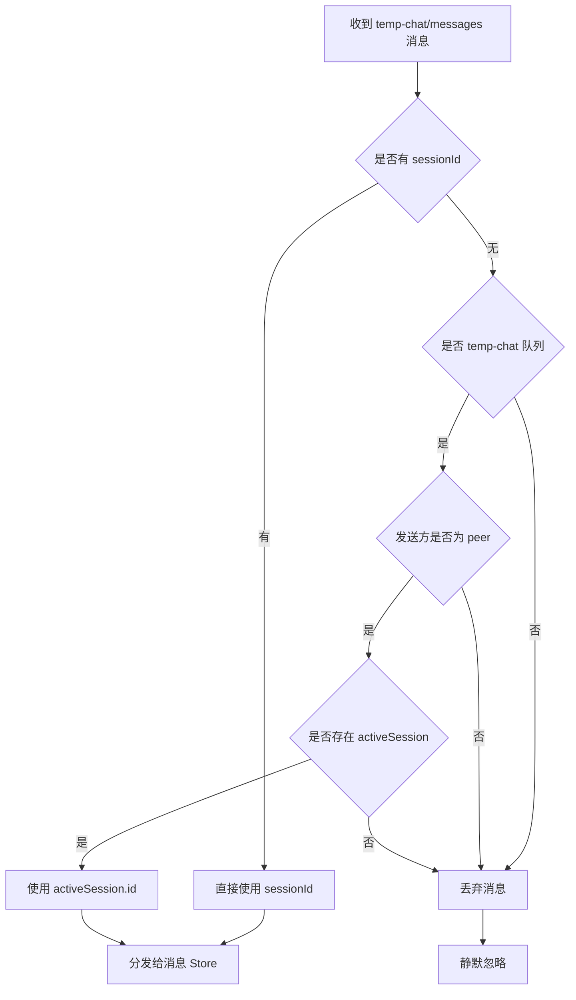

**图表来源**
- [apps/client/src/services/websocket/ws-message-adapter.ts:90-114](file://apps/client/src/services/websocket/ws-message-adapter.ts#L90-L114)
- [apps/client/src/services/websocket/store-dispatch.ts:60-150](file://apps/client/src/services/websocket/store-dispatch.ts#L60-L150)

**章节来源**
- [apps/client/src/services/websocket/ws-message-adapter.ts:1-114](file://apps/client/src/services/websocket/ws-message-adapter.ts#L1-L114)
- [apps/client/src/services/websocket/store-dispatch.ts:1-200](file://apps/client/src/services/websocket/store-dispatch.ts#L1-L200)

### 会话切换时的状态同步

会话切换的核心原则是：**每次 `loadSession` 都会替换 `activeSession`，并刷新聊天概览**。

切换过程包括：

1. 用户点击另一个会话。
2. 调用 `loadSession(newSessionId)`。
3. 加载成功后，`activeSession` 被替换为新会话视图模型。
4. 聊天概览刷新，更新最后消息预览、未读数等。
5. 如果新会话是临时会话，后端会标记为已读。
6. 若加载失败，`activeSession` 被清空，避免旧会话继续渲染。

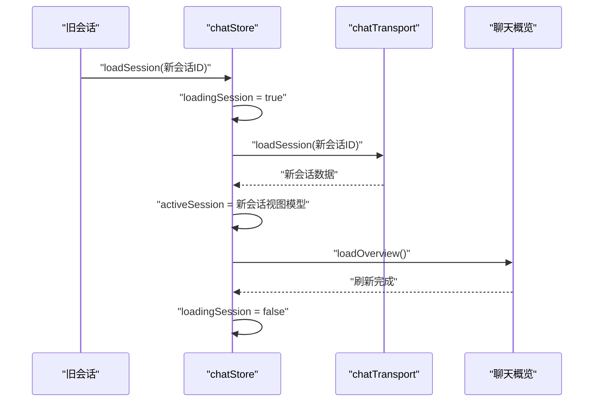

**图表来源**
- [apps/client/src/stores/chat/actions/session.ts:170-255](file://apps/client/src/stores/chat/actions/session.ts#L170-L255)
- [apps/client/src/stores/chat/higher-order.ts:84-142](file://apps/client/src/stores/chat/higher-order.ts#L84-L142)

**章节来源**
- [apps/client/src/stores/chat/actions/session.ts:170-255](file://apps/client/src/stores/chat/actions/session.ts#L170-L255)

## 持久化、断线恢复与内存泄漏防护

### 持久化策略

当前聊天会话相关的持久化主要集中在**消息投递状态**：

| 数据 | 持久化位置 | 说明 |
|---|---|---|
| 消息投递状态 | 本地存储 `MESSAGE_STATUS_STORAGE_KEY` | 记录 `sendId -> sending/sent/failed` |
| 会话数据 | 主要为内存态 `activeSession` | 会话详情由后端提供，前端不长期缓存 |
| 聊天概览 | 内存态 `overview` / `overviewView` | 每次加载或刷新后重建 |
| WebSocket 连接 | 进程内 `WebSocketClient` 实例 | 连接断开后尝试自动重连 |

`loadMessageStatus` 从本地存储读取投递状态映射表，`saveMessageStatus` 写入本地存储。重试逻辑 `withSendRetry` 只对网络层错误重试一次，避免无限重试。

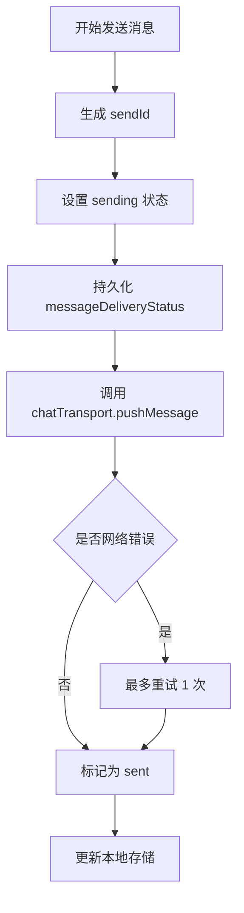

**图表来源**
- [apps/client/src/stores/chat/actions/messaging.ts:45-145](file://apps/client/src/stores/chat/actions/messaging.ts#L45-L145)
- [apps/client/src/stores/chat/utils.ts:30-97](file://apps/client/src/stores/chat/utils.ts#L30-L97)

**章节来源**
- [apps/client/src/stores/chat/utils.ts:30-97](file://apps/client/src/stores/chat/utils.ts#L30-L97)
- [apps/client/src/stores/chat/actions/messaging.ts:1-229](file://apps/client/src/stores/chat/actions/messaging.ts#L1-L229)

### 断线重连后的状态恢复

WebSocket 客户端内置重连管理器，具备以下能力：

- 自动递增重连次数。
- 达到最大重连次数后停止自动重连。
- 保持待重播的订阅列表。
- 重连后重新订阅用户私有频道。
- 连接状态变化通过 `onStateChange` 通知调用方。

断线重连后的恢复策略：

1. WebSocket 底层断开后，`ReconnectManager` 启动重连。
2. 重连成功后，重新发送 STOMP CONNECT。
3. 重新订阅 `/user/{userId}/queue/messages`、`/user/{userId}/queue/signals`、`/user/{userId}/queue/notifications` 等频道。
4. 临时会话消息仍需依赖 `chatStore.activeSession` 进行归属；若用户不在会话页，WS 临时会话消息可能被静默丢弃。
5. 业务侧可通过监听连接状态变化，提示用户网络异常或引导重新登录。

**章节来源**
- [apps/client/src/services/websocket/index.ts:1-200](file://apps/client/src/services/websocket/index.ts#L1-L200)

### 内存泄漏防护

代码中多处体现了内存泄漏防护意识：

| 防护点 | 实现位置 | 防护方式 |
|---|---|---|
| WebSocket 订阅回调泄漏 | `services/websocket/index.ts` | 使用 `subIdCallbacks` 映射，unsubscribe 时按订阅 ID 精确移除 |
| 重连防重入 | `services/websocket/index.ts` | `reconnectScheduled` 标志位避免 error/close 双重触发 |
| 断开关闭定时器泄漏 | `services/websocket/index.ts` | 保存 `disconnectCloseTimer` 引用并在 cleanup 中取消 |
| typing 自动复位定时器 | `stores/messages.ts` | 模块级 `typingResetTimers` 表，避免污染 Pinia state |
| 消息投递状态本地存储失败 | `stores/chat/utils.ts` | try/catch 捕获，写入失败不影响主流程 |
| 未知 WebSocket 队列 | `services/websocket/store-dispatch.ts` | 上报 Sentry，避免静默丢失 |

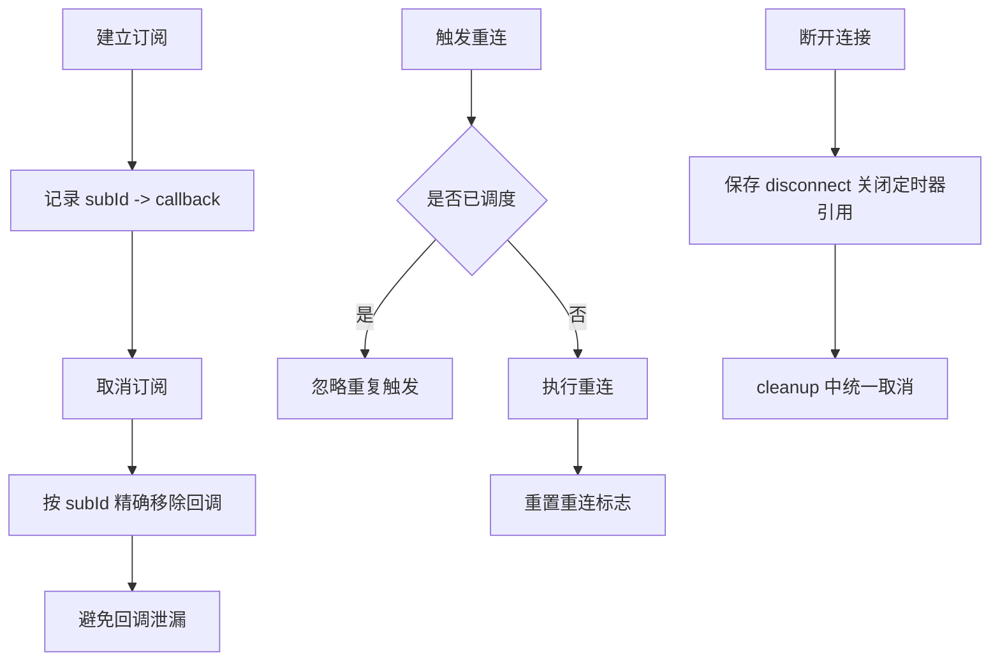

**图表来源**
- [apps/client/src/services/websocket/index.ts:120-220](file://apps/client/src/services/websocket/index.ts#L120-L220)
- [apps/client/src/stores/messages.ts:1-80](file://apps/client/src/stores/messages.ts#L1-L80)
- [apps/client/src/stores/chat/utils.ts:30-97](file://apps/client/src/stores/chat/utils.ts#L30-L97)

**章节来源**
- [apps/client/src/services/websocket/index.ts:120-220](file://apps/client/src/services/websocket/index.ts#L120-L220)
- [apps/client/src/stores/messages.ts:1-80](file://apps/client/src/stores/messages.ts#L1-L80)
- [apps/client/src/stores/chat/utils.ts:30-97](file://apps/client/src/stores/chat/utils.ts#L30-L97)

## 架构总览图

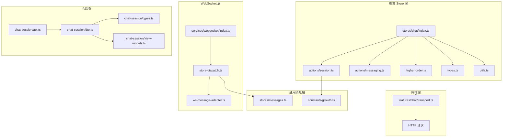

**图表来源**
- [apps/client/src/stores/chat/index.ts:1-131](file://apps/client/src/stores/chat/index.ts#L1-L131)
- [apps/client/src/stores/chat/actions/session.ts:1-314](file://apps/client/src/stores/chat/actions/session.ts#L1-L314)
- [apps/client/src/stores/chat/actions/messaging.ts:1-229](file://apps/client/src/stores/chat/actions/messaging.ts#L1-L229)
- [apps/client/src/stores/chat/higher-order.ts:1-142](file://apps/client/src/stores/chat/higher-order.ts#L1-L142)
- [apps/client/src/stores/chat/types.ts:1-86](file://apps/client/src/stores/chat/types.ts#L1-L86)
- [apps/client/src/stores/chat/utils.ts:1-97](file://apps/client/src/stores/chat/utils.ts#L1-L97)
- [apps/client/src/features/chat/transport.ts:1-125](file://apps/client/src/features/chat/transport.ts#L1-L125)
- [apps/client/src/subpackages/chat/chat-session/api.ts:1-32](file://apps/client/src/subpackages/chat/chat-session/api.ts#L1-L32)
- [apps/client/src/subpackages/chat/chat-session/dto.ts:1-200](file://apps/client/src/subpackages/chat/chat-session/dto.ts#L1-L200)
- [apps/client/src/subpackages/chat/chat-session/types.ts:1-112](file://apps/client/src/subpackages/chat/chat-session/types.ts#L1-L112)
- [apps/client/src/subpackages/chat/chat-session/view-models.ts:1-200](file://apps/client/src/subpackages/chat/chat-session/view-models.ts#L1-L200)
- [apps/client/src/stores/messages.ts:1-120](file://apps/client/src/stores/messages.ts#L1-L120)
- [apps/client/src/constants/growth.ts:1-40](file://apps/client/src/constants/growth.ts#L1-L40)
- [apps/client/src/services/websocket/index.ts:1-200](file://apps/client/src/services/websocket/index.ts#L1-L200)
- [apps/client/src/services/websocket/store-dispatch.ts:1-200](file://apps/client/src/services/websocket/store-dispatch.ts#L1-L200)
- [apps/client/src/services/websocket/ws-message-adapter.ts:1-114](file://apps/client/src/services/websocket/ws-message-adapter.ts#L1-L114)

## 关键流程时序图

### 临时会话创建与激活

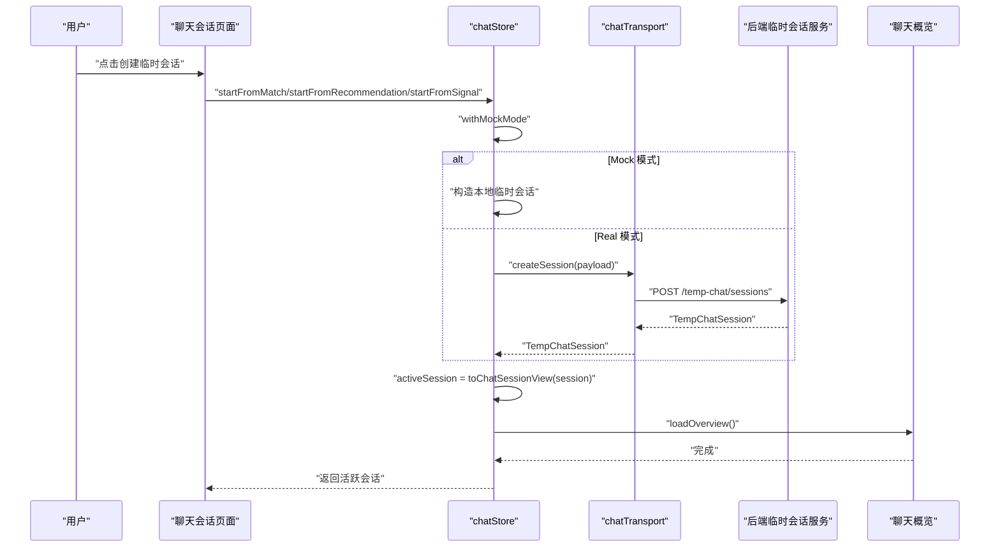

**图表来源**
- [apps/client/src/stores/chat/actions/session.ts:52-199](file://apps/client/src/stores/chat/actions/session.ts#L52-L199)
- [apps/client/src/stores/chat/higher-order.ts:84-142](file://apps/client/src/stores/chat/higher-order.ts#L84-L142)
- [apps/client/src/features/chat/transport.ts:20-60](file://apps/client/src/features/chat/transport.ts#L20-L60)

### 消息发送与投递状态恢复

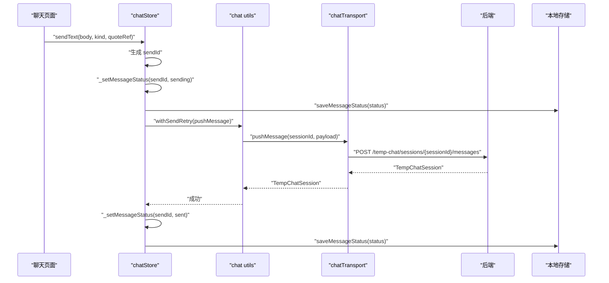

**图表来源**
- [apps/client/src/stores/chat/actions/messaging.ts:45-145](file://apps/client/src/stores/chat/actions/messaging.ts#L45-L145)
- [apps/client/src/stores/chat/utils.ts:60-97](file://apps/client/src/stores/chat/utils.ts#L60-L97)
- [apps/client/src/features/chat/transport.ts:60-85](file://apps/client/src/features/chat/transport.ts#L60-L85)

## 性能与资源特性

### 性能关注点

| 维度 | 现状 | 优化建议 |
|---|---|---|
| 会话创建 | Mock 模式 O(1)，Real 模式依赖后端接口延迟 | 避免频繁重复创建相同来源会话 |
| 消息发送 | 最多重试 1 次，网络错误才重试 | 合理设置重试延迟，避免抖动放大 |
| 会话加载 | 每次进入会话拉取完整会话 | 大会话可考虑分页或增量合并 |
| WebSocket 消息 | 实时推送，但未归因临时会话消息会丢弃 | 后端增加 `sessionUid` 可减少歧义 |
| 本地存储 | 仅持久化投递状态 | 谨慎扩展，避免存储过大 |
| 计时器 | typing 自动复位使用模块级定时器表 | 确保组件卸载时清理 |

### 复杂度分析

- **会话创建**：Mock 模式为常数时间；Real 模式受网络往返影响。
- **消息发送**：平均 O(1)，最坏情况下因重试增加一次网络调用。
- **会话加载**：O(1) 获取会话对象，但后端返回的消息列表规模会影响渲染成本。
- **WebSocket 消息分发**：按队列类型 switch 分支，O(1) 路由。
- **临时会话消息归因**：若无 `sessionId`，需访问 `chatStore.activeSession`，属于 O(1)。

**章节来源**
- [apps/client/src/stores/chat/actions/messaging.ts:1-229](file://apps/client/src/stores/chat/actions/messaging.ts#L1-L229)
- [apps/client/src/stores/chat/actions/session.ts:1-314](file://apps/client/src/stores/chat/actions/session.ts#L1-L314)
- [apps/client/src/services/websocket/store-dispatch.ts:1-200](file://apps/client/src/services/websocket/store-dispatch.ts#L1-L200)

## 调试工具与监控指标

### 调试工具

| 工具 | 用途 | 定位问题 |
|---|---|---|
| WebSocket 开发日志 | `services/websocket/index.ts` 中的 `wsTrace` | 连接、断开、订阅等状态 |
| 未知队列上报 | `store-dispatch.ts` 中上报 Sentry | 后端契约变更或消息丢失 |
| 非法消息数据上报 | `store-dispatch.ts` 与 `ws-message-adapter.ts` | 前后端字段不一致 |
| 消息投递状态本地存储 | `MESSAGE_STATUS_STORAGE_KEY` | 刷新后能否恢复发送状态 |
| 会话倒计时函数 | `formatTempCountdown`、`computeRemainingMs` | 临时会话过期显示是否正确 |
| 会话加载错误 | `loadSession` 抛出错误并清空 `activeSession` | 深链过期、会话不存在 |

### 监控指标建议

建议在运行期暴露以下指标：

| 指标 | 含义 | 告警建议 |
|---|---|---|
| `chat.session.create.success` | 临时会话创建成功次数 | 异常下降时检查后端接口 |
| `chat.session.create.failure` | 临时会话创建失败次数 | 持续升高时检查鉴权与参数 |
| `chat.session.load.success` | 会话加载成功次数 | 异常下降时检查会话有效性 |
| `chat.session.load.failure` | 会话加载失败次数 | 重点关注 404 过期会话 |
| `chat.message.send.success` | 消息发送成功次数 | 正常波动 |
| `chat.message.send.retry` | 消息发送重试次数 | 高重试率意味着网络不稳定 |
| `chat.message.send.failed` | 消息发送失败次数 | 非网络错误需重点排查 |
| `chat.websocket.connected` | WebSocket 连接状态 | 长时间 disconnected 需告警 |
| `chat.websocket.reconnect.count` | 重连次数 | 频繁重连代表网络或服务异常 |
| `chat.temp_session.expired` | 临时会话过期事件 | 统计过期会话占比 |
| `chat.ws.dispatch.unknown_queue` | 未知队列类型数量 | 非零时应尽快修复后端契约 |

**章节来源**
- [apps/client/src/services/websocket/index.ts:1-120](file://apps/client/src/services/websocket/index.ts#L1-L120)
- [apps/client/src/services/websocket/store-dispatch.ts:1-120](file://apps/client/src/services/websocket/store-dispatch.ts#L1-L120)
- [apps/client/src/stores/chat/utils.ts:30-97](file://apps/client/src/stores/chat/utils.ts#L30-L97)
- [apps/client/src/subpackages/chat/chat-session/view-models.ts:100-150](file://apps/client/src/subpackages/chat/chat-session/view-models.ts#L100-L150)

## 常见问题排查

### 问题一：会话加载后仍显示旧会话内容

**现象**：用户切换会话后，页面仍渲染上一个会话的消息。

**可能原因**：

- `loadSession` 失败但没有清空 `activeSession`。
- 异步加载未完成时 UI 提前渲染了旧状态。
- Mock 模式下使用了错误的 `sessionId`。

**排查步骤**：

1. 检查 `loadSession` 是否在 Real 模式加载失败时清空 `activeSession`。
2. 检查页面是否在 `loadingSession` 期间跳过渲染。
3. 确认传入的 `sessionId` 与后端返回一致。

**章节来源**
- [apps/client/src/stores/chat/actions/session.ts:170-255](file://apps/client/src/stores/chat/actions/session.ts#L170-L255)

### 问题二：临时会话消息不显示未读红点

**现象**：临时会话有新消息，但聊天列表未实时更新未读。

**可能原因**：

- 临时会话 WS 消息没有 `sessionId`，无法归因到会话。
- 用户不在会话页，消息被静默丢弃。
- 未读计数依赖服务端，进入会话后才全量刷新。

**排查步骤**：

1. 检查 WS 目标路径是否为 `/queue/temp-chat/messages`。
2. 检查 `fromWsPayload` 是否能解析消息。
3. 检查 `resolveWsSessionId` 是否因无 `activeSession` 返回空串。
4. 进入会话后调用 `loadSession` 验证是否全量刷新。

**章节来源**
- [apps/client/src/services/websocket/store-dispatch.ts:60-150](file://apps/client/src/services/websocket/store-dispatch.ts#L60-L150)
- [apps/client/src/services/websocket/ws-message-adapter.ts:60-114](file://apps/client/src/services/websocket/ws-message-adapter.ts#L60-L114)

### 问题三：消息发送后立即刷新页面，状态丢失

**现象**：发送消息后刷新页面，看不到 `sending`、`sent`、`failed` 状态。

**可能原因**：

- 本地存储读写失败。
- `MESSAGE_STATUS_STORAGE_KEY` 被清除。
- 初始化时未调用 `loadMessageStatus`。

**排查步骤**：

1. 检查 `loadMessageStatus` 是否能读取本地存储。
2. 检查 `saveMessageStatus` 是否成功写入。
3. 检查浏览器或小程序 storage 中是否存在对应 key。

**章节来源**
- [apps/client/src/stores/chat/utils.ts:30-68](file://apps/client/src/stores/chat/utils.ts#L30-L68)
- [apps/client/src/stores/chat/index.ts:90-110](file://apps/client/src/stores/chat/index.ts#L90-L110)

### 问题四：WebSocket 频繁重连

**现象**：控制台反复出现重连日志。

**可能原因**：

- 后端 WebSocket 服务不稳定。
- Token 失效或认证失败。
- 移动端网络切换导致连接断开。
- error 与 close 事件重复触发导致重连计数异常。

**排查步骤**：

1. 检查 `wsTrace` 输出连接状态。
2. 检查 token 是否有效。
3. 检查是否达到最大重连次数。
4. 确认 `reconnectScheduled` 是否阻止重复触发。

**章节来源**
- [apps/client/src/services/websocket/index.ts:120-220](file://apps/client/src/services/websocket/index.ts#L120-L220)

### 问题五：临时会话倒计时不更新或显示异常

**现象**：临时会话倒计时不更新，或已结束仍显示时间。

**可能原因**：

- 调用方未周期性计算 `computeRemainingMs`。
- `formatTempCountdown` 返回值未正确处理 `null`。
- 后端 `closesAt` 格式不正确。

**排查步骤**：

1. 检查 UI 是否使用定时器刷新倒计时。
2. 检查剩余时间小于等于 0 时是否显示空状态。
3. 检查后端返回的 `closesAt` 是否为合法 ISO 时间。

**章节来源**
- [apps/client/src/subpackages/chat/chat-session/view-models.ts:100-150](file://apps/client/src/subpackages/chat/chat-session/view-models.ts#L100-L150)

## 结论

聊天会话生命周期在当前代码库中以**临时匿名聊天**为核心实现，围绕 `chatStore`、`chatTransport`、`WebSocketClient` 三个关键层次组织：

- `chatStore` 负责会话状态、消息投递状态与会话生命周期 action。
- `chatTransport` 封装临时会话的 REST 接口，承担创建、加载、发消息、结束会话等职责。
- `WebSocketClient` 负责实时通道，承担连接、心跳、重连、消息分发职责。

临时匿名聊天的特殊机制体现在：

- 会话 ID 由后端创建，前端仅消费。
- 默认 24 小时过期时间由 `TEMP_SESSION_DURATION_MS` 控制。
- 临时会话消息在没有 `sessionId` 时依赖当前活跃会话进行归属。
- 未读计数以服务端为准，前端进入会话后通过全量加载兜底。
- 消息投递状态通过本地存储持久化，提升刷新后的用户体验。

在资源管理方面，代码已经覆盖了 WebSocket 订阅回调、重连防重入、定时器引用、本地存储异常等常见泄漏点。未来可进一步补充：

- 更细粒度的性能埋点与监控指标。
- 临时会话服务端过期事件的统一处理。
- 后端为临时会话消息增加 `sessionUid`，减少前端归因歧义。
- 对大会话消息列表的分页或增量合并。