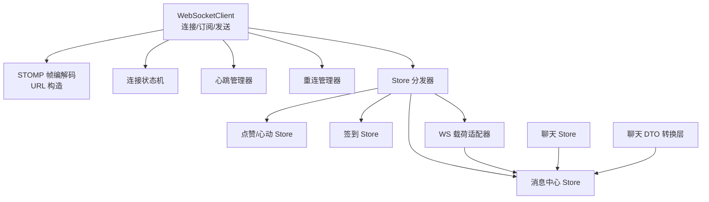
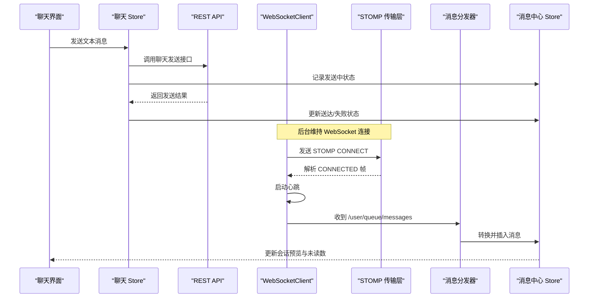
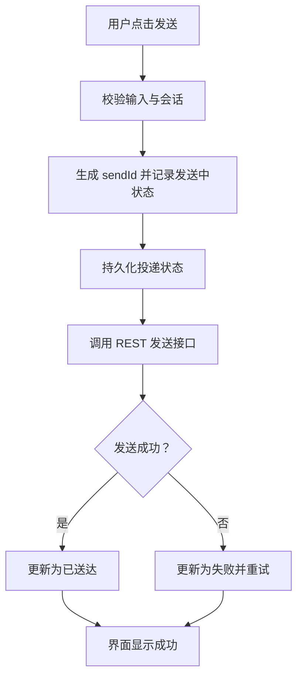
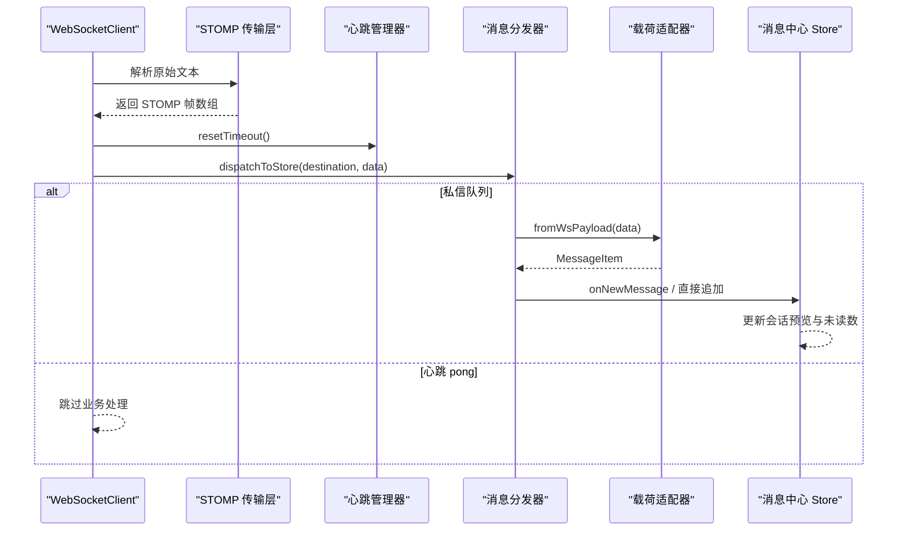
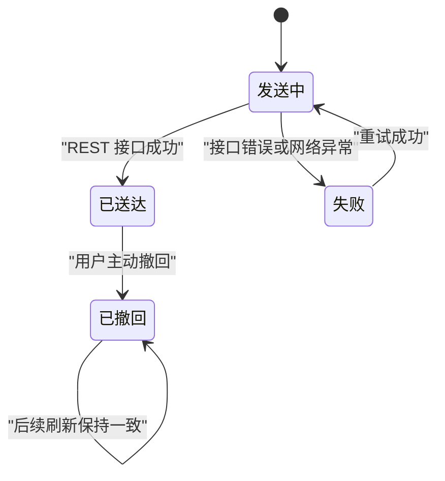
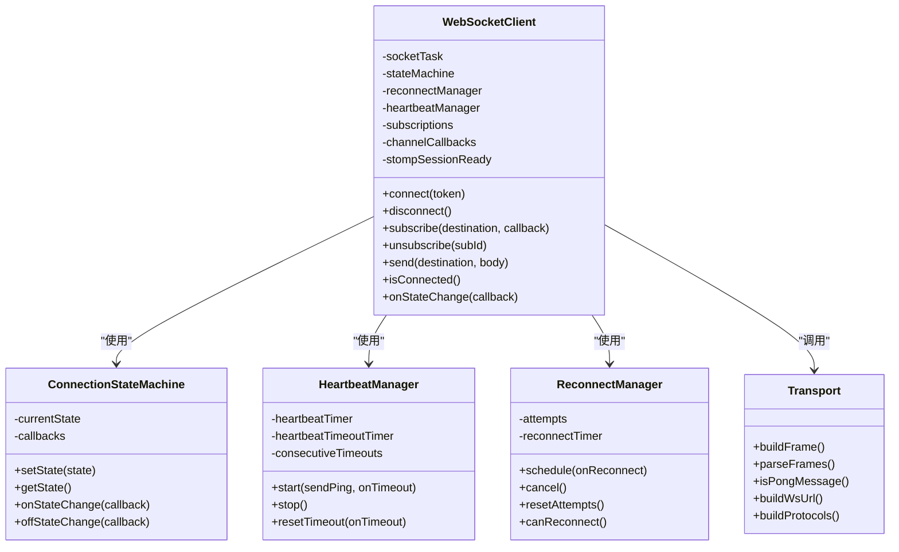
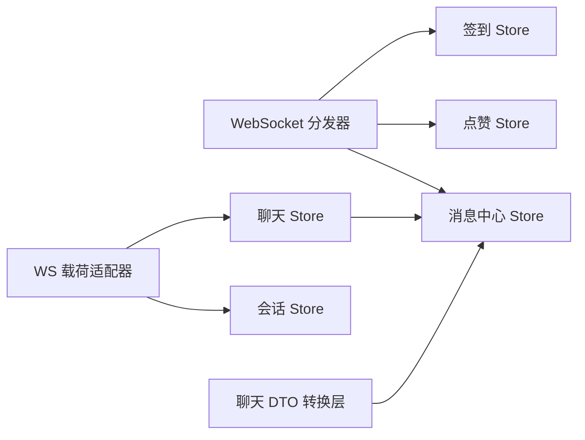

# 消息发送接收系统

<cite>
**本文引用的文件**   
- [apps/client/src/services/websocket/index.ts](file://apps/client/src/services/websocket/index.ts)
- [apps/client/src/services/websocket/store-dispatch.ts](file://apps/client/src/services/websocket/store-dispatch.ts)
- [apps/client/src/services/websocket/ws-message-adapter.ts](file://apps/client/src/services/websocket/ws-message-adapter.ts)
- [apps/client/src/services/websocket/transport.ts](file://apps/client/src/services/websocket/transport.ts)
- [apps/client/src/services/websocket/reconnect.ts](file://apps/client/src/services/websocket/reconnect.ts)
- [apps/client/src/services/websocket/heartbeat.ts](file://apps/client/src/services/websocket/heartbeat.ts)
- [apps/client/src/services/websocket/state-machine.ts](file://apps/client/src/services/websocket/state-machine.ts)
- [apps/client/src/stores/messages.ts](file://apps/client/src/stores/messages.ts)
- [apps/client/src/subpackages/chat/chat-session/dto.ts](file://apps/client/src/subpackages/chat/chat-session/dto.ts)
- [apps/client/src/subpackages/chat/chat-session/api.ts](file://apps/client/src/subpackages/chat/chat-session/api.ts)
- [apps/client/src/stores/chat/index.ts](file://apps/client/src/stores/chat/index.ts)
- [apps/client/src/stores/chat/store-type.ts](file://apps/client/src/stores/chat/store-type.ts)
</cite>

## 目录

1. [引言](#引言)
2. [项目结构与职责划分](#项目结构与职责划分)
3. [核心组件概览](#核心组件概览)
4. [架构总览](#架构总览)
5. [消息发送流程](#消息发送流程)
6. [实时消息接收流程](#实时消息接收流程)
7. [离线与增量同步策略](#离线与增量同步策略)
8. [消息状态全链路追踪](#消息状态全链路追踪)
9. [依赖关系分析](#依赖关系分析)
10. [性能与批量优化](#性能与批量优化)
11. [故障排查指南](#故障排查指南)
12. [结论](#结论)

## 引言

本技术文档聚焦于客户端消息发送与接收子系统，覆盖以下关键目标：

- 消息发送流程：消息格式化、WebSocket 或 REST 发送、发送状态跟踪、失败重试。
- 实时消息接收：WebSocket 连接、STOMP 帧编解码、心跳与重连、消息分发到 Pinia Store。
- 消息排序与去重：会话内消息加载顺序、通知与心动信号去重、临时会话消息归因。
- 本地存储与离线策略：消息分页游标、TTL 缓存、投递状态持久化、增量刷新。
- 离线消息处理：会话列表与消息的拉取、已读回执节流、正在输入状态复位。
- 消息状态管理：发送中、已送达、已读、撤回等状态的表示、持久化与 UI 映射。
- 性能优化：请求令牌防竞态、心跳容错、指数退避重连、消息类型转换集中化。
- 调试工具：开发日志收敛、Sentry 异常上报、队列类型告警、状态变更回调。

该子系统由“聊天会话层（chat store）”“消息中心层（messages store）”“WebSocket 传输层”“STOMP 适配层”“DTO 视图转换层”共同组成，既支持私信会话，也支持临时匿名聊天会话。

**章节来源**
- [apps/client/src/stores/chat/index.ts:1-131](file://apps/client/src/stores/chat/index.ts#L1-L131)
- [apps/client/src/stores/messages.ts:1-200](file://apps/client/src/stores/messages.ts#L1-L200)
- [apps/client/src/services/websocket/index.ts:1-120](file://apps/client/src/services/websocket/index.ts#L1-L120)

## 项目结构与职责划分

从代码组织看，消息相关实现主要分布在以下模块：

| 模块 | 主要职责 | 关键文件 |
|---|---|---|
| WebSocket 客户端主体 | 建立连接、认证、订阅、发送 STOMP 帧、状态机、重连、心跳 | `services/websocket/index.ts` |
| STOMP 帧编解码与 URL 构造 | 构建 CONNECT/SUBSCRIBE/SEND/DISCONNECT 帧、解析多帧、心跳 pong 识别 | `services/websocket/transport.ts` |
| 连接状态机 | 维护 disconnected/connecting/connected/reconnecting 状态及回调 | `services/websocket/state-machine.ts` |
| 心跳管理器 | 周期性 ping、超时检测、连续超时容错 | `services/websocket/heartbeat.ts` |
| 重连管理器 | 指数退避、最大次数控制、尝试计数重置 | `services/websocket/reconnect.ts` |
| WebSocket 到 Store 分发 | 按队列类型路由消息、调用 messages/likes/checkin store | `services/websocket/store-dispatch.ts` |
| WebSocket 载荷适配 | 后端 MessageView/ChatMessageView/mock 三种形态统一为内部 MessageItem | `services/websocket/ws-message-adapter.ts` |
| 消息中心 Store | 会话列表、当前会话消息、心动信号、通知、未读、分页、typing 状态 | `stores/messages.ts` |
| 聊天 Store | 聊天概览、活跃会话、文本/语音发送、消息投递状态持久化 | `stores/chat/index.ts` |
| 聊天 DTO 转换层 | 将 MessageItem/ChatMessage/DTO 转为 ChatMessageView，封装 recalled/deliveryStatus | `subpackages/chat/chat-session/dto.ts` |
| 临时会话 API | 封装临时会话消息撤回接口 | `subpackages/chat/chat-session/api.ts` |

**图表来源**
- [apps/client/src/services/websocket/index.ts:1-120](file://apps/client/src/services/websocket/index.ts#L1-L120)
- [apps/client/src/services/websocket/store-dispatch.ts:1-120](file://apps/client/src/services/websocket/store-dispatch.ts#L1-L120)
- [apps/client/src/stores/chat/index.ts:1-131](file://apps/client/src/stores/chat/index.ts#L1-L131)
- [apps/client/src/stores/messages.ts:1-200](file://apps/client/src/stores/messages.ts#L1-L200)

**章节来源**
- [apps/client/src/services/websocket/index.ts:1-120](file://apps/client/src/services/websocket/index.ts#L1-L120)
- [apps/client/src/services/websocket/store-dispatch.ts:1-120](file://apps/client/src/services/websocket/store-dispatch.ts#L1-L120)
- [apps/client/src/stores/chat/index.ts:1-131](file://apps/client/src/stores/chat/index.ts#L1-L131)
- [apps/client/src/stores/messages.ts:1-200](file://apps/client/src/stores/messages.ts#L1-L200)

## 核心组件概览

### WebSocket 客户端

`WebSocketClient` 是 WebSocket 子系统的入口，负责：

- 使用 `uni.connectSocket()` 建立底层连接。
- 通过子协议头携带 token，完成 HTTP 握手阶段认证。
- 在 TCP 连接成功后发送 STOMP CONNECT 帧，并携带 Authorization header 做会话级认证。
- 收到 CONNECTED 后标记 STOMP 会话就绪，并开始心跳。
- 维护订阅映射：订阅 ID → 目标路径、目标路径 → 回调列表。
- 提供 connect/disconnect/subscribe/unsubscribe/send/isConnected 等公共方法。
- 将错误、关闭事件交给重连管理器，避免重复重连。
- 将收到的 STOMP MESSAGE 帧交给 `dispatchToStore`。

安全方面，token 不再放在 URL 查询参数中，而是通过子协议和 STOMP Authorization header 传递，减少日志、Referer、浏览器历史泄漏风险。

**章节来源**
- [apps/client/src/services/websocket/index.ts:1-120](file://apps/client/src/services/websocket/index.ts#L1-L120)
- [apps/client/src/services/websocket/index.ts:201-500](file://apps/client/src/services/websocket/index.ts#L201-L500)

### STOMP 传输层

`transport.ts` 提供纯函数式 STOMP 帧能力：

- `buildFrame`：构建命令、头部、体、NULL 终止符。
- `parseFrames`：按 NULL 字符拆分多个帧，解析头部与体。
- `isPongMessage`：识别心跳 pong 响应，兼容紧凑 JSON 和带空格格式。
- `buildWsUrl`：将 API Base URL 转换为 ws/wss 端点。
- `buildProtocols`：构造子协议头，承载 bearer token。

这些函数无状态，只承担协议编解码职责，降低 WebSocket 主类的复杂度。

**章节来源**
- [apps/client/src/services/websocket/transport.ts:1-200](file://apps/client/src/services/websocket/transport.ts#L1-L200)

### 连接状态机

`ConnectionStateMachine` 维护四种连接状态：

- disconnected：未连接。
- connecting：正在连接。
- connected：底层连接已连接且 STOMP 会话就绪。
- reconnecting：自动重连中。

它不持有业务逻辑，只提供 setState、onStateChange、offStateChange、getState 等方法，并在状态真正变化时触发回调，避免重复通知。

**章节来源**
- [apps/client/src/services/websocket/state-machine.ts:1-121](file://apps/client/src/services/websocket/state-machine.ts#L1-L121)

### 心跳管理器

`HeartbeatManager` 负责：

- 定时发送 ping。
- 每次发送 ping 后设置超时定时器。
- 收到服务器任何消息时重置超时计时器。
- 连续超时达到上限才判定断线，避免弱网抖动导致频繁重连。
- stop 时清理所有定时器并清零连续超时计数。

**章节来源**
- [apps/client/src/services/websocket/heartbeat.ts:1-154](file://apps/client/src/services/websocket/heartbeat.ts#L1-L154)

### 重连管理器

`ReconnectManager` 实现指数退避重连：

- 第 1 次约 1 秒。
- 第 2 次约 2 秒。
- 第 3 次约 4 秒。
- 第 4 次约 8 秒。
- 第 5 次约 16 秒。
- 第 6 次及以上最多 30 秒。
- 超过最大重连次数后调用 onExhausted 回调，允许业务层提示用户手动重试。

**章节来源**
- [apps/client/src/services/websocket/reconnect.ts:1-176](file://apps/client/src/services/websocket/reconnect.ts#L1-L176)

### WebSocket 消息分发器

`dispatchToStore` 根据 STOMP 目标路径中的队列类型分发消息：

| 队列类型 | 含义 | 处理方式 |
|---|---|---|
| messages | 私信消息 | 经适配器转为 MessageItem，更新消息中心 Store |
| temp-chat/messages | 临时会话私信 | 同样进入私信消息处理，但 sessionId 可能为空，需降级丢弃 |
| signals | 心动信号 | 更新 likes store 与 messages store 的心动信号列表 |
| notifications | 系统通知 | 去重后插入通知列表 |
| matches | 匹配成功 | 生成前端通知条目并按 matchId 去重 |
| temp-chat | 临时会话创建/关闭 | 刷新会话列表 |
| checkin | 签到事件 | 刷新签到状态 |
| typing | 对方正在输入 | 写入 messages store 的 typingMap |

未知队列类型会输出开发日志并通过 Sentry 上报，避免前后端契约漂移被静默忽略。

**章节来源**
- [apps/client/src/services/websocket/store-dispatch.ts:1-200](file://apps/client/src/services/websocket/store-dispatch.ts#L1-L200)
- [apps/client/src/services/websocket/store-dispatch.ts:201-443](file://apps/client/src/services/websocket/store-dispatch.ts#L201-L443)

### WebSocket 载荷适配器

`ws-message-adapter.ts` 解决后端 WebSocket 推送数据形状与前端内部 MessageItem 不一致的问题：

- 形态 A：后端私信 MessageView，包含 conversationId、senderId、messageKind、content、createdAt、quoteContext。
- 形态 B/C：临时会话或 mock 消息，字段更接近 MessageItem，但可能缺少 sessionId。
- 统一返回 MessageItem；无法识别或无法归因时返回 null。
- 同时解析引用回复上下文，使 WS 新消息能复用现有引用渲染逻辑。

**章节来源**
- [apps/client/src/services/websocket/ws-message-adapter.ts:1-114](file://apps/client/src/services/websocket/ws-message-adapter.ts#L1-L114)

## 架构总览

从端到端视角，消息系统分为三层：

1. **表现层**：聊天会话页、消息页、气泡组件、通知 UI。
2. **状态层**：聊天 Store、消息中心 Store、会话 Store、点赞 Store、签到 Store。
3. **传输层**：REST API、WebSocket + STOMP、心跳、重连、状态机、分发器。

**图表来源**
- [apps/client/src/stores/chat/index.ts:1-131](file://apps/client/src/stores/chat/index.ts#L1-L131)
- [apps/client/src/services/websocket/index.ts:201-500](file://apps/client/src/services/websocket/index.ts#L201-L500)
- [apps/client/src/services/websocket/store-dispatch.ts:1-200](file://apps/client/src/services/websocket/store-dispatch.ts#L1-L200)
- [apps/client/src/stores/messages.ts:200-563](file://apps/client/src/stores/messages.ts#L200-L563)

**章节来源**
- [apps/client/src/services/websocket/index.ts:201-500](file://apps/client/src/services/websocket/index.ts#L201-L500)
- [apps/client/src/services/websocket/store-dispatch.ts:1-200](file://apps/client/src/services/websocket/store-dispatch.ts#L1-L200)
- [apps/client/src/stores/messages.ts:200-563](file://apps/client/src/stores/messages.ts#L200-L563)

## 消息发送流程

消息发送涉及两条路径：

- **聊天会话消息**：由 chat store 调用 REST API 发送，并在本地维护 delivery status。
- **WebSocket 通用发送**：通过 WebSocketClient.send 发送 STOMP SEND 帧，用于通用通道消息。

### 聊天会话消息发送

聊天会话的文本和语音发送集中在 chat store：

1. 页面调用 `sendText` 或 `sendVoice`。
2. chat store 构造消息体，调用 REST 接口。
3. 立即在本地 `messageDeliveryStatus` 中记录 sendId 对应的发送中状态。
4. 本地状态持久化到存储，保证页面刷新后仍可恢复发送进度。
5. 接口成功后更新为已送达或失败状态。
6. 临时会话消息撤回通过专用 API 调用，并刷新会话快照。

**图表来源**
- [apps/client/src/stores/chat/index.ts:1-131](file://apps/client/src/stores/chat/index.ts#L1-L131)
- [apps/client/src/stores/chat/store-type.ts:1-129](file://apps/client/src/stores/chat/store-type.ts#L1-L129)
- [apps/client/src/subpackages/chat/chat-session/api.ts:1-32](file://apps/client/src/subpackages/chat/chat-session/api.ts#L1-L32)

**章节来源**
- [apps/client/src/stores/chat/index.ts:1-131](file://apps/client/src/stores/chat/index.ts#L1-L131)
- [apps/client/src/stores/chat/store-type.ts:1-129](file://apps/client/src/stores/chat/store-type.ts#L1-L129)
- [apps/client/src/subpackages/chat/chat-session/api.ts:1-32](file://apps/client/src/subpackages/chat/chat-session/api.ts#L1-L32)

### WebSocket 通用发送

`WebSocketClient.send` 用于通过 WebSocket 发送 STOMP SEND 帧：

- 先检查 isConnected 与 socketTask。
- 将 body 序列化为 JSON。
- 调用 transport.buildFrame 构建 SEND 帧。
- 通过 socketTask.send 发送。
- 发送失败时输出错误日志。

注意：该方法是轻量通用通道发送，并未内置复杂重试队列；对于聊天会话消息，实际业务仍走 REST API，并在 chat store 中维护本地发送状态。

**章节来源**
- [apps/client/src/services/websocket/index.ts:201-500](file://apps/client/src/services/websocket/index.ts#L201-L500)

## 实时消息接收流程

实时消息接收的核心路径是：

1. WebSocket 底层收到文本消息。
2. transport.parseFrames 解析为一个或多个 STOMP 帧。
3. heartbeat.resetTimeout 重置心跳超时。
4. index.ts 识别是否为心跳 pong，若是则跳过业务处理。
5. 否则调用 dispatchToStore。
6. dispatchToStore 根据队列类型选择具体处理器。
7. 私信消息经 ws-message-adapter 转换为 MessageItem。
8. messages store 更新 currentMessages、会话预览、未读数。

**图表来源**
- [apps/client/src/services/websocket/index.ts:201-500](file://apps/client/src/services/websocket/index.ts#L201-L500)
- [apps/client/src/services/websocket/transport.ts:1-200](file://apps/client/src/services/websocket/transport.ts#L1-L200)
- [apps/client/src/services/websocket/heartbeat.ts:1-154](file://apps/client/src/services/websocket/heartbeat.ts#L1-L154)
- [apps/client/src/services/websocket/store-dispatch.ts:1-200](file://apps/client/src/services/websocket/store-dispatch.ts#L1-L200)
- [apps/client/src/services/websocket/ws-message-adapter.ts:1-114](file://apps/client/src/services/websocket/ws-message-adapter.ts#L1-L114)

**章节来源**
- [apps/client/src/services/websocket/index.ts:201-500](file://apps/client/src/services/websocket/index.ts#L201-L500)
- [apps/client/src/services/websocket/store-dispatch.ts:1-200](file://apps/client/src/services/websocket/store-dispatch.ts#L1-L200)
- [apps/client/src/services/websocket/ws-message-adapter.ts:1-114](file://apps/client/src/services/websocket/ws-message-adapter.ts#L1-L114)

### 消息解析与排序

#### 消息解析

后端 WebSocket 推送的消息形状并不总是与前端内部 MessageItem 一致。适配器层承担了关键职责：

- 后端私信消息包含 conversationId、senderId、messageKind、content、createdAt、quoteContext。
- 临时会话消息可能没有 sessionId，需要通过当前活跃会话兜底。
- messageKind 大小写不敏感，voice/emoji/activity/image/text 需要统一映射。
- quoteContext 需要解析为 quoteRef、quoteBody、quoteSender，以便复用引用气泡渲染。

#### 消息排序

消息排序并非在 WebSocket 接收层逐个比较时间戳，而是以服务端返回的分页结果为准：

- 消息中心 Store 使用 messagePage 和 messageHasMore 维护正序分页游标。
- 新收到的实时消息通常作为最新一条追加或更新会话最后预览。
- 会话内历史消息由 loadSession 或 fetchSessionMessages 拉取，服务端决定排序。
- 临时会话 DTO 转换层会将数字 sentAt 转为 ISO 字符串，避免时间条展示错乱。

**章节来源**
- [apps/client/src/services/websocket/ws-message-adapter.ts:1-114](file://apps/client/src/services/websocket/ws-message-adapter.ts#L1-L114)
- [apps/client/src/stores/messages.ts:200-563](file://apps/client/src/stores/messages.ts#L200-L563)
- [apps/client/src/subpackages/chat/chat-session/dto.ts:1-200](file://apps/client/src/subpackages/chat/chat-session/dto.ts#L1-L200)

### 去重逻辑

系统中存在多处去重场景：

| 场景 | 去重键 | 规则 |
|---|---|---|
| 心动信号 | 信号 id | 新增前查找是否已存在，不存在再 push |
| 系统通知 | 通知 id | 新增前查找是否已存在，不存在再 unshift |
| 匹配事件 | matchId | 若已有相同 id 的通知则直接返回 |
| WebSocket 订阅回调 | subId | unsubscribe 时精确移除对应回调，防止回调泄漏 |
| 临时会话消息归因 | sessionId | 无 sessionId 且不在会话页时降级丢弃 |

去重主要在 store-dispatch 与 messages store 中实现，避免同一事件多次推送造成 UI 闪烁或红点重复。

**章节来源**
- [apps/client/src/services/websocket/store-dispatch.ts:201-443](file://apps/client/src/services/websocket/store-dispatch.ts#L201-L443)
- [apps/client/src/services/websocket/index.ts:201-500](file://apps/client/src/services/websocket/index.ts#L201-L500)

## 离线与增量同步策略

### 消息缓存与 TTL

消息中心 Store 引入 TTL 缓存机制：

- 消息页 bootstrap 新鲜度窗口为 30 秒。
- 官方号消息流新鲜度窗口为 60 秒。
- 使用 isCacheFresh、fetchWithStaleWhileRevalidate、setCachedValue 控制缓存读取与回源。
- 目的是减少短时间内重复拉取，尤其对消息流类接口有 N+1 请求问题。

这属于“半离线”策略：不是完整离线数据库，而是基于内存或轻量缓存的快速读取与过期刷新。

**章节来源**
- [apps/client/src/stores/messages.ts:1-200](file://apps/client/src/stores/messages.ts#L1-L200)

### 增量同步

增量同步主要体现在：

- WebSocket 推送新消息时，优先更新当前会话预览和未读数。
- 如果当前会话正在查看，activeSessionId 命中，则不累加未读数。
- 临时会话创建/关闭事件触发 fetchSessions，保持会话列表与后端一致。
- 签到事件触发 checkin store 刷新。
- 匹配事件在前端通知列表前置一条社交通知。

对于临时会话消息，若无法归因 sessionId，则静默忽略；进入会话后由 loadSession 全量刷新兜底。

**章节来源**
- [apps/client/src/services/websocket/store-dispatch.ts:1-200](file://apps/client/src/services/websocket/store-dispatch.ts#L1-L200)
- [apps/client/src/services/websocket/ws-message-adapter.ts:1-114](file://apps/client/src/services/websocket/ws-message-adapter.ts#L1-L114)

### 冲突解决

当前仓库中没有显式的“消息版本冲突解决”算法，主要靠以下方式缓解：

- 服务端作为权威数据源，GET 会话消息为最终一致性依据。
- 客户端实时消息主要用于体验增强，如未读红点、最后消息预览。
- 临时会话消息若归因失败，进入会话时重新拉取。
- 心跳连续超时容错避免弱网单次丢包导致误判断线。
- 请求令牌模式避免旧请求覆盖新请求结果。

**章节来源**
- [apps/client/src/services/websocket/heartbeat.ts:1-154](file://apps/client/src/services/websocket/heartbeat.ts#L1-L154)
- [apps/client/src/stores/messages.ts:200-563](file://apps/client/src/stores/messages.ts#L200-L563)

## 消息状态全链路追踪

消息状态贯穿“发送方 UI → chat store → REST/WebSocket → 服务端 → 实时推送 → messages store → 渲染”。

### 发送状态

chat store 维护 `messageDeliveryStatus`，key 为 sendId，value 为 MessageDeliveryStatus：

- 发送前立即写入发送中状态。
- 本地持久化，保证刷新后可恢复。
- 页面渲染时可显示“发送中/已送达/失败”等状态。
- 临时会话消息撤回通过专用 API 刷新会话快照。

**图表来源**
- [apps/client/src/stores/chat/index.ts:1-131](file://apps/client/src/stores/chat/index.ts#L1-L131)
- [apps/client/src/stores/chat/store-type.ts:1-129](file://apps/client/src/stores/chat/store-type.ts#L1-L129)
- [apps/client/src/subpackages/chat/chat-session/api.ts:1-32](file://apps/client/src/subpackages/chat/chat-session/api.ts#L1-L32)

### 已读状态

messages store 中有两个相关机制：

1. 会话级未读数：收到新消息时，若非当前 activeSession，则 unreadCount 加一。
2. 已读回执节流：同一会话在 2 秒内多次 markConversationRead 只发一次，避免频繁请求。

typing 状态也有类似自动复位机制：

- 对方正在输入状态写入 typingMap。
- 若对方未发送 typing=false，3 秒后自动复位。
- typing=false 立即复位。

### 撤回状态

临时会话消息撤回通过 chat-session/api.ts 的 recallTempChatMessageApi 调用，返回会话快照，从而让 UI 看到 recalled 状态。dto.ts 提供 getMessageRecalled 和 toChatMessageViewList，统一转换 recalled 和 deliveryStatus。

**章节来源**
- [apps/client/src/stores/messages.ts:200-563](file://apps/client/src/stores/messages.ts#L200-L563)
- [apps/client/src/subpackages/chat/chat-session/api.ts:1-32](file://apps/client/src/subpackages/chat/chat-session/api.ts#L1-L32)
- [apps/client/src/subpackages/chat/chat-session/dto.ts:1-200](file://apps/client/src/subpackages/chat/chat-session/dto.ts#L1-L200)

## 依赖关系分析

### WebSocket 子系统内部依赖

**图表来源**
- [apps/client/src/services/websocket/index.ts:1-120](file://apps/client/src/services/websocket/index.ts#L1-L120)
- [apps/client/src/services/websocket/state-machine.ts:1-121](file://apps/client/src/services/websocket/state-machine.ts#L1-L121)
- [apps/client/src/services/websocket/heartbeat.ts:1-154](file://apps/client/src/services/websocket/heartbeat.ts#L1-L154)
- [apps/client/src/services/websocket/reconnect.ts:1-176](file://apps/client/src/services/websocket/reconnect.ts#L1-L176)
- [apps/client/src/services/websocket/transport.ts:1-200](file://apps/client/src/services/websocket/transport.ts#L1-L200)

### 跨 Store 依赖

- WebSocket 分发器依赖 messages store、likes store、checkin store。
- chat store 依赖 messages store 的 currentMessages、sessions、typingMap。
- ws-message-adapter 依赖 session store、chat store，用于临时会话消息归因。
- dto 转换层依赖 messages store 的 MessageItem 类型，但不反向依赖其运行时逻辑。

**图表来源**
- [apps/client/src/services/websocket/store-dispatch.ts:1-200](file://apps/client/src/services/websocket/store-dispatch.ts#L1-L200)
- [apps/client/src/services/websocket/ws-message-adapter.ts:1-114](file://apps/client/src/services/websocket/ws-message-adapter.ts#L1-L114)
- [apps/client/src/stores/chat/index.ts:1-131](file://apps/client/src/stores/chat/index.ts#L1-L131)
- [apps/client/src/subpackages/chat/chat-session/dto.ts:1-200](file://apps/client/src/subpackages/chat/chat-session/dto.ts#L1-L200)

**章节来源**
- [apps/client/src/services/websocket/store-dispatch.ts:1-200](file://apps/client/src/services/websocket/store-dispatch.ts#L1-L200)
- [apps/client/src/services/websocket/ws-message-adapter.ts:1-114](file://apps/client/src/services/websocket/ws-message-adapter.ts#L1-L114)
- [apps/client/src/stores/chat/index.ts:1-131](file://apps/client/src/stores/chat/index.ts#L1-L131)

## 性能与批量优化

### 心跳与连接稳定性

- 心跳间隔固定，但超时采用连续超时上限，避免弱网抖动误判。
- 重连采用指数退避，避免网络不可用时频繁消耗资源。
- CONNECT 握手超时 10 秒，避免状态机永久卡在 connecting。
- DISCONNECT 延迟 300ms 关闭底层连接，给服务端正常下线感知留出窗口。

### 请求竞态防护

messages store 使用请求令牌模式：

- 每个拉取动作维护独立递增 token。
- 仅当响应 token 等于最新 token 时才更新状态。
- 避免快速切换会话或筛选时旧请求覆盖新请求。

相比 AbortController，这种方式不需要修改 request 签名，也与 withTimeout 兼容。

### 未读回执节流

同一会话在 2 秒内多次已读回执合并为一次，因为后端按会话级批量 markAsRead，无需逐条回执。

### 消息类型转换集中化

ws-message-adapter 和 dto 转换层把后端不同消息形状统一到前端内部结构，减少组件层分支判断，提高渲染性能和可维护性。

**章节来源**
- [apps/client/src/services/websocket/heartbeat.ts:1-154](file://apps/client/src/services/websocket/heartbeat.ts#L1-L154)
- [apps/client/src/services/websocket/reconnect.ts:1-176](file://apps/client/src/services/websocket/reconnect.ts#L1-L176)
- [apps/client/src/services/websocket/index.ts:201-500](file://apps/client/src/services/websocket/index.ts#L201-L500)
- [apps/client/src/stores/messages.ts:200-563](file://apps/client/src/stores/messages.ts#L200-L563)
- [apps/client/src/services/websocket/ws-message-adapter.ts:1-114](file://apps/client/src/services/websocket/ws-message-adapter.ts#L1-L114)
- [apps/client/src/subpackages/chat/chat-session/dto.ts:1-200](file://apps/client/src/subpackages/chat/chat-session/dto.ts#L1-L200)

## 故障排查指南

### WebSocket 连接问题

常见问题包括：

- token 为空：connect 时直接拒绝。
- 子协议或 Authorization header 缺失：HTTP 握手或 STOMP 握手失败。
- 连接建立后 10 秒未收到 CONNECTED：视为握手超时，触发重连。
- 小程序并发 socket 任务上限：旧 task 未关闭导致后续连接失败。
- 断开连接时 DISCONNECT 帧未发出：通过延迟关闭修复。

排查建议：

- 开发环境下观察 wsTrace 日志。
- 检查 Sentry 是否上报“未知队列类型”“非法消息数据”等异常。
- 确认 WebSocket URL 是否正确拼接 `/ws/websocket`。
- 检查是否在 disconnect 后立即 closeSocket。

**章节来源**
- [apps/client/src/services/websocket/index.ts:1-120](file://apps/client/src/services/websocket/index.ts#L1-L120)
- [apps/client/src/services/websocket/index.ts:201-500](file://apps/client/src/services/websocket/index.ts#L201-L500)
- [apps/client/src/services/websocket/transport.ts:1-200](file://apps/client/src/services/websocket/transport.ts#L1-L200)

### 消息丢失或未读红点不更新

可能原因：

- WS 载荷形状不符合 MessageItem，被适配器丢弃。
- 临时会话消息 sessionId 为空且不在会话页，归因失败。
- 队列类型不匹配，dispatchToStore 直接返回。
- 消息未通过 isMessageItem 守卫。
- 消息中心 Store 没有 onNewMessage 方法，直接 push 时未更新会话预览。

排查建议：

- 检查 Sentry 中“非法私信消息数据”异常。
- 确认 destination 是否匹配 `/user/queue/messages` 或 `/user/queue/temp-chat/messages`。
- 确认 fromWsPayload 是否能解析出 sessionId。
- 检查 messages store 的 sessions 中是否有对应会话。

**章节来源**
- [apps/client/src/services/websocket/store-dispatch.ts:1-200](file://apps/client/src/services/websocket/store-dispatch.ts#L1-L200)
- [apps/client/src/services/websocket/ws-message-adapter.ts:1-114](file://apps/client/src/services/websocket/ws-message-adapter.ts#L1-L114)
- [apps/client/src/stores/messages.ts:200-563](file://apps/client/src/stores/messages.ts#L200-L563)

### 心跳超时与频繁重连

可能原因：

- 后端未正确回复 `{type:"pong"}`。
- 网络弱导致消息延迟，连续超时累计达到上限。
- 心跳定时器泄漏或重复启动。

排查建议：

- 观察心跳连续超时日志。
- 检查 isPongMessage 是否能识别后端 pong 格式。
- 确认 HeartbeatManager.start 与 stop 生命周期。
- 确认 resetTimeout 在收到任意服务器消息时被调用。

**章节来源**
- [apps/client/src/services/websocket/heartbeat.ts:1-154](file://apps/client/src/services/websocket/heartbeat.ts#L1-L154)
- [apps/client/src/services/websocket/transport.ts:1-200](file://apps/client/src/services/websocket/transport.ts#L1-L200)

### 消息状态不一致

可能原因：

- 页面刷新后本地发送状态未恢复。
- 会话切换时旧请求覆盖新请求。
- 消息撤回后 UI 未刷新。
- deliveryStatus 与 recalled 字段未正确转换。

排查建议：

- 检查 messageDeliveryStatus 持久化逻辑。
- 检查请求令牌是否最新。
- 检查 recallTempChatMessageApi 返回的会话快照是否刷新。
- 检查 dto.getMessageRecalled 与 toChatMessageViewList 是否正确转换。

**章节来源**
- [apps/client/src/stores/chat/index.ts:1-131](file://apps/client/src/stores/chat/index.ts#L1-L131)
- [apps/client/src/stores/chat/store-type.ts:1-129](file://apps/client/src/stores/chat/store-type.ts#L1-L129)
- [apps/client/src/subpackages/chat/chat-session/api.ts:1-32](file://apps/client/src/subpackages/chat/chat-session/api.ts#L1-L32)
- [apps/client/src/subpackages/chat/chat-session/dto.ts:1-200](file://apps/client/src/subpackages/chat/chat-session/dto.ts#L1-L200)

## 结论

消息发送接收系统围绕“可靠连接、清晰分层、状态可观测”三个目标展开：

- 连接层通过心跳、指数退避重连、握手超时、DISCONNECT 延迟关闭提升稳定性。
- 协议层通过 STOMP 帧编解码与载荷适配器隔离后端形状变化。
- 状态层通过 chat store 和 messages store 分别管理会话消息与消息中心数据。
- 可靠性通过请求令牌、去重、节流、TTL 缓存、连续超时容错共同保障。
- 可观测性通过 wsTrace、Sentry 异常上报、状态变更回调暴露问题。

未来可考虑的方向包括：

- 完善离线消息持久化，例如引入 IndexedDB 或 SQLite 作为消息本地库。
- 明确消息版本号或服务端时间戳，实现更强的冲突解决。
- 对 WebSocket 发送增加可靠重试队列与幂等键。
- 将更多队列类型和扩展字段纳入 Sentry 监控，尽早发现前后端契约漂移。