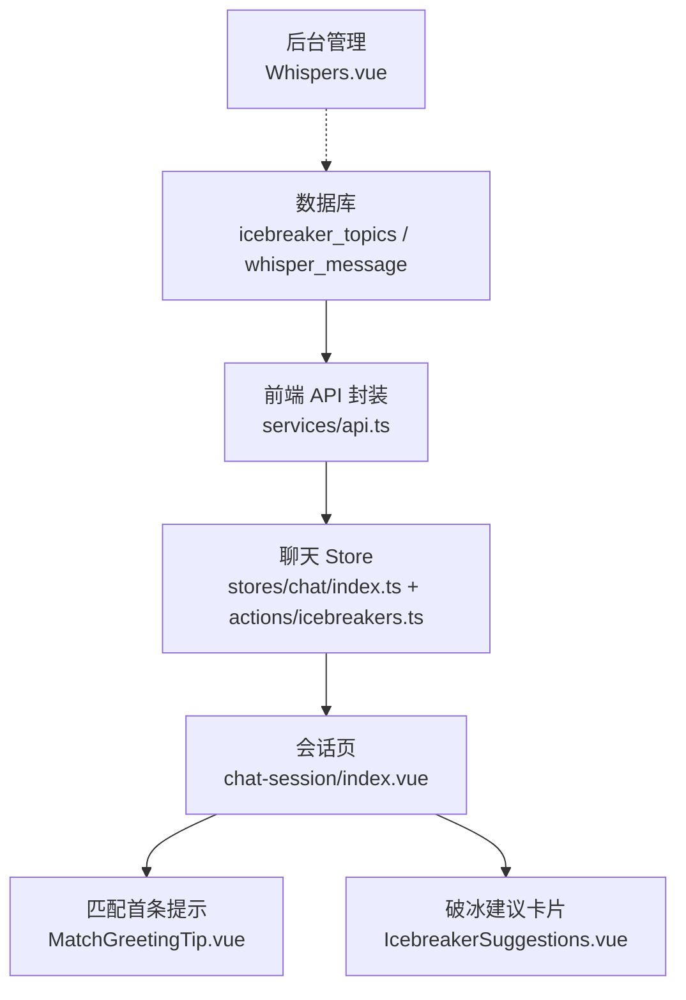
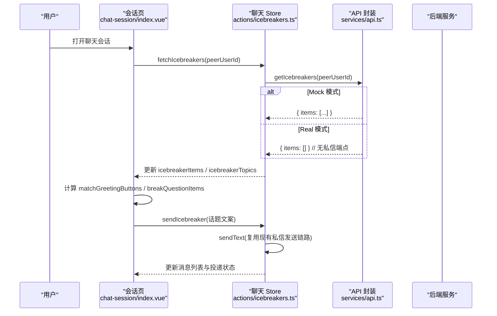
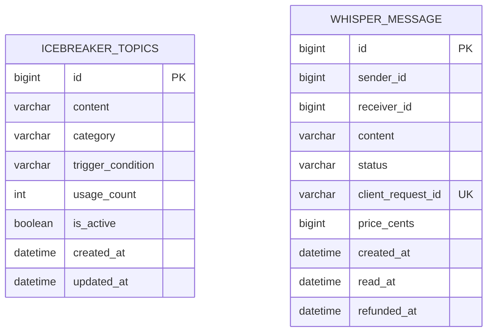
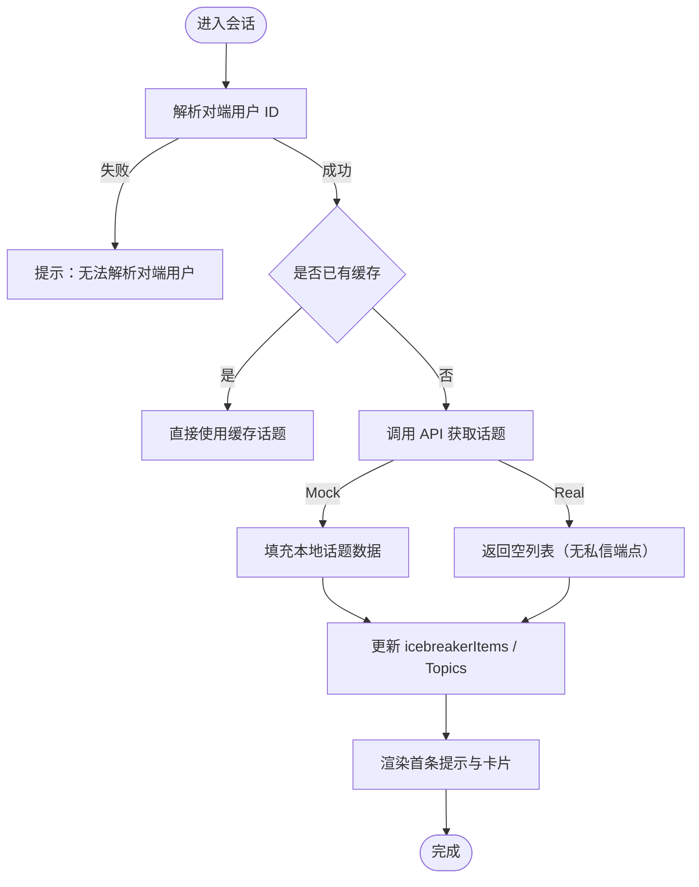
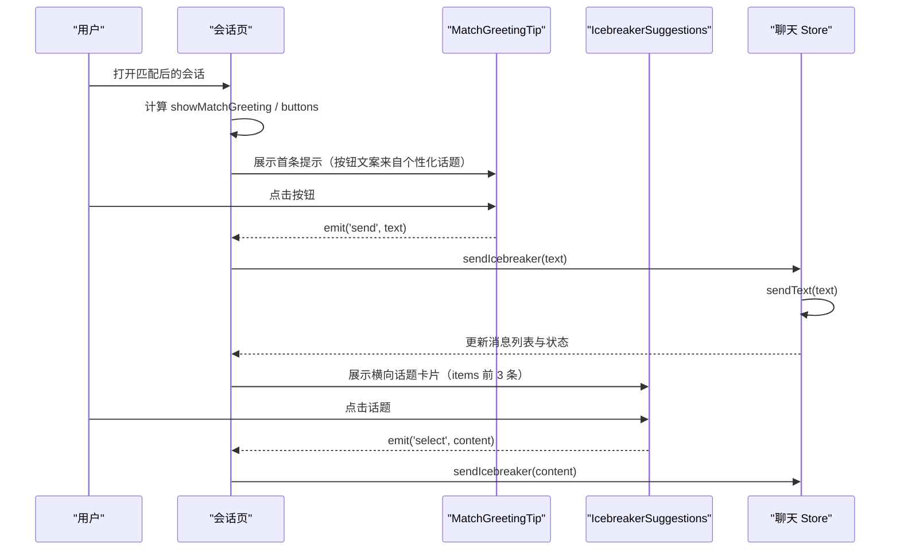
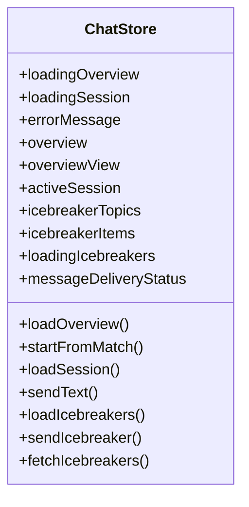
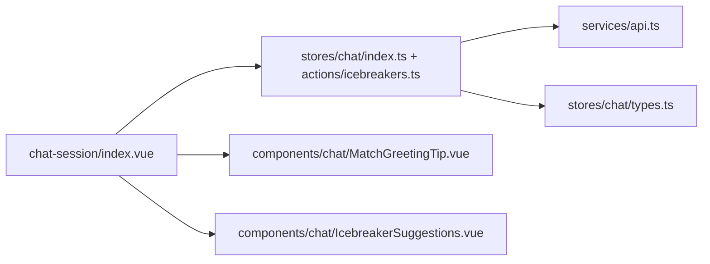

# 破冰话题系统

<cite>
**本文引用的文件**
- [V2026.05.30.0003__create_icebreaker_topics.sql](file://database/flyway/sql/V2026.05.30.0003__create_icebreaker_topics.sql)
- [V2026.08.14.0002__create_whisper_message.sql](file://database/flyway/sql/V2026.08.14.0002__create_whisper_message.sql)
- [index.ts（聊天 Store）](file://apps/client/src/stores/chat/index.ts)
- [icebreakers.ts（破冰话题 Actions）](file://apps/client/src/stores/chat/actions/icebreakers.ts)
- [types.ts（聊天 Store 类型）](file://apps/client/src/stores/chat/types.ts)
- [apps/client/src/subpackages/chat/chat-session/index.vue](file://apps/client/src/subpackages/chat/chat-session/index.vue)
- [IcebreakerSuggestions.vue（破冰建议卡片）](file://apps/client/src/components/chat/IcebreakerSuggestions.vue)
- [MatchGreetingTip.vue（匹配成功首条提示）](file://apps/client/src/components/chat/MatchGreetingTip.vue)
- [api.ts（前端 API 封装）](file://apps/client/src/services/api.ts)
- [Whispers.vue（后台悄悄话管理）](file://apps/admin/src/views/content/Whispers.vue)
</cite>

## 目录
1. [简介](#简介)
2. [项目结构](#项目结构)
3. [核心组件](#核心组件)
4. [架构总览](#架构总览)
5. [详细组件分析](#详细组件分析)
6. [依赖关系分析](#依赖关系分析)
7. [性能与可扩展性](#性能与可扩展性)
8. [故障排查指南](#故障排查指南)
9. [结论](#结论)
10. [附录](#附录)

## 简介
本技术文档聚焦“破冰话题系统”，覆盖生成算法、使用场景、状态管理、内容库与动态加载、多语言支持，以及效果评估与 A/B 测试框架。该系统由数据库中的破冰话题模板、前端的会话级推荐与展示、以及后台的运营数据管理能力共同组成，旨在帮助用户在首次对话、冷场恢复和话题延续等场景中快速开启高质量交流。

## 项目结构
围绕破冰话题的系统涉及以下关键层次：
- 数据层：破冰话题模板表 icebreaker_topics；悄悄话表 whisper_message（用于付费留言，与破冰话题形成互补）。
- 客户端 Store：集中管理破冰话题的加载、发送与刷新。
- 客户端页面与组件：会话页集成首条破冰提示与输入区上方的破冰建议卡片。
- API 层：按匹配 ID 获取个性化破冰话题列表，私信场景下返回空集合以避免调用不存在端点。
- 后台管理：提供悄悄话数据的查看与管理能力，便于运营侧审计与清理。

**图示来源**
- [V2026.05.30.0003__create_icebreaker_topics.sql:1-46](file://database/flyway/sql/V2026.05.30.0003__create_icebreaker_topics.sql#L1-L46)
- [V2026.08.14.0002__create_whisper_message.sql:1-18](file://database/flyway/sql/V2026.08.14.0002__create_whisper_message.sql#L1-L18)
- [api.ts:490-530](file://apps/client/src/services/api.ts#L490-L530)
- [index.ts:80-131](file://apps/client/src/stores/chat/index.ts#L80-L131)
- [apps/client/src/subpackages/chat/chat-session/index.vue:210-250](file://apps/client/src/subpackages/chat/chat-session/index.vue#L210-L250)
- [apps/client/src/subpackages/chat/chat-session/index.vue:1770-1810](file://apps/client/src/subpackages/chat/chat-session/index.vue#L1770-L1810)

**章节来源**
- [V2026.05.30.0003__create_icebreaker_topics.sql:1-46](file://database/flyway/sql/V2026.05.30.0003__create_icebreaker_topics.sql#L1-L46)
- [V2026.08.14.0002__create_whisper_message.sql:1-18](file://database/flyway/sql/V2026.08.14.0002__create_whisper_message.sql#L1-L18)
- [api.ts:490-530](file://apps/client/src/services/api.ts#L490-L530)
- [index.ts:80-131](file://apps/client/src/stores/chat/index.ts#L80-L131)
- [apps/client/src/subpackages/chat/chat-session/index.vue:210-250](file://apps/client/src/subpackages/chat/chat-session/index.vue#L210-L250)
- [apps/client/src/subpackages/chat/chat-session/index.vue:1770-1810](file://apps/client/src/subpackages/chat/chat-session/index.vue#L1770-L1810)

## 核心组件
- 破冰话题数据模型：包含通用模板与带触发条件的个性化模板，字段涵盖内容、分类、触发条件、使用次数、活跃状态等。
- 客户端 Store 动作：负责根据匹配 ID 或对方用户 ID 加载话题、发送话题、拉取完整话题项并维护加载态与错误信息。
- 会话级 UI：匹配成功首条提示按钮与输入区上方横向滚动的话题卡片，支持一键发送到输入框或直接发送。
- API 适配：统一通过 request 发起网络请求；私信场景下因无可用端点而返回空集合，匹配场景则通过 matchId 获取。
- 后台能力：提供悄悄话数据的分页查看、详情查看与删除，便于运营治理。

**章节来源**
- [icebreakers.ts:35-188](file://apps/client/src/stores/chat/actions/icebreakers.ts#L35-L188)
- [types.ts:1-86](file://apps/client/src/stores/chat/types.ts#L1-L86)
- [IcebreakerSuggestions.vue:1-200](file://apps/client/src/components/chat/IcebreakerSuggestions.vue#L1-L200)
- [MatchGreetingTip.vue:1-99](file://apps/client/src/components/chat/MatchGreetingTip.vue#L1-L99)
- [api.ts:490-530](file://apps/client/src/services/api.ts#L490-L530)
- [Whispers.vue:1-150](file://apps/admin/src/views/content/Whispers.vue#L1-L150)

## 架构总览
下图展示了从会话页到后端的数据流与交互顺序：

**图示来源**
- [apps/client/src/subpackages/chat/chat-session/index.vue:210-250](file://apps/client/src/subpackages/chat/chat-session/index.vue#L210-L250)
- [apps/client/src/subpackages/chat/chat-session/index.vue:1770-1810](file://apps/client/src/subpackages/chat/chat-session/index.vue#L1770-L1810)
- [icebreakers.ts:167-188](file://apps/client/src/stores/chat/actions/icebreakers.ts#L167-L188)
- [icebreakers.ts:99-166](file://apps/client/src/stores/chat/actions/icebreakers.ts#L99-L166)
- [api.ts:490-530](file://apps/client/src/services/api.ts#L490-L530)

## 详细组件分析

### 数据模型与内容库
- icebreaker_topics：存储通用与个性化破冰话题模板，含 category、trigger_condition、usage_count、is_active 等字段，支持按分类筛选与活跃度控制。
- whisper_message：记录悄悄话（付费留言）的发送、投递、阅读与退款状态，具备幂等键与索引优化，便于运营审计与风控。

**图示来源**
- [V2026.05.30.0003__create_icebreaker_topics.sql:1-46](file://database/flyway/sql/V2026.05.30.0003__create_icebreaker_topics.sql#L1-L46)
- [V2026.08.14.0002__create_whisper_message.sql:1-18](file://database/flyway/sql/V2026.08.14.0002__create_whisper_message.sql#L1-L18)

**章节来源**
- [V2026.05.30.0003__create_icebreaker_topics.sql:1-46](file://database/flyway/sql/V2026.05.30.0003__create_icebreaker_topics.sql#L1-L46)
- [V2026.08.14.0002__create_whisper_message.sql:1-18](file://database/flyway/sql/V2026.08.14.0002__create_whisper_message.sql#L1-L18)

### 破冰话题生成与推荐流程
- 匹配场景：通过 matchId 调用后端接口获取 IcebreakerView 数组，解析为内容列表。
- 私信场景：当前无私信维度的破冰端点，Real 模式返回空列表；Mock 模式提供本地数据用于开发联调。
- 会话页在 onShow 后异步加载，若无法解析对端用户 ID 会提示用户；已加载则避免重复请求。

**图示来源**
- [apps/client/src/subpackages/chat/chat-session/index.vue:1770-1810](file://apps/client/src/subpackages/chat/chat-session/index.vue#L1770-L1810)
- [icebreakers.ts:35-188](file://apps/client/src/stores/chat/actions/icebreakers.ts#L35-L188)
- [api.ts:490-530](file://apps/client/src/services/api.ts#L490-L530)

**章节来源**
- [apps/client/src/subpackages/chat/chat-session/index.vue:1770-1810](file://apps/client/src/subpackages/chat/chat-session/index.vue#L1770-L1810)
- [icebreakers.ts:35-188](file://apps/client/src/stores/chat/actions/icebreakers.ts#L35-L188)
- [api.ts:490-530](file://apps/client/src/services/api.ts#L490-L530)

### 使用场景与交互
- 首次对话引导：匹配成功后首条固定提示显示两个快捷按钮，优先取个性化话题的前两条，不足时用默认文案补齐。
- 冷场恢复：输入区上方横向滚动的破冰建议卡片，支持点击将话题填入输入框或直接发送；支持刷新获取更多话题。
- 话题延续：用户可基于已展示的个性化话题继续追问或扩展话题，结合消息数量解锁更多信息以维持对话节奏。

**图示来源**
- [apps/client/src/subpackages/chat/chat-session/index.vue:210-250](file://apps/client/src/subpackages/chat/chat-session/index.vue#L210-L250)
- [apps/client/src/subpackages/chat/chat-session/index.vue:2040-2085](file://apps/client/src/subpackages/chat/chat-session/index.vue#L2040-L2085)
- [IcebreakerSuggestions.vue:1-200](file://apps/client/src/components/chat/IcebreakerSuggestions.vue#L1-L200)
- [MatchGreetingTip.vue:1-99](file://apps/client/src/components/chat/MatchGreetingTip.vue#L1-L99)
- [icebreakers.ts:99-166](file://apps/client/src/stores/chat/actions/icebreakers.ts#L99-L166)

**章节来源**
- [apps/client/src/subpackages/chat/chat-session/index.vue:210-250](file://apps/client/src/subpackages/chat/chat-session/index.vue#L210-L250)
- [apps/client/src/subpackages/chat/chat-session/index.vue:2040-2085](file://apps/client/src/subpackages/chat/chat-session/index.vue#L2040-L2085)
- [IcebreakerSuggestions.vue:1-200](file://apps/client/src/components/chat/IcebreakerSuggestions.vue#L1-L200)
- [MatchGreetingTip.vue:1-99](file://apps/client/src/components/chat/MatchGreetingTip.vue#L1-L99)
- [icebreakers.ts:99-166](file://apps/client/src/stores/chat/actions/icebreakers.ts#L99-L166)

### 状态管理与持久化
- Store 状态：icebreakerTopics（前 3 条文案）、icebreakerItems（完整话题项）、loadingIcebreakers、errorMessage。
- 消息投递状态：每条消息的 sending/sent/failed 状态持久化至本地存储，跨会话/刷新后可恢复展示。
- 会话生命周期：onShow 后启动倒计时与破冰话题加载，onHide/onUnload 清理计时器与状态。

**图示来源**
- [index.ts:80-131](file://apps/client/src/stores/chat/index.ts#L80-L131)
- [types.ts:1-86](file://apps/client/src/stores/chat/types.ts#L1-L86)

**章节来源**
- [index.ts:80-131](file://apps/client/src/stores/chat/index.ts#L80-L131)
- [types.ts:1-86](file://apps/client/src/stores/chat/types.ts#L1-L86)

### 多语言支持与国际化
- i18n 键值：包括加载失败、发送失败、首条提示文案、按钮文案等，确保中英文环境下的正确显示。
- 组件内使用 useI18n 进行文案切换，如破冰标题、刷新按钮、卡片提示等。

**章节来源**
- [IcebreakerSuggestions.vue:1-200](file://apps/client/src/components/chat/IcebreakerSuggestions.vue#L1-L200)
- [MatchGreetingTip.vue:1-99](file://apps/client/src/components/chat/MatchGreetingTip.vue#L1-L99)

### 后台管理与运营能力
- 悄悄话管理：提供分页列表、查看详情与删除操作，便于运营侧治理违规内容与审计。
- 数据关联：虽然悄悄话与破冰话题属于不同功能域，但二者共同构成“轻量开场”的内容生态，可在数据分析时联合评估效果。

**章节来源**
- [Whispers.vue:1-150](file://apps/admin/src/views/content/Whispers.vue#L1-L150)

## 依赖关系分析
- 会话页依赖 Store 的状态与方法来获取与发送破冰话题。
- Store 依赖 API 封装进行网络请求，Mock 模式下走本地 fixture，Real 模式下按匹配维度获取。
- 组件仅负责展示与事件发射，逻辑集中在 Store 中，保证职责清晰。

**图示来源**
- [apps/client/src/subpackages/chat/chat-session/index.vue:210-250](file://apps/client/src/subpackages/chat/chat-session/index.vue#L210-L250)
- [apps/client/src/subpackages/chat/chat-session/index.vue:1770-1810](file://apps/client/src/subpackages/chat/chat-session/index.vue#L1770-L1810)
- [index.ts:80-131](file://apps/client/src/stores/chat/index.ts#L80-L131)
- [icebreakers.ts:35-188](file://apps/client/src/stores/chat/actions/icebreakers.ts#L35-L188)
- [api.ts:490-530](file://apps/client/src/services/api.ts#L490-L530)
- [types.ts:1-86](file://apps/client/src/stores/chat/types.ts#L1-L86)

**章节来源**
- [apps/client/src/subpackages/chat/chat-session/index.vue:210-250](file://apps/client/src/subpackages/chat/chat-session/index.vue#L210-L250)
- [apps/client/src/subpackages/chat/chat-session/index.vue:1770-1810](file://apps/client/src/subpackages/chat/chat-session/index.vue#L1770-L1810)
- [index.ts:80-131](file://apps/client/src/stores/chat/index.ts#L80-L131)
- [icebreakers.ts:35-188](file://apps/client/src/stores/chat/actions/icebreakers.ts#L35-L188)
- [api.ts:490-530](file://apps/client/src/services/api.ts#L490-L530)
- [types.ts:1-86](file://apps/client/src/stores/chat/types.ts#L1-L86)

## 性能与可扩展性
- 加载策略：会话页在消息加载完成后异步加载破冰话题，避免空态导致的闪烁与过早展示。
- 去重与缓存：已加载的话题项会在 Store 中缓存，避免重复请求。
- 发送路径：发送破冰话题复用现有私信发送链路，减少额外端点与维护成本。
- 可扩展点：未来可在后端增加按对方用户 ID 的破冰端点，实现更精准的私信场景推荐；也可在数据库层面引入更多分类与权重字段，提升多样性与个性化能力。

[本节为通用指导，不直接分析具体文件]

## 故障排查指南
- 无法解析对端用户 ID：会话页会提示用户，检查 resolvePeerUserId 的实现与传入参数。
- 破冰话题为空：Real 模式下无私信端点返回空列表属预期行为；如需私信场景个性化话题，需在后端新增对应端点并在 API 层接入。
- 发送失败：sendIcebreaker 内部捕获异常并设置 errorMessage，不会向上抛出导致重试；检查网络层错误与消息发送链路。
- 加载超时：请求超时由 http 层处理，检查网络环境与后端可用性。

**章节来源**
- [apps/client/src/subpackages/chat/chat-session/index.vue:1770-1810](file://apps/client/src/subpackages/chat/chat-session/index.vue#L1770-L1810)
- [icebreakers.ts:99-166](file://apps/client/src/stores/chat/actions/icebreakers.ts#L99-L166)
- [api.ts:490-530](file://apps/client/src/services/api.ts#L490-L530)

## 结论
破冰话题系统通过数据库模板、Store 动作与会话级 UI 的配合，实现了匹配场景下的个性化推荐与即时发送，同时兼顾了私信场景的兼容性。系统在加载策略、状态管理与错误处理方面具备较好的健壮性。后续可结合后端能力扩展私信维度的破冰推荐，并完善效果评估指标与 A/B 测试框架，以持续提升破冰成功率与用户体验。

[本节为总结，不直接分析具体文件]

## 附录
- 相关常量：消息长度限制、图片数量限制、空闲破冰提示延迟等，可在 constants/chat.ts 中查阅。
- 后台能力：悄悄话的分页、详情与删除，可在 Whispers.vue 中查看实现。

**章节来源**
- [apps/client/src/constants/chat.ts:1-54](file://apps/client/src/constants/chat.ts#L1-L54)
- [Whispers.vue:1-150](file://apps/admin/src/views/content/Whispers.vue#L1-L150)