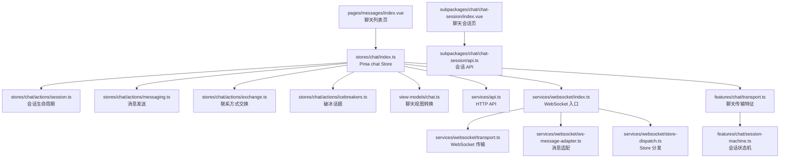
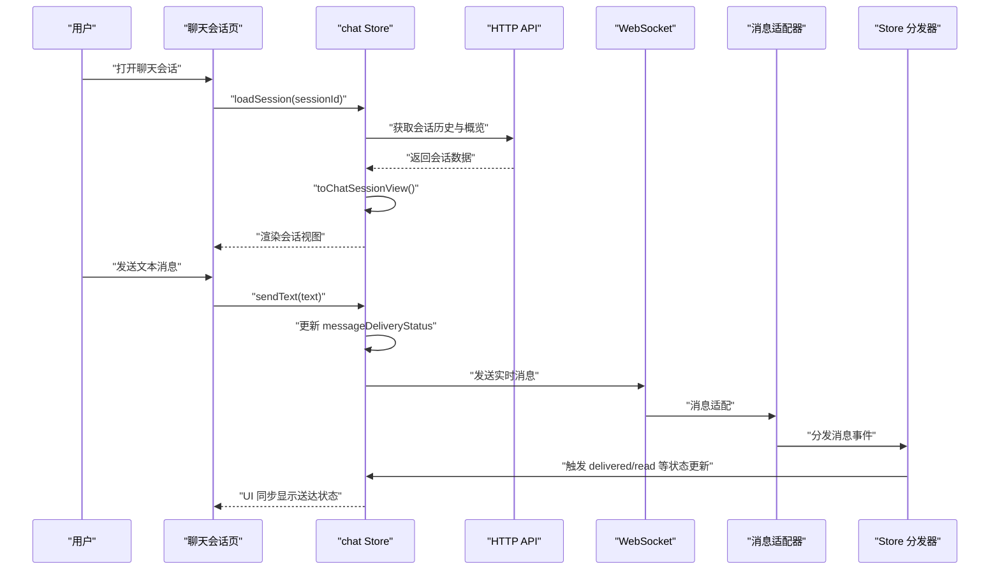
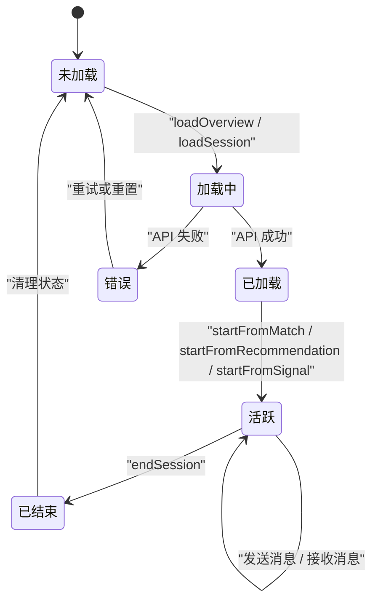
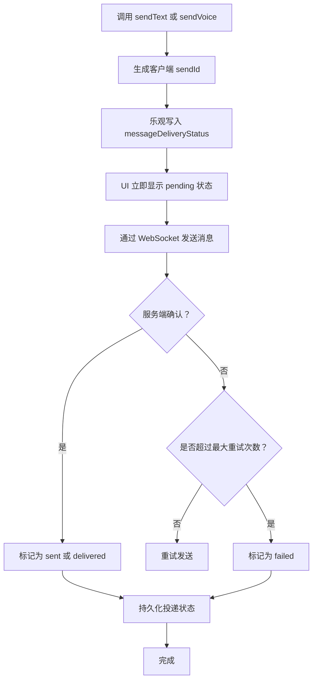
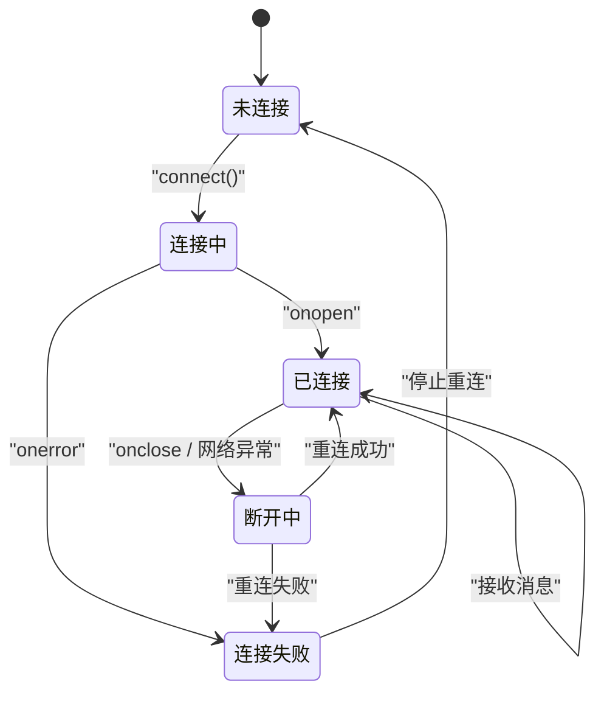
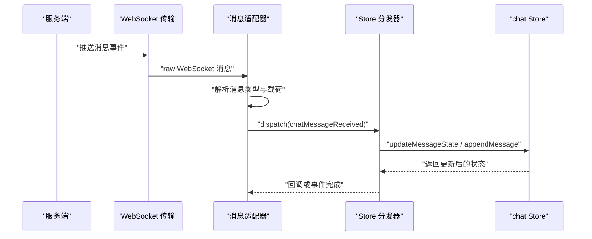
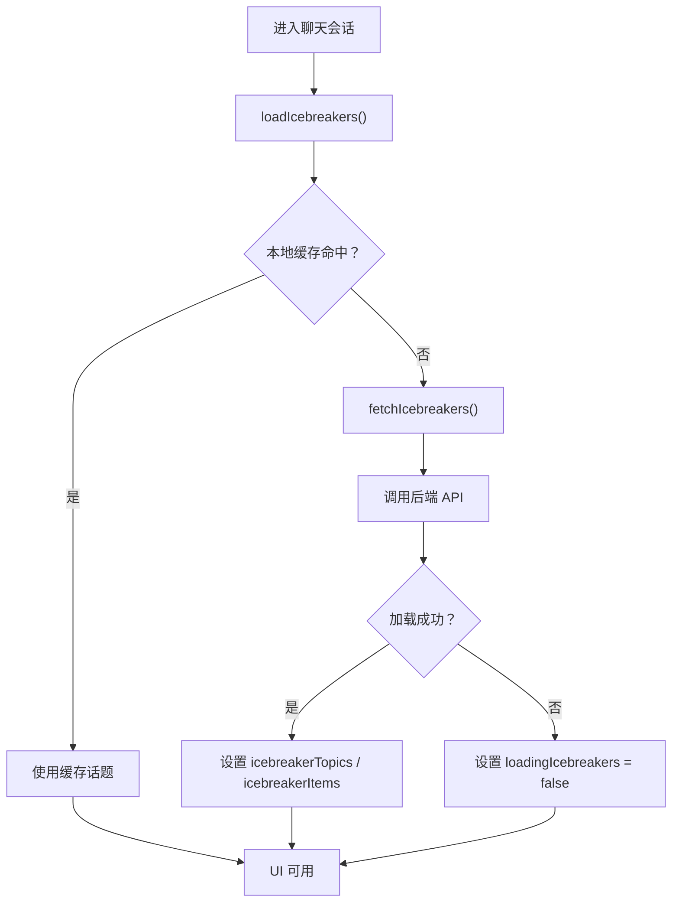
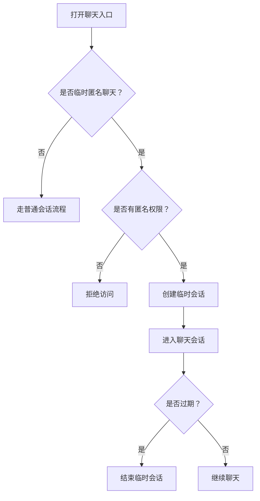
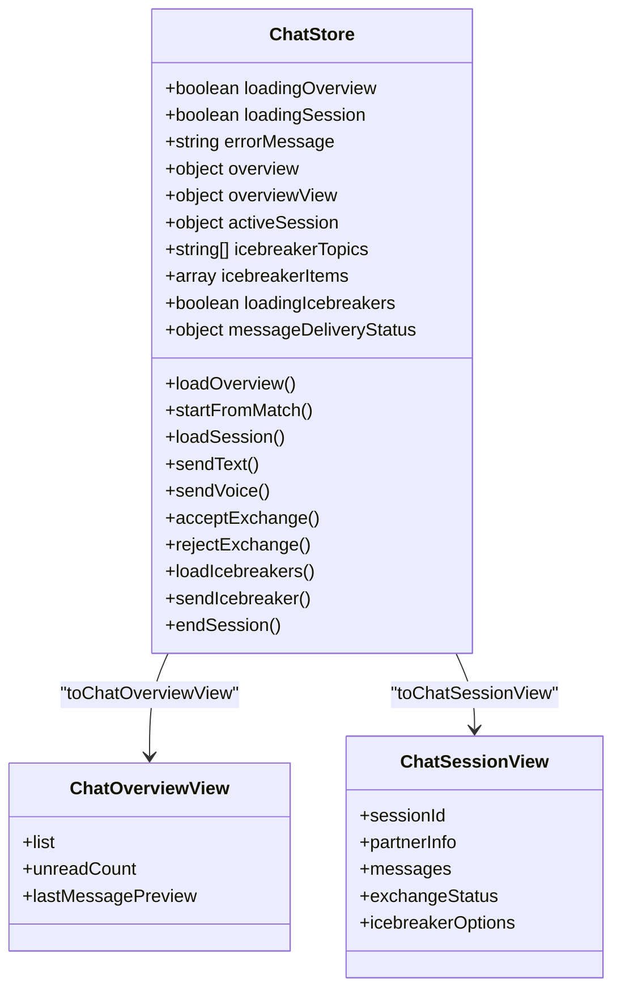
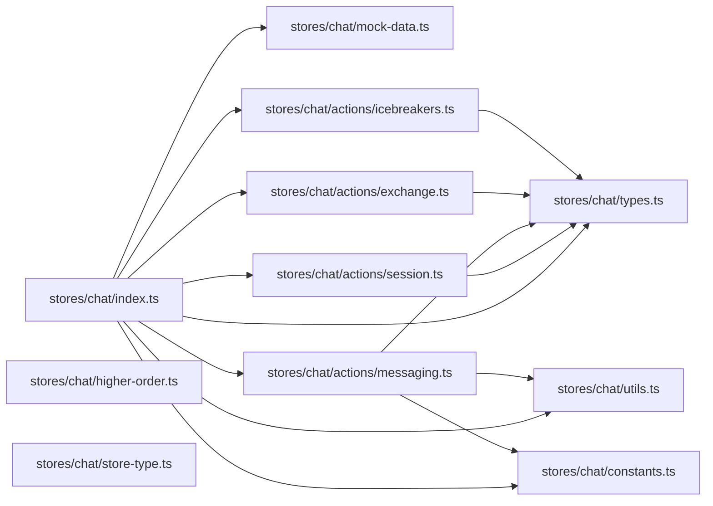

# 聊天状态管理

<cite>
**本文引用的文件**   
- [apps/client/src/stores/chat/index.ts](file://apps/client/src/stores/chat/index.ts)
- [apps/client/src/stores/chat/types.ts](file://apps/client/src/stores/chat/types.ts)
- [apps/client/src/stores/chat/constants.ts](file://apps/client/src/stores/chat/constants.ts)
- [apps/client/src/stores/chat/utils.ts](file://apps/client/src/stores/chat/utils.ts)
- [apps/client/src/stores/chat/higher-order.ts](file://apps/client/src/stores/chat/higher-order.ts)
- [apps/client/src/stores/chat/store-type.ts](file://apps/client/src/stores/chat/store-type.ts)
- [apps/client/src/stores/chat/mock-data.ts](file://apps/client/src/stores/chat/mock-data.ts)
- [apps/client/src/stores/chat/actions/session.ts](file://apps/client/src/stores/chat/actions/session.ts)
- [apps/client/src/stores/chat/actions/messaging.ts](file://apps/client/src/stores/chat/actions/messaging.ts)
- [apps/client/src/stores/chat/actions/exchange.ts](file://apps/client/src/stores/chat/actions/exchange.ts)
- [apps/client/src/stores/chat/actions/icebreakers.ts](file://apps/client/src/stores/chat/actions/icebreakers.ts)
- [apps/client/src/view-models/chat.ts](file://apps/client/src/view-models/chat.ts)
- [apps/client/src/services/api.ts](file://apps/client/src/services/api.ts)
- [apps/client/src/services/websocket.ts](file://apps/client/src/services/websocket.ts)
- [apps/client/src/services/websocket/index.ts](file://apps/client/src/services/websocket/index.ts)
- [apps/client/src/services/websocket/transport.ts](file://apps/client/src/services/websocket/transport.ts)
- [apps/client/src/services/websocket/ws-message-adapter.ts](file://apps/client/src/services/websocket/ws-message-adapter.ts)
- [apps/client/src/services/websocket/store-dispatch.ts](file://apps/client/src/services/websocket/store-dispatch.ts)
- [apps/client/src/features/chat/transport.ts](file://apps/client/src/features/chat/transport.ts)
- [apps/client/src/features/chat/session-machine.ts](file://apps/client/src/features/chat/session-machine.ts)
- [apps/client/src/subpackages/chat/chat-session/api.ts](file://apps/client/src/subpackages/chat/chat-session/api.ts)
- [apps/client/src/subpackages/chat/chat-session/dto.ts](file://apps/client/src/subpackages/chat/chat-session/dto.ts)
- [apps/client/src/subpackages/chat/chat-session/types.ts](file://apps/client/src/subpackages/chat/chat-session/types.ts)
- [apps/client/src/subpackages/chat/chat-session/view-models.ts](file://apps/client/src/subpackages/chat/chat-session/view-models.ts)
- [apps/client/src/pages/messages/index.vue](file://apps/client/src/pages/messages/index.vue)
- [apps/client/src/subpackages/chat/chat-session/index.vue](file://apps/client/src/subpackages/chat/chat-session/index.vue)
- [apps/client/src/stores/messages.ts](file://apps/client/src/stores/messages.ts)
- [apps/client/src/tests/ws-store-dispatch.spec.ts](file://apps/client/src/tests/ws-store-dispatch.spec.ts)
- [apps/client/src/tests/websocket.spec.ts](file://apps/client/src/tests/websocket.spec.ts)
- [apps/client/src/tests/ws-message-adapter.spec.ts](file://apps/client/src/tests/ws-message-adapter.spec.ts)
- [apps/client/src/tests/chat-transport.spec.ts](file://apps/client/src/tests/chat-transport.spec.ts)
- [apps/client/src/tests/pages/chat-session-page.spec.ts](file://apps/client/src/tests/pages/chat-session-page.spec.ts)
- [apps/client/src/tests/chat-overview-view.spec.ts](file://apps/client/src/tests/chat-overview-view.spec.ts)
- [apps/client/src/tests/chat-transport-real.spec.ts](file://apps/client/src/tests/chat-transport-real.spec.ts)
- [apps/client/src/tests/chat-session-machine.spec.ts](file://apps/client/src/tests/chat-session-machine.spec.ts)
</cite>

## 目录

1. [引言](#引言)
2. [项目结构与职责边界](#项目结构与职责边界)
3. [核心领域模型](#核心领域模型)
4. [架构总览](#架构总览)
5. [聊天会话生命周期](#聊天会话生命周期)
6. [消息发送与接收流程](#消息发送与接收流程)
7. [WebSocket 连接、实时同步与离线处理](#websocket-连接实时同步与离线处理)
8. [破冰话题与交换机制](#破冰话题与交换机制)
9. [临时匿名聊天特殊逻辑](#临时匿名聊天特殊逻辑)
10. [组件视图与状态映射](#组件视图与状态映射)
11. [依赖关系分析](#依赖关系分析)
12. [性能特性与优化建议](#性能特性与优化建议)
13. [调试方法与诊断工具](#调试方法与诊断工具)
14. [单元测试与 Mock 数据设计](#单元测试与-mock-数据设计)
15. [常见问题排查](#常见问题排查)
16. [结论](#结论)

## 引言

本技术文档聚焦前端聊天功能的状态管理系统，围绕 Pinia `chat` Store、消息传输层、WebSocket 通道、会话状态机以及聊天页面视图之间的协作关系展开。目标是让读者能够理解：

- 聊天概览、活跃会话、消息列表、用户状态等核心领域对象如何建模；
- 聊天会话从“匹配推荐”到“开始对话”再到“结束会话”的完整生命周期；
- 文本消息、语音消息的发送、重试、投递状态持久化与回滚策略；
- WebSocket 连接的建立、重连、消息适配、Store 分发与离线队列；
- 破冰话题系统、联系方式交换机制的实现细节；
- 临时匿名聊天的入口与权限判断；
- 如何通过测试、Mock 数据和调试脚本定位聊天状态异常。

## 项目结构与职责边界

聊天状态管理代码主要位于客户端应用的 `stores/chat` 目录中，采用“主 Store + 按行为拆分 actions + 类型/常量/Mock/工具函数分离”的结构：

| 路径 | 职责 |
|---|---|
| `stores/chat/index.ts` | 定义 `useChatStore`，装配 state、actions，并对外 re-export 类型、常量、Mock 和工具函数 |
| `stores/chat/types.ts` | 消息投递状态、临时会话、Store 接口等类型定义 |
| `stores/chat/constants.ts` | 存储键、最大重试次数等常量 |
| `stores/chat/utils.ts` | Mock 模式开关、消息投递状态加载保存、带重试封装等工具 |
| `stores/chat/higher-order.ts` | 高阶函数与传输层实例初始化 |
| `stores/chat/store-type.ts` | 拆分 action 中的 `this` 类型约束 |
| `stores/chat/mock-data.ts` | Mock 会话、概览、会话摘要、会话映射等测试数据 |
| `stores/chat/actions/session.ts` | 会话加载、创建、置顶、结束等生命周期操作 |
| `stores/chat/actions/messaging.ts` | 文本消息、语音消息发送与投递状态更新 |
| `stores/chat/actions/exchange.ts` | 联系方式接受与拒绝 |
| `stores/chat/actions/icebreakers.ts` | 破冰话题加载、发送、拉取 |
| `features/chat/transport.ts` | 聊天传输层抽象或特征级封装 |
| `features/chat/session-machine.ts` | 会话状态机实现 |
| `services/websocket/*` | WebSocket 连接、传输、消息适配、Store 分发 |
| `subpackages/chat/chat-session/*` | 聊天会话子包 API、DTO、类型、视图模型 |
| `view-models/chat.ts` | 后端数据到聊天概览视图、聊天会话视图的转换 |
| `pages/messages/index.vue` | 聊天列表页入口 |
| `subpackages/chat/chat-session/index.vue` | 具体聊天会话页 |

**图示来源**
- [apps/client/src/stores/chat/index.ts:1-131](file://apps/client/src/stores/chat/index.ts#L1-L131)
- [apps/client/src/view-models/chat.ts](file://apps/client/src/view-models/chat.ts)
- [apps/client/src/services/websocket/index.ts](file://apps/client/src/services/websocket/index.ts)
- [apps/client/src/features/chat/session-machine.ts](file://apps/client/src/features/chat/session-machine.ts)

**章节来源**
- [apps/client/src/stores/chat/index.ts:1-131](file://apps/client/src/stores/chat/index.ts#L1-L131)

## 核心领域模型

### 聊天 Store 状态

`useChatStore` 维护的 state 是聊天模块的核心本地状态，包括：

| 字段 | 含义 | 说明 |
|---|---|---|
| `loadingOverview` | 聊天概览是否加载中 | 控制聊天列表加载态 |
| `loadingSession` | 当前会话是否加载中 | 控制聊天会话页加载态 |
| `errorMessage` | 错误信息 | 用于向 UI 暴露失败原因 |
| `overview` | 原始聊天概览数据 | 来自后端 API 的聊天概览响应 |
| `overviewView` | 聊天概览视图模型 | 经 `toChatOverviewView` 转换后的展示结构 |
| `activeSession` | 当前活跃会话视图模型 | 经 `toChatSessionView` 转换后的会话展示结构 |
| `icebreakerTopics` | 当前匹配的破冰话题字符串列表 | 供破冰话题 UI 使用 |
| `icebreakerItems` | 结构化破冰话题项 | 包含 id、content、category、source |
| `loadingIcebreakers` | 破冰话题是否加载中 | 控制破冰话题加载态 |
| `messageDeliveryStatus` | 消息投递状态映射 | sendId 到投递状态的持久化映射 |

其中 `messageDeliveryStatus` 是一个关键修复点：它解决了刷新页面或切换会话后，用户无法感知上一条消息是否发送成功的问题。每条消息使用客户端生成的唯一 `sendId`（例如形如 `send-${timestamp}`）作为键，将投递状态持久化到本地存储。

### 消息投递状态类型

消息投递状态由 `MessageDeliveryStatus` 表示，典型语义包括：

| 状态值 | 语义 |
|---|---|
| `sending` | 正在发送 |
| `sent` | 已发送到服务端 |
| `delivered` | 已送达对方 |
| `read` | 已被对方阅读 |
| `failed` | 发送失败 |
| `cancelled` | 被取消或回滚 |

该类型在 `stores/chat/types.ts` 中定义，并在 `stores/chat/actions/messaging.ts` 中被 `_setMessageStatus` 更新。

### 临时匿名会话类型

临时匿名聊天通常对应一个轻量会话对象，常见字段包括：

| 字段 | 含义 |
|---|---|
| `id` | 临时会话标识 |
| `type` | 会话类型，例如临时聊天、匿名聊天 |
| `partnerId` | 对方用户标识 |
| `status` | 会话状态 |
| `createdAt` | 创建时间 |
| `expiresAt` | 过期时间 |
| `isAnonymous` | 是否为匿名聊天 |

这些类型通常定义在 `stores/chat/types.ts` 或 `subpackages/chat/chat-session/types.ts` 中，并由会话创建流程生成。

**章节来源**
- [apps/client/src/stores/chat/index.ts:52-129](file://apps/client/src/stores/chat/index.ts#L52-L129)
- [apps/client/src/stores/chat/types.ts](file://apps/client/src/stores/chat/types.ts)
- [apps/client/src/stores/chat/constants.ts](file://apps/client/src/stores/chat/constants.ts)
- [apps/client/src/stores/chat/utils.ts](file://apps/client/src/stores/chat/utils.ts)

## 架构总览

聊天状态管理遵循“Store 驱动 + 分层传输 + 视图模型解耦”的架构：

1. **Store 层**：`useChatStore` 持有聊天概览、活跃会话、消息投递状态、破冰话题等状态。
2. **Action 层**：会话、消息、交换、破冰话题等行为拆分为独立 action 文件，通过 method shorthand 挂载到 store。
3. **视图模型层**：后端数据通过 `view-models/chat.ts` 转换为 `toChatOverviewView` 和 `toChatSessionView`，避免页面直接依赖后端数据结构。
4. **传输层**：HTTP API 负责会话概览、破冰话题、联系方式交换等请求；WebSocket 负责实时消息推送。
5. **WebSocket 层**：负责连接管理、消息适配、Store 分发、重连与错误处理。
6. **会话状态机**：`features/chat/session-machine.ts` 提供更严谨的会话状态流转控制。
7. **视图层**：`pages/messages/index.vue` 展示聊天列表，`subpackages/chat/chat-session/index.vue` 展示具体会话。

**图示来源**
- [apps/client/src/stores/chat/index.ts:100-129](file://apps/client/src/stores/chat/index.ts#L100-L129)
- [apps/client/src/stores/chat/actions/messaging.ts](file://apps/client/src/stores/chat/actions/messaging.ts)
- [apps/client/src/services/websocket/ws-message-adapter.ts](file://apps/client/src/services/websocket/ws-message-adapter.ts)
- [apps/client/src/services/websocket/store-dispatch.ts](file://apps/client/src/services/websocket/store-dispatch.ts)

**章节来源**
- [apps/client/src/stores/chat/index.ts:1-131](file://apps/client/src/stores/chat/index.ts#L1-L131)
- [apps/client/src/view-models/chat.ts](file://apps/client/src/view-models/chat.ts)
- [apps/client/src/services/websocket/index.ts](file://apps/client/src/services/websocket/index.ts)

## 聊天会话生命周期

聊天会话的生命周期主要由 `stores/chat/actions/session.ts` 中的 action 管理，并通过 `stores/chat/index.ts` 暴露给外部调用。

### 会话生命周期阶段

**图示来源**
- [apps/client/src/stores/chat/actions/session.ts](file://apps/client/src/stores/chat/actions/session.ts)
- [apps/client/src/stores/chat/index.ts:100-129](file://apps/client/src/stores/chat/index.ts#L100-L129)

### 关键 Action

| Action | 参数 | 作用 |
|---|---|---|
| `loadOverview` | 无或可选过滤条件 | 加载聊天概览，填充 `overview` 和 `overviewView` |
| `startFromMatch` | 匹配结果或会话上下文 | 从匹配结果启动新会话 |
| `startFromRecommendation` | 推荐上下文 | 从推荐入口启动会话 |
| `startFromSignal` | 信号上下文 | 从心跳或信号入口启动会话 |
| `loadSession` | 会话 ID | 加载指定会话的历史消息与元信息 |
| `setSessionPinned` | 会话 ID、置顶标志 | 设置会话置顶状态 |
| `endSession` | 会话 ID | 结束会话，清理活跃状态 |

### 会话创建入口

会话可以通过多种入口创建：

1. **匹配成功**：`startFromMatch` 使用匹配结果初始化会话。
2. **推荐入口**：`startFromRecommendation` 基于推荐数据创建会话。
3. **信号入口**：`startFromSignal` 基于即时信号或通知创建会话。
4. **手动进入**：用户在聊天列表中点击已有会话，调用 `loadSession`。

**章节来源**
- [apps/client/src/stores/chat/actions/session.ts](file://apps/client/src/stores/chat/actions/session.ts)
- [apps/client/src/stores/chat/index.ts:100-129](file://apps/client/src/stores/chat/index.ts#L100-L129)

## 消息发送与接收流程

消息发送是聊天状态管理中最复杂的部分之一，涉及本地乐观更新、持久化、重试、WebSocket 推送与服务端确认。

### 消息发送流程

**图示来源**
- [apps/client/src/stores/chat/actions/messaging.ts](file://apps/client/src/stores/chat/actions/messaging.ts)
- [apps/client/src/stores/chat/utils.ts](file://apps/client/src/stores/chat/utils.ts)
- [apps/client/src/stores/chat/constants.ts](file://apps/client/src/stores/chat/constants.ts)

### 关键行为

| 行为 | 说明 |
|---|---|
| `sendText` | 发送文本消息，生成 `sendId`，乐观更新状态，然后通过 WebSocket 发送 |
| `sendVoice` | 发送语音消息，可能先上传语音文件再发送引用消息 |
| `_setMessageStatus` | 内部方法，更新某条消息的投递状态并持久化 |
| `loadMessageStatus` | 从本地存储加载消息投递状态，支持刷新恢复 |
| `withSendRetry` | 工具函数，封装带重试的发送逻辑 |

### 投递状态持久化

`messageDeliveryStatus` 通过本地存储持久化，确保：

- 页面刷新后仍可显示上次发送的消息状态；
- 切换会话后不会丢失其他会话的消息投递状态；
- 失败消息可被识别并重试；
- 成功消息可被标记为已送达或已读。

**章节来源**
- [apps/client/src/stores/chat/actions/messaging.ts](file://apps/client/src/stores/chat/actions/messaging.ts)
- [apps/client/src/stores/chat/utils.ts](file://apps/client/src/stores/chat/utils.ts)
- [apps/client/src/stores/chat/constants.ts](file://apps/client/src/stores/chat/constants.ts)
- [apps/client/src/stores/chat/index.ts:84-129](file://apps/client/src/stores/chat/index.ts#L84-L129)

## WebSocket 连接、实时同步与离线处理

WebSocket 层负责聊天消息的实时推送、连接管理和错误恢复。其核心文件包括：

| 文件 | 职责 |
|---|---|
| `services/websocket/index.ts` | WebSocket 服务入口，暴露连接、发送、监听等方法 |
| `services/websocket/transport.ts` | 底层传输实现，封装连接、心跳、重连 |
| `services/websocket/ws-message-adapter.ts` | 将原始 WebSocket 消息适配为聊天领域消息 |
| `services/websocket/store-dispatch.ts` | 将适配后的消息分发到 Pinia Store |
| `features/chat/transport.ts` | 聊天特征级传输封装 |

### WebSocket 连接状态

**图示来源**
- [apps/client/src/services/websocket/transport.ts](file://apps/client/src/services/websocket/transport.ts)
- [apps/client/src/services/websocket/index.ts](file://apps/client/src/services/websocket/index.ts)

### 消息适配与 Store 分发

**图示来源**
- [apps/client/src/services/websocket/ws-message-adapter.ts](file://apps/client/src/services/websocket/ws-message-adapter.ts)
- [apps/client/src/services/websocket/store-dispatch.ts](file://apps/client/src/services/websocket/store-dispatch.ts)

### 离线消息处理

当 WebSocket 不可用时，聊天系统应保证：

1. 用户仍可输入消息；
2. 本地乐观状态仍会显示发送中；
3. 网络恢复后重试发送；
4. 服务端确认后更新最终状态；
5. 长时间失败时提示用户。

当前实现中，`messageDeliveryStatus` 的持久化已经为离线恢复提供了基础，但完整的离线队列需要在 `features/chat/transport.ts` 或 `services/websocket/transport.ts` 中进一步扩展。

**章节来源**
- [apps/client/src/services/websocket/index.ts](file://apps/client/src/services/websocket/index.ts)
- [apps/client/src/services/websocket/transport.ts](file://apps/client/src/services/websocket/transport.ts)
- [apps/client/src/services/websocket/ws-message-adapter.ts](file://apps/client/src/services/websocket/ws-message-adapter.ts)
- [apps/client/src/services/websocket/store-dispatch.ts](file://apps/client/src/services/websocket/store-dispatch.ts)
- [apps/client/src/features/chat/transport.ts](file://apps/client/src/features/chat/transport.ts)

## 破冰话题与交换机制

### 破冰话题系统

破冰话题用于帮助用户在初始聊天中快速开启对话。其状态包括：

| 字段 | 含义 |
|---|---|
| `icebreakerTopics` | 字符串列表，供简单 UI 展示 |
| `icebreakerItems` | 结构化话题项，含 id、content、category、source |
| `loadingIcebreakers` | 加载状态 |

相关 action：

| Action | 作用 |
|---|---|
| `loadIcebreakers` | 加载当前会话可用的破冰话题 |
| `sendIcebreaker` | 发送一条破冰话题消息 |
| `fetchIcebreakers` | 主动拉取破冰话题列表 |

**图示来源**
- [apps/client/src/stores/chat/actions/icebreakers.ts](file://apps/client/src/stores/chat/actions/icebreakers.ts)
- [apps/client/src/stores/chat/index.ts:68-83](file://apps/client/src/stores/chat/index.ts#L68-L83)

### 联系方式交换机制

联系方式交换允许双方交换微信、电话或其他联系方式。核心 action：

| Action | 作用 |
|---|---|
| `acceptExchange` | 接受对方的联系方式交换请求 |
| `rejectExchange` | 拒绝对方的联系方式交换请求 |

交换流程通常包括：

1. 一方发起交换请求；
2. 另一方收到 WebSocket 通知；
3. 用户选择接受或拒绝；
4. Store 更新交换状态；
5. 界面显示交换结果。

**章节来源**
- [apps/client/src/stores/chat/actions/icebreakers.ts](file://apps/client/src/stores/chat/actions/icebreakers.ts)
- [apps/client/src/stores/chat/actions/exchange.ts](file://apps/client/src/stores/chat/actions/exchange.ts)
- [apps/client/src/stores/chat/index.ts:68-129](file://apps/client/src/stores/chat/index.ts#L68-L129)

## 临时匿名聊天特殊逻辑

临时匿名聊天是一种不需要完整登录或长期身份绑定的聊天模式。其特殊逻辑包括：

1. **会话类型区分**：通过会话类型字段区分普通会话与临时匿名会话。
2. **权限校验**：进入临时聊天前检查用户是否具备匿名访问权限。
3. **短生命周期**：临时会话通常有明确的过期时间。
4. **有限交互**：可能限制消息数量、表情互动或联系方式交换。
5. **退出即销毁**：会话结束后不保留完整聊天记录。

这些逻辑通常分布在：

- `stores/chat/types.ts`：临时会话类型定义；
- `stores/chat/actions/session.ts`：临时会话创建与结束；
- `subpackages/chat/chat-session/types.ts`：会话类型与权限字段；
- `guards/session-guard.ts`：会话访问守卫；
- `features/chat/session-machine.ts`：会话状态机中对匿名会话的特殊分支。

**图示来源**
- [apps/client/src/stores/chat/types.ts](file://apps/client/src/stores/chat/types.ts)
- [apps/client/src/stores/chat/actions/session.ts](file://apps/client/src/stores/chat/actions/session.ts)
- [apps/client/src/subpackages/chat/chat-session/types.ts](file://apps/client/src/subpackages/chat/chat-session/types.ts)
- [apps/client/src/features/chat/session-machine.ts](file://apps/client/src/features/chat/session-machine.ts)

**章节来源**
- [apps/client/src/stores/chat/types.ts](file://apps/client/src/stores/chat/types.ts)
- [apps/client/src/subpackages/chat/chat-session/types.ts](file://apps/client/src/subpackages/chat/chat-session/types.ts)
- [apps/client/src/features/chat/session-machine.ts](file://apps/client/src/features/chat/session-machine.ts)

## 组件视图与状态映射

聊天 UI 并不直接使用后端原始数据，而是通过 `view-models/chat.ts` 进行转换：

| 视图模型 | 输入 | 输出 |
|---|---|---|
| `toChatOverviewView` | 聊天概览原始数据 | 聊天列表可展示的概览结构 |
| `toChatSessionView` | 聊天会话原始数据 | 聊天会话页可展示的结构 |

### 聊天列表页

`pages/messages/index.vue` 主要负责：

- 调用 `loadOverview`；
- 渲染聊天列表；
- 导航到具体聊天会话；
- 显示未读消息提示；
- 处理登录态与权限。

### 聊天会话页

`subpackages/chat/chat-session/index.vue` 主要负责：

- 调用 `loadSession`；
- 渲染消息列表；
- 调用 `sendText` / `sendVoice`；
- 显示破冰话题；
- 处理联系方式交换；
- 订阅 WebSocket 实时消息。

**图示来源**
- [apps/client/src/stores/chat/index.ts:52-129](file://apps/client/src/stores/chat/index.ts#L52-L129)
- [apps/client/src/view-models/chat.ts](file://apps/client/src/view-models/chat.ts)

**章节来源**
- [apps/client/src/view-models/chat.ts](file://apps/client/src/view-models/chat.ts)
- [apps/client/src/pages/messages/index.vue](file://apps/client/src/pages/messages/index.vue)
- [apps/client/src/subpackages/chat/chat-session/index.vue](file://apps/client/src/subpackages/chat/chat-session/index.vue)

## 依赖关系分析

### Store 内部依赖

**图示来源**
- [apps/client/src/stores/chat/index.ts:1-131](file://apps/client/src/stores/chat/index.ts#L1-L131)

### 外部依赖

| 依赖 | 用途 |
|---|---|
| `pinia` | Store 定义与状态管理 |
| `services/api.ts` | HTTP 请求，获取聊天概览、破冰话题、联系方式等 |
| `services/websocket/*` | 实时消息推送、连接管理 |
| `view-models/chat.ts` | 数据到视图模型的转换 |
| `subpackages/chat/chat-session/*` | 聊天会话子包的 API、DTO、类型与视图模型 |
| `pages/messages/index.vue` | 聊天列表入口 |
| `subpackages/chat/chat-session/index.vue` | 聊天会话入口 |

**章节来源**
- [apps/client/src/stores/chat/index.ts:1-131](file://apps/client/src/stores/chat/index.ts#L1-L131)
- [apps/client/src/services/api.ts](file://apps/client/src/services/api.ts)
- [apps/client/src/services/websocket/index.ts](file://apps/client/src/services/websocket/index.ts)

## 性能特性与优化建议

### 当前性能特性

1. **局部状态更新**：通过 Pinia 的响应式 state，只更新受影响字段。
2. **乐观更新**：发送消息前先更新本地状态，提升用户体验。
3. **持久化投递状态**：避免刷新后丢失消息发送状态。
4. **视图模型解耦**：减少页面与后端结构的耦合，便于缓存与复用。

### 潜在优化点

| 问题 | 建议 |
|---|---|
| 聊天消息过多时渲染缓慢 | 对消息列表做分页或虚拟滚动 |
| WebSocket 频繁重连 | 增加指数退避与最大重连次数 |
| 破冰话题重复请求 | 增加会话级或全局缓存 |
| 消息投递状态过大 | 按会话分片存储或使用 IndexedDB |
| 语音消息上传阻塞 | 改为后台队列上传，不阻塞 UI |
| 聊天概览数据未缓存 | 增加短时间内存缓存 |

[本节为通用性能建议，不直接分析具体代码行]

## 调试方法与诊断工具

### 运行时调试

1. **查看聊天 Store 状态**：
   - 在浏览器 DevTools 中观察 Pinia store；
   - 关注 `messageDeliveryStatus`、`activeSession`、`overviewView`。

2. **查看 WebSocket 消息**：
   - 使用浏览器 Network 面板的 WebSocket 标签；
   - 查看 `services/websocket/index.ts` 暴露的连接日志；
   - 使用 `tests/websocket.spec.ts` 和 `tests/ws-store-dispatch.spec.ts` 中的调试思路。

3. **查看消息投递状态**：
   - 使用 `utils.loadMessageStatus()` 的持久化逻辑；
   - 检查本地存储中对应的 key；
   - 对比 `stores/chat/constants.ts` 中的存储键常量。

### 测试辅助

| 测试文件 | 用途 |
|---|---|
| `tests/ws-store-dispatch.spec.ts` | 验证 WebSocket 消息分发到 Store |
| `tests/websocket.spec.ts` | 验证 WebSocket 连接与基本行为 |
| `tests/ws-message-adapter.spec.ts` | 验证消息适配逻辑 |
| `tests/chat-transport.spec.ts` | 验证聊天传输层 |
| `tests/chat-session-page.spec.ts` | 验证聊天会话页行为 |
| `tests/chat-overview-view.spec.ts` | 验证聊天概览视图转换 |
| `tests/chat-transport-real.spec.ts` | 真实环境下的传输测试 |
| `tests/chat-session-machine.spec.ts` | 验证会话状态机 |

### 常用诊断步骤

1. **消息未送达**：
   - 检查 `messageDeliveryStatus` 是否为 `failed`；
   - 检查 WebSocket 是否连接；
   - 检查服务端是否返回确认消息。

2. **刷新后消息状态丢失**：
   - 检查本地存储是否写入；
   - 检查 `loadMessageStatus` 是否正确读取；
   - 检查持久化 key 是否与常量一致。

3. **破冰话题不显示**：
   - 检查 `loadingIcebreakers`；
   - 检查 `icebreakerItems` 是否为空；
   - 检查 API 返回结构是否符合预期。

**章节来源**
- [apps/client/src/tests/ws-store-dispatch.spec.ts](file://apps/client/src/tests/ws-store-dispatch.spec.ts)
- [apps/client/src/tests/websocket.spec.ts](file://apps/client/src/tests/websocket.spec.ts)
- [apps/client/src/tests/ws-message-adapter.spec.ts](file://apps/client/src/tests/ws-message-adapter.spec.ts)
- [apps/client/src/tests/chat-transport.spec.ts](file://apps/client/src/tests/chat-transport.spec.ts)
- [apps/client/src/tests/pages/chat-session-page.spec.ts](file://apps/client/src/tests/pages/chat-session-page.spec.ts)
- [apps/client/src/tests/chat-overview-view.spec.ts](file://apps/client/src/tests/chat-overview-view.spec.ts)
- [apps/client/src/tests/chat-transport-real.spec.ts](file://apps/client/src/tests/chat-transport-real.spec.ts)
- [apps/client/src/tests/chat-session-machine.spec.ts](file://apps/client/src/tests/chat-session-machine.spec.ts)

## 单元测试与 Mock 数据设计

### Mock 数据

`stores/chat/mock-data.ts` 提供聊天相关的 Mock 数据，包括：

| Mock 数据 | 用途 |
|---|---|
| `mockSession1` | 模拟第一个聊天会话 |
| `mockSession2` | 模拟第二个聊天会话 |
| `mockChatOverview` | 模拟聊天概览 |
| `mockChatSessionSummaries` | 模拟会话摘要列表 |
| `mockSessionMap` | 模拟会话映射表 |

这些 Mock 数据可用于：

- 单元测试聊天 Store；
- Storybook 展示聊天组件；
- E2E 测试中构造稳定场景；
- 开发时快速预览聊天界面。

### 测试策略

1. **Store 行为测试**：
   - 验证 `sendText` 会更新 `messageDeliveryStatus`；
   - 验证 `loadSession` 会设置 `activeSession`；
   - 验证 `endSession` 会清理活跃状态。

2. **WebSocket 分发测试**：
   - 模拟 WebSocket 消息；
   - 验证 Store 是否更新对应状态；
   - 验证消息顺序与去重。

3. **会话状态机测试**：
   - 验证合法状态转移；
   - 验证非法操作被拒绝；
   - 验证异常分支进入错误状态。

4. **视图模型测试**：
   - 验证 `toChatOverviewView` 输出结构；
   - 验证 `toChatSessionView` 输出结构；
   - 验证空数据或异常数据的容错。

### 状态回滚机制

当前回滚机制主要体现在：

1. **消息发送失败**：`messageDeliveryStatus` 可标记为 `failed`；
2. **本地持久化**：刷新后可恢复失败状态；
3. **重试逻辑**：可通过 `withSendRetry` 或自定义重试触发回滚重试；
4. **会话结束**：`endSession` 应清理临时状态，避免残留。

更严格的状态回滚可在 `features/chat/session-machine.ts` 中引入快照或事务式更新。

**章节来源**
- [apps/client/src/stores/chat/mock-data.ts](file://apps/client/src/stores/chat/mock-data.ts)
- [apps/client/src/stores/chat/actions/messaging.ts](file://apps/client/src/stores/chat/actions/messaging.ts)
- [apps/client/src/stores/chat/utils.ts](file://apps/client/src/stores/chat/utils.ts)
- [apps/client/src/features/chat/session-machine.ts](file://apps/client/src/features/chat/session-machine.ts)

## 常见问题排查

| 问题 | 可能原因 | 排查方法 |
|---|---|---|
| 聊天列表不加载 | `loadOverview` 未调用或 API 失败 | 检查 `loadingOverview` 和 `errorMessage` |
| 聊天会话空白 | `loadSession` 失败或 `activeSession` 为空 | 检查会话 ID、`loadingSession`、`activeSession` |
| 消息发送后一直 pending | WebSocket 未连接或服务端未确认 | 检查 WebSocket 连接、`messageDeliveryStatus` |
| 刷新后消息状态丢失 | 本地存储未写入或 key 不一致 | 检查 `loadMessageStatus` 和存储键 |
| 破冰话题不显示 | API 返回为空或结构不匹配 | 检查 `icebreakerItems` 和 API 响应 |
| 联系方式交换无效 | 未调用 accept/reject 或 WebSocket 未推送 | 检查 exchange action 和 WebSocket 事件 |
| 临时聊天无法进入 | 权限不足或会话类型不支持 | 检查会话类型、权限守卫和状态机 |

**章节来源**
- [apps/client/src/stores/chat/index.ts:52-129](file://apps/client/src/stores/chat/index.ts#L52-L129)
- [apps/client/src/stores/chat/actions/session.ts](file://apps/client/src/stores/chat/actions/session.ts)
- [apps/client/src/stores/chat/actions/messaging.ts](file://apps/client/src/stores/chat/actions/messaging.ts)
- [apps/client/src/stores/chat/actions/exchange.ts](file://apps/client/src/stores/chat/actions/exchange.ts)
- [apps/client/src/stores/chat/actions/icebreakers.ts](file://apps/client/src/stores/chat/actions/icebreakers.ts)

## 结论

聊天状态管理系统以 `useChatStore` 为核心，将聊天概览、活跃会话、消息投递状态、破冰话题和联系方式交换组织为清晰的领域模型。通过拆分 action、视图模型转换、WebSocket 适配与 Store 分发，系统在可维护性、可测试性和实时性之间取得了平衡。

未来改进方向包括：

- 完善离线消息队列；
- 增强会话状态机的健壮性；
- 优化大量消息场景下的渲染性能；
- 补充更多端到端测试覆盖 WebSocket 与 Store 协作；
- 统一临时匿名聊天的权限与生命周期管理。

这套结构适合作为聊天类功能的参考实现，尤其适合需要实时通信、乐观更新、状态持久化和复杂会话生命周期的前端应用。