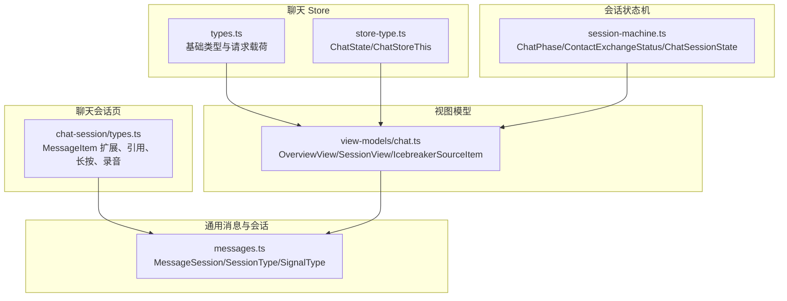
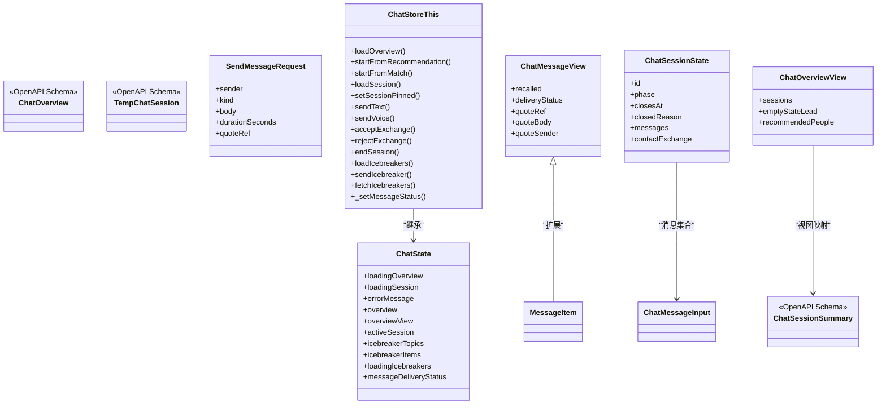
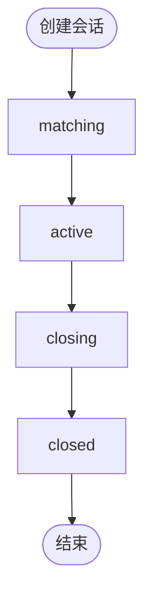
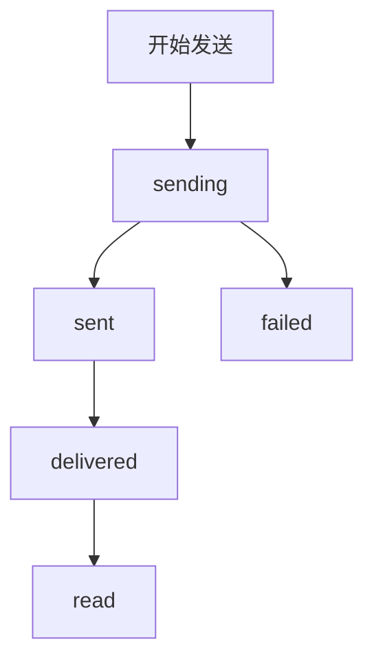
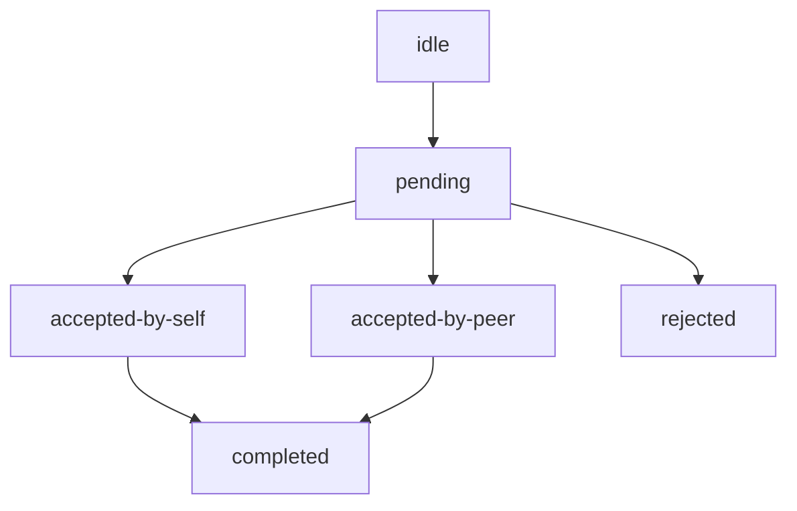
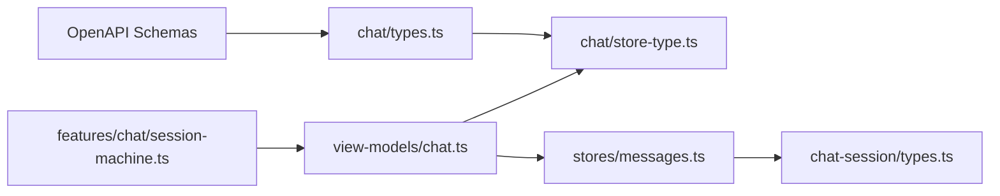

# 聊天状态类型定义

<cite>
**本文引用的文件**   
- [apps/client/src/stores/chat/types.ts](file://apps/client/src/stores/chat/types.ts)
- [apps/client/src/stores/chat/store-type.ts](file://apps/client/src/stores/chat/store-type.ts)
- [apps/client/src/subpackages/chat/chat-session/types.ts](file://apps/client/src/subpackages/chat/chat-session/types.ts)
- [apps/client/src/features/chat/session-machine.ts](file://apps/client/src/features/chat/session-machine.ts)
- [apps/client/src/view-models/chat.ts](file://apps/client/src/view-models/chat.ts)
- [apps/client/src/stores/messages.ts](file://apps/client/src/stores/messages.ts)
</cite>

## 目录
1. [引言](#引言)
2. [项目结构与定位](#项目结构与定位)
3. [核心数据类型总览](#核心数据类型总览)
4. [架构与职责划分](#架构与职责划分)
5. [详细类型分析](#详细类型分析)
6. [状态枚举与流转规则](#状态枚举与流转规则)
7. [依赖关系分析](#依赖关系分析)
8. [性能与可维护性特征](#性能与可维护性特征)
9. [最佳实践与常见错误处理](#最佳实践与常见错误处理)
10. [故障排查指南](#故障排查指南)
11. [结论](#结论)

## 引言
本文面向聊天模块的类型设计，系统性梳理会话接口、消息实体、用户信息、匹配状态等基础类型，以及各类状态枚举的业务含义和流转规则。文档重点解释聊天会话的元数据、配置选项、扩展字段，说明类型继承关系、泛型约束与可选属性模式，并给出类型使用最佳实践和常见错误处理方案。目标是让不同技术背景的读者都能理解聊天状态类型的结构、边界和演进方向。

## 项目结构与定位
聊天相关类型分布在客户端侧多个位置：
- 聊天 Store 集中类型与实例契约：`stores/chat/types.ts`、`stores/chat/store-type.ts`
- 聊天会话页局部类型：`subpackages/chat/chat-session/types.ts`
- 会话状态机与纯函数：`features/chat/session-machine.ts`
- 视图模型与后端 OpenAPI 映射：`view-models/chat.ts`
- 通用消息与会话摘要：`stores/messages.ts`

**图示来源**  
- [apps/client/src/stores/chat/types.ts:1-86](file://apps/client/src/stores/chat/types.ts#L1-L86)  
- [apps/client/src/stores/chat/store-type.ts:1-129](file://apps/client/src/stores/chat/store-type.ts#L1-L129)  
- [apps/client/src/subpackages/chat/chat-session/types.ts:1-112](file://apps/client/src/subpackages/chat/chat-session/types.ts#L1-L112)  
- [apps/client/src/features/chat/session-machine.ts:1-112](file://apps/client/src/features/chat/session-machine.ts#L1-L112)  
- [apps/client/src/view-models/chat.ts:1-159](file://apps/client/src/view-models/chat.ts#L1-L159)  
- [apps/client/src/stores/messages.ts:1-80](file://apps/client/src/stores/messages.ts#L1-L80)

**章节来源**  
- [apps/client/src/stores/chat/types.ts:1-86](file://apps/client/src/stores/chat/types.ts#L1-L86)  
- [apps/client/src/stores/chat/store-type.ts:1-129](file://apps/client/src/stores/chat/store-type.ts#L1-L129)  
- [apps/client/src/subpackages/chat/chat-session/types.ts:1-112](file://apps/client/src/subpackages/chat/chat-session/types.ts#L1-L112)  
- [apps/client/src/features/chat/session-machine.ts:1-112](file://apps/client/src/features/chat/session-machine.ts#L1-L112)  
- [apps/client/src/view-models/chat.ts:1-159](file://apps/client/src/view-models/chat.ts#L1-L159)  
- [apps/client/src/stores/messages.ts:1-80](file://apps/client/src/stores/messages.ts#L1-L80)

## 核心数据类型总览
- 聊天概览与会话摘要：基于 OpenAPI 生成的 `components["schemas"]` 类型，通过别名简化引用。
- 消息投递状态：三态持久化跟踪（发送中/已发送/失败），并通过映射表按 sendId 管理。
- 发送消息请求载荷：统一声明 sender/kind/body/durationSeconds/quoteRef，对齐后端契约。
- ChatStore 实例契约：state + actions 完整 API，供高阶函数复用与类型推断。
- 会话页扩展消息视图：在 MessageItem 基础上补充撤回、送达、引用等字段。
- 会话状态机：会话阶段、消息种类、联系人交换状态及不可变更新函数。
- 视图模型：将后端原始数据结构映射为 UI 友好的视图对象，包含状态标签、推荐动作等。

**章节来源**  
- [apps/client/src/stores/chat/types.ts:1-86](file://apps/client/src/stores/chat/types.ts#L1-L86)  
- [apps/client/src/subpackages/chat/chat-session/types.ts:1-112](file://apps/client/src/subpackages/chat/chat-session/types.ts#L1-L112)  
- [apps/client/src/features/chat/session-machine.ts:1-112](file://apps/client/src/features/chat/session-machine.ts#L1-L112)  
- [apps/client/src/view-models/chat.ts:1-159](file://apps/client/src/view-models/chat.ts#L1-L159)

## 架构与职责划分
聊天类型体系采用“分层解耦”的设计：
- 基础契约层：OpenAPI schemas 别名与发送载荷接口，保证前后端一致性。
- Store 契约层：ChatState 与 ChatStoreThis 明确 state 与 actions 的职责边界。
- 页面局部层：会话页类型聚焦于交互状态（引用、长按、录音）与消息视图扩展。
- 状态机层：会话阶段与联系人交换状态以纯函数方式表达，便于测试与回滚。
- 视图模型层：将后端数据转换为 UI 友好对象，负责文案映射与展示增强。

**图示来源**  
- [apps/client/src/stores/chat/types.ts:1-86](file://apps/client/src/stores/chat/types.ts#L1-L86)  
- [apps/client/src/stores/chat/store-type.ts:1-129](file://apps/client/src/stores/chat/store-type.ts#L1-L129)  
- [apps/client/src/subpackages/chat/chat-session/types.ts:1-112](file://apps/client/src/subpackages/chat/chat-session/types.ts#L1-L112)  
- [apps/client/src/features/chat/session-machine.ts:1-112](file://apps/client/src/features/chat/session-machine.ts#L1-L112)  
- [apps/client/src/view-models/chat.ts:1-159](file://apps/client/src/view-models/chat.ts#L1-L159)

## 详细类型分析

### 聊天概览与会话摘要
- ChatOverview：包含会话摘要列表、空状态文案、推荐人列表，作为首页聊天入口的数据源。
- ChatSessionSummary：会话列表项，用于渲染最近消息预览、对方信息与状态标签。
- TempChatSession：临时聊天会话完整数据，含消息列表与联系方式交换状态。

这些类型均基于 OpenAPI schemas，通过别名引入，避免直接耦合后端命名空间，提高可读性与复用性。

**章节来源**  
- [apps/client/src/stores/chat/types.ts:1-86](file://apps/client/src/stores/chat/types.ts#L1-L86)

### 消息投递状态与发送请求
- MessageDeliveryStatus：三态枚举（sending/sent/failed），修复了刷新或切换会话后无法感知上一条消息发送结果的问题。
- MessageDeliveryStatusMap：按 sendId 管理的状态映射表，确保跨会话与刷新后可恢复展示。
- SendMessageRequest：显式声明发送请求字段，消除内联 any 断言，提升编译期校验与重构安全。

该设计将“消息体”与“投递状态”解耦，通过客户端唯一 sendId 进行关联，既满足前端展示需求，也便于后端对接。

**章节来源**  
- [apps/client/src/stores/chat/types.ts:1-86](file://apps/client/src/stores/chat/types.ts#L1-L86)

### ChatStore 实例契约
- ChatState：描述聊天 store 的状态字段，包括加载标记、错误消息、概览与视图模型、活跃会话、破冰话题、投递状态映射等。
- ChatStoreThis：在 ChatState 基础上扩展所有 actions，提供 loadOverview、startFromRecommendation、startFromMatch、loadSession、setSessionPinned、sendText、sendVoice、acceptExchange、rejectExchange、endSession、loadIcebreakers、sendIcebreaker、fetchIcebreakers、_setMessageStatus 等方法。

该契约被高阶函数（如错误处理、Mock 模式）复用，确保拆分的 action 文件具备一致的 this 类型与行为。

**章节来源**  
- [apps/client/src/stores/chat/store-type.ts:1-129](file://apps/client/src/stores/chat/store-type.ts#L1-L129)

### 聊天会话页扩展类型
- QuoteContext：来自兴趣圈回复的破冰场景，包含话题标题、ID、被引用回复 ID、内容与作者昵称。
- QuoteReply：用户长按消息后选择“引用”，记录被引用消息 ID、正文与发送方。
- LongPressMenuState：长按菜单可见性、触发消息 ID、是否本人消息、菜单位置坐标（保留字段）。
- RecordingState：录音状态，包含是否录音与录音秒数。
- MessageDeliveryStatus（会话页）：视图层合并后的送达状态（sending/sent/delivered/read/failed），由 ChatBubble 自行过滤不可识别状态。
- ChatMessageView：扩展 MessageItem，补充 recalled、deliveryStatus、quoteRef、quoteBody、quoteSender 字段，消除 any 断言。

该组类型聚焦于会话页的交互与展示增强，保持纯类型定义，不耦合页面转场逻辑。

**章节来源**  
- [apps/client/src/subpackages/chat/chat-session/types.ts:1-112](file://apps/client/src/subpackages/chat/chat-session/types.ts#L1-L112)

### 会话状态机
- ChatPhase：matching / active / closing / closed，表示会话生命周期阶段。
- ChatMessageKind：text / voice / emoji / system，区分消息种类。
- ChatSender：self / peer / system，区分消息发送方。
- ContactExchangeStatus：idle / pending / accepted-by-self / accepted-by-peer / completed / rejected，描述联系方式交换流程。
- ChatMessageInput：消息输入模型，包含 id、kind、sender、body、sentAt、durationSeconds。
- ChatSessionState：会话状态，包含 id、phase、closesAt、closedReason、messages、contactExchange。
- 纯函数：createSessionState、sendUserMessage、proposeContactExchange、respondToContactExchange、sendSystemTimeout。

状态机通过不可变更新函数表达状态转移，便于单元测试与时间旅行调试。

**章节来源**  
- [apps/client/src/features/chat/session-machine.ts:1-112](file://apps/client/src/features/chat/session-machine.ts#L1-L112)

### 视图模型与后端映射
- ChatOverviewView：封装 sessions、emptyStateLead、recommendedPeople，其中 recommendedPeople 增加 action 字段。
- ChatSessionSummaryView：在 ChatSessionSummary 上追加 statusLabel，用于 UI 显示。
- toChatOverviewView：根据 HomeCompletionState 生成推荐动作，并为每个会话计算状态标签。
- toChatSessionView：为 TempChatSession 增加 contactExchangeLabel，便于会话详情页展示。
- IcebreakerSourceItem：破冰话题来源项，用于构建 BreakQuestionItem。
- toBreakQuestionItems：去重并分类生成破冰话题输入区条目。

视图模型承担“后端数据到 UI 数据”的转换职责，避免在组件中散落业务判断。

**章节来源**  
- [apps/client/src/view-models/chat.ts:1-159](file://apps/client/src/view-models/chat.ts#L1-L159)

### 通用消息与会话
- SessionType：private / temp_anonymous，区分私有会话与临时匿名会话。
- SignalType：SOCIAL / CONTENT，通知信号分类。
- NotificationFilterType：all / social / content，通知筛选类型。
- MessageSession：会话摘要，包含 conversationUid、partnerId/Name/Avatar/Headline、lastMessagePreview/SentAt、unreadCount、pinned、phase、sessionType、closesAt、closedReason、muted 等字段。

该模块定义了消息系统的基础会话与信号类型，为聊天模块提供底层支撑。

**章节来源**  
- [apps/client/src/stores/messages.ts:1-80](file://apps/client/src/stores/messages.ts#L1-L80)

## 状态枚举与流转规则

### 会话阶段 ChatPhase
- matching：等待匹配开放。
- active：会话进行中。
- closing：进入收尾阶段。
- closed：会话关闭，可能因过期或结束。

**图示来源**  
- [apps/client/src/features/chat/session-machine.ts:1-112](file://apps/client/src/features/chat/session-machine.ts#L1-L112)

**章节来源**  
- [apps/client/src/features/chat/session-machine.ts:1-112](file://apps/client/src/features/chat/session-machine.ts#L1-L112)

### 消息投递状态 MessageDeliveryStatus
- sending：消息正在发送。
- sent：消息已发送到服务端。
- failed：消息发送失败。

视图层还合并 delivered/read 状态，由 ChatBubble 组件过滤不可识别状态。

**图示来源**  
- [apps/client/src/stores/chat/types.ts:1-86](file://apps/client/src/stores/chat/types.ts#L1-L86)  
- [apps/client/src/subpackages/chat/chat-session/types.ts:1-112](file://apps/client/src/subpackages/chat/chat-session/types.ts#L1-L112)

**章节来源**  
- [apps/client/src/stores/chat/types.ts:1-86](file://apps/client/src/stores/chat/types.ts#L1-L86)  
- [apps/client/src/subpackages/chat/chat-session/types.ts:1-112](file://apps/client/src/subpackages/chat/chat-session/types.ts#L1-L112)

### 联系人交换状态 ContactExchangeStatus
- idle：未发起交换。
- pending：等待对方响应。
- accepted-by-self：己方已接受。
- accepted-by-peer：对方已接受。
- completed：双方均已接受。
- rejected：任一方拒绝。

**图示来源**  
- [apps/client/src/features/chat/session-machine.ts:1-112](file://apps/client/src/features/chat/session-machine.ts#L1-L112)

**章节来源**  
- [apps/client/src/features/chat/session-machine.ts:1-112](file://apps/client/src/features/chat/session-machine.ts#L1-L112)

## 依赖关系分析
- 基础类型依赖 OpenAPI schemas，通过别名降低耦合。
- ChatStoreThis 依赖 ChatState 与 ChatStoreLike，确保高阶函数复用。
- 会话页类型依赖通用 MessageItem，扩展出 ChatMessageView。
- 视图模型依赖后端 schemas 与状态文案映射，产出 UI 友好对象。
- 状态机独立于 UI，仅依赖内部消息与会话状态。

**图示来源**  
- [apps/client/src/stores/chat/types.ts:1-86](file://apps/client/src/stores/chat/types.ts#L1-L86)  
- [apps/client/src/stores/chat/store-type.ts:1-129](file://apps/client/src/stores/chat/store-type.ts#L1-L129)  
- [apps/client/src/subpackages/chat/chat-session/types.ts:1-112](file://apps/client/src/subpackages/chat/chat-session/types.ts#L1-L112)  
- [apps/client/src/view-models/chat.ts:1-159](file://apps/client/src/view-models/chat.ts#L1-L159)  
- [apps/client/src/features/chat/session-machine.ts:1-112](file://apps/client/src/features/chat/session-machine.ts#L1-L112)  
- [apps/client/src/stores/messages.ts:1-80](file://apps/client/src/stores/messages.ts#L1-L80)

**章节来源**  
- [apps/client/src/stores/chat/types.ts:1-86](file://apps/client/src/stores/chat/types.ts#L1-L86)  
- [apps/client/src/stores/chat/store-type.ts:1-129](file://apps/client/src/stores/chat/store-type.ts#L1-L129)  
- [apps/client/src/subpackages/chat/chat-session/types.ts:1-112](file://apps/client/src/subpackages/chat/chat-session/types.ts#L1-L112)  
- [apps/client/src/view-models/chat.ts:1-159](file://apps/client/src/view-models/chat.ts#L1-L159)  
- [apps/client/src/features/chat/session-machine.ts:1-112](file://apps/client/src/features/chat/session-machine.ts#L1-L112)  
- [apps/client/src/stores/messages.ts:1-80](file://apps/client/src/stores/messages.ts#L1-L80)

## 性能与可维护性特征
- 类型别名与拆分：将原单文件 944 行的 chat.ts 拆分为 types、store-type、actions、utils 等，遵循单一职责原则，便于多文件复用与维护。
- 视图模型转换：toChatOverviewView、toChatSessionView 将后端数据转为 UI 友好对象，减少组件中的业务判断与重复计算。
- 不可变状态机：会话状态通过纯函数更新，便于测试、回滚与调试。
- 投递状态持久化：MessageDeliveryStatus 与 Map 持久化到本地存储，避免刷新或切换会话后丢失状态。
- 字段可选与严格校验：SendMessageRequest 显式声明可选字段，结合后端契约变更时仅需调整接口即可暴露受影响调用点。

[本节为一般性指导，无需特定文件来源]

## 最佳实践与常见错误处理

### 类型使用最佳实践
- 使用 OpenAPI 别名而非直接引用 components.schemas，提升可读性与复用性。
- 在发送消息时使用 SendMessageRequest 接口，避免内联对象与 any 断言。
- 在会话页中使用 ChatMessageView 替代 MessageItem 的 any 断言，确保 IDE 静态检查有效。
- 使用 ChatStoreThis 声明 actions 的 this 类型，避免 noImplicitThis 错误。
- 使用状态机纯函数更新会话状态，保持不可变性与可测试性。

**章节来源**  
- [apps/client/src/stores/chat/types.ts:1-86](file://apps/client/src/stores/chat/types.ts#L1-L86)  
- [apps/client/src/subpackages/chat/chat-session/types.ts:1-112](file://apps/client/src/subpackages/chat/chat-session/types.ts#L1-L112)  
- [apps/client/src/stores/chat/store-type.ts:1-129](file://apps/client/src/stores/chat/store-type.ts#L1-L129)  
- [apps/client/src/features/chat/session-machine.ts:1-112](file://apps/client/src/features/chat/session-machine.ts#L1-L112)

### 常见错误处理方案
- 发送失败：MessageDeliveryStatus.failed 需配合重试机制与用户提示；同时持久化状态，确保刷新后可恢复。
- 状态不一致：视图层对 deliveryStatus 进行过滤，只渲染已知状态，避免未知状态导致 UI 异常。
- 联系人交换冲突：respondToContactExchange 根据当前状态与 actor 决定下一状态，防止非法跳转。
- 会话超时：sendSystemTimeout 将 phase 设为 closed 并设置 closedReason 与 closesAt，便于 UI 展示过期原因。

**章节来源**  
- [apps/client/src/stores/chat/types.ts:1-86](file://apps/client/src/stores/chat/types.ts#L1-L86)  
- [apps/client/src/subpackages/chat/chat-session/types.ts:1-112](file://apps/client/src/subpackages/chat/chat-session/types.ts#L1-L112)  
- [apps/client/src/features/chat/session-machine.ts:1-112](file://apps/client/src/features/chat/session-machine.ts#L1-L112)

## 故障排查指南
- 如果会话列表状态标签不正确，检查 toSessionStatusLabel 的分支逻辑与 statusCopyMap 文案映射。
- 如果消息投递状态不显示，确认 messageDeliveryStatus 映射表是否正确持久化与恢复。
- 如果联系方式交换状态异常，检查 proposeContactExchange 与 respondToContactExchange 的 actor 与 decision 参数。
- 如果视图模型缺失字段，检查 toChatOverviewView 与 toChatSessionView 的展开与新增字段。

**章节来源**  
- [apps/client/src/view-models/chat.ts:1-159](file://apps/client/src/view-models/chat.ts#L1-L159)  
- [apps/client/src/stores/chat/store-type.ts:1-129](file://apps/client/src/stores/chat/store-type.ts#L1-L129)  
- [apps/client/src/features/chat/session-machine.ts:1-112](file://apps/client/src/features/chat/session-machine.ts#L1-L112)

## 结论
聊天状态类型体系围绕“后端契约、Store 契约、页面局部类型、状态机、视图模型”五个层次构建，兼顾类型安全、可维护性与可测试性。通过 OpenAPI 别名、显式请求载荷、不可变状态机与视图模型转换，系统在复杂交互场景下仍能保持清晰的类型边界与稳定的状态流转。建议后续继续遵循上述模式，逐步收敛任意类型断言，强化可选属性的语义化与错误处理的健壮性。