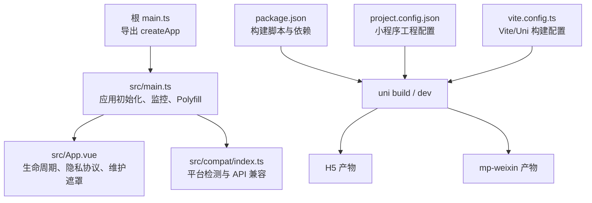
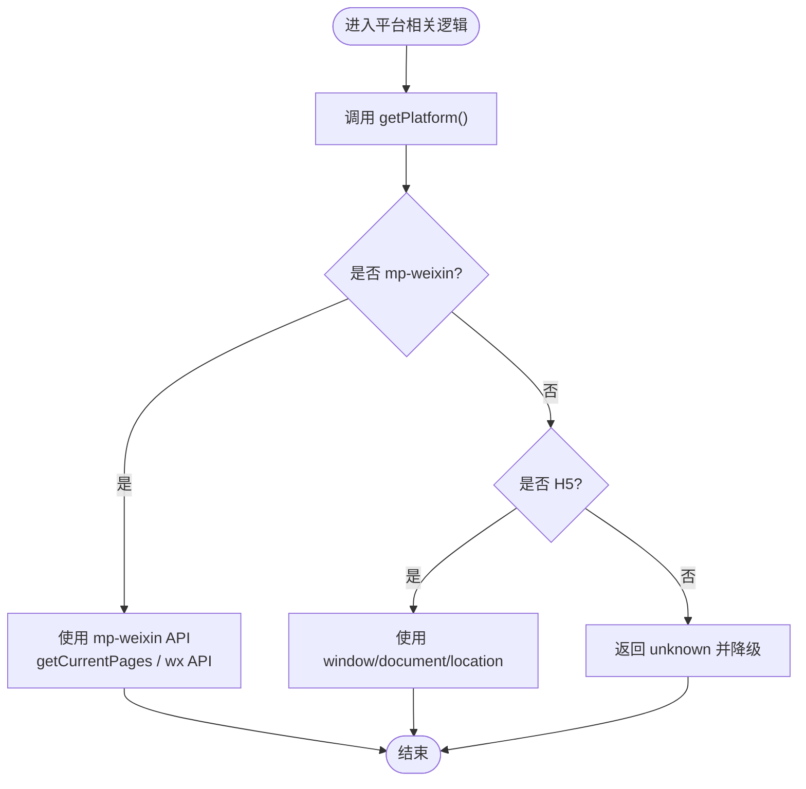
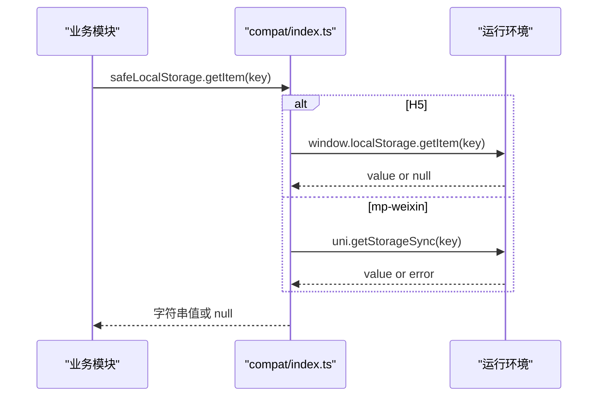
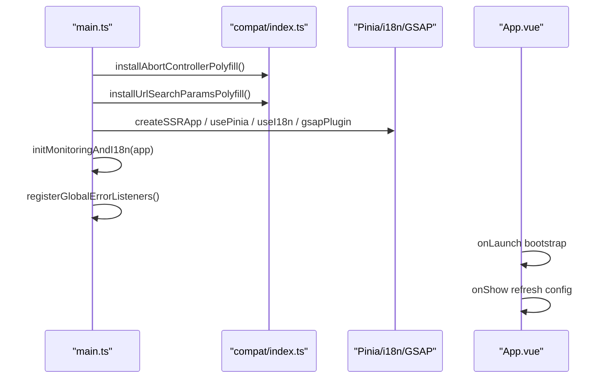
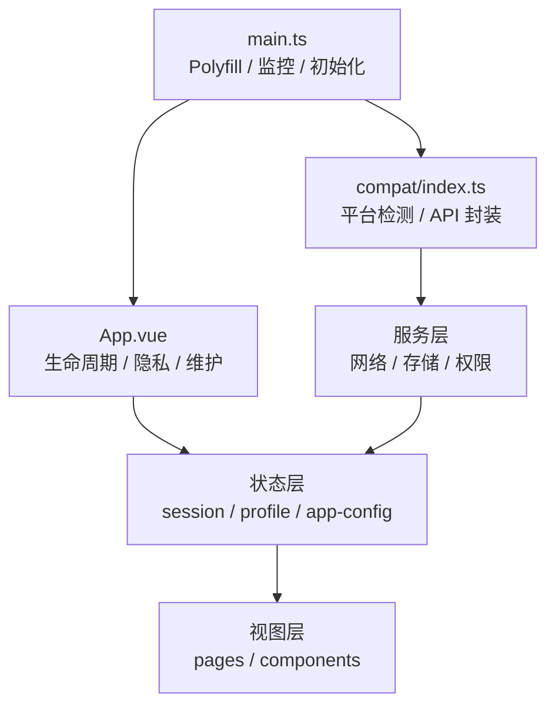
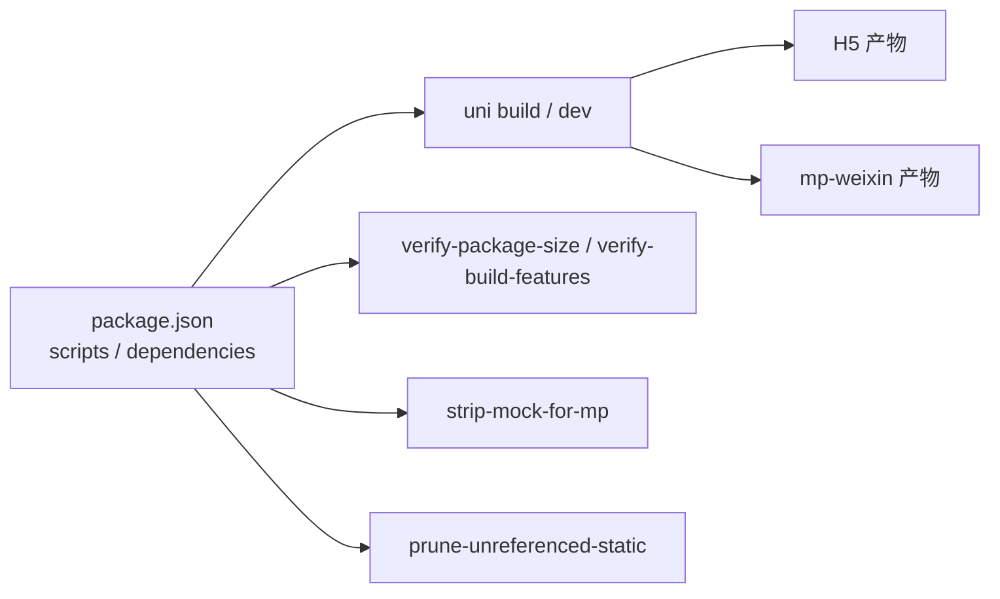

# 跨平台适配

<cite>
**本文引用的文件**   
- [apps/client/package.json](file://apps/client/package.json)
- [apps/client/main.ts](file://apps/client/main.ts)
- [apps/client/src/main.ts](file://apps/client/src/main.ts)
- [apps/client/src/App.vue](file://apps/client/src/App.vue)
- [apps/client/src/compat/index.ts](file://apps/client/src/compat/index.ts)
- [apps/client/vite.config.ts](file://apps/client/vite.config.ts)
- [apps/client/project.config.json](file://apps/client/project.config.json)
</cite>

## 目录
1. [引言](#引言)
2. [项目结构与平台边界](#项目结构与平台边界)
3. [核心适配组件](#核心适配组件)
4. [架构总览](#架构总览)
5. [详细组件分析](#详细组件分析)
6. [依赖与构建关系](#依赖与构建关系)
7. [性能与包体积优化](#性能与包体积优化)
8. [调试与测试方法](#调试与测试方法)
9. [发布流程差异](#发布流程差异)
10. [常见问题排查](#常见问题排查)
11. [结论与最佳实践](#结论与最佳实践)

## 引言
本项目基于 uni-app 同时支持微信小程序（mp-weixin）与 H5 两个主要运行环境。跨平台适配的核心目标是：
- 在代码层统一平台判断、API 调用与降级策略，避免业务中散落条件编译。
- 在构建层按平台裁剪能力、控制包体积与资源加载方式。
- 在运行时保证小程序与浏览器在权限、存储、网络、样式和动画上体验一致或明确降级。
- 提供可测试、可观测的启动链路和错误上报机制，便于问题定位。

## 项目结构与平台边界
- 应用入口由根 `main.ts` 导出 `createApp`，真实创建逻辑位于 `src/main.ts`。
- 全局初始化、监控、国际化、Polyfill、展示模式等均在 `src/main.ts` 中集中编排。
- 应用生命周期（onLaunch / onShow / onMounted）、隐私协议、维护遮罩、导航拦截等在 `src/App.vue` 中处理。
- 平台检测、原生 API 兼容、localStorage 封装、系统信息读取、页面路径获取等集中在 `src/compat/index.ts`。
- 构建脚本、H5/mp-weixin 构建命令、依赖版本定义在 `apps/client/package.json`。
- 微信小程序工程配置位于 `apps/client/project.config.json`；Vite 插件与 Uni 配置位于 `apps/client/vite.config.ts`。

图表来源
- [apps/client/main.ts:1-1](file://apps/client/main.ts#L1-L1)
- [apps/client/src/main.ts:1-122](file://apps/client/src/main.ts#L1-L122)
- [apps/client/src/App.vue:1-200](file://apps/client/src/App.vue#L1-L200)
- [apps/client/src/compat/index.ts:1-200](file://apps/client/src/compat/index.ts#L1-L200)
- [apps/client/package.json:1-104](file://apps/client/package.json#L1-L104)
- [apps/client/project.config.json](file://apps/client/project.config.json)
- [apps/client/vite.config.ts](file://apps/client/vite.config.ts)

章节来源
- [apps/client/main.ts:1-1](file://apps/client/main.ts#L1-L1)
- [apps/client/src/main.ts:1-122](file://apps/client/src/main.ts#L1-L122)
- [apps/client/src/App.vue:1-200](file://apps/client/src/App.vue#L1-L200)
- [apps/client/package.json:1-104](file://apps/client/package.json#L1-L104)

## 核心适配组件
本节聚焦跨平台适配的关键实现点：平台检测、条件编译、原生 API 封装、降级策略、权限与隐私、存储与网络差异、样式与动画兼容。

### 平台检测与条件编译
- 运行时平台检测：通过 `getPlatform()`、`isPlatform()`、`isMpWeixin()`、`isH5()` 等函数判断当前运行环境。
- 构建期条件编译：使用 `#ifdef MP-WEIXIN`、`#ifdef H5`、`#ifndef H5` 等指令区分不同平台的代码分支，减少运行时判断开销。
- 安全访问浏览器对象：通过 `safeGetWindow()`、`safeGetDocument()` 避免在 mp-weixin 环境中直接引用 `window`/`document`。
- 当前页面路径获取：通过 `getCurrentPagePath()` 抽象 mp-weixin 的 `getCurrentPages()` 与 H5 的 `window.location.pathname`。

图表来源
- [apps/client/src/compat/index.ts:1-200](file://apps/client/src/compat/index.ts#L1-L200)

章节来源
- [apps/client/src/compat/index.ts:1-200](file://apps/client/src/compat/index.ts#L1-L200)

### 原生 API 封装与降级方案
- AbortController 与 URLSearchParams Polyfill：在 mp-weixin 基础库缺少原生实现时注入 Polyfill，确保 store、网络请求、历史状态等模块正常运行。
- localStorage 适配：`safeLocalStorage` 在 H5 端使用 `localStorage`，在 mp-weixin 端包装 `uni.storage` 同步 API，并对异常进行静默降级。
- 系统信息读取：`safeGetSystemInfo()` 优先组合新版 split API（如 `getAppBaseInfo`、`getDeviceInfo`、`getWindowInfo`），低版本回退旧 API；H5 端从 `window.innerWidth`、`devicePixelRatio` 推导。
- CSS backdrop-filter 毛玻璃效果：`supportsBackdropFilter()` 在 mp-weixin 端统一返回 false，强制业务层使用高不透明度实色背景降级。
- ESM 动态导入：`supportsRuntimeEsmImport()` 仅在 H5 允许运行时动态 import，mp-weixin 走构建期打包。

图表来源
- [apps/client/src/compat/index.ts:1-200](file://apps/client/src/compat/index.ts#L1-L200)
- [apps/client/src/compat/index.ts:201-400](file://apps/client/src/compat/index.ts#L201-L400)

章节来源
- [apps/client/src/compat/index.ts:1-200](file://apps/client/src/compat/index.ts#L1-L200)
- [apps/client/src/compat/index.ts:201-400](file://apps/client/src/compat/index.ts#L201-L400)

### 权限管理、隐私协议与网络状态
- 隐私协议授权：在 `App.vue` 的 `onLaunch` 中注册微信隐私协议回调，提供“同意并继续”和“查看协议”入口，防止并发弹窗导致 UI 阻塞。
- 权限与敏感接口：对需要权限的能力（如定位、相册、相机）建议通过 compat 层或业务封装统一处理授权失败与降级。
- 网络状态监听：通过 `useNetworkStatus()` 监听 `uni.onNetworkStatusChange`，在网络断开或恢复时提示用户，并在切前台时刷新后台配置。

章节来源
- [apps/client/src/App.vue:1-200](file://apps/client/src/App.vue#L1-L200)

### 样式兼容性与布局适配
- 全局页面底色与字体：在 `App.vue` 中统一设置 page 背景色、字体栈、抗锯齿、安全区底部内边距，避免小程序与 H5 背景色差。
- 状态栏避让：移除 page 级顶部 padding，改用各页面根节点注入 `--statusbar`，避免刘海屏双倍避让。
- 页面切换动画：将页面过渡动画缩短为 100ms 纯 opacity，降低 transform 带来的重排与卡顿，提升点击响应体感。
- 图片渲染基线：引入 `_image-base.scss` 统一 `<image>` 渲染行为，缓解 mp-weixin 中 image 尺寸与对齐不一致的问题。

章节来源
- [apps/client/src/App.vue:201-400](file://apps/client/src/App.vue#L201-L400)

### 动画效果与性能影响
- 页面进入动画：使用轻量 `page-fade-in` 关键帧，仅改变 opacity，避免复杂位移导致的合成层抖动。
- 全局微动效：提供 fadeInUp、fadeIn、scaleIn 等通用动画，供卡片、引导、反馈等场景复用。
- GSAP 集成：通过 `plugins/gsap.ts` 在 Vue 应用中挂载 GSAP，但需结合 `supportsRuntimeEsmImport()` 控制动态导入时机，避免 mp-weixin 运行时再次 import。

章节来源
- [apps/client/src/App.vue:201-400](file://apps/client/src/App.vue#L201-L400)

### 启动链路与错误上报
- 应用创建顺序：先注入 AbortController 与 URLSearchParams Polyfill，再创建 Pinia、主题、GSAP、i18n、Sentry，最后注册全局错误处理器。
- 全局错误监听：在 `main.ts` 中集中注册 `uni.onError` 与 `uni.onUnhandledRejection`，覆盖 Vue 之外的运行时错误。
- Sentry 监控：仅在 H5 端实际生效，mp-weixin 端通过 `reportGlobalError` 通道上报。
- 展示模式：在构建时通过环境变量开启全功能展示版，自动以演示者身份登录，便于演示与验收。

图表来源
- [apps/client/src/main.ts:1-122](file://apps/client/src/main.ts#L1-L122)
- [apps/client/src/App.vue:1-200](file://apps/client/src/App.vue#L1-L200)

章节来源
- [apps/client/src/main.ts:1-122](file://apps/client/src/main.ts#L1-L122)
- [apps/client/src/App.vue:1-200](file://apps/client/src/App.vue#L1-L200)

## 架构总览
整体架构围绕“入口初始化 → 平台兼容层 → 应用生命周期 → 业务模块”展开：
- 入口负责 Polyfill、监控、国际化、状态初始化。
- 兼容层提供平台检测、原生 API 封装、降级策略。
- 应用生命周期负责隐私协议、维护遮罩、会话启动、配置刷新。
- 业务模块通过兼容层访问平台能力，避免直接依赖浏览器或小程序 API。

图表来源
- [apps/client/src/main.ts:1-122](file://apps/client/src/main.ts#L1-L122)
- [apps/client/src/compat/index.ts:1-200](file://apps/client/src/compat/index.ts#L1-L200)
- [apps/client/src/App.vue:1-200](file://apps/client/src/App.vue#L1-L200)

## 详细组件分析

### 平台检测与特性嗅探
- `getPlatform()`：优先使用 uni-app 条件编译常量，其次运行时推断，最终 fallback 到 unknown。
- `isPlatform(platform)`：统一平台判断入口，便于单元测试 mock。
- `supportsBackdropFilter()`：针对毛玻璃效果做平台能力嗅探，mp-weixin 统一降级。
- `supportsSyncStorage()`：标识是否可直接使用同步 storage 语义。
- `supportsRuntimeEsmImport()`：控制是否允许运行时动态 import ESM。

章节来源
- [apps/client/src/compat/index.ts:1-200](file://apps/client/src/compat/index.ts#L1-L200)

### 原生 API 封装与降级
- `safeLocalStorage`：H5 用 localStorage，mp-weixin 用 uni.storage 同步包装，捕获异常并返回空值。
- `safeGetSystemInfo()`：组合 split API 读取系统信息，低版本回退旧 API，H5 使用 window 尺寸。
- `getCurrentPagePath()`：mp-weixin 使用 getCurrentPages，H5 使用 window.location.pathname。
- `getDevApiBaseUrl()`：开发模式下按平台选择 http 或 https 回退地址，支持环境变量覆盖。

章节来源
- [apps/client/src/compat/index.ts:201-400](file://apps/client/src/compat/index.ts#L201-L400)

### 权限与隐私协议
- 隐私协议弹窗：在 onLaunch 中注册 wx.onNeedPrivacyAuthorization，提供查看协议与同意按钮，防重入并发弹窗。
- 权限失败降级：建议业务层统一处理权限拒绝后的降级路径，例如跳过定位能力、使用默认数据或引导用户授权。

章节来源
- [apps/client/src/App.vue:1-200](file://apps/client/src/App.vue#L1-L200)

### 样式与布局适配
- 全局 page 样式：统一背景色、字体、安全区底部内边距，避免滚动色差与刘海屏异常。
- 状态栏避让：由各页根注入 --statusbar，避免 page 级双重避让。
- 图片渲染：引入 `_image-base.scss` 统一 image 渲染基线，缓解 mp-weixin 显示差异。

章节来源
- [apps/client/src/App.vue:201-400](file://apps/client/src/App.vue#L201-L400)

### 动画与交互优化
- 页面切换动画：改为 100ms 纯 opacity，减少 transform 重排，提升点击响应。
- 全局微动效：提供 fadeInUp、fadeIn、scaleIn 等通用动画，提升用户体验一致性。

章节来源
- [apps/client/src/App.vue:201-400](file://apps/client/src/App.vue#L201-L400)

## 依赖与构建关系
- 依赖项包含 uni-app、uni-h5、uni-mp-weixin、Sentry、GSAP、Pinia、Vue、i18n 等。
- 构建脚本提供 H5 与 mp-weixin 的开发与生产命令，mp-weixin 构建包含图片检查、SVG 转 PNG、包体积校验、Mock 剥离、静态资源裁剪等步骤。
- 小程序工程配置与 Vite 配置分别管理平台特定构建参数。

图表来源
- [apps/client/package.json:1-104](file://apps/client/package.json#L1-L104)

章节来源
- [apps/client/package.json:1-104](file://apps/client/package.json#L1-L104)

## 性能与包体积优化
- 动画性能：页面切换动画从 250ms+transform 改为 100ms opacity，降低合成层压力。
- 构建期裁剪：mp-weixin 构建执行 Mock 剥离、未引用静态资源裁剪、SVG 转 PNG，减少包体积。
- 依赖控制：仅在 H5 允许运行时 ESM 动态 import，mp-weixin 依赖构建期打包，避免运行时额外加载。
- 本地存储：大数据量建议使用异步 storage，避免同步 API 阻塞主线程。

章节来源
- [apps/client/src/App.vue:201-400](file://apps/client/src/App.vue#L201-L400)
- [apps/client/src/compat/index.ts:201-400](file://apps/client/src/compat/index.ts#L201-L400)
- [apps/client/package.json:1-104](file://apps/client/package.json#L1-L104)

## 调试与测试方法
- H5 开发：使用 `dev:h5` 或 `dev:h5:real` 启动本地开发服务器，配合浏览器 DevTools 调试。
- 小程序开发：使用 `dev:mp-weixin` 或 `dev:mp-weixin:debug` 启动小程序调试，关注 console 与 uni-app 调试面板。
- 单元测试：通过 `test`、`test:unit`、`test:coverage` 运行 Vitest，可对 compat 层、store、service 进行 mock 测试。
- E2E 测试：通过 Playwright 配置执行端到端测试，覆盖关键业务流程与无障碍用例。
- 错误上报：H5 使用 Sentry，mp-weixin 使用 `reportGlobalError` 通道，统一出口便于集中分析。

章节来源
- [apps/client/package.json:1-104](file://apps/client/package.json#L1-L104)
- [apps/client/src/main.ts:1-122](file://apps/client/src/main.ts#L1-L122)

## 发布流程差异
- H5 发布：
  - 构建命令：`build:h5` 或 `build:h5:real`。
  - 前置步骤：准备静态资源、验证发布环境。
  - 输出：Web 静态资源，部署到 CDN 或 Web 服务器。
- mp-weixin 发布：
  - 构建命令：`build:mp-weixin`、`build:mp-weixin:mock`、`build:mp-weixin:showcase`、`build:mp-weixin:real`。
  - 前置步骤：图片样式检查、状态栏偏移检查、TabBar 一致性检查、项目规则检查、注入 appId、准备静态资源、SVG 转 PNG、环境变量验证、Mock 剥离、未引用静态资源裁剪、包体积校验。
  - 输出：小程序分包结构，上传至微信开发者工具或 CI 流水线。

章节来源
- [apps/client/package.json:1-104](file://apps/client/package.json#L1-L104)

## 常见问题排查
- 隐私协议弹窗叠弹：已在 App.vue 中使用 pending 标志防止并发触发，若仍出现，检查是否有多处调用 wx.onNeedPrivacyAuthorization。
- 启动时报错 e0：已通过 appReady 标志位延迟渲染含事件处理器的全局组件，确保小程序 $scope 就绪。
- mp-weixin 无 AbortController：已在 main.ts 中注入 Polyfill，确保 store 与服务正常初始化。
- localStorage 不可用：使用 safeLocalStorage，避免直接访问 window.localStorage。
- 毛玻璃效果异常：使用 supportsBackdropFilter() 判断并降级为高不透明度背景。
- 包体积过大：检查 mp-weixin 构建脚本是否执行了 strip-mock-for-mp、prune-unreferenced-static、profile-svg-to-png 等步骤。

章节来源
- [apps/client/src/App.vue:1-200](file://apps/client/src/App.vue#L1-L200)
- [apps/client/src/main.ts:1-122](file://apps/client/src/main.ts#L1-L122)
- [apps/client/src/compat/index.ts:1-200](file://apps/client/src/compat/index.ts#L1-L200)
- [apps/client/package.json:1-104](file://apps/client/package.json#L1-L104)

## 结论与最佳实践
- 统一平台检测与 API 封装：所有平台差异应集中在 compat 层，业务代码避免直接使用 window/document/wx。
- 优先构建期条件编译：静态判断使用 `#ifdef`，运行时动态判断用于极少数场景。
- 明确降级策略：对不支持的特性（如 backdrop-filter、runtime ESM import）提供清晰降级路径。
- 注重启动链路稳定性：集中注册全局错误监听、Polyfill、监控与国际化，避免重复与遗漏。
- 构建期优化包体积：mp-weixin 构建务必执行 Mock 剥离、静态资源裁剪、图片优化与包体积校验。
- 保持用户体验一致性：样式、动画、权限、存储、网络在各平台尽量一致，差异处明确降级并提示用户。