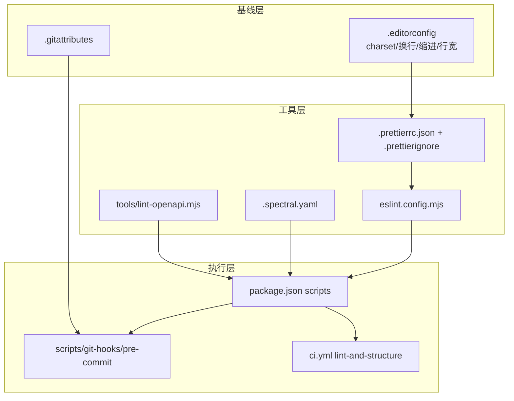
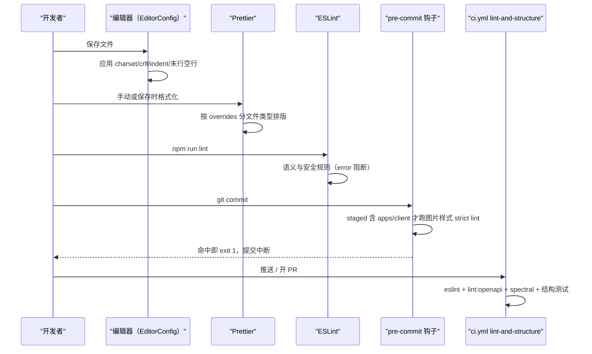
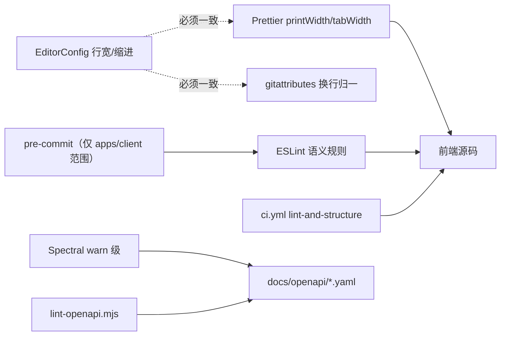

# 代码规范与格式化

<cite>
**本文引用的文件**
- [.editorconfig](file://.editorconfig)
- [.prettierrc.json](file://.prettierrc.json)
- [.prettierignore](file://.prettierignore)
- [eslint.config.mjs](file://eslint.config.mjs)
- [.spectral.yaml](file://.spectral.yaml)
- [package.json](file://package.json)
- [pnpm-workspace.yaml](file://pnpm-workspace.yaml)
- [.gitattributes](file://.gitattributes)
- [install-git-hooks.mjs](file://scripts/install-git-hooks.mjs)
- [pre-commit](file://scripts/git-hooks/pre-commit)
- [lint-openapi.mjs](file://tools/lint-openapi.mjs)
- [ci.yml](file://.github/workflows/ci.yml)
- [project-structure.spec.mjs](file://tests/project-structure.spec.mjs)
- [prototype-contract.spec.mjs](file://tests/prototype-contract.spec.mjs)
</cite>

## 目录
1. [简介](#简介)
2. [项目结构](#项目结构)
3. [核心组件](#核心组件)
4. [架构总览](#架构总览)
5. [编辑器基线：EditorConfig](#编辑器基线editorconfig)
6. [格式化：Prettier 及其文件级例外](#格式化prettier-及其文件级例外)
7. [静态检查：ESLint 扁平配置](#静态检查eslint-扁平配置)
8. [被显式约束的规则清单](#被显式约束的规则清单)
9. [按文件类型分块的例外](#按文件类型分块的例外)
10. [契约层的规范：Spectral 与自研 lint](#契约层的规范spectral-与自研-lint)
11. [提交闸：git hooks 的实现取向](#提交闸git-hooks-的实现取向)
12. [工作区与依赖约束](#工作区与依赖约束)
13. [校验命令与执行链路](#校验命令与执行链路)
14. [依赖关系分析](#依赖关系分析)
15. [性能考虑](#性能考虑)
16. [故障排查指南](#故障排查指南)
17. [结论](#结论)

## 简介
这个仓库的"代码规范"由五层叠成，各层职责不重叠：

1. **EditorConfig**（`.editorconfig`，36 行）：跨编辑器的字符集、换行、缩进、行宽基线。
2. **Prettier**（`.prettierrc.json`，35 行 + `.prettierignore`，56 行）：语法无关的排版。
3. **ESLint 扁平配置**（`eslint.config.mjs`，200 行）：语义层面的规则，含 Vue 专项。
4. **契约规范**（`.spectral.yaml`，15 行 + `tools/lint-openapi.mjs`）：OpenAPI YAML 的合规性。
5. **提交闸与流水线**（`scripts/install-git-hooks.mjs` 95 行、`scripts/git-hooks/pre-commit` 48 行、
   `ci.yml` 的 `lint-and-structure` 作业 L84）：把上述检查变成可阻断的动作。

一个贯穿全局的取向是：**换行符统一 CRLF**（EditorConfig 与 Prettier 双侧都写死），
这与项目主要开发环境是 Windows 一致。

## 项目结构
- 根配置：`.editorconfig`、`.prettierrc.json`、`.prettierignore`、`eslint.config.mjs`、
  `.spectral.yaml`、`.gitattributes`、`pnpm-workspace.yaml`、`package.json`。
- 钩子：`scripts/git-hooks/pre-commit`（真正的钩子脚本）、
  `scripts/install-git-hooks.mjs`（安装/卸载器）。
- 自研检查：`tools/lint-openapi.mjs`（契约检查）、
  `tools/verify-client-builds.mjs`（构建校验）、`tools/run-api-wrapper.cjs`（API 启动/测试包装）。
- 结构测试：`tests/project-structure.spec.mjs`、`tests/prototype-contract.spec.mjs`，
  分别由 `npm run test:structure`、`npm run test:prototype` 调用。

[此图为概念流程，不直接对应具体源文件，故不提供图表来源]

## 核心组件
- `.editorconfig`：`root = true`(L5)，`[*]` 块(L7) 设 `charset = utf-8`(L9)、
  `end_of_line = crlf`(L11)、`insert_final_newline = true`(L13)、
  `trim_trailing_whitespace = true`(L15)、`indent_style = space`(L17)、
  `indent_size = 2`(L18)、`max_line_length = 100`(L20)，
  再对 `*.{ts,tsx,js,jsx,mjs,cjs,vue,json,jsonc,json5,yml,yaml,html,css,scss,sass,less}`
  重复 `indent_size = 2`(L22-L23)。注释写明行宽"与 Prettier printWidth 一致"(L19)。
- `.prettierrc.json`：`printWidth: 100`(L3)、`tabWidth: 2`(L4)、`semi: false`(L6)、
  `singleQuote: true`(L7)、`trailingComma: "es5"`(L8)、`arrowParens: "always"`(L10)、
  `endOfLine: "crlf"`(L11)、`vueIndentScriptAndStyle: false`(L12)、
  `htmlWhitespaceSensitivity: "css"`(L13)，`overrides`(L14 起) 三条文件级例外。
- `eslint.config.mjs`：引入 `eslint-plugin-vue`(L16)，`ignores`(L42)、
  `languageOptions`(L74)、`rules`(L100 起)，再按文件模式开三个例外块(L161、L172、L183)。
- `.spectral.yaml`：`extends: spectral:oas`(L1-L2)，7 条规则降为 `warn`(L8-L15)。
- 提交闸：`scripts/git-hooks/pre-commit`(48 行) + 安装器 `install-git-hooks.mjs`(95 行)。

**章节来源**
- [.editorconfig:5-23](file://.editorconfig#L5-L23)
- [.prettierrc.json:3-34](file://.prettierrc.json#L3-L34)
- [eslint.config.mjs:16-195](file://eslint.config.mjs#L16-L195)
- [.spectral.yaml:1-15](file://.spectral.yaml#L1-L15)

## 架构总览
一次"从敲下到合入"的完整校验顺序如下，五层各自负责不同性质的问题：

[此图为概念流程，不直接对应具体源文件，故不提供图表来源]

## 编辑器基线：EditorConfig
EditorConfig 承担"打开文件就不该写错"的部分：编码、换行、缩进、行尾空格、末行空行。
它的文件头注释说明了动机（"Task 50：代码风格统一"、"确保不同开发者环境一致"(L1-L3)），
并逐条给出中文注释——例如 `end_of_line = crlf` 后紧跟
"（Windows 风格，与项目现有文件一致）"(L10)。

值得注意的是**同一约束在两个工具里各写一遍**：
`max_line_length = 100`(L20) 对应 `printWidth: 100`(.prettierrc.json L3)，
`indent_size = 2`(L18) 对应 `tabWidth: 2`(L4)。
这是有意为之：EditorConfig 管编辑器显示与手输，Prettier 管自动重写，
两者不一致就会出现"保存即 diff"的现象。

**章节来源**
- [.editorconfig:1-23](file://.editorconfig#L1-L23)
- [.prettierrc.json:3-4](file://.prettierrc.json#L3-L4)

## 格式化：Prettier 及其文件级例外
主配置之外，三条 `overrides` 处理了语言差异（L14 起）：

| 目标 | 例外 | 理由 |
|---|---|---|
| `*.json`、`*.jsonc`、`*.json5` | `trailingComma: "none"`(L18) | JSON 语法不允许尾逗号 |
| `*.yml`、`*.yaml` | `singleQuote: false`(L24) | YAML 中双引号更常见，避免大规模无意义改动 |
| `*.md` | `printWidth: 120` + `proseWrap: "preserve"`(L30-L31) | 中文/段落文档不该被硬折行 |

`endOfLine: "crlf"`(L11) 与 EditorConfig 一致；
`semi: false`(L6) 意味着分号由 Prettier 决定不加，ESLint 侧不能反过来要求分号。
`.prettierignore`（56 行）负责把生成物与三方内容排除在格式化之外——
`apps/client/src/services/generated/` 这类目录若被格式化，下次生成就会产生 diff。

**章节来源**
- [.prettierrc.json:3-34](file://.prettierrc.json#L3-L34)
- [.prettierignore:1-56](file://.prettierignore#L1-L56)

## 静态检查：ESLint 扁平配置
`eslint.config.mjs` 用的是**扁平配置（flat config）**而不是 `.eslintrc`：
文件顶部注释直接给出安装命令
`pnpm add -D -w eslint @eslint/js typescript-eslint eslint-plugin-vue`(L6)，
并以 `import vuePlugin from 'eslint-plugin-vue'`(L16) 的 ESM 方式引入。

三段结构分别是：
- `ignores`(L42)：全局忽略清单（构建产物、依赖、生成代码）。
- `languageOptions`(L74)：解析器与环境（TS/浏览器/Node globals）。
- `rules`(L100 起)：实际语义规则，见下一节逐条清单。
之后按文件模式追加例外块（L161 测试文件、L172 各类 `*.config.*`、L183 另一组目标 L183-L195）。

**章节来源**
- [eslint.config.mjs:6-42](file://eslint.config.mjs#L6-L42)
- [eslint.config.mjs:74-100](file://eslint.config.mjs#L74-L100)
- [eslint.config.mjs:161-195](file://eslint.config.mjs#L161-L195)

## 被显式约束的规则清单
以下规则与强度是从配置里逐条读出的（行号为配置中的定义位置）：

| 规则 | 强度 | 行号 | 意图 |
|---|---|---|---|
| `no-console` | `warn`，且 `allow: ['warn','error']` | L107、L119-L121 | 允许告警/错误日志，禁止调试输出 |
| `prefer-const` | `error` | L126 | 不许留可变绑定 |
| `eqeqeq` | `error`，`always`，`{ null: 'ignore' }` | L129 | 强制全等，但允许 `== null` 惯用法 |
| `no-debugger` | `error` | L134 | 防 `debugger` 进库 |
| `no-alert` | `error` | L137 | 禁止 `alert`（小程序/H5 不适用） |
| `no-var` | `error` | L140 | 禁 `var` |
| `object-shorthand` | `warn` | L143 | 风格收敛 |
| `prefer-template` | `warn` | L146 | 字符串拼接改模板串 |
| `no-duplicate-imports` | `error` | L149 | 同模块多次 import |
| `vue/no-v-html` | `warn` | L153 | 注释写明"避免 v-html XSS 风险" |
| `vue/require-explicit-emits` | `warn` | L155 | 注释："显式声明 emits" |

两点判断：`error` 集中在**正确性与安全**（全等、debugger、var、重复 import、XSS 面），
`warn` 留给**风格与渐进改造**（console、简写、模板串、emits 声明）。
因此 `npm run lint` 不会因为历史风格问题直接红，但会持续暴露出来。

**章节来源**
- [eslint.config.mjs:107-155](file://eslint.config.mjs#L107-L155)

## 按文件类型分块的例外
配置里有三个针对特定文件块的覆盖：

- `**/*.spec.ts`、`**/*.test.ts`、`**/*.spec.mjs`、`**/tests/**`(L161)：
  测试代码通常要放宽 `no-console`（断言输出）一类约束(L162 起)。
- `*.config.ts`、`*.config.js`、`*.config.mjs`、`vite.config.*`、`vitest.config.*`(L172)：
  构建配置常需要 Node 环境全局与动态 import(L173 起)。
- L183 起的第三组目标（配 `languageOptions` L189 与 `rules` L195）：
  对另一类文件单独设定解析选项。

这种"基线严格 + 局部放宽"的写法是扁平配置的自然形态，
好处是可以直接看出被放宽的是哪几类文件，而不是靠 `extends` 层叠推断。

**章节来源**
- [eslint.config.mjs:161-195](file://eslint.config.mjs#L161-L195)

## 契约层的规范：Spectral 与自研 lint
OpenAPI 契约同样被纳入规范体系，且是**两套并行**：

1. **Spectral**：`lint:openapi:spectral` 脚本执行 `spectral lint "docs/openapi/*.yaml"`；
   `.spectral.yaml` 以 `extends: spectral:oas`(L1-L2) 起步，
   注释记录了 R4-00523 的决定："逐条评估后恢复全部被关闭的规范规则"，
   并说明在 8 个 YAML 上这些规则目前"仅产生 warning（0 error）"，
   而 CI 的 `spectral lint` 默认只有 error 才失败(L4-L7)。
   因此下列 7 条被显式设为 `warn`：`info-contact`(L9)、`info-description`(L10)、
   `info-license`(L11)、`openapi-tags`(L12)、`operation-description`(L13)、
   `operation-success-response`(L14)、`operation-tags`(L15)——
   即"契约元信息与操作描述缺失"会持续可见但**不阻断合入**。
2. **自研 linter**：`lint:openapi` 脚本逐个传入 9 个 YAML 文件路径，
   由 `tools/lint-openapi.mjs` 做项目自定义检查。

这里的差异值得注意：脚本层能精确定位到"哪个契约缺描述"，
Spectral 层负责行业规范；两者都挂在 `verify:phase01` 的链路上（见校验命令一节）。

**章节来源**
- [.spectral.yaml:1-15](file://.spectral.yaml#L1-L15)
- [package.json:1-1](file://package.json#L1-L1)

## 提交闸：git hooks 的实现取向
钩子不依赖 husky/lint-staged。安装器 `scripts/install-git-hooks.mjs` 的做法是
把 git 指向仓库内目录：`git config core.hooksPath scripts/git-hooks`(L6 注释)，
`HOOKS_DIR` 即 `scripts/git-hooks`(L24)，并用 `chmodSync`/`statSync`(L18) 保证可执行权限；
支持 `--uninstall`，实现方式是 `git config --unset core.hooksPath`(L43)，
卸载前会先比对当前 `core.hooksPath` 是否指向本目录，不是就提示"无需卸载"(L41-L50)。

真正的闸在 `scripts/git-hooks/pre-commit`（48 行），其头部注释列出五条设计要点(L4-L9)：

1. **轻量零依赖**：不装 husky/lint-staged，靠 `core.hooksPath`；
2. **作用域过滤**：只有 staged 文件落在 `apps/client/` 下才跑 lint，
   避免 admin/api 提交被拖累——实现是
   `git diff --cached --name-only --diff-filter=ACMR`(L14) 后用 `case` 前缀匹配(L17-L19)；
3. **失败拦截**：lint 命中即 `exit 1`，`git commit` 中断；
4. **兜底友好**：前置的 mp-image lint 约 1s 完成，可高频触发；
5. **沙箱兼容**：走系统命令 + node 子进程，不受 `NODE_OPTIONS` shim 拦截。

脚本以 `set -euo pipefail`(L11) 起，任何未处理失败立即终止。
它守的是 **mp-weixin 图片样式 strict lint** 这一条专门规则，
而不是全站 lint——全站检查放在流水线里。

**章节来源**
- [install-git-hooks.mjs:3-56](file://scripts/install-git-hooks.mjs#L3-L56)
- [pre-commit:1-20](file://scripts/git-hooks/pre-commit#L1-L20)

## 工作区与依赖约束
`pnpm-workspace.yaml`（13 行）声明 `packages: - "apps/*"`，
即 workspace 成员只取 `apps/` 下一层；
`allowBuilds` 列出允许执行安装脚本的依赖
（`@parcel/watcher`、`core-js`、`core-js-pure`、`esbuild`、`puppeteer`、`sharp`、`vue-demi`）——
这是 pnpm 对"构建脚本白名单"的控制点，等价于供应链安全的一道闸；
`overrides` 固定 `@vitejs/plugin-vue: 5.0.5`，用于压制上游版本漂移。

`package.json` 的 `lint` 脚本则限定了检查范围：
`eslint apps/admin/src apps/client/src tools eslint.config.mjs`——
后端 Java 与 `docs/` 不在 ESLint 管辖内，配置文件自身也被检查。

**章节来源**
- [pnpm-workspace.yaml:1-13](file://pnpm-workspace.yaml#L1-L13)
- [package.json:1-1](file://package.json#L1-L1)

## 校验命令与执行链路
`package.json` 的脚本按用途分层：

| 命令 | 内容 |
|---|---|
| `lint` | `eslint apps/admin/src apps/client/src tools eslint.config.mjs` |
| `lint:openapi` | `node tools/lint-openapi.mjs` + 9 个契约文件逐一传入 |
| `lint:openapi:spectral` | `spectral lint "docs/openapi/*.yaml"` |
| `test:prototype` | `node tests/prototype-contract.spec.mjs` |
| `test:structure` | `node tests/project-structure.spec.mjs` |
| `test:client` | 先 `generate:openapi` 再跑 client 单测 |
| `test` | `test:prototype` → `test:structure` → `test:client` |
| `verify:client-builds` | `node tools/verify-client-builds.mjs` |
| `verify:phase01` | `test` → `lint:openapi` → `lint:openapi:spectral` → client `typecheck` → `verify:client-builds` → `api:test` |
| `api:dev` / `api:test` | 经 `tools/run-api-wrapper.cjs`（dev 显式带 `-Dspring-boot.run.profiles=mock`）|
| `lighthouse:client` / `:admin` / `:ci` | 端口 5173 / 5177 的桌面性能基线，CI 版走 `config/lighthouserc.json` |

两点值得强调：`test:client` 会**先生成 OpenAPI 类型**再测，
所以类型漂移会在测试里暴露；`verify:phase01` 是唯一把
结构测试、契约 lint、类型检查、构建校验与后端测试串起来的入口，
CI 侧的 `lint-and-structure` 作业（`ci.yml` L84）承担对应职责。

**章节来源**
- [package.json:1-1](file://package.json#L1-L1)
- [ci.yml:84-84](file://.github/workflows/ci.yml#L84-L84)
- [project-structure.spec.mjs:1-1](file://tests/project-structure.spec.mjs#L1-L1)

## 依赖关系分析
- **双层同行宽**：`.editorconfig` L19 与 `.prettierrc.json` L3 必须一致，
  改一处必须改另一处；缩进同理（L18 与 L4）。
- **换行三处耦合**：EditorConfig `crlf`(L10)、Prettier `endOfLine: "crlf"`(L11)、
  `.gitattributes` 的文本归一化。三者不一致会在 Windows 上产生整文件 diff。
- **Prettier 与 ESLint 不冲突**：ESLint 配置未启用排版类规则
  （分号/引号/缩进都不在 L107-L155 清单中），排版完全交给 Prettier。
- **钩子 → 安装器 → git 配置**：`pre-commit` 生效的前提是
  `core.hooksPath` 指向 `scripts/git-hooks`，由 `install-git-hooks.mjs` 写入(L6、L24)，
  因此**克隆仓库后未跑安装命令就没有本地闸**。
- **契约规范 → 契约实现**：`.spectral.yaml` 与 `tools/lint-openapi.mjs` 检查的是
  `docs/openapi/*.yaml`，与接口实现的一致性不由这些工具负责
  （各域的差异见 `API接口文档` 各子页）。

[此图为概念流程，不直接对应具体源文件，故不提供图表来源]

**章节来源**
- [.editorconfig:9-20](file://.editorconfig#L9-L20)
- [.prettierrc.json:3-11](file://.prettierrc.json#L3-L11)
- [install-git-hooks.mjs:24-24](file://scripts/install-git-hooks.mjs#L24-L24)
- [pre-commit:14-19](file://scripts/git-hooks/pre-commit#L14-L19)

## 性能考虑
- **钩子只做必要范围**：`pre-commit` 用 staged 文件前缀过滤(L14-L19)，
  非 `apps/client/` 的提交完全不触发 lint；注释也给出"约 1s 完成"的时间预算(L8)。
- **零依赖钩子**：不用 husky/lint-staged，省掉 `npm install` 时的额外包与
  一次 Node 冷启动(L5)。
- **忽略清单减少重排**：`.prettierignore`(56 行) 把生成目录与三方内容排除，
  避免"生成 → 格式化 → diff"的循环。
- **warn 分级避免阻塞**：`no-console`、`object-shorthand`、`prefer-template`、
  Vue 两条与 Spectral 全部 7 条规则都定为 `warn`，
  使日常提交只被 error 级卡住，风格债以持续提示而非中断的方式暴露。

**章节来源**
- [pre-commit:4-19](file://scripts/git-hooks/pre-commit#L4-L19)
- [.prettierignore:1-56](file://.prettierignore#L1-L56)
- [eslint.config.mjs:107-155](file://eslint.config.mjs#L107-L155)
- [.spectral.yaml:4-15](file://.spectral.yaml#L4-L15)

## 故障排查指南
- **保存后出现整文件 diff**：先查换行符三处是否一致
  （`.editorconfig` L11、`.prettierrc.json` L11、`.gitattributes`）。
- **Prettier 与 ESLint 互相打脸**：本仓库未启用排版类 ESLint 规则，
  若发生通常是新增配置引入了 formatting 插件——应保持"排版归 Prettier、语义归 ESLint"。
- **提交被 pre-commit 阻断但不知为何**：钩子只跑 mp-weixin 图片样式 strict lint，
  且只对本次 staged 的 `apps/client/` 文件生效；看它打印的命中项，
  不要误以为全站 lint 失败。
- **钩子没生效**：`core.hooksPath` 未指向 `scripts/git-hooks`——
  执行 `node scripts/install-git-hooks.mjs` 安装；
  安装器会先检查现有值(L41-L50)。
- **CI lint 红但本地绿**：CI 的 `lint-and-structure` 覆盖范围由脚本参数决定
  （`apps/admin/src`、`apps/client/src`、`tools`、`eslint.config.mjs`），
  本地若只跑单目录就会漏。
- **契约告警一直刷但不阻断**：`.spectral.yaml` 把 7 条规则设为 `warn`，
  这是注释里写明的策略（恢复规则可见性、由 CI 只卡 error，L4-L7）；
  若要阻断需显式改回 `error` 并先清零存量。
- **行宽不一致（100 vs 120）**：`*.md` 有独立 `printWidth: 120` 与
  `proseWrap: "preserve"` 例外(.prettierrc.json L30-L31)，文档不适用 100 基线。

**章节来源**
- [eslint.config.mjs:161-195](file://eslint.config.mjs#L161-L195)
- [ci.yml:84-84](file://.github/workflows/ci.yml#L84-L84)
- [.spectral.yaml:4-15](file://.spectral.yaml#L4-L15)
- [.prettierrc.json:28-30](file://.prettierrc.json#L28-L30)
- [install-git-hooks.mjs:41-56](file://scripts/install-git-hooks.mjs#L41-L56)

## 结论
这套规范体系是**分层且互不越界**的：EditorConfig 定基线（UTF-8、CRLF、2 空格、行宽 100），
Prettier 负责排版并给出 JSON/YAML/Markdown 三条例外，ESLint 只管语义与安全
（`eqeqeq`、`no-var`、`no-debugger`、`no-alert`、`no-duplicate-imports` 为 error，
`no-console`/`vue/no-v-html`/`vue/require-explicit-emits` 等为 warn），
契约层用 Spectral（7 条 warn）+ 自研 `lint-openapi.mjs` 双轨，
最后由 `pre-commit`（作用域限定在 `apps/client/`）与 CI 的 `lint-and-structure` 负责阻断。

三处需要人为留意：**换行符在 EditorConfig/Prettier/gitattributes 三处都写着**，
改一处必然产生噪声 diff；**钩子必须显式安装**（`core.hooksPath`），
否则本地没有任何闸；**Spectral 全部规则是 warn**，
契约元信息缺失不会拦住合入，只保证持续可见。
