# 团队协作与工作流程

<cite>
**本文引用的文件**
- [package.json](file://package.json)
- [pull_request_template.md](file://.github/pull_request_template.md)
- [install-git-hooks.mjs](file://scripts/install-git-hooks.mjs)
- [CODEOWNERS](file://.github/CODEOWNERS)
- [ci.yml](file://.github/workflows/ci.yml)
- [README.md](file://README.md)
- [pre-commit](file://scripts/git-hooks/pre-commit)
</cite>

## 目录
1. [简介](#简介)
2. [项目结构](#项目结构)
3. [核心组件](#核心组件)
4. [架构总览](#架构总览)
5. [详细组件分析](#详细组件分析)
6. [版本发布与回滚](#版本发布与回滚)
7. [团队协作与知识分享](#团队协作与知识分享)
8. [能力缺口登记](#能力缺口登记)
9. [依赖关系分析](#依赖关系分析)
10. [配置与开关](#配置与开关)
11. [性能考虑](#性能考虑)
12. [故障排查指南](#故障排查指南)
13. [结论](#结论)

## 简介
本页文档化 Campus Love 仓库内实际存在的团队协作与工程流程约束，覆盖四条主线：Git 分支与提交流程、Pull Request 提交与审查、本地钩子与 CI 门禁、版本发布与回滚。与同级页面「开发指南与规范/测试策略与实践」的分工是：那页描述"测什么、怎么测"，本页描述"改动如何被允许进入主分支"，即把测试、静态检查、契约校验组织成流程门禁的那一层规则。

取证口径说明：本页只引用仓库里真实存在并可打开的文件，行号取自这些文件当前的实际内容。凡需求中提到、但仓库内没有对应文件或缺少接入证据的能力（例如 Issue 模板、Issue 追踪配置、发布标签自动化），一律在「能力缺口登记」一节中显式记为"仓库里没有该能力/无接入证据"，不做推定描述。

**章节来源**
- [package.json:1-48](file://package.json#L1-L48)
- [pull_request_template.md:1-89](file://.github/pull_request_template.md#L1-L89)

## 项目结构
协作流程相关的文件分布在三个位置，构成"人读的模板 + 机器执行的脚本 + 平台执行的流水线"三层：

- 仓库根：`package.json` 承载统一的 npm 脚本入口（开发、测试、校验、审计命令），是团队约定的"唯一命令面"；`.editorconfig`、`.prettierrc.json`、`.gitattributes` 约定跨编辑器与跨操作系统的文本一致性。
- `.github/`：`pull_request_template.md` 定义 PR 正文骨架与检查清单；`CODEOWNERS` 把目录归属映射到负责人团队；`workflows/ci.yml` 定义流水线作业。
- `scripts/`：`install-git-hooks.mjs` 负责把版本化在仓库里的钩子脚本安装到本地 `.git/hooks`，使团队约定在提交前本地生效。

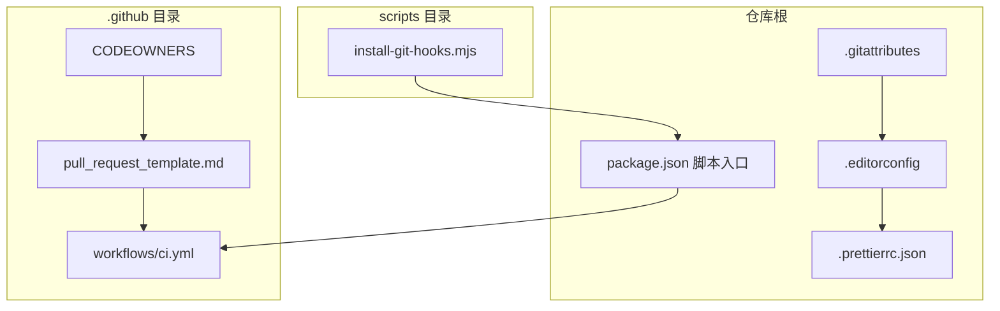

**图表来源**
- [package.json:1-48](file://package.json#L1-L48)
- [pull_request_template.md:1-89](file://.github/pull_request_template.md#L1-L89)
- [CODEOWNERS:1-12](file://.github/CODEOWNERS#L1-L12)

**章节来源**
- [package.json:1-48](file://package.json#L1-L48)
- [CODEOWNERS:1-12](file://.github/CODEOWNERS#L1-L12)

## 核心组件
协作流程由五个可执行的构件支撑，每个构件都有唯一权威文件，团队约定"以文件为准"而不是"以口头为准"：

1. **统一命令面 `package.json`**：`name` 为 `campus-love-monorepo`、`private: true`、`version: 0.1.0`，声明 `workspaces` 为 `apps/client` 与 `apps/admin` 两个前端工作区。scripts 段一共提供 17 个命令入口，覆盖开发（`api:dev`、`client:dev:h5`、`client:dev:h5:real`）、检查（`lint`、`lint:openapi`、`lint:openapi:spectral`）、测试（`test:prototype`、`test:structure`、`test:client`、`test`、`api:test`）、聚合校验（`verify:phase01`、`verify:client-builds`）与性能审计（`lighthouse:client`、`lighthouse:admin`、`lighthouse:ci`）。协作上这意味着任何"跑一遍"的说法都必须落到具体脚本名。
2. **PR 骨架 `.github/pull_request_template.md`**：89 行、11 个 H2 段落，从 Summary 到 Release Notes 逐段强制填写，其中 `Checks`、`CI 检查清单`、`Contracts And Data`、`Risk And Rollback` 四段构成合并前的自检契约。
3. **归属映射 `.github/CODEOWNERS`**：12 行，一条兜底规则加九条目录规则，把 `.github/`、`apps/client/`、`apps/api/`、`database/flyway/`、`docs/openapi/`、`docs/`、`tests/`、`tools/` 分别指派给 `@campus-love/` 前缀下的团队。
4. **本地前置门禁 `scripts/install-git-hooks.mjs` + `scripts/git-hooks/pre-commit`**：通过设置 `core.hooksPath` 让仓库内的钩子目录生效，不依赖 husky/lint-staged。
5. **平台门禁 `.github/workflows/ci.yml`**：流水线作业定义，PR 模板里的 `CI 检查清单` 逐条对应其作业名与超时配置。

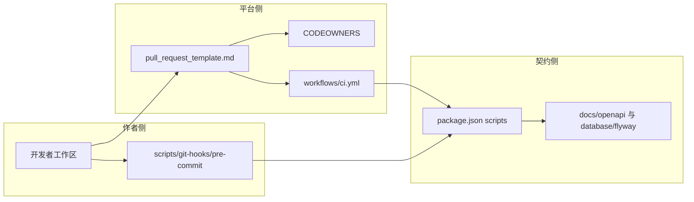

**图表来源**
- [package.json:9-27](file://package.json#L9-L27)
- [pull_request_template.md:21-60](file://.github/pull_request_template.md#L21-L60)
- [CODEOWNERS:1-12](file://.github/CODEOWNERS#L1-L12)
- [install-git-hooks.mjs:56-96](file://scripts/install-git-hooks.mjs#L56-L96)

**章节来源**
- [package.json:1-48](file://package.json#L1-L48)
- [pull_request_template.md:1-89](file://.github/pull_request_template.md#L1-L89)
- [CODEOWNERS:1-12](file://.github/CODEOWNERS#L1-L12)
- [install-git-hooks.mjs:1-96](file://scripts/install-git-hooks.mjs#L1-L96)

## 架构总览
协作流程的整体形状是"三层门禁 + 一条作业链"：本地钩子在 `git commit` 时拦截，PR 模板在提交评审前拦截，CI 作业链在合并时拦截。三层共用同一批命令，因此本地跑通即接近 CI 跑通。

CI 的触发面只有三种事件：`pull_request` 指向 `main` 或 `develop`、`push` 到 `main` 或 `develop`（以及 `push` 命中 `v*` 标签）、手工 `workflow_dispatch`。权限被收紧为 `contents: read` + `packages: write`，后者只为 push 事件推送镜像到 GHCR 而开。并发组 `ci-${{ github.workflow }}-${{ github.ref }}` 配 `cancel-in-progress: true`，同一分支的新提交会自动取消旧工作流。

作业链按 `needs` 形成有向无环图，共 10 个作业：

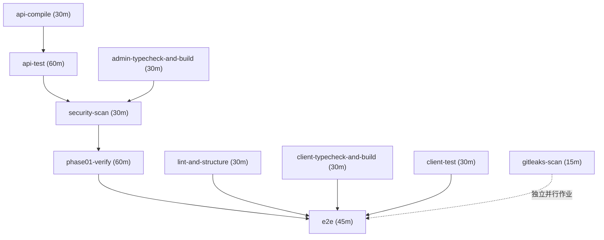

**图表来源**
- [ci.yml:3-19](file://.github/workflows/ci.yml#L3-L19)
- [ci.yml:227-231](file://.github/workflows/ci.yml#L227-L231)
- [ci.yml:261-267](file://.github/workflows/ci.yml#L261-L267)
- [ci.yml:428-433](file://.github/workflows/ci.yml#L428-L433)
- [ci.yml:461-473](file://.github/workflows/ci.yml#L461-L473)

一次改动的完整时序如下：作者先装钩子、再提交、再按模板开 PR、由 CODEOWNERS 自动请求评审、CI 全绿后合并。

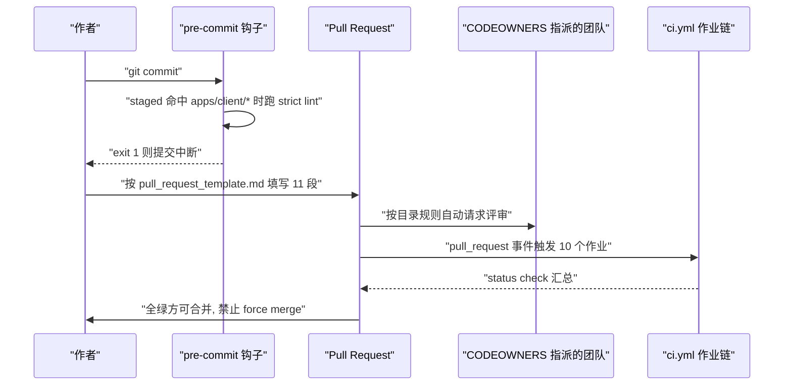

**图表来源**
- [pre-commit:13-49](file://scripts/git-hooks/pre-commit#L13-L49)
- [pull_request_template.md:32-60](file://.github/pull_request_template.md#L32-L60)
- [CODEOWNERS:4-12](file://.github/CODEOWNERS#L4-L12)
- [ci.yml:3-9](file://.github/workflows/ci.yml#L3-L9)

**章节来源**
- [ci.yml:1-512](file://.github/workflows/ci.yml#L1-L512)
- [pull_request_template.md:32-60](file://.github/pull_request_template.md#L32-L60)

## 详细组件分析
本章按"分支 → 提交 → PR → 审查 → 本地钩子 → CI → 发布"的顺序，逐个拆解流程组件的权威文件、可执行约束与填写要求。每条规则都锚定到具体文件行；仓库里没有实现证据的规则在「能力缺口登记」中单独列出，不混入本章。

各小节与权威文件的对应关系：

| 流程组件 | 权威文件 | 约束性质 |
| --- | --- | --- |
| 分支与合并 | `README.md` 贡献指南小节、`.github/workflows/ci.yml` 触发器 | 约定 + 部分由 CI 触发面隐式约束 |
| 提交信息 | `README.md` 提交规范小节 | 纯约定，无自动校验 |
| PR 结构 | `.github/pull_request_template.md` | 平台自动填充，人工逐项勾选 |
| 审查归属 | `.github/CODEOWNERS` | 平台按路径自动请求评审 |
| 本地前置门禁 | `scripts/install-git-hooks.mjs`、`scripts/git-hooks/pre-commit` | 可执行，exit 1 中断提交 |
| 合并门禁 | `.github/workflows/ci.yml` 的 10 个作业 | 可执行，模板声明"任一 check 失败即阻断合并" |
| 发布与回滚 | `README.md` 发布窗口小节、`doc/DEPLOYMENT.md` 升级与回滚小节 | 文档化步骤 |

### Git 分支管理策略
仓库对外的分支定义写在 `README.md` 的"分支策略"小节，要点共 7 类分支：

- `main`：唯一长期集成分支，必须保持可发布状态。
- `release/YYYY-MM-DD`：发布稳定分支。
- `hotfix/YYYY-MM-DD-short-name`：紧急生产修复分支。
- `feature/<scope>-<topic>`：新功能分支。
- `fix/<scope>-<topic>`：缺陷修复分支。
- `chore/<scope>-<topic>`：工具 / CI / 构建分支。
- `docs/<topic>`：仅文档变更。

工作分支从 `main` 切出，命名遵循上述规则；`release/*` 分支切出后，修复改为从该 release 分支切出，必要时 cherry-pick 回 `main`。PR 模板的 `Scope` 段用另一维度对同一件事做声明：当前所属 lane 只能填 `Phase 0 / Phase 1`、`Launch governance`、`Hotfix` 三选一，并要求显式写出 In scope 与 Explicitly left out，防止分支名与真实意图漂移。

主分支保护的**可执行证据来自 CI 触发面**而非仓库内的分支保护配置文件：`ci.yml` 只在 `pull_request` 指向 `main` 或 `develop`、以及 `push` 到 `main`/`develop` 或命中 `v*` 标签时运行。因此"改动只能经 PR 进入 main"这一条，在仓库内的落地形式是"PR 才会跑门禁作业"。同一触发面也说明 `develop` 被流水线视为可集成分支，而 README 的分支要点里没有为 `develop` 给出定义——这一处不一致在「能力缺口登记」中登记。

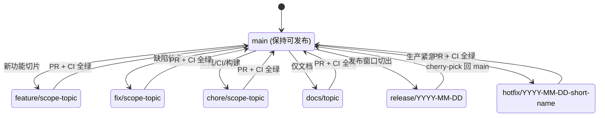

**图表来源**
- [README.md:345-404](file://README.md#L345-L404)
- [ci.yml:3-9](file://.github/workflows/ci.yml#L3-L9)
- [pull_request_template.md:5-11](file://.github/pull_request_template.md#L5-L11)

### 提交信息规范
提交信息采用约定式提交（Conventional Commits），模板为三段式：

```
<type>(<scope>): <subject>

<body>

<footer>
```

- `type` 允许 11 个值：`feat` / `fix` / `docs` / `style` / `refactor` / `perf` / `test` / `build` / `ci` / `chore` / `revert`。
- `scope` 取影响模块，示例模块为 `auth` / `match` / `chat` / `village` / `admin` / `api` / `client`；这些名称与后端包名 `com.campuslove.api.*` 和 PR 模板的 `Scope` 段共用同一套领域词汇。
- `subject` 用祈使句、首字母小写、结尾不加句号；`body` 详细说明可选；`footer` 承载 `BREAKING CHANGE` 与关联 issue 引用。
- README 给出的四条示例即类型跨度的下限：`feat(match): add quick-match endpoint with schedule-aware filter`、`fix(auth): refresh token leak on concurrent refresh requests`、`docs(api): update API-CONTRACT with rate limit table`、`chore(ci): bump Trivy to v0.55.0`。

`type` 与 PR 标签体系是同构的：PR 模板的 Labels 段要求勾选 `type:*`、`area:*`、`priority:*`、`risk:*`、`scope:*` 五类标签，其中 `type:*` 与提交类型的集合对齐，`scope:*` 与 `(<scope>)` 对齐。这样一条改动在 commit 历史、PR 标签、CI 日志三处的分类是一致的，检索时可用同一关键词贯穿。

需要明确边界：本仓库**没有提交信息的自动校验器**。`.github/` 目录下只有 `CODEOWNERS`、`pull_request_template.md`、`workflows/`、`modernize/` 四项，不存在 `commit_message_template`、`ISSUE_TEMPLATE` 等目录或文件；根目录也没有 commitlint 类配置，`package.json` 的 scripts 与 devDependencies 里同样没有提交信息校验依赖。`scripts/git-hooks/pre-commit` 只做 mp-weixin 图片样式 lint，不解析提交信息。因此提交规范目前是靠评审与本文档维持的约定，写错 type 不会有任何机器阻力。

**章节来源**
- [README.md:359-387](file://README.md#L359-L387)
- [pull_request_template.md:13-19](file://.github/pull_request_template.md#L13-L19)
- [package.json:9-38](file://package.json#L9-L38)
- [pre-commit:1-49](file://scripts/git-hooks/pre-commit#L1-L49)

### Pull Request 提交流程
流程共 6 步，直接来自 README 的"PR 流程"小节：

1. 从 `main` 切出工作分支，命名遵循分支策略。
2. 提交前在本地运行 `npm run verify:phase01`。该脚本在 `package.json` 中展开为 `npm run test && npm run lint:openapi && npm run lint:openapi:spectral && npm --workspace apps/client run typecheck && npm run verify:client-builds && npm run api:test`，即"一次跑完测试 + 契约校验 + 类型检查 + 构建 + 后端测试"。
3. PR 必须填写 `.github/pull_request_template.md` 中的检查清单。
4. PR 必须携带至少一个 `type:*` / `area:*` / `priority:*` / `risk:*` / `scope:*` 标签。
5. 通过 CODEOWNERS 评审与 CI 全绿后合并。
6. 涉及 `docs/openapi` 或 `database/flyway` 变更的 PR，必须在同一 PR 中同步客户端、API 与验证更新。

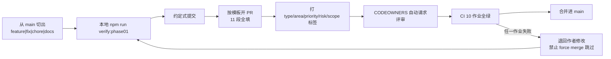

**图表来源**
- [README.md:389-396](file://README.md#L389-L396)
- [package.json:23-23](file://package.json#L23-L23)
- [pull_request_template.md:21-60](file://.github/pull_request_template.md#L21-L60)
- [CODEOWNERS:4-12](file://.github/CODEOWNERS#L4-L12)

模板 89 行分 11 段，各段的用途与强制程度如下：

| 段名（行号） | 内容要求 | 与门禁的关系 |
| --- | --- | --- |
| `Summary`（L1） | 一句话改动概述 | 评审入口 |
| `Scope`（L5） | lane 三选一 + In scope + Explicitly left out | 界定审查范围 |
| `Labels`（L13） | 5 类标签勾选框 | 与提交 type/scope 同构 |
| `Checks`（L21） | 8 项本地命令勾选 | 含 `npm test`、`lint:openapi`、`lint:openapi:spectral`、client typecheck、`verify:client-builds`、`api:test`、`verify:phase01` |
| `CI 检查清单`（L32） | 8 个作业名逐条勾选 + 强制门禁声明 | 与 `ci.yml` 作业一一对应 |
| `Job 超时配置`（L47） | 8 行 job/timeout-minutes 表 | 声明超时即失败、禁止重试跳过 |
| `Contracts And Data`（L62） | OpenAPI changed / 生成客户端已更新 / Flyway migration changed / 向后兼容说明 | 触面契约门禁 |
| `AI Plan Scope Check`（L70） | 3 项 AI plan 行为不变检查 | 防止误改产品行为 |
| `Risk And Rollback`（L76） | 风险 + Rollback plan | 回滚预案留档 |
| `Evidence`（L82） | 截图/日志/录屏 | 证据留存 |
| `Release Notes`（L87） | 发布说明 | 供发布窗口汇总 |

`Checks` 段的第 8 项写明"当 `database/flyway` 变更时，需针对一次性数据库执行 Flyway migrate + validate"，与 `Contracts And Data` 段的 `Flyway migration changed: Yes / No` 形成触发—动作配对：只有声明了 migration 变更，才要求执行该验证。

**章节来源**
- [pull_request_template.md:1-89](file://.github/pull_request_template.md#L1-L89)
- [README.md:389-396](file://README.md#L389-L396)
- [package.json:9-27](file://package.json#L9-L27)

### 代码审查标准与清单
审查由"谁必须看"和"看什么"两部分组成。

**谁必须看**由 `.github/CODEOWNERS` 的 12 行决定：兜底规则 `*` 指向 `@campus-love/maintainers`，其后 9 条按目录收窄，`.github/` 与 `.github/workflows/` 归 `release-managers`（后者再加 `backend-owners`），`apps/client/` 归 `client-owners`，`apps/api/` 归 `backend-owners`，`database/flyway/` 归 `backend-owners` + `release-managers`，`docs/openapi/` 同时归 `backend-owners` + `client-owners`（契约双端共审），`docs/` 归 `product-owners`，`tests/` 归 `qa-owners`，`tools/` 归 `maintainers`。文件首行明确写着：这些团队名需要先与 GitHub 或 Gitee 组织同步，才能启用严格强制。

**看什么**由 PR 模板的三段清单决定，评审者按段核对：

- 功能正确性与质量：`Checks` 段 8 项（`npm test`、`npm run lint:openapi`、`npm run lint:openapi:spectral`、`npm --workspace apps/client run typecheck`、`npm run verify:client-builds`、`npm run api:test`、`npm run verify:phase01`，以及 Flyway 变更时的一次性库 migrate + validate）。
- 流水线证据：`CI 检查清单` 段 8 个作业名（lint-and-structure、client-typecheck-and-build、client-test、admin-typecheck-and-build、api-compile、api-test、security-scan、e2e），并声明"以下所有 status check 必须全部绿才能合并；任一 check 失败即阻断合并，禁止使用 `Admin force merge` 跳过"。
- 安全项：`security-scan` 要求 Trivy 扫描无 HIGH/CRITICAL 漏洞；`gitleaks-scan` 作业用固定版本 `gitleaks/gitleaks:v8.18.4` 扫全量历史（`fetch-depth: 0`）并带 `--redact`；`lint-and-structure` 作业额外跑 `pnpm audit --prod --audit-level high` 作为生产依赖漏洞门禁。
- 契约与数据兼容：`Contracts And Data` 段的 4 个问答（OpenAPI changed、Generated client updated、Flyway migration changed、Backward-compatibility note）。
- 产品行为不变性：`AI Plan Scope Check` 段 3 项——AI plan 行为未变、AI plan 仍通过 `GET /home/dashboard` 输出到 `HomeDashboard.aiPlan`、`chat_ai_enabled = false` 的兜底行为仍然有效或被有意更新。
- 风险与回滚：`Risk And Rollback` 段要求填风险与 Rollback plan；`Evidence` 段要求提供截图/日志/录屏；`Release Notes` 段供发布窗口汇总使用。

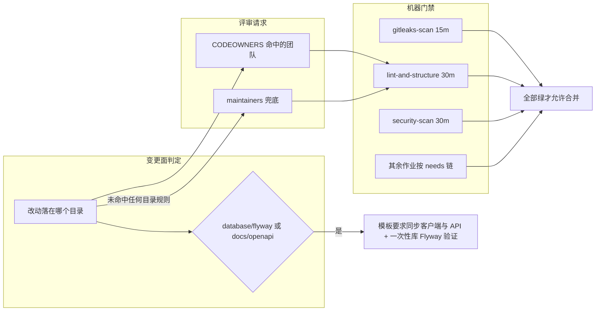

**图表来源**
- [CODEOWNERS:1-12](file://.github/CODEOWNERS#L1-L12)
- [pull_request_template.md:21-68](file://.github/pull_request_template.md#L21-L68)
- [ci.yml:60-79](file://.github/workflows/ci.yml#L60-L79)
- [ci.yml:100-120](file://.github/workflows/ci.yml#L100-L120)
- [README.md:389-396](file://README.md#L389-L396)

**章节来源**
- [CODEOWNERS:1-12](file://.github/CODEOWNERS#L1-L12)
- [pull_request_template.md:13-75](file://.github/pull_request_template.md#L13-L75)
- [ci.yml:60-120](file://.github/workflows/ci.yml#L60-L120)

### 本地前置门禁（Git 钩子）
钩子由两部分组成：安装器 `scripts/install-git-hooks.mjs`（96 行）与被安装的脚本 `scripts/git-hooks/pre-commit`（49 行）。安装器头部注释写明四条设计取舍：用 `git config core.hooksPath scripts/git-hooks` 让 git 直接读仓库内 hooks；不依赖 husky/lint-staged 以避免装包风险；Windows / Linux / macOS 跨平台；可幂等多次执行（每次重写配置并校验可执行权限）。用法两种：`node scripts/install-git-hooks.mjs` 安装，加 `--uninstall` 卸载并恢复默认 `.git/hooks` 路径。

安装流程有 4 个显式校验点，任一失败即以 exit 1 终止：

1. `gitCfg` / `gitCfgGet` 两个 helper 用 `spawnSync` 在仓库根执行 `git config`，以返回码判定成败。
2. 卸载分支先读当前 `core.hooksPath`，只有其值包含 `scripts/git-hooks` 时才执行 `--unset`，否则打印"无需卸载"并 exit 0，避免误改他人的钩子配置。
3. 安装分支校验 `scripts/git-hooks` 目录与其中的 `pre-commit` 文件存在，缺失即 FAIL；随后 `chmodSync(st.mode | 0o111)` 强制属主可执行位，chmod 失败仅降级为 WARN（Windows 下 git 可直接调用）。
4. 写入后回读校验 `final === "scripts/git-hooks"`，成功日志明确写出触发条件"git commit 时自动跑 apps/client mp-image strict lint"与作用域限定"仅对 apps/client/ 下的 staged 文件生效（作用域过滤）"。

`pre-commit` 本体的判定顺序：`set -euo pipefail` → 用 `git diff --cached --name-only --diff-filter=ACMR` 收集本次 staged 文件 → 只保留匹配 `apps/client/*` 的项 → 集合为空则 `exit 0` 直接放行 → 用 `git rev-parse --show-toplevel` 定位仓库根，`apps/client` 目录不存在时打 WARN 并跳过 → 进入 `apps/client` 后执行 `node scripts/check-mp-image-styles.mjs --strict`，等价于该工作区的 `check:mp-image:strict` 脚本 → 命中失败时打印两条处置路径：手工复跑 `cd apps/client && npx -y pnpm@11.17.0 run check:mp-image:strict`，或在 `src/**/*.vue|scss|css` 的目标行（或其上一非空代码行）加豁免注释 `/* mp-audit:ignore */` → 以 `exit $RC` 决定提交是否被阻断。

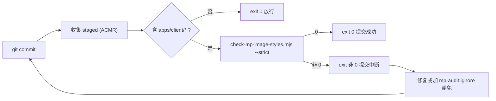

**图表来源**
- [install-git-hooks.mjs:56-96](file://scripts/install-git-hooks.mjs#L56-L96)
- [pre-commit:11-49](file://scripts/git-hooks/pre-commit#L11-L49)
- [package.json:36-37](file://apps/client/package.json#L36-L37)

**章节来源**
- [install-git-hooks.mjs:1-96](file://scripts/install-git-hooks.mjs#L1-L96)
- [pre-commit:1-49](file://scripts/git-hooks/pre-commit#L1-L49)
- [package.json:18-53](file://apps/client/package.json#L18-L53)

### CI 作业链与合并门禁
`ci.yml` 的 512 行里定义了 10 个作业。逐作业的运行时、依赖与关键步骤如下（超时值均取自各作业的 `timeout-minutes`）：

| 作业 ID | 显示名 | 超时 | needs | 关键步骤 |
| --- | --- | --- | --- | --- |
| `gitleaks-scan` | Gitleaks Secret Scan | 15 | — | `checkout` 带 `fetch-depth: 0`；`docker run gitleaks/gitleaks:v8.18.4 detect --config /repo/.gitleaks.toml --redact --verbose` |
| `lint-and-structure` | Lint & Structure | 30 | — | `pnpm install --frozen-lockfile`；`pnpm audit --prod --audit-level high`；`npm run lint`；`npm run lint:openapi`；`npm run lint:openapi:spectral`；`npm run test:structure` |
| `client-typecheck-and-build` | Client Typecheck & Build | 30 | — | client `typecheck` / `build:h5` / `build:mp-weixin` |
| `client-test` | Client Unit Tests | 30 | — | client `test:unit` |
| `admin-typecheck-and-build` | Admin Typecheck & Build | 30 | — | admin `typecheck` / `build` |
| `api-compile` | API Compile | 30 | — | `setup-java@v4` 17 + temurin + maven 缓存；`mvn -B -f apps/api/pom.xml compile` |
| `api-test` | API Unit Tests | 60 | `api-compile` | `mvn -B -f apps/api/pom.xml test` |
| `security-scan` | Trivy Security Scan（作业名内嵌推送决策说明） | 30 | `api-test`、`admin-typecheck-and-build` | 推送闸三档判定 → 必要时显式 fail → Trivy fs 扫 `apps/api`/`apps/admin` → buildx + metadata + GHCR 登录 + build-push → Trivy image 扫两镜像 → cosign 逐 tag 签名 |
| `phase01-verify` | Phase 01 Verify | 60 | `security-scan` | `npm run verify:phase01` |
| `e2e` | E2E Tests | 45 | 前 8 个作业（不含 `gitleaks-scan`） | 缓存 Playwright 浏览器 → `npx playwright install --with-deps chromium` → `npx playwright test --config=tests/e2e/playwright.config.ts` → 上传报告 `retention-days: 7` |

ESLint 步骤的判定口径写在注释里：只卡 errors，warning 不阻塞（历史 style 债另项清理），这与仓库根 `eslint.config.mjs` 的 flat config 和 `package.json` 的 `lint` 脚本范围（`apps/admin/src apps/client/src tools eslint.config.mjs`）共同回答"哪些代码被审"；`apps/client/src/services/generated/**` 与 `**/*.generated.ts` 在 ESLint 全局 ignores 中被排除，生成物不参与人工审查。

`security-scan` 的推送闸是流程里唯一带"显式决策留痕"的门禁：step `push-gate` 用 env 中转 secrets（注释说明 secrets 上下文不能直接用于 `if` 表达式）后分三档——配置了 `COSIGN_PRIVATE_KEY` 走 `sign`；未配置但仓库变量 `vars.ALLOW_UNSIGNED_IMAGES` 显式为 `true` 走 `allow-unsigned`；两者皆无走 `refuse`。`refuse` 档在非 PR 事件下由一个专门的失败步骤终止作业，日志直接给出两条处置路径（补 `COSIGN_PRIVATE_KEY` / `COSIGN_PASSWORD`，或新增 `ALLOW_UNSIGNED_IMAGES=true`）；同档时 `Log in to GHCR` 与两个 `build-push` 步骤的 `push:` 条件都被关掉，PR 场景则始终只构建不推送。签名步骤先判断 `secrets.COSIGN_PRIVATE_KEY != ''` 再安装 cosign，并按空格拆分多 tag 逐个 `cosign sign`。

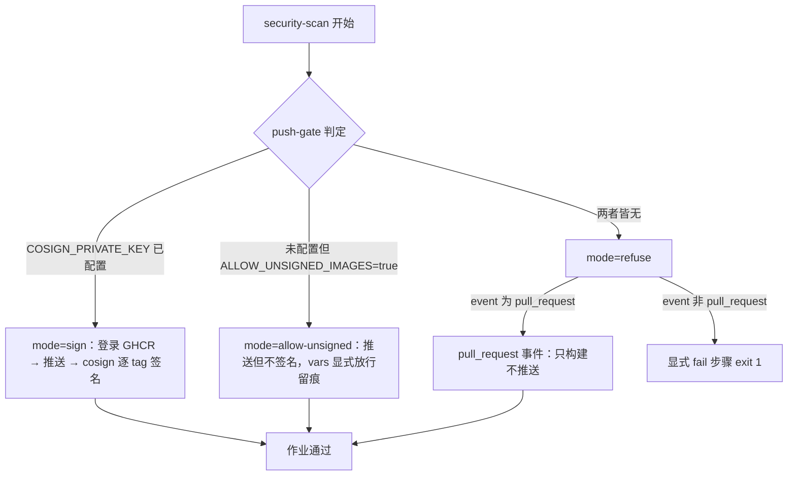

**图表来源**
- [ci.yml:271-304](file://.github/workflows/ci.yml#L271-L304)
- [ci.yml:352-381](file://.github/workflows/ci.yml#L352-L381)
- [ci.yml:401-422](file://.github/workflows/ci.yml#L401-L422)

**章节来源**
- [ci.yml:56-120](file://.github/workflows/ci.yml#L56-L120)
- [ci.yml:261-433](file://.github/workflows/ci.yml#L261-L433)
- [ci.yml:458-512](file://.github/workflows/ci.yml#L458-L512)
- [package.json:15-15](file://package.json#L15-L15)
- [eslint.config.mjs:39-60](file://eslint.config.mjs#L39-L60)

## 版本发布与回滚

### 分支模型

README 的贡献指南给出七类分支，其中只有一条是长期的（L347-L357）：

| 分支 | 角色 | 约定 |
| --- | --- | --- |
| `main` | 唯一长期集成分支 | **必须保持可发布状态**（L351），所有工作分支从这里切出 |
| `release/YYYY-MM-DD` | 发布稳定分支 | 以日期命名；切出后修复从该分支进行（L402） |
| `hotfix/YYYY-MM-DD-short-name` | 紧急生产修复 | 日期 + 短名，两级信息都在分支名里 |
| `feature/<scope>-<topic>` | 新功能 | scope 与提交 `type(scope)` 呼应 |
| `fix/<scope>-<topic>` | 缺陷修复 | 同上 |
| `chore/<scope>-<topic>` | 工具 / CI / 构建 | 同上 |
| `docs/<topic>` | 仅文档变更 | 无 scope 段 |

需要与门禁对照着读的一点：`ci.yml` 的触发分支是 `[main, develop]`（L5、L7），而上述模型**没有 `develop`**。也就是说 CI 为一个文档里不存在的分支准备了流水线，而文档里的 `release/*`、`hotfix/*` 反而不在触发列表内——这两种"不同源"在排查"为什么我的 release 分支没跑 CI"时必须同时看两边。除分支触发外，CI 还接受 `tags: ['v*']`（L7）与 `workflow_dispatch`（L8），后者提供了不依赖事件的的手工入口。

### 提交信息规范

约定式提交（Conventional Commits），结构为 `<type>(<scope>): <subject>` + 可选 `body` + 可选 `footer`（L361-L369）：

- `type` 取 `feat`/`fix`/`docs`/`style`/`refactor`/`perf`/`test`/`build`/`ci`/`chore`/`revert`（L371）；
- `scope` 是影响模块，README 直接列了本项目可用的取值：`auth`/`match`/`chat`/`village`/`admin`/`api`/`client`（L372）；
- `subject` 要求祈使句、首字母小写、结尾不加句号（L373）；
- `footer` 承载 `BREAKING CHANGE` 与关联 issue（L375）。

README 给了四条真实风格的示例（L379-L387），其中 `fix(auth): refresh token leak on concurrent refresh requests` 与 `chore(ci): bump Trivy to v0.55.0` 可直接当作模板。**但该规范没有任何机器校验**：`scripts/git-hooks/` 目录只有一个 `pre-commit`（无 `commit-msg`/`prepare-commit-msg`），而这份 pre-commit 的作用域被限死在 `apps/client/` 的图片样式检查（详见「核心组件」一节）。因此提交信息格式目前**只由评审者肉眼把关**。

### 发布窗口与冻结节奏

README L398-L404 定义的不是版本号推进，而是**合入权随时间收紧**：

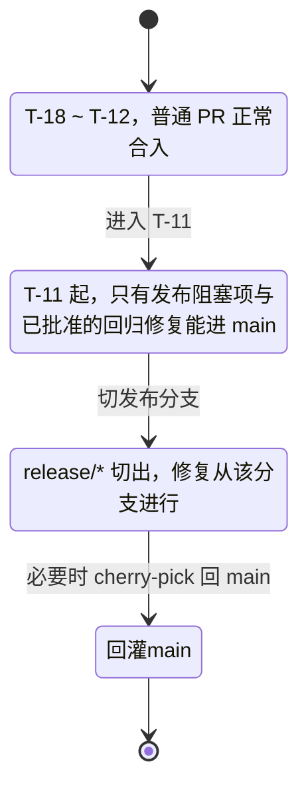

**图表来源**
- [README.md:398-404](file://README.md#L398-L404)

窗口用 `T-18`/`T-12`/`T-11` 这类相对日表达，**没有绑定具体日期或版本号**，也没有指向可执行的发布脚本。README L404 把细节交给 `docs/GRADUAL-RELEASE.md` 与 `docs/release-checklist.md`，这两份文件（连同 L304 提到的 `docs/release-checklist-template.md`）在仓库中都不存在，登记在「能力缺口登记」。

### 版本号现状

四份版本声明目前**同值且无递增机制**：

| 位置 | 字段 | 当前值 |
| --- | --- | --- |
| 根 `package.json` L4 | `version` | `0.1.0` |
| `apps/client/package.json` L4 | `version` | `0.1.0` |
| `apps/admin/package.json` L4 | `version` | `0.1.0` |
| `apps/api/pom.xml` L14 | `<version>`（`artifactId: campus-love-api`） | `0.1.0` |

`pom.xml` 的 `<parent>` 是 Spring Boot `3.3.1`（L6-L10），与项目版本无关，读错会把框架升级当成产品发版。仓库内没有 changesets/lerna 之类的版本编排配置，也没有发布脚本，因此**版本号一致是靠人工维持的**；CI 侧唯一的版本相关触发是 `v*` 标签（`ci.yml` L7），而打 tag 的动作本身不在任何文档或脚本里。

### 回滚机制

回滚目前是**清单要求 + 平台能力**，而非仓库脚本：

- PR 模板强制填写 `Risk And Rollback` 两段：风险描述与 "Rollback plan"（L76-L80），且 `Release Notes` 单列（L87-L89）。
- 分支模型给出的回滚路径是 `cherry-pick`（README L402）：release 分支上修好之后再决定要不要回灌 `main`，而不是反向回退 `main`。
- 数据库侧要求"变更过 `database/flyway` 时，在一次性数据库上执行 Flyway migrate + validate"（PR 模板 L30），`/database/flyway/` 的评审人也同时挂 `backend-owners` 与 `release-managers`（CODEOWNERS L8）。但仓库没有 undo/降级脚本约定，迁移不可逆时的处置方式未文档化（交叉引用「Flyway数据库迁移管理」）。
- 合并侧的约束是反向的：模板声明**禁止用 `Admin force merge` 跳过失败的 status check**（L32-L36），并禁止靠重试跳过门禁（L60）。

**章节来源**
- [README.md:347-357](file://README.md#L347-L357)
- [README.md:359-387](file://README.md#L359-L387)
- [README.md:398-404](file://README.md#L398-L404)
- [ci.yml:3-9](file://.github/workflows/ci.yml#L3-L9)
- [pull_request_template.md:30-36](file://.github/pull_request_template.md#L30-L36)
- [pull_request_template.md:60-60](file://.github/pull_request_template.md#L60-L60)
- [pull_request_template.md:76-89](file://.github/pull_request_template.md#L76-L89)
- [CODEOWNERS:8-8](file://.github/CODEOWNERS#L8-L8)
- [package.json:4-4](file://package.json#L4-L4)
- [apps/client/package.json:4-4](file://apps/client/package.json#L4-L4)
- [apps/admin/package.json:4-4](file://apps/admin/package.json#L4-L4)
- [pom.xml:6-14](file://apps/api/pom.xml#L6-L14)

## 团队协作与知识分享

### PR 全流程

README L389-L396 把流程写成六步，而 `.github/pull_request_template.md` 是每一步的落地表单：

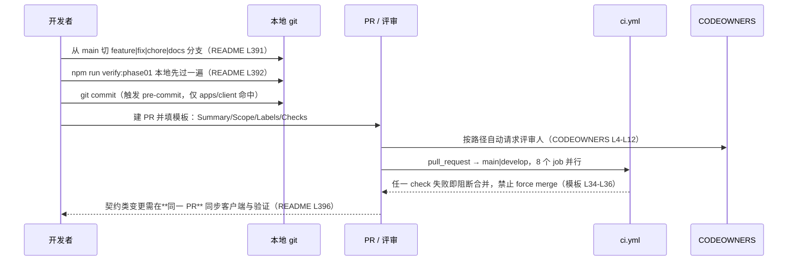

**图表来源**
- [README.md:389-396](file://README.md#L389-L396)
- [pull_request_template.md:21-45](file://.github/pull_request_template.md#L21-L45)
- [CODEOWNERS:2-12](file://.github/CODEOWNERS#L2-L12)
- [pre-commit:13-24](file://scripts/git-hooks/pre-commit#L13-L24)
- [ci.yml:3-9](file://.github/workflows/ci.yml#L3-L9)

模板里几段容易被忽略但会决定评审结论：

- **Scope 段要求声明所属 lane**：`Phase 0 / Phase 1` / `Launch governance` / `Hotfix` 三选一，并强制写 "In scope" 与 "Explicitly left out"（L5-L11）。"显式排除"这一栏的作用是把范围收缩写进记录，避免评审时被"顺手也改了"带过。
- **Labels 是勾选项而不是自由标签**：`type:*`、`area:*`、`priority:*`、`risk:*`、`scope:*` 五族各一框（L13-L19），README L394 要求 PR 至少携带一个。
- **Checks 段列八项本地命令**：`npm test`、`lint:openapi`、`lint:openapi:spectral`、client `typecheck`、`verify:client-builds`、`api:test`、`verify:phase01`，以及第八条条件项——`database/flyway` 有变更时需在**一次性数据库**上执行 migrate + validate（L23-L30）。
- **CI 检查清单八项**逐 job 列出（L38-L45），并附 job 超时表（L49-L58）：`api-test` 60 分钟、`e2e` 45 分钟、其余 30 分钟；模板同时声明"超过 timeout-minutes 自动取消并标记失败，禁止重试跳过门禁"（L60）。
- **AI Plan Scope Check** 是本项目特有的一段（L70-L74）：要求确认 AI plan 行为未变、仍经 `GET /home/dashboard` → `HomeDashboard.aiPlan` 出卡、`chat_ai_enabled = false` 的兜底仍然有效。
- **Evidence 段**要求附截图/日志/录制（L82-L85），与仓库里大量存在的截图取证流程相呼应。

### 评审边界与所有权

CODEOWNERS 用 9 条规则把目录切成不同责任面（L4-L12），每条至少双人：

| 路径 | 规则要求 |
| --- | --- |
| `*` | `@campus-love/maintainers`（L2） |
| `/.github/` | `release-managers` + `maintainers`（L4） |
| `/.github/workflows/` | `release-managers` + `backend-owners`（L5） |
| `/apps/client/` | `client-owners` + `maintainers`（L6） |
| `/apps/api/` | `backend-owners` + `maintainers`（L7） |
| `/database/flyway/` | `backend-owners` + `release-managers`（L8） |
| `/docs/openapi/` | `backend-owners` + `client-owners`（L9） |
| `/docs/` | `product-owners` + `maintainers`（L10） |
| `/tests/` | `qa-owners` + `maintainers`（L11） |
| `/tools/` | `maintainers`（L12） |

三条设计意图值得读出来：**契约文件由前后端共同签字**（L9 是唯一同时挂 client 与 backend 的路径），**迁移由后端与发布共同签字**（L8，使 schema 变更天然经过发布视角），**流水线本身不接受单一维护者改动**（L5 把 `release-managers` 拉进 workflows）。

同时 L1 的注释必须和规则一起看：`# Sync these teams with your GitHub or Gitee org before enabling strict enforcement.`——这些 `@campus-love/*` 团队名要**先在组织的真实团队里建好**，strict mode 才能生效。换言之该文件目前是所有权**意图声明**，是否已强制执行取决于平台设置，仓库里没有任何证据表明团队已建立（根目录与 `.github/` 下也没有相关配置或说明）。

### 本地闸：只做一件事的 pre-commit

`scripts/git-hooks/pre-commit` 的头部把设计要点写全了（L2-L9）：轻量零依赖（**不装 husky/lint-staged**，靠 `git config core.hooksPath scripts/git-hooks` 让 git 直接读仓库内 hooks，见 `scripts/install-git-hooks.mjs` L6）；作用域过滤（只有 staged 文件落在 `apps/client/` 才跑，L14-L24，避免 admin/api 提交被拖累）；失败拦截（lint 命中即 `exit 1` 中断提交，L42-L49）；兜底友好（前置检查只 1 秒左右，可在 commit 时频繁触发，L8）；沙箱兼容（走系统命令与 node 子进程，不受 `NODE_OPTIONS` shim 拦截，L9、L38）。

它检查的内容只有一项：`node scripts/check-mp-image-styles.mjs --strict`（L39），对应客户端脚本 `check:mp-image:strict`（`apps/client/package.json` L37）。失败时给出的处置是两条：修样式，或在 `src/**/*.vue|scss|css` 里加豁免注释 `/* mp-audit:ignore */`（放在问题行本身或其上一非空代码行，L44-L47）。

这决定了本地闸的能力边界：**格式、类型、单测、提交信息都不在提交时校验**，全部推迟到 CI。想提前发现问题只能按 README L392 的约定手工执行 `npm run verify:phase01`。

### 知识分享的现有载体

README 描述的知识结构里有四项**并不存在**：`docs/adr/`（架构决策记录，L342）、`docs/superpowers/`（开发流程辅助资料，L343）、`docs/branching.md`（分支完整规则，L349）、`docs/label-dictionary.md`（标签字典，L394）。仓库里 `docs/` 实际只有 `openapi/` 与 `wechat-submission-materials-checklist.md`。

目前真正在承担"记录为什么这样做"的有三类：

1. **配置与脚本内的注释**。例如 `eslint.config.mjs` 记录 `no-alert` 的理由是"小程序不支持"、`.gitattributes` 记录为何**故意不写** `* text=auto`、`pnpm-workspace.yaml` 用 `allowBuilds` 名单固化哪些依赖可执行构建。这些是决策的实际存放处。
2. **CI 文件头的演进记录**。`ci.yml` L21-L27 把门禁为何长这样写成编号链（Task 19/23/24、P1.16、Task 53），并明确指出补齐依据来自 `REAUDIT-REPORT-100+.md` 第 3.1 节编号 8 与第 3.5 节编号 105；并发控制也带编号（`FIN-00866 / infra #51`，L16-L19：同一分支新提交自动取消进行中的旧工作流）。
3. **`.zcode/workflows/*.dwf.ts` 的工作流协议**。多 actor 的执行/验收协议、缺陷登记与实测修正都写在这里（例如同目录 QA 工作流记录了"开发者工具自动化端口不保证是 9420，实测本机起在 9430"及由此引发的锁与端口不一致缺陷）。这是本仓库最完整的流程知识来源，但它不是文档格式，也不会被 README 指向。

新人入职路径因此是拼接的：README 的注意事项（L406-L411，说明主线聊天仍是临时匿名聊天、`GET /home/dashboard` 的 `aiPlan` 卡片位已复用为「每日一问」、`pages/dev/index` 经 `#ifdef DEV` 条件编译在生产构建中剔除、依赖版本用 `~` 或完全固定并指向 `.npmrc`）+ 同级的「开发环境搭建」页 + 本页的门禁清单；仓库没有 `CONTRIBUTING.md`、没有 issue 模板目录。

**章节来源**
- [README.md:340-357](file://README.md#L340-L357)
- [README.md:389-396](file://README.md#L389-L396)
- [README.md:406-411](file://README.md#L406-L411)
- [pull_request_template.md:5-19](file://.github/pull_request_template.md#L5-L19)
- [pull_request_template.md:23-30](file://.github/pull_request_template.md#L23-L30)
- [pull_request_template.md:38-58](file://.github/pull_request_template.md#L38-L58)
- [pull_request_template.md:70-85](file://.github/pull_request_template.md#L70-L85)
- [CODEOWNERS:1-12](file://.github/CODEOWNERS#L1-L12)
- [pre-commit:2-49](file://scripts/git-hooks/pre-commit#L2-L49)
- [install-git-hooks.mjs:6-6](file://scripts/install-git-hooks.mjs#L6-L6)
- [apps/client/package.json:36-37](file://apps/client/package.json#L36-L37)
- [ci.yml:16-27](file://.github/workflows/ci.yml#L16-L27)
- [.npmrc:7-8](file://.npmrc#L7-L8)

## 能力缺口登记

本页的 catalog 要求是"制定协作规范与工作流程"，而仓库现状是**规范存在、载体缺半**。逐条登记（含判定方式）：

| 项 | 判定 | 依据 |
| --- | --- | --- |
| `docs/branching.md`（分支完整规则） | **文件不存在** | README L349 引用它；对 `docs/` 目录列举的结果只有 `openapi/` 与 `wechat-submission-materials-checklist.md` |
| `docs/label-dictionary.md`（标签字典） | **文件不存在** | README L394 引用它，PR 模板 L15-L19 要求勾选这五族标签，但没有任何地方定义合法取值 |
| `docs/GRADUAL-RELEASE.md`（灰度发布方案） | **文件不存在** | README L319 与 L404 两处引用 |
| `docs/release-checklist.md` / `release-checklist-template.md` | **文件不存在** | README L304 与 L404 引用 |
| `docs/adr/`、`docs/superpowers/` | **目录不存在** | README L342-L343 声称 ADR 与流程辅助资料在此 |
| `CONTRIBUTING.md` | **不存在** | 仓库根列举无该文件；贡献内容全部写在 README L345-L404 内 |
| Issue 模板 | **不存在** | `.github/` 下只有 `CODEOWNERS`、`modernize/`、`pull_request_template.md`、`workflows/`，无 `ISSUE_TEMPLATE/` |
| `CHANGELOG` | **不存在** | 根目录无 changelog 类文件；PR 模板仅有 `Release Notes` 空段（L87-L89） |
| 提交信息机器校验 | **无** | `scripts/git-hooks/` 目录只有一个 `pre-commit`，无 `commit-msg`/`prepare-commit-msg`；pre-commit 只做 `apps/client` 的图片样式 strict lint |
| 版本号推进机制 | **无** | 四处版本全为 `0.1.0`（三个 `package.json` L4 + `apps/api/pom.xml` L14）；无 changesets/lerna/release 脚本 |
| 打 tag 与发布自动化 | **无脚本** | CI 认 `tags: ['v*']`（L7），但仓库内无创建 tag、无发布 workflow 文件（`.github/workflows/` 只有 `ci.yml`） |
| 分支保护规则本体 | **不在仓库** | 模板 L34-L36 与 L60 只是**声明**禁止 force merge/重试跳过门禁；实际保护与 required status checks 属平台设置，仓库无对应配置文件 |
| `develop` 分支 | **只在 CI 出现** | `ci.yml` L5、L7 认它，README 分支模型（L347-L357）里没有它——两侧不同源 |
| CODEOWNERS 可执行性 | **占位状态** | L1 注释自述需先在 GitHub/Gitee 组织同步团队名才能启用严格强制；仓库内无证据表明 `@campus-love/*` 九个团队已存在 |
| 契约 → 客户端类型的覆盖面 | **1/9** | `generate:openapi` 只对 `docs/openapi/feedback-growth-and-auth.yaml` 生成 `api-types.ts`（`apps/client/package.json` L47），而 `lint:openapi` 检查 9 份 yaml（根 `package.json` L16）。其余 8 份契约没有类型生成路径，是 README L396"同 PR 同步客户端"难以自动验证的结构性原因 |
| 团队沟通渠道 | **无记录** | 全仓未见 chat/会议/评审节律类文档；catalog 要求的"沟通渠道与知识分享机制"目前由配置文件注释、CI 演进注释与 `.zcode/workflows/*.dwf.ts` 协议三处**间接**承担 |

**章节来源**
- [README.md:304-343](file://README.md#L304-L343)
- [README.md:347-357](file://README.md#L347-L357)
- [README.md:389-404](file://README.md#L389-L404)
- [pull_request_template.md:13-19](file://.github/pull_request_template.md#L13-L19)
- [pull_request_template.md:32-36](file://.github/pull_request_template.md#L32-L36)
- [pull_request_template.md:60-60](file://.github/pull_request_template.md#L60-L60)
- [pull_request_template.md:87-89](file://.github/pull_request_template.md#L87-L89)
- [CODEOWNERS:1-12](file://.github/CODEOWNERS#L1-L12)
- [ci.yml:3-9](file://.github/workflows/ci.yml#L3-L9)
- [apps/client/package.json:47-47](file://apps/client/package.json#L47-L47)
- [package.json:16-16](file://package.json#L16-L16)
- [package.json:4-4](file://package.json#L4-L4)
- [pom.xml:14-14](file://apps/api/pom.xml#L14-L14)

## 依赖关系分析

协作机制由五层组成，层与层之间**不是全覆盖**的，这正是排查"为什么没被拦住"的关键。

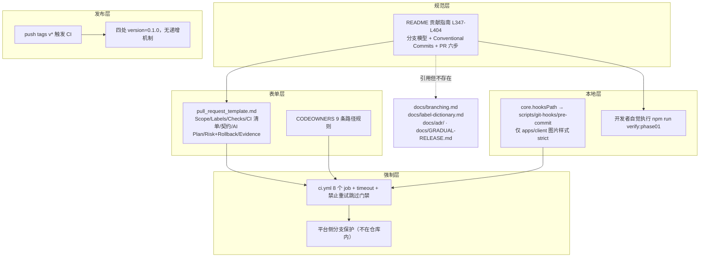

**图表来源**
- [README.md:347-404](file://README.md#L347-L404)
- [pull_request_template.md:5-89](file://.github/pull_request_template.md#L5-L89)
- [CODEOWNERS:1-12](file://.github/CODEOWNERS#L1-L12)
- [ci.yml:3-9](file://.github/workflows/ci.yml#L3-L9)
- [pre-commit:13-24](file://scripts/git-hooks/pre-commit#L13-L24)
- [install-git-hooks.mjs:6-6](file://scripts/install-git-hooks.mjs#L6-L6)

四条真实的依赖方向：

1. **强制层只有一处**：`ci.yml` 的 job 集合。README 的分支与提交规范、模板的勾选项都是**人工约定**；本地 pre-commit 只覆盖一类前端样式问题。因此"某问题没在提交时被拦住"不是缺陷，而是设计边界——它的拦截点在 CI。
2. **CI 的触发面比规范窄**。`push.branches` 针对被推送的分支、`pull_request.branches` 针对 PR 的目标分支（L3-L7），两侧都只列 `main`/`develop`。日常 `feature/*` 分支的推送本身不触发流水线，只有开出指向 `main` 的 PR 时才跑；`release/*`、`hotfix/*` 同样不在 push 触发列表里。
3. **评审依赖平台对象**。CODEOWNERS 的规则要生效，前提是那些 `@campus-love/*` 团队在组织里真实存在（L1 注释自述），并且严格模式被开启；这一步完全在仓库之外。
4. **发布依赖人**。`v*` 标签能触发 CI（L7），但没人负责打 tag、没有版本递增机制（四处 `0.1.0`），因此"版本发布"这条链目前是**声明齐全、动作缺位**。

**章节来源**
- [ci.yml:3-9](file://.github/workflows/ci.yml#L3-L9)
- [README.md:347-357](file://README.md#L347-L357)
- [CODEOWNERS:1-1](file://.github/CODEOWNERS#L1-L1)
- [package.json:4-4](file://package.json#L4-L4)
- [pom.xml:14-14](file://apps/api/pom.xml#L14-L14)

## 配置与开关

工作流程的可调项分布在 git、CI 与脚本三处，它们决定同一条规范在不同机器上的实际强度。

| 开关 | 位置 | 作用 | 关掉/漏配的后果 |
| --- | --- | --- | --- |
| `git config core.hooksPath scripts/git-hooks` | `scripts/install-git-hooks.mjs` L6 | 让 git 直接读仓库内 hooks，不装 husky/lint-staged | 未执行安装脚本 ⇒ 本地零校验；卸载走 `git config --unset core.hooksPath`（L41-L50） |
| pre-commit 作用域过滤 | `scripts/git-hooks/pre-commit` L14-L24 | 仅当 staged 文件落在 `apps/client/` 才执行检查 | 设计意图是"不拖累 admin/api 提交"，因此后端提交的本地校验为零 |
| `--strict` 与豁免注释 | `apps/client/package.json` L36-L37（`check:mp-image` / `check:mp-image:strict`）；`pre-commit` L39、L46 | strict 模式把图片样式问题判为失败；行内注释 `/* mp-audit:ignore */`（问题行本身或其上一非空代码行）可豁免 | 只用非 strict 脚本时问题不判失败；滥用豁免会让闸失效 |
| `concurrency.cancel-in-progress` | `ci.yml` L16-L19 | 同一分支的新提交自动取消进行中的旧工作流（注释标 `FIN-00866 / infra #51`） | 若关闭，连续推送会排队消耗 runner，反馈变慢 |
| `permissions` | `ci.yml` L11-L15 | 默认 `contents: read`；`packages: write` 供 security-scan 向 GHCR 推镜像，注释限定"仅 push 事件" | 权限收窄使 PR 事件下的扫描不会误推镜像 |
| `workflow_dispatch` | `ci.yml` L8 | 不依赖事件的手工触发入口 | 分支不在触发列表时的补救通道 |
| CODEOWNERS 严格模式 | 平台设置；`.github/CODEOWNERS` L1 注释 | 决定是否强制要求 owner 批准 | 未开启 ⇒ 规则只是"自动请求评审人"，不构成合并阻断 |
| `save-exact` / `engine-strict` | `.npmrc` L7-L8 | 新依赖写精确版本；engines 不匹配拒绝安装 | 关掉后依赖漂移会进入分支，`verify:client-builds` 与 CI 构建易出现"只有某人机器上过" |
| PR 的 lane 声明 | `pull_request_template.md` L7 | 要求选择 `Phase 0 / Phase 1` / `Launch governance` / `Hotfix` | lane 决定评审口径与允许触碰的范围；不填则范围收缩（L10-L11）失去依据 |

**章节来源**
- [install-git-hooks.mjs:6-6](file://scripts/install-git-hooks.mjs#L6-L6)
- [install-git-hooks.mjs:41-56](file://scripts/install-git-hooks.mjs#L41-L56)
- [pre-commit:14-46](file://scripts/git-hooks/pre-commit#L14-L46)
- [apps/client/package.json:36-37](file://apps/client/package.json#L36-L37)
- [ci.yml:8-19](file://.github/workflows/ci.yml#L8-L19)
- [CODEOWNERS:1-1](file://.github/CODEOWNERS#L1-L1)
- [.npmrc:7-8](file://.npmrc#L7-L8)
- [pull_request_template.md:7-11](file://.github/pull_request_template.md#L7-L11)

## 性能考虑

这里的"性能"指的是**反馈回路的耗时**，而不是运行时性能。仓库在四个点上做了明确取舍：

- **本地闸刻意做轻**。pre-commit 的设计要点里写着"前置 mp-image lint 只 1s 跑完，可在 commit 时频繁触发"（L8），并用作用域过滤保证"admin/api 提交不被拖累"（L6、L14-L24）。代价是本地拦截能力极窄，收益是提交摩擦接近零——这个取舍成立的前提是**所有人都知道真正的闸在 CI**。
- **用取消代替排队**。`concurrency.group` 按 `workflow-ref` 分组并 `cancel-in-progress: true`（L16-L19），同一分支连续推送时旧 run 直接被取消，避免 runner 被过期提交占满。
- **端到端耗时取决于最长前置链，而不是 job 之和**。模板给出的超时上限是三档：多数 job 30 分钟、`e2e` 45 分钟、`api-test` 60 分钟（L49-L58），而注释规定"e2e 依赖所有前置 job 通过后才执行"（L25）。因此一次 PR 的完整反馈时间 ≈ 前置并行段 + `api-test` 段 + `e2e` 段，任何一段触到 `timeout-minutes` 都会自动取消并判失败，且禁止靠重试绕过（模板 L60）。
- **契约生成被串进单测路径**。`test:client` 是 `npm run generate:openapi && npm --workspace apps/client run test:unit`（根 `package.json` L20），意味着每次跑客户端测试都会先重新生成类型。好处是 `docs/openapi` 与 `src/services/generated/api-types.ts` 不可能悄悄长期漂移（它会立刻反映进类型），代价是客户端测试环节比纯单测慢一截。
- **最贵的一步是显式的**。模板第八条勾选项要求"当 `database/flyway` 有变更时，对**一次性数据库**执行 Flyway migrate + validate"（L30）。这是整条流程里唯一要求额外环境的检查，因此现实中最常被跳过；而 `/database/flyway/` 的评审人同时挂着 `backend-owners` 与 `release-managers`（CODEOWNERS L8），跳过它的成本会在评审时补收。

一个实用结论：`verify:phase01`（L23）是 CI 全链的本地等价物，串了 `test`、两份 OpenAPI lint、client `typecheck`、`verify:client-builds`、`api:test`。README 把它放在 PR 之前（L392）而不是每次提交之前，正是因为它等于把 30–60 分钟的链路在本地重放一遍。

**章节来源**
- [pre-commit:6-24](file://scripts/git-hooks/pre-commit#L6-L24)
- [ci.yml:16-27](file://.github/workflows/ci.yml#L16-L27)
- [pull_request_template.md:30-30](file://.github/pull_request_template.md#L30-L30)
- [pull_request_template.md:49-60](file://.github/pull_request_template.md#L49-L60)
- [CODEOWNERS:8-8](file://.github/CODEOWNERS#L8-L8)
- [package.json:20-23](file://package.json#L20-L23)
- [README.md:389-396](file://README.md#L389-L396)

## 故障排查指南

流程类故障的特征是"没人报错，但事情没按规范发生"。下表按环节排。

| 环节 | 症状 | 原因 | 处置 |
| --- | --- | --- | --- |
| 本地提交 | `commit` 被中断，提示 `mp-weixin <image> 失效样式命中` | pre-commit 跑了 `check-mp-image-styles.mjs --strict`（L39、L42-L44） | 按提示 `cd apps/client && npx -y pnpm@11.17.0 run check:mp-image:strict` 复现并修复；确需保留时在问题行或其上一非空代码行加 `/* mp-audit:ignore */`（L46） |
| 本地提交 | 写了明显违规的代码却毫无提示 | `core.hooksPath` 未指向 `scripts/git-hooks`（安装脚本 L6），钩子根本没执行 | `node scripts/install-git-hooks.mjs` 重装；`install-git-hooks.mjs` L41-L50 会读当前 `core.hooksPath` 并报告是否已指向 |
| 本地提交 | 提交信息写成 `fix: xxx` 也过了 | 仓库**没有** `commit-msg` 钩子，约定式提交只由评审者把关 | 不要指望本地拦；改 PR 描述与标签让评审能快速判断 |
| CI | 推了 `feature/*` 分支后流水线没动 | `push.branches` 只含 `main`/`develop`（L5-L7）；推送 feature 分支不构成事件匹配 | 开一个以 `main` 为目标的 PR——`pull_request.branches` 判的是**目标分支**（L4-L5） |
| CI | `release/2026-xx-xx`、`hotfix/*` 分支上没有流水线 | 同上，二者都不在触发列表；而分支模型明确要求切这两类分支（README L352-L353） | 用 `workflow_dispatch` 手工触发（L8），或把 PR 目标设在 `main` |
| CI | 明明只改了一个后端文件，`client-test` 也跑了一遍 | job 划分按门禁而非改动面（模板 L38-L45 的八项是**全量清单**） | 属预期；若要省时间看下一条 |
| CI | 上一个提交的红叉突然变成"已取消" | 同分支新推送触发 `cancel-in-progress`（L16-L19） | 看最新 run，不必回看被取消的旧 run |
| 评审 | PR 没有自动请求任何人评审 | CODEOWNERS 里的 `@campus-love/*` 团队尚未在组织建立，或严格模式未开（L1 注释自述） | 先同步组织团队，否则 9 条规则都只是请求而非阻断 |
| 评审 | 想合并但 check 是红的，管理员能强合吗 | 模板把 `Admin force merge` 与重试跳过门禁**明确禁止**（L34-L36、L60） | 只能修；分支保护本身在平台侧配置，仓库文件只表达意图 |
| 评审 | PR 被打回补标签 | 五族标签是勾选项（L15-L19）且 README L394 要求至少一个 | 缺 `docs/label-dictionary.md`，取值目前靠既有 PR 惯例，建议在描述里写明理由 |
| 契约 | 改了 `docs/openapi/*.yaml` 但客户端类型没变化 | `generate:openapi` 只对 `feedback-growth-and-auth.yaml` 生成 `api-types.ts`（`apps/client/package.json` L47），其余 8 份只在 `lint:openapi` 的检查列表里（根 `package.json` L16） | 其余契约需手工同步调用侧；README L396 要求同一 PR 内完成，评审据此把关 |
| 数据库 | 迁移合入后别人环境起不来 | 跳过了"一次性库 migrate + validate"（模板 L30），或 Flyway 扫描路径随工作目录变化（交叉引用「Flyway数据库迁移管理」） | 补跑一次性库校验；`/database/flyway/` 改动必走 backend + release 双评审（CODEOWNERS L8） |
| 发布 | 想发版但版本号还是 `0.1.0` | 四处版本无递增机制，也没有发布脚本或 tag 流程 | 先建立版本推进约定（见「能力缺口登记」），否则 `v*` 触发的 CI 段永远不会跑 |
| 回滚 | 需要撤回一次发布 | 规范给出的路径是 release 分支修复后按需 cherry-pick 回 `main`（README L402），不是回退 `main` | 若涉及不可逆迁移，仓库暂无处置文档 |

**章节来源**
- [pre-commit:39-47](file://scripts/git-hooks/pre-commit#L39-L47)
- [install-git-hooks.mjs:6-6](file://scripts/install-git-hooks.mjs#L6-L6)
- [install-git-hooks.mjs:41-56](file://scripts/install-git-hooks.mjs#L41-L56)
- [ci.yml:3-9](file://.github/workflows/ci.yml#L3-L9)
- [ci.yml:16-19](file://.github/workflows/ci.yml#L16-L19)
- [pull_request_template.md:15-19](file://.github/pull_request_template.md#L15-L19)
- [pull_request_template.md:30-45](file://.github/pull_request_template.md#L30-L45)
- [CODEOWNERS:1-1](file://.github/CODEOWNERS#L1-L1)
- [CODEOWNERS:8-8](file://.github/CODEOWNERS#L8-L8)
- [README.md:352-353](file://README.md#L352-L353)
- [README.md:389-402](file://README.md#L389-L402)
- [package.json:16-16](file://package.json#L16-L16)
- [apps/client/package.json:47-47](file://apps/client/package.json#L47-L47)

## 结论

这套协作流程的真实构成是：**一段 README 规范 + 一份 PR 表单 + 一条 CODEOWNERS + 一条 CI 流水线 + 一个只管前端图片样式的本地钩子**。

它的强度分布很不均匀。CI 那一层是硬的：八个 job、逐项超时、禁止重试跳过门禁、禁止 force merge（模板 L32-L60），并且门禁的演进原因被写进 `ci.yml` 注释且可追溯到具体审计条目（L21-L27）。表单那一层是半硬的：Scope/Labels/Checks/契约/AI Plan/Risk+Rollback/Evidence 都有格子要填，填不填只有评审人看得出。本地那一层几乎不设防：钩子只拦一类问题，提交信息、格式、类型、单测全靠自觉与 CI。

因此最需要被记住的三条判断是：

1. **不要把本地闸当质量闸**。`core.hooksPath` 机制是有意做成"1 秒、只在 apps/client 命中"的（pre-commit L6-L8），任何"提交时没提示"都不构成"改动没问题"的证据。
2. **规范的细节大量不存在**。README 把分支完整规则、标签字典、ADR、灰度发布方案与发布清单指向了六份仓库里没有的文件，`CONTRIBUTING.md`、issue 模板、CHANGELOG 也都没有。当前所有可执行的约束都收敛在上面列出的那五件实物上，其余是意图。
3. **发布这条链只有声明**。四处版本停在 `0.1.0`，`v*` 触发条件写好了却没有任何打 tag 或发布的入口；回滚路径靠 cherry-pick 约定，数据库侧不可逆迁移没有处置文档。

按证据排序的最小改进：先补或删除 README 指向的六份缺失文件（现在它们会把新人引向不存在的目录）；再把 CI 触发面与分支模型对齐（`develop` 只存在于 CI、`release/*` 与 `hotfix/*` 只存在于文档）；然后给版本号与 tag 建立一个可执行入口；最后视需要把 `commit-msg` 校验加进 `scripts/git-hooks`——那是目前唯一"写了规范但没有任何机器执行"的一环。

**章节来源**
- [pull_request_template.md:32-60](file://.github/pull_request_template.md#L32-L60)
- [ci.yml:16-27](file://.github/workflows/ci.yml#L16-L27)
- [pre-commit:2-24](file://scripts/git-hooks/pre-commit#L2-L24)
- [README.md:340-357](file://README.md#L340-L357)
- [CODEOWNERS:1-12](file://.github/CODEOWNERS#L1-L12)
- [package.json:4-4](file://package.json#L4-L4)
- [pom.xml:14-14](file://apps/api/pom.xml#L14-L14)
