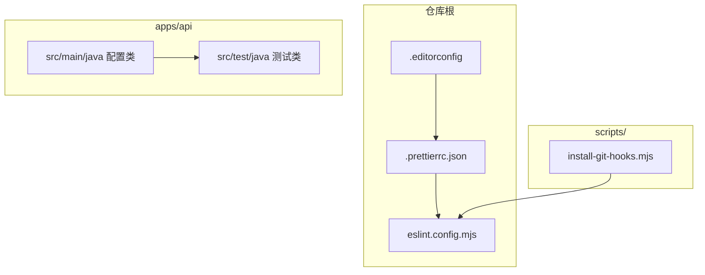
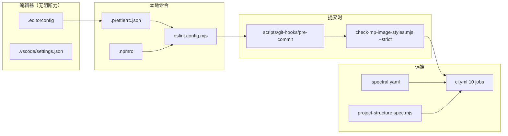
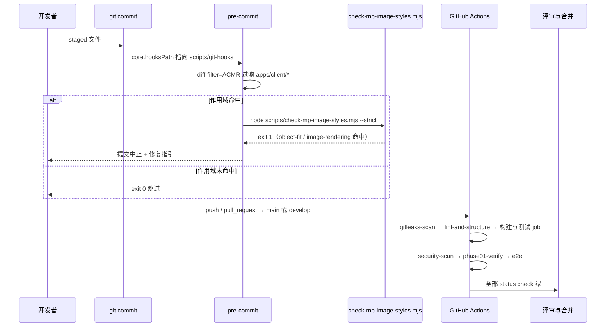
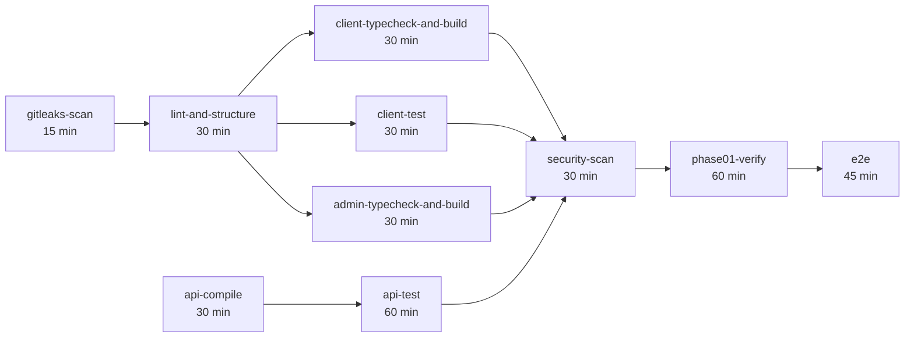
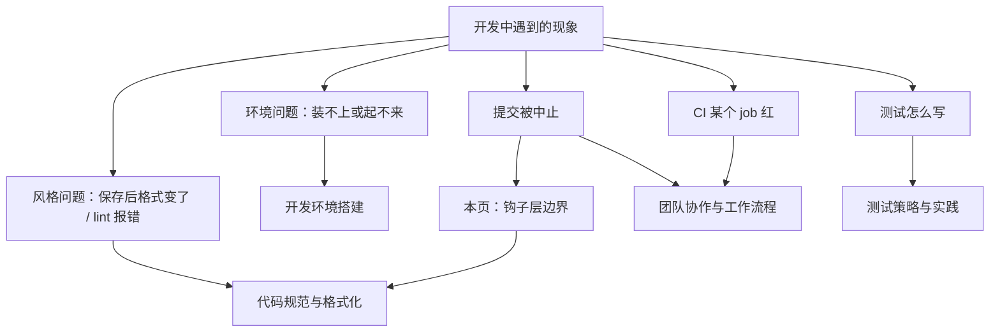
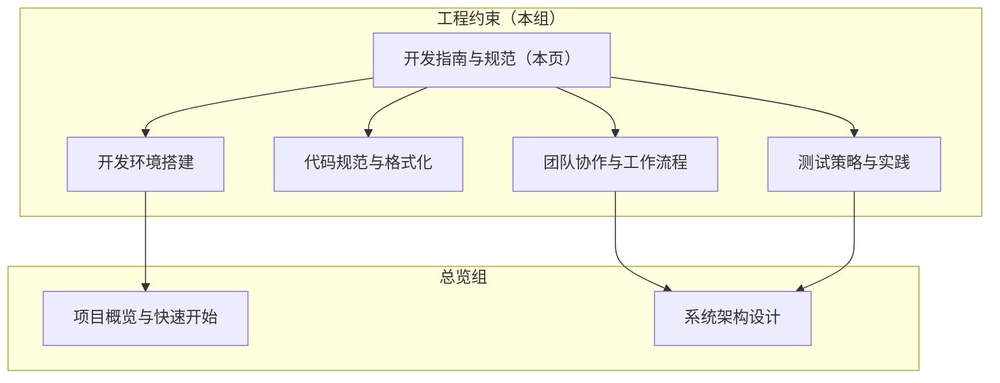
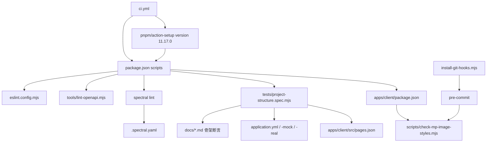
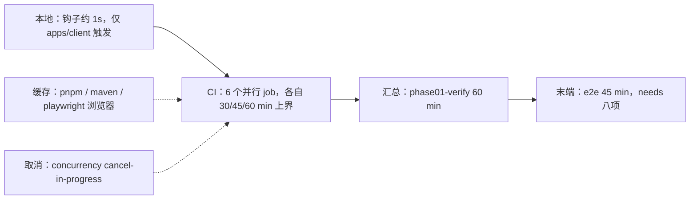
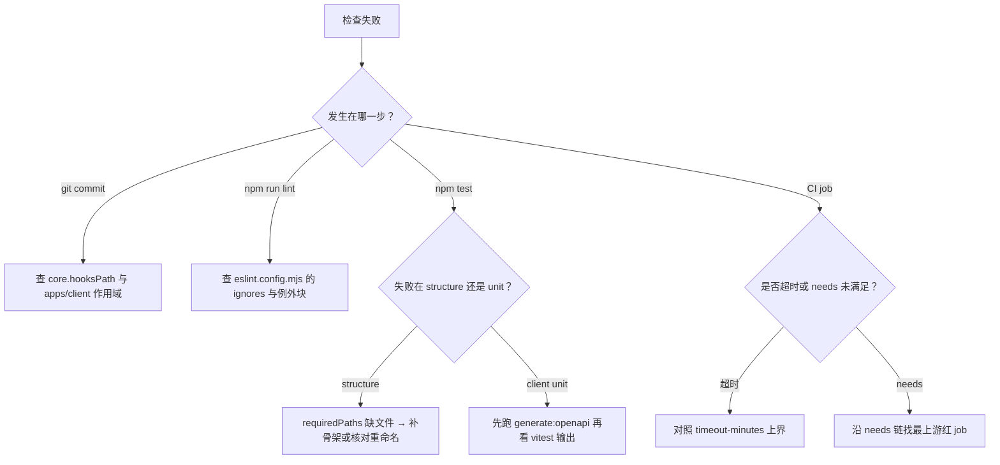

# 开发指南与规范

<cite>
**本文引用的文件**
- [eslint.config.mjs](file://eslint.config.mjs)
- [.prettierrc.json](file://.prettierrc.json)
- [.editorconfig](file://.editorconfig)
- [install-git-hooks.mjs](file://scripts/install-git-hooks.mjs)
- [CacheTest.java](file://apps/api/src/test/java/com/campuslove/api/config/CacheTest.java)
- [I18nTest.java](file://apps/api/src/test/java/com/campuslove/api/config/I18nTest.java)
- [AsyncConfig.java](file://apps/api/src/main/java/com/campuslove/api/config/AsyncConfig.java)
- [CacheNames.java](file://apps/api/src/main/java/com/campuslove/api/config/CacheNames.java)
- [package.json](file://package.json)
- [.npmrc](file://.npmrc)
- [scripts/git-hooks/pre-commit](file://scripts/git-hooks/pre-commit)
- [apps/client/scripts/check-mp-image-styles.mjs](file://apps/client/scripts/check-mp-image-styles.mjs)
- [apps/client/package.json](file://apps/client/package.json)
- [.github/workflows/ci.yml](file://.github/workflows/ci.yml)
- [.github/CODEOWNERS](file://.github/CODEOWNERS)
- [.github/pull_request_template.md](file://.github/pull_request_template.md)
- [tests/project-structure.spec.mjs](file://tests/project-structure.spec.mjs)
- [tests/prototype-contract.spec.mjs](file://tests/prototype-contract.spec.mjs)
- [.spectral.yaml](file://.spectral.yaml)
- [config/lighthouserc.json](file://config/lighthouserc.json)
- [.vscode/settings.json](file://.vscode/settings.json)
- [pnpm-workspace.yaml](file://pnpm-workspace.yaml)
- [.gitleaks.toml](file://.gitleaks.toml)
- [.prettierignore](file://.prettierignore)
- [tools/lint-openapi.mjs](file://tools/lint-openapi.mjs)
- [apps/admin/package.json](file://apps/admin/package.json)
- [apps/client/vitest.config.ts](file://apps/client/vitest.config.ts)
- [tests/e2e/playwright.config.ts](file://tests/e2e/playwright.config.ts)
- [SecurityConfigTest.java](file://apps/api/src/test/java/com/campuslove/api/config/SecurityConfigTest.java)
- [ResilienceTest.java](file://apps/api/src/test/java/com/campuslove/api/config/ResilienceTest.java)
- [TraceIdFilterTest.java](file://apps/api/src/test/java/com/campuslove/api/config/TraceIdFilterTest.java)
- [WebConfigTest.java](file://apps/api/src/test/java/com/campuslove/api/config/WebConfigTest.java)
- [JwtConfigTest.java](file://apps/api/src/test/java/com/campuslove/api/config/JwtConfigTest.java)
</cite>

## 目录
1. [简介](#简介)
2. [项目结构](#项目结构)
3. [核心组件](#核心组件)
4. [架构总览](#架构总览)
5. [详细组件分析](#详细组件分析)
6. [子页索引与覆盖范围](#子页索引与覆盖范围)
7. [模块边界与交叉引用](#模块边界与交叉引用)
8. [配置与开关](#配置与开关)
9. [依赖关系分析](#依赖关系分析)
10. [性能考虑](#性能考虑)
11. [故障排查指南](#故障排查指南)
12. [能力缺口登记](#能力缺口登记)
13. [附录](#附录)
14. [结论](#结论)

## 简介
本页是 `开发指南与规范` 分组的总览与索引页，面向 Campus Love 仓库的贡献者，回答三个问题：工程约束在哪些文件里落地、四份子页各自负责什么、跨子页的边界在哪里。本页不重复子页中的逐条规则细节，只给出规范资产在仓库中的物理分布、它们之间的触发顺序，以及遇到某一类开发问题时应当跳转到哪份子页。

分组下的四份子页为：`开发环境搭建`、`代码规范与格式化`、`测试策略与实践`、`团队协作与工作流程`。仓库中与工程约束直接相关的根级资产是 `eslint.config.mjs`、`.prettierrc.json`、`.editorconfig` 与 `scripts/install-git-hooks.mjs`，它们共同构成"编辑器—命令行—钩子"三层拦截网。

**章节来源**
- [eslint.config.mjs:1-200](file://eslint.config.mjs#L1-L200)
- [.prettierrc.json:1-35](file://.prettierrc.json#L1-L35)
- [.editorconfig:1-36](file://.editorconfig#L1-L36)
- [install-git-hooks.mjs:1-96](file://scripts/install-git-hooks.mjs#L1-L96)

## 项目结构
工程规范资产按"根级配置 + 脚本目录 + 各端测试目录"三层分布。根级配置文件对全仓生效且不带作用域前缀；`scripts/` 目录承载一次性或安装期的 Node 脚本；测试代码则分散在后端 API 模块与前端各自的目录里。

**图表来源**
- [eslint.config.mjs:1-200](file://eslint.config.mjs#L1-L200)
- [.prettierrc.json:1-35](file://.prettierrc.json#L1-L35)
- [.editorconfig:1-36](file://.editorconfig#L1-L36)
- [install-git-hooks.mjs:1-96](file://scripts/install-git-hooks.mjs#L1-L96)

**章节来源**
- [eslint.config.mjs:1-200](file://eslint.config.mjs#L1-L200)
- [install-git-hooks.mjs:1-96](file://scripts/install-git-hooks.mjs#L1-L96)

## 核心组件
工程约束在本仓库由五类互不重叠的组件承载。分类依据是"由谁触发"与"失败后阻断什么"：编辑器与配置文件只在保存时生效、脚本只在手动执行时生效、钩子只在 `git commit` 时生效、CI 只在 push / pull_request / workflow_dispatch 时生效、契约组件则约束接口定义文件本身。

| 组件类 | 物理载体 | 触发时机 | 失败后果 |
| --- | --- | --- | --- |
| 风格层 | `.editorconfig`（36 行）、`.prettierrc.json`（35 行）、`eslint.config.mjs`（200 行） | 编辑器保存 / `npm run lint` | ESLint 0 error 才算通过；`no-console`、`prefer-const`、`eqeqeq`、`no-var`、`no-debugger`、`no-alert`、`no-duplicate-imports` 为 error 级 |
| 命令层 | 根 `package.json` 的 17 条 scripts | 手动或 CI 调用 | 命令链以 `&&` 串联，前序失败即中断 |
| 钩子层 | `scripts/git-hooks/pre-commit` + `scripts/install-git-hooks.mjs` | `git commit` | `exit $RC` 非零即中止提交 |
| 门禁层 | `.github/workflows/ci.yml`（512 行、10 个 job） | push / PR / 手动 | 任一 job 失败或超时即阻断合并 |
| 契约层 | `tools/lint-openapi.mjs`、`.spectral.yaml`、`tests/project-structure.spec.mjs` | `lint:openapi` / `lint:openapi:spectral` / `test:structure` | 结构断言以 `assert.ok` / `assert.match` 硬失败 |

依赖版本由 `.npmrc` 的 `save-exact=true` 与 `engine-strict=true` 锁定，根 `package.json` 进一步声明 `engines.node` 为 `>=18.0.0 <23.0.0`、`engines.npm` 为 `>=9.0.0`，并以 `packageManager` 固定 `pnpm@11.17.0`。CI 侧三个 Node job 使用 `node-version: '20'`、两个 Java job 使用 `java-version: '17'`，落在这两条区间之内。

**图表来源**
- [.editorconfig:1-36](file://.editorconfig#L1-L36)
- [.prettierrc.json:1-35](file://.prettierrc.json#L1-L35)
- [eslint.config.mjs:100-157](file://eslint.config.mjs#L100-L157)
- [.npmrc:1-8](file://.npmrc#L1-L8)
- [scripts/git-hooks/pre-commit:35-49](file://scripts/git-hooks/pre-commit#L35-L49)
- [apps/client/scripts/check-mp-image-styles.mjs:1-22](file://apps/client/scripts/check-mp-image-styles.mjs#L1-L22)
- [.github/workflows/ci.yml:84-120](file://.github/workflows/ci.yml#L84-L120)
- [.spectral.yaml:1-15](file://.spectral.yaml#L1-L15)
- [tests/project-structure.spec.mjs:55-58](file://tests/project-structure.spec.mjs#L55-L58)
- [.vscode/settings.json:1-12](file://.vscode/settings.json#L1-L12)

**章节来源**
- [package.json:9-27](file://package.json#L9-L27)
- [package.json:43-47](file://package.json#L43-L47)
- [eslint.config.mjs:100-157](file://eslint.config.mjs#L100-L157)
- [.npmrc:1-8](file://.npmrc#L1-L8)
- [.github/workflows/ci.yml:95-98](file://.github/workflows/ci.yml#L95-L98)
- [.github/workflows/ci.yml:215-217](file://.github/workflows/ci.yml#L215-L217)

## 架构总览
一次改动的完整拦截顺序是"编辑器 → 手工 lint → commit 钩子 → CI 十个 job → 合并"。钩子层刻意只做轻量局部检查，把全量质量判定推给 CI，从而保证本地提交速度；CI 层则用 `needs` 串出依赖链，最后由 `e2e` job 汇总全部前置结果。

**图表来源**
- [scripts/git-hooks/pre-commit:11-49](file://scripts/git-hooks/pre-commit#L11-L49)
- [install-git-hooks.mjs:79-92](file://scripts/install-git-hooks.mjs#L79-L92)
- [apps/client/scripts/check-mp-image-styles.mjs:1-22](file://apps/client/scripts/check-mp-image-styles.mjs#L1-L22)
- [.github/workflows/ci.yml:3-19](file://.github/workflows/ci.yml#L3-L19)
- [.github/workflows/ci.yml:60-79](file://.github/workflows/ci.yml#L60-L79)
- [.github/workflows/ci.yml:428-473](file://.github/workflows/ci.yml#L428-L473)
- [.github/pull_request_template.md:32-60](file://.github/pull_request_template.md#L32-L60)

CI 的触发面与并发策略写在文件头部：`pull_request` 与 `push` 都只针对 `main` / `develop` 分支，`push` 额外匹配 `v*` tag，`workflow_dispatch` 允许手动跑全链；`concurrency.group` 为 `ci-${{ github.workflow }}-${{ github.ref }}` 且 `cancel-in-progress: true`，同分支新提交会取消仍在进行的旧工作流。`permissions` 只申请 `contents: read` 与 `packages: write`，后者供 `security-scan` 推镜像到 GHCR。

**图表来源**
- [.github/workflows/ci.yml:60-63](file://.github/workflows/ci.yml#L60-L63)
- [.github/workflows/ci.yml:84-87](file://.github/workflows/ci.yml#L84-L87)
- [.github/workflows/ci.yml:208-231](file://.github/workflows/ci.yml#L208-L231)
- [.github/workflows/ci.yml:261-267](file://.github/workflows/ci.yml#L261-L267)
- [.github/workflows/ci.yml:428-473](file://.github/workflows/ci.yml#L428-L473)
- [.github/pull_request_template.md:47-60](file://.github/pull_request_template.md#L47-L60)

`api-test` 显式 `needs: api-compile`；`phase01-verify` 只依赖 `security-scan`；`e2e` 的 `needs` 列出 `lint-and-structure`、`client-typecheck-and-build`、`client-test`、`admin-typecheck-and-build`、`api-compile`、`api-test`、`security-scan`、`phase01-verify` 八项，是全链最下游的汇总闸。

**章节来源**
- [.github/workflows/ci.yml:1-54](file://.github/workflows/ci.yml#L1-L54)
- [.github/workflows/ci.yml:428-473](file://.github/workflows/ci.yml#L428-L473)
- [.github/pull_request_template.md:32-60](file://.github/pull_request_template.md#L32-L60)

## 详细组件分析
本节按组件类逐块说明"配置写在哪儿、由谁执行、失败长什么样"，只给定位与边界，规则枚举留在子页。

### 命令层：根 package.json 脚本矩阵
根 `package.json` 是 monorepo 的唯一命令入口（`name` 为 `campus-love-monorepo`、`private: true`、`workspaces` 为 `apps/client` 与 `apps/admin`）。质量相关脚本按用途分四组：

| 组 | 脚本 | 实际命令要点 |
| --- | --- | --- |
| 静态检查 | `lint` | `eslint apps/admin/src apps/client/src tools eslint.config.mjs`，作用域显式列出，不含 `apps/api` |
| 契约检查 | `lint:openapi` / `lint:openapi:spectral` | 前者跑 `node tools/lint-openapi.mjs` 并逐个传入 9 份 `docs/openapi/*.yaml`；后者 `spectral lint "docs/openapi/*.yaml"` |
| 测试 | `test:prototype` / `test:structure` / `test:client` / `test` | `test` 以 `&&` 串联前三者；`test:client` 先 `generate:openapi` 再跑 client 工作区 `test:unit` |
| 汇总门禁 | `verify:phase01` | `test` → `lint:openapi` → `lint:openapi:spectral` → client `typecheck` → `verify:client-builds` → `api:test` |

`api:test` 通过 `node tools/run-api-wrapper.cjs test` 间接调用 Maven，避免各平台 PATH 差异；`lighthouse:client` 与 `lighthouse:admin` 分别针对 `http://localhost:5173` 与 `http://localhost:5177`，`lighthouse:ci` 走 `lhci autorun --config=config/lighthouserc.json`。

**章节来源**
- [package.json:9-27](file://package.json#L9-L27)
- [package.json:1-8](file://package.json#L1-L8)
- [apps/client/package.json:18-48](file://apps/client/package.json#L18-L48)

### 风格层：ESLint 扁平配置的分块取向
`eslint.config.mjs` 使用 ESLint 9 的 flat config，以 `tseslint.config(...)` 作为导出容器，依次叠加：全局 ignores → `js.configs.recommended` → `...tseslint.configs.recommended` → `...vuePlugin.configs['flat/recommended']` → 项目通用规则块 → 测试文件块 → 配置文件块 → Node 工具脚本块。

- ignores 块把 `apps/client/src/services/generated/**`、`**/*.generated.ts`、`apps/api/target/**`、各端 `dist/**` 与 `unpackage/**` 排除，生成物与设计归档不参与检查。
- 通用块 `languageOptions` 设定 `ecmaVersion: 2022`、`sourceType: 'module'`，并用 `tseslint.parser` 解析 Vue 的 `<script lang="ts">`；globals 显式声明 `uni`、`wx`、`UniApp`、`getApp`、`getCurrentPages`、`App`、`Page`、`Component` 以及 H5 侧 `window` / `document` / `localStorage` / `navigator`。
- `no-unused-vars` base 规则关闭，改由 `@typescript-eslint/no-unused-vars` 以 warn 处理，三处 ignore 模式统一为 `^_`；`no-console` 为 error 但 `allow: ['warn', 'error']`。
- 例外块共三个：测试文件（`**/*.spec.ts`、`**/*.test.ts`、`**/*.spec.mjs`、`**/tests/**`）关 `no-console` 与 `no-explicit-any`；配置文件关 `no-console`；`scripts/**`、`tools/**`、`tests/**` 与根级 `*.{cjs,js,mjs}` 切到 `sourceType: 'commonjs'` 并注入 `nodeScriptGlobals`（`process` / `require` / `module` / `__dirname` 等 14 项），同时关 `no-require-imports`。注释明确写出"产品代码（apps/admin/src、apps/client/src）不在此豁免范围内"。

**章节来源**
- [eslint.config.mjs:1-37](file://eslint.config.mjs#L1-L37)
- [eslint.config.mjs:39-100](file://eslint.config.mjs#L39-L100)
- [eslint.config.mjs:100-157](file://eslint.config.mjs#L100-L157)
- [eslint.config.mjs:159-200](file://eslint.config.mjs#L159-L200)

### 钩子层：零依赖安装的 pre-commit
`scripts/install-git-hooks.mjs` 不引入 husky / lint-staged，而是把 `git config core.hooksPath` 指向仓库内的 `scripts/git-hooks`，安装流程为四步：校验 hooks 目录存在 → 校验 `pre-commit` 存在并对其实例 `chmodSync(PRE_COMMIT, st.mode | 0o111)` → 写入 `core.hooksPath` → 回读校验值为 `scripts/git-hooks` 才打印"安装成功"。脚本可幂等重复执行，`--uninstall` 分支只在当前值包含 `scripts/git-hooks` 时 `--unset`。

`scripts/git-hooks/pre-commit` 本身以 `set -euo pipefail` 起头，逻辑三步：`git diff --cached --name-only --diff-filter=ACMR` 取 staged 列表并按 `apps/client/*` 过滤，未命中直接 `exit 0`；命中则 `cd` 到 `apps/client` 跑 `node scripts/check-mp-image-styles.mjs --strict`；失败时打印修复命令 `cd apps/client && npx -y pnpm@11.17.0 run check:mp-image:strict` 与豁免写法 `/* mp-audit:ignore */`。注释里写明的设计取向是"轻量零依赖 / 作用域过滤 / 失败拦截 / 前置 mp-image lint 只 1s 跑完 / 沙箱兼容"。

被钩子调用的 `apps/client/scripts/check-mp-image-styles.mjs` 只拦两类 mp-weixin 原生 `<image>` 失效写法：`object-fit`（应改用原生 `mode="aspectFit"` / `mode="aspectFill"`）与 `image-rendering: crisp-edges`；扫描 `src` 下 `.vue` / `.scss` / `.css`，用块注释状态机跳过注释行，命中行或紧邻上一非空行含 `mp-audit:ignore` 时豁免；无 `--strict` 时 advisory 输出且 `exit 0`。该脚本同时挂在 client 工作区脚本上：`check:mp-image`、`check:mp-image:strict`，并被 `build:mp-weixin:mock`、`build:mp-weixin:real:dev` 作为构建前置。

**章节来源**
- [install-git-hooks.mjs:1-53](file://scripts/install-git-hooks.mjs#L1-L53)
- [install-git-hooks.mjs:55-96](file://scripts/install-git-hooks.mjs#L55-L96)
- [scripts/git-hooks/pre-commit:1-49](file://scripts/git-hooks/pre-commit#L1-L49)
- [apps/client/scripts/check-mp-image-styles.mjs:1-22](file://apps/client/scripts/check-mp-image-styles.mjs#L1-L22)
- [apps/client/package.json:34-40](file://apps/client/package.json#L34-L40)

### 门禁层：ci.yml 的 job 与命令映射
`lint-and-structure` job 的顺序是 `pnpm install --frozen-lockfile` → `pnpm audit --prod --audit-level high` → `npm run lint` → `npm run lint:openapi` → `npm run lint:openapi:spectral` → `npm run test:structure`，即命令层四个脚本在 CI 里的直接映射。Node 环境由 `pnpm/action-setup@v3`（`version: 11.17.0`）与 `actions/setup-node@v4`（`node-version: '20'`、`cache: 'pnpm'`）装配；Java 环境由 `actions/setup-java@v4`（`java-version: '17'`、`cache: 'maven'`）装配。`gitleaks-scan` 用 `fetch-depth: 0` 全量 checkout 后以固定镜像 `gitleaks/gitleaks:v8.18.4` 扫描，配置文件 `/repo/.gitleaks.toml`。`e2e` job 缓存 `~/.cache/ms-playwright`、`npx playwright install --with-deps chromium`，并显式 `--config=tests/e2e/playwright.config.ts`（注释记录 FIN-00278：根目录无 playwright.config，原命令实际无法运行）。

**章节来源**
- [.github/workflows/ci.yml:84-120](file://.github/workflows/ci.yml#L84-L120)
- [.github/workflows/ci.yml:60-79](file://.github/workflows/ci.yml#L60-L79)
- [.github/workflows/ci.yml:428-473](file://.github/workflows/ci.yml#L428-L473)
- [package.json:15-23](file://package.json#L15-L23)

### 契约层：OpenAPI lint、Spectral 与结构测试
契约约束分三层：`tools/lint-openapi.mjs`（自研，101 行）按显式文件清单校验；`spectral lint` 用根级 `.spectral.yaml`，`extends: spectral:oas`，并把 `info-contact`、`info-description`、`info-license`、`openapi-tags`、`operation-description`、`operation-success-response`、`operation-tags` 七条规则显式降为 warn（注释说明 CI 默认仅 error 失败，降为 warn 使缺失元信息持续可见而不阻断）。`tests/project-structure.spec.mjs` 以 48 条 `requiredPaths`（L5-L52）守卫仓库骨架，再断言根 `package.json` 的 `private` / `workspaces` / 五个脚本存在性、`application*.yml` 三处 profile 特征、OpenAPI 路径存在、client `package.json` 的 `type: module` 与 `vue: 3.4.21`、`pages.json` 的 49 个主包页面与 6 个分包与五 Tab 文案，最后以 `doesNotMatch` 断言 `home/index.vue` 不得引入 `CardSwiper`、`discover/index.vue` 不得持有 `communityPosts` / `loveProgress`、`nearby/index.vue` 不得持有 `matchCenter`。`tests/prototype-contract.spec.mjs` 则对遗留静态原型做了自降级处理：`index.html` 或 `script.js` 缺失时打印跳过并 `process.exit(0)`，不再视为失败。

**章节来源**
- [.spectral.yaml:1-15](file://.spectral.yaml#L1-L15)
- [tests/project-structure.spec.mjs:4-53](file://tests/project-structure.spec.mjs#L4-L53)
- [tests/project-structure.spec.mjs:60-80](file://tests/project-structure.spec.mjs#L60-L80)
- [tests/project-structure.spec.mjs:122-184](file://tests/project-structure.spec.mjs#L122-L184)
- [tests/prototype-contract.spec.mjs:1-45](file://tests/prototype-contract.spec.mjs#L1-L45)

## 子页索引与覆盖范围
分组下四份子页按"资产归属"切分，本页只负责把它们串成一条拦截链。判据是：某条细节若只在一个配置文件里出现，就归对应子页；若需要跨三份以上资产才能讲清（如"提交为什么被中止"要同时看 `core.hooksPath`、pre-commit 作用域过滤、client 工作区脚本），才写进本页。

| 子页 | 主要覆盖资产 | 该页回答的典型问题 | 本页保留的部分 |
| --- | --- | --- | --- |
| 开发环境搭建 | Node/pnpm/JDK 工具链、`package.json` engines 与 `packageManager`、`.npmrc`、`docker-compose.yml`、环境变量、`scripts/install-git-hooks.mjs` | 装什么版本、工作区怎么初始化、钩子怎么装、本地怎么起服务 | 只在"钩子层"与"命令层"边界处引用，不重复安装步骤 |
| 代码规范与格式化 | `.editorconfig`、`.prettierrc.json`、`.prettierignore`、`eslint.config.mjs` 的逐条规则 | 某条规则是 error 还是 warn、哪种文件走哪个例外块 | 只给 flat config 的分块结构与豁免范围，不逐条列规则 |
| 测试策略与实践 | `apps/api/src/test/java/**` 的 JUnit 测试类、`apps/client` 的 vitest、`tests/e2e/playwright.config.ts` 与 `tests/e2e/specs/*.spec.ts`、`tests/performance/k6-baseline.js` | 各层测试怎么写、覆盖率门槛、测试数据管理 | 只给分层与 CI job 的对应关系 |
| 团队协作与工作流程 | `.github/CODEOWNERS`、`.github/pull_request_template.md`、`.github/workflows/ci.yml`、分支与发布约定 | 谁能审、PR 勾选项、分支策略、发布检查单 | 只给 CI job 顺序与 CODEOWNERS 的边界表 |

`测试策略与实践` 自身已再分层，目录内有 `后端集成测试（Spring Boot + JUnit）` 与 `端到端测试（Playwright）` 两份专页，本页不再下沉。

后端测试资产在 `apps/api/src/test/java/com/campuslove/api/config/` 下的实际体量（按文件真实行数）可以直接用来判断"该看哪份子页"：配置类测试最重的是 `I18nTest.java`（523 行，持有 `messageSource`、`localeResolver`、`i18nConfig` 三个注入字段）与 `TraceIdFilterTest.java`（435 行，注入 `request` / `response` / `filterChain` 并构造 `TraceIdFilter`），`CacheTest.java` 为 431 行、`ResilienceTest.java` 为 390 行、`WebConfigTest.java` 为 355 行、`SecurityConfigTest.java` 为 247 行（内含 `MockMvc mockMvc` 与 `WhisperMessageRepository` 字段）、`JwtConfigTest.java` 为 105 行。对应的被测配置类如 `AsyncConfig.java`（112 行，`@Configuration`，暴露 `taskExecutor()`，以 `corePoolSize` / `maxPoolSize` / `queueCapacity` / `threadNamePrefix` / `keepAliveSeconds` 五个字段做线程池参数化）与 `CacheNames.java`（111 行，缓存名常量类型）。

[此图为概念流程，不直接对应具体源文件，故不提供图表来源]

**章节来源**
- [install-git-hooks.mjs:1-16](file://scripts/install-git-hooks.mjs#L1-L16)
- [scripts/git-hooks/pre-commit:1-9](file://scripts/git-hooks/pre-commit#L1-L9)
- [eslint.config.mjs:1-12](file://eslint.config.mjs#L1-L12)
- [I18nTest.java:50-59](file://apps/api/src/test/java/com/campuslove/api/config/I18nTest.java#L50-L59)
- [TraceIdFilterTest.java:53-64](file://apps/api/src/test/java/com/campuslove/api/config/TraceIdFilterTest.java#L53-L64)
- [CacheTest.java:54-57](file://apps/api/src/test/java/com/campuslove/api/config/CacheTest.java#L54-L57)
- [SecurityConfigTest.java:45-53](file://apps/api/src/test/java/com/campuslove/api/config/SecurityConfigTest.java#L45-L53)
- [AsyncConfig.java:42-89](file://apps/api/src/main/java/com/campuslove/api/config/AsyncConfig.java#L42-L89)
- [CacheNames.java:12-111](file://apps/api/src/main/java/com/campuslove/api/config/CacheNames.java#L12-L111)

## 模块边界与交叉引用
本页只解释"工程约束"这一个横切面，其余横切面归其它分组。与同目录四份子页之外，还需要与总览组的五份页划清界线：`项目概览与快速开始` 负责"这条命令做什么业务"，`系统架构设计` 负责"模块之间怎么调用"，`客户端应用（Uni-app）`、`管理后台系统`、`后端API服务` 负责各自端的实现细节；本页负责"改动怎样被拦下来、由谁批"。

归属边界按 `.github/CODEOWNERS` 落地，共 10 条规则（1 条 `*` 兜底 + 9 条显式路径），`*` 兜底给 `@campus-love/maintainers`：

| 路径 | 归属团队 |
| --- | --- |
| `/.github/` | `@campus-love/release-managers` + `@campus-love/maintainers` |
| `/.github/workflows/` | `@campus-love/release-managers` + `@campus-love/backend-owners` |
| `/apps/client/` | `@campus-love/client-owners` + `@campus-love/maintainers` |
| `/apps/api/` | `@campus-love/backend-owners` + `@campus-love/maintainers` |
| `/database/flyway/` | `@campus-love/backend-owners` + `@campus-love/release-managers` |
| `/docs/openapi/` | `@campus-love/backend-owners` + `@campus-love/client-owners` |
| `/docs/` | `@campus-love/product-owners` + `@campus-love/maintainers` |
| `/tests/` | `@campus-love/qa-owners` + `@campus-love/maintainers` |
| `/tools/` | `@campus-love/maintainers` |

按此表可直接判定交叉引用的写法：`scripts/git-hooks/pre-commit` 位于 `/scripts/`，未被任何显式规则覆盖，因此落入 `*` 兜底，由 maintainers 单点负责；`eslint.config.mjs`、`.prettierrc.json`、`.editorconfig`、`.npmrc` 同为根级文件，同样走兜底。`/docs/openapi/` 与 `/docs/` 是父子关系且归属不同（前者 backend+client，后者 product+maintainers），CODEOWNERS 的就近匹配使契约文件的评审不经过 product-owners。

**图表来源**
- [CODEOWNERS:1-12](file://.github/CODEOWNERS#L1-L12)
- [eslint.config.mjs:41-61](file://eslint.config.mjs#L41-L61)
- [package.json:15-15](file://package.json#L15-L15)

跨端检查的覆盖面也在这里定界：`npm run lint` 的作用域是 `apps/admin/src apps/client/src tools eslint.config.mjs`，不含 Java 侧；后端由 `api-compile` 与 `api-test` 两个 job（Maven `-B` 批处理模式，`timeout-minutes` 分别为 30 与 60）承担同等地位的质量闸。`application.yml` 的 `spring.application.name: campus-love-api`、`profiles.default: mock`，以及 `application-mock.yml` 排除 `DataSourceAutoConfiguration` / `FlywayAutoConfiguration` 这类约束，是由 `test:structure` 用正则断言而非由 ESLint 保证的。

**章节来源**
- [CODEOWNERS:1-12](file://.github/CODEOWNERS#L1-L12)
- [package.json:15-15](file://package.json#L15-L15)
- [.github/workflows/ci.yml:208-211](file://.github/workflows/ci.yml#L208-L211)
- [.github/workflows/ci.yml:227-231](file://.github/workflows/ci.yml#L227-L231)
- [.github/pull_request_template.md:42-43](file://.github/pull_request_template.md#L42-L43)
- [tests/project-structure.spec.mjs:75-94](file://tests/project-structure.spec.mjs#L75-L94)

## 配置与开关
仓库没有集中式开关文件，可改变检查行为的旋钮分散在六处。与「核心组件」表按触发时机分类不同，本节只登记"把某个值改掉就能改变门禁结论"的位置，其中五项是配置期常量，只有镜像推送闸在运行期决定 pass/fail。

| 旋钮 | 位置 | 效果 |
| --- | --- | --- |
| `root = true` | `.editorconfig` 第 5 行 | 编辑器向上查找在本仓库终止，外层目录的约定不再叠加 |
| `allowBuilds` | `pnpm-workspace.yaml` 第 3-10 行 | 仅 7 个包可执行安装期构建脚本（`@parcel/watcher`、`core-js`、`core-js-pure`、`esbuild`、`puppeteer`、`sharp`、`vue-demi`），其余依赖跳过 postinstall |
| `overrides` | `pnpm-workspace.yaml` 第 12-13 行 | `@vitejs/plugin-vue` 强制解析为 `5.0.5`，覆盖各工作区自身声明 |
| Spectral 规则等级 | `.spectral.yaml` 第 9-15 行 | 7 条规范规则降为 warn，CI 不因它们失败 |
| ESLint 等级与三个例外块 | `eslint.config.mjs` 第 100-198 行 | error 阻塞、warn 不阻塞；测试 / 配置 / Node 工具脚本三块目录级豁免 |
| 镜像推送闸 | `.github/workflows/ci.yml` 第 276-304 行 | `sign` / `allow-unsigned` / `refuse` 三档，唯一运行期决定门禁结果的开关 |

推送闸的判定与传导写在 `security-scan` job 内：步骤先在 step 级 `env` 中读 `secrets.COSIGN_PRIVATE_KEY` 与 `vars.ALLOW_UNSIGNED_IMAGES`（第 278-280 行；第 275 行注释说明 secrets 上下文不能直接用于 `if` 表达式，故必须经 `env` 中转），再按分支把 `mode` 写入 `$GITHUB_OUTPUT`（第 282-291 行）。同一 `mode` 约束下游三处动作——GHCR 登录的 `if`（第 352-354 行）、API 与 Admin 两次 `push:` 判定（第 368 行、第 379 行）；`refuse` 档在非 PR 事件触发显式失败步骤并打印两条处置路径（第 295-304 行，第 300-303 行分别给出"配 COSIGN 密钥"与"显式设 `ALLOW_UNSIGNED_IMAGES=true`"），PR 场景只构建不推送故不受本闸影响。签名两步（`Install cosign`、`Sign images`）只在 `secrets.COSIGN_PRIVATE_KEY != ''` 时执行（第 404-412 行）。

其余开关分别落在：工作流触发面（第 3-9 行——`pull_request` 与 `push` 都只针对 `main` / `develop`，`push` 额外匹配 `v*` tag，`workflow_dispatch` 允许手动跑全链）与并发取消（第 16-19 行）；密钥扫描豁免（`.gitleaks.toml` 以 `[extend] useDefault = true` 继承默认规则，第 19-20 行，另有 2 条精确 regex 与 4 条精确 paths 豁免，第 34-51 行；第 4-16 行注释记录白名单从宽泛路径收紧为精确匹配的两轮过程）；端到端的重试、并发与端点随 `process.env.CI` 与 `E2E_BASE_URL` 切换（`tests/e2e/playwright.config.ts` 第 39-49 行）；性能预算阈值（`config/lighthouserc.json` 第 14-19 行，性能分 `minScore: 0.8` 判 error、`numeric-timing-INP` 200 ms 判 warn）。

**章节来源**
- [.editorconfig:5-5](file://.editorconfig#L5-L5)
- [pnpm-workspace.yaml:3-13](file://pnpm-workspace.yaml#L3-L13)
- [.spectral.yaml:9-15](file://.spectral.yaml#L9-L15)
- [eslint.config.mjs:100-198](file://eslint.config.mjs#L100-L198)
- [.github/workflows/ci.yml:276-304](file://.github/workflows/ci.yml#L276-L304)
- [.github/workflows/ci.yml:352-412](file://.github/workflows/ci.yml#L352-L412)
- [.github/workflows/ci.yml:3-19](file://.github/workflows/ci.yml#L3-L19)
- [.gitleaks.toml:4-51](file://.gitleaks.toml#L4-L51)
- [tests/e2e/playwright.config.ts:39-49](file://tests/e2e/playwright.config.ts#L39-L49)
- [config/lighthouserc.json:14-19](file://config/lighthouserc.json#L14-L19)

## 依赖关系分析
规范资产之间存在三组必须同步的耦合，改动任一处都要顺着链条检查另一处。

第一组是工具链版本锁。`pnpm@11.17.0` 同时出现在三处：根 `package.json` 的 `packageManager`（带 sha512 校验和）、`ci.yml` 中 `pnpm/action-setup@v3` 的 6 处 `version: 11.17.0`、以及 `pre-commit` 失败提示里的 `npx -y pnpm@11.17.0 run check:mp-image:strict`。三处不一致会让本地修复命令与 CI 环境跑在不同包管理器上。

第二组是风格文件之间的数值对齐。`.editorconfig` 的 `max_line_length = 100` 与 `.prettierrc.json` 的 `printWidth: 100` 成对（`.editorconfig` 第 19 行注释即写明"与 Prettier printWidth 一致"）；`end_of_line = crlf` 与 `endOfLine: "crlf"` 成对；`indent_style = space` / `indent_size = 2` 与 `useTabs: false` / `tabWidth: 2` 成对；`[*.md]` 段的 `trim_trailing_whitespace = false` + `max_line_length = off` 与 Prettier overrides 里 `*.md` 的 `printWidth: 120` + `proseWrap: "preserve"` 成对。

第三组是命令与配置文件的自指。`npm run lint` 的显式作用域里包含 `eslint.config.mjs` 自身，因此这份配置文件同时是被检查对象与检查规则来源。

**图表来源**
- [package.json:15-23](file://package.json#L15-L23)
- [package.json:47-47](file://package.json#L47-L47)
- [eslint.config.mjs:15-16](file://eslint.config.mjs#L15-L16)
- [.spectral.yaml:1-2](file://.spectral.yaml#L1-L2)
- [tests/project-structure.spec.mjs:45-52](file://tests/project-structure.spec.mjs#L45-L52)
- [tests/project-structure.spec.mjs:133-156](file://tests/project-structure.spec.mjs#L133-L156)
- [apps/client/package.json:26-37](file://apps/client/package.json#L26-L37)
- [scripts/git-hooks/pre-commit:39-45](file://scripts/git-hooks/pre-commit#L39-L45)
- [install-git-hooks.mjs:80-83](file://scripts/install-git-hooks.mjs#L80-L83)
- [.github/workflows/ci.yml:91-101](file://.github/workflows/ci.yml#L91-L101)

`结构测试`这一层的依赖最脆弱：它断言的是"文件存在 + 内容匹配正则"，任何被列进 `requiredPaths` 的文件被删除或重命名都会让整个 `npm run test` 链失败，进而阻断 `verify:phase01` 与 CI 的 `lint-and-structure` job。该文件当前列出的 `docs/` 骨架项在仓库里并不齐备，具体见「能力缺口登记」。

**章节来源**
- [package.json:18-23](file://package.json#L18-L23)
- [tests/project-structure.spec.mjs:4-58](file://tests/project-structure.spec.mjs#L4-L58)
- [.editorconfig:19-28](file://.editorconfig#L19-L28)
- [.prettierrc.json:3-13](file://.prettierrc.json#L3-L13)
- [.prettierrc.json:27-33](file://.prettierrc.json#L27-L33)

## 性能考虑
质量闸的开销按"越靠前越便宜"分配，这条取舍在钩子注释里写得最直接：`pre-commit` 的设计要点第 4 条是"兜底友好——前置 mp-image lint 只 1s 跑完，可在 commit 时频繁触发"，配套的作用域过滤把这份开销限定在 staged 文件落在 `apps/client/` 时才发生，其它提交路径直接 `exit 0`。

CI 侧的耗时上界由每个 job 的 `timeout-minutes` 显式声明，PR 模板把同一组数值做成表格供作者自查：

| job | timeout-minutes | 证据 |
| --- | --- | --- |
| gitleaks-scan | 15 | `ci.yml` 第 63 行（模板表未列此项） |
| lint-and-structure | 30 | `ci.yml` 第 87 行 |
| client-typecheck-and-build | 30 | `ci.yml` 第 127 行 |
| client-test | 30 | `ci.yml` 第 158 行 |
| admin-typecheck-and-build | 30 | `ci.yml` 第 183 行 |
| api-compile | 30 | `ci.yml` 第 211 行 |
| api-test | 60 | `ci.yml` 第 231 行 |
| security-scan | 30 | `ci.yml` 第 267 行 |
| phase01-verify | 60 | `ci.yml` 第 433 行 |
| e2e | 45 | `ci.yml` 第 473 行 |

模板同时规定"任一 job 超过 timeout-minutes 将自动取消并标记为失败，禁止重试跳过门禁"。

重复工作的削减集中在四处装配：`concurrency.cancel-in-progress: true` 让同分支旧工作流提前退出；所有 Node job 用 `pnpm install --frozen-lockfile` 配合 `setup-node` 的 `cache: 'pnpm'`；两个 Java job 用 `setup-java` 的 `cache: 'maven'`；`e2e` 用 `actions/cache@v4` 缓存 `~/.cache/ms-playwright`，key 为 `playwright-${{ runner.os }}-${{ hashFiles('pnpm-lock.yaml') }}`。Maven 统一加 `-B` 避免交互式阻塞。

[此图为概念流程，不直接对应具体源文件，故不提供图表来源]

前端性能预算是声明式的：`config/lighthouserc.json` 对 `http://localhost:5173` 与 `http://localhost:5177` 各跑 `numberOfRuns: 3`，`preset: desktop` 且 `onlyCategories: ["performance"]`；断言里 `categories:performance` 为 `["error", { minScore: 0.8 }]`，`numeric-timing-INP` 为 `["warn", { maxNumericValue: 200 }]`，报告上传到 `temporary-public-storage`。压测基线文件是 `tests/performance/k6-baseline.js`。构建产物侧的体积控制由 client 工作区脚本承担：`build:mp-weixin` 与 `build:mp-weixin:mock` 都在末尾调用 `node ../../scripts/verify-package-size.mjs --allow-mock`。

**章节来源**
- [scripts/git-hooks/pre-commit:1-24](file://scripts/git-hooks/pre-commit#L1-L24)
- [.github/workflows/ci.yml:16-19](file://.github/workflows/ci.yml#L16-L19)
- [.github/workflows/ci.yml:100-105](file://.github/workflows/ci.yml#L100-L105)
- [.github/workflows/ci.yml:486-496](file://.github/workflows/ci.yml#L486-L496)
- [.github/pull_request_template.md:47-60](file://.github/pull_request_template.md#L47-L60)
- [config/lighthouserc.json:1-24](file://config/lighthouserc.json#L1-L24)
- [package.json:24-26](file://package.json#L24-L26)
- [apps/client/package.json:25-26](file://apps/client/package.json#L25-L26)

## 故障排查指南
分诊原则：先看现象落在哪一层（编辑器 / 本地命令 / 钩子 / CI），再定位到该层的唯一入口文件，避免在子页之间来回跳。

| 现象 | 首个定位点 | 依据与处置 |
| --- | --- | --- |
| `npm test` 抛 `AssertionError [ERR_ASSERTION]: ../docs/phase-0-1-foundation.md should exist`（进程退出码 1） | `tests/project-structure.spec.mjs` 的存在性循环 | 断言发生在第 55-58 行的 `for` 循环中，由 `assert.ok(existsSync(ref), ...)` 抛出 "should exist" 消息；该循环遍历 48 条路径，任一条缺失即整体失败，`npm run test:structure`、`npm test`、`verify:phase01` 与 CI `lint-and-structure` 会连锁变红 |
| `test:prototype` 打印 `prototype contract skipped: legacy prototype files removed (monorepo app)` | `tests/prototype-contract.spec.mjs` 第 6-9 行 | 属预期行为：`index.html` / `script.js` 不存在时 `process.exit(0)`，不视为失败，与上一行的硬失败策略不同 |
| `git commit` 没有触发任何检查 | `git config --get core.hooksPath` | 应为 `scripts/git-hooks`；未设置则执行 `node scripts/install-git-hooks.mjs`，脚本第 86-92 行会回读校验并打印安装成功或失败值 |
| 钩子打印 `[pre-commit] WARN: apps/client 不存在，跳过 mp-image lint` | `scripts/git-hooks/pre-commit` 第 30-33 行 | `git rev-parse --show-toplevel` 解析出的仓库根下缺 `apps/client`，多在工作树路径异常时出现 |
| 提交被中止且提示 `mp-weixin <image> 失效样式命中` | `apps/client/scripts/check-mp-image-styles.mjs` | 按提示执行 `cd apps/client && npx -y pnpm@11.17.0 run check:mp-image:strict`；确有合法场景时在命中行或紧邻上一非空行加 `/* mp-audit:ignore */` |
| ESLint 对 `uni` / `wx` / `getApp` 报未定义 | `eslint.config.mjs` 的 globals 段 | 第 81-98 行声明了 uni-app 与小程序全局；新增全局需补进该段，否则按 `no-undef` 处理 |
| `console.log` 在产品代码报 error | `eslint.config.mjs` 第 118-123 行 | `no-console: ['error', { allow: ['warn', 'error'] }]`；诊断脚本目录已由第 182-199 行豁免块放行，产品代码不放行 |
| `npm install` 因版本不匹配被拒 | `.npmrc` + 根 `package.json` engines | `engine-strict=true` 使 `engines.node`（`>=18.0.0 <23.0.0`）成为硬约束；`save-exact=true` 则解释为什么新依赖保存为精确版本 |
| CI 的 e2e job 报找不到配置 | `.github/workflows/ci.yml` 第 501-503 行 | 注释记录 FIN-00278：根目录无 `playwright.config`，必须显式 `--config=tests/e2e/playwright.config.ts` |
| Spectral 输出一堆 warning 但不阻断 | `.spectral.yaml` 第 8-15 行 | 七条规则被显式降为 warn，CI 默认仅 error 失败，属"持续可见"策略而非缺陷 |
| 改了 `apps/client` 里的文件，钩子却没跑 | `scripts/git-hooks/pre-commit` 第 14-20 行 | 过滤要求文件已进暂存区且变更类型落在 `ACMR`（新增 / 复制 / 修改 / 重命名），删除的文件不在范围内；先 `git add` 再提交 |
| `npm test` 整链红但客户端单测是绿的 | `package.json` 第 18-21 行的三段串行 | 单独跑 `npm run test:structure` 定位；`test:prototype` 在缺失时是 `exit 0` 跳过而非失败，不会把链子拖红 |
| ESLint 对 Node 工具脚本报 `no-undef` | `eslint.config.mjs` 第 182-198 行豁免块 | Node 全局由 `nodeScriptGlobals`（第 22-37 行，14 项）注入并切到 `sourceType: 'commonjs'`；豁免只覆盖 `scripts/**`、`tools/**`、`tests/**` 与根级 `*.{cjs,js,mjs}`，且默认 `lint` 作用域根本不扫 `scripts/` 与 `tests/`（`package.json` 第 15 行） |
| 告警刷屏、看不清真正的错误 | `eslint.config.mjs` 第 105-155 行的 warn 级规则与第 9-12 行等级语义 | 以退出码判定：`ci.yml` 第 107-110 行注释写明"0 errors 即失败、warning 不阻塞"，历史 style 债另项清理 |
| 单测里 `import pages.json` 抛 invalid JSON | `apps/client/vitest.config.ts` 第 18-33 行 | 该文件内置 `jsonc-strip` 插件（剥行 / 块注释并收敛 `}` / `]` 前的尾逗号，注册于第 65 行），复用该插件，勿在测试内另写 JSON 解析 |
| `security-scan` 拒绝把未签名镜像推出仓 | `.github/workflows/ci.yml` 第 282-291 行的 `mode` 判定 | `refuse` 档只在非 PR 事件失败（第 296 行），PR 只构建不推送；处置二选一（第 300-303 行）：配 `COSIGN_PRIVATE_KEY` / `COSIGN_PASSWORD` 启用签名，或显式设 `ALLOW_UNSIGNED_IMAGES=true` 接受未签名推送 |
| gitleaks 误报开发占位符 | `.gitleaks.toml` 第 34-51 行 | 豁免已收紧为 2 条精确 regex + 4 条精确 paths，只放行已知占位符；新增豁免请继续写精确匹配，勿恢复第 4-16 行注释里记载的宽泛路径白名单 |

[此图为概念流程，不直接对应具体源文件，故不提供图表来源]

**章节来源**
- [tests/project-structure.spec.mjs:55-58](file://tests/project-structure.spec.mjs#L55-L58)
- [tests/prototype-contract.spec.mjs:4-9](file://tests/prototype-contract.spec.mjs#L4-L9)
- [install-git-hooks.mjs:40-53](file://scripts/install-git-hooks.mjs#L40-L53)
- [install-git-hooks.mjs:86-96](file://scripts/install-git-hooks.mjs#L86-L96)
- [scripts/git-hooks/pre-commit:26-47](file://scripts/git-hooks/pre-commit#L26-L47)
- [apps/client/scripts/check-mp-image-styles.mjs:13-21](file://apps/client/scripts/check-mp-image-styles.mjs#L13-L21)
- [eslint.config.mjs:81-98](file://eslint.config.mjs#L81-L98)
- [eslint.config.mjs:115-123](file://eslint.config.mjs#L115-L123)
- [.npmrc:4-8](file://.npmrc#L4-L8)
- [package.json:43-46](file://package.json#L43-L46)
- [.github/workflows/ci.yml:501-503](file://.github/workflows/ci.yml#L501-L503)
- [.spectral.yaml:4-15](file://.spectral.yaml#L4-L15)
- [scripts/git-hooks/pre-commit:14-20](file://scripts/git-hooks/pre-commit#L14-L20)
- [package.json:18-21](file://package.json#L18-L21)
- [eslint.config.mjs:22-37](file://eslint.config.mjs#L22-L37)
- [eslint.config.mjs:182-198](file://eslint.config.mjs#L182-L198)
- [apps/client/vitest.config.ts:18-65](file://apps/client/vitest.config.ts#L18-L65)
- [.github/workflows/ci.yml:282-304](file://.github/workflows/ci.yml#L282-L304)
- [.gitleaks.toml:4-51](file://.gitleaks.toml#L4-L51)

## 能力缺口登记
catalog 指令要求覆盖的十二项主题里，八项在仓库中有可打开的实物载体，四项只能给出"部分覆盖"或"无证据"。以下逐条登记，判定依据全部是本页实际核对过的目录列举与文件内容，可复核。

| catalog 主题 | 仓库现状 | 判定依据 |
| --- | --- | --- |
| 真实 profile 安全链的自动化覆盖 | 缺口（2026-10-11 记录） | `SecurityConfigTest` 以 `@SpringBootTest` 默认 mock profile 装配，断言对象是 `MockSecurityConfig` 的链（`SecurityConfigTest.java:42`）；`SecurityConfig` 本体的 permitAll 字面量没有容器级用例，补上需要 MySQL/Redis。当日修复微信回调放行串时，实际防护是两条：mock 链上「未认证 POST 断言非 401/403」的用例（`:256`）+ 反射读 `BillingController` 类级/方法级注解拼出真实路径再比对白名单的守卫（`:281`）。`SecurityConfig` 那一侧仍靠人工同步 |
| 已应用迁移的注释单位口径 | 未修（有意不动） | `V2026.07.27.0001__payment_callback_log.sql` 文件头 L12 称金额单位「分」，同文件 L24 列注释称「元」，而 `amount` 是 `DECIMAL(10,2)`。直接改已应用迁移会让 Flyway 校验失败、阻断启动；正确消解是新增一支仅改列注释的 `ALTER TABLE ... MODIFY COLUMN ... COMMENT` 迁移（不改类型、不改数据），属 schema 动作需显式授权 |
| 提交信息规范的可执行校验 | 缺口 | `scripts/git-hooks/` 目录下只有一个文件 `pre-commit`，无 `commit-msg` 钩子；仓库根与两个工作区均无 `commitlint.config.*`、无 `.gitmessage`；`pull_request_template.md` 的 Labels 段只要求勾选 `type:*` / `area:*` / `priority:*` / `risk:*` / `scope:*` 五类标签，未规定 commit message 的字面格式 |
| 分支管理策略 | 缺口（且与门禁不一致） | `tests/project-structure.spec.mjs` 第 47 行要求 `../docs/branching.md` 存在，但 `docs/` 目录实际只有 `openapi/` 与 `wechat-submission-materials-checklist.md`；`ci.yml` 只把 `main` / `develop` 作为 push 与 PR 的目标分支，未文档化命名与生命周期约定 |
| IDE 配置 | 缺口 | `.vscode/` 目录只有 `settings.json`，其唯一顶层键是 `claude.mcpServers`，无 ESLint / Prettier / EditorConfig 相关编辑器设置项，也无 `extensions.json`、`launch.json`；仓库无 `.idea/`。三份风格文件的落地完全依赖开发者自装插件，仓库未提供任何推荐清单 |
| 调试与性能分析的流水线接入 | 部分覆盖 | `package.json` 有 `lighthouse:client` / `lighthouse:admin` / `lighthouse:ci` 三条脚本与 `config/lighthouserc.json`，`tests/performance/k6-baseline.js` 也在仓库内；但对 `ci.yml` 全文检索 `lighthouse` / `lhci` / `k6` 均无命中，10 个 job 里没有一个性能闸；根与两个工作区脚本中亦无 k6 调用，压测基线处于未接线状态 |
| 新功能开发模板 | 缺口 | 无 `plopfile.js` / `plopfile.cjs`；`apps/client/package.json` 的脚本块（第 18-54 行）中唯一带生成语义的命令是 `generate:openapi`（产出 `src/services/generated/api-types.ts`），`check:project-rules` 与 `check:p0` 是合规检查而非脚手架；根脚本同样没有模板/脚手架入口 |
| 版本发布流程 | 部分覆盖 | 有载体：`doc/CHANGELOG.md` 与 `doc/DEPLOYMENT.md` 存在，`ci.yml` 第 8 行以 `tags: ['v*']` 触发同一条流水线；结构测试第 49 行还要求 `docs/release-checklist-template.md`。缺口在流水线本身：`.github/workflows/` 目录只有 `ci.yml` 一份，没有独立的 release job 去产出变更日志或发布产物，而 `docs/release-checklist-template.md` 在仓库中并不存在，导致该断言无法通过 |
| 沟通渠道与团队协作规范 | 缺口 | 无 `CONTRIBUTING.md`、无 `.github/ISSUE_TEMPLATE/`、无 `.github/release.yml`；`.github/` 实际内容只有 `CODEOWNERS`、`pull_request_template.md`、`modernize/`、`workflows/`。团队联系方式、议题升级路径在仓库内没有任何载体文件 |
| 知识管理方式 | 部分覆盖 | `doc/` 目录顶层有 17 个条目（`overview.md`、`detailed-design.md`、`proposal.md`、`prompt.md`、`design-tokens-admin.md`、`design-beautify-research.md`、`素材资产管理规范.md`、`设计问题诊断与重构方案.md`、`后台设计方案总览.md`、`后台设计决策说明.md`、`后台RBAC三级圈层规格.md`、`后台功能模块清单.md` 及 `reports/`、`tasks/`、`scripts/` 三个子目录），但仓库内没有一份索引或元文档说明"什么知识进哪份文件、由谁维护"，`docs/`（复数）与 `doc/`（单数）两个目录并存且分工未记述 |

另有三项 catalog 主题在本仓库证据充分，不需要登记为缺口：代码格式化与 ESLint 使用（三份风格文件 + `npm run lint`）、代码审查与 PR 规范（`CODEOWNERS` + PR 模板 + CI 门禁清单）、单元 / 集成 / 端到端三层测试（`apps/api/src/test/java/**` 的 JUnit 测试类、client 的 vitest 脚本、`tests/e2e/specs/` 下 `accessibility.spec.ts`、`all-pages-smoke.spec.ts`、`core-journey.spec.ts` 三份 spec 与 `tests/e2e/playwright.config.ts`）。

### 门禁接线与口径登记

上表按 catalog 主题取证。另有四项属"检查器已存在但门禁没接线"或"两处清单口径不一致"，判定同样只依据可复核的文件事实：

| 主题 | 仓库现状 | 判定依据 |
| --- | --- | --- |
| 数据库迁移门禁 | 缺口 | `ci.yml` 全文 512 行检索不到 `flyway` 关键字，10 个 job 里没有迁移步骤；`tools/flyway-12.6.1/` 发行包在仓库内存在但未被任何 job 调用；迁移只由三处间接约束——PR 人工检查项（`pull_request_template.md` 第 30 行）、目录归属（`CODEOWNERS` 第 8 行）与"迁移 SQL 文件存在"断言（`tests/project-structure.spec.mjs` 第 52 行） |
| 检查器与覆盖率接入 | 缺口 | 客户端 `apps/client/package.json` 实测 35 条脚本（其中 `check:*` 7 条、Vitest 入口 4 条），但 `ci.yml` 只调用其中的 `typecheck`（第 143-144 行）、`test:unit`（第 174-175 行）与两条构建（第 146-150 行）：7 条 `check:*` 无一被作业调用——本地钩子是直接 `node scripts/check-mp-image-styles.mjs --strict`（`scripts/git-hooks/pre-commit` 第 39 行），不经包脚本入口；`test:coverage` 也没有入口，`ci.yml` 全文无 `coverage` 字样，`apps/client/vitest.config.ts` 第 115-120 行已声明的阈值（statements 80 / branches 75 / functions 80 / lines 80）因此不被任何 job 执行；`apps/admin` 没有 Vitest 配置文件，其 `test:unit` 是裸 `vitest run`（`apps/admin/package.json` 第 21 行） |
| PR 模板与作业清单漂移 | 口径漂移 | PR 模板的 CI 检查清单（第 38-45 行）与 Job 超时表（第 51-58 行）各 8 项，而 `ci.yml` 有 10 个 job：`gitleaks-scan`（15 分钟，第 63 行）与 `phase01-verify`（60 分钟，第 433 行）两处都没列入 |
| 契约文件计数注释 | 口径漂移 | `.spectral.yaml` 第 5 行注释称"当前 8 个 OpenAPI YAML"，实测 `docs/openapi/` 为 9 份 yaml 文件，根 `package.json` 第 16 行 `lint:openapi` 也逐个枚举 9 个路径 |

另有三处属事实而非缺口的口径差异：`npm run lint` 的扫描集（`apps/admin/src`、`apps/client/src`、`tools` 与 `eslint.config.mjs` 自身，`package.json` 第 15 行）小于配置文件豁免块声明的目录集（`scripts/**`、`tools/**`、`tests/**` 与根级 `*.{cjs,js,mjs}`，`eslint.config.mjs` 第 183-188 行），也与该文件头部第 7 行推荐的 `pnpm exec eslint .` 覆盖面不等价；工作区解析同时由 `pnpm-workspace.yaml` 第 1-2 行的 `apps/*` 通配与根 `package.json` 第 5-8 行的两个前端包精确列表表达，而结构测试第 64-68 行只断言后者；评审的强制生效取决于托管平台设置——`CODEOWNERS` 第 1 行注释要求团队名先在托管组织内同步才能严格启用，仓库内没有分支保护配置文件，也没有 CodeQL 或 Sonar 配置。

**章节来源**
- [scripts/git-hooks/pre-commit:42-47](file://scripts/git-hooks/pre-commit#L42-L47)
- [.github/pull_request_template.md:13-19](file://.github/pull_request_template.md#L13-L19)
- [tests/project-structure.spec.mjs:45-52](file://tests/project-structure.spec.mjs#L45-L52)
- [.vscode/settings.json:1-12](file://.vscode/settings.json#L1-L12)
- [package.json:18-26](file://package.json#L18-L26)
- [config/lighthouserc.json:1-24](file://config/lighthouserc.json#L1-L24)
- [apps/client/package.json:34-54](file://apps/client/package.json#L34-L54)
- [.github/workflows/ci.yml:3-9](file://.github/workflows/ci.yml#L3-L9)
- [CODEOWNERS:1-12](file://.github/CODEOWNERS#L1-L12)
- [CODEOWNERS:8-8](file://.github/CODEOWNERS#L8-L8)
- [.github/pull_request_template.md:30-30](file://.github/pull_request_template.md#L30-L30)
- [.github/pull_request_template.md:38-58](file://.github/pull_request_template.md#L38-L58)
- [.github/workflows/ci.yml:60-63](file://.github/workflows/ci.yml#L60-L63)
- [.github/workflows/ci.yml:428-433](file://.github/workflows/ci.yml#L428-L433)
- [.github/workflows/ci.yml:143-175](file://.github/workflows/ci.yml#L143-L175)
- [.github/workflows/ci.yml:146-150](file://.github/workflows/ci.yml#L146-L150)
- [scripts/git-hooks/pre-commit:39-39](file://scripts/git-hooks/pre-commit#L39-L39)
- [tests/project-structure.spec.mjs:52-68](file://tests/project-structure.spec.mjs#L52-L68)
- [apps/client/package.json:34-53](file://apps/client/package.json#L34-L53)
- [apps/client/vitest.config.ts:115-120](file://apps/client/vitest.config.ts#L115-L120)
- [apps/admin/package.json:17-21](file://apps/admin/package.json#L17-L21)
- [pnpm-workspace.yaml:1-13](file://pnpm-workspace.yaml#L1-L13)
- [package.json:15-16](file://package.json#L15-L16)
- [eslint.config.mjs:7-7](file://eslint.config.mjs#L7-L7)
- [eslint.config.mjs:183-188](file://eslint.config.mjs#L183-L188)
- [.spectral.yaml:4-7](file://.spectral.yaml#L4-L7)

## 附录
命令索引（按实测条数）：根 `package.json` 第 9-27 行共 **17** 条脚本——`api:dev`（第 10 行，经 `tools/run-api-wrapper.cjs` 以 mock profile 起服务）与 `api:test`（第 11 行，同一条包装脚本改为 `test`）、`client:dev:h5` / `client:dev:h5:real`（第 12-13 行）、`generate:openapi`（第 14 行）、`lint`（第 15 行）、`lint:openapi` / `lint:openapi:spectral`（第 16-17 行）、`test:prototype` / `test:structure` / `test:client` / `test`（第 18-21 行）、`verify:client-builds`（第 22 行）、`verify:phase01`（第 23 行）、`lighthouse:client` / `lighthouse:admin` / `lighthouse:ci`（第 24-26 行）。客户端工作区共 **35** 条脚本，规范相关的是 `typecheck`（第 33 行）、**7** 条 `check:*`（第 34-38 行与第 52-53 行）与 4 条 Vitest 入口（第 40-43 行，均经 `scripts/run-vitest.mjs` 包装）；`generate:openapi`（第 47 行）把契约写成 `src/services/generated/api-types.ts`。管理后台共 **5** 条脚本（第 17-21 行），`build` 前置 `vue-tsc`（第 18 行）。

规范资产清单（"行数"按文件系统实测内容行计，不含末尾换行；"是否阻塞"指失败后是否中断提交、流水线或合并）：

| 文件 | 行数 | 消费方 | 是否阻塞 |
| --- | --- | --- | --- |
| `.editorconfig` | 36 | 编辑器内置实现 | 否 |
| `.prettierrc.json` | 35 | Prettier（编辑器 / 手工调用） | 否，`ci.yml` 内无 prettier 步骤 |
| `.prettierignore` | 56 | Prettier | 否 |
| `.npmrc` | 8 | npm / pnpm 安装期 | 是（`engine-strict` 拒绝不合规 Node） |
| `eslint.config.mjs` | 200 | `npm run lint` → `ci.yml` 第 109-110 行 | 是 |
| `.spectral.yaml` | 15 | `ci.yml` 第 115-116 行 | 否，仅 warn |
| `pnpm-workspace.yaml` | 13 | pnpm 工作区解析与安装期构建 | 影响安装结果，不直接报错 |
| `package.json`（根） | 48 | 手工与 10 个 job 的命令入口 | 是 |
| `tools/lint-openapi.mjs` | 101 | `npm run lint:openapi` → 第 112-113 行 | 是 |
| `scripts/install-git-hooks.mjs` | 96 | 开发者手工执行（`ci.yml` 不调用） | 否 |
| `scripts/git-hooks/pre-commit` | 49 | `git commit` | 是 |
| `apps/client/scripts/check-mp-image-styles.mjs` | 124 | 钩子与 client 工作区脚本 | 是（`--strict` 时） |
| `.github/workflows/ci.yml` | 512 | GitHub Actions | 是 |
| `.gitleaks.toml` | 51 | `ci.yml` 第 72-79 行的 gitleaks 步骤 | 是 |
| `.github/CODEOWNERS` | 12 | 托管平台评审分派 | 取决于平台分支保护设置 |
| `.github/pull_request_template.md` | 89 | 人工流程 | 否 |
| `tests/project-structure.spec.mjs` | 185 | `ci.yml` 第 118-119 行 | 是（当前因 `docs/` 骨架缺失必失败） |
| `tests/prototype-contract.spec.mjs` | 45 | `npm run test:prototype` | 通常跳过（仓库根无 `index.html` / `script.js`） |
| `tests/e2e/playwright.config.ts` | 83 | `ci.yml` 第 501-503 行 | 是 |
| `apps/client/vitest.config.ts` | 123 | 客户端 4 条 Vitest 入口 | 是（阈值未接 CI，见「门禁接线与口径登记」） |
| `config/lighthouserc.json` | 24 | `npm run lighthouse:ci` | 未接入 CI |
| `.vscode/settings.json` | 13 | 编辑器 | 否，且无可引用的规范项 |

**章节来源**
- [package.json:9-27](file://package.json#L9-L27)
- [apps/client/package.json:18-54](file://apps/client/package.json#L18-L54)
- [apps/admin/package.json:16-22](file://apps/admin/package.json#L16-L22)
- [.github/workflows/ci.yml:72-119](file://.github/workflows/ci.yml#L72-L119)
- [.github/workflows/ci.yml:501-503](file://.github/workflows/ci.yml#L501-L503)
- [.editorconfig:1-36](file://.editorconfig#L1-L36)
- [.prettierrc.json:1-35](file://.prettierrc.json#L1-L35)
- [.prettierignore:1-56](file://.prettierignore#L1-L56)
- [.npmrc:1-8](file://.npmrc#L1-L8)
- [pnpm-workspace.yaml:1-13](file://pnpm-workspace.yaml#L1-L13)
- [eslint.config.mjs:1-200](file://eslint.config.mjs#L1-L200)
- [.spectral.yaml:1-15](file://.spectral.yaml#L1-L15)
- [tools/lint-openapi.mjs:1-101](file://tools/lint-openapi.mjs#L1-L101)
- [scripts/install-git-hooks.mjs:1-96](file://scripts/install-git-hooks.mjs#L1-L96)
- [scripts/git-hooks/pre-commit:1-49](file://scripts/git-hooks/pre-commit#L1-L49)
- [apps/client/scripts/check-mp-image-styles.mjs:1-124](file://apps/client/scripts/check-mp-image-styles.mjs#L1-L124)
- [.github/workflows/ci.yml:1-512](file://.github/workflows/ci.yml#L1-L512)
- [.gitleaks.toml:1-51](file://.gitleaks.toml#L1-L51)
- [.github/CODEOWNERS:1-12](file://.github/CODEOWNERS#L1-L12)
- [.github/pull_request_template.md:1-89](file://.github/pull_request_template.md#L1-L89)
- [tests/project-structure.spec.mjs:1-185](file://tests/project-structure.spec.mjs#L1-L185)
- [tests/prototype-contract.spec.mjs:1-45](file://tests/prototype-contract.spec.mjs#L1-L45)
- [tests/e2e/playwright.config.ts:1-83](file://tests/e2e/playwright.config.ts#L1-L83)
- [apps/client/vitest.config.ts:1-123](file://apps/client/vitest.config.ts#L1-L123)
- [config/lighthouserc.json:1-24](file://config/lighthouserc.json#L1-L24)
- [.vscode/settings.json:1-13](file://.vscode/settings.json#L1-L13)

### 本 wiki 自身的引用一致性校验与修复

`.qoder/repowiki` 是生成物且不受 git 跟踪，改动不会被任何 CI 覆盖，因此校验与修复脚本随文档一起放在仓库内：

| 命令 | 作用 | 判读方式 |
| --- | --- | --- |
| `node .qoder/wiki_verify.cjs` | 遍历全部 md，把每条 `](file://路径#Lx-Ly)` 用**文件系统**解析 | 打印 `BROKEN PATH` / `BROKEN LINE RANGE`，任一非 0 则退出码 3 |
| `node .qoder/wiki_repair.cjs [--apply]` | 幂等修复流水线：双前缀去重、补 `com/campuslove/api/` 段、已知搬迁路径重定向、行号越界钳制、正文裸路径改写、链接文本与 URL 同步 | 先跑 dry 核对各趟计数，再 `--apply` |
| `node .qoder/wiki_gap_symbols.cjs` | 对「本应被记录却 0 命中」的符号统计命中文档数 | 输出中 `仍为 0` 的条目即内容空缺 |

四条使用约定，都是本轮踩过的位置：

- 行数口径必须是 `wc -l` 语义：文件以换行结尾时末尾那个空 split 元素不算可引用行。按 `split('\n').length` 计数会多算一行，使 `#L<末行+1>` 被判为合法——曾据此产出过一个假的「越界 0」。
- 存在性判断只能用文件系统，不能用 `git ls-files` 的结论。`.qoder/repowiki` 本身、`apps/admin-legacy`、`node_modules` 都不在跟踪清单里但真实存在；反之把跟踪清单当存在性依据，会把有效引用判成死链、把真实存在的第二后台判成虚构。
- 修复脚本的章节地图按相对 `zh/content` 的路径作键；用相对 wiki 根的路径查表会静默命中 0，表现为「跑了但什么都没改」。
- 不要把脚本输出接管道后再读退出码：管道返回的是末端命令的状态，必须读打印出来的计数。

语料快照与移出物（`.qoder/` 下，均不受 git 跟踪）：`_backup_repowiki_20261010.tar.gz`（本轮校订前全量）、`_emergency_current_20261011_1425.tar.gz` 与 `_snap_progress.tar.gz`（外部进程一次性剪掉 71 篇 content 文档后的现场与后续里程碑）、`_superseded_flat_20261011/`（不在 manifest 中、面板读不到的扁平重复稿，独有章节已核实后并入各自目录内的 `X/X.md` 正式稿，**移出而非删除**）。恢复务必用 `tar -xzf 备份 --skip-old-files` 只补缺：存活文件带着更晚的校订成果，整体覆盖会让它们倒退，且引用校验仍然全绿，看不出被回退。

## 结论
本页把 `开发指南与规范` 分组的工程约束还原成一条可核对的拦截链：`.editorconfig` 与 `.vscode/settings.json` 只在编辑器侧起作用；`.prettierrc.json` 与 `eslint.config.mjs` 在 `npm run lint` 与被显式列出的三个作用域上起作用；`scripts/git-hooks/pre-commit` 只在 staged 文件落在 `apps/client/` 时用约一秒的 mp-image strict 检查拦住提交；`.github/workflows/ci.yml` 的十个 job 用 `timeout-minutes` 与 `needs` 把 lint、契约、类型、构建、单测、安全扫描与端到端串成合并前的最终闸；`tests/project-structure.spec.mjs` 则以 48 条路径存在性与若干正则断言守卫仓库骨架本身。

跨子页的三条使用规则可以概括为：改风格配置先看「代码规范与格式化」，改环境或安装钩子先看「开发环境搭建」，写或排查测试先看「测试策略与实践」（后端 JUnit、端到端 Playwright 另有两份专页），改分支、PR、评审与发布先看「团队协作与工作流程」。只有当现象跨越两层以上——例如提交被中止、`npm test` 连锁变红、CI 某个 job 超时——才回到本页按分诊表定位入口文件。

维护本页的判据同样明确：新增规范资产时，先确认它归哪一层、由哪条命令或哪个 job 触发、失败后阻断谁，再把这三行写进对应子页，本页只在「核心组件」表与「架构总览」链路上补一个节点；若某项要求找不到仓库内实物，就登记进「能力缺口登记」并给出可复核的否定依据，而不是写成通用建议。按这一纪律，当前最需要被后续改动消化的是「能力缺口登记」里两项带阻断效应的条目：`docs/` 五份骨架文档缺失使 `test:structure` 无法通过，`.vscode` 无编辑器规范接入使风格层依赖个人环境。

**章节来源**
- [eslint.config.mjs:1-12](file://eslint.config.mjs#L1-L12)
- [.editorconfig:1-20](file://.editorconfig#L1-L20)
- [scripts/git-hooks/pre-commit:1-24](file://scripts/git-hooks/pre-commit#L1-L24)
- [.github/workflows/ci.yml:56-120](file://.github/workflows/ci.yml#L56-L120)
- [.github/workflows/ci.yml:461-473](file://.github/workflows/ci.yml#L461-L473)
- [tests/project-structure.spec.mjs:4-58](file://tests/project-structure.spec.mjs#L4-L58)
- [package.json:15-23](file://package.json#L15-L23)
- [.npmrc:1-8](file://.npmrc#L1-L8)
- [CODEOWNERS:1-12](file://.github/CODEOWNERS#L1-L12)
