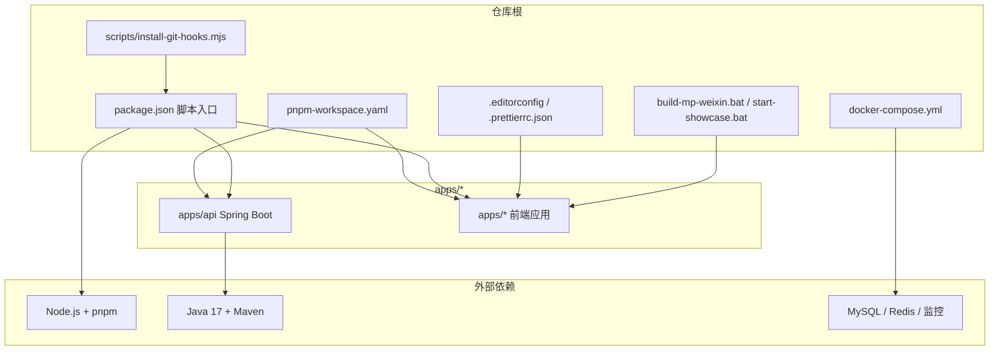
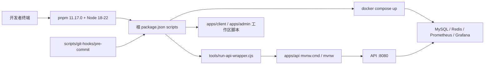
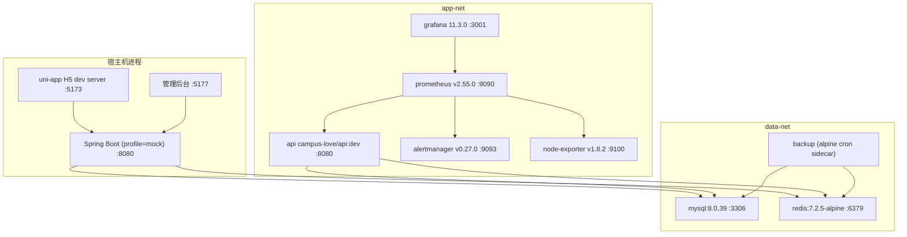
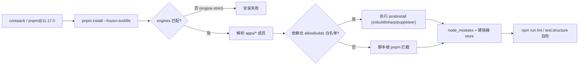
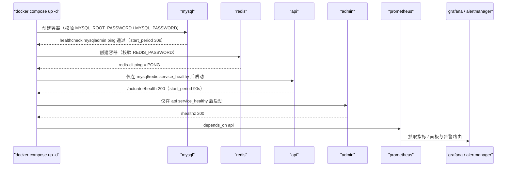
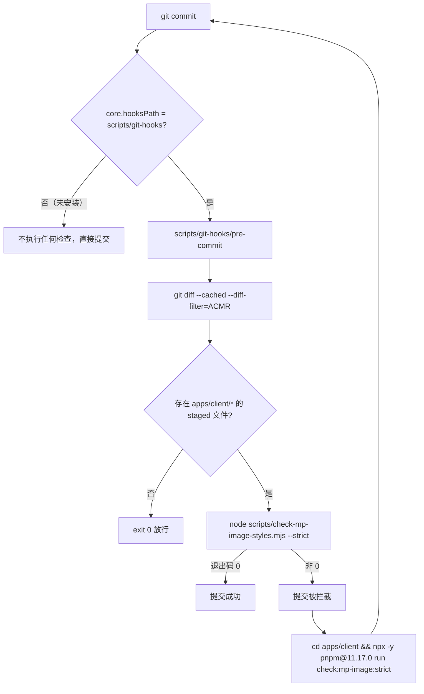
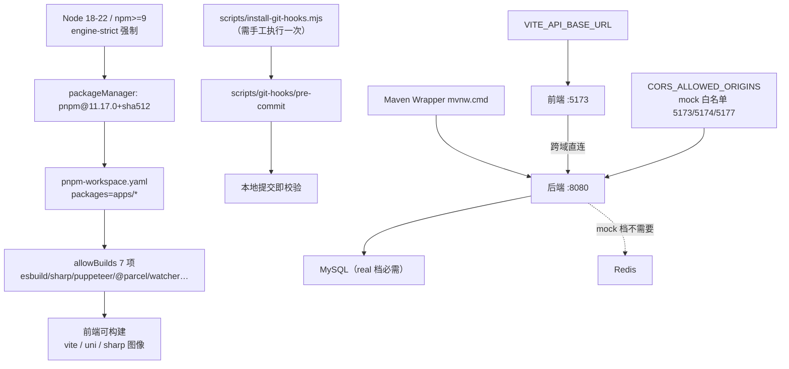

# 开发环境搭建

<cite>
**本文引用的文件**
- [package.json](file://package.json)
- [pnpm-workspace.yaml](file://pnpm-workspace.yaml)
- [.editorconfig](file://.editorconfig)
- [.prettierrc.json](file://.prettierrc.json)
- [scripts/install-git-hooks.mjs](file://scripts/install-git-hooks.mjs)
- [docker-compose.yml](file://docker-compose.yml)
- [tools/run-api-wrapper.cjs](file://tools/run-api-wrapper.cjs)
</cite>

## 目录
1. [简介](#简介)
2. [项目结构](#项目结构)
3. [核心组件](#核心组件)
4. [运行时依赖与版本要求](#运行时依赖与版本要求)
5. [架构总览](#架构总览)
6. [Monorepo 工作区初始化](#monorepo-工作区初始化)
7. [Docker Compose 基础设施编排](#docker-compose-基础设施编排)
8. [环境变量与密钥注入](#环境变量与密钥注入)
9. [Git Hooks 安装与 pre-commit 机制](#git-hooks-安装与-pre-commit-机制)
10. [代码风格与编辑器一致性配置](#代码风格与编辑器一致性配置)
11. [IDE 插件与调试配置](#ide-插件与调试配置)
12. [详细组件分析](#详细组件分析)
13. [本地启动与验收流程](#本地启动与验收流程)
14. [依赖关系分析](#依赖关系分析)
15. [性能考虑](#性能考虑)
16. [故障排查指南](#故障排查指南)
17. [仓库中缺失的能力登记](#仓库中缺失的能力登记)
18. [结论](#结论)

## 简介
本页面向 Campus Love（校园恋爱小程序）仓库的新入职开发者与运维协作者，给出从零开始把整个 Monorepo 跑起来所需的全部本地环境准备步骤：运行时依赖（Node.js、pnpm、Java 17、MySQL、Redis）的版本与安装要求、`pnpm-workspace.yaml` 声明的工作区初始化流程、根 `package.json` 中脚本的真实语义、`docker-compose.yml` 编排的基础设施服务与密钥注入契约、`scripts/install-git-hooks.mjs` 的钩子安装机制，以及 `.editorconfig` / `.prettierrc.json` 对编辑器与格式化行为的统一约束。

文档只描述仓库中确实存在的配置与脚本：所有结论均落到具体文件与行号；仓库里没有实现的能力（例如统一的 IDE 调试配置目录、`.env` 模板文件）在「仓库中缺失的能力登记」一节单独列出，不做推测性补全。

**章节来源**
- [package.json:1-48](file://package.json#L1-L48)
- [pnpm-workspace.yaml:1-13](file://pnpm-workspace.yaml#L1-L13)
- [docker-compose.yml:1-663](file://docker-compose.yml#L1-L663)

## 项目结构
仓库采用 pnpm workspace 组织的 Monorepo，`pnpm-workspace.yaml` 只声明了一个包目录集合 `apps/*`，即前端应用与后端 API 都以 workspace 成员的形式挂在 `apps/` 下；根 `package.json` 不承载业务代码，只提供跨包的脚本入口（开发、测试、静态检查、OpenAPI 生成与审计）与少量根级依赖。

与开发环境直接相关的根级位置如下：

| 位置 | 作用 |
| --- | --- |
| `package.json` | 根脚本入口、`engines` 版本约束、根级依赖（`puppeteer`、`sharp`） |
| `pnpm-workspace.yaml` | workspace 成员声明与构建脚本白名单（allowBuilds） |
| `docker-compose.yml` | MySQL、Redis、监控等本地基础设施服务编排 |
| `scripts/install-git-hooks.mjs` | Git 钩子安装脚本 |
| `.editorconfig`、`.prettierrc.json` | 跨编辑器的缩进、换行符（CRLF）与格式化基线 |
| `tools/run-api-wrapper.cjs` | 后端 API 启动包装脚本，被 `api:dev` / `api:test` 复用 |
| `build-mp-weixin.bat`、`start-showcase.bat` | Windows 下的小程序构建与演示启动批处理 |
| `apps/api` | Spring Boot 后端模块（Maven 构建，Java 源码在 `src/main/java`） |



**图表来源**
- [package.json:1-48](file://package.json#L1-L48)
- [pnpm-workspace.yaml:1-13](file://pnpm-workspace.yaml#L1-L13)

**章节来源**
- [package.json:1-48](file://package.json#L1-L48)
- [pnpm-workspace.yaml:1-13](file://pnpm-workspace.yaml#L1-L13)

## 核心组件
开发环境由六个相互独立的配置面组成，任何一个缺失都会导致本地无法完整跑通：

1. 包管理与工作区：根 `package.json` 声明 `packageManager: pnpm@11.17.0+sha512...`（L47）与 `engines`（`node >=18.0.0 <23.0.0`、`npm >=9.0.0`，L43-L46），`pnpm-workspace.yaml` 用 `packages: ["apps/*"]` 圈定成员，并通过 `allowBuilds` 白名单（L3-L10）放行 `@parcel/watcher`、`core-js`、`core-js-pure`、`esbuild`、`puppeteer`、`sharp`、`vue-demi` 七个含安装脚本的依赖，`overrides` 把 `@vitejs/plugin-vue` 固定为 `5.0.5`（L12-L13）。
2. 脚本入口：根 `scripts`（L9-L27）把后端启动、前端开发、OpenAPI 生成与校验、静态检查、测试、产物验证、性能审计分组编排，其中 `api:dev`、`api:test` 统一经 `tools/run-api-wrapper.cjs` 派发到 `apps/api` 的 Maven Wrapper。
3. 基础设施编排：`docker-compose.yml`（663 行）定义 MySQL、Redis、Grafana、Prometheus、Alertmanager、node-exporter、backup 等服务，并把宿主机端口与镜像标签参数化。
4. 配置注入契约：`.env.example`（216 行）按 14 个小节列出全部变量，并明确必填字段为 `MYSQL_ROOT_PASSWORD`、`MYSQL_PASSWORD`、`REDIS_PASSWORD`、`JWT_SECRET`、`GRAFANA_ADMIN_PASSWORD`（L21-L22）；`docker-compose.yml` 中相应密码字段以 `${VAR:?...}` 强制注入（L89、L92、L150）。
5. 提交前把关：`scripts/install-git-hooks.mjs`（96 行）通过 `git config core.hooksPath scripts/git-hooks` 把仓库内的 `pre-commit` 钩子接入，不依赖 husky/lint-staged（L5-L9）。
6. 编辑器一致性：`.editorconfig`（36 行）与 `.prettierrc.json`（35 行）共同规定 UTF-8、CRLF、2 空格缩进、100 列行宽。



**图表来源**
- [package.json:9-27](file://package.json#L9-L27)
- [tools/run-api-wrapper.cjs:11-23](file://tools/run-api-wrapper.cjs#L11-L23)
- [.env.example:136-144](file://.env.example#L136-L144)

**章节来源**
- [package.json:9-27](file://package.json#L9-L27)
- [package.json:39-47](file://package.json#L39-L47)
- [pnpm-workspace.yaml:1-13](file://pnpm-workspace.yaml#L1-L13)
- [tools/run-api-wrapper.cjs:1-27](file://tools/run-api-wrapper.cjs#L1-L27)
- [.env.example:16-23](file://.env.example#L16-L23)
- [scripts/install-git-hooks.mjs:1-16](file://scripts/install-git-hooks.mjs#L1-L16)
- [docker-compose.yml:89-92](file://docker-compose.yml#L89-L92)

## 运行时依赖与版本要求
本地开发需要两套互不相干的运行时：Node 侧（前端与工具链）与 JVM 侧（后端 API），再加由 Docker Desktop 提供的容器运行时。版本要求全部写在仓库里，不需要口头约定：

| 依赖 | 仓库中的约束 | 生效方式 |
| --- | --- | --- |
| Node.js | `engines.node: ">=18.0.0 <23.0.0"` | 根 `package.json` L44；CI 固定 `node-version: '20'`（`.github/workflows/ci.yml` L97） |
| npm | `engines.npm: ">=9.0.0"` | 根 `package.json` L45；`client:dev:h5` 等脚本用 `npm --workspace` 调用 |
| pnpm | `packageManager: "pnpm@11.17.0+sha512.cca3cea3..."` | 根 `package.json` L47；CI 用 `pnpm/action-setup@v3 version: 11.17.0`（ci.yml L91-L93）；pre-commit 提示语也写死 `pnpm@11.17.0`（`scripts/git-hooks/pre-commit` L45） |
| Java | `<java.version>17</java.version>` | `apps/api/pom.xml` L20 |
| Spring Boot | parent `spring-boot-starter-parent` `3.3.1` | `apps/api/pom.xml` L6-L11 |
| Maven | 由 Wrapper 提供（`mvnw` / `mvnw.cmd`） | `tools/run-api-wrapper.cjs` L13-L16 |
| MySQL | JDBC `jdbc:mysql://127.0.0.1:3306/campus_love?...serverTimezone=Asia/Shanghai`，驱动 `com.mysql:mysql-connector-j` | `.env.example` L42；`apps/api/pom.xml` L55-L59 |
| Redis | `spring-boot-starter-data-redis` + `redisson-spring-boot-starter 3.27.0`，`REDIS_HOST/PORT/PASSWORD/DATABASE` | `apps/api/pom.xml` L105-L116；`.env.example` L57-L72 |
| Docker | `docker compose` 编排（服务定义见下文） | `docker-compose.yml` |

`.npmrc` 里的两条开关把版本约束变成了硬闸：`save-exact=true` 让新依赖写入精确版本，`engine-strict=true` 使依赖的 `engines` 不匹配时直接拒绝安装（`.npmrc` L7-L8）。因此用 Node 23 或更低 Node 18 之前的版本执行安装会失败，而不是仅告警。

JVM 侧还有一处与 JDK 版本相关的显性配置：`pom.xml` 把 `mockito.version` 固定为 `5.10.0`、`byte-buddy.version` 固定为 `1.14.12`，注释说明旧版 Mockito 在 JDK 21 上无法初始化 `ByteBuddyInlineMockMaker`，会导致 586/790 测试报 Error（`apps/api/pom.xml` L21-L27）。也就是说，即便本机装的是 JDK 21，编译目标仍是 17，而测试依赖必须保持这两条版本才不炸。

后端启动的 profile 决定是否需要真实的 MySQL/Redis：`api:dev` 显式传入 `-Dspring-boot.run.profiles=mock`（根 `package.json` L10），走内存数据，不需要数据库即可联调前端；`.env.example` 也在小节标题上标注 `DB_*`、`REDIS_*` 为「real profile 必须配置」（L39、L57）。

**章节来源**
- [package.json:43-47](file://package.json#L43-L47)
- [package.json:9-11](file://package.json#L9-L11)
- [.npmrc:1-8](file://.npmrc#L1-L8)
- [apps/api/pom.xml:6-28](file://apps/api/pom.xml#L6-L28)
- [apps/api/pom.xml:51-59](file://apps/api/pom.xml#L51-L59)
- [apps/api/pom.xml:105-116](file://apps/api/pom.xml#L105-L116)
- [tools/run-api-wrapper.cjs:11-23](file://tools/run-api-wrapper.cjs#L11-L23)
- [.env.example:39-42](file://.env.example#L39-L42)
- [.env.example:57-72](file://.env.example#L57-L72)
- [.github/workflows/ci.yml:91-101](file://.github/workflows/ci.yml#L91-L101)
- [scripts/git-hooks/pre-commit:44-46](file://scripts/git-hooks/pre-commit#L44-L46)

## 架构总览
本地开发态由三层组成：宿主机的 Node/JVM 进程、Docker 容器内的数据与监控组件、以及两者之间的端口契约。`docker-compose.yml` 头部注释给出了官方的启动顺序与访问地址：`mysql/redis → api → admin/client → prometheus → grafana/alertmanager`，API 在 8080、Admin 在 5177、Client H5 在 5173、Grafana 在 3001、Prometheus 在 9090、Alertmanager 在 9093（`docker-compose.yml` L16-L28）。

编排层面还有两条影响本地联调的结构决策：网络按安全域拆成 `data-net`（mysql/redis/backup）与 `app-net`（其余服务），`api` 同时接入两个网络（L47-L48、L55-L61）；所有对外端口只绑定 `127.0.0.1`，数据库、Redis、监控都不暴露公网（L38-L40、L111、L160、L418、L467、L512、L555）。这意味着本机任何工具都可以直连这些端口，但同事无法从局域网访问你的数据库。



**图表来源**
- [docker-compose.yml:1-28](file://docker-compose.yml#L1-L28)
- [docker-compose.yml:54-61](file://docker-compose.yml#L54-L61)
- [docker-compose.yml:83-84](file://docker-compose.yml#L83-L84)
- [docker-compose.yml:144-145](file://docker-compose.yml#L144-L145)
- [docker-compose.yml:190-204](file://docker-compose.yml#L190-L204)
- [docker-compose.yml:399-400](file://docker-compose.yml#L399-L400)
- [docker-compose.yml:449-450](file://docker-compose.yml#L449-L450)
- [docker-compose.yml:499-500](file://docker-compose.yml#L499-L500)
- [docker-compose.yml:546-547](file://docker-compose.yml#L546-L547)
- [docker-compose.yml:585-586](file://docker-compose.yml#L585-L586)

宿主机侧的 `api:dev` 与容器侧的 `api` 服务是两条互斥路径：前者由 `tools/run-api-wrapper.cjs` 调用 `apps/api` 下的 Maven Wrapper，并显式带上 `-Dspring-boot.run.profiles=mock`（根 `package.json` L10），改代码即重启、不依赖数据库；后者镜像 `campus-love/api:${TAG:-dev}`，`SPRING_PROFILES_ACTIVE: real`，并以 `condition: service_healthy` 等待 mysql 与 redis（`docker-compose.yml` L190-L204）。本地要验证真实 SQL 与 Redis 行为时才需要起容器版。

**章节来源**
- [docker-compose.yml:1-50](file://docker-compose.yml#L1-L50)
- [docker-compose.yml:52-78](file://docker-compose.yml#L52-L78)
- [docker-compose.yml:109-111](file://docker-compose.yml#L109-L111)
- [docker-compose.yml:158-160](file://docker-compose.yml#L158-L160)
- [docker-compose.yml:190-214](file://docker-compose.yml#L190-L214)
- [package.json:9-13](file://package.json#L9-L13)
- [tools/run-api-wrapper.cjs:11-23](file://tools/run-api-wrapper.cjs#L11-L23)

## Monorepo 工作区初始化
工作区有两个互补的声明面：`pnpm-workspace.yaml` 决定哪些目录是 workspace 成员，根 `package.json` 的 `workspaces` 字段则服务于 `npm --workspace` 这条调用链。两者的成员集合是一致的（`apps/client`、`apps/admin`），但写法不同：

- `pnpm-workspace.yaml` L1-L2 用通配 `packages: ["apps/*"]`，因此 `apps/api`、`apps/admin-legacy`、`apps/archive` 目录同样落在通配范围内；
- 根 `package.json` L5-L8 显式枚举 `apps/client`、`apps/admin` 两个包。

安装步骤（Windows/Linux/macOS 相同）：

1. 启用 Corepack 或直接安装指定版本：包管理器版本由 `packageManager` 字段锁定为 `pnpm@11.17.0`（含 sha512 校验和），CI 用 `pnpm/action-setup@v3 version: 11.17.0` 达到同一效果（`.github/workflows/ci.yml` L91-L93）。
2. 在仓库根执行 `pnpm install --frozen-lockfile`。`--frozen-lockfile` 是与 `pnpm-lock.yaml` 对齐的关键开关，CI 的全部安装步骤都带它（ci.yml L100-L101）；本地首次拉取若省略该开关，pnpm 可能重写 lockfile。
3. 确认 Node 版本落在 `>=18.0.0 <23.0.0`。`.npmrc` 的 `engine-strict=true` 会让不匹配的安装直接失败（L8），`save-exact=true` 则保证后续新增依赖写入精确版本（L7）。
4. 允许构建脚本执行。`pnpm-workspace.yaml` 的 `allowBuilds` 白名单（L3-L10）放行了 `@parcel/watcher`、`core-js`、`core-js-pure`、`esbuild`、`puppeteer`、`sharp`、`vue-demi`；白名单外的依赖若带 postinstall 脚本会被 pnpm 拦下。根 `package.json` 的运行时依赖恰好是其中的两个大包 `puppeteer@~24.43.1`、`sharp@~0.34.5`（L39-L42），它们需要下载浏览器二进制与原生长到库，被拦时表现为「命令找不到 chromium」而非安装报错。
5. 版本归一。`overrides` 把 `@vitejs/plugin-vue` 强制为 `5.0.5`（L12-L13），覆盖成员包自己声明的 `~5.0.0`（`apps/client/package.json` L100）。

安装完成后可用三条命令自检，它们的真实语义写在根 `package.json` L15-L19：`npm run lint`（ESLint 覆盖 `apps/admin/src`、`apps/client/src`、`tools`、`eslint.config.mjs`）、`npm run test:structure`（`node tests/project-structure.spec.mjs`）、`npm run test:prototype`（`node tests/prototype-contract.spec.mjs`）。



**图表来源**
- [package.json:43-47](file://package.json#L43-L47)
- [pnpm-workspace.yaml:1-13](file://pnpm-workspace.yaml#L1-L13)
- [.npmrc:7-8](file://.npmrc#L7-L8)
- [.github/workflows/ci.yml:91-101](file://.github/workflows/ci.yml#L91-L101)
- [package.json:15-19](file://package.json#L15-L19)

**章节来源**
- [pnpm-workspace.yaml:1-13](file://pnpm-workspace.yaml#L1-L13)
- [package.json:1-19](file://package.json#L1-L19)
- [package.json:39-47](file://package.json#L39-L47)
- [.npmrc:1-8](file://.npmrc#L1-L8)
- [.github/workflows/ci.yml:91-101](file://.github/workflows/ci.yml#L91-L101)
- [apps/client/package.json:98-116](file://apps/client/package.json#L98-L116)

## Docker Compose 基础设施编排
`docker-compose.yml` 声明 11 个服务，其中 3 个挂在 profile 下、默认不启动。这一点直接决定「起了 compose 为什么看不到 9100/备份」这类疑问：

| 服务 | 镜像 | 宿主机端口（默认） | 默认启动 | 关键约束 |
| --- | --- | --- | --- | --- |
| `mysql` | `mysql:8.0.39` | `127.0.0.1:${MYSQL_PORT:-3306}` | 是 | `MYSQL_ROOT_PASSWORD`、`MYSQL_PASSWORD` 强制注入（L89、L92）；`utf8mb4` + `utf8mb4_0900_ai_ci`（L95-L97）；慢日志与 binlog 开启（L101-L108） |
| `redis` | `redis:7.2.5-alpine` | `127.0.0.1:${REDIS_PORT:-6379}` | 是 | `--requirepass ${REDIS_PASSWORD:?...}`（L150）、`maxmemory 256mb`、`appendonly yes`（L151-L154） |
| `api` | `campus-love/api:${TAG:-dev}`（本地 build `./apps/api`） | `127.0.0.1:${API_PORT:-8080}` | 是 | `SPRING_PROFILES_ACTIVE: real`（L203）；等 mysql/redis `service_healthy`（L197-L201）；healthcheck 打 `/actuator/health`（L274） |
| `admin` | `campus-love/admin:${TAG:-dev}` | `127.0.0.1:${ADMIN_PORT:-5177}` | 是 | 构建上下文是仓库根，因为 `apps/admin` 无独立 lockfile（L301-L305）；等 api 健康（L312-L314） |
| `client` | `nginx:1.27.3-alpine` | `127.0.0.1:${CLIENT_PORT:-5173}` | 否，profile `client-h5` | 直接托管宿主目录 `./apps/client/dist/build/h5`（L360），需先本地构建出 H5 产物 |
| `prometheus` | `prom/prometheus:v2.55.0` | `127.0.0.1:${PROMETHEUS_PORT:-9090}` | 是 | 配置来自 `./docker/prometheus/prometheus.yml` 与 `rules`（L421-L422）；`read_only: true` + `cap_drop ALL`（L440-L446） |
| `grafana` | `grafana/grafana:11.3.0` | `127.0.0.1:${GRAFANA_PORT:-3001}` | 是 | `GF_SECURITY_ADMIN_PASSWORD` 强制注入（L458）；面板与数据源由 `./docker/grafana/provisioning`、`dashboards` 供给（L470-L471） |
| `alertmanager` | `prom/alertmanager:v0.27.0` | `127.0.0.1:${ALERTMANAGER_PORT:-9093}` | 是 | 配置文件 `./docker/alertmanager/alertmanager.yml`（L515），该镜像无 envsubst，需手工替换通知渠道（`.env.example` L166-L169） |
| `node-exporter` | `prom/node-exporter:v1.8.2` | `127.0.0.1:${NODE_EXPORTER_PORT:-9100}` | 否，profile `monitoring` | `--path.rootfs=/host`，宿主根只读挂载（L551-L557） |
| `backup` | `alpine:3.19.4` | 不映射端口 | 否，profile `backup` | crontab 由 `BACKUP_CRON` 在启动命令里生成，以非 root 的 `backup` 用户运行 crond（L628-L634）；挂载 `./scripts/backup-mysql.sh` 与 `./backups`（L621-L622） |

启动流程与就绪门：



**图表来源**
- [docker-compose.yml:83-141](file://docker-compose.yml#L83-L141)
- [docker-compose.yml:144-187](file://docker-compose.yml#L144-L187)
- [docker-compose.yml:190-297](file://docker-compose.yml#L190-L297)
- [docker-compose.yml:300-345](file://docker-compose.yml#L300-L345)
- [docker-compose.yml:399-446](file://docker-compose.yml#L399-L446)
- [docker-compose.yml:449-539](file://docker-compose.yml#L449-L539)

常用命令（`version: "3.9"`，Compose V2 语法）：

- `docker compose up -d`：起默认服务；缺任一必填环境变量时 compose 在渲染阶段就报 `required variable X is missing`，不会创建半个栈。
- `docker compose --profile monitoring up -d`：追加 `node-exporter`。
- `docker compose --profile backup up -d`：追加备份 sidecar；`docker compose --profile client-h5 up -d`：追加 H5 静态预览。
- `docker compose ps`：查看 healthcheck 状态；`docker compose logs -f api`：看后端启动日志。
- `docker compose down`：停止但保留 `campus-mysql-data` 等命名卷；`docker compose down -v` 会连卷一起删，本地有联调数据时不要使用。卷名已在文件里固定为 `campus-*` 前缀（L63-L78）。

镜像标签同样受环境变量控制：`image: campus-love/api:${TAG:-dev}`（L194），`.env.example` 明确 `TAG` 默认 `dev`、生产必须注入 `ci-<sha>` 或 release tag（L192-L196）。本地只想跑基础设施、不想构建应用镜像时，可以只起两个数据服务：`docker compose up -d mysql redis`，然后用 `npm run api:dev` 在宿主机跑 mock 后端。

**章节来源**
- [docker-compose.yml:1-28](file://docker-compose.yml#L1-L28)
- [docker-compose.yml:52-78](file://docker-compose.yml#L52-L78)
- [docker-compose.yml:83-297](file://docker-compose.yml#L83-L297)
- [docker-compose.yml:300-396](file://docker-compose.yml#L300-L396)
- [docker-compose.yml:399-663](file://docker-compose.yml#L399-L663)
- [.env.example:136-144](file://.env.example#L136-L144)
- [.env.example:192-196](file://.env.example#L192-L196)

## 环境变量与密钥注入
`.env.example`（216 行）是唯一的环境变量清单，按 14 个小节组织：JWT、数据库、Redis、管理员初始化、微信小程序、Apple 登录、Agnes AI、CORS、RabbitMQ、应用运行时、Compose 端口映射、监控告警、告警通知渠道、上传校验、构建标签、Swagger/OpenAPI。使用方式是复制为 `.env` 后把 `<PLACEHOLDER>` 换成真实值，且模板头部就写明「切勿将含真实凭据的 `.env` 提交到版本控制系统」（`.env.example` L6-L14）。`.gitignore` 与之呼应：`.env` 被忽略、`!**/.env.example` 反向白名单放行模板（L24-L25）。

compose 的注入契约分三档，全部能在文件里逐条对上：

| 档位 | 写法 | 出现的变量 | 未设置时的行为 |
| --- | --- | --- | --- |
| 强制注入 | `${VAR:?message}` | `MYSQL_ROOT_PASSWORD`（L89、L600、L607）、`MYSQL_PASSWORD`（L92、L209）、`REDIS_PASSWORD`（L150、L157、L214、L614）、`JWT_SECRET`（L217）、`GRAFANA_ADMIN_PASSWORD`（L458） | `docker compose` 在渲染阶段直接失败，无弱默认值兜底 |
| 带默认值 | `${VAR:-default}` | `MYSQL_DATABASE`/`MYSQL_USER`（L90-L91）、`JWT_EXPIRATION_MS=86400000`（L218）、`CORS_ALLOWED_ORIGINS`（L225）、`BACKUP_RETENTION_DAYS=7`（L616）、`BACKUP_CRON=0 2 * * *`（L618）、各 `*_PORT` | 使用文件里的默认值 |
| 可选留空 | `${VAR:-}` | `WECHAT_APPID`/`WECHAT_SECRET`（L220-L221）、`AGNES_API_KEY`（L227）、`ADMIN_OPENID`（L233）、`ADMIN_INITIAL_PASSWORD_HASH`（L235）、`RABBITMQ_*`（L247-L250） | 空值；对应能力自动不可用 |

必填集合与 `.env.example` 的声明一致：`MYSQL_ROOT_PASSWORD / MYSQL_PASSWORD / REDIS_PASSWORD / JWT_SECRET / GRAFANA_ADMIN_PASSWORD`（L21-L22），同处还解释了 `RABBITMQ_USERNAME/PASSWORD` 为何例外——本编排未部署 MQ，应用在 MQ 不可用时自动降级，因此改为可选注入（L18-L19、L243-L246）。`JWT_SECRET` 有长度下限：compose 的报错文案直接写 `JWT_SECRET is required (>=48 chars)`（L217），模板侧则要求 HS256 至少 32 字符、建议 48 字符随机串（`.env.example` L33-L34）。

密钥生成有三条等价路径：`scripts/generate-secret.sh` 提供 `jwt`（`openssl rand -base64 48`）、`db`（`base64 32`）、`redis`（`base64 24`）、`admin_hash`（`python3 -c "import bcrypt; ..."`，明文默认 `ChangeMe123!`，依赖 `pip install bcrypt`）四个子命令（L4-L8、L12-L41）；`.env.example` 也内联了同样的 openssl / bcrypt 命令（L25-L29）；CI 侧用 gitleaks v8.18.4 以 `--config /repo/.gitleaks.toml --redact` 扫描仓库，防止真实凭据被提交（`.github/workflows/ci.yml` L69-L79）。

两个只影响本地体验的开关值得单独设置：

- `SWAGGER_UI_ENABLED`：compose 默认 `false`（L253），本地要打开 `/swagger-ui.html` 调试接口需在 `.env` 里覆盖为 `true`（`.env.example` L198-L202）。
- `CORS_ALLOWED_ORIGINS`：默认只含 `http://localhost:5173,http://localhost:5174,http://localhost:5177`（L225、`.env.example` L114）。在本机换端口跑前端（例如 vite 回落到 5175）时，浏览器会因跨源被拒，需要同步改这一项。

Windows 下还要注意：`docker compose` 读的是它自己进程的环境，PowerShell 里 `$env:MYSQL_PASSWORD="..."` 只对当前会话生效，与 `.env` 文件不是同一通道；两者同时存在时以 shell 环境优先，排查「.env 明明写了却仍报 missing」时要先看当前会话是否 export 了空值。

**章节来源**
- [.env.example:1-30](file://.env.example#L1-L30)
- [.env.example:32-72](file://.env.example#L32-L72)
- [.env.example:108-114](file://.env.example#L108-L114)
- [.env.example:136-163](file://.env.example#L136-L163)
- [.env.example:192-216](file://.env.example#L192-L216)
- [docker-compose.yml:87-92](file://docker-compose.yml#L87-L92)
- [docker-compose.yml:148-157](file://docker-compose.yml#L148-L157)
- [docker-compose.yml:202-268](file://docker-compose.yml#L202-L268)
- [docker-compose.yml:455-467](file://docker-compose.yml#L455-L467)
- [docker-compose.yml:595-619](file://docker-compose.yml#L595-L619)
- [scripts/generate-secret.sh:1-41](file://scripts/generate-secret.sh#L1-L41)
- [scripts/generate-secret.sh:44-62](file://scripts/generate-secret.sh#L44-L62)
- [.github/workflows/ci.yml:60-79](file://.github/workflows/ci.yml#L60-L79)

## Git Hooks 安装与 pre-commit 机制
钩子不靠 husky 或 lint-staged，而是把 git 的钩子目录直接指向仓库内文件：`install-git-hooks.mjs` 的设计说明明确写了「通过 `git config core.hooksPath scripts/git-hooks` 让 git 直接读仓库内 hooks」「不依赖 husky/lint-staged，避免 pnpm 装包风险」「跨平台 Windows/Linux/macOS」「可幂等多次执行」（`scripts/install-git-hooks.mjs` L5-L9）。因此 clone 之后钩子不会自动生效——根 `package.json` 的脚本表里没有 `prepare`/`postinstall` 之类的安装入口（L9-L27），需要手动执行一次：

- 安装：`node scripts/install-git-hooks.mjs`
- 卸载：`node scripts/install-git-hooks.mjs --uninstall`（L11-L15）

安装流程有四个可观测步骤，失败即 `exit 1`：

1. 校验 `scripts/git-hooks` 目录与其中的 `pre-commit` 文件存在（L59-L67），二者缺一直接 FAIL；
2. 对 `pre-commit` 强制补可执行位 `chmodSync(PRE_COMMIT, st.mode | 0o111)`，注释说明 Windows Git Bash 在 NTFS 上同样以元数据标记支持 `+x`；chmod 失败只降级为 WARN，不中断安装（L69-L77）；
3. 写入 `git config core.hooksPath scripts/git-hooks`（L79-L83）；
4. 回读校验 `core.hooksPath == scripts/git-hooks`，成功时打印触发条件与卸载方式，并声明「仅对 `apps/client/` 下的 staged 文件生效（作用域过滤）」（L85-L92）。

卸载分支会先 `git config --get core.hooksPath`，只有当前值包含 `scripts/git-hooks` 才执行 `--unset`，否则提示「无需卸载」，避免误删别人配置的钩子路径（L40-L52）。`gitCfg` / `gitCfgGet` 两个辅助函数用 `spawnSync("git", ...)` 且 `cwd` 固定在仓库根，因此从任意子目录执行脚本结果一致（L22-L38）。

`pre-commit` 本体是 bash 脚本，工作分三段：用 `git diff --cached --name-only --diff-filter=ACMR` 取 staged 文件，只保留 `apps/client/*` 前缀的项，集合为空就 `exit 0` 放行（L14-L24）；用 `git rev-parse --show-toplevel` 定位仓库根再 `cd "$CLIENT_DIR"`，目录不存在时 WARN 后放行（L26-L36）；最后执行 `node scripts/check-mp-image-styles.mjs --strict`，即 mp-weixin `<image>` 失效样式严格检查（L38-L40）。脚本头部注释解释了设计取舍：轻量零依赖、作用域过滤避免拖累 admin/api 提交、任一 lint 命中即 `exit 1` 中断 commit、前置检查约 1 秒可频繁触发、走系统 node 以兼容 `NODE_OPTIONS` shim 沙箱（L2-L9）。



**图表来源**
- [scripts/git-hooks/pre-commit:11-49](file://scripts/git-hooks/pre-commit#L11-L49)
- [scripts/install-git-hooks.mjs:79-92](file://scripts/install-git-hooks.mjs#L79-L92)
- [apps/client/package.json:36-37](file://apps/client/package.json#L36-L37)

一处实现细节值得知悉：pre-commit 在 L11 启用了 `set -euo pipefail`，而检查命令写在 L39、退出码判断写在 L40-L47。非零退出时 `set -e` 会让脚本在 L39 立刻终止，因此 L42-L47 打印修复指引的分支只在 `pipefail` 未触发的路径上可达；提交拦截本身不受影响（脚本退出码非零，git 拒绝提交）。要拿到明确提示，可以直接手动跑 `pnpm --filter @campus-love/client run check:mp-image:strict` 或 `cd apps/client && npx -y pnpm@11.17.0 run check:mp-image:strict`（后者是 pre-commit 里给出的命令，L45；对应脚本定义在 `apps/client/package.json` L37）。

绕过钩子的唯一正确做法是修问题，而不是 `--no-verify`；仓库层面还有 CI 兜底：`lint-and-structure` job 会跑 `npm run lint`、`npm run lint:openapi`、`npm run lint:openapi:spectral`、`npm run test:structure`（`.github/workflows/ci.yml` L103-L119），pre-commit 只覆盖 mp-image 样式这一项。

**章节来源**
- [scripts/install-git-hooks.mjs:1-96](file://scripts/install-git-hooks.mjs#L1-L96)
- [scripts/git-hooks/pre-commit:1-49](file://scripts/git-hooks/pre-commit#L1-L49)
- [package.json:9-27](file://package.json#L9-L27)
- [apps/client/package.json:34-39](file://apps/client/package.json#L34-L39)
- [.github/workflows/ci.yml:103-119](file://.github/workflows/ci.yml#L103-L119)

## 代码风格与编辑器一致性配置
风格基线由三份文件叠加，作用面不同：`.editorconfig` 管编辑器输入行为、`.prettierrc.json` 管格式化工具输出、`eslint.config.mjs` 管可执行静态检查。三者对同一件事的取值必须一致，当前是一致的：缩进 2 空格、行宽 100、换行符 CRLF。

`.editorconfig` 以 `root = true` 终止向上查找（L5），`[*]` 段规定 `charset = utf-8`、`end_of_line = crlf`（注释写明「Windows 风格，与项目现有文件一致」）、`insert_final_newline = true`、`trim_trailing_whitespace = true`、`indent_style = space` + `indent_size = 2`、`max_line_length = 100`（注释标注「与 Prettier printWidth 一致」）（L7-L20）。四类文件有例外：`*.{ts,tsx,js,jsx,mjs,cjs,vue,json,jsonc,json5,yml,yaml,html,css,scss,sass,less}` 显式重申 `indent_size = 2`（L22-L23）；`*.md` 关掉尾空格清理（双空格表示换行）并把行宽设为 `off`（L25-L28）；`Makefile` 必须 Tab（L30-L32）；`*.{bat,cmd,ps1}` 保留 CRLF（L34-L36）。

`.prettierrc.json` 的关键取值：`printWidth: 100`、`tabWidth: 2`、`useTabs: false`、`semi: false`、`singleQuote: true`、`trailingComma: "es5"`、`arrowParens: "always"`、`endOfLine: "crlf"`、`vueIndentScriptAndStyle: false`、`htmlWhitespaceSensitivity: "css"`（L3-L13），`overrides` 再对 `*.json*` 关掉尾逗号、对 `*.yml/yaml` 关闭单引号、对 `*.md` 改 `printWidth: 120` + `proseWrap: "preserve"`（L14-L33）。这里与 editorconfig 的唯一差异是 Markdown 行宽（100 vs 120），且 `.editorconfig` 对 `*.md` 已设 `max_line_length = off`，因此不冲突。

`eslint.config.mjs` 是 ESLint 9 flat config（L1-L2），链式启用 `js.configs.recommended`、`tseslint.configs.recommended`、`vuePlugin.configs['flat/recommended']`（L64-L70），全局忽略 `node_modules/**`、`dist/**`、`apps/client/unpackage/**`、`apps/api/target/**`、`apps/client/src/services/generated/**`、`**/*.generated.ts` 与 `pnpm-lock.yaml` 等（L42-L60）。`languageOptions` 声明 `ecmaVersion: 2022`、`sourceType: 'module'`、Vue `<script lang="ts">` 走 TS 解析器，并把 `uni`、`wx`、`UniApp`、`getApp`、`getCurrentPages`、`App`、`Page`、`Component` 等小程序/H5 全局注册为 readonly，避免误报未定义（L74-L98）。核心规则与产品代码诉求直接对应：`no-unused-vars` 交给 `@typescript-eslint/no-unused-vars` 且以 `^_` 前缀豁免（L105-L113）、`no-console` 为 error 但放行 `warn`/`error`（L118-L123）、`prefer-const`/`eqeqeq`/`no-debugger`/`no-alert`/`no-var`/`no-duplicate-imports` 为 error（L126-L149，其中 `no-alert` 的理由是「小程序不支持」L136-L137），Vue 侧关掉 `multi-word-component-names`、把 `no-v-html` 降为 warn（L152-L155）。三段作用域覆盖分别放宽测试文件（`**/*.spec.ts`、`**/*.test.ts`、`**/*.spec.mjs`、`**/tests/**` 允许 console 与 `any`，L160-L168）、配置文件（`*.config.ts|js|mjs`、`vite.config.*`、`vitest.config.*` 允许 console，L171-L176）与诊断脚本（`scripts/**`、`tools/**`、`tests/**`、根目录 `*.{cjs,js,mjs}` 改为 `sourceType: 'commonjs'`、注入 Node 全局、允许 console 与 `require`，L178-L199）——注释特别强调产品代码 `apps/admin/src`、`apps/client/src` 不在豁免范围内（L181）。

需要留意的现状是：根 `package.json` 的 `devDependencies`（L28-L38）与 `scripts`（L9-L27）都没有 `prettier` 依赖或 `format` 脚本，`apps/client/package.json` 的 devDependencies 与脚本表同样没有（L18-L54、L98-L111）；`.prettierrc.json` 因此只作为配置存在，实际格式化要靠编辑器的 Prettier 插件读取它，而不是仓库命令。`lint` 脚本的真实覆盖范围是 `eslint apps/admin/src apps/client/src tools eslint.config.mjs`（L15），既不含 `scripts/`，也不含 `tests/`——这两处由 ESLint 配置的作用域段描述，但不在根 lint 命令的路径参数里。

换行策略还有第四份文件参与：`.gitattributes` 明确写了**故意不加** `* text=auto`，理由是仓库数千文件的行尾已是既有状态，加了会在下一次触碰时触发全仓 CRLF/LF 重归一化、产出吞掉真实改动的巨型 diff，行尾策略维持由 `.editorconfig` / `.prettierrc` 管理（`.gitattributes` L7-L10）。该文件的实际内容只服务于 LFS 取证帧规则（L29-L49）。也就是说，clone 后文件行尾不会被 git 改写，本地务必让编辑器遵守 CRLF，否则 diff 会整文件变红。

**章节来源**
- [.editorconfig:1-36](file://.editorconfig#L1-L36)
- [.prettierrc.json:1-35](file://.prettierrc.json#L1-L35)
- [eslint.config.mjs:1-200](file://eslint.config.mjs#L1-L200)
- [package.json:9-27](file://package.json#L9-L27)
- [package.json:28-42](file://package.json#L28-L42)
- [apps/client/package.json:18-54](file://apps/client/package.json#L18-L54)
- [apps/client/package.json:98-111](file://apps/client/package.json#L98-L111)
- [.gitattributes:1-49](file://.gitattributes#L1-L49)

## IDE 插件与调试配置

仓库对 IDE 的交代只有一份文件，而且它不管编辑器的事。

`.vscode/settings.json` 全文 13 行，唯一内容是声明一个 MCP 服务器：`claude.mcpServers."computer-use"`，`type: "stdio"`，命令为 `cmd /c node D:\codex-tools\node-v22.17.0-win-x64\node_modules\computer-use-mcp\dist\main.js`（L2-L11）。也就是说它**没有任何 `editor.*`、`files.*`、`prettier.*` 或 `eslint.*` 键**，不承担缩进、行尾、格式化或校验行为的配置职责；同时那条绝对路径把另一台机器的工具安装位置写进了版本库——在新机器上该声明直接失效，需要自行改写或删除，但仓库里没有说明这一点。

因此 IDE 里的"看起来生效的规则"实际都来自仓库根的三份文件，且**都需要插件去读**：

| 规则来源 | 生效前提 | 无插件时的表现 |
| --- | --- | --- |
| `.editorconfig`（缩进 2、CRLF、尾换行、`max_line_length = 100`，`*.md` 关尾空格清理） | 编辑器启用 EditorConfig 支持 | 新文件按编辑器默认（常为 LF、4 空格）落盘，diff 整文件变红 |
| `.prettierrc.json`（`semi: false`、`singleQuote: true`、`endOfLine: "crlf"`） | 装 Prettier 插件 | 格式完全不变——因为根 `package.json` 既无 `prettier` 依赖也无 `format` 脚本，仓库命令不会替你格式化 |
| `eslint.config.mjs`（ESLint 9 flat config） | ESLint 扩展且使用工作区版本的 ESLint ≥ 9 | 用旧版 ESLint 6/7/8 默认 `eslintrc` 模式的扩展会完全读不到规则，表现为"没有报错"而不是"报错不同" |

flat config 这一点值得单独强调：`eslint.config.mjs` 是 ESLint 9 的入口格式（上一节已述其链式继承与三段作用域豁免）。仓库根的 `lint` 脚本走 `eslint apps/admin/src apps/client/src tools eslint.config.mjs`（`package.json` L15），命令行不受 IDE 影响；**但开发者在 IDE 里看到的告警可能与命令行不一致**，因为很多扩展默认解析 `.eslintrc.*`。判断方法是故意在产品代码里写一处 `console.log`：命令行 `npm run lint` 必然报 `no-console`（error），IDE 若不报，就是 IDE 没吃到这份 flat config。

调试侧仓库**没有任何启动配置**：没有 `.vscode/launch.json`、没有 `tasks.json`、没有 `extensions.json`（推荐插件清单）。可执行的调试路径只有两条：后端用 `mvnw spring-boot:run -Dspring-boot.run.profiles=mock`（`tools/start-api.bat` L21）或根脚本 `api:dev`（`package.json` L10，经 `tools/run-api-wrapper.cjs` 包一层），前端用 `client:dev:h5`（L12）。小程序端调试依赖微信开发者工具本身，而仓库里唯一涉及它的自动化脚本把可执行文件路径写死为 `D:\微信开发者\微信web开发者工具\微信开发者工具.exe`（`tools/screenshot-all.mjs` L39），所以"用仓库脚本调试小程序"隐含了本机安装在同一位置的前提。

Java 侧也没有版本管理文件（无 `.java-version`/无 Maven Toolchains 配置），运行时依赖靠 `pom.xml` 与 `mvnw` 包装器；Node 侧有 `engines`（`package.json` L44：`>=18.0.0 <23.0.0`；L45：`npm >=9.0.0`）但**没有 `.nvmrc`/`.tool-versions`**，因此版本约束只在安装或运行报错时才暴露。

**章节来源**
- [.vscode/settings.json:1-13](file://.vscode/settings.json#L1-L13)
- [package.json:10-15](file://package.json#L10-L15)
- [package.json:43-46](file://package.json#L43-L46)
- [tools/start-api.bat:21-21](file://tools/start-api.bat#L21-L21)
- [tools/screenshot-all.mjs:39-39](file://tools/screenshot-all.mjs#L39-L39)

## 详细组件分析

环境搭建由五个互相不替代的部件组成，缺任何一个的表现都不同，值得逐个拆开。

### 部件一：包管理器与工作区

根 `package.json` 同时给出三种约束，而且彼此并不完全一致：

- `engines.node: ">=18.0.0 <23.0.0"`、`engines.npm: ">=9.0.0"`（L43-L46）；
- `packageManager: "pnpm@11.17.0+sha512.cca3cea…"`（L47）——带 sha512 完整性校验，意味着 corepack 会校验下载内容，包管理器版本被钉死；
- `scripts` 里全部用 `npm run` 与 `npm --workspace`（L10-L23）。

`pnpm-workspace.yaml`（13 行）声明工作区只含 `packages: ["apps/*"]`（L1-L2），随后是 7 项 `allowBuilds` 白名单（`@parcel/watcher`、`core-js`、`core-js-pure`、`esbuild`、`puppeteer`、`sharp`、`vue-demi`，L3-L10）和一条 `overrides: { "@vitejs/plugin-vue": 5.0.5 }`（L12-L13）。这解释了安装期两类现象：**默认拒绝执行依赖的构建脚本**，只有白名单里列出的包（上表七个，正好覆盖 esbuild、sharp、puppeteer 这类需要下载二进制或打补丁的依赖）才允许构建；新增一个不在名单里的同类依赖时，安装会**成功但产物残缺**，要到运行期才暴露。另一条 `overrides` 意味着 `@vitejs/plugin-vue` 的版本由 workspace 强制统一，在单个 app 的 `package.json` 里改它不会生效。

### 部件二：Java 侧构建入口

后端一律经 Maven Wrapper（`mvnw.cmd`），根脚本不假设本机装了 Maven。两条真实入口是 `api:dev`（`package.json` L10）与 `api:test`（L11），二者都走 `tools/run-api-wrapper.cjs` 包装；`tools/start-api.bat` 则是"先 `package -DskipTests -q` 再 `spring-boot:run -P mock`"两步（L11、L21），并在编译返回码非 0 时打印「编译失败！」并 `exit /b 1`（L12-L16）。注意 `-q`：编译错误在该脚本里**不会逐条打印**，需要去掉 `-q` 重跑才能看到诊断。

### 部件三：客户端与后台应用

`apps/client/package.json` 的脚本表把平台差异写进了命令名：`dev:h5` 是 `node scripts/prepare-static.mjs --h5 && uni --platform h5`（L19），`dev:h5:real` 是 `uni --platform h5 --mode real`（L20），`dev:mp-weixin` 是 `node scripts/prepare-static.mjs --dev && uni --platform mp-weixin`（L23）。静态资源预处理（`prepare-static.mjs`）只出现在 H5/mock 小程序路径里，real 分支不带它——这决定了"直接跑 real 脚本"时静态资源可能未就绪。类型检查是 `vue-tsc --noEmit`（L33），E2E 入口在 L44-L46。

### 部件四：质量门禁的本地等价物

`verify:phase01`（`package.json` L23）串起 `test`、`lint:openapi`、`lint:openapi:spectral`、client `typecheck`、`verify:client-builds`、`api:test`，而 `test`（L21）= `test:prototype && test:structure && test:client`。CI 侧把这些拆成独立 job 并逐个设超时（`gitleaks-scan` 15 分钟、`lint-and-structure`/`client-typecheck-and-build`/`client-test`/`admin-typecheck-and-build`/`api-compile` 各 30 分钟、`api-test` 60 分钟，见 `.github/workflows/ci.yml` L60-L63、L84-L87、L124-L127、L155-L158、L180-L183、L208-L211、L228-L231），注释还说明 Maven 命令统一加 `-B` 以避免交互式阻塞（L27）。本地一次性复现全部前提就用 `npm run verify:phase01`。

### 部件五：钩子与基础设施

Git 钩子不是自动装的：仓库通过 `scripts/install-git-hooks.mjs` 安装，钩子脚本本体在 `scripts/git-hooks/pre-commit`。因此 clone 之后**必须显式执行一次安装**，否则提交绕过全部本地校验（详见「Git Hooks 安装与 pre-commit 机制」一节）。运行时基础设施由 `docker-compose.yml` 编排（MySQL/Redis/注册与监控栈等），本地起后端时若走 real 档才需要 MySQL/Redis，mock 档不依赖 Redis。

**章节来源**
- [package.json:10-23](file://package.json#L10-L23)
- [package.json:43-47](file://package.json#L43-L47)
- [pnpm-workspace.yaml:1-13](file://pnpm-workspace.yaml#L1-L13)
- [apps/client/package.json:19-46](file://apps/client/package.json#L19-L46)
- [tools/start-api.bat:11-21](file://tools/start-api.bat#L11-L21)
- [.github/workflows/ci.yml:27-27](file://.github/workflows/ci.yml#L27-L27)
- [.github/workflows/ci.yml:60-63](file://.github/workflows/ci.yml#L60-L63)
- [.github/workflows/ci.yml:228-231](file://.github/workflows/ci.yml#L228-L231)

## 本地启动与验收流程

下面这条顺序是按仓库实际入口拼出来的，每一步都写了"用什么命令"和"怎么算通过"。

### 第 0 步：版本与包管理器前提

- Node 必须在 `>=18.0.0 <23.0.0`、npm `>=9.0.0`（`package.json` L43-L46）。
- 根 `.npmrc` 设了 `engine-strict=true`（L8），所以版本不合规**不会只是警告，而是安装直接被拒**；注释在 L5-L6 把这个意图写明了。同文件 L7 的 `save-exact=true` 让后续 `npm install <pkg>` 写入精确版本号（不带 `^`/`~`）。
- `packageManager` 钉到 `pnpm@11.17.0+sha512.…`（L47）。带完整性哈希意味着 corepack 会校验取到的包管理器本体，版本漂移会直接失败。

### 第 1 步：安装依赖

锁文件有两份：根 `pnpm-lock.yaml` 与 `apps/client/pnpm-lock.yaml`；`apps/admin` 没有独立锁文件。工作区范围由 `pnpm-workspace.yaml` L2 的 `packages: ["apps/*"]` 决定。构建脚本白名单（L3-L10）必须先确认——esbuild、sharp、puppeteer、@parcel/watcher 都在名单里，因此它们的二进制能正常落地；名单外的同类依赖会"装成功但缺产物"。

### 第 2 步：安装 Git 钩子（易漏）

钩子不是 clone 自带的，需要执行 `node scripts/install-git-hooks.mjs`，钩子本体是 `scripts/git-hooks/pre-commit`。跳过这一步的后果是本地提交不经过任何校验，问题推迟到 CI 的 `lint-and-structure` 与 `gitleaks-scan` 才暴露。

### 第 3 步：起后端

| 档位 | 命令 | 通过判据 |
| --- | --- | --- |
| mock（默认） | `tools/start-api.bat`（先 `package -DskipTests -q` 再 `spring-boot:run -P mock`，L11、L21）或根脚本 `npm run api:dev`（L10，经 `tools/run-api-wrapper.cjs`） | 监听 8080；`tools/start-client.bat` L10 的提示语即以 8080 为前提 |
| real | 需注入 `DB_URL`/`DB_USERNAME`/`DB_PASSWORD`（`application-real.yml` L16-L18，账号密码默认空）与 `WEBSOCKET_ALLOWED_ORIGIN_PATTERNS`，且本机要有 MySQL 与 Redis | 启动阶段不抛 `IllegalStateException`；缺 DB 配置时由 `DatabaseConfigValidator` 在启动期拒绝（同文件 L10-L11 注释） |

后端在 mock 档不依赖 Redis（`application-real.yml` L41 说明由 `application-mock.yml` 覆盖）。

### 第 4 步：起前端

`npm run client:dev:h5`（L12）→ `apps/client` 的 `dev:h5` = `node scripts/prepare-static.mjs --h5 && uni --platform h5`（L19），H5 监听 5173。要接真实后端用 `npm run client:dev:h5:real`（L13）→ `uni --platform h5 --mode real`（L20）。小程序档为 `dev:mp-weixin`（L23）。

前端 API 地址由 `VITE_API_BASE_URL` 决定（`apps/client/.env.example` L25 与 `.env.development` 均为 `http://127.0.0.1:8080/api`），**不走 Vite 代理**，所以 mock 档的 CORS 白名单必须覆盖你的实际端口——`application-mock.yml` L35 只放了 5173/5174/5177 三个。

### 第 5 步：验收

按成本从低到高：

```
npm run lint               # ESLint flat config，范围= apps/admin/src apps/client/src tools
npm --workspace apps/client run typecheck   # vue-tsc --noEmit
npm run test               # test:prototype && test:structure && test:client
npm run verify:phase01     # 再加 OpenAPI lint + client build + api:test
npm --workspace apps/client run test:e2e    # Playwright，会自动拉起或复用 5173
```

`verify:phase01`（L23）是 CI 门禁的本地等价物；E2E 侧 `tests/e2e/playwright.config.ts` L73-L82 的 `webServer` 会尝试自启 dev server（`reuseExistingServer: true`，超时 180 秒），因此手工先起前端能省掉这段等待。

**章节来源**
- [package.json:10-23](file://package.json#L10-L23)
- [package.json:43-47](file://package.json#L43-L47)
- [.npmrc:5-8](file://.npmrc#L5-L8)
- [pnpm-workspace.yaml:1-13](file://pnpm-workspace.yaml#L1-L13)
- [apps/client/package.json:19-46](file://apps/client/package.json#L19-L46)
- [tools/start-api.bat:11-21](file://tools/start-api.bat#L11-L21)
- [tools/start-client.bat:10-13](file://tools/start-client.bat#L10-L13)
- [application-real.yml:10-18](file://apps/api/src/main/resources/application-real.yml#L10-L18)
- [application-mock.yml:35-35](file://apps/api/src/main/resources/application-mock.yml#L35-L35)
- [.env.example:25-25](file://apps/client/.env.example#L25-L25)
- [playwright.config.ts:73-82](file://tests/e2e/playwright.config.ts#L73-L82)

## 依赖关系分析

搭建过程里有五条真实的依赖边，每条都各有一个"看起来能跑但其实没接上"的失败模式。



**图表来源**
- [.npmrc:5-8](file://.npmrc#L5-L8)
- [package.json:43-47](file://package.json#L43-L47)
- [pnpm-workspace.yaml:1-10](file://pnpm-workspace.yaml#L1-L10)
- [application-real.yml:16-45](file://apps/api/src/main/resources/application-real.yml#L16-L45)
- [application-mock.yml:35-35](file://apps/api/src/main/resources/application-mock.yml#L35-L35)
- [apps/client/.env.example:25-25](file://apps/client/.env.example#L25-L25)

逐条说明其后果：

1. **`engine-strict` 把版本问题变成安装问题**。因为 `.npmrc` L8 是严格模式，Node 23 或 17 下 `install` 会直接失败，而不是"装上了但运行异常"。这条边解释了为什么换机器后第一件事应该是核对 `node -v` 而不是重装依赖。
2. **`packageManager` 与 `scripts` 用的是两套工具**。钉的是 pnpm（L47），脚本文用 `npm --workspace`（L12-L13、L23），而 Playwright 的 `webServer.command` 又用 `pnpm --filter`（`tests/e2e/playwright.config.ts` L74）。**只有 npm 没有 pnpm 的机器能跑单测与 lint，却跑不了 E2E 自启服务**；反之只有 pnpm 没装 corepack 时 `packageManager` 声明不会自动生效。
3. **`allowBuilds` 决定"装了但没产物"**。工作区名单只列了 7 个包（`pnpm-workspace.yaml` L3-L10），因此构建期需要下载二进制的依赖一旦不在名单里，失败点会推迟到运行时。
4. **钩子不是自动的**。`install-git-hooks.mjs` 必须显式执行一次，否则 `pre-commit` 不存在，本地没有任何前置校验。
5. **前端与后端之间是跨域直连**。这条边由 `VITE_API_BASE_URL` 与 CORS 白名单共同决定，没有代理层兜底，因此"后端活着但前端全红"是配置不同端口导致的，而不是服务异常。

**章节来源**
- [.npmrc:5-8](file://.npmrc#L5-L8)
- [package.json:12-23](file://package.json#L12-L23)
- [pnpm-workspace.yaml:3-10](file://pnpm-workspace.yaml#L3-L10)
- [playwright.config.ts:73-82](file://tests/e2e/playwright.config.ts#L73-L82)
- [scripts/install-git-hooks.mjs:1-96](file://scripts/install-git-hooks.mjs#L1-L96)

## 性能考虑

搭建阶段的成本主要花在**安装、首次构建与首次数据库迁移**三处，仓库对它们各有一个明确的取舍。

- **确定性优先于速度**。`save-exact=true` 与 `engine-strict=true`（`.npmrc` L7-L8）使安装结果可复现，代价是版本不合规时直接拒绝安装，而不是"装了再说"。对团队而言这把环境差异集中暴露在一次安装里，属于**用首次失败换后续稳定**。
- **预处理只覆盖部分构建路径**。`dev:h5` 与 `dev:mp-weixin` 前挂 `scripts/prepare-static.mjs`（`apps/client/package.json` L19、L23），real 分支（L20）没有这一步——real 档启动更快，但静态资源需自行保证就绪。
- **编译换启动速度**。`tools/start-api.bat` L11 用 `package -DskipTests -q`：跳过测试与静默输出显著加快"改一行代码重启"的循环，代价是编译错误不逐条打印（L12-L16 只有"编译失败！"）。诊断编译问题时必须去掉 `-q` 重跑。
- **构建目标按平台分叉**。`apps/client/vite.config.ts` L120-L127 为 mp-weixin 选 `es2018`（基础库不支持 `catch {}`）、为 H5 保留 ≥`es2020`（否则 `import.meta` 被错误转译导致入口失败）。es2018 意味着更多转译工作，小程序侧构建比 H5 慢是预期行为。
- **CI 用超时兜底而非提速**。每个 job 都配了 `timeout-minutes`：`gitleaks-scan` 15 分钟（L60-L63）、`lint-and-structure`/`client-typecheck-and-build`/`client-test`/`admin-typecheck-and-build`/`api-compile` 30 分钟（L84-L87、L124-L127、L155-L158、L180-L183、L208-L211）、`api-test` 60 分钟（L228-L231），注释另说明 Maven 统一加 `-B` 以避免交互式阻塞（L27）。也就是说 CI 的失败模式包含"卡住到超时"，本地复现时若某步远慢于预期，优先怀疑它进入了等待交互输入的状态。
- **首次数据库迁移是一次性大成本**。real 档 `flyway.enabled: true` 且扫描 `filesystem:../../database/flyway/sql`（`application-real.yml` L68-L75），全新库首启要执行整段迁移链；由于该路径相对 `apps/api` 解析，迁移慢与"找不到迁移"是两类不同问题，别混为一谈。
- **E2E 不做并行**。`fullyParallel: false` 且 `workers` 两端都为 1（`tests/e2e/playwright.config.ts` L38-L41），配合 `webServer.timeout` 180 秒与 `reuseExistingServer: true`（L73-L82）——用例时长线性增长是换取"单实例 dev server 不抢端口"的代价，先手工起服务能把冷启动从计时里去掉。

**章节来源**
- [.npmrc:7-8](file://.npmrc#L7-L8)
- [apps/client/package.json:19-23](file://apps/client/package.json#L19-L23)
- [vite.config.ts:120-127](file://apps/client/vite.config.ts#L120-L127)
- [tools/start-api.bat:11-16](file://tools/start-api.bat#L11-L16)
- [.github/workflows/ci.yml:27-27](file://.github/workflows/ci.yml#L27-L27)
- [.github/workflows/ci.yml:60-63](file://.github/workflows/ci.yml#L60-L63)
- [.github/workflows/ci.yml:228-231](file://.github/workflows/ci.yml#L228-L231)
- [application-real.yml:68-75](file://apps/api/src/main/resources/application-real.yml#L68-L75)
- [playwright.config.ts:38-41](file://tests/e2e/playwright.config.ts#L38-L41)

## 故障排查指南

搭建期的故障几乎都能用"命令 + 返回信息"定位，下表按出现频率排列。

| 症状 | 根因 | 最短验证 |
| --- | --- | --- |
| `EBADENGINE` / `Unsupported engine`，安装中止 | `.npmrc` L8 的 `engine-strict=true` 遇上 `engines.node: ">=18.0.0 <23.0.0"`（`package.json` L44） | `node -v` 落在 18–22 之间再重装 |
| 依赖装成功，运行时报 esbuild/sharp/puppeteer 相关缺失 | 该包不在 `pnpm-workspace.yaml` L3-L10 的 `allowBuilds` 名单里，构建脚本被拒 | 核对报错包名是否出现在那 7 项中 |
| 单测、lint 正常，E2E 报找不到 `pnpm` | 根脚本用 `npm --workspace`，而 Playwright 的 `webServer.command` 用 `pnpm --filter`（`tests/e2e/playwright.config.ts` L74） | 启用 corepack（`packageManager` 已钉版本，`package.json` L47），或先手工起 5173 让 `reuseExistingServer` 复用 |
| `npm --workspace apps/client` 报无此 workspace | 不在仓库根执行；工作区只声明 `packages: ["apps/*"]`（`pnpm-workspace.yaml` L2） | `cd` 到含根 `package.json` 的目录再跑 |
| 提交没有被任何校验拦住 | 没执行 `node scripts/install-git-hooks.mjs`，`scripts/git-hooks/pre-commit` 未落到 `.git/hooks` | 装钩子后故意提交一处 `console.log` 看是否被拦 |
| IDE 里零告警，但 `npm run lint` 报错 | ESLint 扩展没吃 `eslint.config.mjs`（flat config，ESLint 9 入口格式），或用了旧版 ESLint | 用命令行结论为准；检查扩展的 ESLint 版本来源 |
| `git diff` 整文件变红 | 仓库**故意不加** `* text=auto`（`.gitattributes` L7-L10），行尾由 `.editorconfig` 管（`end_of_line = crlf`），编辑器没遵守就会重写全文件行尾 | 让编辑器读取 EditorConfig；已改脏的文件用 `git checkout --` 还原 |
| 前端所有接口 403/CORS | `VITE_API_BASE_URL` 直连后端（无代理），而 mock 白名单只含 5173/5174/5177（`application-mock.yml` L35）；5173 被占时 Vite 会自动换端口 | 看实际端口是否在三者内；不在则设 `CORS_ALLOWED_ORIGINS` 或 `VITE_DEV_API_BASE_URL`（`apps/client/.env.example` L28-L31） |
| 后端"编译失败！"却看不到错误 | `start-api.bat` L11 的 `-q` 抑制了输出，L12-L16 只判返回码 | 手工执行不带 `-q` 的 `mvnw.cmd package -DskipTests` |
| 启动报找不到 Flyway 迁移目录 | `filesystem:../../database/flyway/sql` 相对进程工作目录（`apps/api`）解析（`application-real.yml` L70-L75） | 确认在 `apps/api` 下启动，或设 `APP_FLYWAY_LOCATIONS` 为绝对路径 |
| real 档启动即抛异常提到 Origin | real 环境必须显式配置 WebSocket 允许来源，未配置直接拒绝启动（`WebSocketConfig.java` L114-L120） | 设 `WEBSOCKET_ALLOWED_ORIGIN_PATTERNS`，或本地改用 mock |
| 小程序里图片全部不显示 | 微信基础库 3.x 起 `<image>` 拒绝 `http://`（`scripts/dev-https-proxy.mjs` L5-L8），需 8443 HTTPS 反代并勾选「不校验 TLS 证书」 | 起 `node scripts/dev-https-proxy.mjs` 后复测 |

**章节来源**
- [.npmrc:7-8](file://.npmrc#L7-L8)
- [package.json:44-47](file://package.json#L44-L47)
- [pnpm-workspace.yaml:2-10](file://pnpm-workspace.yaml#L2-L10)
- [playwright.config.ts:73-82](file://tests/e2e/playwright.config.ts#L73-L82)
- [scripts/install-git-hooks.mjs:1-96](file://scripts/install-git-hooks.mjs#L1-L96)
- [.gitattributes:7-10](file://.gitattributes#L7-L10)
- [application-mock.yml:35-35](file://apps/api/src/main/resources/application-mock.yml#L35-L35)
- [.env.example:28-31](file://apps/client/.env.example#L28-L31)
- [tools/start-api.bat:11-16](file://tools/start-api.bat#L11-L16)
- [application-real.yml:70-75](file://apps/api/src/main/resources/application-real.yml#L70-L75)
- [WebSocketConfig.java:114-120](file://apps/api/src/main/java/com/campuslove/api/config/WebSocketConfig.java#L114-L120)
- [dev-https-proxy.mjs:5-8](file://scripts/dev-https-proxy.mjs#L5-L8)

## 仓库中缺失的能力登记

catalog 的"环境搭建"叙事里有若干环节在本仓库**没有对应实现**。逐条登记，避免按不存在的机制配置环境：

| 缺失项 | 判定依据 | 实际替代做法 |
| --- | --- | --- |
| IDE 推荐插件清单 | `.vscode/` 目录只有 `settings.json` 一个文件，无 `extensions.json` | 靠本文与 `.editorconfig`/`eslint.config.mjs` 反推需要的插件 |
| 调试启动配置 | 同上，无 `launch.json`/`tasks.json` | 用命令行入口：`api:dev`（L10）、`client:dev:h5`（L12） |
| 编辑器行为设置 | `.vscode/settings.json` 全文 13 行，**无任何 `editor.*`/`prettier.*`/`eslint.*` 键**，唯一内容是 MCP 服务器声明（L2-L11） | 全部交给 `.editorconfig` + 插件 |
| 可移植的工具路径 | 同文件 L9 与 `tools/screenshot-all.mjs` L9、L39 都写死 `D:\…` 本机绝对路径 | 换机需自行改写 |
| Node 版本固定文件 | 根目录无 `.nvmrc`/`.tool-versions`（只有 `.npmrc`），Node 约束只存在于 `engines`（L44） | 由 `engine-strict` 在安装期兜底 |
| Java 版本固定文件 | 无 `.java-version`/Toolchains 配置，Java 侧只有 Maven Wrapper | 依 `pom.xml` 与 mvnw 报错判断 |
| 一键容器化开发环境 | 无 devcontainer 配置；`docker-compose.yml` 编排的是运行栈而非开发容器 | 手工起 MySQL/Redis，后端前端在本机跑 |
| 格式化命令 | 根 `package.json` 的 `devDependencies`（L28-L42）与 `scripts`（L9-L27）都无 `prettier` 依赖或 `format` 脚本 | 只能靠编辑器 Prettier 插件读 `.prettierrc.json` |
| 统一的环境自检（doctor/setup） | 根脚本无 `setup`/`doctor`/`preflight` 条目（L10-L26 逐条核对） | 按「本地启动与验收流程」第 0–2 步人工执行 |
| Admin 侧独立锁文件 | `apps/admin/` 下无 `pnpm-lock.yaml`/`package-lock.json`（根与 `apps/client` 各有） | Admin 依赖解析随根工作区 |
| `scripts/` 与 `tests/` 的 lint 覆盖 | `lint` 脚本路径参数只有 `apps/admin/src apps/client/src tools eslint.config.mjs`（L15） | 这两处需另行 `npx eslint <path>` |
| 自动化排障文档中的"官方版本" | 环境相关事实散落在 `README`、`.zcode/workflows/*.dwf.ts` 注释与脚本注释里，无单一入口 | 以配置文件的注释为准（本文即按此取证） |

一处边界声明：`scripts/install-git-hooks.mjs`（96 行）与 `scripts/git-hooks/pre-commit`（49 行）我只核对到"钩子需显式安装"这一层，未逐行验证钩子内部的检查项集合；`.github/workflows/ci.yml` 只核对了各 job 的 `timeout-minutes` 与开头注释段，未逐 job 验证步骤内容。

**章节来源**
- [.vscode/settings.json:1-13](file://.vscode/settings.json#L1-L13)
- [package.json:9-27](file://package.json#L9-L27)
- [package.json:28-42](file://package.json#L28-L42)
- [screenshot-all.mjs:9-10](file://tools/screenshot-all.mjs#L9-L10)
- [tools/start-client.bat:10-13](file://tools/start-client.bat#L10-L13)
- [scripts/install-git-hooks.mjs:1-96](file://scripts/install-git-hooks.mjs#L1-L96)

## 结论

本仓库的环境搭建有一个共同气质：**用配置文件提供确定性，把编排留给人**。

确定性这一侧做得相当扎实：`engine-strict` 让 Node 版本不合规直接在安装期失败（`.npmrc` L8 对 `package.json` L44），`packageManager` 带哈希钉住包管理器（L47），`allowBuilds` 白名单决定哪些依赖可以执行构建（`pnpm-workspace.yaml` L3-L10），`save-exact` 让新依赖写入精确版本，行尾策略由 `.editorconfig` 与"故意不加 `text=auto`"的 `.gitattributes` 共同固定，CI 每个 job 都有超时兜底。这些约束互相咬合，结果是：**一台干净机器按顺序执行，要么成功要么明确告诉你哪一步不合规**。

编排这一侧则完全靠文档与自觉：钩子要手工安装、`pnpm` 与 `npm` 两种入口并存（根脚本用 `npm --workspace`，E2E 用 `pnpm --filter`）、没有 `.nvmrc`、没有 devcontainer、没有 doctor 脚本、`.vscode/settings.json` 甚至不含任何编辑器设置而只是一条指向本机绝对路径的 MCP 声明。换句话说，**环境不会自我装配，也不会自我诊断**。

因此对新成员的建议顺序是：先满足硬约束（Node 版本、包管理器、`allowBuilds`），再补人工步骤（装钩子、核对 IDE 用的是同一份 flat config），最后按「本地启动与验收流程」逐层拉起并以 `npm run verify:phase01` 作为"我这台机器与 CI 等价"的判据。任何一步失败时，先回到配置文件里读注释——本仓库绝大多数环境规则的**理由**就写在那几行注释中，而不在外面。

**章节来源**
- [.npmrc:5-8](file://.npmrc#L5-L8)
- [package.json:10-23](file://package.json#L10-L23)
- [package.json:43-47](file://package.json#L43-L47)
- [pnpm-workspace.yaml:1-13](file://pnpm-workspace.yaml#L1-L13)
- [.vscode/settings.json:1-13](file://.vscode/settings.json#L1-L13)
- [.gitattributes:7-10](file://.gitattributes#L7-L10)
