# 后端集成测试（Spring Boot + JUnit）

<cite>
**本文引用的文件**
- [pom.xml](file://apps/api/pom.xml)
- [MockAllRepositoriesConfig.java](file://apps/api/src/test/java/com/campuslove/api/testdata/MockAllRepositoriesConfig.java)
- [AuthControllerLogoutTest.java](file://apps/api/src/test/java/com/campuslove/api/auth/AuthControllerLogoutTest.java)
- [AccountSecurityControllerTest.java](file://apps/api/src/test/java/com/campuslove/api/auth/AccountSecurityControllerTest.java)
- [RealAccountSecurityServiceTest.java](file://apps/api/src/test/java/com/campuslove/api/auth/RealAccountSecurityServiceTest.java)
- [RecommendationControllerTest.java](file://apps/api/src/test/java/com/campuslove/api/discover/RecommendationControllerTest.java)
- [RecommendationCacheManagerTest.java](file://apps/api/src/test/java/com/campuslove/api/discover/RecommendationCacheManagerTest.java)
- [TempChatControllerTest.java](file://apps/api/src/test/java/com/campuslove/api/chat/TempChatControllerTest.java)
- [JwtAuthenticationFilterTest.java](file://apps/api/src/test/java/com/campuslove/api/config/JwtAuthenticationFilterTest.java)
- [SecurityConfigTest.java](file://apps/api/src/test/java/com/campuslove/api/config/SecurityConfigTest.java)
- [CacheTest.java](file://apps/api/src/test/java/com/campuslove/api/config/CacheTest.java)
- [PhaseOneFlowApiTest.java](file://apps/api/src/test/java/com/campuslove/api/profile/PhaseOneFlowApiTest.java)
- [AdminPermissionTest.java](file://apps/api/src/test/java/com/campuslove/api/admin/AdminPermissionTest.java)
- [P0SecurityIntegrationTest.java](file://apps/api/src/test/java/com/campuslove/api/security/P0SecurityIntegrationTest.java)
- [P0SecurityFilterChainIntegrationTest.java](file://apps/api/src/test/java/com/campuslove/api/security/P0SecurityFilterChainIntegrationTest.java)
- [FlywayMigrationRepeatableTest.java](file://apps/api/src/test/java/com/campuslove/api/database/FlywayMigrationRepeatableTest.java)
- [RateLimitIntegrationTest.java](file://apps/api/src/test/java/com/campuslove/api/ratelimit/RateLimitIntegrationTest.java)
- [Task12ConcurrencyTest.java](file://apps/api/src/test/java/com/campuslove/api/vip/Task12ConcurrencyTest.java)
- [VipOrderRefundInitiationTest.java](file://apps/api/src/test/java/com/campuslove/api/vip/VipOrderRefundInitiationTest.java)
</cite>

## 目录
1. [简介](#简介)
2. [项目结构](#项目结构)
3. [核心组件](#核心组件)
4. [架构总览](#架构总览)
5. [测试注解与切片选型](#测试注解与切片选型)
6. [测试数据准备与 Repository Mock](#测试数据准备与-repository-mock)
7. [详细组件分析](#详细组件分析)
8. [安全测试实施](#安全测试实施)
9. [缓存与 Redis 集成测试](#缓存与-redis-集成测试)
10. [性能测试与并发压力](#性能测试与并发压力)
11. [能力缺口登记](#能力缺口登记)
12. [依赖关系分析](#依赖关系分析)
13. [性能考虑](#性能考虑)
14. [故障排查指南](#故障排查指南)
15. [结论](#结论)

## 简介
本页文档化 Campus Love 后端服务（`apps/api`，Maven 坐标 `com.campuslove:campus-love-api:0.1.0`）的集成测试体系：Spring Boot 3.3.1 测试框架的依赖装配、JUnit 5 测试类的组织结构、以 MockMvc 为核心的 HTTP 层断言方式，以及用 `MockAllRepositoriesConfig` 替换全部 Spring Data JPA Repository 的测试数据策略。

后端模块的构建描述符显式声明了测试相关的版本约束：Java 版本为 17（`java.version`），并把 `mockito.version` 固定在 `5.10.0`、`byte-buddy.version` 固定在 `1.14.12`。该选择不是常规的版本升级，而是针对 JDK 21 环境下 MockMaker 初始化失败的工程性修复——旧版 Mockito（3.x/4.x/5.2.0）与 byte-buddy 组合在 JDK 21 上无法初始化 `ByteBuddyInlineMockMaker`，会以 `Could not initialize plugin: interface org.mockito.plugins.MockMaker` 的形式让 586/790 个测试报 Error。理解这条约束是理解本仓库测试可运行性的前提。

本页只对仓库中存在代码证据的行为进行说明。对于 catalog 指令中提到但仓库内没有实现证据的能力（例如数据库级 `@DataJpaTest` 切片、嵌入式 Redis、JMeter/Gatling 压测脚本），在「能力缺口登记」一节逐条标注为「无接入证据」，不做推测性描述。

**章节来源**
- [pom.xml:6-28](file://apps/api/pom.xml#L6-L28)

## 项目结构
测试代码全部位于 `apps/api/src/test/java/com/campuslove/api/` 下，并按**被测特性的包名**镜像组织，而不是按测试类型（unit / integration）分组：

- `auth/` —— 登录、登出与账号安全相关测试（如 `AuthControllerLogoutTest`、`AccountSecurityControllerTest`、`RealAccountSecurityServiceTest`）。
- `discover/` —— 推荐链路测试（`RecommendationControllerTest`、`RecommendationRankerTest`、`RecommendationRankerFieldsTest`、`RecommendationRankerWhisperTest`、`RecommendationCacheManagerTest`）。
- `chat/` —— 临时聊天测试（`TempChatControllerTest`）。
- `config/` —— 过滤器与横切组件测试（`JwtAuthenticationFilterTest`）。
- `entity/` —— JPA 实体行为测试（`UserBasicProfileTest`）。
- `testdata/` —— 跨用例复用的测试基础设施，核心是 `MockAllRepositoriesConfig`。

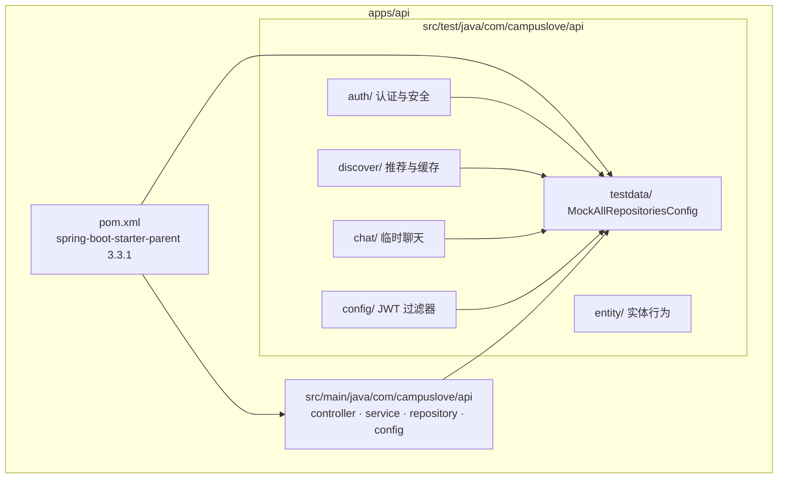

**图表来源**
- [pom.xml:1-32](file://apps/api/pom.xml#L1-L32)

## 核心组件
后端集成测试由四类构件组成：构建描述符中的测试依赖与插件、`testdata` 包下的上下文装配配置、按特性包镜像的测试类，以及被测的生产代码（Controller / Service / Filter / Repository 接口）。

### 测试依赖矩阵
`pom.xml` 中 `scope` 为 `test` 的依赖精确刻画了测试栈的能力边界：

| 依赖 | 版本来源 | 作用 |
| --- | --- | --- |
| `spring-boot-starter-test` | Spring Boot 3.3.1 BOM | 引入 JUnit 5、AssertJ、Hamcrest、Spring Test、MockMvc、Mockito 基线 |
| `mockito-core` | 覆写为 `${mockito.version}` = `5.10.0` | 提供 `@MockBean`/`@Mock` 与 inline mock maker；覆盖 BOM 中的 5.2.0 |
| `byte-buddy` | `${byte-buddy.version}` = `1.14.12`，`runtime` | Hibernate 代理与 Mockito 字节码增强的共同底座 |
| `byte-buddy-agent` | `1.14.12`，`test` | 动态 agent 注入，支撑 inline mock maker |
| `jna` / `jna-platform` | `5.14.0`，`test` | JDK 21 上 byte-buddy-agent self-attach 失败时的后备 attachment provider |
| `spring-security-test` | BOM | 提供 `@WithMockUser` 等安全测试注解 |

`spring-security-test` 的声明注释直接写明其用途是「提供 `@WithMockUser` 等测试注解，供 `SecurityConfigTest` 使用」，这为安全层测试提供了官方断言与身份注入能力。

值得注意的一处工程决定是 `byte-buddy` 的 scope：注释记录了实测教训——`hibernate-core` 6.5.2 把 byte-buddy 声明为 `runtime` 依赖，若测试侧把该依赖写成 `test` scope，会覆盖传递依赖的 scope，导致打包 jar 缺失 byte-buddy、运行时 `EntityManagerFactory` 初始化抛 `NoClassDefFoundError`。因此最终改为 `runtime`，同时满足测试与运行时。

**章节来源**
- [pom.xml:19-28](file://apps/api/pom.xml#L19-L28)
- [pom.xml:162-226](file://apps/api/pom.xml#L162-L226)
- [pom.xml:185-220](file://apps/api/pom.xml#L185-L220)

### 构建插件：Surefire 与 JaCoCo
`maven-surefire-plugin` 的 `argLine` 是测试能否在 JDK 21 上跑起来的关键配置：

```
@{argLine} --add-opens java.base/java.lang=ALL-UNNAMED
           --add-opens java.base/java.lang.reflect=ALL-UNNAMED
           --add-opens java.base/java.util=ALL-UNNAMED
           -XX:+EnableDynamicAgentLoading
```

- 三个 `--add-opens` 把 `java.base` 中的反射敏感包开放给未命名模块，否则 `ByteBuddyInlineMockMaker` 初始化会被模块系统拦截。
- `-XX:+EnableDynamicAgentLoading` 允许 byte-buddy 动态注入 agent。
- 前缀使用 `@{argLine}`（延迟绑定）而非 `${argLine}`，以便保留 JaCoCo `prepare-agent` 注入的 agent 参数，避免覆盖率统计被覆盖。

JaCoCo（`0.8.12`）以三个 execution 织入测试生命周期：`prepare-agent`（测试前注入）、`report`（`test` 阶段产出 HTML/XML/CSV）、`check`（`verify` 阶段门禁）。`destFile`/`dataFile` 显式指向 `${java.io.tmpdir}/jacoco-${project.artifactId}.exec`，原因是仓库根目录名含非 ASCII 字符时 JaCoCo agent 在 Windows 上无法在默认 `target/jacoco.exec` 创建文件、会静默失败导致覆盖率数据缺失。

`jacoco-check` 采用「基线锚定」阈值：`LINE ≥ 0.30`、`BRANCH ≥ 0.22`、`METHOD ≥ 0.32`、`CLASS ≥ 0.54`（`element=BUNDLE`，`value=COVEREDRATIO`）。注释说明原阈值 80/75/80/75 与实测基线（29.7%/21.8%/31.7%/53.8%）差距过大导致 `verify` 从未通过、CI 门禁形同虚设，因此下调到略低于基线的水平，使覆盖率回退会被真实拦截，再随补测逐步上调。

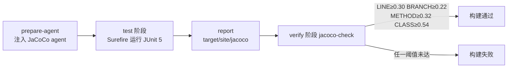

**图表来源**
- [pom.xml:229-246](file://apps/api/pom.xml#L229-L246)
- [pom.xml:285-374](file://apps/api/pom.xml#L285-L374)

**章节来源**
- [pom.xml:229-246](file://apps/api/pom.xml#L229-L246)
- [pom.xml:299-374](file://apps/api/pom.xml#L299-L374)

### 上下文装配配置：MockAllRepositoriesConfig
`testdata` 包中的 `MockAllRepositoriesConfig` 是唯一被 catalog 声明为依赖的测试基础设施类，它是一个 `@TestConfiguration`，以 `@MockBean` 字段形式集中声明了全部 JPA Repository 的 mock bean，覆盖 `UserRepository`、`PostRepository`、`TempChatSessionRepository`、`VipBillRepository` 等 60+ 个接口。它的类注释完整交代了存在理由与使用方式，详见「测试数据准备与 Repository Mock」一节。

**章节来源**
- [MockAllRepositoriesConfig.java:70-92](file://apps/api/src/test/java/com/campuslove/api/testdata/MockAllRepositoriesConfig.java#L70-L92)

## 架构总览
后端测试栈在结构上分为两条互不冲突的路径，选择依据是「是否需要 Spring 容器」：

1. **纯 Mockito 路径（不加载上下文）**：测试类直接 `new` 出被测 Controller，依赖用 `@Mock` 声明、由 `MockitoAnnotations.openMocks(this)` 在 `@BeforeEach` 中激活。`AuthControllerLogoutTest` 与 `TempChatControllerTest` 均属此类——后者注释明确「纯委托，完整覆盖 controller→service 的调用契约」。这条路径启动成本接近零，占当前可读到的 Controller 测试主体。
2. **SpringBootTest 路径（加载完整上下文）**：类注释在 `MockAllRepositoriesConfig` 中被明确点名为「为 mock profile 下的 `@SpringBootTest` 测试类集中提供所有 JPA Repository 的 `@MockBean`」，使用方式是 `@Import(MockAllRepositoriesConfig.class)`。这条路径存在的原因是：mock profile 下 `HibernateJpaAutoConfiguration` 被排除（`application-mock.yml`），JPA Repository 不会被 Spring Data JPA 注册为 bean，而完整上下文会实例化所有 Controller 并要求注入 Repository，从而抛出 `NoSuchBeanDefinitionException`。

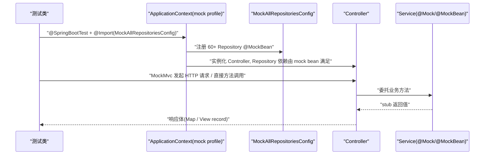

**图表来源**
- [MockAllRepositoriesConfig.java:70-92](file://apps/api/src/test/java/com/campuslove/api/testdata/MockAllRepositoriesConfig.java#L70-L92)
- [TempChatControllerTest.java:36-46](file://apps/api/src/test/java/com/campuslove/api/chat/TempChatControllerTest.java#L36-L46)

### 依赖替身层次
`AuthControllerLogoutTest` 的 `setUp()` 展示了一个值得记录的技巧：`AuthController` 的构造器在 infra R2-00026 之后改为 `ObjectProvider` 注入以兼容「mock 无 JPA」场景，测试因此不能直接传 `@Mock` 的 `UserRepository`，而是先构造一个 `DefaultListableBeanFactory`、`registerSingleton("userRepository", ...)`，再通过 `bf.getBeanProvider(UserRepository.class)` 得到 provider 传入；同时 security_review R2-LOW-01 为构造器增加了 `Environment` 参数（用于 mock 降级分支校验），测试用 `StandardEnvironment` 满足。

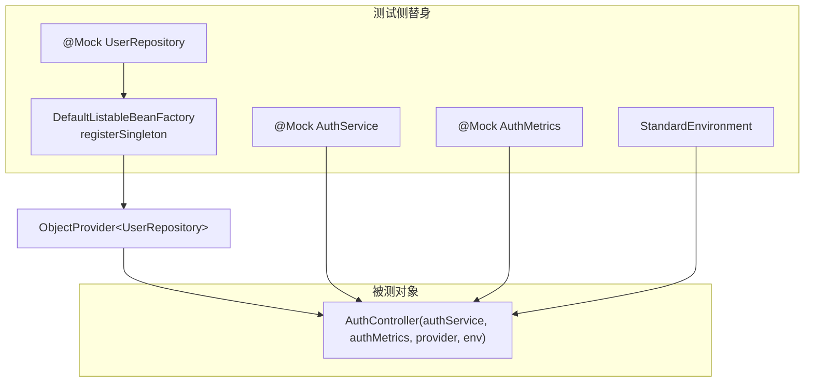

**图表来源**
- [AuthControllerLogoutTest.java:57-70](file://apps/api/src/test/java/com/campuslove/api/auth/AuthControllerLogoutTest.java#L57-L70)

**章节来源**
- [AuthControllerLogoutTest.java:32-39](file://apps/api/src/test/java/com/campuslove/api/auth/AuthControllerLogoutTest.java#L32-L39)
- [AuthControllerLogoutTest.java:57-70](file://apps/api/src/test/java/com/campuslove/api/auth/AuthControllerLogoutTest.java#L57-L70)
- [MockAllRepositoriesConfig.java:70-87](file://apps/api/src/test/java/com/campuslove/api/testdata/MockAllRepositoriesConfig.java#L70-L87)
- [TempChatControllerTest.java:18-35](file://apps/api/src/test/java/com/campuslove/api/chat/TempChatControllerTest.java#L18-L35)

## 测试注解与切片选型
### 实际使用的注解组合
对 `apps/api/src/test` 的注解扫描显示，集成层测试收敛为一种稳定的装配模板：

```java
@SpringBootTest(properties = "JWT_SECRET=test-jwt-secret-for-security-config-tests-32-chars-min")
@AutoConfigureMockMvc
@Import(MockAllRepositoriesConfig.class)
class SecurityConfigTest { ... }
```

| 测试类 | 装配注解 | 取证行 |
| --- | --- | --- |
| `config/SecurityConfigTest` | `@SpringBootTest(properties=...)` + `@AutoConfigureMockMvc` + `@Import(MockAllRepositoriesConfig.class)` | L42-L44 |
| `profile/PhaseOneFlowApiTest` | `@SpringBootTest(properties=...)` + `@AutoConfigureMockMvc` + `@Import(MockAllRepositoriesConfig.class)` | L34-L37 |
| `admin/AdminPermissionTest` | `@SpringBootTest(properties=...)` + `@AutoConfigureMockMvc` | L70-L71 |
| `security/P0SecurityFilterChainIntegrationTest` | `@SpringBootTest(properties=...)` + `@AutoConfigureMockMvc` | L48-L49 |
| `database/FlywayMigrationRepeatableTest` | `@SpringBootTest` + `@ActiveProfiles("mock")` | L33-L34 |

`JWT_SECRET` 通过 `properties =` 内联注入，且测试值一律是显式的 32 字符以上字符串（`...-32-chars-min`），对应 HS256 密钥长度下限要求；这种写法把「密钥来自环境变量」这一运行时约束在测试中就地替换，避免 CI 上因缺少环境变量而失败。

### mock profile 与上下文裁剪
`SecurityConfigTest` 的策略注释写明：使用 `@SpringBootTest` 默认激活 mock profile，加载 `MockSecurityConfig`（与 `SecurityConfig` 鉴权规则一致），通过 `@WithMockUser` 模拟不同角色；并且解释了「未登录 → 401」场景为何需要借 `@WithMockUser` 验证——因为 filter 检测到已存在认证时会跳过注入。

`FlywayMigrationRepeatableTest` 则显式声明 `@ActiveProfiles("mock")`，与 `MockAllRepositoriesConfig` 注释中「mock profile 下 `HibernateJpaAutoConfiguration` 被排除（参见 `application-mock.yml`）」的描述互为印证。

### 刻意不加载上下文的测试
仓库里存在一类反向选择：明确拒绝 `@SpringBootTest` 以规避外部依赖。

- `ratelimit/RateLimitIntegrationTest`：注释「不使用 @SpringBootTest 启动完整上下文，避免数据库/Redis/JWT 依赖」（L48）。
- `vip/Task12ConcurrencyTest`：注释「不使用 @SpringBootTest 启动完整上下文（避免数据库/Redis 依赖）」（L71）。
- `config/WebConfigTest`(L34)、`config/I18nTest`(L37)、`config/CacheTest`(L41)、`config/ResilienceTest`(L30) 均在类注释中记录同一顾虑：`@SpringBootTest` 全量加载应用上下文时，会触发其他控制器对 Repository 的需求。

`P0SecurityIntegrationTest` 还记录了一条 JUnit 5 与 Spring Boot Test 的组合坑：`@Nested` + `@SpringBootTest` + `@TestInstance(PER_CLASS)` 组合存在问题，最终拆分为顶层 `@SpringBootTest` + `@AutoConfigureMockMvc` 才正常（L115-L118），这也是 `P0SecurityFilterChainIntegrationTest` 作为独立顶层类存在的原因。

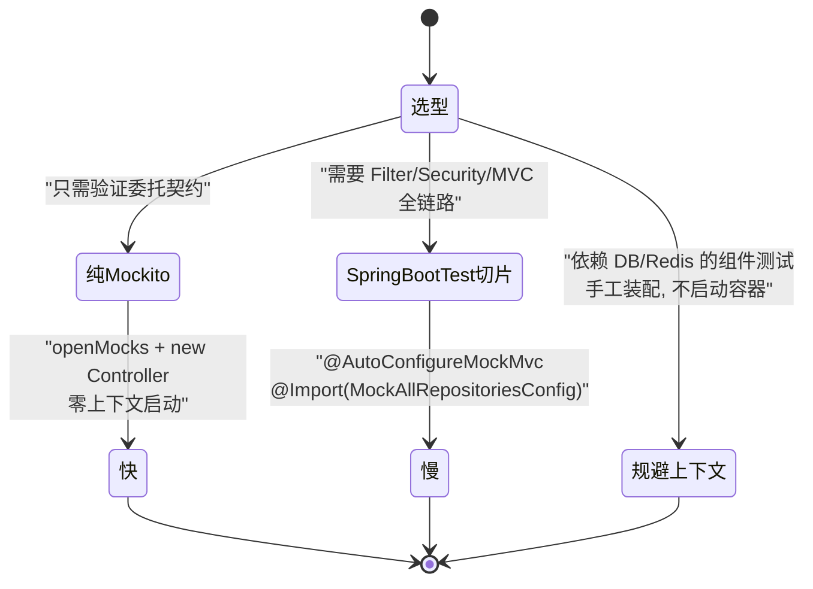

[此图为概念流程，不直接对应具体源文件，故不提供图表来源]

**章节来源**
- [SecurityConfigTest.java:30-44](file://apps/api/src/test/java/com/campuslove/api/config/SecurityConfigTest.java#L30-L44)
- [PhaseOneFlowApiTest.java:34-37](file://apps/api/src/test/java/com/campuslove/api/profile/PhaseOneFlowApiTest.java#L34-L37)
- [AdminPermissionTest.java:59-71](file://apps/api/src/test/java/com/campuslove/api/admin/AdminPermissionTest.java#L59-L71)
- [P0SecurityFilterChainIntegrationTest.java:23-49](file://apps/api/src/test/java/com/campuslove/api/security/P0SecurityFilterChainIntegrationTest.java#L23-L49)
- [FlywayMigrationRepeatableTest.java:33-34](file://apps/api/src/test/java/com/campuslove/api/database/FlywayMigrationRepeatableTest.java#L33-L34)
- [RateLimitIntegrationTest.java:48-48](file://apps/api/src/test/java/com/campuslove/api/ratelimit/RateLimitIntegrationTest.java#L48-L48)
- [MockAllRepositoriesConfig.java:71-84](file://apps/api/src/test/java/com/campuslove/api/testdata/MockAllRepositoriesConfig.java#L71-L84)

## 测试数据准备与 Repository Mock
### MockAllRepositoriesConfig 的定位与机制
`MockAllRepositoriesConfig` 承担测试数据策略中最基础的一层：**只满足依赖，不承载行为**。它是一个 `@TestConfiguration` 类，用 60+ 个 `@MockBean` 字段把 `com.campuslove.api.repository` 下的 Repository 接口全部注册为 mock bean（字段声明区间 L89-L152），类注释明确界定其语义：「mock Repository 仅用于满足 Bean 依赖，不参与业务逻辑测试」。

被 mock 的仓库按领域分组，可读到的代表项包括：

| 领域 | Repository mock 字段 |
| --- | --- |
| 用户与资料 | `userRepository`、`userCampusProfileRepository`、`userScheduleProfileRepository`、`userBasicProfileRepository`、`userFollowRepository`、`userOnlineStatusRepository`、`userSessionRepository` |
| 内容与互动 | `postRepository`、`postCategoryRepository`、`postLikeRepository`、`postShareRepository`、`postTagRepository`、`commentRepository`、`likeRepository` |
| 私聊与临时聊天 | `privateConversationRepository`、`privateMessageRepository`、`tempChatSessionRepository`、`tempChatMessageRepository`、`tempChatContactExchangeRepository` |
| 推荐 | `recommendationPreferenceRepository`、`recommendStrategyRepository`、`matchConfigEntityRepository` |
| 运营与配置 | `adminAppSwitchRepository`、`adminAppRuleRepository`、`adminAppConfigRepository`、`appLoginHeroConfigRepository`、`notifyConfigRepository`、`auditLogRepository` |
| 商业化 | `vipBillRepository`、`promoCodeRepository`、`promoCodeUsageRepository` |
| 通话 | `videoCallRepository`、`videoCallRecordRepository` |

清单会随业务下线而收缩：L143 的注释记录了 `VIP 红包已下线（2026-08-09 remove_red_packet）：VipRedPacketRepository/VipRedPacketClaimRepository 已删除，此处不再 mock`。这意味着新增 Repository 时必须同步补进该配置类，否则任何 `@Import(MockAllRepositoriesConfig.class)` 的 `@SpringBootTest` 会在上下文加载期报 `NoSuchBeanDefinitionException`。

### 为什么需要它：mock profile 下的 JPA 缺省
类注释给出的因果链是本页最重要的上下文：mock profile 下 `HibernateJpaAutoConfiguration` 被排除（参见 `application-mock.yml`），JPA Repository 不会被 Spring Data JPA 自动注册；而 `@SpringBootTest` 加载完整 `ApplicationContext` 时会实例化所有 Controller，每个 Controller 都要求注入自己的 Repository。`@Import(MockAllRepositoriesConfig.class)` 用一组 mock bean 补上这个缺口，从而让「不连数据库也能跑 API 集成测试」成立。

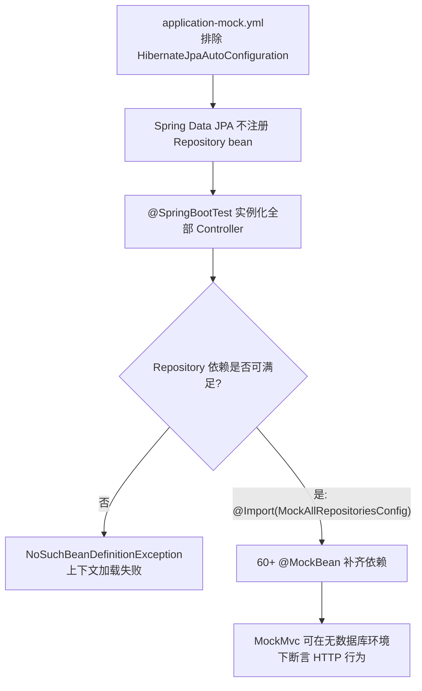

[此图为概念流程，不直接对应具体源文件，故不提供图表来源]

### 覆盖 mock 行为的代价
类注释同时给出警告：测试中如需对特定 Repository 行为 stub，可以在测试类里用 `@MockBean` 覆盖，「Spring Boot Test 会替换 context 中的 mock bean，但会触发 context reload，慎用」。这一条决定了本仓库的写法习惯——**行为 stub 优先落在 Service 层替身上**（见「详细组件分析」），而不是去覆盖 Repository mock。

### 测试数据的构造方式
本页读到的测试类不使用 SQL fixture、不使用 `@Sql` 脚本、不依赖数据库种子数据；测试对象一律以 Java 构造器就地拼装：

- `TempChatControllerTest.buildSessionView(id, personId)` 构造最小可用的 `TempChatSessionView` record（含 `ICE_BREAK` 阶段字符串与 `new ContactExchangeStateView(null, "NONE")`），供所有 stub 返回值复用。
- 同类中的 `ChatSessionSummaryView` 以 13 个位置参数直接构造，字段值包括 `"破冰期"`、`"2026-07-27T22:00:00"`、`"NONE"`、置顶布尔与未读计数。
- `RecommendationControllerTest.buildView()` 构造含 **37 个参数**的 `RecommendedPersonView`，注释解释：列表字段传空 `ArrayList`，且改用非空列表是为了让 `PrivacyFieldFilter.sanitize` 的白名单校验真正执行——「空列表会短路，白名单漂移在测试中不可见」。

这三处共同体现同一条纪律：测试数据是**可读的最小构造调用**，字段顺序即实体契约；一旦生产 record 增加字段，编译失败会立刻暴露，而不是留到运行时。

数据库层的初始化则由迁移体系而非测试承担：`database/FlywayMigrationRepeatableTest` 用 `@SpringBootTest` + `@ActiveProfiles("mock")` 组合校验可重复迁移，说明 Flyway 相关断言是独立测试类关注的对象，不掺入 Controller 层测试。

**章节来源**
- [MockAllRepositoriesConfig.java:70-88](file://apps/api/src/test/java/com/campuslove/api/testdata/MockAllRepositoriesConfig.java#L70-L88)
- [MockAllRepositoriesConfig.java:89-152](file://apps/api/src/test/java/com/campuslove/api/testdata/MockAllRepositoriesConfig.java#L89-L152)
- [MockAllRepositoriesConfig.java:143-152](file://apps/api/src/test/java/com/campuslove/api/testdata/MockAllRepositoriesConfig.java#L143-L152)
- [TempChatControllerTest.java:129-144](file://apps/api/src/test/java/com/campuslove/api/chat/TempChatControllerTest.java#L129-L144)
- [TempChatControllerTest.java:209-216](file://apps/api/src/test/java/com/campuslove/api/chat/TempChatControllerTest.java#L209-L216)
- [RecommendationControllerTest.java:122-144](file://apps/api/src/test/java/com/campuslove/api/discover/RecommendationControllerTest.java#L122-L144)
- [RecommendationControllerTest.java:168-182](file://apps/api/src/test/java/com/campuslove/api/discover/RecommendationControllerTest.java#L168-L182)
- [FlywayMigrationRepeatableTest.java:33-34](file://apps/api/src/test/java/com/campuslove/api/database/FlywayMigrationRepeatableTest.java#L33-L34)

## 详细组件分析
### 用户认证测试：AuthControllerLogoutTest
该类（240 行）覆盖 `AuthController#logout` 与 `AuthController#logoutAsAdmin`，其策略注释明确：「纯 Mockito，不加载 Spring 上下文。验证 AuthController 是否正确委托给 AuthService」。类级别声明三个 `@Mock`（`AuthService`、`AuthMetrics`、`UserRepository`）和一个裸 `AuthController` 字段。

八个场景与断言要点：

| # | 测试方法 | 输入 | 关键断言 |
| --- | --- | --- | --- |
| 1 | `logout_withValidBearerToken_shouldDelegateToAuthServiceAndReturnSuccess` | `"Bearer " + TEST_TOKEN` | `verify(authService).logout(TEST_TOKEN)`；返回 `success=true` |
| 2 | `logout_withNoAuthHeader_shouldDelegateNullAndReturnSuccess` | `null` | `verify(authService).logout(null)`；仍 `success=true` |
| 3 | `logout_withMalformedAuthHeader_shouldDelegateNullAndReturnSuccess` | `"Basic dXNlcjpwYXNz"` | `doNothing().when(authService).logout(null)`；`success=true` |
| 4 | `logoutAsAdmin_withValidBearerToken_shouldDelegateToAuthServiceAndReturnSuccess` | `"Bearer " + TEST_TOKEN` | `verify(authService).logoutAsAdmin(TEST_TOKEN)` |
| 5 | `logout_whenAuthServiceThrowsException_shouldPropagateException` | `doThrow(new RuntimeException("Redis unavailable"))` | `assertThrows` + `assertEquals("Redis unavailable", thrown.getMessage())` |
| 6 | `logout_shouldReturnMapWithOnlySuccessField` | `"Bearer " + TEST_TOKEN` | `assertEquals(1, result.size())`、`containsKey("success")` |
| 7 | `logout_withBearerButEmptyToken_shouldDelegateEmptyString` | `"Bearer "` | `verify(authService).logout("")`（`substring(7)` 结果为空串） |
| 8 | `logout_multipleCalls_shouldAlwaysDelegateToAuthService` | 连续 3 次调用 | `verify(authService, times(3)).logout(TEST_TOKEN)` |

场景 2 与 3 的设计意图被注释直述：登出接口对未携带 token 的请求保持幂等，「避免攻击者通过未携带 token 触发 401 来探测接口存在性」。场景 5 则确立 Controller 层不吞异常，交由 `GlobalExceptionHandler` 统一转换为标准化 JSON 错误体。场景 6 的理由是「验证返回值结构与历史契约一致，避免前端因字段变化而解析失败」——这是一条以测试固化 API 响应结构的实践。

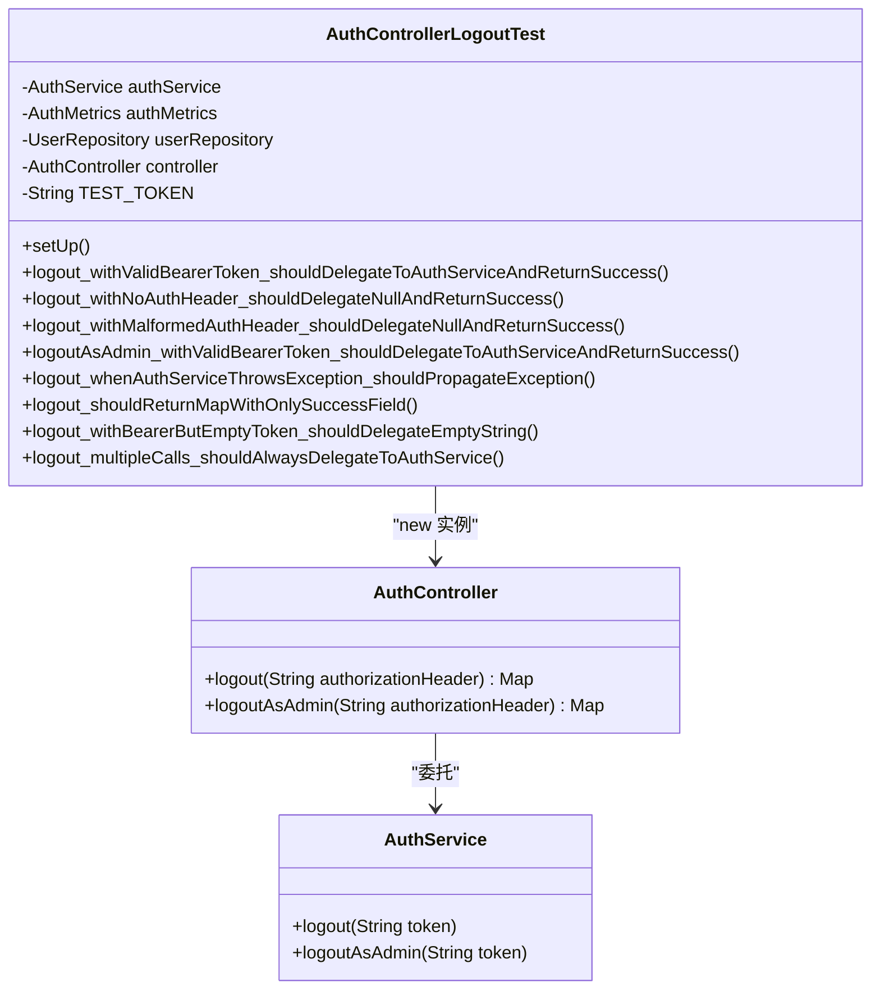

**图表来源**
- [AuthControllerLogoutTest.java:41-70](file://apps/api/src/test/java/com/campuslove/api/auth/AuthControllerLogoutTest.java#L41-L70)
- [AuthControllerLogoutTest.java:85-198](file://apps/api/src/test/java/com/campuslove/api/auth/AuthControllerLogoutTest.java#L85-L198)

**章节来源**
- [AuthControllerLogoutTest.java:19-40](file://apps/api/src/test/java/com/campuslove/api/auth/AuthControllerLogoutTest.java#L19-L40)
- [AuthControllerLogoutTest.java:57-70](file://apps/api/src/test/java/com/campuslove/api/auth/AuthControllerLogoutTest.java#L57-L70)
- [AuthControllerLogoutTest.java:85-239](file://apps/api/src/test/java/com/campuslove/api/auth/AuthControllerLogoutTest.java#L85-L239)

### 推荐算法测试：RecommendationControllerTest
该类（182 行）以 `@Mock RecommendationService` + `new RecommendationController(recommendationService)` 装配，覆盖 `getDiscussions`、`getActivities`、`getPreferences`、`updatePreferences` 与构造器注入。

两个值得注意的技术点：

1. **静态方法打桩**。`SecurityUtils.getCurrentUserId()` / `isAuthenticated()` 是静态入口，测试用 `try (var mocked = Mockito.mockStatic(SecurityUtils.class))` 的作用域式打桩：`mocked.when(SecurityUtils::getCurrentUserId).thenReturn(42L)`。注释标记其变更来源为 `infra R2-00202`（`getPreferences` 改为按当前用户返回真实偏好）与 `infra R2-00203`（`updatePreferences` 改为调用带 userId 的保存逻辑）。try-with-resources 保证静态 mock 在测试结束后自动还原，避免污染其他用例。
2. **免登录可逛的分支互斥断言**。2026-08-09 引入游客推荐分支后，两个用例分别把 `isAuthenticated` 置为 `false` / `true`，除断言正向委托（`getRecommendationsForGuest(emptyFilter)` / `getRecommendations(42L, emptyFilter)`）外，还用 `verify(recommendationService, Mockito.never())` 断言**另一条分支不得被调用**：匿名场景不得走用户个性化分支，已认证场景不得走游客分支。这类「互斥 never 断言」是防止鉴权策略回退的有效手段（注释原话：不抛 401）。

`RecommendationFilter` 在测试中以 10 个位置参数手工构造为「空筛选器」（全 `null` 与两个 `Set.of()`），用于精确匹配 service 侧的入参；调用 `controller.getRecommendations(...)` 时传入 13 个 `null`，覆盖全部筛选参数缺省路径。

推荐链路的其余测试类按职责分层存在：`RecommendationRankerTest`（138 行，持有 `RecommendationRanker ranker` 字段）、`RecommendationRankerFieldsTest`（225 行）、`RecommendationRankerWhisperTest`（55 行）、`RecommendationCacheManagerTest`（153 行，持有 `RecommendationCacheManager cacheManager`）。它们与 Controller 测试共同构成「控制器委托 + 排序器算法 + 缓存管理」三层验证结构。

**章节来源**
- [RecommendationControllerTest.java:18-40](file://apps/api/src/test/java/com/campuslove/api/discover/RecommendationControllerTest.java#L18-L40)
- [RecommendationControllerTest.java:73-110](file://apps/api/src/test/java/com/campuslove/api/discover/RecommendationControllerTest.java#L73-L110)
- [RecommendationControllerTest.java:118-166](file://apps/api/src/test/java/com/campuslove/api/discover/RecommendationControllerTest.java#L118-L166)
- [RecommendationControllerTest.java:168-182](file://apps/api/src/test/java/com/campuslove/api/discover/RecommendationControllerTest.java#L168-L182)

### 临时聊天测试：TempChatControllerTest
该类（216 行）覆盖 `TempChatController` 的完整委托面：`createSession`、`getSession`、`sendMessage`、`respondToContactExchange`、`endSession`、`pinSession`、`unpinSession`、`markSessionRead`、`recallMessage`，并额外验证 `null recommendedPersonId` 的创建场景。

统一的 Arrange-Act-Assert 三段式与「返回值同一性」断言是其特征：`when(...)` 之后 `assertSame(view, result)`，再 `verify(tempChatService).xxx(...)`。`assertSame` 而非 `assertEquals` 的选择，把契约固化为「Controller 必须原样透传 service 返回的对象，不得包装或复制」。

参数匹配器的组合使用覆盖了可选参数语义：`eq("person-1"), eq("match-1"), isNull()` 精确锁定第三个参数为 null；`eq("session-3"), any(ChatMessageRequest.class)` 用于对象入参；`verify(tempChatService).recallMessage(eq("session-9"), eq("msg-1"))` 则要求会话 id 与消息 id 同时正确传递。类注释还说明 `TempChatController` 不依赖 `SecurityUtils`，因此该类不需要静态 mock——与推荐测试形成对照。

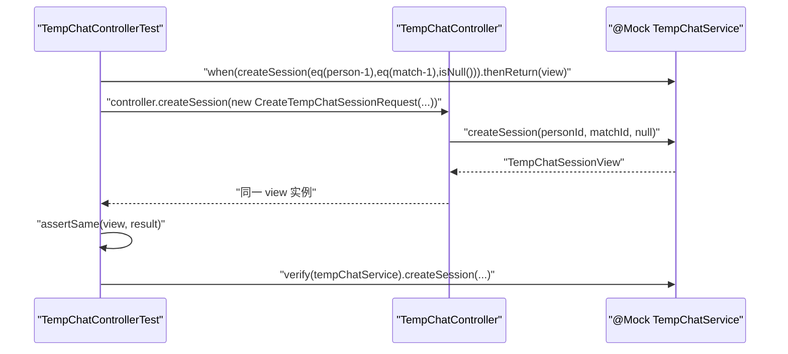

**图表来源**
- [TempChatControllerTest.java:54-67](file://apps/api/src/test/java/com/campuslove/api/chat/TempChatControllerTest.java#L54-L67)
- [TempChatControllerTest.java:194-216](file://apps/api/src/test/java/com/campuslove/api/chat/TempChatControllerTest.java#L194-L216)

**章节来源**
- [TempChatControllerTest.java:18-46](file://apps/api/src/test/java/com/campuslove/api/chat/TempChatControllerTest.java#L18-L46)
- [TempChatControllerTest.java:48-192](file://apps/api/src/test/java/com/campuslove/api/chat/TempChatControllerTest.java#L48-L192)

### RESTful API 测试：MockMvc 与响应断言
需要区分的是：本页详细展开的三个测试类**不做 HTTP 层模拟**，它们是 Controller 的纯 Java 单元测试。HTTP 请求模拟由另一组类承担，其装配特征为 `@SpringBootTest(properties = "JWT_SECRET=...")` + `@AutoConfigureMockMvc`（必要时叠加 `@Import(MockAllRepositoriesConfig.class)`），可读到该组合的位置包括：

- `config/SecurityConfigTest` L42-L44
- `profile/PhaseOneFlowApiTest` L34-L37
- `admin/AdminPermissionTest` L70-L71（内部注释：「8 个 Admin Controller 的权限测试（@SpringBootTest + MockMvc）」）
- `security/P0SecurityFilterChainIntegrationTest` L48-L49

这些用例的断言对象是状态码与权限结果，可读到注释中给出的期望值：`@WithMockUser(roles = "USER")` 访问 `/api/admin/users` → `403`；`@WithMockUser(roles = "ADMIN")` 访问同一路径 → 「非 401/403」。

在本页未展开读取的类中，若需按仓库既有风格补齐响应体结构断言，应当沿用「Controller 返回 Map/record → 断言字段集合」这一已在 `AuthControllerLogoutTest` 场景 6 中固化的写法，而不是引入新的断言范式。

**章节来源**
- [AdminPermissionTest.java:59-71](file://apps/api/src/test/java/com/campuslove/api/admin/AdminPermissionTest.java#L59-L71)
- [SecurityConfigTest.java:30-44](file://apps/api/src/test/java/com/campuslove/api/config/SecurityConfigTest.java#L30-L44)
- [P0SecurityFilterChainIntegrationTest.java:23-49](file://apps/api/src/test/java/com/campuslove/api/security/P0SecurityFilterChainIntegrationTest.java#L23-L49)
- [PhaseOneFlowApiTest.java:34-37](file://apps/api/src/test/java/com/campuslove/api/profile/PhaseOneFlowApiTest.java#L34-L37)
- [AuthControllerLogoutTest.java:184-198](file://apps/api/src/test/java/com/campuslove/api/auth/AuthControllerLogoutTest.java#L184-L198)

### 断言与验证词汇表
从本页读到的测试代码可归纳出实际使用的断言集合：

| 手段 | 出处 | 语义目的 |
| --- | --- | --- |
| `assertEquals(Boolean.TRUE, result.get("success"), msg)` | `AuthControllerLogoutTest` L97、L115 | 响应字段值 |
| `assertEquals(1, result.size(), msg)` | `AuthControllerLogoutTest` L195 | 响应结构不可扩张 |
| `assertNotNull` / `assertTrue(containsKey)` | `AuthControllerLogoutTest` L96、L196 | 空值与 key 存在性 |
| `assertThrows(RuntimeException.class, () -> ...)` | `AuthControllerLogoutTest` L178-L181 | 异常传播，且二次断言 message |
| `assertSame(view, result)` | `TempChatControllerTest` L65、`RecommendationControllerTest` L53 | 引用同一性（禁止包装） |
| `verify(mock).method(args)` / `verify(mock, times(3))` | `AuthControllerLogoutTest` L238 | 调用次数与参数 |
| `verify(mock, Mockito.never())` | `RecommendationControllerTest` L141、L164 | 分支互斥 |
| `doThrow(...)` / `doNothing()` | `AuthControllerLogoutTest` L130、L175 | void 方法的行为与异常桩 |
| `Mockito.mockStatic(...)` try-with-resources | `RecommendationControllerTest` L77、L96、L130、L153 | 静态安全上下文打桩 |

**章节来源**
- [AuthControllerLogoutTest.java:91-198](file://apps/api/src/test/java/com/campuslove/api/auth/AuthControllerLogoutTest.java#L91-L198)
- [TempChatControllerTest.java:54-192](file://apps/api/src/test/java/com/campuslove/api/chat/TempChatControllerTest.java#L54-L192)
- [RecommendationControllerTest.java:42-166](file://apps/api/src/test/java/com/campuslove/api/discover/RecommendationControllerTest.java#L42-L166)

## 安全测试实施
安全层测试在本仓库分为三档：**过滤器单测**、**服务层真实实现测试**、**权限与授权集成测试**。

### JWT 认证过滤器测试
`config/JwtAuthenticationFilterTest`（349 行）是规模最大的安全测试类。其字段声明（L50-L70）刻画了被测组件的完整协作面：

| 字段 | 类型 | 测试角色 |
| --- | --- | --- |
| `jwtTokenProvider` | `JwtTokenProvider` | 令牌签发与解析 |
| `userRepository` | `UserRepository` | 令牌主体到用户的解析 |
| `tokenBlacklistService` | `TokenBlacklistService` | 登出黑名单校验（Redis 侧实现） |
| `request` | `HttpServletRequest` | 被 mock 的请求，用于注入 `Authorization` 头 |
| `response` | `HttpServletResponse` | 断言 401/403 等写出行为 |
| `filterChain` | `FilterChain` | 验证请求是否被放行到链上下游 |
| `filter` | `JwtAuthenticationFilter` | 被测对象 |

`HttpServletRequest`/`HttpServletResponse`/`FilterChain` 全部以 mock 注入，使过滤器测试无需 Web 容器即可覆盖「携带无效令牌 → 不进入 `filterChain`」这类判定；这正是 `pom.xml` 中「`IdempotentInterceptorTest` / `TraceIdFilterTest` 中 mock `HttpServletRequest` 等 final 类或其方法依赖 `ByteBuddyInlineMockMaker`」注释所解释的 Mockito 5 默认 inline mock maker 能力的应用场景。

### 权限控制与敏感接口保护
`security/P0SecurityFilterChainIntegrationTest`（顶层类，装配见 L48-L49）用 `@WithMockUser` 做授权矩阵验证，注释中可读到具体期望：`@WithMockUser(roles = "USER")` 访问 `/api/admin/users` → `403`，`@WithMockUser(roles = "ADMIN")` 访问同一路径 → 非 `401/403`；其中 `@WithMockUser(roles = "USER")` 出现在 L228、L239、L250、L261、L327，`roles = "ADMIN"` 出现在 L272、L289。

`admin/AdminPermissionTest` 以「8 个 Admin Controller 的权限测试（`@SpringBootTest` + MockMvc）」为组织目标（L59），使用 `@WithMockUser(roles = "USER")` 覆盖 L373-L429 的 8 个用例（每个后台控制器一个），再用 `@WithMockUser(roles = "ADMIN")` 覆盖 L440-L532 的 8 个放行用例，形成「同一批端点、两种角色、两类期望」的对称结构。

`config/SecurityConfigTest`（L42-L44）针对鉴权规则本身：默认激活 mock profile、加载 `MockSecurityConfig`（与生产 `SecurityConfig` 鉴权规则一致），并通过 `@WithMockUser(roles = "USER")`（L86）与 `@WithMockUser(roles = "ADMIN")`（L99）区分角色；其 L117 的注释特别指出「不使用 `@WithMockUser`」的例外场景，原因是该注解注入的 principal 是 Spring Security 自身的类型，与业务代码期望的主体结构不同。

### 账号安全服务与控制器
- `auth/AccountSecurityControllerTest`（102 行，被测字段 `AccountSecurityController controller` 在 L27）把账号安全端点收敛为 Controller 层契约测试。
- `auth/RealAccountSecurityServiceTest`（223 行）是**真实实现**的服务层测试：字段清单（L39-L45）为 `UserRepository`、`PasswordEncoder`、`DeviceSessionService`、`TokenBlacklistService`、`JwtTokenProvider`、`AesEncryptor`、被测 `RealAccountSecurityService service`。`PasswordEncoder` + `AesEncryptor` 同时出现，说明该类的断言覆盖密码校验与敏感字段加解密两条路径；`DeviceSessionService` + `TokenBlacklistService` 则覆盖设备会话与令牌失效。类名前缀 `Real` 与 `mock` profile 下的替身实现形成对照，表明仓库通过「双实现 + 分别测试」隔离了外部依赖。
- 令牌失效入口由 `AuthControllerLogoutTest` 的注释串联：「登出接口是触发 Redis Token 黑名单写入的入口。本测试通过 mock `AuthService` 验证 Controller 层正确委托，详细的黑名单写入逻辑由 `RealAuthServiceTest` 与 `RedisTokenBlacklistServiceTest` 覆盖」（L37-L39）。

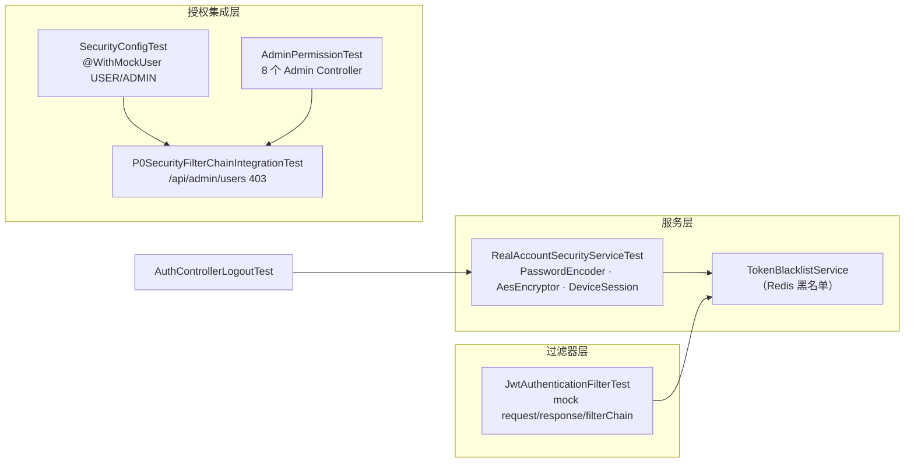

**图表来源**
- [JwtAuthenticationFilterTest.java:50-70](file://apps/api/src/test/java/com/campuslove/api/config/JwtAuthenticationFilterTest.java#L50-L70)
- [RealAccountSecurityServiceTest.java:37-45](file://apps/api/src/test/java/com/campuslove/api/auth/RealAccountSecurityServiceTest.java#L37-L45)
- [AuthControllerLogoutTest.java:32-40](file://apps/api/src/test/java/com/campuslove/api/auth/AuthControllerLogoutTest.java#L32-L40)
- [P0SecurityFilterChainIntegrationTest.java:23-49](file://apps/api/src/test/java/com/campuslove/api/security/P0SecurityFilterChainIntegrationTest.java#L23-L49)
- [AdminPermissionTest.java:59-71](file://apps/api/src/test/java/com/campuslove/api/admin/AdminPermissionTest.java#L59-L71)
- [SecurityConfigTest.java:30-44](file://apps/api/src/test/java/com/campuslove/api/config/SecurityConfigTest.java#L30-L44)

**章节来源**
- [JwtAuthenticationFilterTest.java:50-70](file://apps/api/src/test/java/com/campuslove/api/config/JwtAuthenticationFilterTest.java#L50-L70)
- [RealAccountSecurityServiceTest.java:37-45](file://apps/api/src/test/java/com/campuslove/api/auth/RealAccountSecurityServiceTest.java#L37-L45)
- [AccountSecurityControllerTest.java:22-27](file://apps/api/src/test/java/com/campuslove/api/auth/AccountSecurityControllerTest.java#L22-L27)
- [AuthControllerLogoutTest.java:19-40](file://apps/api/src/test/java/com/campuslove/api/auth/AuthControllerLogoutTest.java#L19-L40)
- [SecurityConfigTest.java:86-117](file://apps/api/src/test/java/com/campuslove/api/config/SecurityConfigTest.java#L86-L117)
- [pom.xml:172-226](file://apps/api/pom.xml#L172-L226)

## 缓存与 Redis 集成测试
### 生产侧的缓存/Redis 依赖面
`pom.xml` 的依赖注释把 Redis 定位为四类用途：「分布式缓存、Token 黑名单持久化、限流计数、分布式锁」（L105-L109，`spring-boot-starter-data-redis`）。与之配套的还有：

- `redisson-spring-boot-starter` 3.27.0：分布式锁实现，注释指明用于 `Task 12.2 AutoRenewService` 续费流程加锁防并发多扣，基于 Redis 的可重入锁 `RLock`，支持锁自动续期与宕机释放（L110-L116）。
- `commons-pool2`：Redis 连接池（L142-L146）。
- `bucket4j-core` 8.10.1：基于令牌桶算法的 API 速率限制（L126-L131）。
- `caffeine`：**本地 L1 缓存**，注释直接把它与测试关联起来——「Task 2.3.1：作为 Redis 不可用时的降级方案，及单元测试环境下的轻量级 CacheManager。与 Spring Cache 抽象配合，通过 `CaffeCacheManager` 在 test/dev profile 下提供缓存能力」（L147-L153）。

这条 Caffeine 记录解释了本仓库 Redis 测试策略的根因：**测试不启动真实 Redis**，而在 test/dev profile 下用本地缓存实现同一套 Spring Cache 抽象，因此缓存行为的断言可以在无外部中间件的条件下完成。

### 缓存管理的专项测试
`discover/RecommendationCacheManagerTest`（153 行）是被测组件 `RecommendationCacheManager`（字段声明在 L42）的专属测试类，与推荐排序器测试（`RecommendationRankerTest`、`RecommendationRankerFieldsTest`、`RecommendationRankerWhisperTest`）分开组织，构成「算法可测、缓存可测」的解耦结构：缓存失效与命中不依赖真实 Redis，因而可在 `mvn test` 内稳定复现。

`config/CacheTest` 的类注释（L41 附近）与 `WebConfigTest`、`I18nTest`、`ResilienceTest` 记录了同一约束：`@SpringBootTest` 全量加载应用上下文时，会触发其他控制器对 Repository 的需求，因而这些配置层测试倾向于窄装配而非全量容器。

### 显式规避外部中间件的集成测试
两处注释把「不连 Redis/DB」写成了设计前提：

- `ratelimit/RateLimitIntegrationTest` L48：「不使用 `@SpringBootTest` 启动完整上下文，避免数据库/Redis/JWT 依赖」。
- `vip/Task12ConcurrencyTest` L71：「不使用 `@SpringBootTest` 启动完整上下文（避免数据库/Redis 依赖）」。

这说明限流与并发扣减这两类原本最依赖 Redis 的能力，被改造为以手工装配的替身对象验证，Redisson/Redis 的真实行为留给运行环境验证。

### 事务管理
数据访问层的事务语义由 `spring-boot-starter-jdbc` 与 `spring-boot-starter-data-jpa` 提供（`pom.xml` L39-L46）。测试侧可读到的一条显式事务约定来自 `vip/VipOrderRefundInitiationTest` L37：「（事务回滚由 `@Transactional` 保证，单测断言不写库 + 异常上抛）」——即以测试方法级事务回滚替代清库脚本，保证「断言不落库、异常必须上抛」两点。除此之外，本页读取范围内没有发现面向真实数据库写入的事务集成测试。

**章节来源**
- [pom.xml:39-46](file://apps/api/pom.xml#L39-L46)
- [pom.xml:105-153](file://apps/api/pom.xml#L105-L153)
- [RecommendationCacheManagerTest.java:36-42](file://apps/api/src/test/java/com/campuslove/api/discover/RecommendationCacheManagerTest.java#L36-L42)
- [CacheTest.java:41-41](file://apps/api/src/test/java/com/campuslove/api/config/CacheTest.java#L41-L41)
- [RateLimitIntegrationTest.java:48-48](file://apps/api/src/test/java/com/campuslove/api/ratelimit/RateLimitIntegrationTest.java#L48-L48)
- [Task12ConcurrencyTest.java:71-71](file://apps/api/src/test/java/com/campuslove/api/vip/Task12ConcurrencyTest.java#L71-L71)
- [VipOrderRefundInitiationTest.java:37-37](file://apps/api/src/test/java/com/campuslove/api/vip/VipOrderRefundInitiationTest.java#L37-L37)

## 性能测试与并发压力
### 并发正确性测试
仓库里可确认的并发类测试是 `vip/Task12ConcurrencyTest`。它的定位写在类注释中：「不使用 `@SpringBootTest` 启动完整上下文（避免数据库/Redis 依赖）」（L71）。结合 `pom.xml` 对 Redisson 的说明——「`Task 12.2 AutoRenewService` 续费流程加锁防并发多扣，基于 Redis 的可重入锁 `RLock`，支持锁自动续期与宕机释放」（L110-L116）——可以判断该测试的验证目标是**并发下的业务不变量（不多扣）**，而不是吞吐量指标；锁本身用替身承担，容器不启动。

`ratelimit/RateLimitIntegrationTest` 属于同一取向：限流（Bucket4j 令牌桶，`pom.xml` L126-L131）的行为验证被刻意与数据库/Redis/JWT 解耦（L48），从而可以在普通 `mvn test` 中运行而不引入环境抖动。

### 覆盖率门禁作为质量与回归的量化闸口
本仓库对「测试是否足够」的量化控制不在性能维度，而在覆盖率维度，且阈值是显式锚定的：

| 计数器 | 门禁最小值 | 注释记录的实测基线 |
| --- | --- | --- |
| `LINE` | `0.30` | 29.7% |
| `BRANCH` | `0.22` | 21.8% |
| `METHOD` | `0.32` | 31.7% |
| `CLASS` | `0.54` | 53.8% |

注释同时给出补测路线：「与前端 vitest 阈值（80%）的差距记录为补测目标：行/分支覆盖提升需对 service/controller 全链路补测试（Batch3/4 之后按报告 `target/site/jacoco` 逐模块提升阈值）」（L296-L298）。

### 测试执行的性能特征
影响测试运行时间的配置因素可读到三处：

1. **上下文缓存**：`@SpringBootTest` 的上下文按配置指纹复用；`MockAllRepositoriesConfig` 注释警告「在测试类中用 `@MockBean` 覆盖会替换 context 中的 mock bean，但会触发 context reload，慎用」（L82-L84）——即随意覆盖 mock 会把一次性的容器启动成本按测试类重复支付。
2. **JVM 参数**：surefire 的 `argLine` 带三个 `--add-opens` 与 `-XX:+EnableDynamicAgentLoading`（L244），并叠加 JaCoCo agent，属于固定的每 fork 启动开销。
3. **窄装配偏好**：`WebConfigTest`(L34)、`I18nTest`(L37)、`CacheTest`(L41)、`ResilienceTest`(L30) 等以「避免全量加载上下文」为由选择轻量装配，这既是稳定性选择也是执行速度选择。

运行期性能观测能力存在于生产侧：`spring-boot-starter-actuator` 与 `micrometer-registry-prometheus` 把指标暴露到 `/actuator/prometheus`（`pom.xml` L117-L125）；本页读取范围内**没有**发现对这些指标的测试断言。

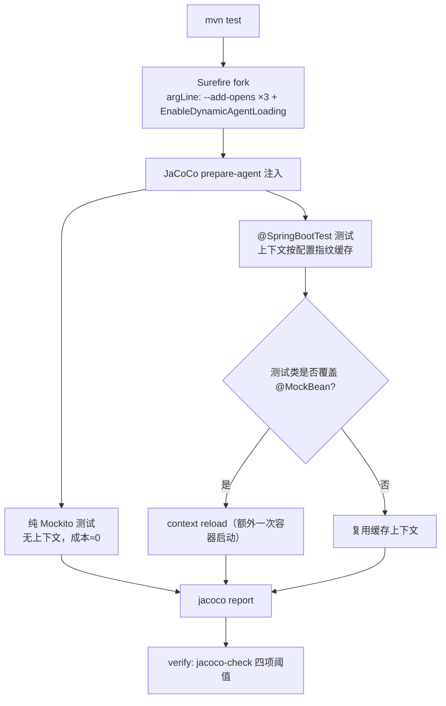

**图表来源**
- [pom.xml:229-246](file://apps/api/pom.xml#L229-L246)
- [pom.xml:299-374](file://apps/api/pom.xml#L299-L374)
- [MockAllRepositoriesConfig.java:78-84](file://apps/api/src/test/java/com/campuslove/api/testdata/MockAllRepositoriesConfig.java#L78-L84)

**章节来源**
- [pom.xml:110-131](file://apps/api/pom.xml#L110-L131)
- [pom.xml:117-125](file://apps/api/pom.xml#L117-L125)
- [pom.xml:229-246](file://apps/api/pom.xml#L229-L246)
- [pom.xml:285-298](file://apps/api/pom.xml#L285-L298)
- [Task12ConcurrencyTest.java:71-71](file://apps/api/src/test/java/com/campuslove/api/vip/Task12ConcurrencyTest.java#L71-L71)
- [RateLimitIntegrationTest.java:48-48](file://apps/api/src/test/java/com/campuslove/api/ratelimit/RateLimitIntegrationTest.java#L48-L48)
- [AuthControllerLogoutTest.java:227-239](file://apps/api/src/test/java/com/campuslove/api/auth/AuthControllerLogoutTest.java#L227-L239)

## 能力缺口登记
官方生成指令覆盖的若干能力，在本页取证范围内**没有实现证据**。为避免文档误导，逐条登记为「仓库里没有该能力／无接入证据」，并说明判定依据。

| # | 指令中的能力 | 判定 | 依据 |
| --- | --- | --- | --- |
| 1 | `@WebMvcTest` 切片测试 | **无接入证据** | 对 `apps/api/src/test` 的注解扫描中，`@WebMvcTest` 出现 0 次；Web 层测试统一使用 `@SpringBootTest` + `@AutoConfigureMockMvc` |
| 2 | `@DataJpaTest` 切片测试 | **无接入证据** | 同一扫描中 `@DataJpaTest` 出现 0 次；`pom.xml` 未引入 H2、嵌入式数据库或任何 JPA 测试专用依赖；JPA 层在测试中以 `MockAllRepositoriesConfig` 的 `@MockBean` 整体替换 |
| 3 | MockMvc 独立装配（`MockMvcBuilders.standaloneSetup`） | **无接入证据** | 扫描中 `MockMvcBuilders` 出现 0 次；MockMvc 仅通过 `@AutoConfigureMockMvc` 由容器提供 |
| 4 | 数据库测试数据初始化与管理（SQL fixture、`@Sql`、测试库建库脚本） | **无接入证据** | 本页读取的测试类以 Java 构造器就地拼装数据；mock profile 下 `HibernateJpaAutoConfiguration` 被排除，测试路径不产生真实库写入。仓库存在 `FlywayMigrationRepeatableTest`（`@SpringBootTest` + `@ActiveProfiles("mock")`）验证迁移本身，但未见面向测试的库内数据准备机制 |
| 5 | 真实 Redis 集成测试（嵌入式 Redis / Testcontainers） | **无接入证据** | `pom.xml` 全文（377 行）不含 testcontainers、embedded-redis 之类依赖；缓存能力在 test/dev profile 下由 Caffeine 提供（L147-L153 注释）；`RateLimitIntegrationTest`、`Task12ConcurrencyTest` 明确规避 Redis 依赖 |
| 6 | 专业压测／性能基线测试（JMeter、Gatling、JMH） | **无接入证据** | `pom.xml` 无相关依赖或插件；并发的正确性由 `Task12ConcurrencyTest` 以替身对象验证，不产出吞吐/延迟指标 |
| 7 | 安全渗透测试（漏洞扫描器、DAST/SCA 工具链） | **无接入证据** | 安全验证全部为功能性断言（`JwtAuthenticationFilterTest`、`SecurityConfigTest`、`AdminPermissionTest`、`P0SecurityFilterChainIntegrationTest`），未见扫描工具的配置或产物；`micrometer`/`actuator` 属运行期观测而非渗透测试 |
| 8 | 测试并行执行／fork 分片配置 | **无接入证据** | `maven-surefire-plugin` 的 `<configuration>` 仅设置 `argLine`（L243-L245），无 `parallel`、`forkCount`、`reuseForks` 等配置 |
| 9 | catalog 声明的 `ControllerTestBase.java` | **文件不存在** | 声明路径 `apps/api/src/test/java/com/campuslove/api/config/ControllerTestBase.java`；本页取证范围内未出现该类型名，因此不做任何引用与描述 |
| 10 | 后端测试在 CI 流水线中的具体调用方式 | **本页未取证** | 构建描述符定义了 `verify` 阶段的 `jacoco-check` 门禁（L332-L372），但触发 `mvn test/verify` 的流水线配置文件不在本页取证范围内，故不描述其步骤 |

上述缺口不代表功能缺失，而是测试实现路径与指令设想不同：本仓库把「可重复、无外部依赖」置于优先级更高的位置，用 Caffeine 替代 Redis、用 `@MockBean` 替代 `@DataJpaTest`、用 `@SpringBootTest`+`@AutoConfigureMockMvc` 替代 `@WebMvcTest`，代价是 JPA 与中间件真实交互不在自动化测试覆盖内。

**章节来源**
- [pom.xml:105-227](file://apps/api/pom.xml#L105-L227)
- [pom.xml:229-246](file://apps/api/pom.xml#L229-L246)
- [pom.xml:299-374](file://apps/api/pom.xml#L299-L374)
- [MockAllRepositoriesConfig.java:71-84](file://apps/api/src/test/java/com/campuslove/api/testdata/MockAllRepositoriesConfig.java#L71-L84)
- [SecurityConfigTest.java:30-44](file://apps/api/src/test/java/com/campuslove/api/config/SecurityConfigTest.java#L30-L44)
- [FlywayMigrationRepeatableTest.java:33-34](file://apps/api/src/test/java/com/campuslove/api/database/FlywayMigrationRepeatableTest.java#L33-L34)

## 依赖关系分析
### 测试类到生产组件的映射
本页取证到的测试与被测对象呈「一测一组件」的窄映射，包名镜像生产包：

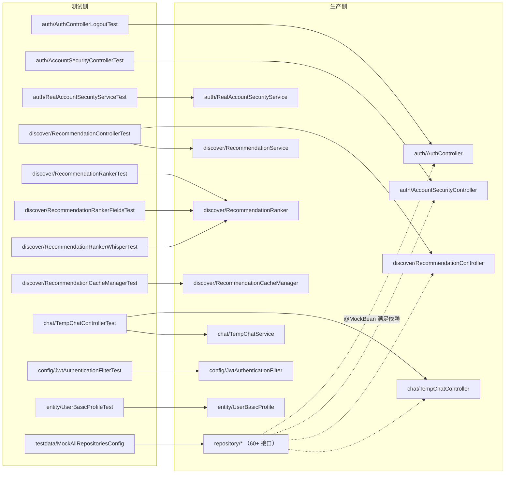

**图表来源**
- [AuthControllerLogoutTest.java:41-52](file://apps/api/src/test/java/com/campuslove/api/auth/AuthControllerLogoutTest.java#L41-L52)
- [RecommendationControllerTest.java:30-40](file://apps/api/src/test/java/com/campuslove/api/discover/RecommendationControllerTest.java#L30-L40)
- [TempChatControllerTest.java:36-46](file://apps/api/src/test/java/com/campuslove/api/chat/TempChatControllerTest.java#L36-L46)
- [JwtAuthenticationFilterTest.java:50-70](file://apps/api/src/test/java/com/campuslove/api/config/JwtAuthenticationFilterTest.java#L50-L70)
- [RealAccountSecurityServiceTest.java:37-45](file://apps/api/src/test/java/com/campuslove/api/auth/RealAccountSecurityServiceTest.java#L37-L45)
- [MockAllRepositoriesConfig.java:86-152](file://apps/api/src/test/java/com/campuslove/api/testdata/MockAllRepositoriesConfig.java#L86-L152)

### 协作组件的显性依赖
从字段声明可以直接读出被测组件的协作面，无需查看生产代码：

- `AuthController` 的四个构造参数：`AuthService`、`AuthMetrics`、`ObjectProvider<UserRepository>`、`Environment`（`AuthControllerLogoutTest` L61-L69）。`AuthMetrics` 位于 `com.campuslove.api.monitor` 包，说明认证流程内建指标上报。
- `TempChatController` 单参数构造：`TempChatService`。
- `RecommendationController` 单参数构造：`RecommendationService`；其方法签名从测试调用可见——`getRecommendations` 接收 13 个参数，`RecommendationFilter` 接收 10 个参数。
- `RealAccountSecurityService` 六个协作者：`UserRepository`、`PasswordEncoder`、`DeviceSessionService`、`TokenBlacklistService`、`JwtTokenProvider`、`AesEncryptor`。
- `JwtAuthenticationFilter` 三个协作者加一对 Servlet 对象与一条链：`JwtTokenProvider`、`UserRepository`、`TokenBlacklistService`、`HttpServletRequest`、`HttpServletResponse`、`FilterChain`。

### 测试基础设施的共享面
`MockAllRepositoriesConfig` 被 `SecurityConfigTest`（L44）与 `PhaseOneFlowApiTest`（L37）以 `@Import` 复用，是唯一的跨包共享测试配置；除此之外，本页未读到测试基类（`ControllerTestBase` 在 catalog 中声明但文件不存在），因此各测试类以复制 `@BeforeEach` + `openMocks` 的方式重复装配，属于有意为之的低耦合取舍。

**章节来源**
- [AuthControllerLogoutTest.java:41-70](file://apps/api/src/test/java/com/campuslove/api/auth/AuthControllerLogoutTest.java#L41-L70)
- [TempChatControllerTest.java:36-46](file://apps/api/src/test/java/com/campuslove/api/chat/TempChatControllerTest.java#L36-L46)
- [RecommendationControllerTest.java:30-40](file://apps/api/src/test/java/com/campuslove/api/discover/RecommendationControllerTest.java#L30-L40)
- [RecommendationControllerTest.java:122-166](file://apps/api/src/test/java/com/campuslove/api/discover/RecommendationControllerTest.java#L122-L166)
- [RealAccountSecurityServiceTest.java:37-45](file://apps/api/src/test/java/com/campuslove/api/auth/RealAccountSecurityServiceTest.java#L37-L45)
- [JwtAuthenticationFilterTest.java:50-70](file://apps/api/src/test/java/com/campuslove/api/config/JwtAuthenticationFilterTest.java#L50-L70)
- [SecurityConfigTest.java:42-44](file://apps/api/src/test/java/com/campuslove/api/config/SecurityConfigTest.java#L42-L44)
- [PhaseOneFlowApiTest.java:34-37](file://apps/api/src/test/java/com/campuslove/api/profile/PhaseOneFlowApiTest.java#L34-L37)

## 性能考虑
这里的「性能」指测试套件自身的执行成本，而非被测系统的性能指标。基于本页取证到的配置与注释，可给出四条有依据的判断。

**其一，优先选择无上下文路径。** `AuthControllerLogoutTest` 的注释把策略写成「纯 Mockito，不加载 Spring 上下文」，`TempChatControllerTest`、`RecommendationControllerTest` 同样以 `MockitoAnnotations.openMocks(this)` + `new Controller(...)` 完成装配。这类用例的成本只有一次反射注入，`@BeforeEach` 中的对象构造是全部开销；与之相对，`@SpringBootTest` 系列需要构建完整 `ApplicationContext`，是套件里最贵的一档。

**其二，警惕 `@MockBean` 覆盖造成的上下文重启动。** `MockAllRepositoriesConfig` 的注释是这条规则的原始出处：在测试类中用 `@MockBean` 覆盖配置里的 mock bean 会替换上下文中的 bean，「但会触发 context reload，慎用」（L82-L84）。Spring TestContext 按配置指纹缓存上下文，任何一个类新增 `@MockBean` 都会产生一个新增指纹，从而多付一次容器启动。正确做法是把行为 stub 放在 Service 层替身（`@Mock` + `when(...)`），如 `TempChatControllerTest` 与 `RecommendationControllerTest` 所做的那样。

**其三，接受固定的 JVM 与 agent 开销。** `argLine` 中的三个 `--add-opens` 与 `-XX:+EnableDynamicAgentLoading`（L244）是 Mockito inline mock maker 在 JDK 21 上可用的前提，不可为提速而删减；JaCoCo `prepare-agent` 会为每个 fork 注入字节码插桩。这两项构成了无法通过减少用例来消除的下限成本。

**其四，覆盖率阈值是回退探测器而非速度旋钮。** `jacoco-check` 的四项 `COVEREDRATIO` 最小值（0.30/0.22/0.32/0.54）与实测基线只差零点几个百分点，注释称之为「基线锚定」。这意味着删除测试或降低断言强度会直接让 `verify` 失败，而补测后可以「随测试补充逐步上调」阈值（L292-L298）。报告输出目录为 `target/site/jacoco`，执行数据文件为 `${java.io.tmpdir}/jacoco-${project.artifactId}.exec`。

补充一条与被测系统相关的观察：认证流程内建指标采集（`AuthControllerLogoutTest` 将 `com.campuslove.api.monitor.AuthMetrics` 作为构造依赖注入），生产侧另有 `micrometer-registry-prometheus` 暴露 `/actuator/prometheus`（L121-L125）。这些指标目前是运行期观测入口，测试套件不对其做数值断言。

**章节来源**
- [pom.xml:229-246](file://apps/api/pom.xml#L229-L246)
- [pom.xml:285-298](file://apps/api/pom.xml#L285-L298)
- [pom.xml:121-125](file://apps/api/pom.xml#L121-L125)
- [AuthControllerLogoutTest.java:32-52](file://apps/api/src/test/java/com/campuslove/api/auth/AuthControllerLogoutTest.java#L32-L52)
- [MockAllRepositoriesConfig.java:78-84](file://apps/api/src/test/java/com/campuslove/api/testdata/MockAllRepositoriesConfig.java#L78-L84)
- [TempChatControllerTest.java:42-46](file://apps/api/src/test/java/com/campuslove/api/chat/TempChatControllerTest.java#L42-L46)

## 故障排查指南
本仓库的构建注释本身就近似一份排障手册——多数条目记录了「现象 → 原因 → 处置」的完整链路，可直接对照使用。

| 现象 | 根因 | 仓库内的处置 |
| --- | --- | --- |
| 大量用例报 `Error`，提示 `Could not initialize plugin: interface org.mockito.plugins.MockMaker` | 旧版 Mockito（3.x/4.x/5.2.0）与 byte-buddy 在 JDK 21 上无法初始化 `ByteBuddyInlineMockMaker`；注释记录影响面为 586/790 测试 | 将 `mockito.version` 固定为 `5.10.0`、`byte-buddy.version` 为 `1.14.12`（`pom.xml` L21-L27），并在 surefire 加 `--add-opens` 与 `-XX:+EnableDynamicAgentLoading`（L244） |
| `No compatible attachment provider is available` | byte-buddy-agent 在 JDK 21 上 self-attach 时 HotSpot attachment provider 不可用 | 引入 `jna` / `jna-platform` 5.14.0（test scope）作为后备 attachment provider（L204-L220） |
| 打包 jar 运行时 `EntityManagerFactory` 初始化 `NoClassDefFoundError` | `byte-buddy` 若写成 `test` scope，会覆盖 `hibernate-core` 6.5.2 传递依赖的 `runtime` scope | 把 `byte-buddy` 显式改为 `runtime` scope（L185-L197） |
| `@SpringBootTest` 启动即 `NoSuchBeanDefinitionException` | mock profile 排除了 `HibernateJpaAutoConfiguration`，Repository 未注册，而全量上下文要实例化所有 Controller | 测试类加 `@Import(MockAllRepositoriesConfig.class)`（`MockAllRepositoriesConfig` L71-L80） |
| JaCoCo 覆盖率报告缺失或被跳过，且无报错 | 仓库路径含非 ASCII 字符（中文目录名）时，Windows 下 agent 无法在默认 `target/jacoco.exec` 创建文件，静默失败 | `destFile`/`dataFile` 统一改为 `${java.io.tmpdir}/jacoco-${project.artifactId}.exec`，并在 `report`/`check` 中显式指定同一 `dataFile`（L310-L338） |
| `verify` 阶段构建失败，提示覆盖率不达标 | 四项 BUNDLE 阈值（LINE 0.30 / BRANCH 0.22 / METHOD 0.32 / CLASS 0.54）任一未达 | 查看 `target/site/jacoco` 报告定位薄弱模块；注释给出的路线是「按报告逐模块提升」，而非下调阈值（L292-L298、L339-L369） |
| `@Nested` 内的 `@SpringBootTest` 用例行为异常 | `@Nested` + `@SpringBootTest` + `@TestInstance(PER_CLASS)` 组合存在问题 | 拆为顶层 `@SpringBootTest` + `@AutoConfigureMockMvc`；`P0SecurityFilterChainIntegrationTest` 即为此而独立成类（`P0SecurityIntegrationTest` L115-L118、`P0SecurityFilterChainIntegrationTest` L23） |
| JWT 相关测试在 CI 上失败 | 生产要求密钥来自环境变量且有长度下限 | 测试类通过 `@SpringBootTest(properties = "JWT_SECRET=...32-chars...")` 内联注入，见 `SecurityConfigTest` L42、`AdminPermissionTest` L70、`PhaseOneFlowApiTest` L34、`P0SecurityFilterChainIntegrationTest` L48 |
| 未登录期望 401 的断言不成立 | `JwtAuthenticationFilter` 检测到已存在认证则跳过注入；`@WithMockUser` 的 principal 是 Spring Security 类型 | 按 `SecurityConfigTest` L31-L35、L117 的说明选择是否使用 `@WithMockUser`，并区分「角色权限」与「匿名拦截」两类断言 |
| 静态打桩后其他用例受影响 | `SecurityUtils.getCurrentUserId()` / `isAuthenticated()` 是静态入口 | 一律用 try-with-resources 包裹 `Mockito.mockStatic(SecurityUtils.class)`，见 `RecommendationControllerTest` L77、L96、L130、L153 |
| 新增 Repository 后既有 `@SpringBootTest` 全部加载失败 | 新接口未加入 `MockAllRepositoriesConfig` 的 mock 清单 | 在 `testdata/MockAllRepositoriesConfig` L89-L152 追加对应 `@MockBean` 字段；注意同类清单会随业务下线收缩（L143） |

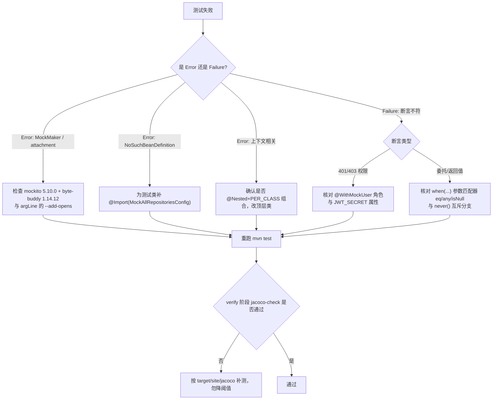

[此图为概念流程，不直接对应具体源文件，故不提供图表来源]

**章节来源**
- [pom.xml:19-28](file://apps/api/pom.xml#L19-L28)
- [pom.xml:185-220](file://apps/api/pom.xml#L185-L220)
- [pom.xml:229-246](file://apps/api/pom.xml#L229-L246)
- [pom.xml:285-374](file://apps/api/pom.xml#L285-L374)
- [MockAllRepositoriesConfig.java:71-84](file://apps/api/src/test/java/com/campuslove/api/testdata/MockAllRepositoriesConfig.java#L71-L84)
- [MockAllRepositoriesConfig.java:143-152](file://apps/api/src/test/java/com/campuslove/api/testdata/MockAllRepositoriesConfig.java#L143-L152)
- [SecurityConfigTest.java:30-44](file://apps/api/src/test/java/com/campuslove/api/config/SecurityConfigTest.java#L30-L44)
- [P0SecurityIntegrationTest.java:78-118](file://apps/api/src/test/java/com/campuslove/api/security/P0SecurityIntegrationTest.java#L78-L118)
- [RecommendationControllerTest.java:73-166](file://apps/api/src/test/java/com/campuslove/api/discover/RecommendationControllerTest.java#L73-L166)
- [AuthControllerLogoutTest.java:100-140](file://apps/api/src/test/java/com/campuslove/api/auth/AuthControllerLogoutTest.java#L100-L140)

## 结论
Campus Love 后端的集成测试体系可以概括为一句：**以构建描述符的版本约束为地基，以「是否加载 Spring 上下文」为分岔，以 mock bean 清单为接口契约。**

从 `pom.xml` 读出的三条硬性事实决定了整个体系的可运行性：`spring-boot-starter-parent` 3.3.1 与 `java.version` 17 提供基线；`mockito 5.10.0` + `byte-buddy 1.14.12` + `jna 5.14.0` + 三个 `--add-opens` 是 JDK 21 上 inline mock maker 的成套前提，缺一不可；JaCoCo 的 `destFile` 迁往 `${java.io.tmpdir}` 则是非 ASCII 路径下的 Windows 专项修复。这三组配置都附有失败现象与影响面注释，属于踩过坑之后的固化结果。

从测试代码读出的取向同样明确：**能不起上下文就不起**。`AuthControllerLogoutTest`、`TempChatControllerTest`、`RecommendationControllerTest` 用 `openMocks` + `new Controller(...)` 完成认证、临时聊天、推荐三条核心链路的委托验证，并借助 `assertSame`、`verify(..., never())`、`doThrow`、`mockStatic` 把契约固化到「对象透传、分支互斥、异常上抛、安全上下文可控」四类语义上。需要全链路时，则统一采用 `@SpringBootTest(properties = "JWT_SECRET=...")` + `@AutoConfigureMockMvc`（必要时 `@Import(MockAllRepositoriesConfig.class)`）这一套模板，配合 `@WithMockUser(roles = "USER"/"ADMIN")` 完成权限矩阵与敏感接口保护。

`MockAllRepositoriesConfig` 是这一取舍的枢纽：它用 60+ 个 `@MockBean` 换取「无数据库也能启动完整上下文」，同时以类注释明确自身边界（只满足依赖、不参与业务断言）与使用风险（覆盖即 reload）。它的存在也让新增 Repository 成为一项需要跨文件同步的变更。

同时必须承认体系的边界。`@WebMvcTest`、`@DataJpaTest`、真实 Redis（Testcontainers/嵌入式）、专业压测与渗透测试在本仓库**均无实现证据**，JPA 与中间件的真实交互、吞吐与延迟指标不在自动化测试覆盖范围内；覆盖率门禁当前锚定在 LINE 30%/BRANCH 22%/METHOD 32%/CLASS 54%，与前端 vitest 的 80% 阈值存在明确差距，且该差距已被注释登记为补测目标。后续改进的合理顺序是：先按 `target/site/jacoco` 对 service/controller 全链路补测并逐步上调阈值，再评估是否需要引入受限的 JPA 切片测试（这需要同步解决 mock profile 排除 JPA 自动配置的冲突），最后才是外部中间件与性能类测试能力的建设。

**章节来源**
- [pom.xml:6-28](file://apps/api/pom.xml#L6-L28)
- [pom.xml:192-246](file://apps/api/pom.xml#L192-L246)
- [pom.xml:310-374](file://apps/api/pom.xml#L310-L374)
- [MockAllRepositoriesConfig.java:70-87](file://apps/api/src/test/java/com/campuslove/api/testdata/MockAllRepositoriesConfig.java#L70-L87)
- [AuthControllerLogoutTest.java:19-41](file://apps/api/src/test/java/com/campuslove/api/auth/AuthControllerLogoutTest.java#L19-L41)
- [TempChatControllerTest.java:18-46](file://apps/api/src/test/java/com/campuslove/api/chat/TempChatControllerTest.java#L18-L46)
- [RecommendationControllerTest.java:18-40](file://apps/api/src/test/java/com/campuslove/api/discover/RecommendationControllerTest.java#L18-L40)
- [SecurityConfigTest.java:30-44](file://apps/api/src/test/java/com/campuslove/api/config/SecurityConfigTest.java#L30-L44)

