# 端到端测试（Playwright）

<cite>
**本文引用的文件**
- [playwright.config.ts](file://tests/e2e/playwright.config.ts)
- [core-journey.spec.ts](file://tests/e2e/specs/core-journey.spec.ts)
- [all-pages-smoke.spec.ts](file://tests/e2e/specs/all-pages-smoke.spec.ts)
- [accessibility.spec.ts](file://tests/e2e/specs/accessibility.spec.ts)
- [package.json](file://package.json)
- [package.json (client)](file://apps/client/package.json)
</cite>

## 目录
1. [简介](#简介)
2. [项目结构](#项目结构)
3. [核心组件](#核心组件)
4. [架构总览](#架构总览)
5. [详细组件分析](#详细组件分析)
6. [配置与开关](#配置与开关)
7. [测试数据管理与环境隔离](#测试数据管理与环境隔离)
8. [可访问性测试](#可访问性测试)
9. [持续集成与并行执行](#持续集成与并行执行)
10. [视觉回归与截图对比现状](#视觉回归与截图对比现状)
11. [依赖关系分析](#依赖关系分析)
12. [性能考虑](#性能考虑)
13. [故障排查指南](#故障排查指南)
14. [未接入能力登记](#未接入能力登记)
15. [结论](#结论)
16. [附录](#附录)

## 简介
本文档描述 Campus Love 项目中基于 Playwright 的端到端（E2E）测试层。该层位于仓库根目录的 `tests/e2e` 之下，由一份全局配置 `tests/e2e/playwright.config.ts` 与三份测试规格 `core-journey.spec.ts`、`all-pages-smoke.spec.ts`、`accessibility.spec.ts` 组成，覆盖三类目标：核心用户旅程的自动化回归、全部页面的冒烟可达性检查，以及页面无障碍属性的静态断言。

与仓库内其他测试层不同，E2E 层不通过 `package.json` 的 npm scripts 暴露入口，而是直接由 Playwright CLI 消费配置文件运行；`package.json` 中的 `test`、`test:client`、`test:structure`、`test:prototype` 等脚本服务于单元测试与结构校验。本文对这一事实差异给出精确说明，并逐项登记配置与规格中真实存在的选项，避免把「Playwright 通用能力」当作「本仓库已接入能力」。

## 项目结构
E2E 测试目录采用「一份配置 + 一个 specs 子目录」的扁平结构，测试文件按关注面而非页面拆分：

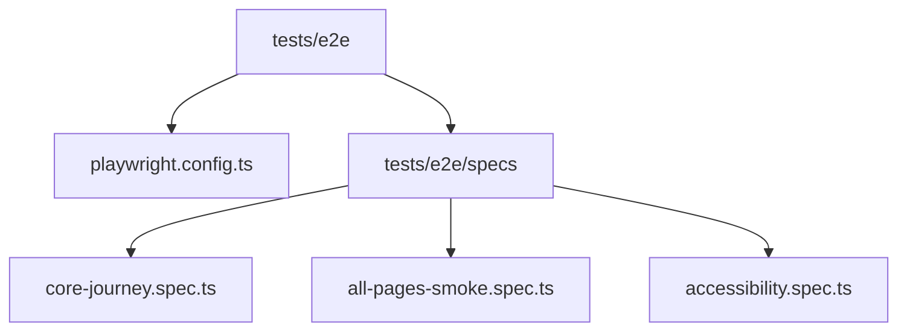

**图表来源**
- [playwright.config.ts:1-83](file://tests/e2e/playwright.config.ts#L1-L83)

**章节来源**
- [playwright.config.ts:1-83](file://tests/e2e/playwright.config.ts#L1-L83)
- [core-journey.spec.ts:1-219](file://tests/e2e/specs/core-journey.spec.ts#L1-L219)
- [all-pages-smoke.spec.ts:1-115](file://tests/e2e/specs/all-pages-smoke.spec.ts#L1-L115)
- [accessibility.spec.ts:1-216](file://tests/e2e/specs/accessibility.spec.ts#L1-L216)

## 核心组件
E2E 层由四个真实文件构成，职责边界清晰：一份配置决定「怎么跑」，三份规格决定「跑什么」。

| 组件 | 路径 | 规模 | 职责 |
| --- | --- | --- | --- |
| 运行配置 | `tests/e2e/playwright.config.ts` | 83 行 | testDir/outputDir、并发与重试、reporter、浏览器 project、webServer 编排 |
| 核心旅程 | `tests/e2e/specs/core-journey.spec.ts` | 219 行 | 登录 → 匹配 → 聊天 6 个用例 + 2 个 ARIA 可见性用例 |
| 全页面冒烟 | `tests/e2e/specs/all-pages-smoke.spec.ts` | 115 行 | 60 条路由（数组实列主包 45 + 分包 15；注释声明主包 47 页）逐页渲染与零 JS 错误检查 |
| 无障碍 | `tests/e2e/specs/accessibility.spec.ts` | 216 行 | axe-core 扫描 7 个页面 + 键盘导航 + 暗色模式 + 44px 触控目标 |

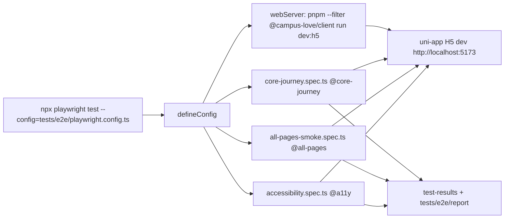

**图表来源**
- [playwright.config.ts:33-83](file://tests/e2e/playwright.config.ts#L33-L83)
- [core-journey.spec.ts:68-195](file://tests/e2e/specs/core-journey.spec.ts#L68-L195)
- [all-pages-smoke.spec.ts:109-115](file://tests/e2e/specs/all-pages-smoke.spec.ts#L109-L115)
- [accessibility.spec.ts:120-192](file://tests/e2e/specs/accessibility.spec.ts#L120-L192)

三份规格之间没有共享 fixture 文件，跨用例复用靠各自文件内部的 helper 函数：`core-journey.spec.ts` 定义了 `navigateToLogin`、`performWechatLogin`、`skipProfileSetupIfPresent`、`navigateToDiscover`、`navigateToChat` 五个 Page Object 风格函数；`accessibility.spec.ts` 独立定义 `loginAndNavigate` 与 `runAxeScan`；`all-pages-smoke.spec.ts` 只依赖一个 `visitPage`。这意味着两套登录逻辑并存（体验号登录与微信按钮兜底登录），是后续收敛点。

**章节来源**
- [playwright.config.ts:1-83](file://tests/e2e/playwright.config.ts#L1-L83)
- [core-journey.spec.ts:21-64](file://tests/e2e/specs/core-journey.spec.ts#L21-L64)
- [all-pages-smoke.spec.ts:88-107](file://tests/e2e/specs/all-pages-smoke.spec.ts#L88-L107)
- [accessibility.spec.ts:59-116](file://tests/e2e/specs/accessibility.spec.ts#L59-L116)
- [package.json:9-27](file://package.json#L9-L27)

## 架构总览
E2E 执行期由配置文件统一编排：先由 `webServer` 拉起 uni-app H5 dev server，再由 Playwright 调度两个 project（`chromium-mobile`、`chromium-desktop`）串行运行 `./specs` 目录下的三份规格，产物写入 `./test-results`，HTML 报告写入 `tests/e2e/report`。

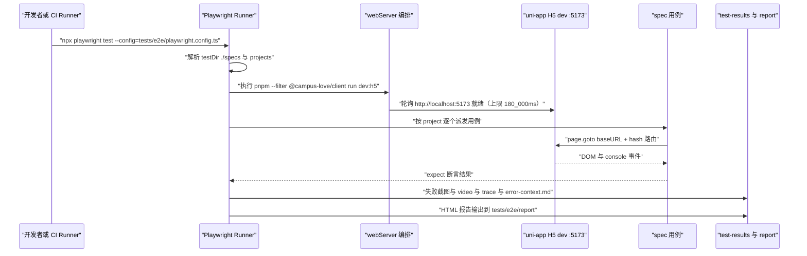

**图表来源**
- [playwright.config.ts:33-83](file://tests/e2e/playwright.config.ts#L33-L83)
- [core-journey.spec.ts:21-64](file://tests/e2e/specs/core-journey.spec.ts#L21-L64)
- [all-pages-smoke.spec.ts:88-107](file://tests/e2e/specs/all-pages-smoke.spec.ts#L88-L107)

三层隔离是本架构的关键设计：其一，浏览器层由 `projects` 决定（同一套用例在移动端视口与桌面视口各跑一次）；其二，服务层由 `webServer.reuseExistingServer` 决定（本地复用已启动的 dev server，CI 自动拉起）；其三，数据层由 mock 模式决定（`NODE_ENV=development`，避免真实微信登录依赖）。配置注释明确记录该取舍来自 infra 约束 R2-00005：CI 无 docker-compose 服务编排，若禁用 `webServer` 则 E2E 无任何服务可测。

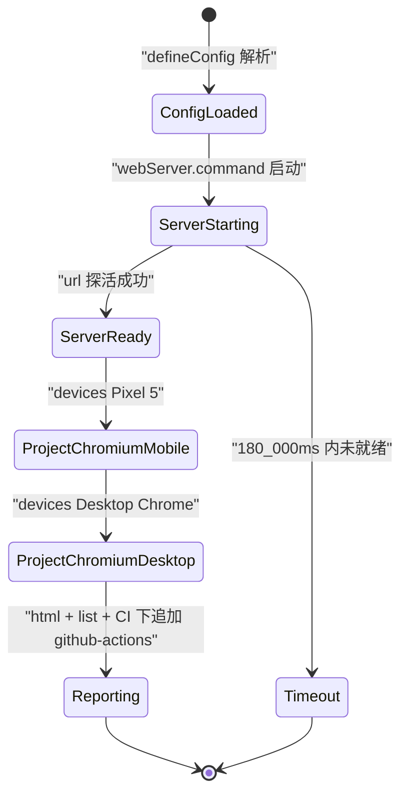

**图表来源**
- [playwright.config.ts:39-82](file://tests/e2e/playwright.config.ts#L39-L82)

**章节来源**
- [playwright.config.ts:1-83](file://tests/e2e/playwright.config.ts#L1-L83)
- [package.json:12-13](file://package.json#L12-L13)
- [ci.yml:501-503](file://.github/workflows/ci.yml#L501-L503)

## 详细组件分析
本节按文件逐个展开，给出真实存在的函数签名、断言策略与选择器约定。

### Playwright 配置对象
`tests/e2e/playwright.config.ts` 以 `defineConfig` 导出单一默认配置，关键选项及实际取值如下：

| 选项 | 取值 | 语义 |
| --- | --- | --- |
| `testDir` | `./specs` | 相对配置文件目录解析；注释记录 2026-08-10 修复前的 `'./tests/e2e/specs'` 会拼成重复路径导致 0 测试 |
| `outputDir` | `./test-results` | 同上，修复后产物落在 `tests/e2e/test-results` |
| `fullyParallel` | `false` | 注释理由：uni-app H5 dev 单实例，避免端口冲突 |
| `forbidOnly` | `!!process.env.CI` | CI 下禁止残留 `test.only` |
| `retries` | `process.env.CI ? 2 : 0` | 本地不重试，CI 重试 2 次 |
| `workers` | `process.env.CI ? 1 : 1` | 两端均为 1，串行执行 |
| `reporter` | `[['html',{outputFolder:'tests/e2e/report'}],['list'], CI ? ['github-actions'] : ['list']]` | 三种 reporter 叠加 |
| `use.baseURL` | `process.env.E2E_BASE_URL ?? 'http://localhost:5173'` | 环境变量驱动 |
| `use.trace` | `'on-first-retry'` | 首次重试才录 trace |
| `use.screenshot` | `'only-on-failure'` | 仅失败截图 |
| `use.video` | `'retain-on-failure'` | 仅失败保留 video |
| `use.actionTimeout` | `10_000` | 单动作超时 |
| `use.navigationTimeout` | `30_000` | 导航超时 |
| `use.locale` | `'zh-CN'` | 与业务文案语言一致，保证按中文文本定位可用 |
| `use.timezoneId` | `'Asia/Shanghai'` | 时间相关断言稳定 |
| `use.viewport` | `{width:390,height:844}` | iPhone 14 尺寸模拟移动端 |

`projects` 声明两个浏览器上下文：`chromium-mobile` 使用 `devices['Pixel 5']`，`chromium-desktop` 使用 `devices['Desktop Chrome']`，后者注释说明用途是兼容性回归（暗色模式、宽屏布局）。

**章节来源**
- [playwright.config.ts:33-83](file://tests/e2e/playwright.config.ts#L33-L83)
- [playwright.config.ts:1-32](file://tests/e2e/playwright.config.ts#L1-L32)

### 核心旅程规格 helper
`core-journey.spec.ts` 用五个 `async` 函数封装跨用例操作，签名分别为 `navigateToLogin(page: Page)`、`performWechatLogin(page: Page)`、`skipProfileSetupIfPresent(page: Page)`、`navigateToDiscover(page: Page)`、`navigateToChat(page: Page)`，均以 `type Page` 类型从 `@playwright/test` 导入。

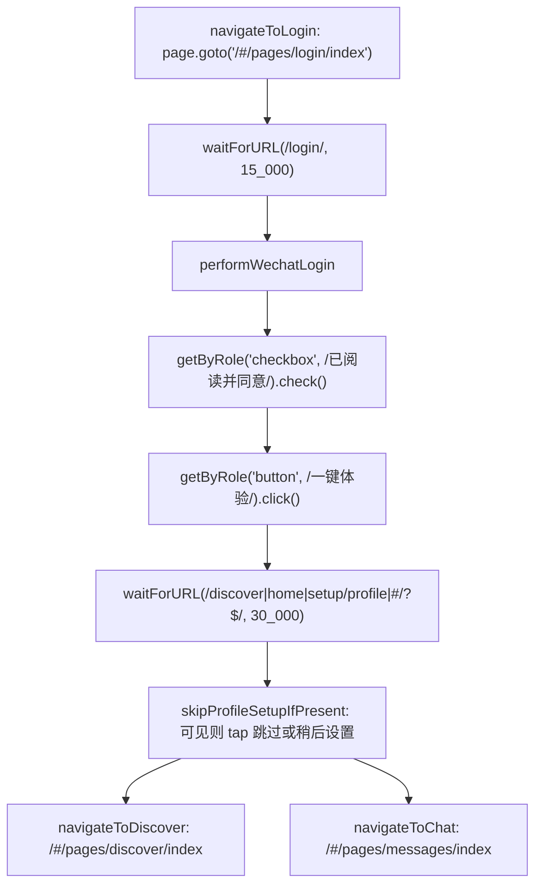

**图表来源**
- [core-journey.spec.ts:21-64](file://tests/e2e/specs/core-journey.spec.ts#L21-L64)
- [core-journey.spec.ts:68-146](file://tests/e2e/specs/core-journey.spec.ts#L68-L146)

两处实现细节值得注意：登录必须先用 `getByRole('checkbox', { name: /已阅读并同意/ })` 勾选协议，因为登录按钮受 `agreed` 守卫；导航必须显式带 hash（`/#/pages/...`），因为 uni-app H5 是 hash 路由，裸路径会落到首页。文件注释同时记录：微信登录（`uni.login provider=weixin`）仅小程序端可用，H5 环境无该 provider，因此改用体验号登录，对应后端接口 `POST /v1/auth/guest-login`；custom tabBar 仅在 mp-weixin 实现，H5 端无底部导航，故用 URL 导航代替 tab 点击。

**章节来源**
- [core-journey.spec.ts:1-64](file://tests/e2e/specs/core-journey.spec.ts#L1-L64)
- [page-access-config.spec.ts:1-58](file://apps/client/src/tests/page-access-config.spec.ts#L1-L58)
- [navigation-config.spec.ts:1-45](file://apps/client/src/tests/navigation-config.spec.ts#L1-L45)

### 核心旅程用例矩阵
`test.describe('核心旅程：注册 → 匹配 → 聊天 @core-journey')` 内共 6 个用例，另有 `test.describe('页面可访问性与可见性 @a11y')` 内 2 个用例：

| 用例标题 | 标签 | 关键断言 | 定位方式 |
| --- | --- | --- | --- |
| 用户可通过微信登录进入首页 | `@auth` `@smoke` | `toHaveURL(/\/home\|\/discover\|#\/?$/)`；页面文本匹配 `寻觅` 或 `发现心动的人` | `getByRole` + `getByText` |
| 登录后可访问匹配页查看推荐人物 | `@match` | `person-card` 容器可见，15s 超时 | `.person-card, [data-testid="person-card"]` |
| 右滑匹配后产生互相喜欢可在聊天页查看 | `@match` | 错误边界 `[role="alert"].error, .error-state` 不可见；聊天页 URL 匹配 | `getByRole('button', /喜欢\|心动/)`，兜底 `keyboard.press('ArrowRight')` |
| 聊天页会话列表可正常渲染 | `@chat` | 空态文案或会话项二者之一可见（`hasEmpty \|\| hasSession`） | `getByText(/还没有聊天\|暂无消息/)`、`.chat-session-item, [data-testid="chat-session"]` |
| 点击会话可进入聊天详情并查看消息 | `@chat` | `waitForURL(/\/chat-session/)` 后输入框可见 | `getByPlaceholder(/输入消息\|说点什么/)` |
| 发送文本消息可在消息列表显示 | `@chat` | 发送后同文本消息可见（乐观更新） | `messageInput.fill()` + `getByRole('button', /发送/)` |
| 登录页核心元素对屏幕阅读器可见 | `@a11y` | `toHaveAttribute('role','button')` 与 `toHaveAttribute('aria-label', /.+/)` | `getByRole('button', /一键体验/)` |
| TabBar 满足 ARIA tablist 规范 | `@a11y` | `[role="tab"]` 数量 ≥ 4 | `[role="tablist"]` 作用域内计数 |

用例遵循 AAA 结构注释（Arrange / Act / Assert），并对可选路径采用「先探测可见性再断言」的软处理：`if (await likeBtn.isVisible({timeout:5_000}).catch(() => false))`，无会话场景调用 `test.skip()` 后返回。第 3 个用例注释明确「不强断言成功（mock 数据可能无匹配），仅验证无白屏错误」，这是该层避免脆测的显式策略。

**章节来源**
- [core-journey.spec.ts:68-195](file://tests/e2e/specs/core-journey.spec.ts#L68-L195)
- [core-journey.spec.ts:197-219](file://tests/e2e/specs/core-journey.spec.ts#L197-L219)

### 全页面冒烟规格
`all-pages-smoke.spec.ts` 维护一份 `const ROUTES: string[]`，注释标注来源为 `pages.json`，数组实列主包 45 条与分包 15 条（合计 60 条；注释声明主包 47 页，与实列条目存在 2 条差异），并以 `for (const route of ROUTES)` 为每条路由生成一个独立用例，标题为 `页面可渲染且无 JS 错误: <route>`，整组挂在 `test.describe('全页面冒烟（@all-pages）')` 下。

`visitPage(page, route)` 的判定逻辑是该规格的核心：注册 `page.on('pageerror')` 与 `page.on('console')`（仅 `msg.type() === 'error'` 计入，`warning`/`info` 不视为失败，文本 `slice(0, 200)` 截断），随后 `page.goto(route, { waitUntil: 'domcontentloaded', timeout: 20_000 })` + `waitForTimeout(1_500)` 等待首屏与异步数据，最后用两条 `expect.soft` 断言 body 文本非空与错误数组等于 `[]`。使用 `expect.soft` 而非硬断言，使同一页面的两类问题能一次跑完全部列出。

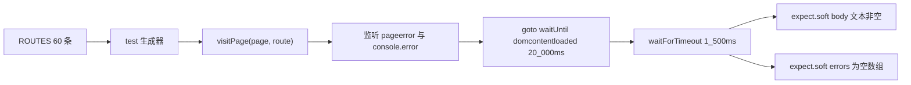

**图表来源**
- [all-pages-smoke.spec.ts:22-115](file://tests/e2e/specs/all-pages-smoke.spec.ts#L22-L115)

文件头注释给出四条判定标准：无 pageerror 与 console error、body 有实际渲染内容、带参页面（`detail`、`topic-detail` 等）以无参访问验证空态或错误态路径、需登录页面未登录时跳转登录页或展示 LockScreen 属预期不判失败。

**章节来源**
- [all-pages-smoke.spec.ts:1-115](file://tests/e2e/specs/all-pages-smoke.spec.ts#L1-L115)

### 选择器契约与脆弱点
E2E 选择器与页面实现之间形成隐式契约：`data-testid` 优先、class 兜底、可见文本最后。规格中出现的双通道选择器包括 `.person-card, [data-testid="person-card"]`、`.chat-session-item, [data-testid="chat-session"]`；文本通道包括 `已阅读并同意`、`一键体验`、`跳过|稍后设置`、`喜欢|心动`、`还没有聊天|暂无消息`、`输入消息|说点什么`、`发送`、`寻觅|发现心动的人`。

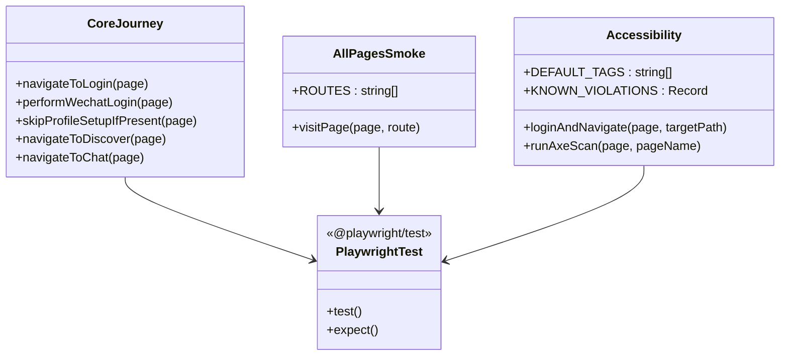

**图表来源**
- [core-journey.spec.ts:21-64](file://tests/e2e/specs/core-journey.spec.ts#L21-L64)
- [all-pages-smoke.spec.ts:22-107](file://tests/e2e/specs/all-pages-smoke.spec.ts#L22-L107)
- [accessibility.spec.ts:43-116](file://tests/e2e/specs/accessibility.spec.ts#L43-L116)

契约一旦漂移即产生真实失败：`tests/e2e/test-results/` 下保留了 `core-journey` 两个失败用例的 `error-context.md`，其中记录 `expect(locator).toBeVisible() failed`、`Locator: locator('.person-card, [data-testid="person-card"]').first()`、`Timeout: 15000ms`、`Error: element(s) not found`，定位信息指向 `tests\e2e\specs\core-journey.spec.ts:84:7`，即「登录后可访问匹配页查看推荐人物」用例。`.last-run.json` 同时记录 `"status": "failed"` 与 2 个 `failedTests` 标识。

**章节来源**
- [core-journey.spec.ts:84-98](file://tests/e2e/specs/core-journey.spec.ts#L84-L98)
- [error-context.md:1-25](file://tests/e2e/test-results/core-journey-核心旅程：注册-→-匹配--35959-urney-登录后可访问匹配页查看推荐人物-match-chromium-mobile/error-context.md#L1-L25)
- [.last-run.json:1-6](file://tests/e2e/test-results/.last-run.json#L1-L6)

## 配置与开关
E2E 层的行为由三类开关控制：环境变量、配置文件常量、运行期 CLI 参数。

### 环境变量
配置中读取的环境变量共三个，全部为可选：

| 变量 | 使用位置 | 缺省行为 |
| --- | --- | --- |
| `E2E_BASE_URL` | `use.baseURL: process.env.E2E_BASE_URL ?? 'http://localhost:5173'` | 未设置时回落本地 H5 dev 端口 5173 |
| `CI` | `forbidOnly`、`retries`、`workers`、`reporter` 四处 | 非 CI 环境：禁止 only 关闭、重试 0 次、不启用 github-actions reporter |
| `NODE_ENV` | `webServer.env.NODE_ENV = 'development'` | 强制 dev server 以 development 启动，即注释所称「Mock 模式：避免真实微信登录依赖」 |

配置文件头部注释另提到 `USE_DEV_SERVER` 用于切换 baseURL（默认 H5 dev）与 mp-weixin 两种环境，但 `defineConfig` 主体中未出现该变量的读取；实际生效的 baseURL 开关是 `E2E_BASE_URL`。这一差异在「未接入能力登记」中登记。

**章节来源**
- [playwright.config.ts:1-58](file://tests/e2e/playwright.config.ts#L1-L58)
- [playwright.config.ts:73-82](file://tests/e2e/playwright.config.ts#L73-L82)

### 运行命令与标签过滤
配置注释与三份规格注释给出的真实运行方式如下（`--grep` 依据用例标题中的标签）：

| 目的 | 命令 | 标签依据 |
| --- | --- | --- |
| 安装浏览器 | `npx playwright install --with-deps chromium` | 配置文件注释 |
| 全量运行 | `npx playwright test --config=tests/e2e/playwright.config.ts` | CI 同款命令 |
| UI 模式 | `npx playwright test --ui --config=tests/e2e/playwright.config.ts` | 配置文件注释 |
| 仅核心旅程 | `npx playwright test --grep="@core-journey" --config=tests/e2e/playwright.config.ts` | describe 标题含 `@core-journey` |
| 仅全页面冒烟 | `npx playwright test --grep="@all-pages" --config=tests/e2e/playwright.config.ts` | describe 标题含 `@all-pages` |
| 仅无障碍 | `npx playwright test --grep="@a11y" --config=tests/e2e/playwright.config.ts` | 用例标题含 `@a11y` |

workspace 侧把前三条封装为 npm scripts，`apps/client/package.json` 的 `test:e2e`、`test:e2e:ui`、`test:a11y` 分别对应 `playwright test --config=../../tests/e2e/playwright.config.ts`、加 `--ui`、加 `--grep=@a11y`。根 `package.json` 的 `scripts` 未定义 e2e 入口，其 `test` 链为 `test:prototype && test:structure && test:client`，与 E2E 层平行。CI 侧的注释（FIN-00278）明确指出：根目录无 `playwright.config`，因此必须显式指定 `--config=tests/e2e/playwright.config.ts`，原命令实际无法运行。

**章节来源**
- [playwright.config.ts:17-31](file://tests/e2e/playwright.config.ts#L17-L31)
- [package.json:9-27](file://package.json#L9-L27)
- [package.json (client):44-46](file://apps/client/package.json#L44-L46)
- [ci.yml:47-48](file://.github/workflows/ci.yml#L47-L48)
- [all-pages-smoke.spec.ts:18-19](file://tests/e2e/specs/all-pages-smoke.spec.ts#L18-L19)
- [accessibility.spec.ts:25-32](file://tests/e2e/specs/accessibility.spec.ts#L25-L32)
- [core-journey.spec.ts:8](file://tests/e2e/specs/core-journey.spec.ts#L8-L8)

### 超时与阈值一览
E2E 层的等待阈值分散在配置与用例两处，合计 11 个数值：

| 阈值 | 出处 | 值 |
| --- | --- | --- |
| `actionTimeout` | 配置 `use` | 10_000ms |
| `navigationTimeout` | 配置 `use` | 30_000ms |
| `webServer.timeout` | 配置 | 180_000ms |
| `webServer.url` 探活地址 | 配置 | `http://localhost:5173` |
| 登录页 `waitForURL` | `navigateToLogin` | 15_000ms |
| 协议勾选可见性 | `performWechatLogin` | 10_000ms |
| 登录后跳转 `waitForURL` | `performWechatLogin` | 30_000ms |
| 跳过按钮探测 | `skipProfileSetupIfPresent` | 3_000ms |
| 推荐卡片可见性 | 匹配用例 | 15_000ms |
| 会话项探测 | 聊天用例 | 5_000ms |
| 冒烟 `goto` 与固定等待 | `visitPage` | 20_000ms 与 1_500ms |

**章节来源**
- [playwright.config.ts:47-58](file://tests/e2e/playwright.config.ts#L47-L58)
- [playwright.config.ts:73-82](file://tests/e2e/playwright.config.ts#L73-L82)
- [core-journey.spec.ts:21-64](file://tests/e2e/specs/core-journey.spec.ts#L21-L64)
- [core-journey.spec.ts:84-146](file://tests/e2e/specs/core-journey.spec.ts#L84-L146)
- [all-pages-smoke.spec.ts:99-101](file://tests/e2e/specs/all-pages-smoke.spec.ts#L99-L101)

## 测试数据管理与环境隔离
本层的数据策略可以概括为一句话：不建数据集，只借 dev mock 后端；不共享状态，每个用例自己走一遍登录。

### 环境来源
`webServer.command` 为 `pnpm --filter @campus-love/client run dev:h5`，对应 client workspace 脚本 `dev:h5` = `node scripts/prepare-static.mjs --h5 && uni --platform h5`，并以 `NODE_ENV=development` 运行。`reuseExistingServer: true` 使本地开发者已启动的 dev server 被直接复用，CI 上则由 Playwright 拉起并在 180_000ms 内轮询 `http://localhost:5173`。根 `package.json` 同时提供 `client:dev:h5`（走 npm workspace）与 `client:dev:h5:real`（`--mode real`，接真实后端）两条命令；E2E 配置只调用前者，因此默认测试面是 mock 数据。

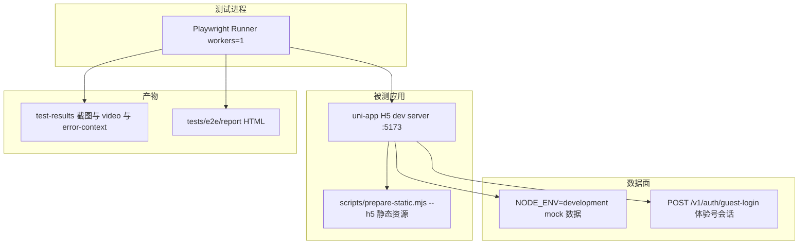

**图表来源**
- [playwright.config.ts:73-82](file://tests/e2e/playwright.config.ts#L73-L82)
- [package.json (client):19-20](file://apps/client/package.json#L19-L20)
- [core-journey.spec.ts:29-44](file://tests/e2e/specs/core-journey.spec.ts#L29-L44)

### 用例间隔离
`core-journey.spec.ts` 头部注释把「数据隔离：每个用例独立运行，不依赖前置状态」列为设计原则，实现方式是每个用例都从 `navigateToLogin` 开始重新登录，不复用 storageState，也没有共享的 `test.beforeAll` 会话。代价是登录动作在用例中重复 6 次以上，收益是用例可任意顺序、任意子集执行。

写入类数据采用时间戳唯一化：发送消息用例使用 `const testMessage = \`E2E 测试消息 ${Date.now()}\`` 作为断言锚点，避免与历史消息文本冲突。读取类断言则不假设具体条数，仅断言「空态与会话列表二者之一存在」。

带参页面的数据处理遵循「无参访问即测空态」原则：`ROUTES` 中 `/pages/village/detail`、`/pages/circles/topic-detail`、`/pages/activities/detail`、`/subpackages/market/detail/index` 等均不带 query 参数，文件注释声明「空态渲染无错同样视为通过」。

**章节来源**
- [core-journey.spec.ts:10-17](file://tests/e2e/specs/core-journey.spec.ts#L10-L17)
- [core-journey.spec.ts:168-194](file://tests/e2e/specs/core-journey.spec.ts#L168-L194)
- [all-pages-smoke.spec.ts:10-16](file://tests/e2e/specs/all-pages-smoke.spec.ts#L10-L16)
- [all-pages-smoke.spec.ts:22-85](file://tests/e2e/specs/all-pages-smoke.spec.ts#L22-L85)

### 后端与数据库侧的相邻测试
E2E 之外的数据正确性由单元测试与契约测试承担，不在浏览器层重复：客户端页面配置由 `apps/client/src/tests/page-access-config.spec.ts` 与 `navigation-config.spec.ts` 校验（后者的单元测试文件共 45 行），页面渲染逻辑由 `apps/client/src/tests/pages/village-post-page.spec.ts` 覆盖；后端领域行为由 Java 单测覆盖，包括 `UserBasicProfileTest`（类声明位于 L25，被测字段 `private UserBasicProfile profile;` 位于 L27）、`VillagePostServiceTest`（`private VillagePostService postService;`）、`TempChatMessageServiceTest`（`private TempChatMessageService messageService;`）、`PostReportControllerTest` 与 `PrivateMessageControllerTest`。E2E 层负责「页面能打开、能点、能发消息」，上述文件负责「数据算得对」。

**章节来源**
- [page-access-config.spec.ts:1-58](file://apps/client/src/tests/page-access-config.spec.ts#L1-L58)
- [navigation-config.spec.ts:1-45](file://apps/client/src/tests/navigation-config.spec.ts#L1-L45)
- [village-post-page.spec.ts:1-109](file://apps/client/src/tests/pages/village-post-page.spec.ts#L1-L109)
- [UserBasicProfileTest.java:25-27](file://apps/api/src/test/java/com/campuslove/api/entity/UserBasicProfileTest.java#L25-L27)
- [VillagePostServiceTest.java:25-31](file://apps/api/src/test/java/com/campuslove/api/village/VillagePostServiceTest.java#L25-L31)
- [TempChatMessageServiceTest.java:30-37](file://apps/api/src/test/java/com/campuslove/api/chat/TempChatMessageServiceTest.java#L30-L37)
- [PostReportControllerTest.java:15-20](file://apps/api/src/test/java/com/campuslove/api/village/PostReportControllerTest.java#L15-L20)
- [PrivateMessageControllerTest.java:23-27](file://apps/api/src/test/java/com/campuslove/api/chat/PrivateMessageControllerTest.java#L23-L27)

### 隔离缺口
以下能力在仓库中未见实现：没有 `storageState` 文件或登录态快照复用；没有 per-test 的数据库 seed/teardown 脚本；没有 `test.setTimeout` 之外的配额清理；`webServer` 只保证前端 dev server 就绪，不校验后端 API 可用性（若 mock 由 uni-app 侧拦截则无需后端）。因此跨运行的数据污染风险取决于 dev mock 的实现范围，而非 E2E 层自身的清理逻辑。

**章节来源**
- [playwright.config.ts:33-83](file://tests/e2e/playwright.config.ts#L33-L83)
- [core-journey.spec.ts:68-146](file://tests/e2e/specs/core-journey.spec.ts#L68-L146)

## 可访问性测试
无障碍层基于 axe-core 的 Playwright 封装：文件顶部 `import AxeBuilder from '@axe-core/playwright'`，与 `@playwright/test` 一同构成依赖前提（两者均未在 package.json 中声明，见「未接入能力登记」）。

### 规则集与豁免表
`const DEFAULT_TAGS = ['wcag2a', 'wcag2aa', 'wcag21aa', 'best-practice']` 决定扫描规则集。`KNOWN_VIOLATIONS: Record<string, string[]>` 按页面路径登记豁免规则：`/pages/login/index` 豁免 `aria-allowed-role`（注释理由：uni-app TabBar 在 H5 下 `role=tablist` 不完整，属已知问题），`/pages/discover/index` 豁免 `region`（注释理由：CardSwiper 卡片某些场景需双焦点，属 mp-weixin 限制）。豁免表通过 `.disableRules(disabledRules)` 注入 AxeBuilder，未列出的页面按全规则扫描。

### 判定门限
`runAxeScan(page, pageName)` 的流程是：`new AxeBuilder({ page }).withTags(DEFAULT_TAGS).disableRules(...).analyze()`，随后把 `violations` 按 `impact` 过滤为 `critical` 与 `serious` 两组；若任一非空，先用 `console.log` 打印每条违规的 `id`、`description`、`helpUrl` 与 `nodes[].target`，再对两组分别断言 `toHaveLength(0)`，消息模板包含页面名与实际条数。Moderate 与 Minor 级别不阻断，与文件注释「Moderate 应修复、记录为技术债；Minor 建议修复」一致。

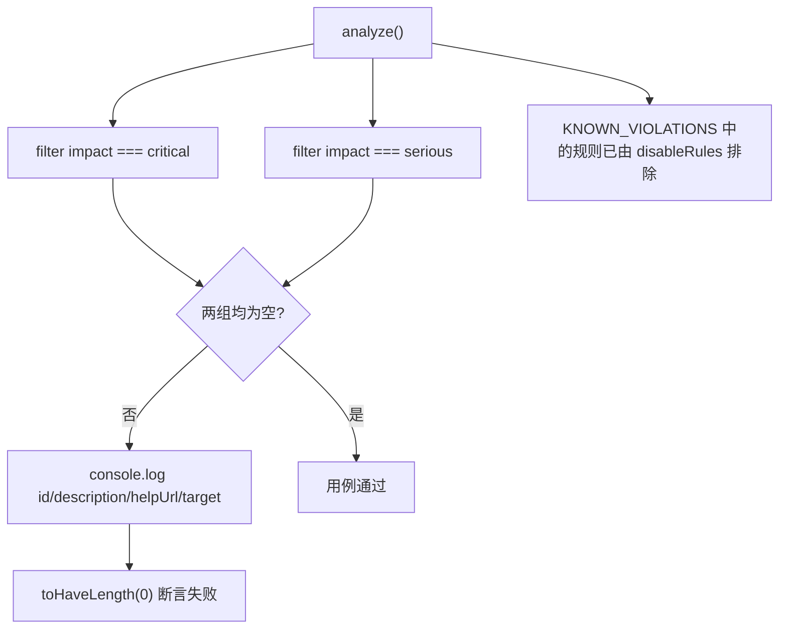

**图表来源**
- [accessibility.spec.ts:43-116](file://tests/e2e/specs/accessibility.spec.ts#L43-L116)

### 页面覆盖与专用用例
`test.describe('无障碍合规性测试 @a11y')` 下共 10 个用例：7 个 WCAG 2.1 AA 页面扫描（登录页 `/pages/login/index`、首页 `/pages/home/index`、匹配/发现页 `/pages/discover/index`、聊天列表页 `/pages/chat/index`、个人页 `/pages/profile/index`、校园圈子页 `/pages/circles/index`、村落/广场页 `/pages/village/index`），加上键盘导航、暗色模式、移动端触控目标 3 个专用用例。

`loginAndNavigate(page, targetPath)` 的登录方式与核心旅程不同：它 `page.goto('/')` 后用 `getByRole('button', { name: /微信登录|微信一键登录/ })` 探测并 `tap()`，等待 `/\/(home|setup\/profile|discover)/`，再探测 `/跳过|稍后设置/`；仅在 `page.url()` 未包含目标路径时才 `goto(targetPath)` 并 `waitForLoadState('networkidle')`。这说明 a11y 层的登录按钮文案假设与 core-journey 的「一键体验」文案假设并不一致，属于两份规格的选择器漂移。

三个专用用例的判据分别是：键盘导航用 `page.keyboard.press('Tab')` 循环 10 次，用 `page.evaluate` 读取 `document.activeElement` 的 `tagName`/`id`/`className` 收集焦点序列，断言 `focusedSelectors.length > 0`；暗色模式用 `page.emulateMedia({ colorScheme: 'dark' })` 后扫描，页面键为 `/dark/login`（该键不在豁免表中，因此全规则生效）；触控目标用例遍历前 20 个可见 `button, [role="button"]`，用 `boundingBox()` 统计宽高小于 44px 的元素，断言小目标占比 `ratio < 0.1`。

**章节来源**
- [accessibility.spec.ts:1-55](file://tests/e2e/specs/accessibility.spec.ts#L1-L55)
- [accessibility.spec.ts:59-116](file://tests/e2e/specs/accessibility.spec.ts#L59-L116)
- [accessibility.spec.ts:120-157](file://tests/e2e/specs/accessibility.spec.ts#L120-L157)
- [accessibility.spec.ts:159-215](file://tests/e2e/specs/accessibility.spec.ts#L159-L215)
- [core-journey.spec.ts:29-44](file://tests/e2e/specs/core-journey.spec.ts#L29-L44)

### 与单元测试层的可访问性断言分工
`core-journey.spec.ts` 的 `@a11y` describe 只做两类轻量断言：登录按钮的 `role="button"` 与 `aria-label` 非空，以及 `[role="tablist"]` 内 `[role="tab"]` 数量不少于 4。它们不依赖 axe-core，可在未安装该依赖时单独运行；文件注释同时记录一条 API 约束：`toHaveAttribute` 的属性名不支持正则，因此原来的一条合并断言被拆成两次调用。

**章节来源**
- [core-journey.spec.ts:197-219](file://tests/e2e/specs/core-journey.spec.ts#L197-L219)
- [accessibility.spec.ts:1-40](file://tests/e2e/specs/accessibility.spec.ts#L1-L40)

## 持续集成与并行执行
### CI 中的 e2e job
GitHub Actions 工作流 `.github/workflows/ci.yml`（512 行）把 E2E 作为第 9 个 job：注释写为「Job 9: E2E 测试（依赖所有前置 job 通过，含安全扫描与 Phase 01 验证）」，job 键为 `e2e`，显示名 `name: E2E Tests`。文件头部注释同时记录两条编排事实：e2e 依赖所有前置 job 通过后才执行；Task 24 新增的 security-scan job（Trivy 漏洞扫描）位于 `api-test` 通过后、e2e 之前。

job 内可见的三步关键动作：

1. 浏览器缓存：`path: ~/.cache/ms-playwright`，`key: playwright-${{ runner.os }}-${{ hashFiles('pnpm-lock.yaml') }}`，并配置了 `playwright-${{ runner.os }}-` 形式的部分匹配 key。
2. 浏览器安装：`npx playwright install --with-deps chromium`。
3. 用例执行：`npx playwright test --config=tests/e2e/playwright.config.ts`，其上方注释为「FIN-00278：根目录无 playwright.config，必须显式指定配置（tests/e2e/）」。
4. 报告上传：artifact 名 `playwright-report`，路径 `tests/e2e/report`，与配置中 `reporter` 的 `outputFolder: 'tests/e2e/report'` 一一对应。

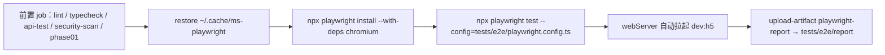

**图表来源**
- [ci.yml:459-511](file://.github/workflows/ci.yml#L459-L511)
- [playwright.config.ts:42-82](file://tests/e2e/playwright.config.ts#L42-L82)

### 并行与重试的真实取值
CI 并发度由配置强制为串行：`workers: process.env.CI ? 1 : 1`（两个分支同为 1，注释理由「串行：避免 dev server 并发占用」），且 `fullyParallel: false`（注释理由「uni-app H5 dev 单实例，避免端口冲突」）。因此 `--parallel` 在本仓库不是可用优化项，唯一有效的并行维度是两个 project 各自跑一遍用例。

重试方面 `retries: process.env.CI ? 2 : 0`，配合 `trace: 'on-first-retry'`：CI 上第一次重试会录制 trace，本地不重试也就不会产生 trace。`forbidOnly: !!process.env.CI` 保证 CI 不会因遗留的 `test.only` 而漏跑用例。

**章节来源**
- [playwright.config.ts:38-52](file://tests/e2e/playwright.config.ts#L38-L52)
- [ci.yml:47-48](file://.github/workflows/ci.yml#L47-L48)

### 报告产物与历史运行证据
配置声明三种 reporter 叠加：`html`（输出到 `tests/e2e/report`）、`list`，以及 CI 环境追加的 `github-actions`。仓库内保留了两类运行痕迹：其一是当前 `tests/e2e/test-results/` 下两个失败用例目录，每个含 `error-context.md`、`test-failed-1.png`、`video.webm` 三件产物（文件名与配置中的 `screenshot: 'only-on-failure'`、`video: 'retain-on-failure'` 完全对应）；其二是历史遗留的嵌套目录 `tests/e2e/tests/e2e/report/index.html`（89 行），它是 `testDir` 路径修复前 reporter 输出目录被二次拼接的结果，可作为该缺陷的实物证据。

**章节来源**
- [playwright.config.ts:42-52](file://tests/e2e/playwright.config.ts#L42-L52)
- [index.html:1-89](file://tests/e2e/tests/e2e/report/index.html#L1-L89)
- [.last-run.json:1-6](file://tests/e2e/test-results/.last-run.json#L1-L6)
- [ci.yml:510-511](file://.github/workflows/ci.yml#L510-L511)

### 门禁阻断的声明与实际
`accessibility.spec.ts` 注释规定「Critical / Serious：必须修复，CI 阻断」，实现方式是断言数量为 0 使用例失败，再由 `needs` 链在下游阻断合并；注释中的 Moderate/Minor 分级没有任何代码化处理（既未记录到文件，也未生成工单）。同样，「生成 a11y 报告」的 `--reporter=html` 是注释建议的手工命令，CI 未单独运行 `@a11y` 子集，而是全量执行三份规格。

**章节来源**
- [accessibility.spec.ts:34-39](file://tests/e2e/specs/accessibility.spec.ts#L34-L39)
- [accessibility.spec.ts:107-116](file://tests/e2e/specs/accessibility.spec.ts#L107-L116)
- [accessibility.spec.ts:25-32](file://tests/e2e/specs/accessibility.spec.ts#L25-L32)
- [ci.yml:501-503](file://.github/workflows/ci.yml#L501-L503)

## 视觉回归与截图对比现状
这一节区分「仓库里真实存在的图像相关能力」与「catalog 期望但未见实现的能力」，避免把 Playwright 的通用能力当作本项目已接入项。

### 已实现：失败取证类图像
配置中 `screenshot: 'only-on-failure'` 与 `video: 'retain-on-failure'` 使失败用例自动产出 `test-failed-1.png` 与 `video.webm`，落盘位置由 `outputDir: './test-results'` 决定。仓库中这两个目录各自完整保留了三件产物（`error-context.md` + `test-failed-1.png` + `video.webm`），证明该机制实际生效过。`trace: 'on-first-retry'` 只在 CI 首次重试时录制，当前保留的运行目录中未见 trace 文件，与本地 `retries: 0` 的组合一致。

这三者属于「失败诊断」而非「视觉比对」：它们没有基线，也不做像素差异判定。

### 未实现：快照基线比对
三份规格均未调用 `expect(...).toHaveScreenshot()`，未配置 `snapshotDir`/`snapshotPathTemplate`，`tests/e2e` 目录下也不存在快照基线子目录（实际文件仅 `playwright.config.ts`、`specs/` 三份规格、`test-results/` 运行产物，以及历史遗留的 `tests/e2e/tests/e2e/report` 与 `test-results`）。因此按 Playwright 原生机制的截图对比、视觉回归基线更新（`--update-snapshots`）在本仓库没有接入证据。

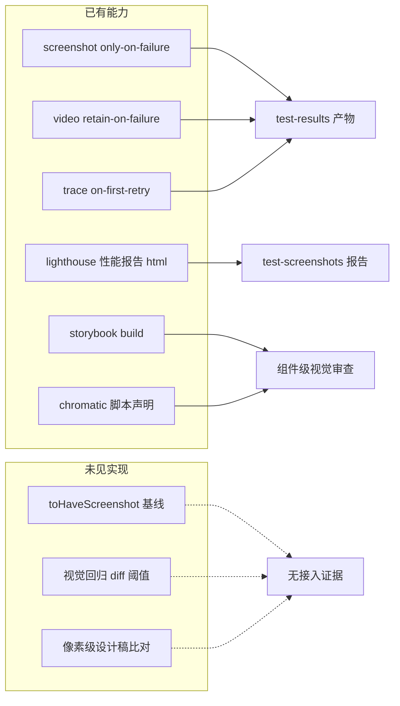

[此图为能力盘点示意，其中「未见实现」分支不对应源文件，故不提供图表来源]

### 相邻的图像与视觉工具链
根 `package.json` 的 `dependencies` 含 `puppeteer@~24.43.1` 与 `sharp@~0.34.5`，说明存在另一条基于 Puppeteer 的浏览器自动化路径与图像处理能力；`lighthouse:client`、`lighthouse:admin`、`lighthouse:ci` 三条脚本把性能审计报告写入 `./test-screenshots/`，CI 版走 `lhci autorun --config=config/lighthouserc.json`。`apps/client/package.json` 则声明 `storybook`、`build-storybook` 与 `chromatic --exit-zero-on-changes`，指向组件级视觉审查，但 `--exit-zero-on-changes` 意味着视觉差异不判失败。这些工具链与 Playwright E2E 层相互独立，没有共享配置或产物目录。

**章节来源**
- [playwright.config.ts:37-58](file://tests/e2e/playwright.config.ts#L37-L58)
- [package.json:19-26](file://package.json#L19-L26)
- [package.json:39-42](file://package.json#L39-L42)
- [package.json (client):48-50](file://apps/client/package.json#L48-L50)
- [core-journey.spec.ts:1-219](file://tests/e2e/specs/core-journey.spec.ts#L1-L219)
- [all-pages-smoke.spec.ts:1-115](file://tests/e2e/specs/all-pages-smoke.spec.ts#L1-L115)
- [accessibility.spec.ts:1-216](file://tests/e2e/specs/accessibility.spec.ts#L1-L216)

## 依赖关系分析
### 模块依赖图
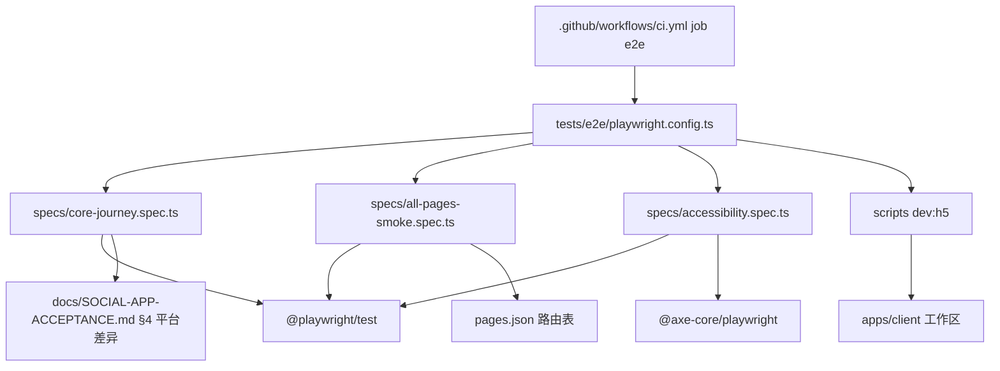

**图表来源**
- [playwright.config.ts:1-83](file://tests/e2e/playwright.config.ts#L1-L83)
- [accessibility.spec.ts:1-2](file://tests/e2e/specs/accessibility.spec.ts#L1-L2)
- [all-pages-smoke.spec.ts:22-85](file://tests/e2e/specs/all-pages-smoke.spec.ts#L22-L85)
- [ci.yml:501-503](file://.github/workflows/ci.yml#L501-L503)

### 测试运行器的依赖声明缺口
三份规格从 `@playwright/test` 导入 `test`、`expect`、`type Page`，`accessibility.spec.ts` 额外从 `@axe-core/playwright` 导入默认导出 `AxeBuilder`。这两个包在根 `package.json` 的 `dependencies`（`puppeteer`、`sharp`）与 `devDependencies`（`@eslint/js`、`@lhci/cli`、`@stoplight/spectral-cli`、`eslint`、`eslint-plugin-vue`、`lighthouse`、`openapi-typescript`、`typescript-eslint`、`yaml`）中都没有声明，`apps/client/package.json` 的 `devDependencies` 亦只含 dcloudio、vitest、vue-tsc 一类条目而不含 Playwright。配置文件头部注释给出的补齐方式是手工执行 `pnpm --filter @campus-love/client add -D @playwright/test` 与 `npx playwright install --with-deps chromium`。锁文件层面，`pnpm-lock.yaml` 存在 `axe-core@4.12.1` 与 `axe-core@4.7.2` 的解析记录，但那是被其他包引入的间接依赖，不等同于 `@axe-core/playwright` 已在工程中声明。

其直接后果是：`npx playwright ...` 在无全局或无本地安装时会触发在线拉取；CI 的 e2e job 通过 `npx playwright install --with-deps chromium` 只解决浏览器二进制，不解决 npm 包本身。

**章节来源**
- [core-journey.spec.ts:1-1](file://tests/e2e/specs/core-journey.spec.ts#L1-L1)
- [accessibility.spec.ts:1-2](file://tests/e2e/specs/accessibility.spec.ts#L1-L2)
- [playwright.config.ts:17-31](file://tests/e2e/playwright.config.ts#L17-L31)
- [package.json:28-42](file://package.json#L28-L42)
- [package.json (client):98-111](file://apps/client/package.json#L98-L111)
- [pnpm-lock.yaml:2791-2795](file://pnpm-lock.yaml#L2791-L2795)
- [ci.yml:499-503](file://.github/workflows/ci.yml#L499-L503)

### 包管理器与运行环境
`webServer.command` 使用 `pnpm --filter @campus-love/client run dev:h5`，而根 `package.json` 的等价脚本 `client:dev:h5` 使用 `npm --workspace apps/client run dev:h5`；根 `package.json` 的 `packageManager` 字段锁定为 `pnpm@11.17.0` 并带 sha512 完整性校验，`workspaces` 声明 `apps/client` 与 `apps/admin`。`engines` 在根与 client 两侧一致：`node >=18.0.0 <23.0.0`、`npm >=9.0.0`。混用 pnpm 与 npm 两条入口是本层的一个可执行性风险：环境若只有 npm 而无 pnpm，`webServer` 无法启动，全部用例会因 5173 端口无服务而超时。

**章节来源**
- [playwright.config.ts:73-82](file://tests/e2e/playwright.config.ts#L73-L82)
- [package.json:5-13](file://package.json#L5-L13)
- [package.json:43-47](file://package.json#L43-L47)
- [package.json (client):112-115](file://apps/client/package.json#L112-L115)

### 与静态检查链的关系
根 `lint` 脚本的检查范围为 `apps/admin/src apps/client/src tools eslint.config.mjs`，未包含 `tests` 目录；`verify:phase01` 的组合为 `test && lint:openapi && lint:openapi:spectral && client typecheck && verify:client-builds && api:test`，同样不含 Playwright 执行。换言之，`tests/e2e` 下的 TypeScript 既不被 ESLint 覆盖，也不被 `verify:phase01` 运行，只有 CI 的 `e2e` job 会实际执行它。

**章节来源**
- [package.json:15-23](file://package.json#L15-L23)
- [ci.yml:24-26](file://.github/workflows/ci.yml#L24-L26)

### 仓库内另一条端到端验收链
除 Playwright 外，审计产物登记了一条脚本化的验收链路：`reports/audit/real-e2e/GATES.json` 将 runner 记为 `scripts/qa/g8-e2e.cjs`，`reports/audit/real-e2e/provenance.json` 以 `"tool": "scripts/qa/g8-e2e.cjs"` 记录同一载具，`reports/audit/round-7/ledger-plan-ring6.json` 更把「G8 十环」的复验口径指向该 GATES.json。这条链与 Playwright 层互不依赖：它产出审计台账与门禁 JSON，而非浏览器报告。本文档只覆盖 Playwright 层，G8 链路的实现细节需另行成文。

**章节来源**
- [GATES.json:33-33](file://reports/audit/real-e2e/GATES.json#L33-L33)
- [provenance.json:65-65](file://reports/audit/real-e2e/provenance.json#L65-L65)

## 性能考虑
### 用例规模与串行成本
单次运行的用例规模由三份规格与两个 project 相乘得出：`core-journey.spec.ts` 声明 8 个用例（`@core-journey` 组 6 个 + `@a11y` 组 2 个）、`all-pages-smoke.spec.ts` 由 60 条路由循环生成 60 个、`accessibility.spec.ts` 声明 10 个，合计 78 个；`projects` 为 `chromium-mobile` 与 `chromium-desktop` 两项，且 `fullyParallel: false`、`workers` 在 CI 与本地同为 1，因此派发次数约 156，全部串行。

固定等待是主要时间成本。`visitPage` 每条路由执行 `waitForTimeout(1_500)`，仅冒烟层就引入约 90 秒纯等待，不含 dev server 编译与 axe 扫描；核心旅程在匹配用例中有 `waitForTimeout(2_000)`，键盘兜底分支另有 `1_000`。配合 `actionTimeout: 10_000` 与 `navigationTimeout: 30_000`，一个不可达页面最坏消耗 30 秒而非快速失败，这在串行模式下会直接放大总耗时。

**章节来源**
- [all-pages-smoke.spec.ts:22-107](file://tests/e2e/specs/all-pages-smoke.spec.ts#L22-L107)
- [core-journey.spec.ts:100-127](file://tests/e2e/specs/core-journey.spec.ts#L100-L127)
- [playwright.config.ts:38-58](file://tests/e2e/playwright.config.ts#L38-L58)

### 加载等待策略差异
冒烟层使用 `waitUntil: 'domcontentloaded'` 加固定 1.5 秒，属于「快但弱」的组合：不等资源加载完成，对异步渲染竞争更敏感，但换来 60 条路由的总耗时可控。无障碍层的 `loginAndNavigate` 使用 `waitForLoadState('networkidle')`，成本更高但保证扫描时 DOM 稳定。核心旅程依赖 `waitForURL` 正则与 web-first 断言的自动重试，不使用 networkidle。三种策略并存源于目标不同：冒烟求覆盖宽度，a11y 求扫描时点稳定，旅程求业务语义正确。

**章节来源**
- [all-pages-smoke.spec.ts:99-101](file://tests/e2e/specs/all-pages-smoke.spec.ts#L99-L101)
- [accessibility.spec.ts:59-77](file://tests/e2e/specs/accessibility.spec.ts#L59-L77)
- [core-journey.spec.ts:21-64](file://tests/e2e/specs/core-journey.spec.ts#L21-L64)

### 产物与循环调用开销
`trace: 'on-first-retry'`、`screenshot: 'only-on-failure'`、`video: 'retain-on-failure'` 把产物生成限制在失败路径，避免全量录屏的 I/O 压力；`outputDir: './test-results'` 使产物集中在可清理目录。CI 以 `~/.cache/ms-playwright` 缓存浏览器二进制，key 绑定 `runner.os` 与 `hashFiles('pnpm-lock.yaml')`，锁文件变更即失效并重新执行 `npx playwright install --with-deps chromium`。

循环内的同步求值另有隐性成本：键盘导航用例按 Tab 循环 10 次，每次 `page.evaluate` 读取 `document.activeElement`（10 次往返）；触控目标用例对前 20 个 `button, [role="button"]` 逐个 `isVisible()` 与 `boundingBox()`（最多 40 次往返）。这些开销在两个 project 下翻倍。

**章节来源**
- [playwright.config.ts:33-52](file://tests/e2e/playwright.config.ts#L33-L52)
- [ci.yml:493-499](file://.github/workflows/ci.yml#L493-L499)
- [accessibility.spec.ts:159-215](file://tests/e2e/specs/accessibility.spec.ts#L159-L215)

### 可优化但未采用的点
`workers: process.env.CI ? 1 : 1` 的两个分支取值相同，因此没有为 CI 与本地设置不同并发；`projects` 只覆盖 chromium 内核，未接入 `firefox` 或 `webkit`，视口靠 `use.viewport` 的 390×844 手工指定；核心旅程未使用 `storageState` 或 `test.describe.configure({ mode: 'serial' })` 复用登录态，登录动作在每个用例中重复。上述都是可评估的耗时来源，而非当前实现，改动前需与 `fullyParallel: false` 的单实例约束一并考虑。

**章节来源**
- [playwright.config.ts:41-69](file://tests/e2e/playwright.config.ts#L41-L69)
- [core-journey.spec.ts:68-98](file://tests/e2e/specs/core-journey.spec.ts#L68-L98)

## 故障排查指南
### 排障入口
先看 `tests/e2e/test-results/.last-run.json`：其 `status` 字段与 `failedTests` 数组直接给出上次运行的失败用例 ID；再进入对应用例目录读 `error-context.md`，其中包含用例名、`Location`（精确到 `specs` 文件行列，例如 `tests\e2e\specs\core-journey.spec.ts:84:7`）、`Error details`（断言类型、Locator、Timeout、根因如 `element(s) not found`）与 `Call log`。同名目录内的 `test-failed-1.png` 与 `video.webm` 提供视觉回放，`tests/e2e/report/index.html` 提供汇总视图。

```mermaid
flowchart TD
    A["用例失败"] --> B["读 .last-run.json 确认 status 与 failedTests"]
    B --> C["进入 test-results 用例目录"]
    C --> D["error-context.md 取 Location 与 Call log"]
    D --> E{"错误类型"}
    E --> |element(s) not found| F["检查选择器契约与页面是否已渲染"]
    E --> |Timeout 30s| G["检查 dev server 与 E2E_BASE_URL"]
    E --> |模块无法解析| H["检查 @playwright/test 与 @axe-core/playwright 是否安装"]
    E --> |a11y violations| I["核对 KNOWN_VIOLATIONS 豁免与真实缺陷"]
    F --> J["复跑：--grep 定位到单条用例"]
    G --> J
    H --> J
    I --> J
```

**图表来源**
- [error-context.md:1-24](file://tests/e2e/test-results/core-journey-核心旅程：注册-→-匹配--35959-urney-登录后可访问匹配页查看推荐人物-match-chromium-mobile/error-context.md#L1-L24)
- [.last-run.json:1-6](file://tests/e2e/test-results/.last-run.json#L1-L6)
- [playwright.config.ts:42-58](file://tests/e2e/playwright.config.ts#L42-L58)

### 高频问题与仓库内的既有处置
| 现象 | 根因 | 仓库内处置 |
| --- | --- | --- |
| 运行结果 0 个测试 | `testDir`/`outputDir` 相对配置文件目录解析，写成 `'./tests/e2e/specs'` 会重复拼接 | 配置改为 `'./specs'` 与 `'./test-results'`，遗留产物在 `tests/e2e/tests/e2e/report` |
| 打开的是首页而不是目标页 | uni-app H5 为 hash 路由，裸路径 `/pages/login/index` 无 hash | 所有导航显式带 `/#/pages/...` |
| 登录按钮点击无反应 | 按钮受 `agreed` 守卫，需先勾选协议 | `performWechatLogin` 先 `getByRole('checkbox', { name: /已阅读并同意/ }).check()` |
| H5 下微信登录失败 | `uni.login provider=weixin` 仅小程序端可用 | 改用体验号登录（`POST /v1/auth/guest-login`），按钮文案 `一键体验` |
| 底部 Tab 点不到 | custom tabBar 仅 mp-weixin 实现，H5 无底部导航 | 用 `page.goto('/#/pages/discover/index')` 等 URL 导航 |
| `toHaveAttribute` 正则属性名报错 | API 不支持属性名正则 | 拆成 `role` 与 `aria-label` 两条断言 |
| 推荐卡片断言超时 15s 且 `element(s) not found` | `.person-card, [data-testid="person-card"]` 契约漂移 | 保留在 `test-results` 的失败上下文可作为定位起点 |
| 聊天页 URL 断言与扫描路径不一致 | 核心旅程用 `/pages/messages/index`，a11y 层用 `/pages/chat/index`，冒烟表用 `/pages/messages/index` 与 `/pages/chat-session/index` | 排障时先确认页面路由的真实取值 |
| axe 扫描报 TabBar 角色问题 | uni-app H5 下 `role=tablist` 不完整（已知限制） | `KNOWN_VIOLATIONS['/pages/login/index']` 豁免 `aria-allowed-role` |
| 发现页 region 规则报违规 | CardSwiper 在某些场景需双焦点（mp-weixin 限制） | `KNOWN_VIOLATIONS['/pages/discover/index']` 豁免 `region` |

**章节来源**
- [playwright.config.ts:34-37](file://tests/e2e/playwright.config.ts#L34-L37)
- [core-journey.spec.ts:21-64](file://tests/e2e/specs/core-journey.spec.ts#L21-L64)
- [core-journey.spec.ts:197-219](file://tests/e2e/specs/core-journey.spec.ts#L197-L219)
- [core-journey.spec.ts:84-98](file://tests/e2e/specs/core-journey.spec.ts#L84-L98)
- [accessibility.spec.ts:45-55](file://tests/e2e/specs/accessibility.spec.ts#L45-L55)
- [accessibility.spec.ts:139-142](file://tests/e2e/specs/accessibility.spec.ts#L139-L142)
- [all-pages-smoke.spec.ts:37-45](file://tests/e2e/specs/all-pages-smoke.spec.ts#L37-L45)

### 等待与超时类问题
元素定位失败的常见成因是渲染尚未完成。现有代码给出三种可复用手段：`waitForURL` 带显式超时（登录 15_000ms、登录后跳转 30_000ms、会话详情 15_000ms）、`isVisible({ timeout }).catch(() => false)` 的探测式软处理、以及 `waitForTimeout` 的固定等待（1_000ms 至 2_000ms）。对于首屏异步数据，冒烟层统一采用 `domcontentloaded` + 1_500ms 固定窗口；若某页面因接口延迟而稳定报空白，应优先延长该窗口或改用 web-first 断言，而不是新增用例。

**章节来源**
- [core-journey.spec.ts:21-64](file://tests/e2e/specs/core-journey.spec.ts#L21-L64)
- [core-journey.spec.ts:148-194](file://tests/e2e/specs/core-journey.spec.ts#L148-L194)
- [all-pages-smoke.spec.ts:88-107](file://tests/e2e/specs/all-pages-smoke.spec.ts#L88-L107)

### 环境与端口类问题
`baseURL` 优先取 `E2E_BASE_URL`，缺省 `http://localhost:5173`；`webServer.url` 探活同一地址且 `reuseExistingServer: true`。若本地已用 `client:dev:h5` 或 `client:dev:h5:real` 占用 5173，Playwright 会直接复用；若需要指向部署环境，只能通过 `E2E_BASE_URL` 覆盖 `use.baseURL`，而 `webServer.url` 与 `command` 是硬编码的——指向远端时 Playwright 仍会尝试本地拉起 dev server。此外 `webServer.command` 依赖 pnpm，环境缺 pnpm 时表现为 180_000ms 探活超时。

**章节来源**
- [playwright.config.ts:47-58](file://tests/e2e/playwright.config.ts#L47-L58)
- [playwright.config.ts:73-82](file://tests/e2e/playwright.config.ts#L73-L82)
- [package.json:12-13](file://package.json#L12-L13)

## 未接入能力登记
catalog 对本页的能力期望宽于仓库现状。下表逐条登记「已核对但仓库中没有接入证据」的能力，证据列给出核查过的真实事实，结论列统一写「未接入」，避免读者把通用 Playwright 能力误认为本项目的实现。

| 期望能力 | 已核查的真实证据 | 结论 |
| --- | --- | --- |
| 微信小程序端 E2E 执行 | `projects` 仅 `chromium-mobile`（`devices['Pixel 5']`）与 `chromium-desktop`（`devices['Desktop Chrome']`）；`webServer.command` 只跑 `dev:h5`；`tests/e2e` 下仅三份规格，无 mp-weixin 端规格文件；`apps/client/package.json` 虽有 `dev:mp-weixin` 脚本与 `miniprogram-automator` 依赖声明，但 E2E 层未引用 | 未接入（mp-weixin 仅出现在配置注释与环境差异说明中） |
| 截图对比 / 视觉回归基线 | 三份规格均未调用 `toHaveScreenshot`，未配置 `snapshotDir`；`tests/e2e` 目录内无基线快照子目录；`chromatic` 脚本存在但带 `--exit-zero-on-changes` | 未接入（只有失败截图与失败录像） |
| 测试依赖声明 | 根 `package.json` 的 `dependencies`/`devDependencies` 与 `apps/client/package.json` 的 `devDependencies` 均不含 `@playwright/test` 与 `@axe-core/playwright`；补齐方式仅写在配置注释里（`pnpm --filter @campus-love/client add -D @playwright/test`） | 未接入（依赖需手工安装，运行前提不受版本锁约束） |
| `USE_DEV_SERVER` 环境开关 | 配置头部注释声明「通过 USE_DEV_SERVER 环境变量切换 baseURL」，但 `defineConfig` 主体中只读取 `E2E_BASE_URL`、`CI`、`NODE_ENV` | 未接入（注释与实现不一致） |
| 远端环境的 webServer 切换 | `webServer.url` 与 `command` 为硬编码本地地址与本地命令，`baseURL` 可用 `E2E_BASE_URL` 覆盖但 webServer 不可关闭 | 未接入（指向远端时仍会尝试本地起服务） |
| E2E 的 lint 与类型检查 | 根 `lint` 脚本范围为 `apps/admin/src apps/client/src tools eslint.config.mjs`，不含 `tests`；`verify:phase01` 组合中不含 Playwright；未见针对 `tests/e2e` 的 ESLint 或 tsconfig 配置证据 | 未接入 |
| 测试数据构造与回收 | 无 `storageState`、无 `test.beforeAll` 数据准备、无 seed/teardown 脚本、无后端健康检查；隔离依赖「每个用例重新登录」与 mock 数据 | 未接入 |
| 网络异常与延迟模拟 | 三份规格未使用 `page.route`、`setOffline`、网络节流或请求拦截；只有超时阈值与固定等待 | 未接入 |
| 跨域问题处置 | `tests/e2e` 内无代理、无 CORS 相关配置；`baseURL` 单一来源，用例只访问同源 hash 路由 | 无此类问题证据（因此也无处置方案） |
| 并行执行优化 | `fullyParallel: false` 且 `workers` 两个分支均为 1，配置注释说明是为规避 dev server 端口冲突 | 未接入（当前为刻意串行） |
| 多浏览器内核覆盖 | `projects` 仅 chromium；无 firefox、无 webkit 上下文 | 未接入 |
| 无障碍独立门禁 | `apps/client` 提供 `test:a11y` 脚本（`--grep=@a11y`），但 CI 的 `e2e` job 执行全量命令 `npx playwright test --config=tests/e2e/playwright.config.ts`；注释里的 Moderate/Minor 分级没有代码化处理 | 部分未接入（分级与独立 job 无实现） |
| 失败用例的定向重跑 | 依赖 Playwright 原生 `--last-failed` 能力，仓库脚本未封装；`.last-run.json` 只反映状态 | 未接入（仅可由开发者手工执行 CLI 参数） |

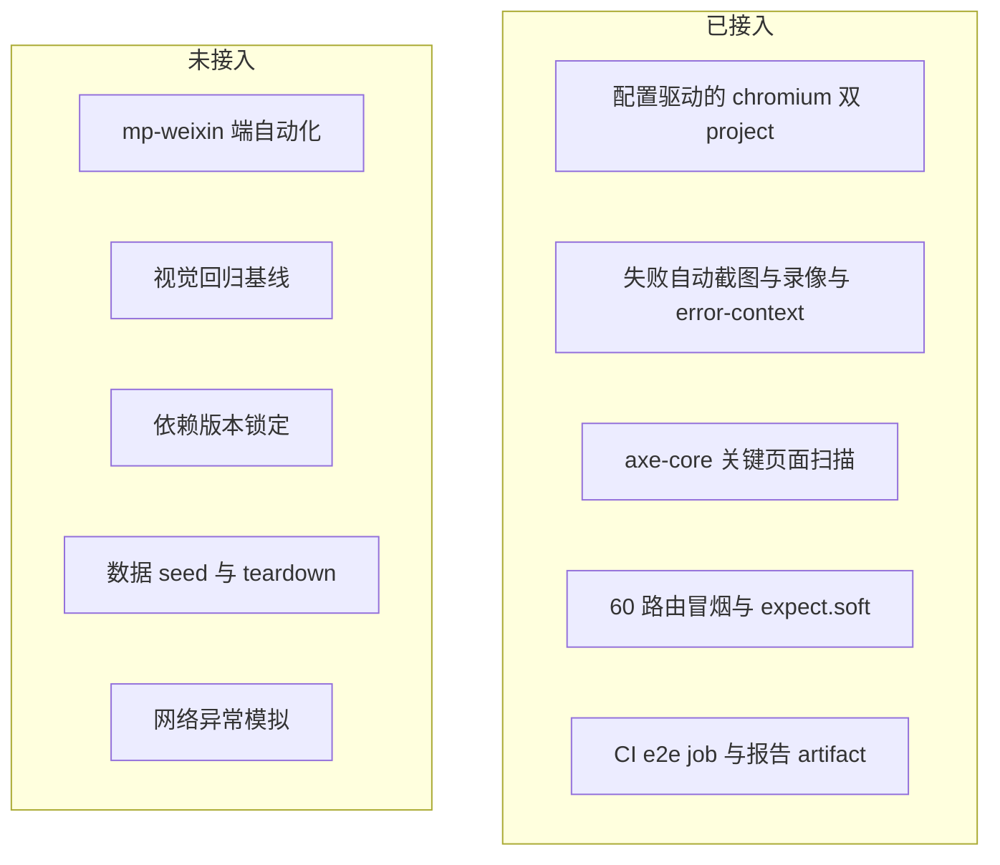

[此图为能力盘点示意，不对应具体源文件，故不提供图表来源]

**章节来源**
- [playwright.config.ts:1-83](file://tests/e2e/playwright.config.ts#L1-L83)
- [core-journey.spec.ts:1-219](file://tests/e2e/specs/core-journey.spec.ts#L1-L219)
- [all-pages-smoke.spec.ts:1-115](file://tests/e2e/specs/all-pages-smoke.spec.ts#L1-L115)
- [accessibility.spec.ts:1-216](file://tests/e2e/specs/accessibility.spec.ts#L1-L216)
- [package.json:9-42](file://package.json#L9-L42)
- [package.json (client):19-53](file://apps/client/package.json#L19-L53)
- [package.json (client):98-111](file://apps/client/package.json#L98-L111)
- [ci.yml:499-511](file://.github/workflows/ci.yml#L499-L511)

## 结论
`tests/e2e` 是一个刻意保持小的 Playwright 层：一个配置文件、三份规格、78 个用例、两个 chromium project、串行执行、mock 数据、失败自动取证。它的价值集中在三点：以 `@core-journey` 标签锁住「登录 → 匹配 → 聊天」这条最小可运行路径；以 60 条路由的冒烟矩阵换取「页面不白屏、控制台无 error」的宽度覆盖；以 axe-core 的 critical/serious 零违规断言建立无障碍下限。配置层的 `testDir` 路径修复、`forbidOnly` 与 CI 重试组合，以及 CI 中显式 `--config` 的约定（FIN-00278），说明这一层经过实际运行与失败反馈的调整，而非模板产物。

其边界同样清楚：小程序端没有自动化执行入口（仅 chromium 桌面/移动视口 + H5 dev server）、没有截图基线比对、没有测试数据构造与回收、`@playwright/test` 与 `@axe-core/playwright` 未在 package.json 中声明、`tests/e2e` 不在 ESLint 与 `verify:phase01` 覆盖范围内。三份规格之间的登录文案假设（`一键体验` 与 `/微信登录|微信一键登录/`）与聊天页路由假设（`/pages/messages/index` 与 `/pages/chat/index`）存在漂移，`test-results` 中保留的 `person-card` 超时失败上下文说明选择器契约仍需与页面实现对齐。

若要继续投入，按证据优先级排序的改进是：其一，把两个测试依赖写入 workspace 的 devDependencies，使运行前提可被锁文件复现；其二，把跨规格共享的登录与导航 helper 抽为单一来源，统一按钮文案与路由取值；其三，为 `webServer` 增加可关闭开关，使 `E2E_BASE_URL` 指向远端环境时不再本地起服务；其四，将 `tests/e2e` 纳入 lint 与类型检查范围，使选择器与 API 误用在提交前暴露；其五，若小程序端必须纳入自动化，需另行设计基于微信开发者工具链路的执行方案，Playwright 的 chromium project 无法覆盖该端。

**章节来源**
- [playwright.config.ts:33-83](file://tests/e2e/playwright.config.ts#L33-L83)
- [core-journey.spec.ts:1-219](file://tests/e2e/specs/core-journey.spec.ts#L1-L219)
- [all-pages-smoke.spec.ts:1-115](file://tests/e2e/specs/all-pages-smoke.spec.ts#L1-L115)
- [accessibility.spec.ts:1-216](file://tests/e2e/specs/accessibility.spec.ts#L1-L216)
- [ci.yml:459-511](file://.github/workflows/ci.yml#L459-L511)

## 附录

### A. 运行入口对照

| 入口 | 位置 | 实际命令 | 备注 |
| --- | --- | --- | --- |
| workspace 脚本 | `apps/client/package.json` L44 | `playwright test --config=../../tests/e2e/playwright.config.ts` | 需在 client 工作目录执行，相对路径以 `apps/client` 为基准 |
| UI 模式 | `apps/client/package.json` L45 | `... test --ui --config=../../tests/e2e/playwright.config.ts` | 交互式调试 |
| 无障碍子集 | `apps/client/package.json` L46 | `... test --grep=@a11y --config=../../tests/e2e/playwright.config.ts` | 依赖标题含 `@a11y` 标签 |
| 根目录脚本 | 根 `package.json` | **无 e2e 入口** | 根 `test` 链为 `test:prototype && test:structure && test:client`，与本层平行 |
| 配置注释里的命令 | `playwright.config.ts` L17-L31 | `npx playwright test --config=tests/e2e/playwright.config.ts` 等四条 | 从**仓库根**执行的写法，与 workspace 脚本的 `../../` 形式互为镜像；注释还给出安装前提 `pnpm --filter @campus-love/client add -D @playwright/test` 与 `npx playwright install --with-deps chromium` |

两套命令写法并存本身不是错误，但**执行目录必须与所选路径匹配**：在仓库根用 `../../tests/e2e/...` 会指向仓库外，在 `apps/client` 用 `tests/e2e/...` 会指向不存在的路径。

### B. 配置默认值速查

| 键 | 值 | 行号 | 排查含义 |
| --- | --- | --- | --- |
| `testDir` / `outputDir` | `./specs` / `./test-results` | L36-L37 | 相对**配置文件所在目录**解析，产物落在 `tests/e2e/test-results` |
| `fullyParallel` | `false` | L38 | 注释理由：uni-app H5 dev 单实例，避免端口冲突 |
| `workers` | CI 1、本地 1 | L41 | 三元表达式两端同为 1，即**始终串行**；"CI 资源有限时通过 workers 限制"的设计意图并未形成差异 |
| `retries` | CI 2、本地 0 | L40 | 配合 `trace: 'on-first-retry'`，本地首跑失败**不留 trace** |
| `forbidOnly` | `!!process.env.CI` | L39 | 仅 CI 禁止 `test.only` |
| `baseURL` | `process.env.E2E_BASE_URL ?? 'http://localhost:5173'` | L49 | 未注入即打本地 dev server |
| `screenshot` / `video` | `only-on-failure` / `retain-on-failure` | L51-L52 | 通过用例不产出媒体证据 |
| `actionTimeout` / `navigationTimeout` | 10_000 / 30_000 | L53-L54 | 选择器等待超 10 秒即失败，是 `person-card` 类超时的直接来源 |
| `locale` / `timezoneId` | `zh-CN` / `Asia/Shanghai` | L55-L56 | 断言文案依赖 locale 固定 |
| `viewport` | 390×844 | L57 | 注释称 iPhone 14 尺寸，而 `projects` 实际用 Pixel 5 覆盖 |
| `projects` | `chromium-mobile`(Pixel 5)、`chromium-desktop`(Desktop Chrome) | L59-L69 | 小程序端无 project |
| `reporter` | `html`→`tests/e2e/report`、`list`、CI 加 `github-actions` | L42-L46 | `outputFolder` 是相对路径，报告位置随执行目录漂移 |
| `webServer` | `pnpm --filter @campus-love/client run dev:h5`，轮询 5173，`timeout` 180_000，`reuseExistingServer: true` | L73-L82 | 依赖 pnpm；仅有 npm 的环境无法拉起服务 |

### C. 产物落点与现存证据

`outputDir` 指向 `tests/e2e/test-results`，其中当前保留两份失败上下文，目录名即用例标识的 slug 化结果，均带 `chat-chromium-mobile` / `match-chromium-mobile` 后缀：

- `core-journey-核心旅程：注册-→-匹配--30a5c-e-journey-聊天页会话列表可正常渲染-chat-chromium-mobile`
- `core-journey-核心旅程：注册-→-匹配--35959-urney-登录后可访问匹配页查看推荐人物-match-chromium-mobile`

两者都属 `chromium-mobile` project，说明失败发生在移动端视口配置下；后缀中的哈希段来自 Playwright 对超长用例名的截断，**用它反查用例时要按前缀匹配而不是全等匹配**。

另有一处历史痕迹值得注意：`tests/e2e/tests/e2e/` 这个嵌套空目录是配置修正前的产物。修正前的 `testDir` 写成 `'./tests/e2e/specs'`，而该值相对配置文件目录解析，实际拼成 `tests/e2e/tests/e2e/specs` → 发现 0 个测试；L34-L35 的注释记录了这次修复。看到 0 测试时优先核对 `testDir` 的解析基准，而不是怀疑规格内容。

### D. 提交前检查清单

1. 确认执行目录与 `--config` 路径形式匹配（根目录用 `tests/e2e/...`，`apps/client` 用 `../../tests/e2e/...`）。
2. 确认 `pnpm` 可用，或先用 `client:dev:h5` 手工起 5173 供 `reuseExistingServer` 复用。
3. 若要指向远端环境，需自行处理 `webServer` 仍会本地拉起 dev server 这一事实（配置未提供关闭开关）。
4. 需要失败证据时以 CI 运行（本地 `retries: 0` 不产 trace）。
5. 断言涉及文案/时间/货币时，确认运行环境未被外部 `locale`、`timezoneId` 覆盖。
6. 新增规格文件放入 `tests/e2e/specs/`，不要依赖 `tests/e2e/tests/` 下的历史空目录。

**章节来源**
- [playwright.config.ts:17-31](file://tests/e2e/playwright.config.ts#L17-L31)
- [playwright.config.ts:33-83](file://tests/e2e/playwright.config.ts#L33-L83)
- [package.json (client):44-46](file://apps/client/package.json#L44-L46)
