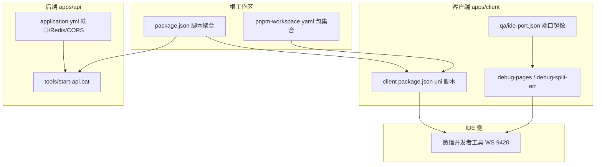
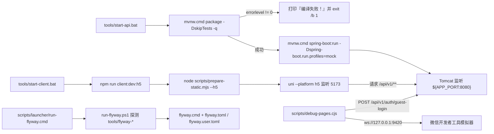
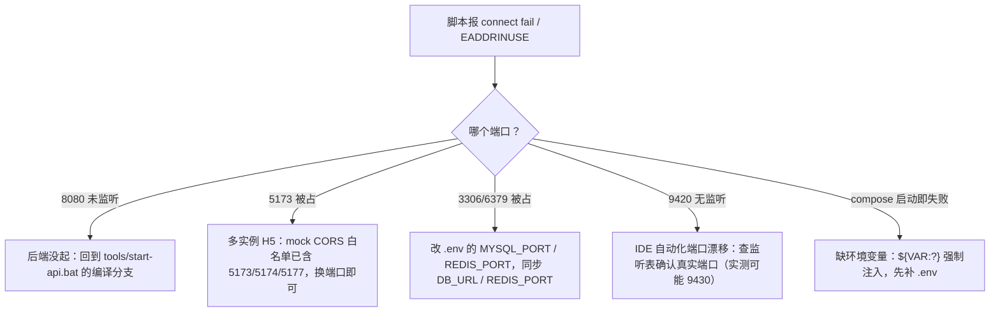
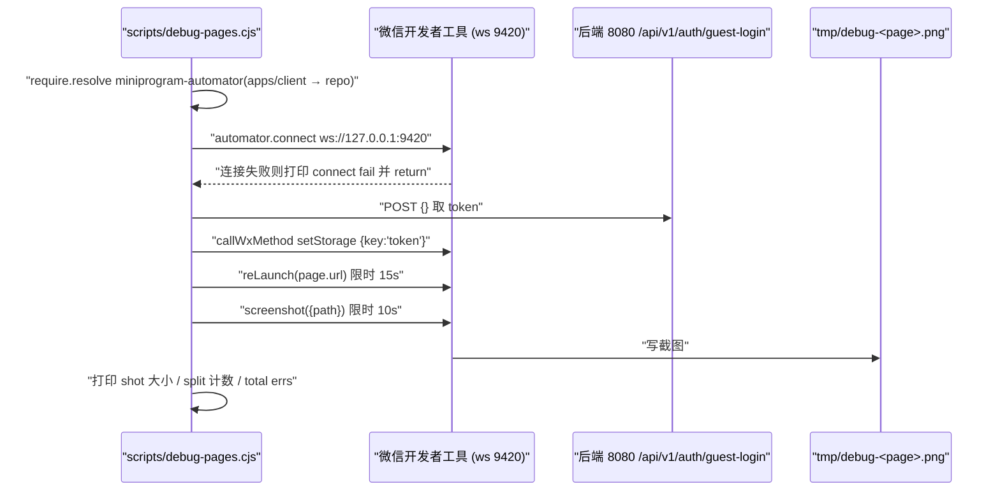
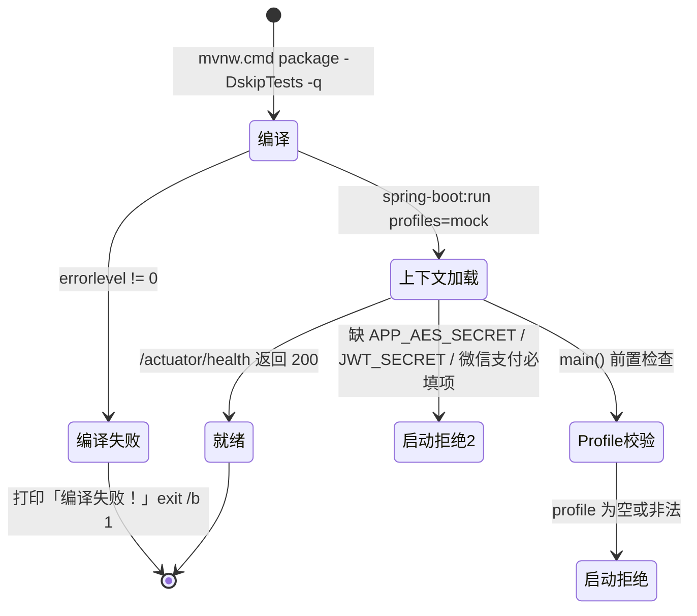
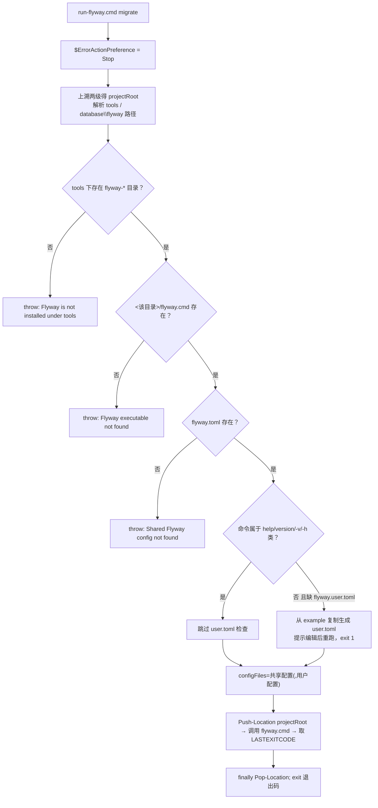
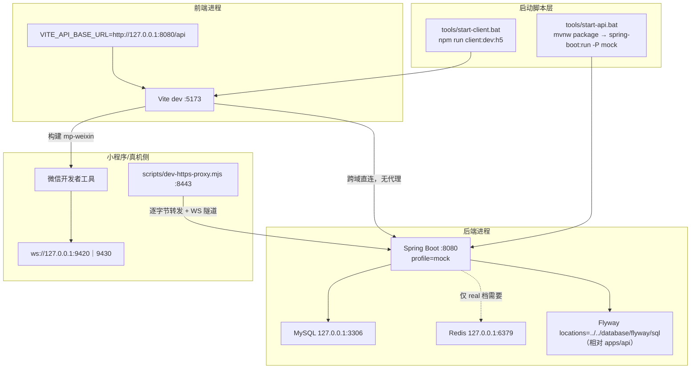
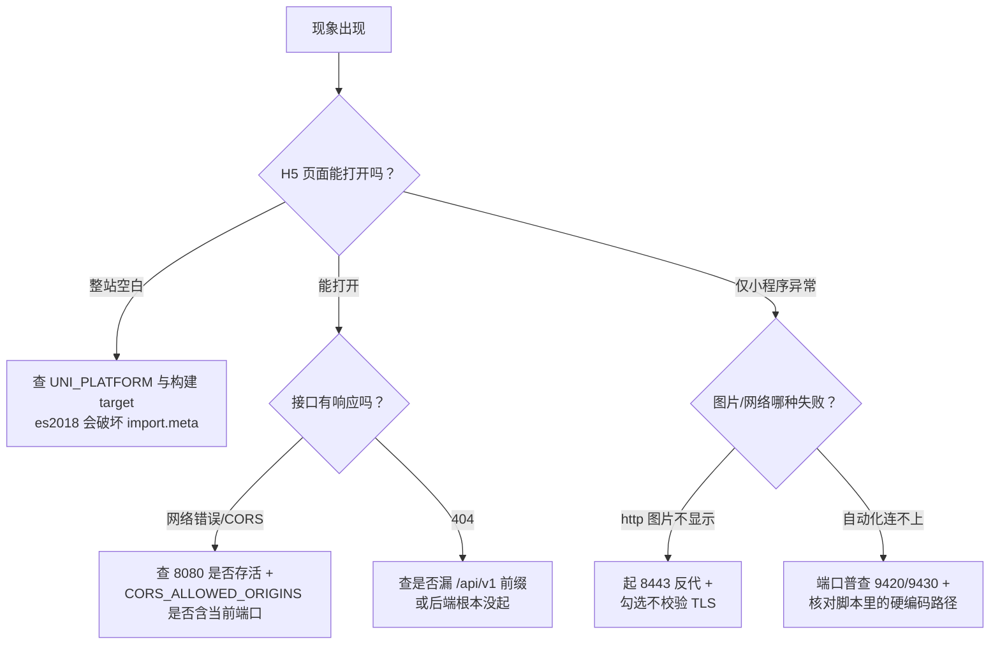

# 开发环境问题排查

<cite>
**本文引用的文件**
- [debug-pages.cjs](file://scripts/debug-pages.cjs)
- [debug-split-err.cjs](file://scripts/debug-split-err.cjs)
- [test-clearstorage.cjs](file://scripts/test-clearstorage.cjs)
- [test-image-load.cjs](file://scripts/test-image-load.cjs)
- [test-png-load.cjs](file://scripts/test-png-load.cjs)
- [start-client.bat](file://tools/start-client.bat)
- [start-api.bat](file://tools/start-api.bat)
- [package.json](file://package.json)
- [pnpm-workspace.yaml](file://pnpm-workspace.yaml)
- [apps/client/package.json](file://apps/client/package.json)
- [application.yml](file://apps/api/src/main/resources/application.yml)
- [ide-port.json](file://scripts/qa/ide-port.json)
- [debug-pages.cjs](file://scripts/debug-pages.cjs)
- [debug-split-err.cjs](file://scripts/debug-split-err.cjs)
- [test-clearstorage.cjs](file://scripts/test-clearstorage.cjs)
- [test-image-load.cjs](file://scripts/test-image-load.cjs)
- [test-png-load.cjs](file://scripts/test-png-load.cjs)
- [ide-port.json](file://scripts/qa/ide-port.json)
- [run-flyway.ps1](file://scripts/launcher/run-flyway.ps1)
- [run-flyway.cmd](file://scripts/launcher/run-flyway.cmd)
- [application-mock.yml](file://apps/api/src/main/resources/application-mock.yml)
- [logback-spring.xml](file://apps/api/src/main/resources/logback-spring.xml)
- [GlobalExceptionHandler.java](file://apps/api/src/main/java/com/campuslove/api/config/GlobalExceptionHandler.java)
- [ApiResponse.java](file://apps/api/src/main/java/com/campuslove/api/common/ApiResponse.java)
- [docker-compose.yml](file://docker-compose.yml)
- [.env.example](file://.env.example)
- [flyway.toml](file://database/flyway/flyway.toml)
- [flyway.user.toml.example](file://database/flyway/flyway.user.toml.example)
- [vite.config.ts](file://apps/client/vite.config.ts)
- [tsconfig.json](file://apps/client/tsconfig.json)
- [.env.development](file://apps/client/.env.development)
</cite>

## 目录
1. [简介](#简介)
2. [项目结构](#项目结构)
3. [核心组件](#核心组件)
4. [架构总览](#架构总览)
5. [详细组件分析](#详细组件分析)
6. [配置与开关](#配置与开关)
7. [能力缺口与无证据项登记](#能力缺口与无证据项登记)
8. [依赖关系分析](#依赖关系分析)
9. [性能考虑](#性能考虑)
10. [故障排查指南](#故障排查指南)
11. [结论](#结论)
12. [附录](#附录)

## 简介
本文面向 Campus Love 项目的本地开发者，聚焦"开发环境跑不起来"这一类问题的取证与定位路径。与运行期业务故障不同，开发环境故障的判定依据集中在三处：本地启动脚本与批处理入口、Node 侧调试/测试脚本、以及后端 Spring Boot 的配置与日志落盘位置。

本文只描述仓库里真实存在的入口和真实存在的文件：
- 前端 H5 Mock 启动入口 `tools/start-client.bat`，声明后端在 `http://localhost:8080`、前端在 `http://localhost:5173`，最终执行 `npm run client:dev:h5`。
- 后端 Mock 启动入口 `tools/start-api.bat`，先 `mvnw.cmd package -DskipTests -q` 再 `mvnw.cmd spring-boot:run -Dspring-boot.run.profiles=mock`，并带 `errorlevel` 非零即退出的编译失败分支。
- 数据库迁移入口 `scripts/launcher/` 下的 `run-flyway` 命令对（cmd 转发到 ps1，ps1 在 `tools/flyway-*` 目录里查找可执行文件）。
- 后端统一异常出口 `apps/api/src/main/java/com/campuslove/api/config/GlobalExceptionHandler.java` 与统一响应体 `ApiResponse`，日志由 `logback-spring.xml` 的 4 个 appender 落盘。
- 小程序侧的 5 个 `.cjs` 调试脚本（页面结构、分包错误、storage 清理、图片加载、PNG 加载）。

对任务书提出但仓库里没有实现证据的主题（例如 HTTPS 证书生成工具、本地域名映射配置），本文不设"解决方法"章节，统一在第 7 节登记为能力缺口，避免读者按不存在的命令操作。

## 项目结构
开发环境相关的可执行入口按"三端 + 一库"分布：

```
恋爱小程序/
├── apps/
│   ├── api/                      后端 Spring Boot（mvnw.cmd 自包含，Mock profile）
│   └── ...                       前端 / 小程序端
├── database/flyway/sql/          Flyway 版本化迁移脚本（V<日期>.<序号>__*.sql）
├── scripts/
│   ├── debug-pages.cjs           页面清单/结构调试脚本
│   ├── debug-split-err.cjs       分包错误调试脚本
│   ├── test-*.cjs                storage 与图片加载的独立验证脚本
│   └── launcher/                 run-flyway 等启动器（cmd 转发 ps1）
└── tools/
    ├── start-client.bat          前端 H5 Mock 启动
    ├── start-api.bat             后端 Mock 编译 + 启动
    └── flyway-*                  Flyway 可发行包目录（被 launcher 探测）
```

启动顺序上的依赖关系是硬性的：`tools/start-client.bat` 在执行 `npm run client:dev:h5` 之前先用一行提示要求"后端已在 `http://localhost:8080` 运行"，因此前端报"连接被拒绝"时，第一优先排查对象是 `start-api.bat` 的编译阶段而非前端本身。

**章节来源**
- [start-client.bat:1-15](file://tools/start-client.bat#L1-L15)
- [start-api.bat:1-23](file://tools/start-api.bat#L1-L23)

## 核心组件
开发环境故障面由五类构件决定，排查时按"谁先失败"排序：

1. 根工作区脚本层：根 `package.json` 定义 `api:dev`（`node tools/run-api-wrapper.cjs spring-boot:run -Dspring-boot.run.profiles=mock`，L10）、`client:dev:h5`（转发到 `apps/client` 的 `dev:h5`，L12）、`test:client`、`verify:phase01`（串起 lint、typecheck、构建校验与后端测试，L23）。同时声明 `workspaces: ["apps/client","apps/admin"]`（L5-L8）与 `engines.node = ">=18.0.0 <23.0.0"`（L43-L46），`packageManager` 固定为带 sha512 校验和的 `pnpm@11.17.0`（L47）。
2. 双包管理器一致性层：`pnpm-workspace.yaml` 用 `packages: ["apps/*"]` 声明工作区成员（L1-L2），`allowBuilds` 放行 `@parcel/watcher`、`core-js`、`esbuild`、`puppeteer`、`sharp`、`vue-demi` 等需要构建脚本的依赖（L3-L10），并以 `overrides` 把 `@vitejs/plugin-vue` 锁到 `5.0.5`（L12-L13）。根清单声明 npm workspaces、pnpm 清单声明 `apps/*`，两者成员集合不同（`apps/*` 会额外匹配 `apps/admin-legacy`、`apps/api` 等目录），这是本地安装/解析类异常的常见根因。
3. 客户端构建层：`apps/client/package.json` 是 uni-app CLI 的直接调用方，`dev:h5` 先跑 `node scripts/prepare-static.mjs --h5` 再 `uni --platform h5`（L19），`dev:mp-weixin` 用 `--dev` 准备静态资源后 `uni --platform mp-weixin`（L23），`build:mp-weixin:mock` 会先执行 `check-mp-image-styles.mjs --strict` 再构建并跑包体校验（L26）。类型检查为 `vue-tsc --noEmit`（L33），自动化依赖 `miniprogram-automator ^0.12.1`（L104），TypeScript 固定 `5.9.3`（L107）。
4. 后端配置层：`apps/api/src/main/resources/application.yml` 把服务端口外部化为 `${APP_PORT:8080}`（L59）、Redis 参数全部走 `REDIS_*` 环境变量（L24-L36）、CORS 允许源为 `${CORS_ALLOWED_ORIGINS:}` 且默认空（L184-L187），并显式 `spring.profiles.default: mock` 且注释说明该默认值仅对测试引导生效、真实启动须由 `CampusLoveApplication.main()` 前置校验（L4-L15）。Actuator 仅暴露 `health,info,prometheus,metrics`（L94-L103），`show-details: when_authorized`（L115-L117）。
5. 小程序自动化与取证层：`scripts/debug-pages.cjs`、`scripts/debug-split-err.cjs`、`scripts/test-clearstorage.cjs` 都以同一套方式连 IDE —— 先 `require.resolve("miniprogram-automator", { paths: [<repo>/apps/client, <repo>] })`（debug-pages L2、debug-split-err L3、test-clearstorage L2），再 `automator.connect({ wsEndpoint: 'ws://127.0.0.1:9420' })`（debug-pages L25、debug-split-err L26、test-clearstorage L5）。端口号本身的"本地镜像"是 `scripts/qa/ide-port.json`：`wsAutomatorPort: 9420`、`httpBridgePorts: [9430]`，并在注释里明确该端口只能由人在 IDE「设置 → 安全设置 → 服务端口」里开、CLI 无对应开关（L2-L9）。



**图表来源**
- [package.json:5-47](file://package.json#L5-L47)
- [pnpm-workspace.yaml:1-13](file://pnpm-workspace.yaml#L1-L13)
- [apps/client/package.json:19-33](file://apps/client/package.json#L19-L33)
- [application.yml:58-59](file://apps/api/src/main/resources/application.yml#L58-L59)
- [ide-port.json:1-10](file://scripts/qa/ide-port.json#L1-L10)

**章节来源**
- [package.json:1-48](file://package.json#L1-L48)
- [pnpm-workspace.yaml:1-13](file://pnpm-workspace.yaml#L1-L13)
- [apps/client/package.json:18-116](file://apps/client/package.json#L18-L116)
- [application.yml:1-231](file://apps/api/src/main/resources/application.yml#L1-L231)
- [debug-pages.cjs:1-58](file://scripts/debug-pages.cjs#L1-L58)
- [debug-split-err.cjs:1-58](file://scripts/debug-split-err.cjs#L1-L58)
- [test-clearstorage.cjs:1-25](file://scripts/test-clearstorage.cjs#L1-L25)
- [ide-port.json:1-10](file://scripts/qa/ide-port.json#L1-L10)

## 架构总览
本地开发态是一条有明确前后依赖的链，任一环节失败都会在下一环节以"看起来不相关"的形式出现，因此排查顺序必须与启动顺序一致。



**图表来源**
- [start-api.bat:10-21](file://tools/start-api.bat#L10-L21)
- [start-client.bat:10-13](file://tools/start-client.bat#L10-L13)
- [application.yml:58-59](file://apps/api/src/main/resources/application.yml#L58-L59)
- [apps/client/package.json:19](file://apps/client/package.json#L19)
- [debug-pages.cjs:25-36](file://scripts/debug-pages.cjs#L25-L36)
- [run-flyway.ps1:16-28](file://scripts/launcher/run-flyway.ps1#L16-L28)

链路上有四个"首因位置"，对应四类典型故障：

| 首因位置 | 证据入口 | 下游误判表现 |
| --- | --- | --- |
| Maven 编译失败 | `start-api.bat` 的 `errorlevel` 分支（L12-L16） | 前端 5173 起来但所有 `/api/v1` 请求 404/拒绝 |
| profile 未显式指定 | `application.yml` 的 `default: mock` 与注释（L4-L15）、`start-api.bat` L21 | 内存态数据"重启即丢"、误连真实库 |
| CORS 源不在白名单 | `application-mock.yml` L34-L35 的 localhost 默认值 | 前端控制台报跨域、后端业务其实正常 |
| IDE 自动化端口漂移 | `ide-port.json` L5-L9 与 `debug-pages.cjs` L25-L26 的固定 9420 | 脚本报 `connect fail` 被误读为"小程序代码坏了" |

`tools/start-client.bat` 与 `tools/start-api.bat` 都以 `chcp 65001 >nul` 开头（各自 L2），并把工作目录切到脚本上级（`cd /d "%~dp0.."` L8 / `cd /d "%~dp0..\apps\api"` L8）；批处理末尾的 `pause`（client L15、api L23）意味着窗口不会自动关闭，双击运行时若看到窗口"卡住"，实际是等待按键而非死锁。

**章节来源**
- [start-api.bat:1-23](file://tools/start-api.bat#L1-L23)
- [start-client.bat:1-15](file://tools/start-client.bat#L1-L15)
- [application.yml:1-59](file://apps/api/src/main/resources/application.yml#L1-L59)
- [application-mock.yml:1-69](file://apps/api/src/main/resources/application-mock.yml#L1-L69)
- [run-flyway.ps1:1-51](file://scripts/launcher/run-flyway.ps1#L1-L51)
- [ide-port.json:1-10](file://scripts/qa/ide-port.json#L1-L10)

## 详细组件分析

### 端口占用与冲突定位（8080 / 5173 / 5177 / 9420 / 9430）
仓库里被固定使用的端口只有五组，且每组都有配置出处，冲突时应改端口配置而不是杀进程：

| 端口 | 出处 | 绑定方式 |
| --- | --- | --- |
| 8080 | `application.yml` 的 `server.port: ${APP_PORT:8080}` | 应用监听，可用 `APP_PORT` 覆盖 |
| 5173 | `tools/start-client.bat` 提示"前端将在 http://localhost:5173 运行" | uni-app / Vite dev server |
| 5177 | `docker-compose.yml` admin 服务 `"127.0.0.1:${ADMIN_PORT:-5177}:8080"` | 仅绑定回环 |
| 3306 / 6379 | `"127.0.0.1:${MYSQL_PORT:-3306}:3306"`、`"127.0.0.1:${REDIS_PORT:-6379}:6379"` | 仅绑定回环，避免公网暴露 |
| 9420 / 9430 | `scripts/qa/ide-port.json` 的 `wsAutomatorPort` / `httpBridgePorts` | 微信开发者工具自动化通道，非本仓进程 |

`.env.example` 第 10 节把宿主机端口映射集中成变量（`API_PORT` / `ADMIN_PORT` / `CLIENT_PORT` / `GRAFANA_PORT` / `PROMETHEUS_PORT` / `ALERTMANAGER_PORT` / `NODE_EXPORTER_PORT`），注释明确其用途是"各服务的宿主机端口映射，避免端口冲突时调整"。因此 compose 侧的端口冲突改 `.env`，应用侧改 `APP_PORT`，IDE 侧不能改（见下一小节）。



**图表来源**
- [application.yml:58-59](file://apps/api/src/main/resources/application.yml#L58-L59)
- [start-client.bat:10-11](file://tools/start-client.bat#L10-L11)
- [application-mock.yml:31-35](file://apps/api/src/main/resources/application-mock.yml#L31-L35)
- [docker-compose.yml:109-111](file://docker-compose.yml#L109-L111)
- [.env.example:136-144](file://.env.example#L136-L144)
- [ide-port.json:1-10](file://scripts/qa/ide-port.json#L1-L10)

9420 的特殊性在于它是"别人（IDE）的端口"：`scripts/qa/ide-port.json` 的注释说明微信开发者工具的 CLI 全表没有任何 settings/enable/port 开关，实测关窗、quit 重开、连 mock 项目对照都不会再出现 automator 端口，这一档只能人在 UI 里开；该文件的值只是本地镜像，"真实性由 ide-service-port.mjs 每次拿监听表当场验，验不过就拒绝继续，不拿一个旧数字硬连"，并记录了 2026-09-26 出现过 9431 消失、9430 仍在的漂移历史。QA 工作流配置里也把端口写成候选集而非单值：`endpoint: "ws://127.0.0.1:9420"` 与 `portCandidates: [9420, 9430]`，注释为"DevTools 的自动化端口不保证是 9420（实测本机起在 127.0.0.1:9430）"，同时 `maxConcurrent: 1` 表示该端口是单写者资源。

**章节来源**
- [ide-port.json:1-10](file://scripts/qa/ide-port.json#L1-L10)
- [miniprogram-qa-loop-v32.dwf.ts:48-52](file://.zcode/workflows/miniprogram-qa-loop-v32.dwf.ts#L48-L52)
- [docker-compose.yml:109-111](file://docker-compose.yml#L109-L111)
- [docker-compose.yml:315-317](file://docker-compose.yml#L315-L317)
- [.env.example:136-144](file://.env.example#L136-L144)
- [application.yml:58-59](file://apps/api/src/main/resources/application.yml#L58-L59)

### 微信开发者工具连接失败与 miniprogram-automator
仓库内 5 个 `.cjs` 脚本走同一套连接范式，理解其中任意一个就理解了全部：

1. 解析依赖：`require(require.resolve("miniprogram-automator", { paths: [<repo>/apps/client, <repo>] }))`（`debug-pages.cjs` L2、`debug-split-err.cjs` L3、`test-clearstorage.cjs` L2、`test-image-load.cjs` L2、`test-png-load.cjs` L2）。该依赖只声明在客户端工作区（`apps/client/package.json` L104，`miniprogram-automator ^0.12.1`），因此顶层没装、`scripts/` 不在 workspace 内时，必须靠 `paths` 兜底解析——若这两条路径都找不到，报错形如 `Cannot find module 'miniprogram-automator'`，处置对象是安装而非脚本。
2. 建立连接：`automator.connect({ wsEndpoint: 'ws://127.0.0.1:9420' })`（`debug-pages.cjs` L25、`debug-split-err.cjs` L26、`test-clearstorage.cjs` L5）。连接失败被显式捕获并只打印一行 `connect fail: <message>` 后 `return`（`debug-pages.cjs` L26），脚本以退出码 0 结束——这意味着"日志里没有异常栈"不等于"连上了"，判定必须看是否走到了后续的 `=== <页面名> ===` 与 `shot:` 输出（L23、L44）。
3. 注入登录态：`httpPost('http://127.0.0.1:8080/api/v1/auth/guest-login', '{}')` 拿 `data.token`，再 `mp.callWxMethod('setStorage', { key: 'token', data: data.token })`（`debug-pages.cjs` L34-L37、`test-image-load.cjs` L7-L8）。这段整体包在 `try { } catch (e) {}` 里，失败被吞掉：后端未启动、或运行在非 mock profile（体验账号开关 `app.guest-login.enabled` 在 `application.yml` L236-L238 默认 `false`，仅 `application-mock.yml` L19-L20 默认 `true`）时，脚本会继续跑但页面处于未登录态，症状是"截图全白/跳到登录页"而不是报错。
4. 页面驱动与超时：`withTimeout(mp.reLaunch(page.url), 15000, 'reLaunch')`、`withTimeout(mp.screenshot(...), 10000, 'shot')`，超时只打印 `[t] reLaunch` 并返回字符串 `'TIMEOUT'`（`debug-pages.cjs` L19-L21、L38、L41）。因此 `[t] shot` 出现而截图大小打印为 0，说明模拟器在跑但渲染没完成。
5. 错误采集：`mp.on('console', ...)` 只收 `msg.type === 'error'`，把 `args` 逐个降级成字符串（`value` / `description` / `JSON.stringify`）后截断 200 或 300 字符入数组（`debug-pages.cjs` L28-L33、`debug-split-err.cjs` L29-L34）；`debug-pages.cjs` 再把包含 `split` 的条目计数单独输出（L43-L44），这正是分包错误专用探针。



**图表来源**
- [debug-pages.cjs:2-58](file://scripts/debug-pages.cjs#L2-L58)
- [test-image-load.cjs:2-32](file://scripts/test-image-load.cjs#L2-L32)

`test-clearstorage.cjs` 是"缓存态怀疑"的最小探针：先 `getStorageInfoSync` 列出全部 key，逐个 `getStorageSync` 打印前 100 字符，再 `clearStorage`，睡 2 秒后重新 `getStorageInfoSync` 复核（L7-L23），并在文件首行 `process.on('uncaughtException',()=>{})` 吞掉未捕获异常（L1）——所以它即使失败也会正常退出。`test-image-load.cjs` 与 `test-png-load.cjs` 结构相同，差别只在探针路径集合：前者检查 `/static/assets/images/people/person-07.webp`、`/static/assets/images/avatars/avatar-1.jpg`、`person-01.webp`（L13-L17），后者换成同名 `.png` 与 `person-02-avatar.png`（L13-L17），两者都在 `mp.evaluate` 里用 `wx.getImageInfo` 的 `success/fail` 回调收集 `{path, ok, w, h}` 或 `{path, ok, err: e.errMsg}`（分别见 L21-L25、L22-L24）。判读要点：`err.errMsg` 里带 `invalid image` 或文件不存在类信息，即为静态资源在小程序侧缺失，而不是网络问题。

**章节来源**
- [debug-pages.cjs:1-58](file://scripts/debug-pages.cjs#L1-L58)
- [debug-split-err.cjs:1-58](file://scripts/debug-split-err.cjs#L1-L58)
- [test-clearstorage.cjs:1-25](file://scripts/test-clearstorage.cjs#L1-L25)
- [test-image-load.cjs:1-32](file://scripts/test-image-load.cjs#L1-L32)
- [test-png-load.cjs:1-31](file://scripts/test-png-load.cjs#L1-L31)
- [apps/client/package.json:104](file://apps/client/package.json#L104)
- [application.yml:231-238](file://apps/api/src/main/resources/application.yml#L231-L238)
- [application-mock.yml:16-20](file://apps/api/src/main/resources/application-mock.yml#L16-L20)

### uni-app 编译错误与 H5 / 小程序差异
uni-app 侧的编译差异在本仓不是口头经验，而是写进 `apps/client/vite.config.ts` 的约束：

- 构建目标按平台分叉：`isMpWeixin` 时 `buildTarget = "es2018"`，否则 `["es2020","edge88","firefox78","chrome87","safari14"]`（L124-L128）。注释给出原因——小程序基础库不支持 ES2019 的 optional catch binding，`catch {}` 必须被降级；而 H5 若降到 es2018，`@vitejs/plugin-vue` 注入的 `import.meta.hot.on('file-changed', ...)` 会被错误转译成未定义的 `import_meta` 变量，导致 App.vue 入口导入失败、全页面空白（L120-L123）。同样的目标同时作用于 `esbuild.target` 与 `build.target`（L191-L196）。
- H5 运行时的插槽补丁：`patchUniH5VueUpdateSlots()` 是一个 `enforce: "pre"`、`apply: "serve"` 的 Vite 插件，把 `@dcloudio/uni-h5-vue/dist/vue.runtime.esm.js` 中的 `extend(slots, children);` 替换为跳过内部键的 for 循环赋值（L23-L42）。注释记录的根因是 `@vue/shared` 的 `def()` 未设 `writable: true`，`slots._` 不可写从而抛 `TypeError`，影响 home/likes/village/messages/chat 五个页面（L11-L17）。H5 白屏且栈里出现 `slots` 相关 TypeError 时，应确认该插件仍在 `plugins` 首位（L224-L226）。
- uni 别名解析兼容：`patchUniAliasResolverDeprecation()` 包装 `@dcloudio/vite-plugin-uni/dist/config/resolve.js` 的 `createResolve`，剥掉 alias 条目里的 `customResolver` 字段并用 `__campusLovePatched` 防重复打补丁，且在配置构建时就执行（L54-L89）。
- 分包策略只允许 H5：`resolveH5ManualChunk` 首行 `if (!isH5) return undefined;`（L154-L155），注释解释 mp-weixin 由 uni-app 编译器自行处理依赖，强制 `manualChunks` 会破坏依赖分析造成运行时错误；同时说明不拆 `@dcloudio/uni-h5` 是因为 `@sentry/vue` 的传递依赖未被 pnpm hoist 到顶层，显式拆分会让 rollup 主动解析依赖图而构建失败（L142-L149）。
- 环境变量的双端一致性：`resolveViteEnvDefine()` 用 `loadEnv(mode, process.cwd(), "VITE_")` 读取，再把 `VITE_API_MODE` / `VITE_API_BASE_URL` / `VITE_APP_VERSION` / `VITE_SENTRY_DSN` / `VITE_TENCENT_MAP_KEY` 以 `process.env.XXX` 字面量注入（L106-L118、L223）；注释理由是 mp-weixin 生产包里直接用 `import.meta.env` 存在兼容性风险（L91-L102）。`apps/client/.env.development` 只有两行：`VITE_API_MODE=mock` 与 `VITE_API_BASE_URL=http://127.0.0.1:8080/api`（L1-L2）——本地"接口全 404"时先看这两个值是否被 mode 对应的 `.env.*` 覆盖。
- 产物目录：`build.outDir` 默认 `dist/build`，注释明确实际目录由 uni-app 的 `UNI_OUTPUT_DIR` 环境变量覆盖（L197-L199）；`sourcemap` 在 development 为 `true`、其余为 `hidden`（L211）。

编译入口本身也分层，不同入口做的校验不同（`apps/client/package.json` L19-L30）：`dev:h5` 只跑 `prepare-static.mjs --h5` + `uni --platform h5`；`build:mp-weixin:mock` 先 `check-mp-image-styles.mjs --strict`；`build:mp-weixin:real:dev` 串了 `check-mp-image-styles` / `check-statusbar-offset` / `check-tabbar-consistency` / `check-project-rules` / `inject-wx-appid` / `prepare-static` / `profile-svg-to-png` 再 `strip-mock-for-mp`；`build:mp-weixin:showcase` 额外先做 `check-band-outdir-collision.mjs --mode mp-weixin-showcase`。因此"某个脚本能过、另一个脚本报错"通常是前置校验脚本失败，而非 uni 编译失败——报错文件名是 `scripts/check-*.mjs` 时应按校验内容定位。条件编译符号在 `package.json` 的 `uni-app.scripts` 里声明：`dev-debug` 注入 `NODE_ENV=development` 与 `define.DEV=true`，`mp-weixin-showcase` 注入 `UNI_PLATFORM=mp-weixin` 与 `define.SHOWCASE=true`（L55-L76）。

**章节来源**
- [vite.config.ts:1-240](file://apps/client/vite.config.ts#L1-L240)
- [apps/client/package.json:18-76](file://apps/client/package.json#L18-L76)
- [.env.development:1-2](file://apps/client/.env.development#L1-L2)

### Node.js 依赖安装失败与 pnpm workspace 解析异常
本仓同时存在 npm 与 pnpm 两套声明，安装异常要先判定"当前用的是哪套"：

- `package.json` 声明 npm workspaces：`"workspaces": ["apps/client", "apps/admin"]`（L5-L8），聚合脚本一律用 `npm --workspace apps/client run <script>` 转发（L12-L14、L20）。
- `pnpm-workspace.yaml` 声明 `packages: ["apps/*"]`（L1-L2），集合比 npm 的两个成员更宽。
- `packageManager` 固定为 `pnpm@11.17.0+sha512.<校验和>`（L47）。在启用 corepack 的机器上，这条声明会让 pnpm 去安装指定版本，校验和不匹配时表现为下载/校验失败，而不是本仓代码问题。
- `.npmrc` 打开 `engine-strict=true`（L8），配合根与客户端各自的 `engines.node = ">=18.0.0 <23.0.0"`（`package.json` L43-L46、`apps/client/package.json` L112-L115）：Node 23 及以上会被 npm 直接拒绝安装并给出 `EBADENGINE`，这是最典型的"依赖装不上"。同文件还设 `save-exact=true`（L7，注释见 L4-L5），新增依赖会写死精确版本，`^`/`~` 范围回退不适用于本仓。
- 需要构建脚本的二进制依赖在 `allowBuilds` 中逐个放行：`@parcel/watcher`、`core-js`、`core-js-pure`、`esbuild`、`puppeteer`、`sharp`、`vue-demi`（`pnpm-workspace.yaml` L3-L10）。未放行的包在 pnpm 下会被跳过安装脚本，症状是 `sharp` 无原生绑定、`puppeteer` 没有下载 Chromium、`esbuild` 报二进制缺失——根 `package.json` 的 `dependencies` 里确实直接依赖 `puppeteer ~24.43.1` 与 `sharp ~0.34.5`（L39-L42）。
- 版本收敛靠 `overrides`：`@vitejs/plugin-vue` 强制 `5.0.5`（`pnpm-workspace.yaml` L12-L13），而客户端 devDependencies 写的是 `~5.0.0`（`apps/client/package.json` L100）。若报错指向 plugin-vue 与 vite 版本不兼容，检查 override 是否被本地改动覆盖。
- 容器侧同样依赖 workspace 解析：admin 服务的构建上下文被刻意设为仓库根，注释说明"`apps/admin` 无独立 lockfile，Dockerfile 需从根目录 COPY `pnpm-lock.yaml` / `pnpm-workspace.yaml`（workspace 安装）"（`docker-compose.yml` L301-L305）。

排查顺序：`node -v` 是否落在 18–22 区间 → 当前包管理器与 `packageManager` 是否一致 → 目标包是否出现在 `allowBuilds` → 报错模块名属于 `apps/client` 还是仓库根（决定 `require.resolve` 的 `paths` 兜底能否命中）。

**章节来源**
- [package.json:1-48](file://package.json#L1-L48)
- [pnpm-workspace.yaml:1-13](file://pnpm-workspace.yaml#L1-L13)
- [.npmrc:1-8](file://.npmrc#L1-L8)
- [apps/client/package.json:98-116](file://apps/client/package.json#L98-L116)
- [docker-compose.yml:299-305](file://docker-compose.yml#L299-L305)

### TypeScript 编译错误
类型检查入口是 `apps/client` 的 `typecheck`：`vue-tsc --noEmit`（`apps/client/package.json` L33），它被根脚本 `verify:phase01` 串进整体验证链（`package.json` L23），客户端单测则由 `scripts/run-vitest.mjs run --config vitest.config.ts` 执行（L40-L43）。

编译选项分两级，错误定位要先看是哪一级引入的：
- 基线 `config/tsconfig.base.json`：`target ES2020` / `module ESNext` / `moduleResolution Bundler` / `resolveJsonModule` / `skipLibCheck`（L4-L13），strict 家族逐项显式开启并注释"禁止在子项目中关闭"（L15-L32），第二阶段 `noUnusedLocals`、`noUnusedParameters`、`noImplicitReturns`、`noFallthroughCasesInSwitch`（L34-L44），第三阶段 `noUncheckedIndexedAccess: true`（L46-L51）。最后一条是本地"明明刚写完就报 `possibly undefined`"的常见来源：任何 `arr[i]` / `obj[key]` 的取值类型都会自动追加 `| undefined`。未使用变量/参数报错同理来自 L41-L42。
- 客户端 `apps/client/tsconfig.json`：通过 `extends: "../../config/tsconfig.base.json"` 继承（L3），本层只加 `types: ["vite/client", "@dcloudio/types"]`（L6-L9）、`baseUrl: "."` 与 `paths` 的 `@/* → src/*`（L10-L13）。注释要求该别名与 `vite.config.ts` 的 `resolve.alias` 保持一致（tsconfig L5 注释、vite L186-L188 注释）——若 `@/...` 在 IDE 不报红而构建失败（或反之），先核对两处是否只改了一处。
- 覆盖范围：`include` 为 `src/**/*.ts`、`src/**/*.d.ts`、`src/**/*.vue`（L15-L19），`exclude` 去掉 `node_modules`、`dist`、`src/**/*.stories.ts`、`src/tests/**/*`（L20-L25）。因此 `src/tests` 下的类型错误不会在 `typecheck` 里出现，只能由 vitest 暴露。

另一类"TS 报错但其实不是类型问题"的是生成物缺失：`generate:openapi` 用 `openapi-typescript` 从 `../../docs/openapi/feedback-growth-and-auth.yaml` 生成 `src/services/generated/api-types.ts`（`apps/client/package.json` L47），根 `test:client` 会先执行生成再跑单测（`package.json` L20）。生成失败或未执行时，业务代码里的导入会连带报"找不到导出的类型"。OpenAPI 文档本身还有两道校验：`lint:openapi`（自定义脚本按 9 个 yaml 检查，`package.json` L16）与 `lint:openapi:spectral`（`package.json` L17）。

**章节来源**
- [tsconfig.base.json:1-53](file://config/tsconfig.base.json#L1-L53)
- [tsconfig.json:1-26](file://apps/client/tsconfig.json#L1-L26)
- [apps/client/package.json:33-53](file://apps/client/package.json#L33-L53)
- [package.json:14-23](file://package.json#L14-L23)
- [vite.config.ts:183-190](file://apps/client/vite.config.ts#L183-L190)

### 后端 Spring Boot 启动失败与 Profile 配置
后端有两条等价启动路径，失败信息不同，排查时要先确认走的是哪条：
- 批处理路径：`tools/start-api.bat` 先 `call .\mvnw.cmd package -DskipTests -q`（L11），再用 `if %errorlevel% neq 0` 判断，失败时打印"编译失败！"、`pause` 并 `exit /b 1`（L12-L16），成功才执行 `call .\mvnw.cmd spring-boot:run -Dspring-boot.run.profiles=mock`（L21）。
- Node 包装路径：根脚本 `api:dev` 与 `api:test` 调 `node tools/run-api-wrapper.cjs`（`package.json` L10-L11）。包装器在无参数时打印 `Usage: node tools/run-api-wrapper.cjs <maven-args...>` 并 `process.exit(1)`（L6-L9）；Windows 上以 `cmd.exe /d /s /c <apps/api>/mvnw.cmd <args>` 执行，`cwd` 固定为 `apps/api`、`stdio: "inherit"`、`shell: false`、`windowsHide: true`，并把子进程退出码原样透传 `process.exit(code ?? 1)`（L11-L27）。"脚本窗口一闪而过、看不到 Maven 输出"通常是直接双击 `mvnw.cmd` 而非走这两个入口。

Profile 侧的坑集中在三处：
1. `application.yml` 里 `spring.profiles.default: mock`（L15），但注释写明它只对测试引导生效，生产/联调启动走 `CampusLoveApplication.main()`，会在 Spring 启动前强制校验激活 profile（`SPRING_PROFILES_ACTIVE` / `--spring.profiles.active` / `-Dspring.profiles.active`），为空或非法时明确报错退出（L5-L14）。因此"漏配 profile 却以 mock 数据启动"只可能出现在测试引导路径。
2. mock profile 主动排除了整套基础设施自动配置：`DataSourceAutoConfiguration`、`FlywayAutoConfiguration`、`HibernateJpaAutoConfiguration`、`RedisAutoConfiguration`、`RedisRepositoriesAutoConfiguration`、`RabbitAutoConfiguration`，以及 `RedissonAutoConfigurationV2`（`application-mock.yml` L2-L14，注释解释不排除 Redisson 会让 healthEndpoint 尝试连 `127.0.0.1:6379` 导致上下文加载失败，L11-L14）。推论：在 mock 下"数据库连不上""Redis 没起"这类异常根本不会发生，若看到它们说明实际激活的是 real/wechat profile。
3. real profile 才加载 `application-real.yml`。该文件开头记录了历史故障：原文件名 `application-db.yml` 与激活的 profile 名不一致，Spring 只加载 `application-{active-profile}.yml`，导致激活 real 时拿不到数据库/Redis/Flyway 配置，已重命名对齐（L1-L7）。real 下 `jpa.hibernate.ddl-auto: validate`、`open-in-view: false`、方言 `MySQLDialect`（L104-L111），实体与表结构不一致会在启动期直接暴露。

还有两个 fail-fast 校验点会让"配置没问题"的启动被拒：`app.security.aes-secret` 在 real 下默认空、未配置 `APP_AES_SECRET` 时由 `AesEncryptor.init()` 拒绝启动（`application-real.yml` L166-L172，mock 侧默认值见 `application-mock.yml` L53-L58）；`app.wechat-pay.enabled=true` 但缺任一必填项时由 `WxPayBootstrapChecker` 拒绝半可用态（L176-L196）。JWT 密钥同理，`app.jwt.secret: ${JWT_SECRET:}` 无默认值（`application.yml` L217-L221）。

健康检查是判定"起没起"的最短路径：Actuator 只暴露 `health,info,prometheus,metrics`（`application.yml` L94-L103），`show-details: when_authorized`（L115-L117），real 下 RabbitMQ 健康指示器默认关闭以免拖垮整体状态（`application-real.yml` L140-L146）。`docker-compose.yml` 的 api 服务正是用 `curl -fsS http://localhost:8080/actuator/health` 作 healthcheck，`start_period: 90s`（L273-L278），且 admin/client 都以 `condition: service_healthy` 依赖它（L312-L314、L352-L355）。



[此图为概念流程，不直接对应具体源文件，故不提供图表来源]

**章节来源**
- [start-api.bat:10-23](file://tools/start-api.bat#L10-L23)
- [run-api-wrapper.cjs:1-27](file://tools/run-api-wrapper.cjs#L1-L27)
- [package.json:10-11](file://package.json#L10-L11)
- [application.yml:1-15](file://apps/api/src/main/resources/application.yml#L1-L15)
- [application.yml:92-120](file://apps/api/src/main/resources/application.yml#L92-L120)
- [application-mock.yml:1-14](file://apps/api/src/main/resources/application-mock.yml#L1-L14)
- [application-real.yml:1-7](file://apps/api/src/main/resources/application-real.yml#L1-L7)
- [application-real.yml:104-196](file://apps/api/src/main/resources/application-real.yml#L104-L196)
- [docker-compose.yml:273-278](file://docker-compose.yml#L273-L278)

### MySQL 与 Redis 连接失败
MySQL 侧有三条独立入口，报"连不上"时先确定自己是哪一条：

- 应用直连（real profile）：`spring.datasource.url: ${DB_URL:jdbc:mysql://127.0.0.1:3306/campus_love?...}`，`username` / `password` 取 `DB_USERNAME` / `DB_PASSWORD` 且无默认值（`application-real.yml` L9-L18，注释记录 R4-00408 去掉 root 默认值的原因）。连接池为 HikariCP：`maximum-pool-size` 默认 20、`minimum-idle` 10、`connection-timeout` 30000ms（注释：超时抛 `SQLTransientConnectionException`）、`max-lifetime` 30min、`leak-detection-threshold` 60s、测试查询 `SELECT 1`、池名 `CampusLoveHikariPool`（L21-L37）。看到 `HikariPool-1 - Connection is not available` 一类信息时，30 秒等待窗口与池名可与这里对齐。
- 容器编排：`mysql` 服务镜像 `mysql:8.0.39`，`MYSQL_ROOT_PASSWORD: ${MYSQL_ROOT_PASSWORD:?MYSQL_ROOT_PASSWORD is required}`（L89）、`MYSQL_PASSWORD: ${MYSQL_PASSWORD:?MYSQL_PASSWORD is required}`（L92），未注入时 compose 直接启动失败——这是"没有弱默认值"的强制设计（文件头注释 L30-L36）。服务参数含 `--character-set-server=utf8mb4`、`--collation-server=utf8mb4_0900_ai_ci`、`--default-authentication-plugin=mysql_native_password`、`max_connections=200`、慢查询日志阈值 2 秒（L94-L103）；端口只绑回环 `127.0.0.1:${MYSQL_PORT:-3306}:3306`（L109-L111）；healthcheck 用 `MYSQL_PWD` 环境变量传密码执行 `mysqladmin ping`，`retries: 10`、`start_period: 30s`（L117-L123）。
- 独立 CLI：`flyway.user.toml` 模板给出 `jdbc:mysql://127.0.0.1:3306/campus_love?...`，注释点名历史故障是误填了另一项目的库名 `qihang_platform`（L2-L5），`user` / `password` 需替换（L13-L14）。

Redis 侧最常见的开发环境误判是"Redis 没起导致后端启动失败"：mock profile 已排除 Redis 与 Redisson 自动配置（`application-mock.yml` L7-L14），只有 real 才启用 `RedisAutoConfiguration` 与自定义 Lettuce Bean（`application-real.yml` L38-L60）。real 下参数为 `REDIS_HOST`/`REDIS_PORT`/`REDIS_PASSWORD`/`REDIS_DATABASE`/`REDIS_TIMEOUT`（默认 3000ms，注释：超时抛 `RedisConnectionFailureException`）与 lettuce 连接池四项（L42-L60；`application.yml` L22-L36 给出同名默认值）。容器侧 `redis:7.2.5-alpine` 以 `--requirepass ${REDIS_PASSWORD:?REDIS_PASSWORD is required}` 启动（L150），同一变量再注入 environment 供 healthcheck 使用（L155-L157、L165），端口同样只绑回环（L158-L160）。因此"redis 容器起不来、报 requirepass 后为空"应补 `.env` 而不是改 compose。

**章节来源**
- [application-real.yml:8-60](file://apps/api/src/main/resources/application-real.yml#L8-L60)
- [application.yml:22-36](file://apps/api/src/main/resources/application.yml#L22-L36)
- [application-mock.yml:1-14](file://apps/api/src/main/resources/application-mock.yml#L1-L14)
- [docker-compose.yml:83-123](file://docker-compose.yml#L83-L123)
- [docker-compose.yml:143-169](file://docker-compose.yml#L143-L169)
- [flyway.user.toml.example:1-23](file://database/flyway/flyway.user.toml.example#L1-L23)

### Flyway 迁移脚本执行失败
CLI 迁移的唯一入口是 `scripts/launcher/run-flyway.cmd`（3 行）：`@echo off` 后以 `powershell -ExecutionPolicy Bypass -File "%~dp0run-flyway.ps1" %*` 转发并 `exit /b %ERRORLEVEL%`（L1-L3）。`database/flyway/README.md` 要求"从项目根目录用 `run-flyway.cmd` 运行"，并给出 `version` / `info` / `migrate` / `validate` / `repair` 五个示例（L3-L15），命名规范示例为 `V1__init_schema.sql`、`R__refresh_views.sql`（L17-L22）。

`run-flyway.ps1`（63 行）把失败点全部做成显式抛出，读栈即可定位：



**图表来源**
- [run-flyway.cmd:1-3](file://scripts/launcher/run-flyway.cmd#L1-L3)
- [run-flyway.ps1:6-63](file://scripts/launcher/run-flyway.ps1#L6-L63)

三条 throw 文案逐字为 `Flyway is not installed under $toolsRoot.`（L21-L23）、`Flyway executable not found: $flywayExe`（L25-L28）、`Shared Flyway config not found: $sharedConfig`（L30-L32）；可执行文件按 `Get-ChildItem -Directory | Where Name -like "flyway-*" | Sort Name -Descending | Select -First 1` 取版本号最大者（L16-L19），当前仓库里是 `tools/flyway-12.6.1`。参数为空时默认执行 `help`（L34），`help/version/list-engines/-v/--version/-h/--help/-?` 会跳过用户配置检查（L35-L37）。最容易被误读的行为是首次运行：`flyway.user.toml` 不存在时脚本从 `.example` 复制一份、打印"Edit that file with your database connection, then rerun the command."并 `exit 1`（L39-L44）——这个退出码不是迁移失败，而是"等你填连接串"。真正的迁移失败要看 `flyway.cmd` 自己的输出，脚本只负责透传退出码（L53-L63）。

配置一致性上，CLI 与 Spring 两条路径必须注入同一份值：
- CLI 读 `database/flyway/flyway.toml`：`locations = ["filesystem:./database/flyway/sql"]`、`validateMigrationNaming = true`、`validateOnMigrate = true`、`baselineOnMigrate = false`（L1-L7），占位符统一用 Flyway 默认 `${...}` 语法，注释记录历史上曾因迁移文件名里的 `__` 被当占位符解析而导致启动失败（L8-L9）；`demo_seed = "false"`（L30），`admin_openid` / `admin_nickname` / `admin_password_hash` 均已移除默认值，缺失时 migrate 直接失败，注入方式只有 `-placeholders.xxx=` 或环境变量 `FLYWAY_PLACEHOLDERS_*`（L11-L39）。
- Spring 读 `application-real.yml`：`spring.flyway.enabled: true`、`locations: ${APP_FLYWAY_LOCATIONS:filesystem:../../database/flyway/sql}`（相对路径基于进程工作目录 `apps/api`）、`baseline-on-migrate: false`、占位符 `admin_openid` / `admin_nickname` / `admin_password_hash`（空默认）/ `demo_seed`（L68-L103）。容器里由 `APP_FLYWAY_LOCATIONS: filesystem:/app/db/migration` 覆盖并以只读挂载 `./database/flyway/sql:/app/db/migration:ro`（`docker-compose.yml` L236-L240、L269-L272）。
- 迁移目录不再挂到 MySQL 的 `initdb.d`，注释理由是"80+ 迁移脚本重复执行会损坏首次部署，且 `${admin_openid}` 占位符会被原样写入"（L114-L116，文件头 L41-L42 同述）。因此本地想靠"删卷重建容器"跑迁移是无效的，必须走 CLI 或应用启动。

`spring.jpa.hibernate.ddl-auto: validate`（`application-real.yml` L104-L107）会把实体与表结构差异变成启动异常，仓库里对应这类差异的修复脚本是 `V2026.05.31.0001__fix_entity_ddl_mismatches.sql`（14 行）：给 `daily_questions` 增加 `category VARCHAR(32)`（L5）、给 `private_messages` 增加 `quote_context TEXT`（L8）、把 `posts.category` 的 ENUM 改为含 `all/interest/sincere/hometown/...` 的取值（L11）、把 `daily_benefits.extra_recommend_quota` 改成 `INT NOT NULL DEFAULT 5`（L14）。索引层面的对齐由 `V2026.07.26.0001__add_entity_index_annotations.sql`（77 行）承担，创建了 `idx_notifications_user_created_at`、`idx_heart_signals_created_at`、`idx_vip_bills_created_at`、`idx_feedback_created_at`、`idx_private_messages_conversation_created_at`、`idx_private_messages_created_at`、`idx_private_messages_delivery_status`（L35-L65），枚举迁移之后还需 `V2026.07.28.0007__rebuild_indexes_after_enum_migration.sql`（93 行）重建索引。运营配置表及其初始数据在 `V2026.06.25.0005__create_admin_configs.sql`（136 行），建表后向 `app_config`、`app_rule`、`app_switch`、`match_config`、`recommend_strategy` 插入初值（L82-L122），对应的 JPA 侧仓库是 `MatchConfigEntityRepository`（20 行，类型声明 L11）。

幂等性由测试兜底：`FlywayMigrationRepeatableTest` 以 `@SpringBootTest` + `@ActiveProfiles("mock")` + `@AutoConfigureTestDatabase(replace = Replace.NONE)` + `@DirtiesContext` 运行，且带 `@EnabledIfSystemProperty(named = "flyway.repeatable.test", matches = "true")`（L33-L38）——不带 `-Dflyway.repeatable.test=true` 时该测试整体跳过，这解释了"迁移测试看起来绿但其实没跑"。类内注入 `JdbcTemplate`（L40-L41），第一个场景断言 `flyway_schema_history` 至少一条记录且 `success = 1` 的数量等于总数（L50-L63）。

**章节来源**
- [run-flyway.cmd:1-3](file://scripts/launcher/run-flyway.cmd#L1-L3)
- [run-flyway.ps1:1-63](file://scripts/launcher/run-flyway.ps1#L1-L63)
- [README.md:1-21](file://database/flyway/README.md#L1-L21)
- [flyway.toml:1-39](file://database/flyway/flyway.toml#L1-L39)
- [flyway.user.toml.example:1-23](file://database/flyway/flyway.user.toml.example#L1-L23)
- [application-real.yml:68-107](file://apps/api/src/main/resources/application-real.yml#L68-L107)
- [docker-compose.yml:112-116](file://docker-compose.yml#L112-L116)
- [docker-compose.yml:236-272](file://docker-compose.yml#L236-L272)
- [V2026.05.31.0001__fix_entity_ddl_mismatches.sql:1-14](file://database/flyway/sql/V2026.05.31.0001__fix_entity_ddl_mismatches.sql#L1-L14)
- [V2026.07.26.0001__add_entity_index_annotations.sql:35-65](file://database/flyway/sql/V2026.07.26.0001__add_entity_index_annotations.sql#L35-L65)
- [FlywayMigrationRepeatableTest.java:15-63](file://apps/api/src/test/java/com/campuslove/api/database/FlywayMigrationRepeatableTest.java#L15-L63)
- [MatchConfigEntityRepository.java:11](file://apps/api/src/main/java/com/campuslove/api/repository/MatchConfigEntityRepository.java#L11)

### CORS、开发代理与请求链路
本仓客户端在开发态**不走 Vite 代理**：`apps/client/vite.config.ts` 的导出对象只配置 `resolve` / `esbuild` / `build` / `define` / `plugins`（L182-L240），没有 `server.proxy` 段；请求基址由 `VITE_API_BASE_URL` 以 `process.env` 字面量注入（L106-L118），本地值就是 `http://127.0.0.1:8080/api`（`apps/client/.env.development` L1-L2）。结论：H5 联调的跨域问题必须在后端 CORS 白名单上解决，改 vite 配置不会生效。

后端白名单分层：
- `application.yml` 的 `app.cors.allowed-origins: ${CORS_ALLOWED_ORIGINS:}` 默认空，注释说明该值为逗号分隔字符串、由 `WebConfig`/`SecurityConfig` 用 `split(',')` 解析，且当 `allowCredentials=true` 时 Spring 6 严格模式禁止 `*`、必须使用 `allowedOriginPatterns`（L177-L187）。WebSocket 的 Origin 模式同样默认空（L188-L193）。
- `application-mock.yml` 为本地开发提供默认值 `http://localhost:5173,http://localhost:5174,http://localhost:5177` 及对应 `127.0.0.1` 三条，注释解释 dev server 常跑在这几个端口（L31-L35），WebSocket 默认 `http://localhost:*,http://127.0.0.1:*`（L36-L39）。
- 编排层 `docker-compose.yml` 给 api 服务注入 `CORS_ALLOWED_ORIGINS: ${CORS_ALLOWED_ORIGINS:-http://localhost:5173,http://localhost:5174,http://localhost:5177}`（L222-L225），`.env.example` 第 7 节同名变量并强调生产必须换成真实域名（L108-L114）。

反向代理只存在于容器路径：`docker/client-nginx.conf` 的 `location /api/` 把请求转给 `http://api:8080/api/`，上游服务名写死而非 `${API_UPSTREAM}`，注释说明官方 nginx 镜像不执行 envsubst（L6-L10、L34-L37）；同一 location 带 `limit_req zone=api_limit burst=10 nodelay`，zone 定义在 http 上下文为 `5r/s`（L13-L14、L36）；转发头为 `Host` / `X-Real-IP` / `X-Forwarded-For` / `X-Forwarded-Proto`，超时 30s/60s/60s（L38-L45）；`try_files $uri $uri/ /index.html` 提供 SPA history 回退（L55-L58），`/healthz` 固定返回 `ok`（L60-L64），`client_max_body_size 50m` 与后端 `servlet.multipart.max-file-size: 50MB` 对齐（L67、`application.yml` L16-L21）。该 conf 在 compose 中以只读挂载进 client 容器（`docker-compose.yml` L359-L361）。

走反代后限流键依赖 `X-Forwarded-For`，而 `app.security.trusted-proxies: ${APP_TRUSTED_PROXIES:}` 默认空即"不信任任何代理"，注释要求把网关 IP 加入且网关负责清理客户端传入的 XFF（`application.yml` L210-L216）。本地用 nginx 套一层后"限流异常灵敏/失效"，应先检查这一项。

**章节来源**
- [vite.config.ts:182-240](file://apps/client/vite.config.ts#L182-L240)
- [.env.development:1-2](file://apps/client/.env.development#L1-L2)
- [application.yml:16-21](file://apps/api/src/main/resources/application.yml#L16-L21)
- [application.yml:177-193](file://apps/api/src/main/resources/application.yml#L177-L193)
- [application.yml:205-216](file://apps/api/src/main/resources/application.yml#L205-L216)
- [application-mock.yml:31-39](file://apps/api/src/main/resources/application-mock.yml#L31-L39)
- [docker-compose.yml:222-225](file://docker-compose.yml#L222-L225)
- [docker-compose.yml:347-361](file://docker-compose.yml#L347-L361)
- [client-nginx.conf:1-68](file://docker/client-nginx.conf#L1-L68)
- [.env.example:108-114](file://.env.example#L108-L114)

### 错误响应与日志取证
后端只有一处异常出口，因此"开发环境看到的错误体形状"是可预期的：`GlobalExceptionHandler`（915 行，类声明 `@RestControllerAdvice` L60-L61）注入 `spring.profiles.active:dev` 作为 `activeProfile`（L71-L72），`isProductionProfile()` 以是否包含 `prod` 或 `real` 判定脱敏策略（L79-L84）。这带来一条本地专属规则：同一个 `IllegalArgumentException`，在 mock/dev 下返回原始消息，在 real 下返回固定文案"请求参数错误"（L118-L126）。**调试时看到被抹平的 400 文案，应第一反应检查 profile，而不是怀疑代码丢了信息。**

| 异常类型 | 处理位置 | 状态码 | 本地判读 |
| --- | --- | --- | --- |
| `MethodArgumentNotValidException` | L90-L100 | 400 | 消息为 `字段: 校验提示` 分号拼接，可直接定位请求体字段 |
| `HttpClientErrorException.Unauthorized` | L106-L112 | 401 | 上游（如微信侧）401 透传 `statusText` |
| `IllegalArgumentException` | L118-L126 | 400 | 消息随 profile 变 |
| `InsufficientBalanceException` | L152-L163 | 400 | 响应体固定 `code: INSUFFICIENT_BALANCE`，金额明细只在日志（L155-L156） |
| `MediaSizeLimitExceededException` | L169-L175 | 413 | 与 `multipart.max-file-size: 50MB` 对应 |
| `CommerceDisabledException` | L197-L202 | 403 | `code: COMMERCE_DISABLED`、文案"功能未开放" |
| `VideoUploadDisabledException` | L223-L228 | 403 | `code: VIDEO_UPLOAD_DISABLED`，落盘前拒绝 |

成功侧统一体是 `common/ApiResponse.java` 的 `record ApiResponse<T>(int code, String message, T data, String traceId)`（L34），`SUCCESS_CODE = 0`、`SUCCESS_MESSAGE = "ok"`（L36-L40），`ok(data)` 的 `traceId` 由 `currentTraceId()` 从 MDC 取（L49-L51），注释说明 MDC 无值时降级为空字符串、由 `TraceIdFilter` 在入口注入（L21-L23）。因此前端报"接口 200 但 `code` 非 0"属于业务错误，而 `code: 0` 才是成功——按 HTTP 状态码判断会误判。

日志落盘位置由 `logback-spring.xml`（281 行）决定：`LOG_PATH` 取 `app.logging.path`、默认 `logs`，`APP_NAME` 取 `spring.application.name`、默认 `campus-love-api`（L23-L24）。四个 appender 分别是 `CONSOLE`（L58-L63）、`FILE` 写 `${LOG_PATH}/${APP_NAME}.log`（L66-L84）、`ERROR_FILE` 写 `${APP_NAME}-error.log` 且带 `ThresholdFilter` 只收 ERROR（L87-L103）、`AUDIT` 写 `${LOG_PATH}/audit.log`（L126-L139）。滚动策略统一为按日 + `maxFileSize 100MB`，业务日志 `maxHistory 30`、`totalSizeCap 10GB`、错误日志 `totalSizeCap 5GB`、审计日志 `maxHistory 90`，且 `cleanHistoryOnStart` 为真（L68-L78、L92-L98、L128-L138）。

三个容易踩的取证陷阱：
1. 密码类字段永远看不到明文。`CONSOLE_PATTERN` 与 `FILE_PATTERN` 用 `%replace` 把 `password|passwd|sessionToken|accessToken|refreshToken|secret|appSecret|jwtSecret|openId|unionId` 后面跟 `[=:]` 的值统一替换成 `$1=***`（L30-L35），审计 JSON pattern 同样套用该正则（L54-L55）。"日志里是 `***`"不是丢日志。
2. 审计日志是单行 JSON。`AUDIT_PATTERN` 输出 `timestamp/level/logger/traceId/message/exception` 六字段（L54-L55），注释说明目标是让 ELK/Loki 直接解析、`traceId` 从 MDC 读（L44-L52），路由方式是 `logger name="com.campuslove.api.audit"` 且 `additivity=false`（L123-L124）。按业务日志的格式去 grep 审计文件会一无所获。
3. 访问日志不含 query。Tomcat accesslog 的 pattern 是 `%h %l %u %t "%m %U %s" %b %D "%{Referer}i" "%{User-Agent}i" "%{X-Trace-Id}i"`，注释解释 R4-00407 起不再记录请求首行 `%r`，因为 query 可能携带 JWT/token（`application.yml` L64-L81），并由 `APP_ACCESS_LOG_ENABLED` 控制开关、`condition-unless` 支持临时关闭（L66、L83）。想验证"客户端到底带了什么参数"必须看应用日志或断点，访问日志给不出。

跨端串线索的做法是把 `traceId` 连起来：响应体里的 `ApiResponse.traceId`（`common/ApiResponse.java` L34）、访问日志的 `%{X-Trace-Id}i`、审计 JSON 的 `"traceId"` 字段与模拟器 console 里的报错文本（`debug-pages.cjs` L28-L33）指向同一次请求。注意后端日志目录 `logs/`（`LOG_PATH` 默认值）与调试脚本截图目录 `tmp/`（`debug-pages.cjs` L40 的 `${REPO_ROOT}/tmp/debug-<page>.png`）是两个不同落点。

**章节来源**
- [GlobalExceptionHandler.java:55-126](file://apps/api/src/main/java/com/campuslove/api/config/GlobalExceptionHandler.java#L55-L126)
- [GlobalExceptionHandler.java:128-228](file://apps/api/src/main/java/com/campuslove/api/config/GlobalExceptionHandler.java#L128-L228)
- [ApiResponse.java:1-51](file://apps/api/src/main/java/com/campuslove/api/common/ApiResponse.java#L1-L51)
- [logback-spring.xml:20-139](file://apps/api/src/main/resources/logback-spring.xml#L20-L139)
- [application.yml:58-90](file://apps/api/src/main/resources/application.yml#L58-L90)
- [debug-pages.cjs:28-44](file://scripts/debug-pages.cjs#L28-L44)

## 配置与开关

开发环境故障的第一层归因永远是配置：本仓库把「本地默认值」和「外部注入」写在同一行占位符里，所以**同一条命令在不同机器上的行为差异，多数是占位符左侧生效了**。

### 后端：数据源与 Redis

`application-real.yml` 的三行占位符决定了本地起 real profile 的全部前置条件：

| 键 | 占位符与默认值 | 行号 | 未配置时的现象 |
| --- | --- | --- | --- |
| `spring.datasource.url` | `${DB_URL:jdbc:mysql://127.0.0.1:3306/campus_love?useUnicode=true&characterEncoding=UTF-8&serverTimezone=Asia/Shanghai}` | L16 | 默认连本机 3306；MySQL 没起则 Hikari 启动即失败，报 `Communications link failure` |
| `spring.datasource.username` | `${DB_USERNAME:}`（**默认空**） | L17 | 注释明写「以空密码 root 连库的本地默认值会沿用至错误环境」，因此空用户名 + 默认 URL 是刻意不设兜底的 |
| `spring.datasource.password` | `${DB_PASSWORD:}`（默认空串仅占位） | L18 | 同上，不注入就靠本机 MySQL 的免密配置，属环境依赖而非仓库保证 |
| `spring.data.redis.host/port` | `${REDIS_HOST:127.0.0.1}` / `${REDIS_PORT:6379}` | L44-L45 | real profile 下 Redis 未起会在鉴权链（令牌吊销）上失败，而不是启动失败 |

关键差异：`application-real.yml` L41 的注释说明 **mock profile 不依赖 Redis**，由 `application-mock.yml` 覆盖。因此"Redis 没启动导致后端起不来"只可能出现在 real 档，mock 档出现该报错应回查 profile 是否被环境变量或启动参数覆盖。

另外 L10-L11 记录了一条启动期强校验：`DatabaseConfigValidator` 在启动时校验连接配置非空，未配置将**拒绝启动**。这条把"配置缺失"从运行期故障提前到启动失败，看到启动期就抛出的 DB 相关异常时，应先读校验器而不是怀疑数据库本身。

### Flyway 的 locations 是相对工作目录的

`application-real.yml` L68-L75 是本地最容易踩的一段：Flyway 默认扫描 `filesystem:../../database/flyway/sql`，注释明确写**相对路径基于进程工作目录（`apps/api`）**，`../../database` 才等于仓库根的 `database` 目录；docker 环境通过 `APP_FLYWAY_LOCATIONS` 覆盖为 `filesystem:/app/db/migration`。

由此产生的典型误诊是"迁移脚本执行失败/找不到迁移"：迁移文件明明存在，但从仓库根执行 `mvnw` 时 `../../database` 解析到仓库外。判断方法是看报错里的路径片段是否出现 `..\..\..\database`，或先确认 `pwd` 是否为 `apps/api`。同段注释还记录了单源合并历史（原 classpath 的 4 个 Phase A 迁移已并入主链并重编号为 `V2026.07.24.0001~0004`），这意味着**旧文档里"classpath + filesystem 双源"的说法已失效**。

### CORS 与 WebSocket Origin：mock 有默认、基线没有

`application-mock.yml` L35 给出带默认值的白名单：`${CORS_ALLOWED_ORIGINS:http://localhost:5173,http://localhost:5174,http://localhost:5177,http://127.0.0.1:5173,...}`，L39 给 `${WEBSOCKET_ALLOWED_ORIGIN_PATTERNS:http://localhost:*,http://127.0.0.1:*}`。基线 `application.yml` L187 则是 `${CORS_ALLOWED_ORIGINS:}`（默认空）。

这解释了三个高频现象：dev server 落在这三个端口之外的端口（例如 5173 被占用后 Vite 自动改用 5175）会 403/CORS 失败；`Origin: null`（file:// 打开）必然失败；real 档不显式配置 WebSocket Origin 时**启动直接失败**（`WebSocketConfig` L114-L120 抛 `IllegalStateException`），而不是等到连接被拒。

### 前端：没有 dev proxy，靠 VITE_API_BASE_URL 直连

客户端**不通过 Vite 代理转发** `/api`，而是由环境变量决定绝对地址：`apps/client/.env.development` L2 与 `.env.example` L25 都是 `VITE_API_BASE_URL=http://127.0.0.1:8080/api`。因此"接口 404/网络错误"在 H5 下是**跨域直连**问题，排查方向是 CORS 白名单与后端是否起在 8080，而不是代理配置。

换端口不需要改代码：`.env.example` L28-L31 记录了 `VITE_DEV_API_BASE_URL`（R4-00204），仅在 `VITE_API_BASE_URL` 未配置且处于 dev 模式时由 `getDevApiBaseUrl` 生效，注释原话是「本地后端换端口/域名时设置此项即可，无需改代码」。

小程序端另有硬约束：`.env.mp-weixin` L7-L10 说明 mp-weixin 合法域名必须 `https://`、构建前必须替换为真实域名；L15-L20 给出本地联调路径——经 `scripts/dev-https-proxy.mjs` 反代到 8080，同时 `VITE_API_BASE_URL` 仍写 `http://127.0.0.1:8080/api`。`.env.real` L4-L6 则指向另一条反代（`scripts/dev-proxy/https-proxy.mjs`，8443 → 8080）做真机预览。**同一功能存在两条脚本与两批证书**（`scripts/dev-certs/localhost.{crt,key}` 与 `scripts/dev-proxy/{cert.pem,key.pem}`），这本身是排查时需要先确认的分叉点。

### HTTPS 本地反代解决的是图片协议而非 TLS

`scripts/dev-https-proxy.mjs` 的头部注释给出了存在理由：微信基础库 3.x 起 `<image>` 直接拒绝加载 `http://` 图片，于是本地联调把小程序构建指向 `https://127.0.0.1:8443`，由代理逐字节转发到 HTTP 后端，且**依赖开发者工具勾选「不校验 TLS 证书」**（L5-L8）。它同时覆盖 WebSocket 升级（`/ws/websocket`，STOMP 私信）做双向隧道（L10-L12）。用法 `node scripts/dev-https-proxy.mjs [监听端口] [目标端口]`，默认 8443 → 8080，端口由 `process.argv[2]`/`[3]` 读取（L14-L16、L27-L28）。证书路径写死为 `scripts/dev-certs/localhost.key` / `.crt`（L31-L34），**仓库内没有生成证书的脚本**（无 mkcert/openssl 调用），属静态文件依赖。

**章节来源**
- [application-real.yml:10-18](file://apps/api/src/main/resources/application-real.yml#L10-L18)
- [application-real.yml:41-45](file://apps/api/src/main/resources/application-real.yml#L41-L45)
- [application-real.yml:66-75](file://apps/api/src/main/resources/application-real.yml#L66-L75)
- [application-mock.yml:35-39](file://apps/api/src/main/resources/application-mock.yml#L35-L39)
- [application.yml:25-27](file://apps/api/src/main/resources/application.yml#L25-L27)
- [WebSocketConfig.java:114-120](file://apps/api/src/main/java/com/campuslove/api/config/WebSocketConfig.java#L114-L120)
- [.env.example:20-31](file://apps/client/.env.example#L20-L31)
- [.env.development:2-2](file://apps/client/.env.development#L2-L2)
- [.env.mp-weixin:7-20](file://apps/client/.env.mp-weixin#L7-L20)
- [.env.real:4-6](file://apps/client/.env.real#L4-L6)
- [dev-https-proxy.mjs:5-34](file://scripts/dev-https-proxy.mjs#L5-L34)

## 能力缺口与无证据项登记

catalog 的要求中有若干项在本仓库**没有对应实现**，逐项登记判定依据，避免读者按不存在的机制排查：

| catalog 要求 | 判定 | 依据（检索方式与命中情况） |
| --- | --- | --- |
| HTTPS 证书生成 | **无生成机制**，只有静态证书 | `scripts/dev-certs/{localhost.crt,localhost.key}` 与 `scripts/dev-proxy/{cert.pem,key.pem}` 存在；在 `dev-https-proxy.mjs`、`dev-proxy/https-proxy.mjs`、`.env.example` 中检索 `mkcert`/`openssl` 命中 0，未见任何生成脚本或 README 说明过期时间 |
| 本地域名映射（hosts） | **无** | 全仓检索未见 hosts 改写脚本、`*.local` 域名或 Caddy/Traefik 之类本地 DNS 方案；反代一律用 `127.0.0.1` 字面量 |
| 开发代理配置（Vite proxy） | **无** | `apps/client/vite.config.ts` 中检索 `proxy` 命中 0；前端通过 `VITE_API_BASE_URL` 直连后端，跨域由 CORS 侧解决 |
| TypeScript 编译错误的解决方案 | 只有**命令**，没有指南 | `apps/client/package.json` L33 `typecheck: vue-tsc --noEmit`，根 `package.json` L23 把它编入 `verify:phase01`；仓库内无 TS 错误诊断文档 |
| Node 依赖安装失败 | 只有**版本约束**，无安装故障处置 | 根 `package.json` L43 `engines`、L47 `packageManager: pnpm@11.17.0+sha512...`；无 `.nvmrc`/`.npmrc` 之外的故障处置说明 |
| pnpm workspace 解析异常 | **无专项说明**，但存在真实风险面 | 根脚本用 `npm --workspace apps/client`（L11-L13、L23），`dev-https-proxy` 与 E2E 配置用 `pnpm --filter`；两条包管理器入口并存，仓库内无统一说明 |
| miniprogram-automator 无法启动 | **有实现、无文档** | 见「故障排查指南」中的硬编码路径证据；无安装/连接排障文档 |
| 端口冲突（9420） | **有实测修正记录，无面向开发者的文档** | `.zcode/workflows/miniprogram-qa-loop-v32.dwf.ts` L49-L52 记录实测端口漂移与 `portCandidates`，属工作流内部注释 |
| 一键诊断（doctor）脚本 | **无** | `scripts/`、`tools/` 下未见 `doctor`/`preflight` 类入口；最接近的是工作流里的端口普查片段（L2342-L2350），但它服务于 QA 轮次而非开发者 |

另有两项**证据边界**需要声明：`application-real.yml` 我只逐行读了 L7-L75 段，其余段落未核证；`scripts/dev-proxy/https-proxy.mjs`（34 行）与 `scripts/dev-https-proxy.mjs`（90 行）的行为差异只比对了头部注释与端口默认值，未逐行核对隧道实现是否等价。

**章节来源**
- [vite.config.ts:113-127](file://apps/client/vite.config.ts#L113-L127)
- [package.json:11-23](file://package.json#L11-L23)
- [package.json:43-47](file://package.json#L43-L47)
- [package.json (client):33-33](file://apps/client/package.json#L33-L33)
- [dev-https-proxy.mjs:31-34](file://scripts/dev-https-proxy.mjs#L31-L34)
- [miniprogram-qa-loop-v32.dwf.ts:48-52](file://.zcode/workflows/miniprogram-qa-loop-v32.dwf.ts#L48-L52)
- [miniprogram-qa-loop-v32.dwf.ts:2342-2350](file://.zcode/workflows/miniprogram-qa-loop-v32.dwf.ts#L2342-L2350)

## 依赖关系分析

开发环境的依赖不是"服务依赖图"，而是**一条命令链上每个环节各自假定了一个前提**。把前提列出来，故障就能定位到具体跳板。



**图表来源**
- [start-api.bat:11-21](file://tools/start-api.bat#L11-L21)
- [start-client.bat:10-13](file://tools/start-client.bat#L10-L13)
- [application-real.yml:16-45](file://apps/api/src/main/resources/application-real.yml#L16-L45)
- [application-real.yml:68-75](file://apps/api/src/main/resources/application-real.yml#L68-L75)
- [dev-https-proxy.mjs:5-34](file://scripts/dev-https-proxy.mjs#L5-L34)
- [.env.development:2-2](file://apps/client/.env.development#L2-L2)
- [miniprogram-qa-loop-v32.dwf.ts:48-52](file://.zcode/workflows/miniprogram-qa-loop-v32.dwf.ts#L48-L52)

四条依赖方向决定了四类故障的归属：

1. **脚本 → profile 的隐性绑定**。`tools/start-api.bat` L21 把 profile 写死为 `mock`（`-Dspring-boot.run.profiles=mock`），`tools/start-client.bat` L13 写死 `client:dev:h5`（根 `package.json` L12 再转成 `npm --workspace apps/client run dev:h5`）。用这两个双击入口启动的环境**不可能**是 real 档；需要 real 档时必须显式改用 `client:dev:h5:real`（根 `package.json` L13，对应 client 侧 `uni --platform h5 --mode real`，`apps/client/package.json` L20）。
2. **后端 → 工作目录**。Flyway 的 `filesystem:../../database/flyway/sql` 相对进程工作目录解析（`application-real.yml` L73），而 `start-api.bat` L8 先 `cd /d "%~dp0..\apps\api"` 正是为满足这一点。跳过脚本直接在仓库根跑 `mvnw` 时，这条前提就断了。
3. **前端 → 后端是直连而非代理**。`VITE_API_BASE_URL` 是绝对地址，浏览器发的是跨域请求，所以 CORS 白名单属于"前端可用性依赖"。`application-mock.yml` L35 只白名单 5173/5174/5177 三个端口，端口被占后 Vite 自动递增的行为会让前端"莫名其妙地"拿不到数据。
4. **小程序侧 → 证书与端口**。基础库对 `http://` 图片的拒绝使 `dev-https-proxy.mjs` 成为小程序图片功能的依赖（L5-L8），而它依赖静态证书文件（L31-L34）；自动化脚本又依赖 DevTools 的自动化端口与本机路径（`tools/screenshot-all.mjs` L9-L10、L36-L41）。这条链任何一环都不在后端进程里，**后端健康不代表小程序侧可用**。

**章节来源**
- [start-api.bat:8-21](file://tools/start-api.bat#L8-L21)
- [start-client.bat:10-13](file://tools/start-client.bat#L10-L13)
- [package.json:11-13](file://package.json#L11-L13)
- [application-real.yml:73-73](file://apps/api/src/main/resources/application-real.yml#L73-L73)
- [application-mock.yml:35-35](file://apps/api/src/main/resources/application-mock.yml#L35-L35)
- [dev-https-proxy.mjs:5-8](file://scripts/dev-https-proxy.mjs#L5-L8)
- [screenshot-all.mjs:9-41](file://tools/screenshot-all.mjs#L9-L41)

## 性能考虑

开发环境的性能问题基本都是**串行化与冷启动**，而不是吞吐。

- **E2E 永远串行**：`tests/e2e/playwright.config.ts` L38 `fullyParallel: false`、L41 `workers` 在 CI 与本地都取 1，注释理由是「uni-app H5 dev 单实例，避免端口冲突」。用例数增加时套件时长线性增长，这是设计代价而非配置遗漏；想并行必须先解决多实例 dev server。
- **冷启动最坏 3 分钟**：同文件 L73-L82 的 `webServer.timeout` 为 180_000ms 并轮询 `http://localhost:5173`。`reuseExistingServer: true` 意味着**先手工起 dev server 就能跳过这段等待**，反之每次新终端冷跑都要付这笔时间。
- **启动期校验是有代价的前置**：`DatabaseConfigValidator`（`application-real.yml` L10-L11 注释）、WebSocket Origin 的 `IllegalStateException`（`WebSocketConfig` L114-L120）都会在启动阶段就失败。它们把"半可用态"换成"启动慢一点/直接起不来"，本地遇到启动失败时应优先读异常文案而不是反复重试。
- **访问日志与磁盘写**：Tomcat accesslog 由 `APP_ACCESS_LOG_ENABLED` 控制，并支持 `condition-unless` 临时关闭（`application.yml` L66、L83）。本地跑批量脚本或压测时，访问日志的逐请求写入是可关闭的开销；另外该 pattern 不记录 query（R4-00407，L64-L81），所以"省了日志"与"丢了参数"是同一处设计。
- **构建目标影响转译量**：`apps/client/vite.config.ts` L124-L127 按 `UNI_PLATFORM` 选择 `es2018`（mp-weixin）或 ≥`es2020`（H5），H5 侧必须保留 `import.meta`，否则会退化成"入口导入失败、全页面空白"。这类空白页在 dev 下表现为整站不可用，容易被误判成后端故障——先看是否切错了平台变量。
- **迁移校验默认不跑**：`FlywayMigrationRepeatableTest` 带 `@EnabledIfSystemProperty(named = "flyway.repeatable.test", matches = "true")`（L37），默认被跳过。也就是说"迁移后 schema 校验"不会在你例行 `mvnw test` 时消耗时间，但**也不会替你发现迁移没生效**；需要它时必须显式加 `-Dflyway.repeatable.test=true`。

**章节来源**
- [playwright.config.ts:38-41](file://tests/e2e/playwright.config.ts#L38-L41)
- [playwright.config.ts:73-82](file://tests/e2e/playwright.config.ts#L73-L82)
- [application-real.yml:10-11](file://apps/api/src/main/resources/application-real.yml#L10-L11)
- [WebSocketConfig.java:114-120](file://apps/api/src/main/java/com/campuslove/api/config/WebSocketConfig.java#L114-L120)
- [application.yml:64-83](file://apps/api/src/main/resources/application.yml#L64-L83)
- [vite.config.ts:120-127](file://apps/client/vite.config.ts#L120-L127)
- [FlywayMigrationRepeatableTest.java:37-37](file://apps/api/src/test/java/com/campuslove/api/database/FlywayMigrationRepeatableTest.java#L37-L37)

## 故障排查指南

### 三分法：先判断故障在哪个进程



**图表来源**
- [vite.config.ts:120-127](file://apps/client/vite.config.ts#L120-L127)
- [application-mock.yml:35-35](file://apps/api/src/main/resources/application-mock.yml#L35-L35)
- [dev-https-proxy.mjs:5-8](file://scripts/dev-https-proxy.mjs#L5-L8)
- [miniprogram-qa-loop-v32.dwf.ts:48-52](file://.zcode/workflows/miniprogram-qa-loop-v32.dwf.ts#L48-L52)

### 后端侧

| 现象 | 真实根因 | 最短验证动作 |
| --- | --- | --- |
| 启动即失败，异常文案含「缺少必填配置」或 DB 相关 | `DatabaseConfigValidator` 在启动期校验连接配置非空（`application-real.yml` L10-L11 注释）；`DB_USERNAME`/`DB_PASSWORD` 默认值是**空**（L17-L18） | 显式注入三个环境变量后再起，不要依赖默认值 |
| `Communications link failure` / 连不上 3306 | 默认 URL 指向 `127.0.0.1:3306/campus_love` 且带 `serverTimezone=Asia/Shanghai`（L16）；MySQL 未起或库名不对 | 先看 URL 是否被 `DB_URL` 覆盖，再测端口连通 |
| 报「找不到迁移」但文件在仓库里 | `filesystem:../../database/flyway/sql` 是**相对 `apps/api`** 解析的（L70-L74），从仓库根执行就指向仓库外 | 确认 `pwd` 是 `apps/api`，或用 `APP_FLYWAY_LOCATIONS` 覆盖为绝对路径 |
| Redis 连接报错，但我用的是 mock | real 档才依赖 Redis（`application-real.yml` L41-L45），mock 由 `application-mock.yml` 覆盖 | 核对实际生效 profile，`-Dspring-boot.run.profiles` 与环境变量谁在后面 |
| real 档启动直接抛 `IllegalStateException` 提 Origin | `WebSocketConfig` 在解析出的 Origin 模式为空时**拒绝启动**（L114-L120） | 设 `WEBSOCKET_ALLOWED_ORIGIN_PATTERNS`；本地演示改用 mock |
| 双击 bat 之后「编译失败！」 | `start-api.bat` 在 `mvnw package -DskipTests -q` 后判 `%errorlevel%`，非 0 直接 `exit /b 1`（L11-L16） | 单独跑一次不带 `-q` 的 package，编译错误被静默吞掉了 |
| 改了迁移但校验没发现 | `FlywayMigrationRepeatableTest` 需 `-Dflyway.repeatable.test=true` 才启用（L37），例行 `test` 不跑 | 显式加参数跑一次该测试类 |

### 前端侧（H5 与 mp-weixin）

| 现象 | 真实根因 | 最短验证动作 |
| --- | --- | --- |
| 接口全红 / CORS 报错，后端明明活着 | 客户端是**直连** `http://127.0.0.1:8080/api`（`.env.development` L2），无 Vite 代理；mock 白名单只含 5173/5174/5177（`application-mock.yml` L35） | 看浏览器当前端口是否在那三个里；不在就设 `CORS_ALLOWED_ORIGINS` 或 `VITE_DEV_API_BASE_URL` |
| 后端换到 9090 后前端仍打 8080 | 需设 `VITE_DEV_API_BASE_URL`（R4-00204，`.env.example` L28-L31），仅在 `VITE_API_BASE_URL` 未配置且 dev 模式下生效 | 二选一，不要同时配——绝对地址优先级更高 |
| H5 打开是白屏，控制台报入口模块相关错误 | esbuild target 被降到 es2018 时 `import.meta` 被错误转译，注释直接写明「App.vue 入口导入失败、全页面空白」（`vite.config.ts` L122-L123） | 确认 `UNI_PLATFORM=h5` 且未被 mp-weixin 的 `es2018` 分支命中（L124-L127） |
| 小程序里图片全部不显示，H5 正常 | 基础库 3.x 起 `<image>` 拒绝 `http://`（`dev-https-proxy.mjs` L5-L6），本地需 `https://127.0.0.1:8443` 反代且勾选「不校验 TLS 证书」（L8） | 起 `node scripts/dev-https-proxy.mjs`，失败再查证书文件是否存在（L31-L34） |
| 私信实时推送在小程序联调时不通 | 反代除 HTTP 外还要覆盖 WebSocket 升级（`/ws/websocket`，STOMP 双向隧道，L10-L12）；只转发 HTTP 的旧代理会让 WS 静默失败 | 对比两条代理脚本的隧道实现；`scripts/dev-proxy/https-proxy.mjs` 与 `scripts/dev-https-proxy.mjs` 并存 |
| 真机预览拿不到数据 | `.env.real` 写的是 `http://127.0.0.1:8080/api`（L6），真机上 127.0.0.1 指向手机自身；该文件注释要求走局域网 HTTPS 反代（L4） | 把地址换成反代可达地址，别用 127.0.0.1 |

### 小程序自动化（DevTools / miniprogram-automator）

| 现象 | 真实根因 | 最短验证动作 |
| --- | --- | --- |
| 连不上 `ws://127.0.0.1:9420`，但开发者工具已开 | 自动化端口**不保证是 9420**：工作流注释记录了「实测本机起在 127.0.0.1:9430」，并改用 `portCandidates: [9420, 9430]`（`miniprogram-qa-loop-v32.dwf.ts` L49-L52） | 做端口普查再连；不要照旧协议写死 9420 |
| 结论显示「9420 未监听，请手动打开开发者工具」而工具其实开着 | 端口发现晚于协议注入，写死端口导致整轮连不上；该缺陷已被登记并把预检改为「端口普查」（L2955-L2958、L2342-L2350） | 确认执行的是修正后的预检逻辑，探测函数用 `net.connect` + 3 秒超时 |
| 两个自动化会话同时驱动，互相踩踏 | 单写者靠 `maxConcurrent: 1` 与锁文件维持；当协议写死 9420 而实际在 9430 上驱动时，**两个驱动各自认为自己独占**（L3143-L3150） | 锁名与端口必须同源；锁按 pid 存活判定 |
| `require('miniprogram-automator')` 解析失败 | `tools/screenshot-all.mjs` 用 `createRequire` 指向**写死的本机全局 node_modules**：`D:\codex-tools\node-v22.17.0-win-x64\node_modules`（L9-L10） | 换机必须改该路径或改用本地依赖解析 |
| 启动 DevTools 失败 / `connect` 无响应 | 同文件把开发者工具可执行文件路径写死为 `D:\微信开发者\微信web开发者工具\微信开发者工具.exe`（L39），并按 `appPath` + `projectPath` 连接（L38-L41） | 核对两个路径在本机是否真实存在 |

**章节来源**
- [application-real.yml:10-18](file://apps/api/src/main/resources/application-real.yml#L10-L18)
- [application-real.yml:41-45](file://apps/api/src/main/resources/application-real.yml#L41-L45)
- [application-real.yml:70-75](file://apps/api/src/main/resources/application-real.yml#L70-L75)
- [WebSocketConfig.java:114-120](file://apps/api/src/main/java/com/campuslove/api/config/WebSocketConfig.java#L114-L120)
- [start-api.bat:11-16](file://tools/start-api.bat#L11-L16)
- [FlywayMigrationRepeatableTest.java:37-37](file://apps/api/src/test/java/com/campuslove/api/database/FlywayMigrationRepeatableTest.java#L37-L37)
- [.env.development:2-2](file://apps/client/.env.development#L2-L2)
- [.env.example:28-31](file://apps/client/.env.example#L28-L31)
- [application-mock.yml:35-35](file://apps/api/src/main/resources/application-mock.yml#L35-L35)
- [vite.config.ts:122-127](file://apps/client/vite.config.ts#L122-L127)
- [dev-https-proxy.mjs:5-34](file://scripts/dev-https-proxy.mjs#L5-L34)
- [.env.real:4-6](file://apps/client/.env.real#L4-L6)
- [screenshot-all.mjs:9-41](file://tools/screenshot-all.mjs#L9-L41)
- [miniprogram-qa-loop-v32.dwf.ts:48-52](file://.zcode/workflows/miniprogram-qa-loop-v32.dwf.ts#L48-L52)
- [miniprogram-qa-loop-v32.dwf.ts:2342-2350](file://.zcode/workflows/miniprogram-qa-loop-v32.dwf.ts#L2342-L2350)
- [miniprogram-qa-loop-v32.dwf.ts:2955-2958](file://.zcode/workflows/miniprogram-qa-loop-v32.dwf.ts#L2955-L2958)
- [miniprogram-qa-loop-v32.dwf.ts:3143-3150](file://.zcode/workflows/miniprogram-qa-loop-v32.dwf.ts#L3143-L3150)

## 结论

开发环境故障在这套仓库里有稳定的三层结构，越往下越少被人检查：

1. **进程层**：后端起不起来、前端端口对不对、小程序工具连不连得上。这一层的答案几乎都写在配置注释里——`DatabaseConfigValidator` 的启动期校验、WebSocket Origin 的空值即拒绝启动、`start-api.bat` 的 `errorlevel` 分支，都是把故障提前到"起不来"而不是"跑一半错"。
2. **地址层**：本仓库的前端**不用代理**，用绝对地址直连后端（`.env.development` L2），于是 CORS 白名单、端口递增、`VITE_DEV_API_BASE_URL` 回退这三件事共同决定了"接口通不通"。这一层最典型的误诊是把跨域失败当成后端故障。
3. **平台层**：H5 与 mp-weixin 的差异不是样式问题，而是编译目标与协议限制——`es2018` 会破坏 `import.meta` 造成整站空白，基础库 3.x 拒绝 `http://` 图片迫使本地起 HTTPS 反代。看到"只有小程序不对"时应先看平台变量与代理，而不是先看业务代码。

还有两点属于**本仓库特有的信任陷阱**。其一是硬编码的本机路径：`tools/screenshot-all.mjs` 把 node_modules 根与开发者工具可执行文件都写死成 D 盘具体目录，换机即失败；其二是"写死的端口"，工作流自身的缺陷记录已经证明 DevTools 自动化端口会从 9420 漂到 9430，而照旧协议办事会导致**锁与实际端口不一致、单写者保证被静默拆掉**——这类故障的表现不是连不上，而是两个会话同时驱动，比连不上更难发现。

因此推荐的处置顺序是：**先确认自己在哪个进程层（端口与 profile），再确认地址层（谁指向谁），最后才怀疑平台层与工具链**；每一步都用配置文件里的注释和占位符默认值作为依据，而不是用记忆中的"上次也是这样"。

**章节来源**
- [.env.development:2-2](file://apps/client/.env.development#L2-L2)
- [application-real.yml:10-18](file://apps/api/src/main/resources/application-real.yml#L10-L18)
- [WebSocketConfig.java:114-120](file://apps/api/src/main/java/com/campuslove/api/config/WebSocketConfig.java#L114-L120)
- [start-api.bat:11-21](file://tools/start-api.bat#L11-L21)
- [screenshot-all.mjs:9-41](file://tools/screenshot-all.mjs#L9-L41)
- [miniprogram-qa-loop-v32.dwf.ts:3143-3150](file://.zcode/workflows/miniprogram-qa-loop-v32.dwf.ts#L3143-L3150)

## 附录

### A. 端口一览

| 端口 | 归属 | 出处 |
| --- | --- | --- |
| 8080 | 后端 API（`server-url` 默认值亦为此） | `application-mock.yml` L42-L43；`tools/start-api.bat` L19 |
| 5173 / 5174 / 5177 | H5 / Admin 等 Vite dev 端口，也是 mock CORS 白名单的三个值 | `application-mock.yml` L35；`tools/start-client.bat` L11 |
| 3306 | MySQL（默认 URL 指向本机） | `application-real.yml` L16 |
| 6379 | Redis（默认 127.0.0.1，real 档才依赖） | `application.yml` L25-L27；`application-real.yml` L44-L45 |
| 8443 | 本地 HTTPS 反代监听（默认转发到 8080） | `scripts/dev-https-proxy.mjs` L15、L27-L28 |
| 9420 / 9430 | 微信开发者工具自动化端口（**不保证是哪个**） | `.zcode/workflows/miniprogram-qa-loop-v32.dwf.ts` L48-L52 |

端口冲突的两种不同性质：8080/3306/6379 冲突是"别的服务占了"，需改配置；5173 冲突是"Vite 自动递增到未白名单端口"，需改 CORS 或用 `VITE_DEV_API_BASE_URL`。

### B. 环境变量速查（开发相关）

| 变量 | 作用 | 缺省行为 | 出处 |
| --- | --- | --- | --- |
| `DB_URL` / `DB_USERNAME` / `DB_PASSWORD` | real 档数据源 | URL 有本机默认值，账号密码默认为空且启动期校验 | `application-real.yml` L16-L18 |
| `REDIS_HOST` / `REDIS_PORT` | 缓存与令牌吊销后端 | 默认 127.0.0.1:6379；mock 档不依赖 | `application-real.yml` L44-L45 |
| `APP_FLYWAY_LOCATIONS` | 覆盖迁移扫描路径 | 默认 `filesystem:../../database/flyway/sql`（相对 `apps/api`） | `application-real.yml` L70-L75 |
| `CORS_ALLOWED_ORIGINS` | 跨域白名单 | 基线为空（不放行），mock 档带三个本地端口默认值 | `application.yml` L187；`application-mock.yml` L35 |
| `WEBSOCKET_ALLOWED_ORIGIN_PATTERNS` | WS 握手来源 | mock 放 `localhost:*`/`127.0.0.1:*`；real 未配置则启动失败 | `application-mock.yml` L39；`WebSocketConfig.java` L114-L120 |
| `APP_ACCESS_LOG_ENABLED` | 访问日志开关 | 支持 `condition-unless` 临时关闭 | `application.yml` L66、L83 |
| `VITE_API_BASE_URL` | 前端 API 绝对地址 | 各 `.env.[mode]` 指向 127.0.0.1:8080 | `apps/client/.env.example` L25 |
| `VITE_DEV_API_BASE_URL` | dev 模式回退地址 | 仅在前者未配置时生效 | `apps/client/.env.example` L28-L31 |
| `UNI_PLATFORM` | 决定 esbuild target | `h5` ≥es2020，`mp-weixin` es2018 | `apps/client/vite.config.ts` L124-L127 |
| `E2E_BASE_URL` | Playwright baseURL | 未注入则 `http://localhost:5173` | `tests/e2e/playwright.config.ts` L49 |
| `flyway.repeatable.test` | 启用迁移校验测试（JVM 属性） | 未设为 true 时测试类整体跳过 | `FlywayMigrationRepeatableTest.java` L37 |

### C. 命令速查

```
# 后端（mock，工作目录必须是 apps/api）
cd apps/api && ./mvnw.cmd spring-boot:run -Dspring-boot.run.profiles=mock

# 后端（real，需注入 DB 凭据；WebSocket Origin 未配置会启动失败）
DB_URL=... DB_USERNAME=... DB_PASSWORD=... WEBSOCKET_ALLOWED_ORIGIN_PATTERNS=http://localhost:5173

# 前端 H5（仓库根）
npm run client:dev:h5          # mock 数据
npm run client:dev:h5:real     # 接真实后端

# 类型检查与整体门禁
npm --workspace apps/client run typecheck
npm run verify:phase01

# 本地 HTTPS 反代（小程序图片/真机联调）
node scripts/dev-https-proxy.mjs            # 8443 → 8080
node scripts/dev-https-proxy.mjs 9443 8081  # 自定义端口

# 迁移校验测试（默认不跑）
./mvnw.cmd test -Dtest=FlywayMigrationRepeatableTest -Dflyway.repeatable.test=true
```

**章节来源**
- [start-api.bat:8-21](file://tools/start-api.bat#L8-L21)
- [start-client.bat:8-13](file://tools/start-client.bat#L8-L13)
- [package.json:11-23](file://package.json#L11-L23)
- [dev-https-proxy.mjs:14-16](file://scripts/dev-https-proxy.mjs#L14-L16)
- [FlywayMigrationRepeatableTest.java:37-37](file://apps/api/src/test/java/com/campuslove/api/database/FlywayMigrationRepeatableTest.java#L37-L37)
- [playwright.config.ts:49-49](file://tests/e2e/playwright.config.ts#L49-L49)
- [vite.config.ts:124-127](file://apps/client/vite.config.ts#L124-L127)
