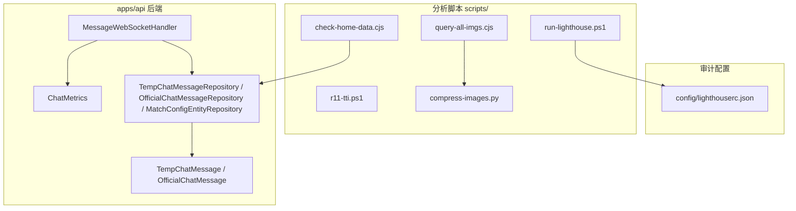
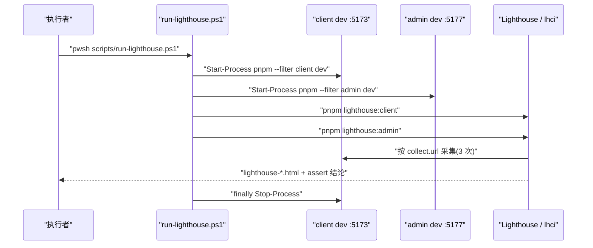
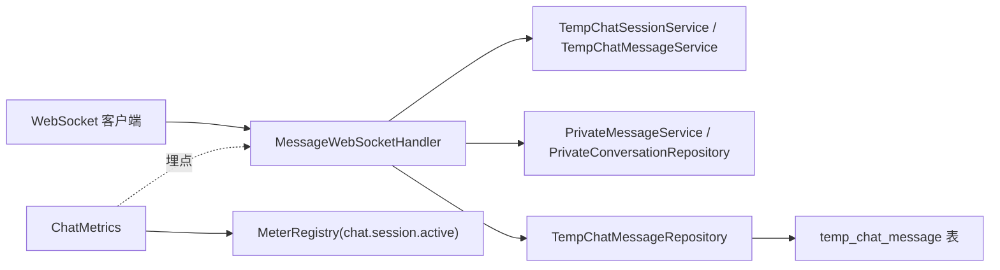
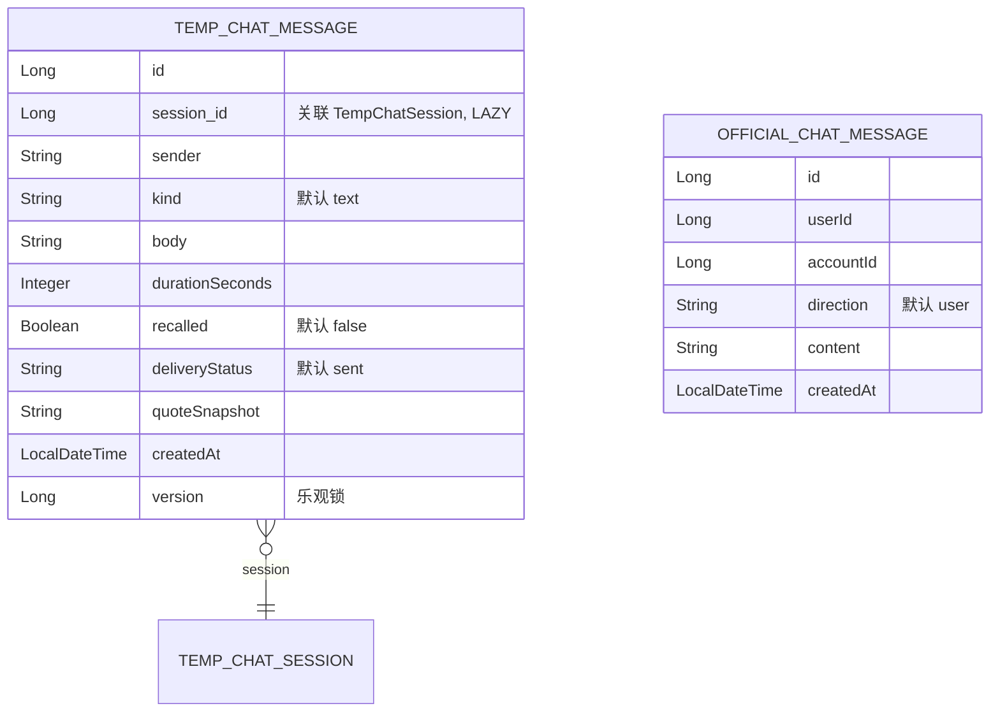
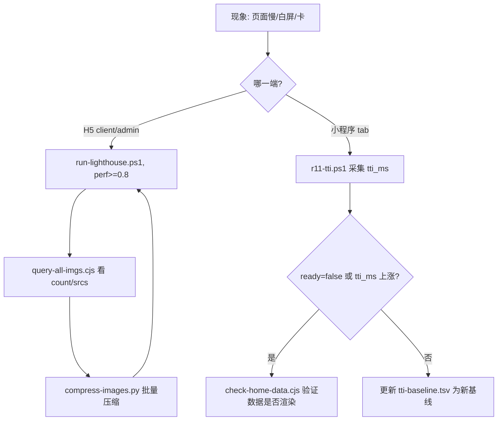
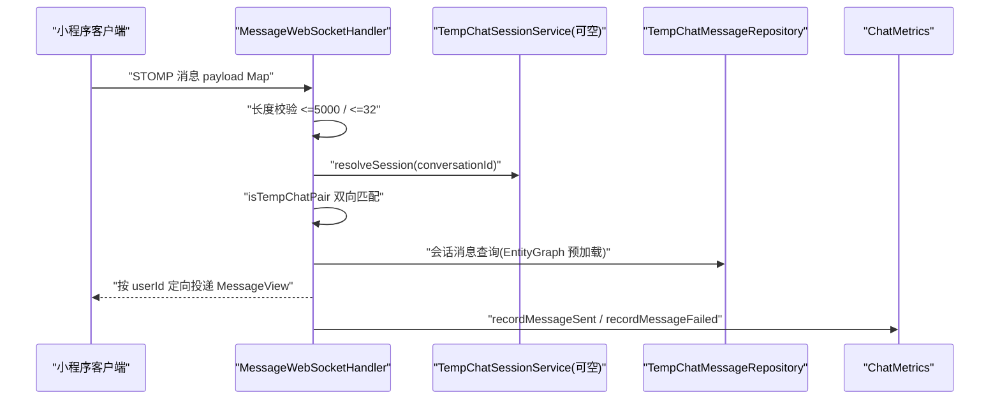

# 性能问题优化

<cite>
**本文引用的文件**
- [lighthouserc.json](file://config/lighthouserc.json)
- [run-lighthouse.ps1](file://scripts/run-lighthouse.ps1)
- [r11-tti.ps1](file://scripts/r11-tti.ps1)
- [check-home-data.cjs](file://scripts/check-home-data.cjs)
- [query-all-imgs.cjs](file://scripts/query-all-imgs.cjs)
- [compress-images.py](file://scripts/compress-images.py)
- [ChatMetrics.java](file://apps/api/src/main/java/com/campuslove/api/monitor/ChatMetrics.java)
- [MessageWebSocketHandler.java](file://apps/api/src/main/java/com/campuslove/api/chat/MessageWebSocketHandler.java)
- [TempChatMessage.java](file://apps/api/src/main/java/com/campuslove/api/entity/TempChatMessage.java)
- [OfficialChatMessage.java](file://apps/api/src/main/java/com/campuslove/api/entity/OfficialChatMessage.java)
- [TempChatMessageRepository.java](file://apps/api/src/main/java/com/campuslove/api/repository/TempChatMessageRepository.java)
- [OfficialChatMessageRepository.java](file://apps/api/src/main/java/com/campuslove/api/repository/OfficialChatMessageRepository.java)
- [MatchConfigEntityRepository.java](file://apps/api/src/main/java/com/campuslove/api/repository/MatchConfigEntityRepository.java)
</cite>

## 目录
1. [简介](#简介)
2. [项目结构](#项目结构)
3. [核心组件](#核心组件)
4. [架构总览](#架构总览)
5. [详细组件分析](#详细组件分析)
6. [Lighthouse 性能审计配置与使用](#lighthouse-性能审计配置与使用)
7. [前端性能问题检测与优化](#前端性能问题检测与优化)
8. [后端接口与数据库查询性能](#后端接口与数据库查询性能)
9. [缓存与实时通信性能](#缓存与实时通信性能)
10. [性能监控与指标体系](#性能监控与指标体系)
11. [依赖关系分析](#依赖关系分析)
12. [性能考虑](#性能考虑)
13. [故障排查指南](#故障排查指南)
14. [仓库里不存在的能力登记](#仓库里不存在的能力登记)
15. [附录](#附录)
16. [结论](#结论)

## 简介

本页汇总 Campus Love 仓库里真实存在的性能分析入口、度量脚本与可优化实现点，覆盖三条链路：

- Web 侧审计：`scripts/run-lighthouse.ps1` + `config/lighthouserc.json`，对 client / admin 两个 dev server 打分并断言。
- 小程序侧实测：`scripts/r11-tti.ps1` 采集 5 个 tab 的 TTI，`scripts/check-home-data.cjs` 做首页数据体检，`scripts/query-all-imgs.cjs` 盘点图片节点，`scripts/compress-images.py` 做图片压缩。
- 服务端观测：`ChatMetrics` 提供消息量 / 失败量 / 活跃会话三个指标，`MessageWebSocketHandler` 承担实时分发，落库对象为 `TempChatMessage`、`OfficialChatMessage`。

写作纪律：所有结论可回溯到具体文件与行区间；catalog 提到但仓库里没有实现证据的能力（Redis 缓存调优、虚拟滚动、包体积断言、慢查询治理等）集中在[仓库里不存在的能力登记](#仓库里不存在的能力登记)一节，不宣称项目已具备。

**章节来源**
- [lighthouserc.json:1-24](file://config/lighthouserc.json#L1-L24)
- [run-lighthouse.ps1:1-25](file://scripts/run-lighthouse.ps1#L1-L25)
- [r11-tti.ps1:1-40](file://scripts/r11-tti.ps1#L1-L40)
- [check-home-data.cjs:1-29](file://scripts/check-home-data.cjs#L1-L29)
- [query-all-imgs.cjs:1-24](file://scripts/query-all-imgs.cjs#L1-L24)
- [compress-images.py:1-44](file://scripts/compress-images.py#L1-L44)

## 项目结构

性能资产分四层：审计配置 `config/`、一次性分析脚本 `scripts/`、后端度量埋点 `apps/api/.../monitor/`、后端实时链路与数据模型 `chat/`、`entity/`、`repository/`。



[此图为概念流程，归纳「配置—脚本—服务端埋点」三层关系，不直接对应单个源文件，故不提供图表来源]

**章节来源**
- [ChatMetrics.java:23-24](file://apps/api/src/main/java/com/campuslove/api/monitor/ChatMetrics.java#L23-L24)
- [MessageWebSocketHandler.java:42-83](file://apps/api/src/main/java/com/campuslove/api/chat/MessageWebSocketHandler.java#L42-L83)
- [TempChatMessageRepository.java:14-14](file://apps/api/src/main/java/com/campuslove/api/repository/TempChatMessageRepository.java#L14-L14)

## 核心组件

性能链路上有 8 个可执行组件，按「度量 → 定位 → 修复 → 回归」划分。

| 组件 | 位置 | 职责 | 产出 |
| --- | --- | --- | --- |
| Lighthouse CI 配置 | `config/lighthouserc.json` | 声明被审计 URL、采样次数、断言阈值、上传目标 | 断言通过 / 失败 |
| Lighthouse 编排脚本 | `scripts/run-lighthouse.ps1` | 拉起 client/admin dev server，串行跑两端分析并清理进程 | `./test-screenshots/lighthouse-*.html` |
| Tab 页 TTI 采集 | `scripts/r11-tti.ps1` | 5 个 tab reLaunch 后轮询页面路径，计算就绪耗时 | `reports/audit/r11-acceptance/tti-baseline.tsv` |
| 首页数据体检 | `scripts/check-home-data.cjs` | 访客登录 + 跳首页 + 读页面 data 判断内容是否渲染 | 控制台判据 + `tmp/home-current.png` |
| 图片资源盘点 | `scripts/query-all-imgs.cjs` | 消息页 `createSelectorQuery` 抓取 `image` 节点 src 与数量 | 控制台 JSON（count + 前 30 个 src） |
| 图片压缩 | `scripts/compress-images.py` | 遍历 `apps/client/src/static/assets/images`，≥50KB 的 jpg 按质量 72 重存 | 控制台 `saved KB` |
| 服务端聊天指标 | `ChatMetrics.java` | Micrometer Counter / Gauge 埋点 | `chat.message.sent` / `chat.message.failed` / `chat.session.active` |
| 实时消息分发 | `MessageWebSocketHandler.java` | STOMP 入站处理与按用户出站推送 | `sendHeartSignal` / `sendNotification` / `sendPrivateMessage` |

两个度量面互补而非重复：H5 侧由 `lighthouserc.json` 的 `collect.url`（`http://localhost:5173`、`http://localhost:5177`）、`numberOfRuns: 3`、`preset: desktop`、`onlyCategories: ["performance"]` 加两条 `assert` 阈值构成唯一机器可判读门禁；小程序侧由 `r11-tti.ps1` 实测毫秒级 TTI 并留图。内容正确性由 `check-home-data.cjs` 兜住，资源规模由 `query-all-imgs.cjs` 统计，体积治理由 `compress-images.py` 完成。

**章节来源**
- [lighthouserc.json:1-24](file://config/lighthouserc.json#L1-L24)
- [r11-tti.ps1:12-40](file://scripts/r11-tti.ps1#L12-L40)
- [check-home-data.cjs:7-26](file://scripts/check-home-data.cjs#L7-L26)
- [query-all-imgs.cjs:6-21](file://scripts/query-all-imgs.cjs#L6-L21)
- [compress-images.py:5-41](file://scripts/compress-images.py#L5-L41)

## 架构总览

运行时分三层，互不共享进程，只通过 HTTP / WebSocket 边界交互：Web 度量层（5173 / 5177 两个 Vite dev server 由 Lighthouse 访问打分）、小程序度量层（自动化通道 `ws://127.0.0.1:9420`，数据来自后端 `http://127.0.0.1:8080`，例如 `/api/v1/auth/guest-login`）、服务端观测层（`ChatMetrics` 注册 Gauge、`MessageWebSocketHandler` 分发，指标失败只 warn 不影响主流程）。



**图表来源**
- [run-lighthouse.ps1:6-25](file://scripts/run-lighthouse.ps1#L6-L25)
- [lighthouserc.json:2-23](file://config/lighthouserc.json#L2-L23)



**图表来源**
- [MessageWebSocketHandler.java:53-85](file://apps/api/src/main/java/com/campuslove/api/chat/MessageWebSocketHandler.java#L53-L85)
- [ChatMetrics.java:41-53](file://apps/api/src/main/java/com/campuslove/api/monitor/ChatMetrics.java#L41-L53)
- [TempChatMessageRepository.java:14-53](file://apps/api/src/main/java/com/campuslove/api/repository/TempChatMessageRepository.java#L14-L53)

**章节来源**
- [check-home-data.cjs:7-10](file://scripts/check-home-data.cjs#L7-L10)
- [MessageWebSocketHandler.java:39-85](file://apps/api/src/main/java/com/campuslove/api/chat/MessageWebSocketHandler.java#L39-L85)

## 详细组件分析

### Lighthouse 编排脚本 run-lighthouse.ps1

脚本注释声明用途与前置：自动启动 client / admin dev server、等待就绪、运行分析、关闭进程；在仓库根执行 `pwsh scripts/run-lighthouse.ps1` 或 `powershell -File scripts/run-lighthouse.ps1`，前置是已 `pnpm install` 安装 `@lhci/cli` 与 `lighthouse`（第 2–4 行）。要点：第 6 行 `$ErrorActionPreference = "Stop"` 使任一步失败即终止；第 8、12 行以 `Start-Process -FilePath "pnpm" -ArgumentList "--filter","client","dev" -PassThru -WindowStyle Hidden` 拉起两端；第 9、13 行的就绪等待只有 `Start-Sleep -Seconds 8`；第 15–20 行依次调用 `pnpm lighthouse:client`、`pnpm lighthouse:admin`，报告落到 `./test-screenshots/lighthouse-*.html`；第 21–24 行 `finally` 用 `Stop-Process -Id ... -Force -ErrorAction SilentlyContinue` 回收进程。已知缺陷：不探测端口占用，8 秒后直接进入分析，失败常表现为报告内容异常而非明确报错。

**章节来源**
- [run-lighthouse.ps1:1-25](file://scripts/run-lighthouse.ps1#L1-L25)

### Lighthouse 配置 lighthouserc.json

只有顶层键 `ci`，内含 `collect`、`assert`、`upload`（第 1–24 行）。`collect.url` 为两个 dev server 地址，`numberOfRuns: 3` 多次采样压掉单次抖动；`preset: "desktop"` 与 `onlyCategories: ["performance"]` 把审计限定为桌面端性能单分类（不做 SEO / a11y / best-practices，也不启用移动端节流）。`assert.assertions` 两条阈值：`categories:performance` 低于 `minScore` 0.8 判 error（唯一阻断项），`numeric-timing-INP` 超过 200ms 判 warn。`upload.target: "temporary-public-storage"` 表示报告不长期留存，趋势需在仓库外归档。

**章节来源**
- [lighthouserc.json:1-24](file://config/lighthouserc.json#L1-L24)

### 首屏可交互时间基线 r11-tti.ps1

口径为 Stopwatch 从注入 `wx.reLaunch`（第 25 行）到轮询 `automation_runtime_info --action currentPage` 命中目标路径（第 28–32 行，300ms 步长、20000ms 封顶），再加第 34 行的 1 秒静置；结果按 `tab / titi_ms / ready` 三列写入 `tti-baseline.tsv`，同轮输出 `tti-{tab}.png`（第 36–38 行）。仓库根由 `$PSScriptRoot` 推导、`wechatide.cmd` 取 `$env:WECHATIDE_DIR` 或 PATH（第 3–6 行），`$tabs` 固定 home / nearby / discover / messages / profile 五个入口（第 12–18 行），输出目录由第 7–8 行的 `New-Item -ItemType Directory -Force` 保证存在。`ready=false` 且 TTI≈20000ms 表示导航在超时窗口内未完成，属加载阻塞而非分数波动。

**章节来源**
- [r11-tti.ps1:1-40](file://scripts/r11-tti.ps1#L1-L40)

### 首页数据体检脚本 check-home-data.cjs

「首页慢 / 首页空」的现场取证工具：第 2 行注册 `uncaughtException` 兜底，第 3 行用 `require.resolve("miniprogram-automator", { paths: [...] })` 同时探测 `apps/client` 与仓库根，第 5 行自带基于 `http` 的 `post()`；第 7–9 行连 `ws://127.0.0.1:9420`、POST `http://127.0.0.1:8080/api/v1/auth/guest-login` 取 `d.token` 并 `setStorage` 注入登录态；第 10 行 `reLaunch('/pages/home/index')` 后等 20000ms；第 13–23 行读 `page.data()` 后做四项存在性判断（`半夏`、`今天暂时没有合适的推荐`、`完善资料`、`likesReceived` 或 `人喜欢了你`）并打印命中上下文；第 25–26 行 `pageScrollTo(0)`、静置 3 秒后截屏 `tmp/home-current.png`。若 20 秒后仍无推荐位数据，瓶颈在接口或数据装配而不是渲染。

**章节来源**
- [check-home-data.cjs:1-29](file://scripts/check-home-data.cjs#L1-L29)

### 图片资源盘点脚本 query-all-imgs.cjs

回答「这一屏加载了多少张图、地址是什么」：第 6–9 行同样连 9420 并访客登录，但额外先 `clearStorage` 清除残留；第 10 行进入 `/pages/messages/index` 并等 25000ms；第 12–20 行在页面上下文执行 `wx.createSelectorQuery().selectAll('image').fields({ properties: ['src'], size: true })`，返回 `{ count, srcs }`（`srcs` 只截前 30 个），第 21 行以 JSON 打印。该脚本只读 `src` 与节点尺寸、不采集传输体积，因此是定位线索而不是体积结论。

**章节来源**
- [query-all-imgs.cjs:1-24](file://scripts/query-all-imgs.cjs#L1-L24)

### 图片压缩脚本 compress-images.py

链路上唯一会改写资源的脚本：`ROOT` 指向 `apps/client/src/static/assets/images`（第 5 行，相对脚本位置推导），`QUALITY = 72`、`MIN_SIZE = 50 * 1024`（第 6–7 行）只处理 ≥50KB 的图，第 14 行只匹配 `.jpg` / `.jpeg`（PNG、GIF、SVG 不在范围内）。失败策略是跳过不中断：打开或 `load()` 异常打印 `SKIP <path>: <原因>`（第 20–25 行）。写入前转 RGB（第 27–28 行），以 `quality=QUALITY, optimize=True, progressive=True` 存 `*.tmp.jpg`（第 29–30 行），只有确认更小才 `os.replace` 覆盖（第 31–33 行），否则删除临时文件（第 38 行）。收益度量是第 39–41 行的 `compressed N files, saved X KB` 与前 15 条 `旧KB -> 新KB`。一处不一致：第 26 行注释写「重存质量 82」，实际生效常量是 72（第 6 行），调整质量时两处需同时改。

**章节来源**
- [compress-images.py:1-44](file://scripts/compress-images.py#L1-L44)

### 服务端指标组件 ChatMetrics

`@Component`（第 23–24 行），只依赖 `MeterRegistry` 并构造器注入（第 43 行）。三个指标名常量 `chat.message.sent`、`chat.message.failed`、`chat.session.active`（第 29–33 行）配两个标签名 `messageType`、`reason`（第 35–36 行）。Gauge 在构造器中以 `AtomicLong::doubleValue` 注册（第 46–52 行），值由第 39 行的 `activeSessionCount` 维护；`recordMessageSent`（第 60–70 行）与 `recordMessageFailed`（第 77–87 行）分别按类型与原因计数，第 63、80 行把空值兜底为 `"unknown"` 以控制标签基数，第 75 行注释给出的原因示例是 `network_error`、`rate_limited`、`content_filtered`；`incrementActiveSession`（第 92–98 行）与 `decrementActiveSession`（第 103–110 行）成对维护会话数，第 106 行的 `updateAndGet(curr -> Math.max(0, curr - 1))` 只排除负值毛刺、不修正漏减。类注释第 21 行的容错策略是本页最重要的观测前提：记录方法全部 try-catch、失败只 `log.warn`（第 51、68、85、96、108 行），因此「指标缺失」不能反推「链路异常」，需先检索形如 `记录 chat.message.sent 指标失败` 的 warn 行。

**章节来源**
- [ChatMetrics.java:11-110](file://apps/api/src/main/java/com/campuslove/api/monitor/ChatMetrics.java#L11-L110)

### 实时分发组件 MessageWebSocketHandler

`@Controller`（第 42–43 行），持有并构造器注入 `SimpMessagingTemplate`（第 53、85 行）；入站入口 `handleChatMessage(@Payload Map<String, Object> payload, ...)`（第 107 行），输入信号入口 `handleTyping(...)`（第 292 行）。四条性能相关约束：第 48 行 `MAX_MESSAGE_CONTENT_LENGTH = 5000` 与第 51 行 `MAX_MESSAGE_KIND_LENGTH = 32` 在入口处界定单体负载；第 59–83 行四个协作者（`TempChatSessionService`、`TempChatMessageService`、`PrivateConversationRepository`、`PrivateMessageService`）全部 `@Autowired(required = false)`，第 39 行注释说明原因是「专属 Bean，mock 模式下不存在」，故运行期可能为 `null`，第 170、329 行调用前必须判空，新增调用点漏判会退化为 NPE；配对校验先于分发（`isTempChatPair` 第 363–368 行比对 `getUserAId()` / `getUserBId()` 双向匹配，`isPrivatePair` 第 372 行、`findPrivateConversation` 第 381 行负责私聊侧），避免向非会话成员推送产生无谓出站流量；出站是三条按用户命名的方法 `sendHeartSignal(String userId, HeartSignalView signal)`（第 401 行）、`sendNotification(String userId, NotificationView notificationView)`（第 419 行）、`sendPrivateMessage(String userId, MessageView messageView)`（第 437 行），签名表明推送目标是单个 `userId` 而非广播频道。

**章节来源**
- [MessageWebSocketHandler.java:39-107](file://apps/api/src/main/java/com/campuslove/api/chat/MessageWebSocketHandler.java#L39-L107)
- [MessageWebSocketHandler.java:168-176](file://apps/api/src/main/java/com/campuslove/api/chat/MessageWebSocketHandler.java#L168-L176)
- [MessageWebSocketHandler.java:292-292](file://apps/api/src/main/java/com/campuslove/api/chat/MessageWebSocketHandler.java#L292-L292)
- [MessageWebSocketHandler.java:363-437](file://apps/api/src/main/java/com/campuslove/api/chat/MessageWebSocketHandler.java#L363-L437)

### 消息模型与 Repository 查询（N+1 治理落点）

`TempChatMessage` 以 `@Entity` + `@Table(name = "temp_chat_message")` 映射（第 22–25 行），字段含 `session`（第 34 行，LAZY 关联）、`sender`（第 38 行）、`kind`（第 42 行，默认 `"text"`）、`body`（第 46 行）、`durationSeconds`（第 50 行）、`recalled`（第 54 行）、`deliveryStatus`（第 58 行，默认 `"sent"`）、`quoteSnapshot`（第 62 行）、`createdAt`（第 69 行）与乐观锁 `version`（第 81 行）。`OfficialChatMessage`（第 18–53 行）用 `direction` 区分双向（第 46 行，默认 `Direction.user.name()`），`createdAt` 在声明处即初始化（第 53 行）。



**图表来源**
- [TempChatMessage.java:22-81](file://apps/api/src/main/java/com/campuslove/api/entity/TempChatMessage.java#L22-L81)
- [OfficialChatMessage.java:18-53](file://apps/api/src/main/java/com/campuslove/api/entity/OfficialChatMessage.java#L18-L53)

`TempChatMessageRepository`（第 14 行）继承 `JpaRepository<TempChatMessage, Long>`，四个方法：`findBySessionIdOrderByCreatedAtAsc`（第 22 行）、`findBySessionIdOrderByCreatedAtDesc`（第 30 行）、`findWithSessionBySessionIdOrderByCreatedAtAsc`（第 43–45 行，`@EntityGraph(attributePaths = "session")` 叠加显式 JPQL，一条 SQL 以 LEFT OUTER JOIN 预加载 `session`）、`countBySessionId`（第 53 行，返回 `long`，只计数不取行）。第 33–38 行注释写明因果：`getSession()` 是 LAZY（第 34 行），调用方在 View 转换层访问 `message.getSession().getId()` 等字段时「会为每条消息触发一次 SELECT session 查询」即 N+1（第 36 行），改用 `@EntityGraph` 后「将原本 N 条 SQL 压缩为 1 条」（第 37–38 行）。另两个仓库各只提供一条路径：`OfficialChatMessageRepository.findByUserIdAndAccountIdOrderByCreatedAtAsc`（第 13 行，第 8 行注释标注需求轮次 R16 2026-09-07）与 `MatchConfigEntityRepository.findByConfigKey`（第 19 行，返回 `Optional<MatchConfigEntity>`；第 4–5 行 import 显示仓库层只有 `Optional` 与 `JpaRepository`，没有缓存装饰），后者是典型的「一次调用反复读」热点配置。

**章节来源**
- [TempChatMessageRepository.java:10-54](file://apps/api/src/main/java/com/campuslove/api/repository/TempChatMessageRepository.java#L10-L54)
- [TempChatMessage.java:22-81](file://apps/api/src/main/java/com/campuslove/api/entity/TempChatMessage.java#L22-L81)
- [OfficialChatMessageRepository.java:7-14](file://apps/api/src/main/java/com/campuslove/api/repository/OfficialChatMessageRepository.java#L7-L14)
- [MatchConfigEntityRepository.java:7-20](file://apps/api/src/main/java/com/campuslove/api/repository/MatchConfigEntityRepository.java#L7-L20)

## Lighthouse 性能审计配置与使用

一次完整审计的前置：已 `pnpm install`（`run-lighthouse.ps1` 第 4 行）；在仓库根执行 `pwsh scripts/run-lighthouse.ps1`（第 3 行）；5173、5177 空闲，脚本第 8、12 行分别以 `pnpm --filter client dev`、`pnpm --filter admin dev` 启动并在第 9、13 行各给 8 秒预热。审计口径由配置决定：第 4–7 行 URL 列表决定被测对象，第 8 行决定采样次数，第 10–11 行决定评分维度；新增被测页只需追加 `collect.url`，收紧门槛只改第 16 行 `minScore`。判读：低于 0.8 是阻断信号，INP 超 200ms 是提示（第 17 行 `numeric-timing-INP` 是唯一被显式断言的时序指标）；报告落 `./test-screenshots/lighthouse-*.html`（脚本第 20 行），且 `upload.target` 为临时公共存储（配置第 21 行），长期对比需自行归档 HTML。

```mermaid
stateDiagram-v2
installDeps: pnpm install
installDeps --> "dev server 预热": run-lighthouse.ps1
"dev server 预热" --> "采集 3 次": lighthouse
"采集 3 次" --> "断言": assert
"断言" --> "定位环节": perf<0.8
"断言" --> "归档报告": perf>=0.8
"定位环节" --> installDeps
```

**图表来源**
- [run-lighthouse.ps1:4-20](file://scripts/run-lighthouse.ps1#L4-L20)
- [lighthouserc.json:8-22](file://config/lighthouserc.json#L8-L22)

**章节来源**
- [run-lighthouse.ps1:1-25](file://scripts/run-lighthouse.ps1#L1-L25)
- [lighthouserc.json:4-22](file://config/lighthouserc.json#L4-L22)

## 前端性能问题检测与优化

**首屏加载时间**。TTI 在 `r11-tti.ps1` 里可复算：注入 `wx.reLaunch` 到轮询命中路径的毫秒数加 1 秒静置（第 25、28–34 行），5 个 tab 各一条记录，判据是同一 tab 的 `tti_ms` 相对基线上升或 `ready=false`；300ms 轮询步长（第 29 行）决定读数分辨率，小于该粒度的变化不会体现在基线里。

**图片资源未压缩**。检测入口 `query-all-imgs.cjs`：第 15 行 `selectAll('image').fields({ properties: ['src'], size: true })`，第 17 行返回 `{ count, srcs }`——`count` 反映单屏图片节点规模，`srcs` 反映是否存在同图不同尺寸重复请求、是否仍指向未压缩原图。修复入口 `compress-images.py`：作用目录 `apps/client/src/static/assets/images`（第 5 行）、≥50KB jpg（第 7、14 行）、质量 72 渐进式重存（第 30 行），收益看第 39 行的 `saved KB`。

**滚动卡顿与长列表**。可确认的滚动证据是 `check-home-data.cjs` 第 25 行 `pageScrollTo(0)` 后仍需 `sleep(3000)` 再截图（第 26 行），说明首页长内容态需要显式等待渲染收敛；列表规模观测面是 `query-all-imgs.cjs` 在消息页的一次性节点统计（第 10、15 行）。仓库里没有滚动帧率采样与列表项回收实现，虚拟滚动只能作为待建能力登记。

**包体积**。`apps/client` 静态图片目录是可压缩资产的事实来源（`compress-images.py` 第 5 行），但仓库内没有 bundle 分析报告、分包配置或体积阈值断言，`lighthouserc.json` 的断言仅两项（第 16–17 行）。



**图表来源**
- [run-lighthouse.ps1:15-20](file://scripts/run-lighthouse.ps1#L15-L20)
- [query-all-imgs.cjs:10-21](file://scripts/query-all-imgs.cjs#L10-L21)
- [compress-images.py:5-41](file://scripts/compress-images.py#L5-L41)
- [r11-tti.ps1:20-38](file://scripts/r11-tti.ps1#L20-L38)
- [check-home-data.cjs:10-26](file://scripts/check-home-data.cjs#L10-L26)

**章节来源**
- [r11-tti.ps1:1-40](file://scripts/r11-tti.ps1#L1-L40)
- [query-all-imgs.cjs:1-24](file://scripts/query-all-imgs.cjs#L1-L24)
- [compress-images.py:1-44](file://scripts/compress-images.py#L1-L44)
- [check-home-data.cjs:1-29](file://scripts/check-home-data.cjs#L1-L29)
- [lighthouserc.json:14-18](file://config/lighthouserc.json#L14-L18)

## 后端接口与数据库查询性能

**N+1 的定位与修复**。定位线索来自实体与仓库注释：`TempChatMessage.getSession()`（第 34 行）是 LAZY，仓库注释（第 33–38 行）指出 View 转换层访问 `message.getSession().getId()` 会为每条消息触发一次 SELECT session，修复是第 43 行 `@EntityGraph` + 第 44 行显式 JPQL 的单条 JOIN。判据：接口 SQL 条数≈消息条数即命中；解法是切换到 `findWithSessionBySessionIdOrderByCreatedAtAsc`，而不是给 `temp_chat_message` 加索引。

**无界列表查询**。`findBySessionIdOrderByCreatedAtAsc`（第 22 行）、`findBySessionIdOrderByCreatedAtDesc`（第 30 行）、`findByUserIdAndAccountIdOrderByCreatedAtAsc`（`OfficialChatMessageRepository` 第 13 行）返回类型都是 `List` 且无 `Pageable`，长会话历史会被整体物化并序列化，响应时间与会话长度正相关；只要总数时应改用 `countBySessionId`（第 53 行）。

**按配置键的重复读**。`findByConfigKey`（第 19 行）返回 `Optional`，无缓存注解或批量方法，同一请求内重复读取同一配置键会重复查库。

**入口负载约束与探测接口**。第 48、51 行的 5000 / 32 长度上限界定单体负载，避免超大消息拖慢同连接后续分发。两个 automator 脚本都依赖 `POST http://127.0.0.1:8080/api/v1/auth/guest-login`（`check-home-data.cjs` 第 8 行、`query-all-imgs.cjs` 第 7 行）：该接口变慢会吞掉脚本固定等待预算（20000ms、25000ms），表现为「页面数据缺失」而非「登录慢」。

**章节来源**
- [TempChatMessageRepository.java:22-53](file://apps/api/src/main/java/com/campuslove/api/repository/TempChatMessageRepository.java#L22-L53)
- [TempChatMessage.java:34-34](file://apps/api/src/main/java/com/campuslove/api/entity/TempChatMessage.java#L34-L34)
- [OfficialChatMessageRepository.java:13-13](file://apps/api/src/main/java/com/campuslove/api/repository/OfficialChatMessageRepository.java#L13-L13)
- [MatchConfigEntityRepository.java:19-19](file://apps/api/src/main/java/com/campuslove/api/repository/MatchConfigEntityRepository.java#L19-L19)
- [MessageWebSocketHandler.java:48-51](file://apps/api/src/main/java/com/campuslove/api/chat/MessageWebSocketHandler.java#L48-L51)
- [query-all-imgs.cjs:7-10](file://scripts/query-all-imgs.cjs#L7-L10)

## 缓存与实时通信性能

**缓存能力现状**。引用范围内没有 Redis 客户端配置、缓存注解、缓存键命名或命中率埋点：`MatchConfigEntityRepository` 只暴露 `findByConfigKey`（第 19 行），`TempChatMessageRepository` 四个方法（第 22、30、43–45、53 行）均为直连查询。因此「命中率调优、热点缓存策略、雪崩防护」在本仓库无实现证据（见[仓库里不存在的能力登记](#仓库里不存在的能力登记)）。现状的替代手段是 `@EntityGraph` 预加载（第 43 行）把关系装配成本压进 SQL 层，用一次 JOIN 代替多次查询，部分承担了读放大治理。

**实时链路规模控制**。分发按用户维度：`sendHeartSignal`（第 401 行）、`sendNotification`（第 419 行）、`sendPrivateMessage`（第 437 行），配第 53 行的 `SimpMessagingTemplate`，不存在一次广播全体在线用户的入口，因此连接数增长的出站成本是逐用户累加而非乘法放大。入站侧第 48、51 行的长度上限与先于分发的配对校验（第 363–368、372、381 行）共同限制无效流量；`handleTyping`（第 292 行）在第 329–330 行同样调用 `resolveSession` 并判配对，即高频 typing 事件每次触发都会走一次会话解析，是消息量大时最需要关注的重复读点。活跃会话规模由 `chat.session.active` Gauge 反映（`ChatMetrics.java` 第 33、46–52 行，`AtomicLong` 第 39 行，增减第 92–110 行）。



**图表来源**
- [MessageWebSocketHandler.java:48-107](file://apps/api/src/main/java/com/campuslove/api/chat/MessageWebSocketHandler.java#L48-L107)
- [MessageWebSocketHandler.java:363-437](file://apps/api/src/main/java/com/campuslove/api/chat/MessageWebSocketHandler.java#L363-L437)
- [TempChatMessageRepository.java:43-45](file://apps/api/src/main/java/com/campuslove/api/repository/TempChatMessageRepository.java#L43-L45)
- [ChatMetrics.java:33-110](file://apps/api/src/main/java/com/campuslove/api/monitor/ChatMetrics.java#L33-L110)

**章节来源**
- [MessageWebSocketHandler.java:292-330](file://apps/api/src/main/java/com/campuslove/api/chat/MessageWebSocketHandler.java#L292-L330)
- [ChatMetrics.java:33-110](file://apps/api/src/main/java/com/campuslove/api/monitor/ChatMetrics.java#L33-L110)
- [MatchConfigEntityRepository.java:11-19](file://apps/api/src/main/java/com/campuslove/api/repository/MatchConfigEntityRepository.java#L11-L19)

## 性能监控与指标体系

服务端是 Micrometer 指标，客户端是脚本产物。

| 名称 | 类型 | 标签 | 出处 | 用途 |
| --- | --- | --- | --- | --- |
| `chat.message.sent` | Counter | `messageType`（空值兜底 `unknown`） | `ChatMetrics.java` 第 29、62–66 行 | 发送量按类型分布，突降提示某类型链路中断 |
| `chat.message.failed` | Counter | `reason`（空值兜底 `unknown`） | 第 31、79–83 行 | 失败归因，示例取值见第 75 行 |
| `chat.session.active` | Gauge | 无 | 第 33、46–52 行 | 活跃会话数，反映连接规模 |

基数控制：第 63、80 行把空标签改写为 `"unknown"`；`messageType` 的取值域应与实体字段 `kind`（`TempChatMessage.java` 第 42 行，默认 `"text"`）一致，否则按类型聚合的曲线会出现难以解释的分母。判读规则：指标记录失败被吞（类注释第 21 行；第 67–69、84–86 行 catch），所以指标为 0 不等于业务未跑，先检索 warn 文本；Gauge 长期只增不减说明关闭路径漏调 `decrementActiveSession`，第 106 行的 `Math.max(0, curr - 1)` 无法修正漏减。

客户端等价指标：`tti-baseline.tsv` 的 `tab / titi_ms / ready` 三列（`r11-tti.ps1` 第 20、38 行）构成首屏时序基线；`tti-{tab}.png`（第 36–37 行）用于确认「TTI 变长是否伴随白屏」；`./test-screenshots/lighthouse-*.html`（`run-lighthouse.ps1` 第 20 行）与 `assert` 结论（`lighthouserc.json` 第 14–18 行）是 H5 端唯一机器可判读结果；`tmp/home-current.png`（`check-home-data.cjs` 第 26 行）、`has ...` 布尔行（第 15–18 行）与 `all image srcs` JSON（`query-all-imgs.cjs` 第 21 行）是内容正确性与资源规模的观测输出。

**章节来源**
- [ChatMetrics.java:28-110](file://apps/api/src/main/java/com/campuslove/api/monitor/ChatMetrics.java#L28-L110)
- [TempChatMessage.java:42-42](file://apps/api/src/main/java/com/campuslove/api/entity/TempChatMessage.java#L42-L42)
- [r11-tti.ps1:20-38](file://scripts/r11-tti.ps1#L20-L38)
- [run-lighthouse.ps1:15-20](file://scripts/run-lighthouse.ps1#L15-L20)
- [check-home-data.cjs:15-26](file://scripts/check-home-data.cjs#L15-L26)

## 依赖关系分析

依赖单向：脚本层依赖外部工具链（`@lhci/cli` + `lighthouse`、`miniprogram-automator`、PIL、`wechatide.cmd`）与被测端口（5173、5177、8080、9420）（`run-lighthouse.ps1` 第 4、7–12 行；`check-home-data.cjs` 第 3、7–8 行；`compress-images.py` 第 2–5 行）；后端侧 `ChatMetrics` 依赖 `MeterRegistry`（第 41–44 行）、`MessageWebSocketHandler` 依赖 `SimpMessagingTemplate`（第 53、85 行）；脚本与 Java 代码之间没有直接引用，性能问题只能经由 HTTP / WebSocket 边界暴露给测量端。

三个耦合点：一是两个 automator 脚本用 `require.resolve("miniprogram-automator", { paths: [...] })` 同时探测 `apps/client` 与仓库根（`check-home-data.cjs` 第 3 行、`query-all-imgs.cjs` 第 2 行），依赖解析位置随 monorepo 结构调整而变且不校验版本；二是脚本对后端只有一条硬编码路由 `POST /api/v1/auth/guest-login`（两脚本第 7–8 行），端口或网关变更会以 `FATAL` 形式失败（第 29、24 行的兜底 catch）；三是 `MessageWebSocketHandler` 四个协作者全部可选注入（第 59–83 行），mock 模式下处理器仍装配成功但会话解析与持久化分支静默跳过，使「本地能跑通 WebSocket 但不落库」成为正常的依赖缺失表现而非性能故障。

**章节来源**
- [check-home-data.cjs:2-10](file://scripts/check-home-data.cjs#L2-L10)
- [query-all-imgs.cjs:2-10](file://scripts/query-all-imgs.cjs#L2-L10)
- [run-lighthouse.ps1:4-12](file://scripts/run-lighthouse.ps1#L4-L12)
- [compress-images.py:2-5](file://scripts/compress-images.py#L2-L5)
- [MessageWebSocketHandler.java:39-85](file://apps/api/src/main/java/com/campuslove/api/chat/MessageWebSocketHandler.java#L39-L85)
- [ChatMetrics.java:3-9](file://apps/api/src/main/java/com/campuslove/api/monitor/ChatMetrics.java#L3-L9)

## 性能考虑

以下是当前实现中可确认的成本点。

- **测量预算是硬编码的**：dev server 预热 8s ×2（`run-lighthouse.ps1` 第 9、13 行），首页 20000ms + 滚动后 3000ms（`check-home-data.cjs` 第 10、25 行），消息页 25000ms（`query-all-imgs.cjs` 第 10 行）。预算不足会把「还没加载完」误判成「加载失败」，过剩则让回归耗时固定化。
- **TTI 读数受粒度限制**：300ms 步长、20000ms 上限、外加 1s 静置（`r11-tti.ps1` 第 28–34 行），使 `tti_ms` 含约 1.3 秒结构性开销，跨版本应比同口径差值而非绝对值。
- **审计口径是桌面端**：`preset: desktop` 且只跑 performance（`lighthouserc.json` 第 10–11 行），移动端节流未参与打分，desktop 分数不能当移动端结论。
- **图片优化只覆盖 jpg 且 ≥50KB**（`compress-images.py` 第 7、14 行）：某轮 `saved` 为 0 通常是已处理过或格式不在范围，而不是脚本失败。
- **长会话查询无分页**（`TempChatMessageRepository` 第 22、30 行、`OfficialChatMessageRepository` 第 13 行）：只取最近若干条时使用它们等于全量读入 JVM；可用第 53 行计数方法与第 43–45 行预加载方法替代。
- **typing 事件重复解析会话**（`MessageWebSocketHandler` 第 292、329–330 行）且无独立指标，只能借 `chat.message.sent` / `chat.message.failed` 间接观察（`ChatMetrics.java` 第 29、31 行）。
- **出站推送为逐用户模式**（第 401、419、437 行），评估连接成本时以 `chat.session.active` 为分母。

**章节来源**
- [run-lighthouse.ps1:9-13](file://scripts/run-lighthouse.ps1#L9-L13)
- [check-home-data.cjs:10-25](file://scripts/check-home-data.cjs#L10-L25)
- [r11-tti.ps1:28-34](file://scripts/r11-tti.ps1#L28-L34)
- [lighthouserc.json:10-11](file://config/lighthouserc.json#L10-L11)
- [compress-images.py:7-14](file://scripts/compress-images.py#L7-L14)
- [TempChatMessageRepository.java:22-53](file://apps/api/src/main/java/com/campuslove/api/repository/TempChatMessageRepository.java#L22-L53)
- [MessageWebSocketHandler.java:292-330](file://apps/api/src/main/java/com/campuslove/api/chat/MessageWebSocketHandler.java#L292-L330)
- [ChatMetrics.java:29-33](file://apps/api/src/main/java/com/campuslove/api/monitor/ChatMetrics.java#L29-L33)

## 故障排查指南

| 现象 | 第一步 | 判据 | 出处 |
| --- | --- | --- | --- |
| 小程序首页空白 / 无推荐 | 跑 `check-home-data.cjs` | `has 半夏: false` 且 `has 今日推荐 empty: true` | 第 15–16 行 |
| 消息页图片过多 | 跑 `query-all-imgs.cjs` | `count` 偏高、`srcs` 指向原图 | 第 17、21 行 |
| 图片压缩无收益 | 看 `compressed 0 files` | 是否 ≥50KB 且为 jpg | `compress-images.py` 第 7、14、39 行 |
| H5 分数不达标 | 看 `assert` 结论 | `categories:performance` < 0.8 判 error | `lighthouserc.json` 第 16 行 |
| 交互卡顿但分数尚可 | 看 INP 断言 | `numeric-timing-INP` > 200 判 warn | 第 17 行 |
| tab 首屏回归 | 比对 `tti-baseline.tsv` | `tti_ms` 上升或 `ready=false` | `r11-tti.ps1` 第 20、38 行 |
| 会话接口 SQL 条数≈消息数 | 确认调用方法 | 是否用了非 EntityGraph 的 findBy | `TempChatMessageRepository` 第 22、30、43–45 行 |
| 消息发送量掉底 / 失败率上升 | 看两个 Counter | 按 `messageType`、`reason` 分组对比 | `ChatMetrics.java` 第 60–87 行 |
| 活跃会话只增不减 | 检查 decrement 调用 | 关闭路径是否触发 | 第 92–110 行 |
| WebSocket 本地不落库 | 检查可选 Bean | mock 模式下四个协作者为 null | `MessageWebSocketHandler.java` 第 39、59–83 行 |

误判排除：指标为 0 不等于链路挂，`ChatMetrics` 吞异常只写 warn（类注释第 21 行、第 67–69、84–86 行），先检索 `指标失败` 字样；`SKIP <path>: <原因>` 是压缩脚本正常工作输出（第 24 行），单图损坏不中断遍历，只有缺 `compressed ... saved ...` 汇总行（第 39 行）才算流程未跑完；`FATAL <message>` 来自两个 automator 脚本最外层 catch（第 29、24 行），通常意味着连不上 9420 或 8080 未启动，与页面性能无关；`[uncaught]` 是兜底日志（两脚本第 2 行），出现时脚本仍会继续打印，不能据此认定整轮数据无效；dev server 未就绪会让 Lighthouse 静默出错，因为脚本只 `Start-Sleep -Seconds 8` 而不探测端口（`run-lighthouse.ps1` 第 9、13 行）。

**章节来源**
- [check-home-data.cjs:2-29](file://scripts/check-home-data.cjs#L2-L29)
- [query-all-imgs.cjs:2-24](file://scripts/query-all-imgs.cjs#L2-L24)
- [compress-images.py:14-39](file://scripts/compress-images.py#L14-L39)
- [lighthouserc.json:14-18](file://config/lighthouserc.json#L14-L18)
- [r11-tti.ps1:20-38](file://scripts/r11-tti.ps1#L20-L38)
- [TempChatMessageRepository.java:22-45](file://apps/api/src/main/java/com/campuslove/api/repository/TempChatMessageRepository.java#L22-L45)
- [ChatMetrics.java:21-110](file://apps/api/src/main/java/com/campuslove/api/monitor/ChatMetrics.java#L21-L110)
- [MessageWebSocketHandler.java:39-83](file://apps/api/src/main/java/com/campuslove/api/chat/MessageWebSocketHandler.java#L39-L83)

## 仓库里不存在的能力登记

catalog 指令提到的若干能力在本次取证范围内没有实现证据。为避免误导，逐条登记「未观测到」，并说明查证边界：结论只覆盖本页引用的文件，不代表项目其他目录一定没有。

| catalog 能力 | 取证结果 | 依据 |
| --- | --- | --- |
| Redis 缓存命中率调优 | 仓库里没有该能力 / 无接入证据：无缓存客户端配置、缓存注解与命中率指标 | `ChatMetrics.java` 第 29–33 行只有 3 个聊天指标；三个 Repository 文件（第 1–54、1–14、1–20 行）无缓存代码 |
| 热点数据缓存策略 / 雪崩防护 | 无接入证据，配置键读取直接查库 | `MatchConfigEntityRepository.findByConfigKey` 仅 `Optional` 返回（第 19 行） |
| 虚拟滚动 / 列表项回收 | 无接入证据，小程序侧只做一次性节点统计 | `query-all-imgs.cjs` 第 15–17 行 `selectAll('image')` 无窗口化取样 |
| 长列表分页加载 | 引用范围内不可见，列表方法无 `Pageable` | `TempChatMessageRepository.java` 第 22、30 行；`OfficialChatMessageRepository.java` 第 13 行 |
| 包体积检测 / 分包阈值断言 | 无接入证据，只有图片批处理与两条 Lighthouse 断言 | `compress-images.py` 第 5–7 行；`lighthouserc.json` 第 16–17 行 |
| 静态资源 HTTP 缓存策略（Cache-Control / CDN） | 引用范围内无服务器或构建产物缓存头配置 | 本页引用的 6 个脚本与配置都不涉及响应头 |
| Lighthouse 移动端模拟指标 | 未启用，preset 为 desktop | `lighthouserc.json` 第 10 行 |
| 慢查询日志 / 索引调优脚本 | 无接入证据，引用范围内无 DDL、索引定义与慢日志开关 | 三个实体与三个仓库文件只含映射与查询方法 |
| 接口耗时直方图（Timer / Histogram） | 未观测到，仅两个 Counter 与一个 Gauge | `ChatMetrics.java` 第 29–33 行 |
| WebSocket 连接数上限 / 并发拒绝策略 | 未观测到，只有活跃会话计数与负载长度上限 | `ChatMetrics.java` 第 39、92–110 行；`MessageWebSocketHandler.java` 第 48、51 行 |
| GlobalExceptionHandler 与性能错误的关联 | 本页取证材料里没有该文件的可读实现片段 | 事实包 #43 未包含该文件 |
| 健康检查端点 / CI 中的性能门禁 | 无接入证据，唯一可确认的 CI 门禁是 lhci `assert` | `lighthouserc.json` 第 14–18 行 |

补齐路径随之明确：缓存层需要暴露命中率与失效指标，包体积需要断言入口，数据库侧需要慢日志与索引定义；在此之前，可用手段只有 `@EntityGraph` 预加载、图片质量批处理、TTI 基线与 perf / INP 双断言。

**章节来源**
- [lighthouserc.json:10-17](file://config/lighthouserc.json#L10-L17)
- [ChatMetrics.java:29-39](file://apps/api/src/main/java/com/campuslove/api/monitor/ChatMetrics.java#L29-L39)
- [TempChatMessageRepository.java:22-45](file://apps/api/src/main/java/com/campuslove/api/repository/TempChatMessageRepository.java#L22-L45)
- [OfficialChatMessageRepository.java:13-13](file://apps/api/src/main/java/com/campuslove/api/repository/OfficialChatMessageRepository.java#L13-L13)
- [MatchConfigEntityRepository.java:19-19](file://apps/api/src/main/java/com/campuslove/api/repository/MatchConfigEntityRepository.java#L19-L19)
- [query-all-imgs.cjs:15-17](file://scripts/query-all-imgs.cjs#L15-L17)
- [compress-images.py:5-7](file://scripts/compress-images.py#L5-L7)
- [MessageWebSocketHandler.java:48-51](file://apps/api/src/main/java/com/campuslove/api/chat/MessageWebSocketHandler.java#L48-L51)

## 附录

**执行入口**

| 目的 | 命令 / 条件 | 出处 |
| --- | --- | --- |
| H5 全量分析 | 仓库根执行 `pwsh scripts/run-lighthouse.ps1` 或 `powershell -File scripts/run-lighthouse.ps1` | `run-lighthouse.ps1` 第 3 行 |
| 审计前置 | `pnpm install`（`@lhci/cli`、`lighthouse`） | 第 4 行 |
| 单端分析 | `pnpm lighthouse:client`、`pnpm lighthouse:admin` | 第 17、19 行 |
| 小程序 TTI 基线 | 执行 `scripts/r11-tti.ps1`，`wechatide.cmd` 取自 `$env:WECHATIDE_DIR` 或 PATH | `r11-tti.ps1` 第 3–5 行（该文件未记录调用示例，此处仅按脚本内容说明入口与依赖） |
| 首页体检 / 图片盘点 | 需自动化通道 9420 与后端 8080 在线，脚本内地址硬编码 | `check-home-data.cjs` 第 7–8 行、`query-all-imgs.cjs` 第 6–9 行 |
| 图片批量压缩 | Python + PIL，作用目录为 client 静态图片目录 | `compress-images.py` 第 2–5 行 |

**关键参数**：`numberOfRuns` 3、`preset` desktop、`onlyCategories` performance、`minScore` 0.8、INP 上限 200、`upload.target` temporary-public-storage（`lighthouserc.json` 第 8–22 行）；`QUALITY = 72`、`MIN_SIZE = 50 * 1024`、仅 jpg、`optimize` + `progressive`（`compress-images.py` 第 6–7、14、30 行）；轮询 300ms / 上限 20000ms / 静置 1s（`r11-tti.ps1` 第 28–34 行）；等待 8s ×2、20000ms、3000ms、25000ms（`run-lighthouse.ps1` 第 9、13 行，`check-home-data.cjs` 第 10、25 行，`query-all-imgs.cjs` 第 10 行）；消息上限 5000 / 32（`MessageWebSocketHandler.java` 第 48、51 行）。

**产物路径**：`./test-screenshots/lighthouse-*.html`（`run-lighthouse.ps1` 第 20 行）；`reports/audit/r11-acceptance/tti-{tab}.png` 与 `tti-baseline.tsv`（`r11-tti.ps1` 第 7、36–38 行）；`tmp/home-current.png`（`check-home-data.cjs` 第 26 行）；控制台 `has ...` 判据与 `半夏 ctx:`（第 15–23 行）、`all image srcs:`（`query-all-imgs.cjs` 第 21 行）、`compressed N files, saved X KB` 与前 15 条明细（`compress-images.py` 第 39–41 行）。

**章节来源**
- [run-lighthouse.ps1:3-20](file://scripts/run-lighthouse.ps1#L3-L20)
- [lighthouserc.json:4-22](file://config/lighthouserc.json#L4-L22)
- [r11-tti.ps1:3-40](file://scripts/r11-tti.ps1#L3-L40)
- [check-home-data.cjs:7-26](file://scripts/check-home-data.cjs#L7-L26)
- [query-all-imgs.cjs:6-21](file://scripts/query-all-imgs.cjs#L6-L21)
- [compress-images.py:2-41](file://scripts/compress-images.py#L2-L41)
- [MessageWebSocketHandler.java:48-51](file://apps/api/src/main/java/com/campuslove/api/chat/MessageWebSocketHandler.java#L48-L51)

## 结论

本页把性能能力落在六个已存在的实现点上：其一，审计口径明确且可改——两个 URL、3 次采样、desktop preset、performance 单分类，加 `minScore` 0.8 与 INP 200ms 两条断言构成唯一机器可判读门禁，`run-lighthouse.ps1` 补齐 dev server 生命周期并把报告固定落到 `./test-screenshots/`。其二，移动端首屏有独立基线——`r11-tti.ps1` 的 5 个 tab `tti_ms` + `ready` TSV 加同轮截图，弥补 Lighthouse 只测桌面端。其三，资源优化闭环最短——`query-all-imgs.cjs` 统计规模、`compress-images.py` 以 50KB 阈值与质量 72 批处理并以 `saved KB` 汇报收益。其四，内容正确性优先于速度——`check-home-data.cjs` 用访客登录 + 20 秒等待 + 四项判据区分「首页慢」与「首页空」。其五，读放大治理有范式——`TempChatMessageRepository` 第 33–38 行注释与第 43–45 行 `@EntityGraph` + JPQL 是本仓库唯一有文档化的 N+1 定位—修复案例。其六，服务端可观测性只覆盖聊天域——三个指标带空标签兜底与防负值处理，但异常被吞意味着指标缺失要靠 warn 日志确认。

未具备的能力已在[仓库里不存在的能力登记](#仓库里不存在的能力登记)逐项登记。日常回归的可执行动作因此是四个：跑 Lighthouse、跑 TTI 基线、按需跑首页体检与图片盘点、按 `saved KB` 复核压缩收益；后端侧的最小判据是两条——是否使用带 `@EntityGraph` 的查询方法，以及 `chat.message.failed` 的 `reason` 分布。

**章节来源**
- [lighthouserc.json:8-22](file://config/lighthouserc.json#L8-L22)
- [run-lighthouse.ps1:6-24](file://scripts/run-lighthouse.ps1#L6-L24)
- [r11-tti.ps1:20-38](file://scripts/r11-tti.ps1#L20-L38)
- [check-home-data.cjs:10-26](file://scripts/check-home-data.cjs#L10-L26)
- [query-all-imgs.cjs:15-21](file://scripts/query-all-imgs.cjs#L15-L21)
- [compress-images.py:5-41](file://scripts/compress-images.py#L5-L41)
- [TempChatMessageRepository.java:33-45](file://apps/api/src/main/java/com/campuslove/api/repository/TempChatMessageRepository.java#L33-L45)
- [ChatMetrics.java:29-110](file://apps/api/src/main/java/com/campuslove/api/monitor/ChatMetrics.java#L29-L110)
- [MessageWebSocketHandler.java:48-437](file://apps/api/src/main/java/com/campuslove/api/chat/MessageWebSocketHandler.java#L48-L437)
