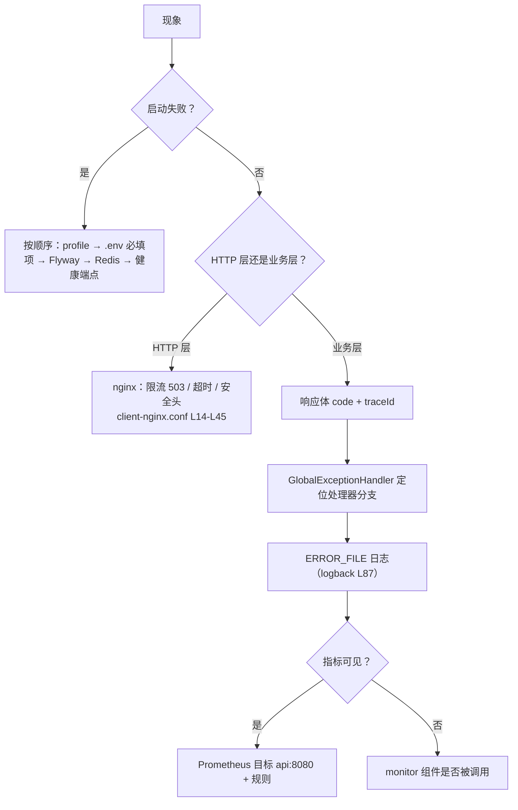
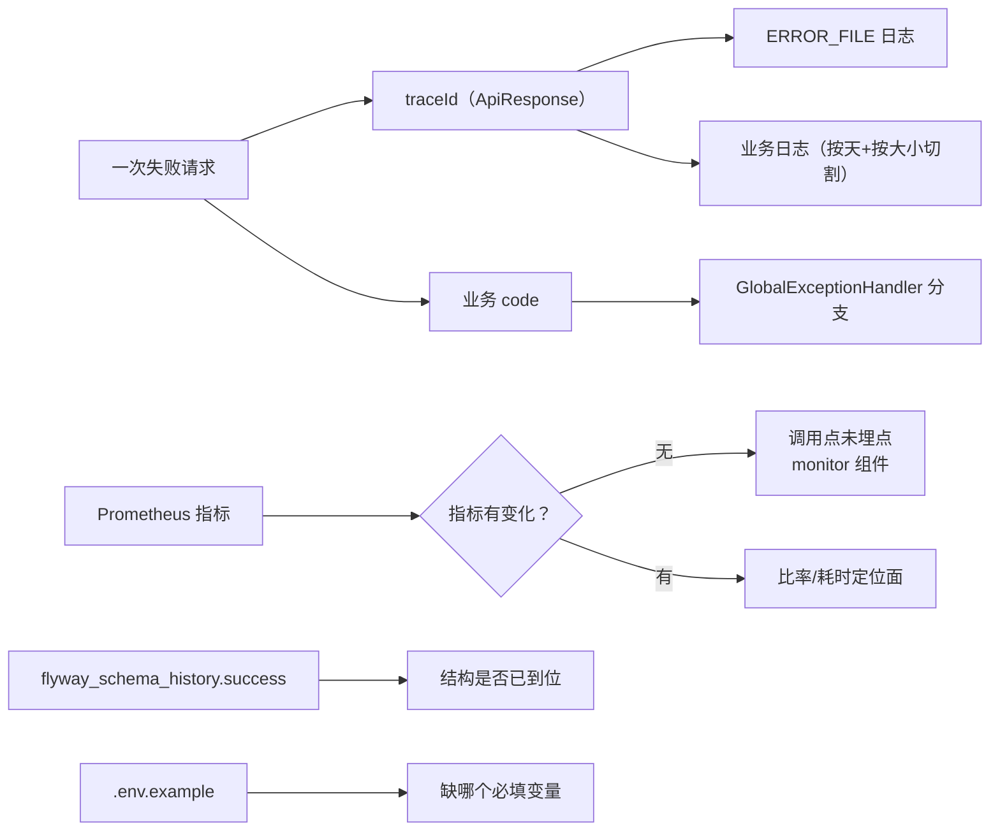
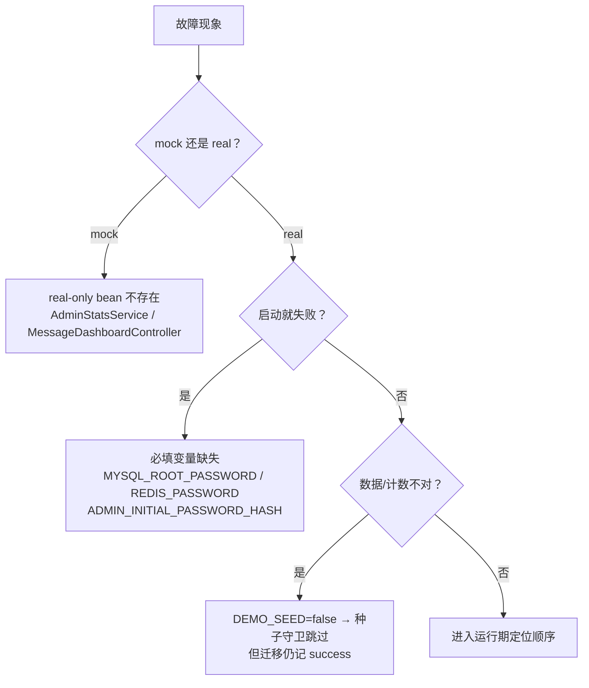

# 故障排查与常见问题

<cite>
**本文引用的文件**
- [GlobalExceptionHandler.java](file://apps/api/src/main/java/com/campuslove/api/config/GlobalExceptionHandler.java)
- [application.yml](file://apps/api/src/main/resources/application.yml)
- [application-real.yml](file://apps/api/src/main/resources/application-real.yml)
- [application-mock.yml](file://apps/api/src/main/resources/application-mock.yml)
- [logback-spring.xml](file://apps/api/src/main/resources/logback-spring.xml)
- [.env.example](file://.env.example)
- [docker-compose.yml](file://docker-compose.yml)
- [client-nginx.conf](file://docker/client-nginx.conf)
- [README.md](file://README.md)
- [目录整理说明.md](file://目录整理说明.md)
- [build-mp-weixin.bat](file://build-mp-weixin.bat)
- [start-showcase.bat](file://start-showcase.bat)
- [install-git-hooks.mjs](file://scripts/install-git-hooks.mjs)
- [prometheus.yml](file://docker/prometheus/prometheus.yml)
- [alert-rules.yml](file://docker/prometheus/rules/alert-rules.yml)
- [FlywayMigrationRepeatableTest.java](file://apps/api/src/test/java/com/campuslove/api/database/FlywayMigrationRepeatableTest.java)
- [flyway.toml](file://database/flyway/flyway.toml)
- [ci.yml](file://.github/workflows/ci.yml)
</cite>

## 目录
1. [简介](#简介)
2. [项目结构](#项目结构)
3. [核心组件](#核心组件)
4. [架构总览](#架构总览)
5. [子页面导航与边界](#子页面导航与边界)
6. [排障的第一手证据在哪里](#排障的第一手证据在哪里)
7. [统一异常出口覆盖了什么](#统一异常出口覆盖了什么)
8. [环境与 profile 引起的故障](#环境与-profile-引起的故障)
9. [启动期故障定位顺序](#启动期故障定位顺序)
10. [运行期故障定位顺序](#运行期故障定位顺序)
11. [容器与网关层的故障](#容器与网关层的故障)
12. [监控与日志如何配合定位](#监控与日志如何配合定位)
13. [已知陷阱清单](#已知陷阱清单)
14. [依赖关系分析](#依赖关系分析)
15. [性能考虑](#性能考虑)
16. [结论](#结论)

## 简介
本页是"出问题从哪里查起"的索引页。它不收集问答式的 FAQ，
而是给出三件有证据支撑的东西：**排障材料的物理位置**（日志、指标、异常出口、编排日志）、
**一条可复用的定位顺序**（启动期与运行期各一条），以及**本仓库已知的陷阱清单**。

具体故障主题的展开在四份子文档里：开发环境问题排查、性能问题优化、第三方集成问题、运行时故障诊断。

## 项目结构
- 后端异常出口：`apps/api/src/main/java/com/campuslove/api/config/GlobalExceptionHandler.java`
  （915 行，类声明 L61）。
- 运行配置：`apps/api/src/main/resources/` 下 `application.yml`、`application-real.yml`、
  `application-mock.yml`、`application-wechat.yml`，外加 `logback-spring.xml`（281 行）
  与 `redisson-dev.yaml`。
- 部署与本地入口：`docker-compose.yml`（663 行）、`docker/client-nginx.conf`（68 行）、
  根目录 `build-mp-weixin.bat`、`start-showcase.bat`。
- 环境模板：`.env.example`（216 行）。
- 目录职责说明：`目录整理说明.md`（240 行）、`README.md`（417 行）。
- 迁移与校验：`database/flyway/flyway.toml`（39 行）、
  `FlywayMigrationRepeatableTest.java`（118 行）。
- 流水线：`.github/workflows/ci.yml`（512 行，10 个作业）。

**章节来源**
- [GlobalExceptionHandler.java:61-61](file://apps/api/src/main/java/com/campuslove/api/config/GlobalExceptionHandler.java#L61-L61)
- [logback-spring.xml:58-126](file://apps/api/src/main/resources/logback-spring.xml#L58-L126)
- [.env.example:1-216](file://.env.example#L1-L216)
- [README.md:1-417](file://README.md#L1-L417)
- [目录整理说明.md:1-240](file://目录整理说明.md#L1-L240)

## 核心组件
`GlobalExceptionHandler` 是唯一的异常收敛点，按异常类型分派，
仓库内可读到的处理器包括（行号为 `@ExceptionHandler` 定义处）：

| 异常 | 行号 | 典型触发 |
|---|---|---|
| `MethodArgumentNotValidException` | L90 | `@Valid` 请求体校验失败 |
| `HttpClientErrorException.Unauthorized` | L106 | 上游（微信等）返回 401 |
| `IllegalArgumentException` | L118 | 参数不合法、枚举取值越界 |
| `InsufficientBalanceException` | L152 | 交友币余额不足 |
| `MediaSizeLimitExceededException` | L169 | 上传体积超限 |
| `CommerceDisabledException` | L197 | 商业化能力被关闭 |
| `VideoUploadDisabledException` | L223 | 视频上传未开启 |

这些处理器的存在意味着：**多数"接口返回奇怪 code"的问题，答案在这个文件里**，
而不是每个控制器各写一套。

**章节来源**
- [GlobalExceptionHandler.java:90-223](file://apps/api/src/main/java/com/campuslove/api/config/GlobalExceptionHandler.java#L90-L223)

## 架构总览

[此图为概念流程，不直接对应具体源文件，故不提供图表来源]

## 子页面导航与边界
- **开发环境问题排查**：Node/pnpm 版本闸、Windows 路径与换行、小程序构建、
  开发者工具连接、钩子未生效。
- **性能问题优化**：慢查询与索引、N+1、缓存击穿、前端首屏与包体。
- **第三方集成问题**：微信登录与支付回调、媒体存储、推送与外部 API。
- **运行时故障诊断**：进程/容器级、令牌与吊销、任务与队列、数据一致性。

本页只负责"先查哪里"，具体处置写进对应子页。

## 排障的第一手证据在哪里

[此图为概念流程，不直接对应具体源文件，故不提供图表来源]

| 证据 | 位置 | 用途 |
|---|---|---|
| 业务日志 | `${LOG_PATH}/${APP_NAME}.%d{yyyy-MM-dd}.%i.log`(L70)，容器内 `/app/logs`，卷 `api-logs`(L271) | 按天 + 按大小切割，容器重建后仍在 |
| 错误日志 | `${LOG_PATH}/${APP_NAME}-error...`(L93) 的 `ERROR_FILE` appender(L87) | 只看错误级，排障首选 |
| 审计日志 | `AUDIT` appender(L126) | 后台操作留痕，异步写 |
| 响应体 | `ApiResponse(code, message, data, traceId)` | `traceId` 是关联日志的钥匙 |
| 指标 | `/actuator/prometheus`，被 `api:8080` 作业抓取(prometheus.yml L49-L55) | 比率/耗时/计数 |
| 健康 | `/actuator/health`（compose 健康检查用它，L274），并暴露 resilience4j 指标(application.yml L460 注释) | 判定"起没起"与依赖是否可用 |
| 迁移历史 | `flyway_schema_history` 的 `success` 列（测试断言口径，FlywayMigrationRepeatableTest L54-L58） | 判断哪些脚本真跑过 |
| 本地凭据模板 | `.env.example`(216 行) | 缺哪个变量一目了然 |

**章节来源**
- [logback-spring.xml:70-126](file://apps/api/src/main/resources/logback-spring.xml#L70-L126)
- [docker-compose.yml:269-275](file://docker-compose.yml#L269-L275)
- [application.yml:460-460](file://apps/api/src/main/resources/application.yml#L460-L460)
- [prometheus.yml:49-55](file://docker/prometheus/prometheus.yml#L49-L55)
- [FlywayMigrationRepeatableTest.java:54-58](file://apps/api/src/test/java/com/campuslove/api/database/FlywayMigrationRepeatableTest.java#L54-L58)

## 统一异常出口覆盖了什么
读该文件时要注意三件事：

1. **参数校验有专门分支**：`MethodArgumentNotValidException`(L90) 单独处理，
   因此"400 但 message 看不懂"通常是字段级校验消息没有被前端展开。
2. **上游 401 与本地令牌问题不是一回事**：`HttpClientErrorException.Unauthorized`(L106)
   处理的是调用外部服务（如微信）被拒，而本地 JWT 校验失败走
   `InvalidTokenException` / `TokenRevokedException`（见 `API接口文档/认证与用户API`）。
   两者都表现为 401 语义，排查方向完全不同。
3. **业务异常有专门类型**：余额不足(L152)、媒体超限(L169)、
   商业化关闭(L197)、视频上传未开启(L223)都有独立处理器，
   所以"提示语奇怪"往往意味着某个能力开关处于关闭态，而不是数据坏了。

**章节来源**
- [GlobalExceptionHandler.java:90-223](file://apps/api/src/main/java/com/campuslove/api/config/GlobalExceptionHandler.java#L90-L223)

## 环境与 profile 引起的故障

[此图为概念流程，不直接对应具体源文件，故不提供图表来源]

后端行为由 profile 决定，`application-real.yml` 与 `application-mock.yml` 是两套实现装配点。
典型环境类故障：

- **profile 选错**：mock 与 real 的差别是"整块能力在不在"。
  例：关系看板有 `MessageDashboardController`(real) 与
  `MockMessageDashboardController`(mock) 同路径两套实现；
  统计服务 `AdminStatsService` 只有 real 实现，mock 下端点整体不存在。
- **必填变量缺失**：compose 里 `MYSQL_ROOT_PASSWORD`、`MYSQL_PASSWORD`(L89、L92)、
  `REDIS_PASSWORD`(L150) 都是 `${VAR:?... is required}`，未设置时容器直接拒绝启动——
  报错信息本身就写明"required"，不要靠猜。
- **管理员凭据为空**：`ADMIN_OPENID` / `ADMIN_INITIAL_PASSWORD_HASH` 默认空(L233-L235)，
  real profile 下口令校验器检测到空哈希会拒绝启动（见 `数据库设计与迁移/Flyway数据库迁移管理`）。
- **演示数据没进来**：`DEMO_SEED` 默认 `false`(L103)，
  且相关迁移在 `flyway_schema_history` 里仍记为成功，容易误判为"跑了但没数据"。
- **钩子没装**：`scripts/install-git-hooks.mjs` 需要显式执行才把
  `core.hooksPath` 指向 `scripts/git-hooks`(L6、L24)，未安装时本地没有任何提交闸。

**章节来源**
- [docker-compose.yml:89-92](file://docker-compose.yml#L89-L92)
- [docker-compose.yml:150-150](file://docker-compose.yml#L150-L150)
- [docker-compose.yml:233-235](file://docker-compose.yml#L233-L235)
- [application-real.yml:101-104](file://apps/api/src/main/resources/application-real.yml#L101-L104)
- [install-git-hooks.mjs:6-24](file://scripts/install-git-hooks.mjs#L6-L24)

## 启动期故障定位顺序
按这个顺序做，能在几分钟内区分"配置错"与"代码错"：

1. **确认 profile 与端口**：进程是否带 `-Dspring-boot.run.profiles=...`
   （`api:dev` 脚本显式用 mock），api 监听 8080 且只绑回环(L268)。
2. **看 Flyway 是否完成**：`locations` 是否解析到脚本目录
   （容器 `filesystem:/app/db/migration`(L240) vs 宿主 `filesystem:../../database/flyway/sql`(L76)，
   两者基准目录不同），以及 `validateOnMigrate`(L5) 是否报 checksum 冲突。
3. **看数据与缓存连接**：MySQL 健康、Redis 是否可用（`RedissonClient` 是令牌吊销载体，
   缺失时吊销语义退化）。
4. **查健康端点**：`/actuator/health`(L274) 与 resilience4j 指标(application.yml L460)。
5. **确认没被 `initdb.d` 干扰**：迁移目录只读挂给应用(L272)，
   若被误挂到 MySQL `initdb.d` 会重复执行脚本（compose 注释 L41-L42 明令禁止）。

**章节来源**
- [application-real.yml:68-77](file://apps/api/src/main/resources/application-real.yml#L68-L77)
- [flyway.toml:1-9](file://database/flyway/flyway.toml#L1-L9)
- [docker-compose.yml:41-42](file://docker-compose.yml#L41-L42)
- [docker-compose.yml:240-240](file://docker-compose.yml#L240-L240)
- [docker-compose.yml:266-275](file://docker-compose.yml#L266-L275)

## 运行期故障定位顺序
1. **先取 `traceId`**：响应体 `ApiResponse(code, message, data, traceId)`，
   用它到 `ERROR_FILE` 里定位堆栈，避免在按天切割的业务日志里翻。
2. **判断落在哪个异常处理器**：按"统一异常出口"表定位分支，
   分支性质直接决定方向（校验 / 鉴权 / 上游 / 业务规则 / 能力关闭）。
3. **看指标是否动了**：`ChatMetrics.recordMessageFailed`、
   `PaymentMetrics.recordCallbackFailure` 等是否增长；
   若指标本身没注册成功，问题在调用点而不是逻辑。
   注意 `alert-rules.yml`(L314-L315) 自述"接线前静默不触发"属**过期注释**：
   `payment_callback_failure_total` 的写入点已在 `BillingController`(L134-L194)、
   `WxPayRefundNotifyController`(L94-L153) 与 `VipOrderService.recordFailure`(L614-L619) 三处存在，
   所以指标不增长应回查请求是否走到那些分支，而不是先去"补接线"。
4. **区分 4xx 归属**：nginx 侧 503 多为限流命中(L14、L36)，
   404 常见于忘写 `/api/v1` 前缀或路径拼错（各 API 子页列了实现路径）。
5. **核对数据一致性**：冗余计数列与明细是否一致
   （`following_count`、`likes_count`、`reply_count`、`last_message_*`），
   不一致时找漏同步的写路径而不是先改数据。

**章节来源**
- [logback-spring.xml:87-98](file://apps/api/src/main/resources/logback-spring.xml#L87-L98)
- [alert-rules.yml:312-318](file://docker/prometheus/rules/alert-rules.yml#L312-L318)
- [client-nginx.conf:14-45](file://docker/client-nginx.conf#L14-L45)
- [ChatMetrics.java:60-103](file://apps/api/src/main/java/com/campuslove/api/monitor/ChatMetrics.java#L60-L103)

## 容器与网关层的故障
- **外部访问 api 不通**：设计如此，端口只绑 `127.0.0.1`(L268)，
  公网流量必须走 client 服务的 Nginx `/api/` 反代(L35-L37)。
  若 `client` 未被 profile 启动，就没有反代入口。
- **间歇 503**：`limit_req ... rate=5r/s` + `burst=10`(L14、L36)，
  表现为按 IP 限流，通常由脚本轮询或前端重复请求放大。
- **静态资源缓存异常**：`expires 1y`(L50) 依赖带指纹的文件名；
  手工替换构建产物会出现"改了没生效"。
- **上传成功但播放 404**：语音链路用 `urlPrefix` 与 `storageRoot` 分离内外路径
  （见 `API接口文档/消息与聊天API`），任一处配置错都会表现为该症状。
- **健康检查失败导致重启**：`HEALTHCHECK` 的 `start-period=60s`
  要覆盖 Flyway 与索引/种子脚本的执行时间，首跑大库时应先看迁移进度再调阈值。

**章节来源**
- [client-nginx.conf:14-50](file://docker/client-nginx.conf#L14-L50)
- [docker-compose.yml:266-275](file://docker-compose.yml#L266-L275)
- [prometheus.yml:22-24](file://docker/prometheus/prometheus.yml#L22-L24)

## 监控与日志如何配合定位
- **规则先于人工**：`ApiDown`(L20) 与 `ApiHealthCheckFailed`(L35) 是 critical，
  两者与容器 `HEALTHCHECK` 同源；先看有没有告警再决定是否手查。
- **主机资源默认无数据**：`HostDiskHigh`/`HostMemoryHigh`/`HostCpuHigh`(L221-L247)
  依赖 node-exporter，而该服务被 profile 化(L581)、抓取作业仍被注释(L65-L66)——
  这类"看起来有告警其实静默"的情况要提前知道。
- **登录失败率是唯一间接的第三方健康信号**：
  `HighLoginFailureRate`(L298) 表达式比率 > 0.1 且 `for: 5m`，
  而微信可达性探测规则本身是注释状态(L268)。
- **未恢复告警的重发节奏**：critical 1h、warning 4h(L68、L75、L57)，
  "怎么又收到同一条"通常是未恢复而非重复触发。

**章节来源**
- [alert-rules.yml:19-53](file://docker/prometheus/rules/alert-rules.yml#L19-L53)
- [alert-rules.yml:215-298](file://docker/prometheus/rules/alert-rules.yml#L215-L298)
- [prometheus.yml:65-66](file://docker/prometheus/prometheus.yml#L65-L66)
- [alertmanager.yml:57-78](file://docker/alertmanager/alertmanager.yml#L57-L78)

## 已知陷阱清单
以下每条都在仓库内有明确出处，属于"会反复浪费排查时间"的类型：

1. **相对路径基准不同**：`filesystem:../../database/flyway/sql` 基于 `apps/api`，
   容器里换成 `/app/db/migration`(L240)，从别处启动会"找不到脚本"。
2. **迁移可重入测试默认不跑**：`FlywayMigrationRepeatableTest` 需要
   `-Dflyway.repeatable.test=true`(L37) 才启用，否则被跳过却被当作通过。
3. **CI 不校验数据库**：`ci.yml` 无任何 Flyway 步骤，唯一防线是 PR 清单人工核对项
   （`.github/pull_request_template.md` 记录"database/flyway 变更时需在一次性库上跑 migrate+validate"）。
4. **占位符没有默认值是有意的**：管理员 openid 与口令哈希缺失时 `migrate` 直接失败，
   不要为了跑通而写回弱默认值（`flyway.toml` 注释记录了这条历史修复）。
5. **函数式唯一索引有版本要求**：`uk_private_conversations_users` 用
   `LEAST`/`GREATEST`(L16)，早期 MySQL 不支持时会静默缺失。
6. **Redis 淘汰策略与吊销语义冲突风险**：`--maxmemory-policy allkeys-lru`(L152)
   可淘汰任意键，而吊销名单正是带 TTL 的键。
7. **JSON 列不能过滤**：`interest_tags`、`posts.tags` 之类走 JSON，
   按标签筛选必须改用关系表，否则全表扫。
8. **同路径两套实现**：`/api/v1/messages/relationship-dashboard` 有 real 与 mock 两个控制器，
   确认运行模式后再判断"数据从哪来"。
9. **BOM 影响逐行解析**：`V2026.06.25.0001__add_user_role_and_init_admin.sql` 带 UTF-8 BOM，
   自研 DDL 解析器会看到首行多出字节。
10. **统计降级返回零值**：DB 失败被就地降级为零/空并返回 200
    （见 `后端API服务/管理后台API/数据统计与分析`），
    "真值为 0"与"查询失败"在响应体上不可区分，只能看日志。

**章节来源**
- [application-real.yml:68-77](file://apps/api/src/main/resources/application-real.yml#L68-L77)
- [FlywayMigrationRepeatableTest.java:37-38](file://apps/api/src/test/java/com/campuslove/api/database/FlywayMigrationRepeatableTest.java#L37-L38)
- [flyway.toml:11-39](file://database/flyway/flyway.toml#L11-L39)
- [V2026.05.24.0002__create_private_conversations.sql:16-16](file://database/flyway/sql/V2026.05.24.0002__create_private_conversations.sql#L16-L16)
- [docker-compose.yml:150-152](file://docker-compose.yml#L150-L152)
- [V2026.06.25.0001__add_user_role_and_init_admin.sql:1-1](file://database/flyway/sql/V2026.06.25.0001__add_user_role_and_init_admin.sql#L1-L1)

## 依赖关系分析
- **异常出口 → 响应契约**：`GlobalExceptionHandler` 与 `ApiResponse` 共同决定
  "HTTP 200 + 业务 code"的形态，因此客户端不能只看状态码。
- **profile → 实现集合**：`application-real.yml` / `application-mock.yml` 决定
  哪些 `@Profile` bean 被装配，进而决定哪些端点存在。
- **日志 → 卷**：`logback-spring.xml` 的路径变量与 compose 的 `api-logs` 卷绑定，
  换部署方式时若丢了卷，排障材料就随容器消失。
- **监控 → 代码调用点**：Prometheus 规则只消费已注册的指标；
  指标是否出现取决于 `monitor` 组件是否被业务调用（陷阱 3 与统计降级即两例）。
- **CI 与流水线**：`ci.yml` 覆盖 lint/测试/镜像/端到端，
  但数据库校验仍靠人工，因此"CI 绿"不等于"schema 一致"。

**章节来源**
- [ci.yml:60-461](file://.github/workflows/ci.yml#L60-L461)
- [docker-compose.yml:269-272](file://docker-compose.yml#L269-L272)
- [application-mock.yml:1-1](file://apps/api/src/main/resources/application-mock.yml#L1-L1)

## 性能考虑
- **日志双维度切割**：按天 + 按大小(`SizeAndTimeBasedRollingPolicy` L68、L92)，
  避免单日文件过大导致定位时需要全量扫盘。
- **错误日志单独 appender**：`ERROR_FILE`(L87) 让排障只读一个小文件而不是主日志。
- **审计异步**：审计写库走独立线程池（`AuditAsyncConfig` 的 `auditLogExecutor()`），
  不拖慢主请求，代价是审计有延迟。
- **评估节奏分级**：可用性 30s、业务 60s(L16、L292)，
  比率类表达式不必跟高频抓取一样评估。

**章节来源**
- [logback-spring.xml:87-126](file://apps/api/src/main/resources/logback-spring.xml#L87-L126)
- [alert-rules.yml:16-16](file://docker/prometheus/rules/alert-rules.yml#L16-L16)
- [alert-rules.yml:292-292](file://docker/prometheus/rules/alert-rules.yml#L292-L292)

## 结论
排障的正确入口是三样东西：**`traceId` + `GlobalExceptionHandler` 的分支 +
`ERROR_FILE` 日志**；其余（指标、健康端点、`flyway_schema_history`、`.env.example`）
用于确认边界条件。启动期按"profile → 必填变量 → Flyway → Redis → 健康端点"走，
运行期按"traceId → 异常分支 → 指标是否动 → 4xx 归属 → 计数一致性"走。

最后强调两条容易被忽略的：**mock 与 real 是两套能力集合**，
问"接口为什么 404"之前先确认 profile；**CI 不校验数据库**，
schema 一致性目前仍依赖 PR 清单的人工核对与 `validateOnMigrate`，
这两者都不能替代一次真实的 `migrate + validate`。
