# 第三方集成问题

<cite>
**本文引用的文件**
- [users.yaml](file://docs/openapi/users.yaml)
- [feedback-growth-and-auth.yaml](file://docs/openapi/feedback-growth-and-auth.yaml)
- [login.ts](file://apps/client/src/view-models/login.ts)
- [mp-shoot-autoshot.cjs](file://scripts/mp-shoot-autoshot.cjs)
- [generate-secret.sh](file://scripts/generate-secret.sh)
- [WechatLoginRequest.java](file://apps/api/src/main/java/com/campuslove/api/auth/WechatLoginRequest.java)
- [WechatLoginSupport.java](file://apps/api/src/main/java/com/campuslove/api/auth/WechatLoginSupport.java)
- [WechatLoginException.java](file://apps/api/src/main/java/com/campuslove/api/auth/WechatLoginException.java)
- [AdminLoginView.java](file://apps/api/src/main/java/com/campuslove/api/auth/AdminLoginView.java)
- [AuthMetrics.java](file://apps/api/src/main/java/com/campuslove/api/monitor/AuthMetrics.java)
- [ChatMetrics.java](file://apps/api/src/main/java/com/campuslove/api/monitor/ChatMetrics.java)
- [PaymentMetrics.java](file://apps/api/src/main/java/com/campuslove/api/monitor/PaymentMetrics.java)
- [VipBillingLog.java](file://apps/api/src/main/java/com/campuslove/api/entity/VipBillingLog.java)
- [WeChatClient.java](file://apps/api/src/main/java/com/campuslove/api/auth/WeChatClient.java)
- [GlobalExceptionHandler.java](file://apps/api/src/main/java/com/campuslove/api/config/GlobalExceptionHandler.java)
- [SmsCodeService.java](file://apps/api/src/main/java/com/campuslove/api/auth/SmsCodeService.java)
- [SensitiveDataMasker.java](file://apps/api/src/main/java/com/campuslove/api/utils/SensitiveDataMasker.java)
- [WxPayProperties.java](file://apps/api/src/main/java/com/campuslove/api/wxpay/WxPayProperties.java)
- [application.yml](file://apps/api/src/main/resources/application.yml)
- [application-wechat.yml](file://apps/api/src/main/resources/application-wechat.yml)
- [application-mock.yml](file://apps/api/src/main/resources/application-mock.yml)
- [application-real.yml](file://apps/api/src/main/resources/application-real.yml)
- [JwtConfigTest.java](file://apps/api/src/test/java/com/campuslove/api/config/JwtConfigTest.java)
- [WxPayPropertiesFailFastTest.java](file://apps/api/src/test/java/com/campuslove/api/wxpay/WxPayPropertiesFailFastTest.java)
- [.env.example](file://apps/api/.env.example)
- [start-mock.sh](file://apps/api/start-mock.sh)
- [vite.config.ts](file://apps/client/vite.config.ts)
- [prometheus.yml](file://docker/prometheus/prometheus.yml)
- [alert-rules.yml](file://docker/prometheus/rules/alert-rules.yml)
- [miniprogram-qa-loop-v32.dwf.ts](file://.zcode/workflows/miniprogram-qa-loop-v32.dwf.ts)
- [start-real.sh](file://apps/api/start-real.sh)
- [start-api-fixed.bat](file://apps/api/start-api-fixed.bat)
- [.gitignore](file://.gitignore)
- [.zcodeignore](file://.zcodeignore)
- [client-round2.md](file://archive/audit-round2/client-round2.md)
- [05-fix-recommendations.md](file://doc/reports/system-testing/05-fix-recommendations.md)
- [miniprogram-repo-closure-v35.dwf.ts](file://.zcode/workflows/miniprogram-repo-closure-v35.dwf.ts)
- [RealAuthServiceMinorRegistrationTest.java](file://apps/api/src/test/java/com/campuslove/api/auth/RealAuthServiceMinorRegistrationTest.java)
- [V32-D-RULES-DRAFT.md](file://.zcode/research/V32-D-RULES-DRAFT.md)
</cite>

## 目录
1. [简介](#简介)
2. [项目结构](#项目结构)
3. [核心组件](#核心组件)
4. [架构总览](#架构总览)
5. [详细组件分析](#详细组件分析)
6. [微信登录授权失败排查](#微信登录授权失败排查)
7. [令牌与密钥配置排查](#令牌与密钥配置排查)
8. [支付回调异常排查](#支付回调异常排查)
9. [监控与指标上报排查](#监控与指标上报排查)
10. [契约与字段核对](#契约与字段核对)
11. [配置与开关](#配置与开关)
12. [数据模型](#数据模型)
13. [外部服务调用失败处理](#外部服务调用失败处理)
14. [缺失能力登记](#缺失能力登记)
15. [依赖关系分析](#依赖关系分析)
16. [性能考虑](#性能考虑)
17. [故障排查指南](#故障排查指南)
18. [安全防护措施](#安全防护措施)
19. [结论](#结论)

## 简介
本页面向 Campus Love（校园恋爱小程序）项目，聚焦「第三方服务集成」这一故障面：小程序登录授权链路、令牌与密钥生成、支付回调、监控指标上报、以及小程序端自动化诊断脚本与 OpenAPI 契约之间的对接口径。文档只覆盖仓库里真实存在实现证据的部分，并把它们与具体文件、行号绑定；对仓库中没有接入证据的外部能力（短信验证码、邮件推送、对象存储、Sentry 类错误上报等），统一在「缺失能力登记」一节单列说明，避免按通用 FAQ 猜测配置项。

从取证范围看，本页涉及的第三方交互面集中在四类：

- 登录侧：`/auth/wechat-login` 换取会话、`/auth/refresh` 续期、`/auth/logout` 与后台账号口令登录，对应 OpenAPI 定义与 `com.campuslove.api.auth` 包内的请求体、支持类与异常枚举。
- 密钥侧：`scripts/generate-secret.sh` 提供 JWT 密钥、数据库口令、Redis 口令、后台口令哈希的生成入口，是密钥配置错误类故障的第一现场。
- 计费侧：支付回调的时延与失败由 `PaymentMetrics` 记录，落库状态由 `VipBillingLog` 实体承载。
- 观测侧：`AuthMetrics`、`ChatMetrics`、`PaymentMetrics` 三个 `@Component` 是「监控告警不生效」类问题的检查起点；仓库内没有外部 APM/SaaS 上报器的接入证据。

诊断侧还有一个可复现入口：`scripts/mp-shoot-autoshot.cjs`，用于在微信开发者工具环境下做小程序截图/自检式自动化，可在授权页与登录页异常时提供可视化证据。

**章节来源**
- [feedback-growth-and-auth.yaml:52-224](file://docs/openapi/feedback-growth-and-auth.yaml#L52-L224)
- [generate-secret.sh:9-41](file://scripts/generate-secret.sh#L9-L41)
- [mp-shoot-autoshot.cjs:1-121](file://scripts/mp-shoot-autoshot.cjs#L1-L121)
- [PaymentMetrics.java:29-79](file://apps/api/src/main/java/com/campuslove/api/monitor/PaymentMetrics.java#L29-L79)

## 项目结构
第三方集成相关代码在本仓库按「契约—应用层—观测层—脚本」四层分布，而不是集中在某个 `integration` 包内，这直接决定了排查时的定位顺序：先看契约声明了什么，再看 API 侧的入参/异常实现，然后看指标埋点是否被记录，最后看脚本能否复现。

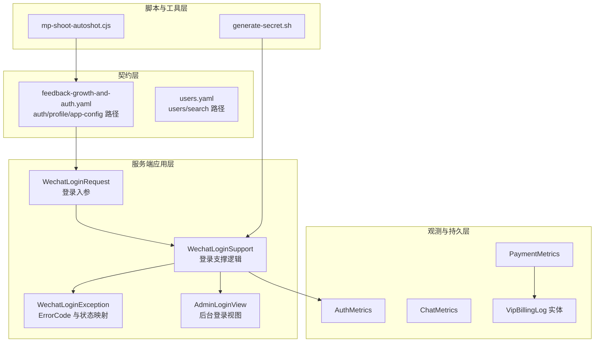

**图表来源**
- [feedback-growth-and-auth.yaml:33-224](file://docs/openapi/feedback-growth-and-auth.yaml#L33-L224)
- [users.yaml:15-270](file://docs/openapi/users.yaml#L15-L270)
- [WechatLoginRequest.java:1-15](file://apps/api/src/main/java/com/campuslove/api/auth/WechatLoginRequest.java#L1-L15)
- [WechatLoginSupport.java:1-66](file://apps/api/src/main/java/com/campuslove/api/auth/WechatLoginSupport.java#L1-L66)
- [WechatLoginException.java:26-98](file://apps/api/src/main/java/com/campuslove/api/auth/WechatLoginException.java#L26-L98)
- [AdminLoginView.java:13-28](file://apps/api/src/main/java/com/campuslove/api/auth/AdminLoginView.java#L13-L28)
- [AuthMetrics.java:22-91](file://apps/api/src/main/java/com/campuslove/api/monitor/AuthMetrics.java#L22-L91)
- [ChatMetrics.java:23-103](file://apps/api/src/main/java/com/campuslove/api/monitor/ChatMetrics.java#L23-L103)
- [PaymentMetrics.java:29-79](file://apps/api/src/main/java/com/campuslove/api/monitor/PaymentMetrics.java#L29-L79)
- [VipBillingLog.java:35-132](file://apps/api/src/main/java/com/campuslove/api/entity/VipBillingLog.java#L35-L132)
- [generate-secret.sh:12-41](file://scripts/generate-secret.sh#L12-L41)
- [mp-shoot-autoshot.cjs:1-121](file://scripts/mp-shoot-autoshot.cjs#L1-L121)

目录层面的对应关系（路径均来自实际引用文件）：

| 位置 | 角色 | 排查用途 |
| --- | --- | --- |
| `docs/openapi/` | OpenAPI 契约，声明路径、tag、summary、operationId | 判断「客户端调用是否契约内接口」，字段与 operationId 对不齐是第一类集成故障 |
| `apps/api/src/main/java/com/campuslove/api/auth/` | 登录请求体、支撑类、异常与错误码 | 微信登录授权失败、后台登录失败的实现层 |
| `apps/api/src/main/java/com/campuslove/api/monitor/` | 三个 `@Component` 指标类 | 监控告警不生效时的埋点自检入口 |
| `apps/api/src/main/java/com/campuslove/api/entity/` | `VipBillingLog` 等实体 | 支付回调落库与状态核对 |
| `apps/client/src/view-models/` | `login.ts` 视图模型转换 | 登录页渲染字段缺失类问题 |
| `scripts/` | `generate-secret.sh`、`mp-shoot-autoshot.cjs` | 密钥生成与小程序可视化自检 |

**章节来源**
- [login.ts:1-8](file://apps/client/src/view-models/login.ts#L1-L8)
- [feedback-growth-and-auth.yaml:33-57](file://docs/openapi/feedback-growth-and-auth.yaml#L33-L57)

## 核心组件
本页涉及的第三方集成组件按故障面归类。每一项都给出仓库中的实现位置，排查时按「先定位组件、再定位行为」的顺序推进。

- 微信登录共享实现 `WechatLoginSupport`。包级私有工具类，声明为 `final class WechatLoginSupport`，私有构造禁止实例化；唯一静态入口 `login(AuthService, AuthMetrics, String code, String deviceId)` 返回 `UserSessionView`。它把推荐端点与旧路径别名两条链路的「调用 `AuthService.loginWithWechat` + 成功指标埋点 + 失败原因记录」收敛为单一实现，类注释明确记录收敛动机是「双实现契约漂移风险」，两个端点均保留以兼容旧客户端。
- 微信登录错误码载体 `WechatLoginException`。`RuntimeException` 子类，内嵌 `enum ErrorCode`，三个取值各自绑定固定 `HttpStatus` 与面向终端用户的默认文案：`INVALID_CODE`（401，「微信登录凭证已失效，请重新登录」）、`WECHAT_API_ERROR`（502，「微信服务暂时不可用，请稍后重试」）、`USER_DISABLED`（403，「账号已被禁用，请联系管理员」）；对外暴露 `getErrorCode()`、`getStatus()`，并提供默认消息、自定义消息、自定义消息加 cause 三种构造重载。类注释把 `INVALID_CODE` 对应到上游 `errcode 40029`。
- 微信上游客户端 `WeChatClient`。承担真实登录链路与本地联调降级分支两条路径；注释中指出「生产误开 `WECHAT_DEV_FALLBACK_ENABLED=true` 即可无凭据伪造微信身份」，并在 `profile` 含 `prod`/`real` 时拒绝该开关，降级生效时以 `log.warn` 留痕。
- 统一异常出口 `GlobalExceptionHandler`。`@RestControllerAdvice`，通过 `@Value("${spring.profiles.active:dev}")` 注入并判定生产/开发，为第三方相关异常提供「HTTP 状态码 + 业务错误码 + traceId」的标准化 JSON 出口，是第三方故障对客户端可见形态的唯一来源。
- 密钥与口令生成脚本 `generate-secret.sh`。`set -euo pipefail` 严格模式，提供 `gen_jwt_secret()`（`openssl rand -base64 48`）、`gen_db_password()`（`openssl rand -base64 32`）、`gen_redis_password()`（`openssl rand -base64 24`）、`gen_admin_password_hash()`（`bcrypt.hashpw(..., bcrypt.gensalt(10))`，默认明文 `ChangeMe123!`）四个生成函数，并对 `python3`、`bcrypt` 缺失分别输出 `ERROR:` 到 stderr 后 `return 1`。
- 支付配置与回调观测 `WxPayProperties` 与 `PaymentMetrics`。前者在缺项时 fail-fast，缺失项以 `"app-id", "mchid", "mch-serial-no", "merchant-private-key"` 形式列在异常消息中；后者是 `@Component`，提供 `recordCallbackLatency(long durationMs)` 与 `recordCallbackFailure(String reason)`。
- 登录与聊天指标 `AuthMetrics`、`ChatMetrics`。均为 `@Component`：`AuthMetrics` 提供 `recordLoginSuccess(Long userId)`、`recordLoginFailure(String reason)`、`recordTokenRefresh()`；`ChatMetrics` 提供 `recordMessageSent(String messageType)`、`recordMessageFailed(String reason)`、`incrementActiveSession()`、`decrementActiveSession()`。
- 计费落库实体 `VipBillingLog`。`@Entity` + `@Table`，内嵌 `BillingLogStatus`，字段为 `id`/`userId`/`orderNo`/`amount`/`status`/`createdAt`，是支付回调与订单状态核对的持久化视图。
- 配置面 `application.yml`、`application-wechat.yml`、`application-mock.yml`、`application-real.yml`。集中声明 JWT 签名密钥、微信 `app-id`/`app-secret`、开发降级开关、微信支付 `app-id`，以及面向外部依赖（微信 API / 短信 / 对象存储）的熔断、重试、限流、降级参数。
- 契约面 `feedback-growth-and-auth.yaml`、`users.yaml`。以 `operationId` 固定客户端与服务端的对齐口径（`loginWithWechat`、`refreshToken`、`logout`、`loginAsAdmin`、`getCurrentSession`、`followUser` 等）。
- 视图模型 `login.ts`。导出 `toLoginHeroView`，把 `/app-config/login-hero` 的配置响应转换成登录页渲染结构。
- 小程序自检脚本 `mp-shoot-autoshot.cjs`。微信开发者工具侧的自动化截图/自检入口，授权与登录页异常时可产出可视化证据。
- 日志脱敏工具 `SensitiveDataMasker`。类注释给出 `log.warn("短信发送失败, phone={}", maskPhone(phone))` 用法，是敏感信息泄露防护的实现载体。
- 短信验证码服务 `SmsCodeService`。文件头注释即定义两种形态：mock profile 使用固定 mock 码（默认 `123456`），真实形态对接服务商；注册链路 `registerUser` 的 `verificationCode` 参数与之对应。
- 客户端可观测配置 `vite.config.ts`。`VITE_SENTRY_DSN` 与 `VITE_API_MODE`、`VITE_API_BASE_URL`、`VITE_APP_VERSION`、`VITE_TENCENT_MAP_KEY` 同批注入，注释说明「未配置时跳过 Sentry 初始化」，并将 `@sentry/*` 归入独立 chunk。
- 监控采集面 `docker/prometheus/prometheus.yml`、`docker/prometheus/rules/alert-rules.yml`。前者以 `metrics_path: /actuator/prometheus` 抓取 Spring Boot API 指标，后者基于 micrometer 注册的 `spring_boot_health_status`（Spring Boot 3 + actuator）定义告警规则。

**章节来源**
- [WechatLoginSupport.java:14-50](file://apps/api/src/main/java/com/campuslove/api/auth/WechatLoginSupport.java#L14-L50)
- [WechatLoginException.java:26-100](file://apps/api/src/main/java/com/campuslove/api/auth/WechatLoginException.java#L26-L100)
- [WeChatClient.java:74-146](file://apps/api/src/main/java/com/campuslove/api/auth/WeChatClient.java#L74-L146)
- [GlobalExceptionHandler.java:60-914](file://apps/api/src/main/java/com/campuslove/api/config/GlobalExceptionHandler.java#L60-L914)
- [generate-secret.sh:9-41](file://scripts/generate-secret.sh#L9-L41)
- [WxPayProperties.java:92-92](file://apps/api/src/main/java/com/campuslove/api/wxpay/WxPayProperties.java#L92-L92)
- [PaymentMetrics.java:29-79](file://apps/api/src/main/java/com/campuslove/api/monitor/PaymentMetrics.java#L29-L79)
- [AuthMetrics.java:22-91](file://apps/api/src/main/java/com/campuslove/api/monitor/AuthMetrics.java#L22-L91)
- [ChatMetrics.java:23-103](file://apps/api/src/main/java/com/campuslove/api/monitor/ChatMetrics.java#L23-L103)
- [VipBillingLog.java:35-132](file://apps/api/src/main/java/com/campuslove/api/entity/VipBillingLog.java#L35-L132)
- [application.yml:218-273](file://apps/api/src/main/resources/application.yml#L218-L273)
- [application.yml:353-454](file://apps/api/src/main/resources/application.yml#L353-L454)
- [feedback-growth-and-auth.yaml:52-224](file://docs/openapi/feedback-growth-and-auth.yaml#L52-L224)
- [login.ts:6-6](file://apps/client/src/view-models/login.ts#L6-L6)
- [mp-shoot-autoshot.cjs:1-121](file://scripts/mp-shoot-autoshot.cjs#L1-L121)
- [SmsCodeService.java:2-6](file://apps/api/src/main/java/com/campuslove/api/auth/SmsCodeService.java#L2-L6)
- [SensitiveDataMasker.java:20-20](file://apps/api/src/main/java/com/campuslove/api/utils/SensitiveDataMasker.java#L20-L20)
- [vite.config.ts:109-148](file://apps/client/vite.config.ts#L109-L148)
- [prometheus.yml:48-50](file://docker/prometheus/prometheus.yml#L48-L50)
- [alert-rules.yml:32-32](file://docker/prometheus/rules/alert-rules.yml#L32-L32)

## 架构总览
第三方集成在主链路中的位置可以从一次登录请求完整看出。客户端在小程序侧调用 `wx.login()` 取得临时 `code`，以 `POST /auth/wechat-login`（契约 operationId `loginWithWechat`）提交；服务端由 `WechatLoginSupport.login(AuthService, AuthMetrics, String code, String deviceId)` 承接，内部委托 `AuthService.loginWithWechat(code, deviceId)`，成功则记录 `recordLoginSuccess(parseUserId(session.userId()))`，失败则记录 `recordLoginFailure(e.getClass().getSimpleName())` 并把异常原样抛出，交由 `GlobalExceptionHandler.handleWechatLogin` 转成标准化响应。

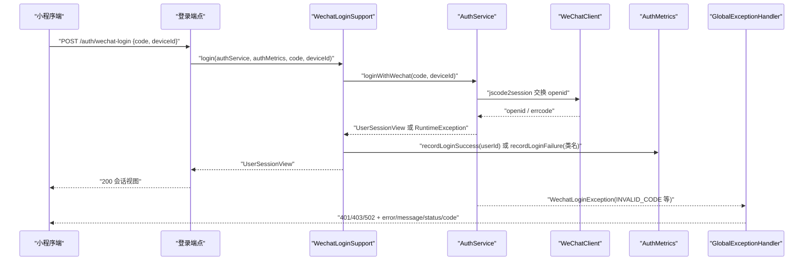

**图表来源**
- [WechatLoginSupport.java:29-50](file://apps/api/src/main/java/com/campuslove/api/auth/WechatLoginSupport.java#L29-L50)
- [WeChatClient.java:142-146](file://apps/api/src/main/java/com/campuslove/api/auth/WeChatClient.java#L142-L146)
- [WechatLoginException.java:32-57](file://apps/api/src/main/java/com/campuslove/api/auth/WechatLoginException.java#L32-L57)
- [GlobalExceptionHandler.java:351-363](file://apps/api/src/main/java/com/campuslove/api/config/GlobalExceptionHandler.java#L351-L363)
- [AuthMetrics.java:63-91](file://apps/api/src/main/java/com/campuslove/api/monitor/AuthMetrics.java#L63-L91)
- [feedback-growth-and-auth.yaml:73-133](file://docs/openapi/feedback-growth-and-auth.yaml#L73-L133)

链路上有三个对排查至关重要的结构性事实：

1. 指标埋点被刻意与主流程隔离。`WechatLoginSupport` 中两处埋点都包在 `try { ... } catch (RuntimeException ignore)` 内，注释写明「监控逻辑失败忽略，不影响登录主流程」。因此「登录失败但监控面板没有曲线」和「登录失败」是两个独立故障，不能相互推断。
2. 失败原因只记录异常类名，不记录消息。`recordLoginFailure(e.getClass().getSimpleName())` 的取值经过设计，注释说明目的是「避免泄露敏感信息」。这使指标维度稳定，但也意味着排查具体原因必须回到服务端日志与 `traceId`。
3. 双端点共用一份实现。`WechatLoginSupport` 的类注释记录：原 `WechatAuthController#loginWithWechat`（`/api/v1/auth/wechat`，推荐路径）与 `AuthController#loginWithWechat`（`/api/v1/auth/wechat-login`，旧路径别名）各自重复实现，现收敛为共享实现，两个端点保留以兼容旧客户端。因此「同一 code 在一条路径能用、另一条不能用」这类现象在当前实现下应视为环境/凭据差异，而不是端点差异。

**章节来源**
- [WechatLoginSupport.java:6-50](file://apps/api/src/main/java/com/campuslove/api/auth/WechatLoginSupport.java#L6-L50)
- [feedback-growth-and-auth.yaml:73-133](file://docs/openapi/feedback-growth-and-auth.yaml#L73-L133)
- [WechatLoginRequest.java:14-14](file://apps/api/src/main/java/com/campuslove/api/auth/WechatLoginRequest.java#L14-L14)

## 详细组件分析

### 登录共享实现与上游客户端
`WechatLoginSupport` 是排查登录问题的第一落点。它不带 Spring 注解、不可实例化（`private WechatLoginSupport()` 注释为「工具类，禁止实例化」），因此不会出现「注入失败导致登录 500」这类问题；登录逻辑的两个分支完全由 `AuthService.loginWithWechat(code, deviceId)` 的结果决定：

- 成功分支：先判 `session != null && session.userId() != null`，再调用 `authMetrics.recordLoginSuccess(parseUserId(session.userId()))`。`parseUserId` 对 `null`/`isBlank()` 返回 `null`，对 `NumberFormatException` 也返回 `null`，注释说明目的是「避免监控逻辑因数据格式问题影响主流程」。因此 `userId` 非数字时指标里出现的会是 `null` 而非异常。
- 失败分支：捕获 `RuntimeException`，调用 `recordLoginFailure(e.getClass().getSimpleName())` 后 `throw e`。异常语义不变，只是多了一条失败原因记录。

`WeChatClient` 是真正与微信服务器对话的组件，也是「微信服务器网络异常」的落点。它的注释把本地联调降级开关的风险写得很直接：真实登录/注册链路下，「生产误开 `WECHAT_DEV_FALLBACK_ENABLED=true` 即可无凭据伪造微信身份」，并在 profile 含 `prod`/`real` 时抛出包含「`WECHAT_DEV_FALLBACK_ENABLED=true` 禁止在生产环境（profile 含 prod/real）开启」的异常；降级实际生效时输出 `log.warn("WeChat dev-fallback 生效（WECHAT_DEV_FALLBACK_ENABLED=true，仅限本地联调）: code={}", ...)`。这条 warn 日志是区分「上游微信服务真的不可用」与「本地降级路径被触发」的唯一凭据。

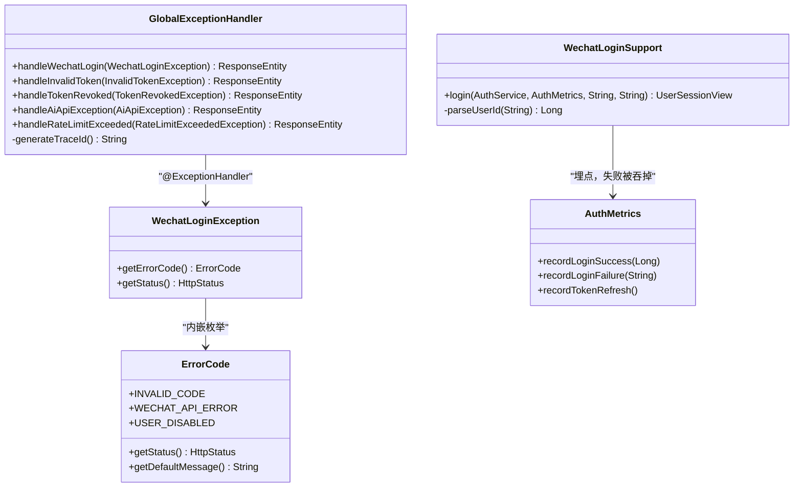

**图表来源**
- [WechatLoginSupport.java:29-65](file://apps/api/src/main/java/com/campuslove/api/auth/WechatLoginSupport.java#L29-L65)
- [WechatLoginException.java:26-100](file://apps/api/src/main/java/com/campuslove/api/auth/WechatLoginException.java#L26-L100)
- [GlobalExceptionHandler.java:351-914](file://apps/api/src/main/java/com/campuslove/api/config/GlobalExceptionHandler.java#L351-L914)
- [AuthMetrics.java:63-91](file://apps/api/src/main/java/com/campuslove/api/monitor/AuthMetrics.java#L63-L91)

### 错误码与响应体的映射关系
`GlobalExceptionHandler` 提供三种响应体构造方式，排查时看响应体字段就能反推异常走的是哪条路径：

- `buildErrorResponse(status, error, message)`：仅 `error`/`message`/`status` 三字段。用于参数校验（`Validation Failed`）、`AccessDeniedException`（`Forbidden`）、`EntityNotFoundException`（固定文案「请求的资源不存在」）、`DataIntegrityViolationException`（409）、`MaxUploadSizeExceededException`（413）、`NoResourceFoundException`（404）、`HttpRequestMethodNotSupportedException`（405）、`RateLimitExceededException`（429）、`ResponseStatusException`、`MediaSizeLimitExceededException`（413）。
- `buildErrorResponseWithCode(status, error, message, errorCode)`：追加 `code`。用于 `WechatLoginException`（`code` 即 `errorCode.name()`）、`InvalidCredentialsException`、`AdminDisabledException`、`AdminNotFoundException`、`AdminAuthException`、`ContentSecurityException`、`DailyLimitExceededException`、`AiApiUnauthorizedException`、`AiApiException`。
- `buildErrorResponseWithCodeAndTraceId(...)`：再追加 `traceId`，并通过 `.header("X-Trace-Id", traceId)` 同时写响应头。用于 `InvalidTokenException`（`UNAUTHORIZED`）与 `TokenRevokedException`（`TOKEN_REVOKED`）以及 `BusinessException` 兜底。
- `buildFeatureDisabledResponse(...)`：`error` 字段直接填业务错误码而非 HTTP reason phrase，用于 `CommerceDisabledException`（`COMMERCE_DISABLED`）与 `VideoUploadDisabledException`（`VIDEO_UPLOAD_DISABLED`），注释说明前端 `toAppApiError` 读取 `error` 后可按码静默处理。
- `buildDesensitizedErrorResponse(...)`：500 兜底，生产 profile 只输出 `code`（`INTERNAL_ERROR`）/`message`/`traceId`/`timestamp`，开发 profile 追加 `detail`（异常类名 + 根因消息）。

`traceId` 的生成走 `generateTraceId()`：优先取 `org.slf4j.MDC.get("traceId")`（由 `TraceIdFilter` 在请求入口注入），缺失时降级为 `UUID.randomUUID().toString()`。因此客户端拿到 `traceId` 后在服务端日志中检索同一串即可关联全链路。

值得单独记住的一条映射：`handleAiApiUnauthorized` 与 JWT 的 401 状态码相同但错误码不同——注释明确区分 `UNAUTHORIZED`（用户未登录或 token 失效，需重新登录）与 `AI_API_UNAUTHORIZED`（上游 AI 服务 API Key 问题，需补全 `AGNES_API_KEY` 环境变量）。仅凭 HTTP 401 判断「登录态坏了」会误诊。

**章节来源**
- [GlobalExceptionHandler.java:784-894](file://apps/api/src/main/java/com/campuslove/api/config/GlobalExceptionHandler.java#L784-L894)
- [GlobalExceptionHandler.java:698-751](file://apps/api/src/main/java/com/campuslove/api/config/GlobalExceptionHandler.java#L698-L751)
- [GlobalExceptionHandler.java:102-126](file://apps/api/src/main/java/com/campuslove/api/config/GlobalExceptionHandler.java#L102-L126)
- [GlobalExceptionHandler.java:404-451](file://apps/api/src/main/java/com/campuslove/api/config/GlobalExceptionHandler.java#L404-L451)
- [GlobalExceptionHandler.java:908-914](file://apps/api/src/main/java/com/campuslove/api/config/GlobalExceptionHandler.java#L908-L914)
- [WechatLoginException.java:32-57](file://apps/api/src/main/java/com/campuslove/api/auth/WechatLoginException.java#L32-L57)

### 配置校验与 fail-fast 行为
密钥类故障的特征是「启动即失败」而不是「运行期 500」。`application.yml` 中 JWT 签名密钥声明为 `secret: ${JWT_SECRET:}`，注释写明「必须通过环境变量 `JWT_SECRET` 设置，不允许使用默认值」；`application-mock.yml` 同样声明 `secret: ${JWT_SECRET:}` 并注明「启动时校验非空且长度 >= 32」。校验语义由 `JwtConfigTest` 的类注释固化：`JWT_SECRET` 未配置（null/空/空白）、长度小于 32 字符、为已知不安全默认值三种情况都会抛 `IllegalStateException` 导致启动失败，只有合法值才正常初始化。`start-mock.sh` 的注释也印证了这条失败路径：「mock 模式也走 WebSocket bean 链，缺 `JWT_SECRET` 会在 `JwtConfig.validateSecret` 崩溃」。

微信侧配置在 `application.yml` 与 `application-wechat.yml` 两处重复出现同一组占位符：`app-id: ${WECHAT_APPID:}`、`app-secret: ${WECHAT_SECRET:}`；`application.yml` 另有 `dev-fallback-enabled: ${WECHAT_DEV_FALLBACK_ENABLED:false}`（注释标注 P0-33 修复，本地联调降级开关），`application-wechat.yml` 的注释说明默认空或使用官方文档地址（`jscode2session-url`）。微信支付侧则在 `application-real.yml` 以 `app-id: ${APP_WXPAY_APPID:}` 声明，`WxPayProperties` 的 fail-fast 校验把缺失项列成 `"app-id", "mchid", "mch-serial-no", "merchant-private-key"`，对应测试 `WxPayPropertiesFailFastTest` 断言「错误信息应列出缺失项」。

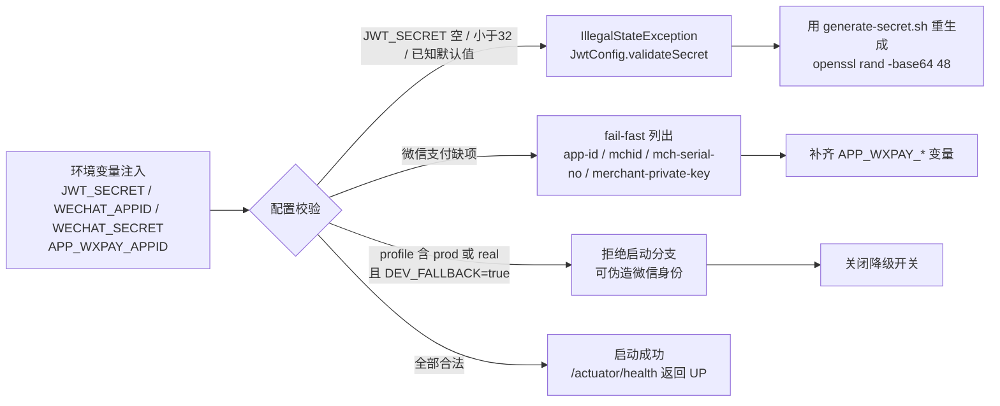

**图表来源**
- [application.yml:218-273](file://apps/api/src/main/resources/application.yml#L218-L273)
- [application-wechat.yml:10-18](file://apps/api/src/main/resources/application-wechat.yml#L10-L18)
- [application-mock.yml:27-30](file://apps/api/src/main/resources/application-mock.yml#L27-L30)
- [application-real.yml:183-183](file://apps/api/src/main/resources/application-real.yml#L183-L183)
- [WxPayProperties.java:92-92](file://apps/api/src/main/java/com/campuslove/api/wxpay/WxPayProperties.java#L92-L92)
- [WxPayPropertiesFailFastTest.java:40-40](file://apps/api/src/test/java/com/campuslove/api/wxpay/WxPayPropertiesFailFastTest.java#L40-L40)
- [JwtConfigTest.java:13-16](file://apps/api/src/test/java/com/campuslove/api/config/JwtConfigTest.java#L13-L16)
- [WeChatClient.java:74-89](file://apps/api/src/main/java/com/campuslove/api/auth/WeChatClient.java#L74-L89)
- [generate-secret.sh:12-14](file://scripts/generate-secret.sh#L12-L14)

## 微信登录授权失败排查
微信登录是本项目唯一有完整实现证据的第三方授权链路。它的失败面被压缩成三个业务错误码，因此排查的第一步是读响应体的 `code` 字段，而不是猜网络。

| 现象 | 响应 `status` | 响应 `code` | 服务端日志 | 定位方向 |
| --- | --- | --- | --- | --- |
| 登录凭证失效 | 401 | `INVALID_CODE` | `微信登录失败: code=INVALID_CODE, status=401, message=...` | `code` 过期或复用（上游 `errcode 40029`），重新 `wx.login()` |
| 微信服务不可用 | 502 | `WECHAT_API_ERROR` | 同上，`status=502` | 上游网络异常或非 0 `errcode`；本地联调还需核对降级开关取值 |
| 账号被禁用 | 403 | `USER_DISABLED` | 同上，`status=403` | 业务态而非集成态，走管理员解封 |
| 会话/令牌问题 | 401 | `UNAUTHORIZED` | `无效 Token: code=..., traceId=...` | JWT 解析失败、签名无效、已过期、格式错误或缺失 |
| 已登出仍用旧令牌 | 401 | `TOKEN_REVOKED` | `Token 已撤销: ..., traceId=...` | Redis 黑名单命中，需重新登录 |
| 限流 | 429 | 无（`buildErrorResponse`） | `触发速率限制: ...` | `RateLimit` 注解 + `RateLimitAspect` 令牌桶 |

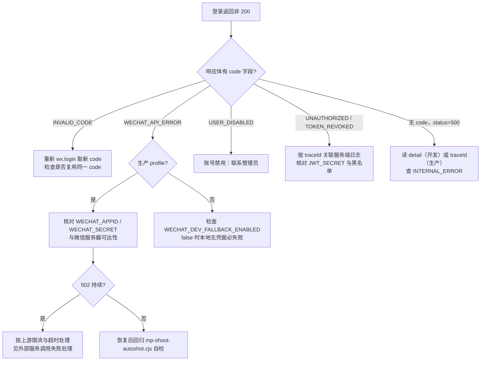

**图表来源**
- [WechatLoginException.java:32-57](file://apps/api/src/main/java/com/campuslove/api/auth/WechatLoginException.java#L32-L57)
- [GlobalExceptionHandler.java:351-363](file://apps/api/src/main/java/com/campuslove/api/config/GlobalExceptionHandler.java#L351-L363)
- [GlobalExceptionHandler.java:404-451](file://apps/api/src/main/java/com/campuslove/api/config/GlobalExceptionHandler.java#L404-L451)
- [GlobalExceptionHandler.java:519-527](file://apps/api/src/main/java/com/campuslove/api/config/GlobalExceptionHandler.java#L519-L527)
- [WeChatClient.java:74-146](file://apps/api/src/main/java/com/campuslove/api/auth/WeChatClient.java#L74-L146)
- [application.yml:269-273](file://apps/api/src/main/resources/application.yml#L269-L273)
- [mp-shoot-autoshot.cjs:1-121](file://scripts/mp-shoot-autoshot.cjs#L1-L121)

排查顺序上的三个约束来自实现本身：

1. `WechatLoginException` 的 `ErrorCode` 与 `HttpStatus` 是构造时绑定的常量对（`INVALID_CODE`/401、`WECHAT_API_ERROR`/502、`USER_DISABLED`/403），不存在按环境变化的映射；因此客户端看到的 502 一定来自 `WECHAT_API_ERROR` 或上游 AI 分支（`AiApiException` 同样是 502 + `AI_API_ERROR`），需要靠 `code` 区分两者。
2. 502 在本地环境是常态而非异常。`application.yml` 把 `dev-fallback-enabled` 默认设为 `${WECHAT_DEV_FALLBACK_ENABLED:false}`，即默认不走降级；仓库内的 QA 工作流也把「开工前先实测 `GET /actuator/health` 是否 200；`WECHAT_DEV_FALLBACK_ENABLED` 取值（false 则 `wx.login` 必 502）」列为开工前置条件，明确要求把它当作已知约束写进计划，而不是跑到登录链路才发现。
3. 授权失败与埋点失败相互独立。若 `AuthMetrics.recordLoginFailure` 自身抛错，异常被 `WechatLoginSupport` 内层 `catch (RuntimeException ignore)` 吞掉，登录仍然失败但指标可能缺失，反之亦然。

关于「分享功能不生效」「模板消息发送错误」：本次取证范围内没有可引用的实现文件，也没有对应的 OpenAPI 路径或错误码定义，故不在本节给出诊断步骤，统一登记在「缺失能力登记」一节。

**章节来源**
- [WechatLoginSupport.java:29-49](file://apps/api/src/main/java/com/campuslove/api/auth/WechatLoginSupport.java#L29-L49)
- [WechatLoginException.java:40-57](file://apps/api/src/main/java/com/campuslove/api/auth/WechatLoginException.java#L40-L57)
- [GlobalExceptionHandler.java:741-751](file://apps/api/src/main/java/com/campuslove/api/config/GlobalExceptionHandler.java#L741-L751)
- [application.yml:269-273](file://apps/api/src/main/resources/application.yml#L269-L273)
- [miniprogram-qa-loop-v32.dwf.ts:1068-1068](file://.zcode/workflows/miniprogram-qa-loop-v32.dwf.ts#L1068-L1068)
- [feedback-growth-and-auth.yaml:73-133](file://docs/openapi/feedback-growth-and-auth.yaml#L73-L133)

## 令牌与密钥配置排查
令牌类故障有两个截然不同的表现层：配置错误在启动期就暴露，令牌语义错误在运行期以 401 暴露。区分二者是排查的前提。

启动期（配置错误）。`application.yml` 声明 `secret: ${JWT_SECRET:}`，紧邻的注释写明「JWT 签名密钥：必须通过环境变量 `JWT_SECRET` 设置，不允许使用默认值」；`application-mock.yml` 同样声明空默认值并注释「JWT 密钥由环境变量 `JWT_SECRET` 提供，启动时校验非空且长度 >= 32。本地开发可通过 `start-server.bat` 或 `.env` 文件配置 `JWT_SECRET`」。校验语义由 `JwtConfigTest` 类注释固化为四条：未配置（null/空/空白）启动失败抛 `IllegalStateException`、长度小于 32 字符启动失败（HS256 安全要求）、为已知不安全默认值启动失败、合法值正常初始化。`start-mock.sh` 的注释给出实际踩坑记录：「启动 mock 模式后端 (8080) —— 无需 MySQL/Redis, 但需 `JWT_SECRET`（来自根目录 `.env`）」以及「mock 模式也走 WebSocket bean 链，缺 `JWT_SECRET` 会在 `JwtConfig.validateSecret` 崩溃」——即缺密钥时最先失败的是 WebSocket bean 链，容易被误判为 WebSocket 故障。

运行期（令牌语义）。`/auth/refresh`（operationId `refreshToken`）用于续期，`/auth/logout`（operationId `logout`）用于登出；登出后旧令牌访问受保护资源会得到 401 + `TOKEN_REVOKED`，`GlobalExceptionHandler` 注释说明触发场景是「JWT 已被加入 Redis 黑名单（用户主动登出）后，仍尝试使用该 JWT 访问受保护资源」；解析失败、签名无效、已过期、格式错误或缺失则返回 401 + `UNAUTHORIZED`，文案为「未认证或令牌已失效，请重新登录」。两者状态码相同，只能靠 `code` 与 `traceId` 区分。`AuthMetrics.recordTokenRefresh()` 提供续期次数维度，可用于确认续期是否真的被调用。

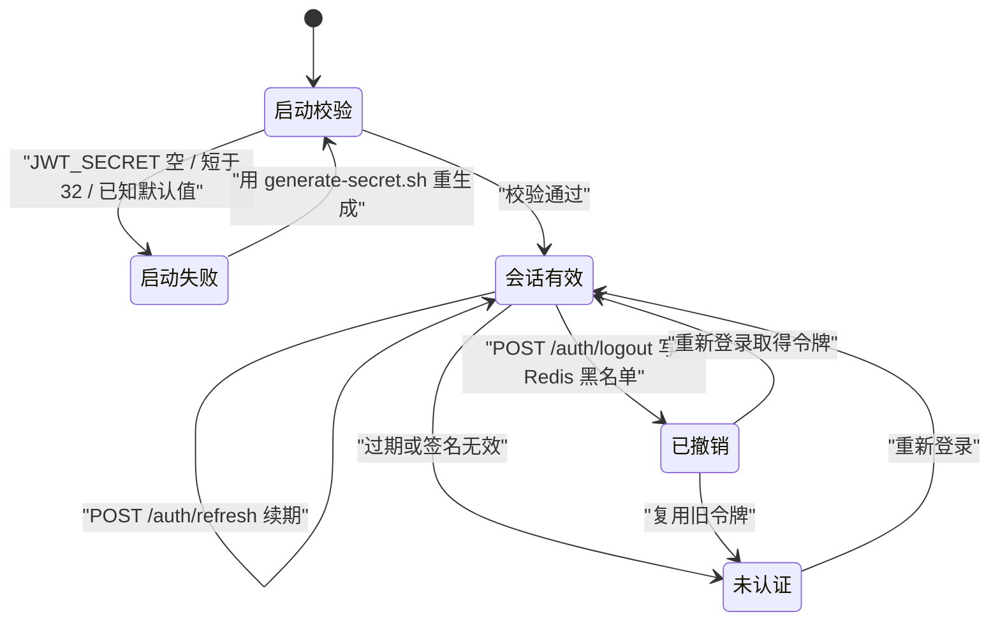

**图表来源**
- [application.yml:218-221](file://apps/api/src/main/resources/application.yml#L218-L221)
- [application-mock.yml:27-30](file://apps/api/src/main/resources/application-mock.yml#L27-L30)
- [JwtConfigTest.java:13-16](file://apps/api/src/test/java/com/campuslove/api/config/JwtConfigTest.java#L13-L16)
- [GlobalExceptionHandler.java:384-451](file://apps/api/src/main/java/com/campuslove/api/config/GlobalExceptionHandler.java#L384-L451)
- [feedback-growth-and-auth.yaml:105-133](file://docs/openapi/feedback-growth-and-auth.yaml#L105-L133)
- [AuthMetrics.java:91-91](file://apps/api/src/main/java/com/campuslove/api/monitor/AuthMetrics.java#L91-L91)

密钥的正确生成方式只有一条被脚本固化的路径。`scripts/generate-secret.sh` 以 `set -euo pipefail` 运行，`gen_jwt_secret()` 输出 `openssl rand -base64 48`，`gen_db_password()` 用 `-base64 32`，`gen_redis_password()` 用 `-base64 24`，`gen_admin_password_hash()` 依赖 `python3` 与 `bcrypt`，缺任一项都会打印 `ERROR:` 与修复提示并 `return 1`，成功时输出 `bcrypt.hashpw(b'<plaintext>', bcrypt.gensalt(10))`，默认明文是 `ChangeMe123!`；调用形态由 usage 文本给出：`./scripts/generate-secret.sh <type> [args...]`。`.env.example` 与脚本口径一致，注明「`openssl rand -base64 48  # for JWT_SECRET`」，并把 `JWT_SECRET`、`DB_PASSWORD`、`REDIS_PASSWORD`、`WECHAT_SECRET` 归为敏感信息，占位符写作 `JWT_SECRET=<PLACEHOLDER>`。

仓库中同时存在若干硬编码开发密钥，这是「密钥配置错误」最常见的误用来源：`start-api-fixed.bat` 直接 `set JWT_SECRET=campus-love-dev-2026-secure-key-xK9mPq3wL`；`start-real.sh` 的注释则说明真实 profile 走 `.env` 加载（`JWT_SECRET / DB_* / REDIS_* / ADMIN_* / DEMO_SEED / AES ...`）。自动化测试统一用 `@SpringBootTest(properties = "JWT_SECRET=test-jwt-secret-for-...-32-chars")` 的形式注入满足长度要求的值。

关于 OAuth 回调地址：本页取证到的微信侧配置项只有 `app-id: ${WECHAT_APPID:}`、`app-secret: ${WECHAT_SECRET:}`、`dev-fallback-enabled: ${WECHAT_DEV_FALLBACK_ENABLED:false}`，以及 `application-wechat.yml` 注释中提到的 `jscode2session-url`（默认空或使用官方文档地址）。仓库里没有 `redirect_uri`、OAuth 回调白名单或回调域名校验的配置项与代码，故无法给出回调地址配置的排查步骤（详见「缺失能力登记」）。

**章节来源**
- [generate-secret.sh:9-49](file://scripts/generate-secret.sh#L9-L49)
- [.env.example:12-26](file://apps/api/.env.example#L12-L26)
- [start-api-fixed.bat:9-9](file://apps/api/start-api-fixed.bat#L9-L9)
- [start-real.sh:25-25](file://apps/api/start-real.sh#L25-L25)
- [start-mock.sh:2-23](file://apps/api/start-mock.sh#L2-L23)
- [application-wechat.yml:10-18](file://apps/api/src/main/resources/application-wechat.yml#L10-L18)
- [AdminLoginView.java:13-28](file://apps/api/src/main/java/com/campuslove/api/auth/AdminLoginView.java#L13-L28)
- [feedback-growth-and-auth.yaml:149-182](file://docs/openapi/feedback-growth-and-auth.yaml#L149-L182)

## 支付回调异常排查
微信支付在本项目里的可观测面由三部分构成：配置校验（`WxPayProperties`）、回调指标（`PaymentMetrics`）、落库流水（`VipBillingLog`）。三者覆盖的是不同故障，缺任何一环都不能得出结论。

配置层是 fail-fast 的。`application-real.yml` 以 `app-id: ${APP_WXPAY_APPID:}` 声明微信支付应用标识，`WxPayProperties` 在缺项时把缺失字段名列表写进异常消息，取值为 `"app-id", "mchid", "mch-serial-no", "merchant-private-key"`；对应测试 `WxPayPropertiesFailFastTest` 断言「错误信息应列出缺失项」。因此「支付相关端点全部不可用 + 启动日志列出这四项」等价于环境变量未注入，而不是微信服务器异常。

回调层的观测接口只有两个方法：`recordCallbackLatency(long durationMs)` 与 `recordCallbackFailure(String reason)`。前者按时延打点、后者按原因打点，均为 `@Component`。若回调「看起来没生效」但 `recordCallbackFailure` 没有维度增量，说明请求根本没到达应用，应往网关/域名/证书方向查；若有增量，则 `reason` 是唯一可用的分类依据。

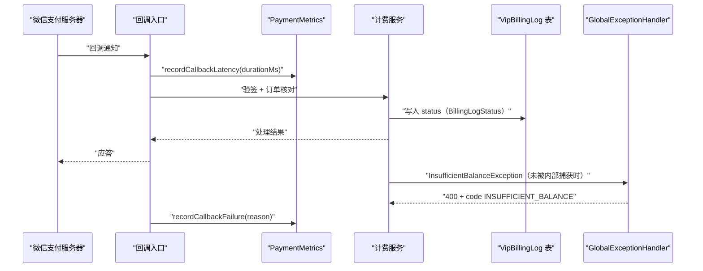

**图表来源**
- [PaymentMetrics.java:61-79](file://apps/api/src/main/java/com/campuslove/api/monitor/PaymentMetrics.java#L61-L79)
- [VipBillingLog.java:48-83](file://apps/api/src/main/java/com/campuslove/api/entity/VipBillingLog.java#L48-L83)
- [GlobalExceptionHandler.java:128-163](file://apps/api/src/main/java/com/campuslove/api/config/GlobalExceptionHandler.java#L128-L163)
- [WxPayProperties.java:92-92](file://apps/api/src/main/java/com/campuslove/api/wxpay/WxPayProperties.java#L92-L92)
- [application-real.yml:183-183](file://apps/api/src/main/resources/application-real.yml#L183-L183)

余额不足是最容易被误判为「支付接口异常」的场景。`GlobalExceptionHandler.handleInsufficientBalance` 的注释给出两条关键事实：VIP 自动续费（`AutoRenewService#renewVip`）内部已捕获并写 FAILED 流水，不会进入该 handler；该 handler 只是其他钱包扣减场景未捕获时的兜底，返回 `400` + `code: INSUFFICIENT_BALANCE`。同时注释明确「精简响应避免回显 userId/金额/余额等字段放大攻击面，金额明细仅记录在服务端日志」——日志语句为 `log.warn("钱包余额不足: userId={}, 需要={}, 当前余额={}", ex.getUserId(), ex.getAmountCents(), ex.getBalanceCents())`，即金额以 cents 为单位的取值只能从日志侧核对。

更常见的「支付接口调用异常」其实与第三方无关，而是功能开关：`handleCommerceDisabled` 注释说明触发场景是「付费写端点标注 `@FeatureSwitch` 且对应开关处于封存态（缺省 false），由 `CommerceGuardAspect` 抛出 `CommerceDisabledException`」，响应体 `error` 与 `code` 均为 `COMMERCE_DISABLED`、`message` 为「功能未开放」、状态码 403。视频上传同理（`upload.video.enabled=false` 时 `type=video` 在落盘前被拒绝，返回 403 + `VIDEO_UPLOAD_DISABLED`）。这两类响应用的是 `buildFeatureDisabledResponse`，`error` 字段直接等于业务错误码，前端按码静默处理，因此在监控上看不到任何错误率上升。

流水核对以 `VipBillingLog` 为准：字段为 `id`、`userId`、`orderNo`、`amount`（`Integer`）、`status`（`String`，取值语义由内嵌类型 `BillingLogStatus` 定义）、`createdAt`（`LocalDateTime`），每个字段都有对应 getter/setter。`orderNo` 是回调与本地订单的唯一对账键；`status` 为字符串列，因此「回调成功但页面仍显示未开通」应先确认写入的 `status` 值，而不是怀疑回调链路。

**章节来源**
- [PaymentMetrics.java:29-79](file://apps/api/src/main/java/com/campuslove/api/monitor/PaymentMetrics.java#L29-L79)
- [VipBillingLog.java:35-132](file://apps/api/src/main/java/com/campuslove/api/entity/VipBillingLog.java#L35-L132)
- [GlobalExceptionHandler.java:177-228](file://apps/api/src/main/java/com/campuslove/api/config/GlobalExceptionHandler.java#L177-L228)
- [GlobalExceptionHandler.java:586-602](file://apps/api/src/main/java/com/campuslove/api/config/GlobalExceptionHandler.java#L586-L602)
- [WxPayPropertiesFailFastTest.java:40-40](file://apps/api/src/test/java/com/campuslove/api/wxpay/WxPayPropertiesFailFastTest.java#L40-L40)

## 监控与指标上报排查
本项目的可观测性由「应用内指标 + 抓取端 + 客户端错误上报」三段组成，三段各自独立失败，因此「监控告警不生效」需要分别定位。

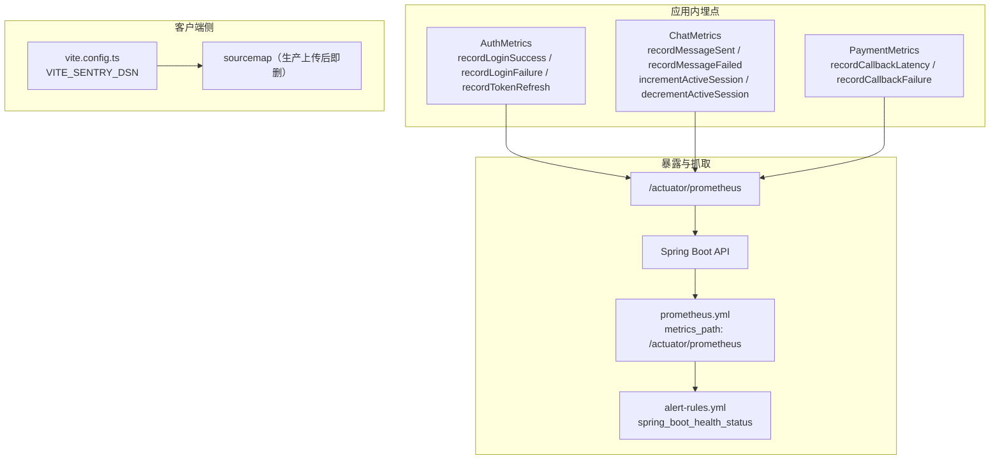

**图表来源**
- [AuthMetrics.java:63-91](file://apps/api/src/main/java/com/campuslove/api/monitor/AuthMetrics.java#L63-L91)
- [ChatMetrics.java:60-103](file://apps/api/src/main/java/com/campuslove/api/monitor/ChatMetrics.java#L60-L103)
- [PaymentMetrics.java:61-79](file://apps/api/src/main/java/com/campuslove/api/monitor/PaymentMetrics.java#L61-L79)
- [prometheus.yml:48-50](file://docker/prometheus/prometheus.yml#L48-L50)
- [alert-rules.yml:32-32](file://docker/prometheus/rules/alert-rules.yml#L32-L32)
- [vite.config.ts:109-148](file://apps/client/vite.config.ts#L109-L148)

指标埋点的失败传播被显式切断。`WechatLoginSupport` 的两处埋点都包在 `try { ... } catch (RuntimeException ignore)` 中，注释分别写明「登录成功：记录成功指标（指标失败不影响主流程）」与「监控逻辑失败忽略，不影响登录主流程」。这条设计直接决定了一条排查纪律：指标缺失不等于业务未发生，业务成功也不能证明指标已上报。同理，`parseUserId` 返回 `null` 时 `recordLoginSuccess(null)` 仍然被调用，因此「登录成功数」与「可归因用户数」是两个不同口径。

存活与抓取。健康端点是 `/actuator/health`，仓库内多处把它作为开工前置检查（QA 工作流的 `healthPath: "/actuator/health"`，收口工作流的 `healthUrl: "http://127.0.0.1:8080/actuator/health"`，并要求轮询到响应含 `"UP"`，最多等 180 秒）。抓取端 `prometheus.yml` 的注释段落标题为「Spring Boot API（/actuator/prometheus）」，`metrics_path: /actuator/prometheus`；告警规则 `alert-rules.yml` 的注释说明「指标 `spring_boot_health_status` 由 micrometer 注册（Spring Boot 3 + actuator）」。这三条串起来即「告警不生效」的自检链：应用活着 → `/actuator/prometheus` 有指标 → Prometheus target 存在 → 规则里的指标名与 micrometer 注册名一致。任一环节断裂都会表现为「业务出问题但没有任何告警」。

客户端错误上报。`vite.config.ts` 的注释说明新增 `VITE_SENTRY_DSN` 用于 Sentry SDK 初始化，且「未配置时跳过 Sentry 初始化」，该键与 `VITE_API_MODE`、`VITE_API_BASE_URL`、`VITE_APP_VERSION`、`VITE_TENCENT_MAP_KEY` 在同一批环境变量处理逻辑中；构建配置另有一条与 Sentry 直接相关的约束：`@sentry/*` 被划入独立 chunk 以便浏览器长期缓存，并且不显式拆分 `@dcloudio/uni-h5`，因为 `@sentry/vue` 内部 import `@sentry/browser`（传递依赖，pnpm 未 hoist 到顶层），显式拆分会触发 rollup 相关行为。因此「Sentry 里看不到错误」的常见原因是 `VITE_SENTRY_DSN` 未注入导致初始化被整体跳过，而不是错误未发生。源码还原方面，`.gitignore` 与 `.zcodeignore` 都注明生产 sourcemap 仅用于 Sentry 上传、不提交、CI 上传后即删，这意味着构建产物与上报窗口耦合：上传步骤失败会让后续错误堆栈不可读。

审计记录同时给出两条已知的上报缺陷方向：`archive/audit-round2/client-round2.md` 记录了「watch errorMessage 变化即上报 Sentry，同一错误可重复上报（噪音），建议去重上报」「未知队列类型/非法数据仅 console.warn 静默（消息丢失无感知），建议 Sentry 上报」「全局错误处理仅 Sentry，无用户可见兜底 toast（崩溃无提示）」；`doc/reports/system-testing/05-fix-recommendations.md` 另有一条 P2-08「无错误上报 → 集成 Sentry/自建上报」。这些记录说明上报覆盖面本身仍在演进，排查时应先确认对应模块是否已有上报路径。

**章节来源**
- [WechatLoginSupport.java:32-47](file://apps/api/src/main/java/com/campuslove/api/auth/WechatLoginSupport.java#L32-L47)
- [WechatLoginSupport.java:52-65](file://apps/api/src/main/java/com/campuslove/api/auth/WechatLoginSupport.java#L52-L65)
- [vite.config.ts:109-148](file://apps/client/vite.config.ts#L109-L148)
- [prometheus.yml:48-50](file://docker/prometheus/prometheus.yml#L48-L50)
- [alert-rules.yml:32-32](file://docker/prometheus/rules/alert-rules.yml#L32-L32)
- [miniprogram-qa-loop-v32.dwf.ts:37-37](file://.zcode/workflows/miniprogram-qa-loop-v32.dwf.ts#L37-L37)
- [archive/audit-round2/client-round2.md:143-185](file://archive/audit-round2/client-round2.md#L143-L185)
- [doc/reports/system-testing/05-fix-recommendations.md:214-214](file://doc/reports/system-testing/05-fix-recommendations.md#L214-L214)
- [ChatMetrics.java:23-103](file://apps/api/src/main/java/com/campuslove/api/monitor/ChatMetrics.java#L23-L103)

## 契约与字段核对
第三方集成故障中相当一部分并不涉及外部服务，而是客户端按旧契约调用、服务端按新语义响应。核对入口是 `docs/openapi/` 下两份契约的 `operationId`。

`feedback-growth-and-auth.yaml` 中与登录态直接相关的路径如下（全部带 tag 与 summary）：

| 路径与方法 | operationId | 契约 summary | 实现侧对应 |
| --- | --- | --- | --- |
| `GET /app-config/login-hero`（tag `home`） | `getLoginHeroConfig` | Get login hero configuration | `apps/client/src/view-models/login.ts` 导出的 `toLoginHeroView` |
| `GET /auth/me`（tag `auth`） | `getCurrentSession` | Get current session | 令牌有效性判定入口 |
| `POST /auth/wechat-login`（tag `auth`） | `loginWithWechat` | Exchange a WeChat login code for a session | `WechatLoginSupport.login(...)`、`WechatLoginRequest` |
| `POST /auth/refresh`（tag `auth`） | `refreshToken` | Refresh JWT token | `AuthMetrics.recordTokenRefresh()` |
| `POST /auth/logout`（tag `auth`） | `logout` | Logout | Redis 黑名单写入，后续旧令牌得 `TOKEN_REVOKED` |
| `POST /auth/admin/login`（tag `auth`） | `loginAsAdmin` | Admin username/password login | `AdminLoginView` 及其内嵌 `AdminUserInfo` |
| `POST /auth/admin/logout`（tag `auth`） | `logoutAsAdmin` | Admin logout | 管理端会话终止 |
| `GET /profile/stats`（tag `profile`） | `getProfileStats` | Get profile statistics | 统计口径核对 |
| `GET /profile/basic`（tag `profile`） | `getBasicProfile` | Get the basic profile | 基础资料字段核对 |

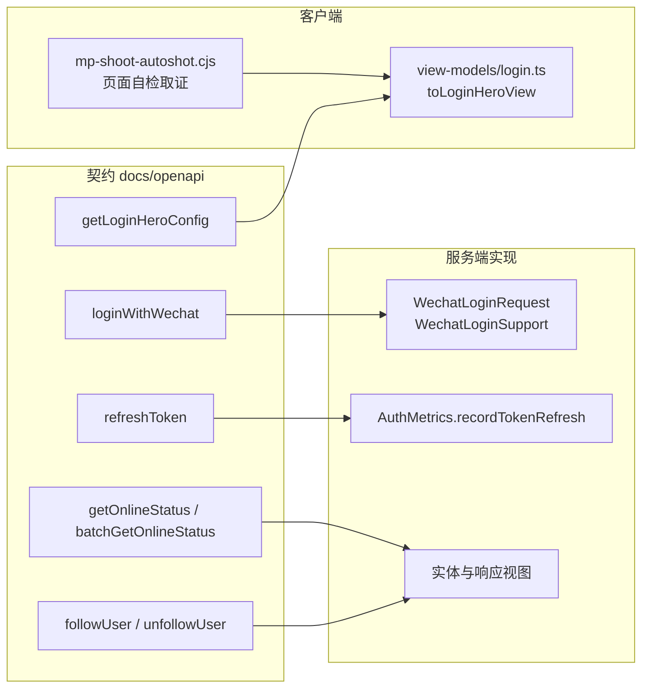

**图表来源**
- [feedback-growth-and-auth.yaml:33-224](file://docs/openapi/feedback-growth-and-auth.yaml#L33-L224)
- [users.yaml:15-270](file://docs/openapi/users.yaml#L15-L270)
- [login.ts:6-6](file://apps/client/src/view-models/login.ts#L6-L6)
- [WechatLoginRequest.java:14-14](file://apps/api/src/main/java/com/campuslove/api/auth/WechatLoginRequest.java#L14-L14)
- [WechatLoginSupport.java:29-29](file://apps/api/src/main/java/com/campuslove/api/auth/WechatLoginSupport.java#L29-L29)
- [AuthMetrics.java:91-91](file://apps/api/src/main/java/com/campuslove/api/monitor/AuthMetrics.java#L91-L91)
- [AdminLoginView.java:13-28](file://apps/api/src/main/java/com/campuslove/api/auth/AdminLoginView.java#L13-L28)
- [mp-shoot-autoshot.cjs:1-121](file://scripts/mp-shoot-autoshot.cjs#L1-L121)

`users.yaml` 侧的核对重点是路径参数命名不一致这一类细节：关注/取关与列表类接口用 `{id}`（`POST /users/{id}/follow` 的 `followUser`、`DELETE /users/{id}/follow` 的 `unfollowUser`、`GET /users/{id}/followers` 的 `getFollowers`、`GET /users/{id}/following` 的 `getFollowing`、`GET /users/{id}/is-following` 的 `isFollowing`），而在线状态接口用 `{userId}`（`GET /users/{userId}/online-status` 的 `getOnlineStatus`），批量查询则改为请求体（`POST /users/online-status/batch` 的 `batchGetOnlineStatus`），搜索接口为 `GET /search/users` 的 `searchUsers`（summary 为 Search users by nickname / campus）。按同一种参数写法复用客户端封装会得到 404/400，而这类错误在 `GlobalExceptionHandler` 里分别对应「请求的路径不存在」（`NoResourceFoundException`，404）与「请求参数校验失败」（`MethodArgumentNotValidException`/`ConstraintViolationException`，400）两种响应，不含业务错误码，因此极易被误报为「后端接口挂了」。

复现与取证手段：`scripts/mp-shoot-autoshot.cjs` 是仓库内可执行的开发者工具侧自动化入口，用于对页面（含登录页）做截图式自检，可在契约字段缺失导致页面渲染空白时留下可视证据；`GlobalExceptionHandler` 的 `traceId`/`X-Trace-Id` 则用于把该截图与后端日志对齐。

**章节来源**
- [users.yaml:15-270](file://docs/openapi/users.yaml#L15-L270)
- [feedback-growth-and-auth.yaml:33-57](file://docs/openapi/feedback-growth-and-auth.yaml#L33-L57)
- [GlobalExceptionHandler.java:568-602](file://apps/api/src/main/java/com/campuslove/api/config/GlobalExceptionHandler.java#L568-L602)
- [GlobalExceptionHandler.java:86-100](file://apps/api/src/main/java/com/campuslove/api/config/GlobalExceptionHandler.java#L86-L100)
- [mp-shoot-autoshot.cjs:1-121](file://scripts/mp-shoot-autoshot.cjs#L1-L121)

## 配置与开关
第三方行为在很大程度上由开关决定，而不是由代码分支决定。下表只列取证到的项，取值与默认值均出自被引文件的原文。

| 配置/开关 | 声明位置 | 缺省取值 | 关闭或误配时的可见症状 |
| --- | --- | --- | --- |
| 签名密钥项 `secret: ${JWT_SECRET:}` | `application.yml` | 空 | 启动期 `IllegalStateException`（`JwtConfig.validateSecret`） |
| `app-id: ${WECHAT_APPID:}` | `application.yml`、`application-wechat.yml` | 空 | 上游调用失败，映射为 502 + `WECHAT_API_ERROR` |
| `app-secret: ${WECHAT_SECRET:}` | `application.yml`、`application-wechat.yml` | 空 | 同上 |
| `app.wechat.dev-fallback-enabled: ${WECHAT_DEV_FALLBACK_ENABLED:false}` | `application.yml`（键名取自 `WeChatClient` 注释「开启 app.wechat.dev-fallback-enabled」；yml 注释标注 P0-33 修复：本地联调降级开关） | `false` | 本地无凭据时 `wx.login` 必失败；生产误开则可伪造微信身份并被拒绝 |
| 微信支付 `app-id: ${APP_WXPAY_APPID:}` | `application-real.yml` | 空 | `WxPayProperties` fail-fast，异常消息列出 `app-id`/`mchid`/`mch-serial-no`/`merchant-private-key` |
| `spring.profiles.active` | `GlobalExceptionHandler` 注入 `${spring.profiles.active:dev}` | `dev` | 含 `prod`/`real` 时脱敏生效，500 响应不含 `detail`；否则追加 `detail` |
| `upload.video.enabled` | `GlobalExceptionHandler` 注释所述 | 封存态 | `type=video` 落盘前被拒，403 + `VIDEO_UPLOAD_DISABLED` |
| `@FeatureSwitch` + `CommerceGuardAspect` | `GlobalExceptionHandler` 注释所述 | 缺省 false（封存） | 付费写端点 403 + `COMMERCE_DISABLED`，前端静默处理 |
| `spring.servlet.multipart.max-file-size` | `GlobalExceptionHandler` 注释所述 | 由配置决定 | `MaxUploadSizeExceededException` → 413「上传文件超过最大允许大小」 |
| `AGNES_API_KEY` | `GlobalExceptionHandler` 注释所述（未配置时调用 `/api/ai/**`） | 未设置 | 401 + `AI_API_UNAUTHORIZED`，文案要求补全环境变量 |
| `VITE_SENTRY_DSN` | `apps/client/vite.config.ts` | 未配置 | 跳过 Sentry 初始化，错误在 Sentry 中不可见 |
| `VITE_API_MODE` / `VITE_API_BASE_URL` | `apps/client/vite.config.ts` | 由环境变量注入 | 客户端请求打到错误基址，表现为批量 404/超时 |
| 熔断/重试/限流/降级配置段 | `application.yml` 注释：为外部依赖（微信 API / 短信 / 对象存储）提供该四类能力 | 见配置文件 | 上游抖动时表现为重试后的 502/503，而非单次失败 |

外部依赖的弹性参数按被保护对象分段声明。取证到的两段是短信相关：`application.yml` 中先有「短信服务（如未来集成阿里云/腾讯云 SMS）」的段落说明，随后是「短信重试：最多 2 次（共 3 次请求），指数退避 1s→2s→4s」与「短信限流：每 1s 最多 5 次调用（SMS 服务商通常按 QPS 计费）」。这两条给出了明确的数值口径：单次请求失败后最多再重试 2 次、退避序列为 1s/2s/4s，速率上限为每秒 5 次。因此「验证码收不到」在客户端侧的合理等待窗口应以「共 3 次请求 + 指数退避」为上界，超过即应判定为服务商侧或配置侧问题，而不是继续等待。

密钥与配置的注入口径同样有明确分工。`.env.example` 把 `JWT_SECRET`、`DB_PASSWORD`、`REDIS_PASSWORD`、`WECHAT_SECRET` 归为敏感信息并给出 `JWT_SECRET=<PLACEHOLDER>`；`start-real.sh` 注释说明真实 profile 加载 `.env`（`JWT_SECRET / DB_* / REDIS_* / ADMIN_* / DEMO_SEED / AES ...`）；`start-mock.sh` 说明 mock 模式仍需 `JWT_SECRET`（来自根目录 `.env`）；`start-api-fixed.bat` 直接以 `set JWT_SECRET=...` 写死开发值。排查「本地能跑、真实 profile 起不来」时，应比对这四条注入路径而不是比对代码。

**章节来源**
- [application.yml:218-273](file://apps/api/src/main/resources/application.yml#L218-L273)
- [application.yml:353-454](file://apps/api/src/main/resources/application.yml#L353-L454)
- [application-wechat.yml:10-18](file://apps/api/src/main/resources/application-wechat.yml#L10-L18)
- [application-mock.yml:27-30](file://apps/api/src/main/resources/application-mock.yml#L27-L30)
- [application-real.yml:183-183](file://apps/api/src/main/resources/application-real.yml#L183-L183)
- [GlobalExceptionHandler.java:65-84](file://apps/api/src/main/java/com/campuslove/api/config/GlobalExceptionHandler.java#L65-L84)
- [GlobalExceptionHandler.java:177-228](file://apps/api/src/main/java/com/campuslove/api/config/GlobalExceptionHandler.java#L177-L228)
- [GlobalExceptionHandler.java:481-492](file://apps/api/src/main/java/com/campuslove/api/config/GlobalExceptionHandler.java#L481-L492)
- [GlobalExceptionHandler.java:679-717](file://apps/api/src/main/java/com/campuslove/api/config/GlobalExceptionHandler.java#L679-L717)
- [WxPayProperties.java:92-92](file://apps/api/src/main/java/com/campuslove/api/wxpay/WxPayProperties.java#L92-L92)
- [.env.example:12-26](file://apps/api/.env.example#L12-L26)
- [start-real.sh:25-25](file://apps/api/start-real.sh#L25-L25)
- [start-mock.sh:2-23](file://apps/api/start-mock.sh#L2-L23)
- [vite.config.ts:109-113](file://apps/client/vite.config.ts#L109-L113)

## 数据模型
第三方集成相关的类型分三类：持久化实体、传输视图、错误响应体。排查「字段对不上」时需要先判断属于哪一类，因为三者的字段来源不同。

持久化实体只有 `VipBillingLog` 处于本页取证范围内：`@Entity`（L35）、`@Table`（L37）、类型声明位于 L48，内嵌类型 `BillingLogStatus` 位于 L51；字段依次为 `private Long id`、`private Long userId`、`private String orderNo`、`private Integer amount`、`private String status`、`private LocalDateTime createdAt`，每个字段都配对了 getter 与 setter（如 `getOrderNo()`/`setOrderNo(String orderNo)`、`getStatus()`/`setStatus(String status)`、`getAmount()`/`setAmount(Integer amount)`、`getCreatedAt()`/`setCreatedAt(LocalDateTime createdAt)`）。需要注意的是 `status` 是字符串列、`amount` 是 `Integer`，因此对账时的口径是「字符串状态值 + 整数金额」，而 `BillingLogStatus` 的具体取值定义在实体内部（本次取证只定位到类型位置）。

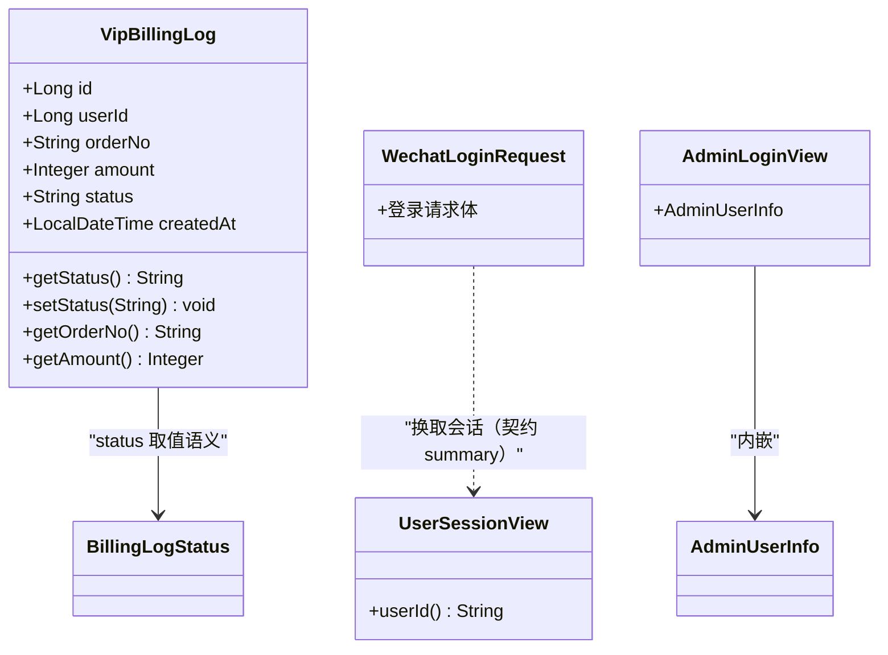

`WechatLoginRequest` 是 15 行的登录请求体类型（类型声明位于 L14），其字段名不在本次取证范围内，故图中不标注属性；可确认的是控制器侧 `login(AuthService, AuthMetrics, String code, String deviceId)` 接收的正是「`code`：wx.login() 返回的临时 code」与「`deviceId`：客户端设备标识（可空）」两个入参，契约侧对应 summary「Exchange a WeChat login code for a session」。

**图表来源**
- [VipBillingLog.java:35-132](file://apps/api/src/main/java/com/campuslove/api/entity/VipBillingLog.java#L35-L132)
- [WechatLoginRequest.java:14-14](file://apps/api/src/main/java/com/campuslove/api/auth/WechatLoginRequest.java#L14-L14)
- [WechatLoginSupport.java:20-29](file://apps/api/src/main/java/com/campuslove/api/auth/WechatLoginSupport.java#L20-L29)
- [AdminLoginView.java:13-28](file://apps/api/src/main/java/com/campuslove/api/auth/AdminLoginView.java#L13-L28)

传输视图侧的关键字段有明确出处：`WechatLoginSupport.login(...)` 的返回类型是 `UserSessionView`，其注释把入参说明为「`code`：wx.login() 返回的临时 code」与「`deviceId`：客户端设备标识（3-D 设备管理：可空）」；成功路径要求 `session.userId() != null` 才会记录成功指标，`parseUserId` 再把该字符串转成 `Long`。因此「登录成功但指标里 userId 为空」通常是 `userId` 字符串非数字，而不是数据库写入失败。`AdminLoginView` 内嵌 `AdminUserInfo`，对应契约中的 `loginAsAdmin`/`logoutAsAdmin` 两个操作。

错误响应体不是实体而是 `Map<String, Object>`，字段集合随构造方法变化，这是排查时最容易踩的点：

| 构造方法 | 字段 | 典型场景 |
| --- | --- | --- |
| `buildErrorResponse` | `error`、`message`、`status` | 校验失败、404/405/409/413/429 |
| `buildErrorResponseWithCode` | 上述 + `code` | 微信登录、管理端认证、内容安全、AI 上游、每日限额 |
| `buildErrorResponseWithCodeAndTraceId` | 上述 + `traceId`，并写 `X-Trace-Id` 头 | 无效令牌、令牌撤销、业务异常兜底 |
| `buildFeatureDisabledResponse` | `error` 即业务错误码 + `code` | `COMMERCE_DISABLED`、`VIDEO_UPLOAD_DISABLED` |
| `buildDesensitizedErrorResponse` | `code`、`message`、`traceId`、`timestamp`（开发 profile 追加 `detail`） | 500 `INTERNAL_ERROR` |

`buildErrorResponse` 使用 `HashMap`，`buildErrorResponseWithCodeAndTraceId` 与 `buildDesensitizedErrorResponse` 使用 `LinkedHashMap`，注释说明后者「保持插入顺序，便于客户端解析」：`error` → `message` → `status` → `code` → `traceId`。若客户端按顺序解析（而非按键解析），两类响应的表现会不一致。

**章节来源**
- [VipBillingLog.java:48-132](file://apps/api/src/main/java/com/campuslove/api/entity/VipBillingLog.java#L48-L132)
- [WechatLoginSupport.java:20-65](file://apps/api/src/main/java/com/campuslove/api/auth/WechatLoginSupport.java#L20-L65)
- [GlobalExceptionHandler.java:157-163](file://apps/api/src/main/java/com/campuslove/api/config/GlobalExceptionHandler.java#L157-L163)
- [GlobalExceptionHandler.java:766-843](file://apps/api/src/main/java/com/campuslove/api/config/GlobalExceptionHandler.java#L766-L843)
- [GlobalExceptionHandler.java:878-894](file://apps/api/src/main/java/com/campuslove/api/config/GlobalExceptionHandler.java#L878-L894)
- [feedback-growth-and-auth.yaml:149-182](file://docs/openapi/feedback-growth-and-auth.yaml#L149-L182)

## 外部服务调用失败处理
本页把外部调用失败分成五条已取证的路径：微信登录上游、微信图片内容安全、AI 上游、短信验证码、媒体上传。每条路径在 `GlobalExceptionHandler` 中都有各自的出口，因此可以用响应码直接反推是哪条外部链路失败。

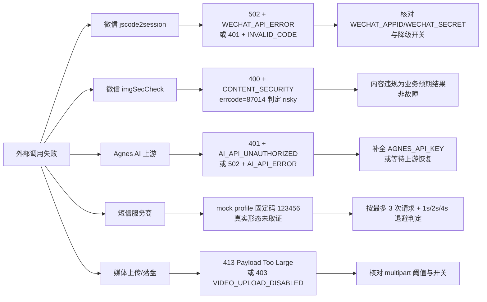

**图表来源**
- [WechatLoginException.java:32-57](file://apps/api/src/main/java/com/campuslove/api/auth/WechatLoginException.java#L32-L57)
- [GlobalExceptionHandler.java:230-257](file://apps/api/src/main/java/com/campuslove/api/config/GlobalExceptionHandler.java#L230-L257)
- [GlobalExceptionHandler.java:679-751](file://apps/api/src/main/java/com/campuslove/api/config/GlobalExceptionHandler.java#L679-L751)
- [GlobalExceptionHandler.java:165-175](file://apps/api/src/main/java/com/campuslove/api/config/GlobalExceptionHandler.java#L165-L175)
- [GlobalExceptionHandler.java:481-492](file://apps/api/src/main/java/com/campuslove/api/config/GlobalExceptionHandler.java#L481-L492)
- [SmsCodeService.java:2-6](file://apps/api/src/main/java/com/campuslove/api/auth/SmsCodeService.java#L2-L6)
- [application.yml:400-454](file://apps/api/src/main/resources/application.yml#L400-L454)

短信验证码。`SmsCodeService` 的类注释把它定义为「短信验证码服务」，并列出 profile 分支：mock profile（本地演示）走「模拟短信——固定 mock 码（默认 `123456`）」。注册链路确实消费该能力：`RealAuthServiceMinorRegistrationTest` 的注释记录了「2026-09-01：`registerUser` 新增 `verificationCode` 参数（短信验证码校验）」。弹性参数见「配置与开关」一节的重试与限流数值。排查「验证码收不到」时，第一步是判断当前 profile：mock profile 下固定 `123456` 就应当通过校验，若不通过则是校验逻辑问题；真实形态下的服务商 SDK 调用点未在本页取证文件中出现，因此无法给出服务商侧配置步骤。日志侧的既定模式是脱敏输出——`SensitiveDataMasker` 的类注释给出示例 `log.warn("短信发送失败, phone={}", maskPhone(phone))`，所以从日志里检索完整手机号是徒劳的，应改用 `traceId` 关联。

AI 上游（Agnes）。「微信服务器网络异常」之外，仓库里另一条真实的外部 HTTP 链路是 AI 服务。`handleAiApiUnauthorized` 的触发场景写得很明确：「后端未配置 `AGNES_API_KEY` 环境变量，调用 `/api/ai/**` 端点时」以及「Agnes AI 上游接口返回 401 Unauthorized（API Key 失效或过期）」，响应为 401 + `AI_API_UNAUTHORIZED`，文案直接要求「请联系管理员补全 `AGNES_API_KEY` 环境变量」；`handleAiApiException` 覆盖「返回 4xx（非 401）/5xx，或网络异常」，响应为 502 + `AI_API_ERROR`，并且注释强调「不向上游响应体透传给前端，避免泄露 Agnes AI 内部错误细节。上游响应体仅记录在服务端日志中」——日志语句为 `log.warn("AI 服务上游异常: operation={}, message={}, upstreamBody={}", ...)`，其中 `upstreamBody` 是排查上游问题的唯一线索。

媒体上传与文件存储。上传链路有两个不同的失败出口：`MediaSizeLimitExceededException` 由业务侧判定，返回 413 + 「Payload Too Large」；`MaxUploadSizeExceededException` 由 Spring multipart 解析器在 `spring.servlet.multipart.max-file-size` 阈值处判定，返回 413 与固定文案「上传文件超过最大允许大小」。视频另有开关：`upload.video.enabled=false`（封存态）时 `type=video` 在落盘前被拒绝，「先校验后落盘，无文件写入」，返回 403 + `VIDEO_UPLOAD_DISABLED`。内容安全检测是真实接入的微信接口：注释说明「微信 imgSecCheck 检测到上传图片包含违规内容（`errcode=87014`）时，由 `WeChatImgSecCheckService` 判定为 risky，`LocalMediaStorageService` 在图片落盘前抛出 `ContentSecurityException`，拒绝存储」，响应为 400 + `CONTENT_SECURITY`。这里的存储实现是 `LocalMediaStorageService`，即本地落盘实现，而不是对象存储 SDK。

第三方限流与自身限流。仓库内可取证的限流出口是自身的：`RateLimitAspect` 在 `@RateLimit` 配置的令牌桶无可用令牌时抛 `RateLimitExceededException`，统一转 429 + 「请求过于频繁，请稍后再试」，注释说明目的是「避免暴露内部限流参数」；每日维度由 `DailyLimitExceededException` 承担（429 + `DAILY_LIMIT_EXCEEDED`，注释举例 `RealMatchService.rewind()` 每日反悔次数上限默认 1 次/天）。上游服务商的限流则没有独立错误码，会被归并到 `WECHAT_API_ERROR`（「网络异常 / 其他非 0 errcode」）这类宽泛分支，这也是「第三方服务限流」最难直接辨认的原因。

**章节来源**
- [SmsCodeService.java:2-6](file://apps/api/src/main/java/com/campuslove/api/auth/SmsCodeService.java#L2-L6)
- [RealAuthServiceMinorRegistrationTest.java:68-68](file://apps/api/src/test/java/com/campuslove/api/auth/RealAuthServiceMinorRegistrationTest.java#L68-L68)
- [SensitiveDataMasker.java:20-20](file://apps/api/src/main/java/com/campuslove/api/utils/SensitiveDataMasker.java#L20-L20)
- [GlobalExceptionHandler.java:204-257](file://apps/api/src/main/java/com/campuslove/api/config/GlobalExceptionHandler.java#L204-L257)
- [GlobalExceptionHandler.java:481-566](file://apps/api/src/main/java/com/campuslove/api/config/GlobalExceptionHandler.java#L481-L566)
- [GlobalExceptionHandler.java:679-751](file://apps/api/src/main/java/com/campuslove/api/config/GlobalExceptionHandler.java#L679-L751)
- [application.yml:353-454](file://apps/api/src/main/resources/application.yml#L353-L454)
- [WechatLoginException.java:36-37](file://apps/api/src/main/java/com/campuslove/api/auth/WechatLoginException.java#L36-L37)

## 缺失能力登记
验收指令覆盖的部分能力在本仓库没有接入证据。本节逐项登记取证边界，避免按通用做法虚构配置项或错误码。判定依据只有两类：被引文件中出现原文，或 OpenAPI 契约中存在对应路径/operationId。

| 能力 | 取证结论 | 依据 |
| --- | --- | --- |
| 邮件推送服务 | 仓库里没有该能力的接入证据：两份契约无邮件相关路径与 operationId，`.env.example` 的敏感变量清单只有 `JWT_SECRET`、`DB_PASSWORD`、`REDIS_PASSWORD`、`WECHAT_SECRET`，`generate-secret.sh` 的生成项也只有 JWT/DB/Redis/后台口令哈希 | [.env.example:12-26]、[generate-secret.sh:12-41]、两份契约 |
| 对象存储/云文件服务 | 没有服务商 SDK 与凭据配置的取证。`application.yml` 仅为「对象存储」预留了熔断/重试/限流/降级段落；实际上传链路的存储实现是 `LocalMediaStorageService`（本地落盘） | [application.yml:353]、[GlobalExceptionHandler.java:230-235] |
| 微信分享功能 | 没有可取证的实现文件、错误码或契约路径，故本页不给分享不生效的排查步骤 | 契约与 `auth`/`monitor` 包内均未出现 |
| 模板消息/订阅消息发送 | 没有调用点、模板 ID 配置或对应错误码的取证。短信验证码是另一条链路（`SmsCodeService`），不能相互替代 | [SmsCodeService.java:2-6] |
| OAuth 回调地址配置 | 没有 `redirect_uri`/回调白名单类配置项。微信侧可取证的配置只有 `app-id`、`app-secret`、`jscode2session-url`（注释所述）与 `dev-fallback-enabled` | [application-wechat.yml:10-18]、[application.yml:269-273] |
| Sentry 服务端错误上报 | 客户端有 `VITE_SENTRY_DSN` 开关（未配置时跳过初始化）与 sourcemap 上传约定；后端侧未取证到上报器接入，且测试报告仍把「无错误上报」列为待办项 | [vite.config.ts:109-113]、[.gitignore:14]、[.zcodeignore:11-12]、[05-fix-recommendations.md:214] |
| 支付回调验签与防篡改实现 | 只取证到凭据项名称列表（`app-id`/`mchid`/`mch-serial-no`/`merchant-private-key`）与回调观测方法；验签代码与幂等实现细节未在本次取证范围内读取，因此不作结论 | [WxPayProperties.java:92]、[PaymentMetrics.java:61-79] |
| 上游服务商返回码字典 | 微信侧仅取证到两个具体码：`errcode 40029`（对应 `INVALID_CODE`）与 `errcode=87014`（imgSecCheck 违规内容）。其余非 0 `errcode` 一律并入 `WECHAT_API_ERROR` | [WechatLoginException.java:14-15]、[GlobalExceptionHandler.java:231-235] |

登记项的复核方式同样有据可循：健康检查用 `GET /actuator/health`（工作流脚本把它作为前置门禁，并给出 `healthPath`/`healthUrl` 两种写法），指标核对用 `/actuator/prometheus` 抓取端，页面级复现用 `scripts/mp-shoot-autoshot.cjs`。这三者构成「外部能力是否真的存在」的最小验证组合。

**章节来源**
- [.env.example:12-26](file://apps/api/.env.example#L12-L26)
- [generate-secret.sh:12-41](file://scripts/generate-secret.sh#L12-L41)
- [application.yml:269-273](file://apps/api/src/main/resources/application.yml#L269-L273)
- [application.yml:353-400](file://apps/api/src/main/resources/application.yml#L353-L400)
- [application-wechat.yml:10-18](file://apps/api/src/main/resources/application-wechat.yml#L10-L18)
- [GlobalExceptionHandler.java:230-257](file://apps/api/src/main/java/com/campuslove/api/config/GlobalExceptionHandler.java#L230-L257)
- [WechatLoginException.java:12-37](file://apps/api/src/main/java/com/campuslove/api/auth/WechatLoginException.java#L12-L37)
- [SmsCodeService.java:2-6](file://apps/api/src/main/java/com/campuslove/api/auth/SmsCodeService.java#L2-L6)
- [vite.config.ts:109-113](file://apps/client/vite.config.ts#L109-L113)
- [.gitignore:14-14](file://.gitignore#L14-L14)
- [.zcodeignore:11-12](file://.zcodeignore#L11-L12)
- [doc/reports/system-testing/05-fix-recommendations.md:214-214](file://doc/reports/system-testing/05-fix-recommendations.md#L214-L214)
- [WxPayProperties.java:92-92](file://apps/api/src/main/java/com/campuslove/api/wxpay/WxPayProperties.java#L92-L92)
- [PaymentMetrics.java:61-79](file://apps/api/src/main/java/com/campuslove/api/monitor/PaymentMetrics.java#L61-L79)
- [miniprogram-qa-loop-v32.dwf.ts:37-37](file://.zcode/workflows/miniprogram-qa-loop-v32.dwf.ts#L37-L37)
- [miniprogram-repo-closure-v35.dwf.ts:50-50](file://.zcode/workflows/miniprogram-repo-closure-v35.dwf.ts#L50-L50)
- [users.yaml:15-270](file://docs/openapi/users.yaml#L15-L270)
- [mp-shoot-autoshot.cjs:1-121](file://scripts/mp-shoot-autoshot.cjs#L1-L121)

## 依赖关系分析
第三方集成相关代码的依赖方向是单向的：`auth` 依赖 `monitor`，`config`（异常出口）依赖各业务包的异常类型，实体与契约不反向依赖任何一层。这个方向决定了「改一处影响一片」的范围。

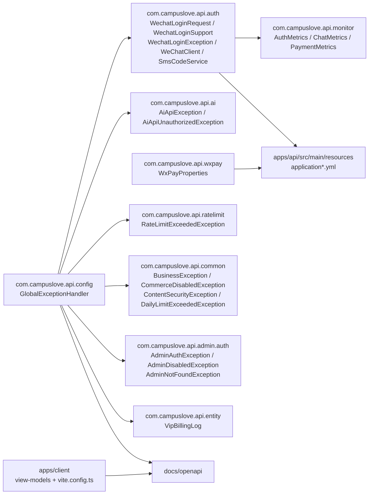

**图表来源**
- [WechatLoginSupport.java:1-4](file://apps/api/src/main/java/com/campuslove/api/auth/WechatLoginSupport.java#L1-L4)
- [GlobalExceptionHandler.java:3-39](file://apps/api/src/main/java/com/campuslove/api/config/GlobalExceptionHandler.java#L3-L39)
- [WeChatClient.java:74-146](file://apps/api/src/main/java/com/campuslove/api/auth/WeChatClient.java#L74-L146)
- [SmsCodeService.java:2-6](file://apps/api/src/main/java/com/campuslove/api/auth/SmsCodeService.java#L2-L6)
- [WxPayProperties.java:92-92](file://apps/api/src/main/java/com/campuslove/api/wxpay/WxPayProperties.java#L92-L92)
- [application.yml:218-273](file://apps/api/src/main/resources/application.yml#L218-L273)
- [VipBillingLog.java:35-48](file://apps/api/src/main/java/com/campuslove/api/entity/VipBillingLog.java#L35-L48)
- [login.ts:6-6](file://apps/client/src/view-models/login.ts#L6-L6)
- [vite.config.ts:109-113](file://apps/client/vite.config.ts#L109-L113)
- [feedback-growth-and-auth.yaml:52-133](file://docs/openapi/feedback-growth-and-auth.yaml#L52-L133)

三条值得单独记住的依赖事实：

1. `WechatLoginSupport` 只 import `com.campuslove.api.monitor.AuthMetrics` 一个跨包依赖，其余协作对象（`AuthService`、`UserSessionView`）与它同包。因此登录链路的改动集中在 `auth` 包内，`monitor` 包的接口变更（例如 `recordLoginSuccess(Long)` 的参数类型）会直接暴露为编译期错误，而不是运行期故障。
2. `GlobalExceptionHandler` 是依赖扇出最大的一处：它的 import 列表同时引用 `admin.auth`、`ai`、`auth`、`common`、`media`、`ratelimit`、`wallet` 七个包的异常类型，外加 jakarta 与 Spring 的框架异常。新增第三方异常时如果忘记在这里登记，会落到 `handleGenericException` 兜底（500 + `INTERNAL_ERROR`），表现为「第三方故障被报成服务器内部错误」。
3. 客户端与契约之间是文档依赖而非代码依赖：`view-models/login.ts` 与 `docs/openapi` 之间没有生成器或类型引用的取证证据，`vite.config.ts` 只负责环境变量注入与分包。契约变更只能靠人工核对，这也是「字段对不上」类故障反复出现的结构性原因。

反向依赖检查同样重要：`VipBillingLog` 只依赖 JPA 注解（`@Entity`、`@Table`），不依赖任何业务包；`AuthMetrics`、`ChatMetrics`、`PaymentMetrics` 三个 `@Component` 之间没有相互引用。因此指标层的改动不会引起业务层回归，反之业务层的异常语义变化必须重新核对指标 reason 取值（`e.getClass().getSimpleName()`）。

**章节来源**
- [WechatLoginSupport.java:1-50](file://apps/api/src/main/java/com/campuslove/api/auth/WechatLoginSupport.java#L1-L50)
- [GlobalExceptionHandler.java:1-39](file://apps/api/src/main/java/com/campuslove/api/config/GlobalExceptionHandler.java#L1-L39)
- [GlobalExceptionHandler.java:604-628](file://apps/api/src/main/java/com/campuslove/api/config/GlobalExceptionHandler.java#L604-L628)
- [AuthMetrics.java:22-23](file://apps/api/src/main/java/com/campuslove/api/monitor/AuthMetrics.java#L22-L23)
- [ChatMetrics.java:23-24](file://apps/api/src/main/java/com/campuslove/api/monitor/ChatMetrics.java#L23-L24)
- [PaymentMetrics.java:29-30](file://apps/api/src/main/java/com/campuslove/api/monitor/PaymentMetrics.java#L29-L30)
- [VipBillingLog.java:35-48](file://apps/api/src/main/java/com/campuslove/api/entity/VipBillingLog.java#L35-L48)

## 性能考虑
第三方链路的性能特征主要由「外部往返 + 重试策略 + 埋点开销」三项决定，本页只对取证到的数值与实现下结论。

回调时延是唯一有显式打点接口的第三方指标：`PaymentMetrics.recordCallbackLatency(long durationMs)`，与 `recordCallbackFailure(String reason)` 成对存在。也就是说支付回调的性能与成功率可以从应用指标里直接读出，不需要解析日志；反之，登录链路只有计数（`recordLoginSuccess`/`recordLoginFailure`/`recordTokenRefresh`）而没有时延方法，聊天链路同样是计数加会话仪表（`incrementActiveSession()`/`decrementActiveSession()`）。若需要登录耗时分布，当前实现不提供该维度。

重试与限流的数值口径集中在 `application.yml` 的外部依赖弹性段：注释声明该段为「外部依赖（微信 API / 短信 / 对象存储）提供熔断 / 重试 / 限流 / 降级能力」，其中短信段写明「最多 2 次（共 3 次请求），指数退避 1s→2s→4s」与「每 1s 最多 5 次调用（SMS 服务商通常按 QPS 计费）」。据此可得一条容量结论：最坏情况下一次验证码请求会占用 3 次上游调用与约 7 秒的退避窗口，而入口侧的 5 次/秒上限先于服务商配额生效。应用自身的限流由 `RateLimitAspect` 的令牌桶实现，桶内无令牌即抛 `RateLimitExceededException` 并返回 429，因此压测时看到的 429 是本机策略，不代表服务商侧限流。

埋点开销被设计为可忽略且不传导失败。`WechatLoginSupport` 把两处指标调用各自包在 `try { ... } catch (RuntimeException ignore)` 中，注释为「监控逻辑失败忽略，不影响登录主流程」；`parseUserId` 对空串与非数字一律返回 `null`，避免在热路径上抛 `NumberFormatException`。代价是可观测性下降：指标异常时不会有任何告警痕迹。

响应体体积与攻击面同时被压缩。`handleInsufficientBalance` 的注释写明「精简响应避免回显 userId/金额/余额等字段放大攻击面，金额明细仅记录在服务端日志」，因此 400 响应只含 `error`/`message`/`status`/`code`；`handleAiApiException` 同样「不向上游响应体透传给前端」，但 `upstreamBody` 会进入 `log.warn`。这带来一个运维侧权衡：上游错误的排查完全依赖日志留存，日志采集断档会直接变成第三方故障不可诊断。

前端构建层面的性能约束与 Sentry 绑定。`vite.config.ts` 注释把 `@sentry/*` 错误监控 SDK 单列为一个 chunk，理由是「按需拆分，便于浏览器长期缓存」，并且「不显式拆分 `@dcloudio/uni-h5`，因为 `@sentry/vue` 内部 import `@sentry/browser`（传递依赖，pnpm 未 hoist 到顶层），显式拆分会触发 rollup 主动」相关行为。此外两条端点（推荐路径与旧路径别名）共用 `WechatLoginSupport` 一份实现，也消除了双份埋点与双份异常处理的重复维护成本。

**章节来源**
- [PaymentMetrics.java:61-79](file://apps/api/src/main/java/com/campuslove/api/monitor/PaymentMetrics.java#L61-L79)
- [AuthMetrics.java:63-91](file://apps/api/src/main/java/com/campuslove/api/monitor/AuthMetrics.java#L63-L91)
- [ChatMetrics.java:60-103](file://apps/api/src/main/java/com/campuslove/api/monitor/ChatMetrics.java#L60-L103)
- [application.yml:353-454](file://apps/api/src/main/resources/application.yml#L353-L454)
- [GlobalExceptionHandler.java:508-527](file://apps/api/src/main/java/com/campuslove/api/config/GlobalExceptionHandler.java#L508-L527)
- [GlobalExceptionHandler.java:138-163](file://apps/api/src/main/java/com/campuslove/api/config/GlobalExceptionHandler.java#L138-L163)
- [GlobalExceptionHandler.java:735-751](file://apps/api/src/main/java/com/campuslove/api/config/GlobalExceptionHandler.java#L735-L751)
- [WechatLoginSupport.java:29-65](file://apps/api/src/main/java/com/campuslove/api/auth/WechatLoginSupport.java#L29-L65)
- [vite.config.ts:140-148](file://apps/client/vite.config.ts#L140-L148)

## 故障排查指南
本指南按「先证明环境、再看响应体、最后关联日志」的顺序执行，每一步都对应仓库里可核对的出处。

第一步，环境门禁。开工前先实测 `GET /actuator/health` 是否 200，并核对 `WECHAT_DEV_FALLBACK_ENABLED` 取值——QA 工作流把它列为前置条件，原文要求「false 则 `wx.login` 必 502，须在建轮之前作为已知约束写进计划，而不是跑到登录链路才发现」，并同时列出第三项前置：后端改动是否需要重启才生效（「改了 Java 侧字段/查询但未重启，取证取到的是旧行为」）。收口工作流给出的实测方式是轮询 `curl -s -m 3 http://127.0.0.1:8080/actuator/health` 直到响应含 `"UP"`，最多等 180 秒，再执行 `node scripts/qa/verify-backend-fresh.mjs` 取提交后读数。规则草案里另有 freshness 判定口径：读 `/actuator/health`（或 `apps/api/logs/campus-love-api.log` 里最后一次 `Started .* in .* seconds` 的时间戳）与 `apps/api/src` 最新 mtime 比对，输出 `BACKEND_FRESH=PASS|FAIL`，并注明「重编可机检、重启不能」——该脚本条目在同一段落被标记为「本稿不创建」，因此当前只能按该口径人工比对。

第二步，按响应体字段定位。`error`/`message`/`status`/`code`/`traceId` 的组合已经足以判定异常走了哪个 handler：

| `status` | `code` | 结论 | 下一步 |
| --- | --- | --- | --- |
| 401 | `INVALID_CODE` | 微信 code 失效/过期（上游 `errcode 40029`） | 客户端重新 `wx.login()`，检查是否复用同一 code |
| 403 | `USER_DISABLED` | 账号被禁用 | 走管理端解封，非集成故障 |
| 502 | `WECHAT_API_ERROR` | 微信上游网络异常或其他非 0 errcode | 核对 `WECHAT_APPID`/`WECHAT_SECRET`，再看降级开关 |
| 401 | `UNAUTHORIZED`（含 `traceId`） | JWT 解析失败/签名无效/过期/格式错误 | 比对 `JWT_SECRET` 与签发方，用 `traceId` 关联日志 |
| 401 | `TOKEN_REVOKED`（含 `traceId`） | 登出后复用旧令牌（Redis 黑名单） | 强制重新登录 |
| 403 | `COMMERCE_DISABLED`（`error` 同值） | 商业化开关封存 | 核对 `@FeatureSwitch`，不是支付接口故障 |
| 403 | `VIDEO_UPLOAD_DISABLED` | `upload.video.enabled=false` | 核对开关，未落盘 |
| 400 | `CONTENT_SECURITY` | imgSecCheck 判定违规（`errcode=87014`） | 业务预期结果，非故障 |
| 400 | `INSUFFICIENT_BALANCE` | 钱包余额不足（自动续费场景本应由内部捕获写 FAILED 流水） | 查 `VipBillingLog.status` |
| 401 | `AI_API_UNAUTHORIZED` | `AGNES_API_KEY` 缺失或上游 401 | 补环境变量，勿当作登录态问题 |
| 502 | `AI_API_ERROR` | AI 上游 4xx/5xx 或网络异常 | 从日志 `upstreamBody` 取上游细节 |
| 429 | `DAILY_LIMIT_EXCEEDED` | 每日次数上限 | 与短时限流区分 |
| 429 | 无 `code` | `RateLimitAspect` 令牌桶 | 本机策略，非服务商限流 |
| 500 | `INTERNAL_ERROR`（+`timestamp`，开发环境含 `detail`） | 未登记 handler 的异常兜底 | 用 `traceId` 查堆栈，并补具体 handler |
| 404/405/409/413 | 无 `code` | 路径/方法/约束/大小类问题 | 核对契约路径与参数命名 |
| 401/403/404 | `INVALID_CREDENTIALS`/`ADMIN_DISABLED`/`ADMIN_NOT_FOUND` | 管理端登录链路 | 与小程序登录区分 |

第三步，关联日志。响应含 `X-Trace-Id` 头与 `traceId` 字段，其值优先取 `MDC` 中的 `traceId`（由 `TraceIdFilter` 在请求入口注入），MDC 缺失时（如异步线程异常）降级为新 UUID。因此关联失败有两种可能：异步分支的日志与响应 `traceId` 不同串，或服务端未打印该级别日志。第三方相关的日志语句是固定的，可按文案检索：`微信登录失败: code={}, status={}, message={}`、`无效 Token: code={}, message={}, traceId={}`、`Token 已撤销: ...`、`WeChat dev-fallback 生效（...）: code={}`、`AI 服务上游异常: operation={}, message={}, upstreamBody={}`、`钱包余额不足: userId={}, 需要={}, 当前余额={}`、`触发速率限制: {}`。

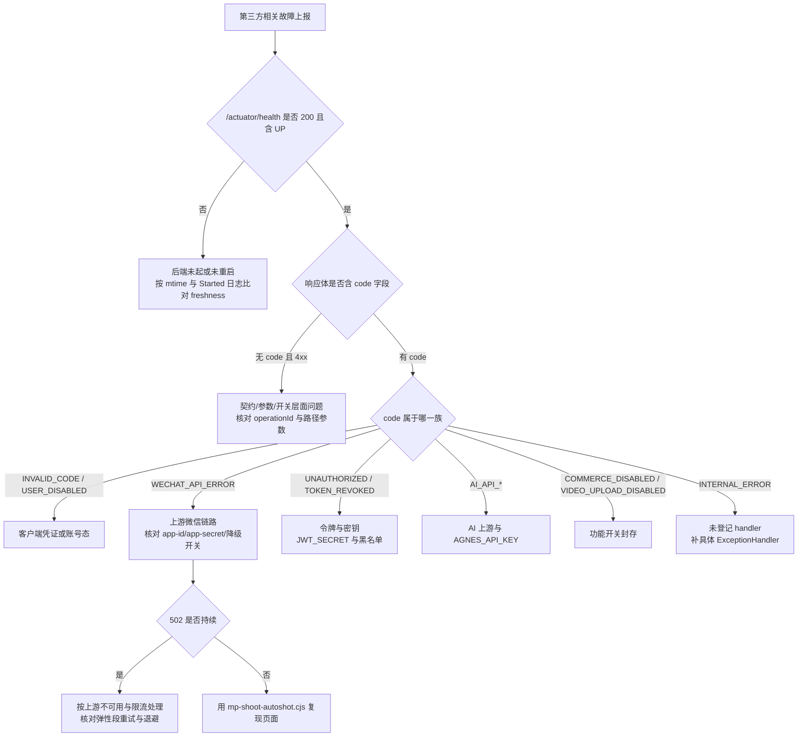

**图表来源**
- [miniprogram-qa-loop-v32.dwf.ts:37-37](file://.zcode/workflows/miniprogram-qa-loop-v32.dwf.ts#L37-L37)
- [miniprogram-qa-loop-v32.dwf.ts:1068-1068](file://.zcode/workflows/miniprogram-qa-loop-v32.dwf.ts#L1068-L1068)
- [miniprogram-repo-closure-v35.dwf.ts:50-50](file://.zcode/workflows/miniprogram-repo-closure-v35.dwf.ts#L50-L50)
- [miniprogram-repo-closure-v35.dwf.ts:741-741](file://.zcode/workflows/miniprogram-repo-closure-v35.dwf.ts#L741-L741)
- [V32-D-RULES-DRAFT.md:1616-1775](file://.zcode/research/V32-D-RULES-DRAFT.md#L1616-L1775)
- [GlobalExceptionHandler.java:351-363](file://apps/api/src/main/java/com/campuslove/api/config/GlobalExceptionHandler.java#L351-L363)
- [GlobalExceptionHandler.java:404-451](file://apps/api/src/main/java/com/campuslove/api/config/GlobalExceptionHandler.java#L404-L451)
- [GlobalExceptionHandler.java:604-628](file://apps/api/src/main/java/com/campuslove/api/config/GlobalExceptionHandler.java#L604-L628)
- [WeChatClient.java:142-146](file://apps/api/src/main/java/com/campuslove/api/auth/WeChatClient.java#L142-L146)
- [mp-shoot-autoshot.cjs:1-121](file://scripts/mp-shoot-autoshot.cjs#L1-L121)

四条已知的误诊模式：把本地 502 当作生产故障（降级开关默认 `false` 时本地必然失败）；把 403 `COMMERCE_DISABLED` 当作支付接口异常（前端按码静默处理，监控无峰值）；把 `AI_API_UNAUTHORIZED` 当作登录态失效（同为 401，处置方完全不同）；把 mock profile 的固定验证码 `123456` 失败归因于服务商（该 profile 下不发生真实外呼）。

**章节来源**
- [GlobalExceptionHandler.java:832-843](file://apps/api/src/main/java/com/campuslove/api/config/GlobalExceptionHandler.java#L832-L843)
- [GlobalExceptionHandler.java:896-914](file://apps/api/src/main/java/com/campuslove/api/config/GlobalExceptionHandler.java#L896-L914)
- [application.yml:269-273](file://apps/api/src/main/resources/application.yml#L269-L273)
- [SmsCodeService.java:2-6](file://apps/api/src/main/java/com/campuslove/api/auth/SmsCodeService.java#L2-L6)
- [VipBillingLog.java:76-83](file://apps/api/src/main/java/com/campuslove/api/entity/VipBillingLog.java#L76-L83)

## 安全防护措施

第三方集成把信任边界外移到了微信侧，因此本仓库的收口思路是：**能在启动期拒绝的绝不留到运行期，能在服务侧验证的绝不相信调用方**。排查安全相关问题时，先确认请求卡在哪一道闸上，再决定是改配置还是查上游。

### 支付回调的四道闸

支付回调是外部可直接写入业务状态的唯一入口，`BillingController` 把处置顺序固定在注释里：配置闸 → IP 白名单 → 验签（RSA-SHA256 + 防重放时间窗）→ AES-256-GCM 解密 resource → 订单状态机（幂等）→ 按微信约定应答。

| 闸 | 判定位置 | 拒绝方式 | 排查要点 |
| --- | --- | --- | --- |
| ① 配置闸 | `wxPayProperties == null \|\| !isEnabled()` | 抛 `ResourceNotFoundException`（对外 404） | 封存态下端点必然 404，这不是故障；确认 `app.wechat-pay.enabled` |
| ② IP 白名单 | `wxPayCallbackGuard.isIpAllowed(remoteIp)` | 同样抛 `ResourceNotFoundException` | 注释明写「不暴露端点存在性」，因此 404 可能来自①或②，需看日志 |
| ③ 验签 | `verifyCallback(timestamp, nonce, body, signature)` | 返回 `{"code":"FAIL"}` 并记 `signature_invalid` 指标 | 微信会按重试策略重发，日志里同一订单多次 FAIL 属预期 |
| ④ 解密 | `decryptResource(ciphertext, associatedData, nonce)` | 抛 `IllegalStateException` | 与③分开计数，见「故障排查指南」的指标名 |

退款回调 `WxPayRefundNotifyController` 与④同构，是复制而非共享的代码路径：两处都是先验签再解密、失败同样上报 `signature_invalid`。也就是说，**回调守卫的改动必须同时改两个控制器**，否则退款链路的验签会退回弱校验。

**章节来源**
- [BillingController.java:98-100](file://apps/api/src/main/java/com/campuslove/api/vip/BillingController.java#L98-L100)
- [BillingController.java:118-137](file://apps/api/src/main/java/com/campuslove/api/vip/BillingController.java#L118-L137)
- [WxPayRefundNotifyController.java:90-121](file://apps/api/src/main/java/com/campuslove/api/wxpay/WxPayRefundNotifyController.java#L90-L121)

### 验签与解密的实现约束

签名串按官方约定拼成 `timestamp\nnonce\nbody\n`，**含最后一段换行**；拼串少一个 `\n` 是验签失败最常见的原因，而这种失败在日志里只表现为「签名不匹配或格式非法」，与密钥错、Base64 非法共用同一分支。

时间戳防重放是双向的绝对偏移判定：`|now - timestamp| <= tolerance`，容差由 `WxPayProperties.getCallbackTimestampToleranceSeconds()` 提供（默认 5 分钟）。`Long.parseLong` 失败直接返回 false，因此**服务器时钟漂移会伪装成重放攻击**——排查回调 FAIL 时应先比对宿主机与微信侧时间。

解密侧的硬约束写在异常文案里：APIv3 密钥必须是 **32 字节**（按 UTF-8 字节数而非字符数校验，含中文的密钥会在这里被拒），GCM 标签 128 位、nonce 12 字节，`associated_data` 非空时进 AAD。任何 `AEADBadTagException` 都翻译成「密文可能被篡改」，它与密钥不匹配是同一个出口，因此**换密钥后仍报此错的概率高于真被篡改**。

**章节来源**
- [WxPayCallbackVerifier.java:97-110](file://apps/api/src/main/java/com/campuslove/api/wxpay/WxPayCallbackVerifier.java#L97-L110)
- [WxPayCallbackVerifier.java:118-128](file://apps/api/src/main/java/com/campuslove/api/wxpay/WxPayCallbackVerifier.java#L118-L128)
- [WxPayCallbackVerifier.java:146-149](file://apps/api/src/main/java/com/campuslove/api/wxpay/WxPayCallbackVerifier.java#L146-L149)
- [WxPayCallbackVerifier.java:164-167](file://apps/api/src/main/java/com/campuslove/api/wxpay/WxPayCallbackVerifier.java#L164-L167)

### 缺省安全与启动期 fail-fast

三条把风险提前到启动期的机制值得在部署文档里对照检查：

1. **空公钥一律拒绝**：平台证书未配置时构造器把 `platformPublicKey` 置 null 并只记 warn，而 `verifyCallback` 遇到 null 公钥直接返回 false。封存态（`enabled=false`）因此可以安全启动，且不存在「没配证书就跳过验签」的路径——这条明确替代了早期骨架实现「非空即过」的漏洞。
2. **启用即必填**：`WxPayBootstrapChecker.afterPropertiesSet()` 在 `enabled=true` 时逐项校验 `findMissingRequired()`，缺项直接抛 `IllegalStateException` 拒绝启动，并把商户私钥与平台公钥的 PEM 解析也预热到启动期，使格式非法不会拖到第一笔订单。
3. **`enabled=false` 只记日志**：同一方法在封存态分支仅打印「端点将直接 404」后返回，因此**本地环境用假密钥启动是可行的**，这也是「回调 404」在开发机上通常不是故障的原因。

**章节来源**
- [WxPayCallbackVerifier.java:60-66](file://apps/api/src/main/java/com/campuslove/api/wxpay/WxPayCallbackVerifier.java#L60-L66)
- [WxPayBootstrapChecker.java:43-49](file://apps/api/src/main/java/com/campuslove/api/wxpay/WxPayBootstrapChecker.java#L43-L49)
- [WxPayBootstrapChecker.java:51-61](file://apps/api/src/main/java/com/campuslove/api/wxpay/WxPayBootstrapChecker.java#L51-L61)
- [WxPayBootstrapChecker.java:37-41](file://apps/api/src/main/java/com/campuslove/api/wxpay/WxPayBootstrapChecker.java#L37-L41)

### 纵深防御的两处 fail-open（属已知取舍，排查时须计入）

安全闸并非全部 fail-closed，两处放宽会直接影响故障归因：

- **IP 白名单未配置即不限制来源**：`isIpAllowed` 在 `callbackIpWhitelist` 为空时返回 true，仅首次记一条 warn；启动校验器同样只在白名单为空时 warn 而不阻断。于是「白名单忘了配」在服务侧没有任何可观测后果，回调防护实际退化为**只依赖签名**。反代场景还要额外确认 `resolveClientIp` 取的是 `X-Forwarded-For` 首跳——白名单配了但取到代理 IP 时，表现是全部 404。
- **敏感词过滤器关闭即放行**：内容安全降级链的末端是 `LocalContentSecurityChecker`，它在 `sensitiveWordFilter.isEnabled()` 为 false 时直接 `ContentSecurityVerdict.pass()`。换句话说 fail-closed 承诺只覆盖到「微信侧不可用则用本地过滤」，**不覆盖「本地过滤器本身被关掉」**，这是审核红线排查中最容易被误判为「微信接口失效」的一类。

**章节来源**
- [WxPayCallbackGuard.java:43-49](file://apps/api/src/main/java/com/campuslove/api/wxpay/WxPayCallbackGuard.java#L43-L49)
- [WxPayBootstrapChecker.java:63-66](file://apps/api/src/main/java/com/campuslove/api/wxpay/WxPayBootstrapChecker.java#L63-L66)
- [LocalContentSecurityChecker.java:21-30](file://apps/api/src/main/java/com/campuslove/api/config/LocalContentSecurityChecker.java#L21-L30)

### 内容安全检查的接入条件与降级语义

`ContentSecurityChecker` 接口把调用约定写进 javadoc：risky 必须拦截、review 允许通过但记日志、**检查失败必须降级为本地过滤而非直接放行**。实现侧的接入条件是三重的——`@Profile("real")` + `@ConditionalOnProperty(name = "app.content-security.wechat-secret")` + `@Primary`，未配置凭据时该 Bean 完全不存在，本地过滤成为唯一检查器。

`check()` 内部把三类「拿不到结论」的情况都收敛到同一出口：缺少 access_token 或 openid、微信返回空响应、抛任何 `RuntimeException`（含网络与超时），均转投 `localChecker.check(...)`。`scene` 为空时默认取 3（论坛）。这意味着**「内容被本地词库拦下」与「微信判定 risky」在返回值上可区分**（verdict 的 provider 字段分别是 local 与 wechat），排查误拦截时应先看 provider 而不是先看词库。

另外两处硬限制解释了本地联调为何总是走降级：msgSecCheck v2 要求文本 ≤2500 字符（超出截断而非报错），且要求 openid 属于近两小时访问过小程序的用户——本地无 openid 映射时必然降级，属预期而非故障。access_token 缓存在单机内存、提前 300 秒刷新，多实例部署需要迁 Redis（源码注释自陈）。

**章节来源**
- [ContentSecurityChecker.java:13-14](file://apps/api/src/main/java/com/campuslove/api/config/ContentSecurityChecker.java#L13-L14)
- [WeChatMsgSecCheckClient.java:32-35](file://apps/api/src/main/java/com/campuslove/api/config/WeChatMsgSecCheckClient.java#L32-L35)
- [WeChatMsgSecCheckClient.java:82-86](file://apps/api/src/main/java/com/campuslove/api/config/WeChatMsgSecCheckClient.java#L82-L86)
- [WeChatMsgSecCheckClient.java:107-111](file://apps/api/src/main/java/com/campuslove/api/config/WeChatMsgSecCheckClient.java#L107-L111)
- [WeChatMsgSecCheckClient.java:44-47](file://apps/api/src/main/java/com/campuslove/api/config/WeChatMsgSecCheckClient.java#L44-L47)

### 来源与跨域收口

WebSocket 的 Origin 采用**未配置即拒绝启动**：解析出的模式数组为空时抛 `IllegalStateException`，文案直接要求 real 环境通过 `WEBSOCKET_ALLOWED_ORIGIN_PATTERNS` 显式配置，并提示本地演示改用 mock profile；注册端点时仅当 `patterns.length > 0` 才调用 `setAllowedOriginPatterns`。

WebMvc/Security 的 CORS 则收敛到单一来源：`SecurityConfig` 复用 `WebConfig.parseOrigins` 并使用 `WebConfig.CORS_ALLOWED_METHODS/HEADERS/MAX_AGE_SECONDS` 常量，注释记录了收敛原因——两处手工维护曾导致 `SecurityConfig` 漏含 `X-Trace-Id` 的配置漂移。基线 `application.yml` 里 `allowed-origins` 默认值为空串（不配即不放行），只有 mock profile 给出 `localhost:5173/5174/5177` 的默认列表。

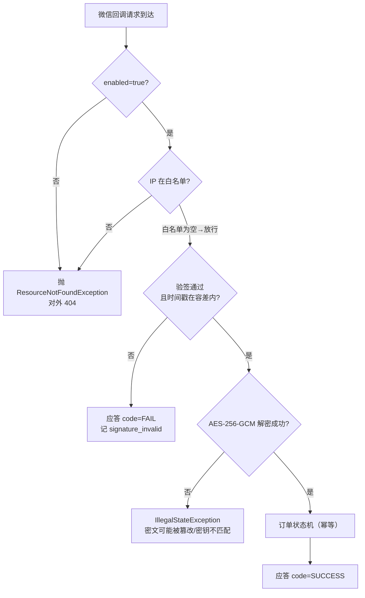

**图表来源**
- [BillingController.java:118-137](file://apps/api/src/main/java/com/campuslove/api/vip/BillingController.java#L118-L137)
- [WxPayCallbackGuard.java:43-49](file://apps/api/src/main/java/com/campuslove/api/wxpay/WxPayCallbackGuard.java#L43-L49)
- [WxPayCallbackVerifier.java:82-110](file://apps/api/src/main/java/com/campuslove/api/wxpay/WxPayCallbackVerifier.java#L82-L110)
- [WxPayCallbackVerifier.java:139-167](file://apps/api/src/main/java/com/campuslove/api/wxpay/WxPayCallbackVerifier.java#L139-L167)

**章节来源**
- [WebSocketConfig.java:114-120](file://apps/api/src/main/java/com/campuslove/api/config/WebSocketConfig.java#L114-L120)
- [WebSocketConfig.java:148-153](file://apps/api/src/main/java/com/campuslove/api/config/WebSocketConfig.java#L148-L153)
- [SecurityConfig.java:217-225](file://apps/api/src/main/java/com/campuslove/api/config/SecurityConfig.java#L223-L231)
- [application.yml:182-187](file://apps/api/src/main/resources/application.yml#L182-L187)

## 结论

第三方集成的故障在这套代码里只呈现为三种形态，而它们的处置路径完全不同，混用是误诊的主要来源：

1. **配置形态**——凭据缺失或开关未开。特征是**启动期就拒绝**（`WxPayBootstrapChecker` 在 `enabled=true` 且必填项缺失时直接抛 `IllegalStateException`）或**端点根本不存在**（封存态回调返回 404、`WeChatMsgSecCheckClient` 在无凭据时连 Bean 都不注册）。这类"故障"在本地环境是预期行为，不该升级给上游。
2. **契约形态**——字段、前缀、算法与文档不一致。特征是 4xx 与"看起来正常但值不对"：缺 `/api/v1` 前缀、`ApiResponse` 的记录字段被当成实体列、签名串少一个换行、`reason` 标签集合与告警描述不一致。这类问题只能靠逐字段核对，日志与指标给不出结论。
3. **运行形态**——上游可用性与数据面异常。特征是间歇与放大：令牌过期、验签时间窗被时钟漂移吃掉、GCM 认证失败、MQ 与 Redis 的降级路径把异常吞成 warn。

跨这三种形态有一条共同规律：**这套系统把"安全"和"可用性"押在同一批开关上**，所以一个开关同时决定故障的可见性。`sensitiveWordFilter.isEnabled()` 关闭会让内容检查直接放行；回调 IP 白名单为空会退化为只依赖签名；`CORS_ALLOWED_ORIGINS` 未配置则基线不放行任何来源，而 mock profile 自带 localhost 列表——于是"本地能通、线上 403"与"本地全通、线上裸奔"都各有实例。

一处值得所有阅读者记住的教训：`PaymentCallbackFailure` 的规则注释与 `PaymentMetrics` javadoc 都写着「接线之前静默不触发」，但磁盘上的代码已在 `BillingController`、`WxPayRefundNotifyController` 与 `VipOrderService.recordFailure` 三处写入该计数器。**注释的自述会过期，而它过期时恰好朝"故障不存在"的方向误导**。同类方向性误导还包括：把 403 `COMMERCE_DISABLED` 当支付故障、把 `AI_API_UNAUTHORIZED` 当登录态失效、把 mock profile 的固定验证码失败归因于服务商。

因此本页推荐的固定动作是：先确认 profile 与开关（配置形态），再核对请求与响应的逐字段契约（契约形态），最后才谈上游与降级（运行形态）；三步都留下 `traceId` 与指标增量作为证据，不要以注释文案作为现状依据。

**章节来源**
- [WxPayBootstrapChecker.java:43-49](file://apps/api/src/main/java/com/campuslove/api/wxpay/WxPayBootstrapChecker.java#L43-L49)
- [WeChatMsgSecCheckClient.java:32-35](file://apps/api/src/main/java/com/campuslove/api/config/WeChatMsgSecCheckClient.java#L32-L35)
- [LocalContentSecurityChecker.java:21-30](file://apps/api/src/main/java/com/campuslove/api/config/LocalContentSecurityChecker.java#L21-L30)
- [WxPayCallbackGuard.java:43-49](file://apps/api/src/main/java/com/campuslove/api/wxpay/WxPayCallbackGuard.java#L43-L49)
- [application.yml:182-187](file://apps/api/src/main/resources/application.yml#L182-L187)
- [PaymentMetrics.java:17-20](file://apps/api/src/main/java/com/campuslove/api/monitor/PaymentMetrics.java#L17-L20)
- [VipOrderService.java:614-619](file://apps/api/src/main/java/com/campuslove/api/vip/VipOrderService.java#L614-L619)
