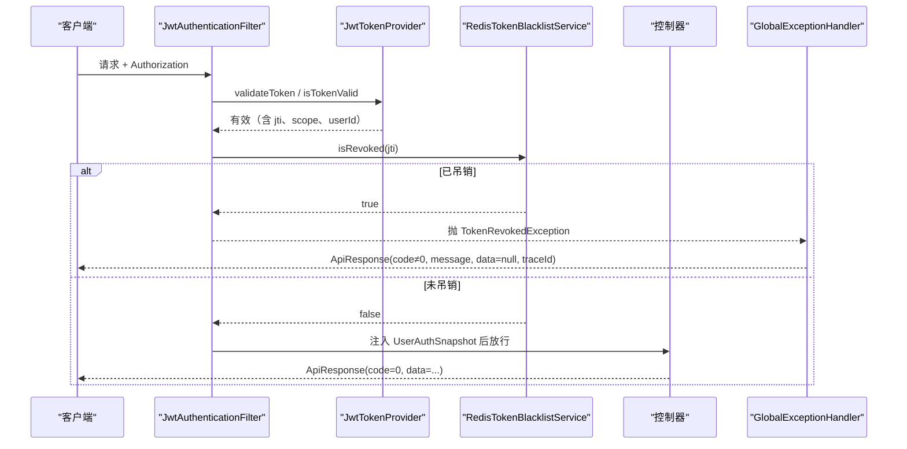
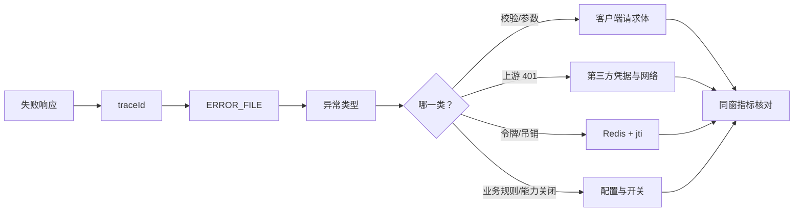
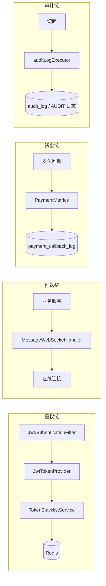
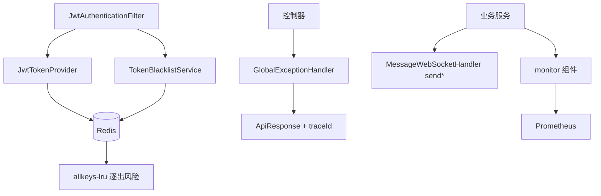

# 运行时故障诊断

<cite>
**本文引用的文件**
- [GlobalExceptionHandler.java](file://apps/api/src/main/java/com/campuslove/api/config/GlobalExceptionHandler.java)
- [ApiResponse.java](file://apps/api/src/main/java/com/campuslove/api/common/ApiResponse.java)
- [JwtTokenProvider.java](file://apps/api/src/main/java/com/campuslove/api/config/JwtTokenProvider.java)
- [JwtAuthenticationFilter.java](file://apps/api/src/main/java/com/campuslove/api/config/JwtAuthenticationFilter.java)
- [RedisTokenBlacklistService.java](file://apps/api/src/main/java/com/campuslove/api/auth/RedisTokenBlacklistService.java)
- [TokenBlacklistService.java](file://apps/api/src/main/java/com/campuslove/api/auth/TokenBlacklistService.java)
- [InvalidTokenException.java](file://apps/api/src/main/java/com/campuslove/api/auth/InvalidTokenException.java)
- [TokenRevokedException.java](file://apps/api/src/main/java/com/campuslove/api/auth/TokenRevokedException.java)
- [logback-spring.xml](file://apps/api/src/main/resources/logback-spring.xml)
- [docker-compose.yml](file://docker-compose.yml)
- [application-real.yml](file://apps/api/src/main/resources/application-real.yml)
- [MessageWebSocketHandler.java](file://apps/api/src/main/java/com/campuslove/api/chat/MessageWebSocketHandler.java)
- [ChatMetrics.java](file://apps/api/src/main/java/com/campuslove/api/monitor/ChatMetrics.java)
- [MatchMetrics.java](file://apps/api/src/main/java/com/campuslove/api/monitor/MatchMetrics.java)
- [PaymentMetrics.java](file://apps/api/src/main/java/com/campuslove/api/monitor/PaymentMetrics.java)
- [RealAccountSecurityService.java](file://apps/api/src/main/java/com/campuslove/api/auth/RealAccountSecurityService.java)
- [AuditAsyncConfig.java](file://apps/api/src/main/java/com/campuslove/api/admin/audit/AuditAsyncConfig.java)
- [alert-rules.yml](file://docker/prometheus/rules/alert-rules.yml)
</cite>

## 目录
1. [简介](#简介)
2. [项目结构](#项目结构)
3. [核心组件](#核心组件)
4. [架构总览](#架构总览)
5. [一次失败请求的取证路径](#一次失败请求的取证路径)
6. [鉴权链路故障](#鉴权链路故障)
7. [令牌吊销与 Redis 故障](#令牌吊销与-redis-故障)
8. [会话与活跃计数异常](#会话与活跃计数异常)
9. [实时推送未送达](#实时推送未送达)
10. [资金与回调类故障](#资金与回调类故障)
11. [异步任务与审计链路故障](#异步任务与审计链路故障)
12. [异常出口决定的故障形态](#异常出口决定的故障形态)
13. [日志与指标怎么配合](#日志与指标怎么配合)
14. [能力缺口登记](#能力缺口登记)
15. [依赖关系分析](#依赖关系分析)
16. [故障处置速查表](#故障处置速查表)
17. [结论](#结论)

## 简介
本页针对"进程已经起来了、但行为不对"的一类故障：鉴权、会话、实时推送、资金回调、异步审计。
它们共同的诊断抓手是三样东西——响应里的 `traceId`、`GlobalExceptionHandler` 的分派分支、
以及 `monitor` 包里那几个指标是否变化。

写作依据全部来自仓库内真实代码与配置行号；没有证据的能力（链路追踪、熔断降级、
分布式事务、健康探针聚合等）在"能力缺口登记"一节明确记为**无实现证据**。

## 项目结构
- 异常与响应契约：`config/GlobalExceptionHandler.java`（915 行，类声明 L61）、
  `common/ApiResponse.java`（`record ApiResponse<T>(int code, String message, T data, String traceId)` L34）。
- 鉴权机制：`config/JwtTokenProvider.java`（438 行）、`config/JwtAuthenticationFilter.java`（290 行）、
  `auth/RedisTokenBlacklistService.java`（208 行）、`auth/TokenBlacklistService.java`（54 行）。
- 故障类型：`auth/InvalidTokenException.java`（53 行，L19；`getErrorCode()` L50）、
  `auth/TokenRevokedException.java`（57 行，L23；`getErrorCode()` L54）。
- 运行依赖：`docker-compose.yml`（Redis/MySQL 的强制凭据与健康依赖）、
  `application-real.yml`（`spring.flyway` 与占位符）。
- 推送与指标：`chat/MessageWebSocketHandler.java`（455 行）、
  `monitor/ChatMetrics.java`、`monitor/MatchMetrics.java`、`monitor/PaymentMetrics.java`。

**章节来源**
- [GlobalExceptionHandler.java:61-61](file://apps/api/src/main/java/com/campuslove/api/config/GlobalExceptionHandler.java#L61-L61)
- [ApiResponse.java:34-34](file://apps/api/src/main/java/com/campuslove/api/common/ApiResponse.java#L34-L34)
- [RedisTokenBlacklistService.java:44-46](file://apps/api/src/main/java/com/campuslove/api/auth/RedisTokenBlacklistService.java#L44-L46)

## 核心组件
- **GlobalExceptionHandler**：按类型分派，可读到的处理器包括
  `MethodArgumentNotValidException`(L90)、`HttpClientErrorException.Unauthorized`(L106)、
  `IllegalArgumentException`(L118)、`InsufficientBalanceException`(L152)、
  `MediaSizeLimitExceededException`(L169)、`CommerceDisabledException`(L197)、
  `VideoUploadDisabledException`(L223)。
- **JwtTokenProvider**：签发 `generateToken(String userId)`(L99) 与
  `generateMediaToken(String userId)`(L128)；解释 `getTokenScope`(L160)、
  `getJtiFromToken`(L185)、`getRemainingTtlSeconds`(L214)、`getUserIdFromToken`(L242)、
  `validateToken`(L265)、`isTokenValid`(L276)、`getExpirationFromToken`(L298)；
  吊销 `revokeToken`(L342)、`isTokenRevoked`(L362)、`cleanupExpiredRevokedTokens()`(L387)；
  依赖 `RedissonClient`(L78)。
- **RedisTokenBlacklistService**：`@Service`(L44)，
  `revoke(String jti, long ttlSeconds)`(L114)、`isRevoked(String jti)`(L161)、
  `cleanupExpiredLocalEntries()`(L74)；接口层是 `TokenBlacklistService`(L29)。
- **JwtAuthenticationFilter**：`@Component`(L47) 产出 `UserAuthSnapshot`(L97)，
  并有 `strictMediaQueryToken`(L115) 控制媒体令牌严格校验。
- **推送出口**：`sendHeartSignal`(L401)、`sendNotification`(L419)、
  `sendPrivateMessage`(L437)。

**章节来源**
- [JwtTokenProvider.java:78-387](file://apps/api/src/main/java/com/campuslove/api/config/JwtTokenProvider.java#L78-L387)
- [JwtAuthenticationFilter.java:47-115](file://apps/api/src/main/java/com/campuslove/api/config/JwtAuthenticationFilter.java#L47-L115)
- [MessageWebSocketHandler.java:401-455](file://apps/api/src/main/java/com/campuslove/api/chat/MessageWebSocketHandler.java#L401-L455)

## 架构总览

**图表来源**
- [JwtAuthenticationFilter.java:47-97](file://apps/api/src/main/java/com/campuslove/api/config/JwtAuthenticationFilter.java#L47-L97)
- [JwtTokenProvider.java:265-276](file://apps/api/src/main/java/com/campuslove/api/config/JwtTokenProvider.java#L265-L276)
- [RedisTokenBlacklistService.java:114-161](file://apps/api/src/main/java/com/campuslove/api/auth/RedisTokenBlacklistService.java#L114-L161)
- [ApiResponse.java:34-34](file://apps/api/src/main/java/com/campuslove/api/common/ApiResponse.java#L34-L34)

## 一次失败请求的取证路径
固定四步，避免在多个日志文件之间乱撞：

1. **拿 traceId**：`ApiResponse` 的四元组里 `traceId` 就是关联键(L34)。
2. **进 ERROR_FILE**：`logback-spring.xml` 的 `ERROR_FILE` appender(L87)
   只收错误级，文件模式带 `-error` 前缀(L93)，比主日志小一到两个数量级。
3. **定位异常分支**：在 `GlobalExceptionHandler` 里按异常类型找到对应处理器
   （L90/L106/L118/L152/L169/L197/L223），分支性质直接决定下一步查配置、查上游还是查数据。
4. **交叉验证指标**：`ChatMetrics.recordMessageFailed(reason)`(L77)、
   `PaymentMetrics.recordCallbackFailure(reason)`(L79) 等是否在同一时间窗增长。

[此图为概念流程，不直接对应具体源文件，故不提供图表来源]

**章节来源**
- [logback-spring.xml:87-98](file://apps/api/src/main/resources/logback-spring.xml#L87-L98)
- [ChatMetrics.java:60-103](file://apps/api/src/main/java/com/campuslove/api/monitor/ChatMetrics.java#L60-L103)
- [PaymentMetrics.java:61-90](file://apps/api/src/main/java/com/campuslove/api/monitor/PaymentMetrics.java#L61-L90)

## 详细组件分析
下面按"链路"而不是"类"来拆解，因为运行期故障总是沿链路传播：
鉴权链（Filter → TokenProvider → Blacklist → Redis）、
推送链（业务服务 → Handler → 连接）、资金链（回调 → Metrics → 表）、
审计链（切面 → 线程池 → 表/日志）。每条链的判据行号在后续小节逐条给出。

**图表来源**
- [JwtAuthenticationFilter.java:47-97](file://apps/api/src/main/java/com/campuslove/api/config/JwtAuthenticationFilter.java#L47-L97)
- [MessageWebSocketHandler.java:60-83](file://apps/api/src/main/java/com/campuslove/api/chat/MessageWebSocketHandler.java#L60-L83)
- [PaymentMetrics.java:61-90](file://apps/api/src/main/java/com/campuslove/api/monitor/PaymentMetrics.java#L61-L90)
- [AuditAsyncConfig.java:38-38](file://apps/api/src/main/java/com/campuslove/api/admin/audit/AuditAsyncConfig.java#L38-L38)

## 鉴权链路故障
| 现象 | 判据 | 定位 |
|---|---|---|
| 全部请求 401 | `InvalidTokenException`(L19) 被抛出 | 签名/过期/时钟漂移；先看 `getExpirationFromToken`(L298) 与 `getRemainingTtlSeconds`(L214) |
| 登出后旧令牌仍可用 | `TokenRevokedException`(L23) 未出现 | 吊销是否写入：`revokeToken`(L342) → `revoke(jti, ttlSeconds)`(L114) |
| 特定接口 401，其他正常 | `getTokenScope`(L160) 与 `strictMediaQueryToken`(L115) | 媒体令牌与访问令牌混用；`generateMediaToken`(L128) 是独立签发 |
| 刷新后立刻失效 | `getJtiFromToken`(L185) 与吊销集合 | 刷新是否顺带吊销旧 jti |
| 改密/换号后被踢 | `RealAccountSecurityService.changePassword(userId, oldPassword, newPassword, currentToken)`(L86) | `currentToken` 参数表明改密会处理当前令牌，属预期 |

两类 401 必须分开：`HttpClientErrorException.Unauthorized`(L106) 是**调用上游被拒**，
`InvalidTokenException` 是**本地令牌无效**。二者对外表现接近，
但一个要查微信凭据与出网，另一个要查签名密钥与系统时间。

**章节来源**
- [InvalidTokenException.java:19-50](file://apps/api/src/main/java/com/campuslove/api/auth/InvalidTokenException.java#L19-L50)
- [TokenRevokedException.java:23-54](file://apps/api/src/main/java/com/campuslove/api/auth/TokenRevokedException.java#L23-L54)
- [JwtTokenProvider.java:160-298](file://apps/api/src/main/java/com/campuslove/api/config/JwtTokenProvider.java#L160-L298)
- [RealAccountSecurityService.java:86-121](file://apps/api/src/main/java/com/campuslove/api/auth/RealAccountSecurityService.java#L86-L121)
- [GlobalExceptionHandler.java:106-117](file://apps/api/src/main/java/com/campuslove/api/config/GlobalExceptionHandler.java#L106-L117)

## 令牌吊销与 Redis 故障
吊销链是：`revokeToken`(L342) → `TokenBlacklistService`(L29) →
`RedisTokenBlacklistService.revoke(String jti, long ttlSeconds)`(L114)，
判定时走 `isRevoked(String jti)`(L161)，本地过期项由 `cleanupExpiredLocalEntries()`(L74) 清理，
Redis 侧另有 `cleanupExpiredRevokedTokens()`(L387)。

**这里有一个配置层面的真实风险**：编排里 Redis 以
`--maxmemory 256mb`(L151) 与 `--maxmemory-policy allkeys-lru`(L152) 启动。
`allkeys-lru` 的含义是内存达上限时**可以淘汰任意键**（不限带 TTL 的键），
而吊销名单正是靠 TTL 自然过期的键。也就是说在缓存压力大时，
吊销记录可能被淘汰，导致已登出的令牌重新被判定为有效。

诊断信号：
- Redis 内存/逐出指标上升，同时"用户说已退出但账号仍可操作"；
- `isRevoked` 恒为 false 而 `revoke` 调用日志存在。

处置方向（择一，均需改动现有配置）：把淘汰策略改成
`volatile-lru` 或 `noeviction`，或把吊销判定改为以持久层状态为准、Redis 只作加速。

**章节来源**
- [JwtTokenProvider.java:342-387](file://apps/api/src/main/java/com/campuslove/api/config/JwtTokenProvider.java#L342-L387)
- [RedisTokenBlacklistService.java:74-161](file://apps/api/src/main/java/com/campuslove/api/auth/RedisTokenBlacklistService.java#L74-L161)
- [TokenBlacklistService.java:29-54](file://apps/api/src/main/java/com/campuslove/api/auth/TokenBlacklistService.java#L29-L54)
- [docker-compose.yml:144-152](file://docker-compose.yml#L144-L152)

## 会话与活跃计数异常
`ChatMetrics.incrementActiveSession()`(L92) 与
`decrementActiveSession()`(L103) 应当成对出现。
若活跃会话数只增不减，说明存在**没走正常关闭路径**的连接（进程被杀、网络中断未触发回调），
这类连接在服务端看来仍在，会挤占后续连接与推送目标解析。

配套检查顺序：
1. 指标曲线是否与发布/重启时间点吻合；
2. 连接是否有超时回收（若无，则为代码级缺口，见"能力缺口登记"）；
3. 容器是否被健康检查杀掉重建（`HEALTHCHECK` 见 Dockerfile L107，
   但更常见于 OOM——`JAVA_OPTS` 用百分比堆，docker-compose L256-L257）。

**章节来源**
- [ChatMetrics.java:92-103](file://apps/api/src/main/java/com/campuslove/api/monitor/ChatMetrics.java#L92-L103)
- [docker-compose.yml:255-265](file://docker-compose.yml#L255-L265)

## 实时推送未送达
推送只有三个出口（`sendNotification` L419、`sendPrivateMessage` L437、
`sendHeartSignal` L401），所以"收不到"要先判断是**没产生事件**还是**通道断了**：

1. 三个 `send*` 是否被调用：未调用即业务侧没产生事件，与通道无关；
2. 调用了但对端没收到：确认对端连接与订阅状态，重连后需
   `GET /api/v1/messages/conversations/{id}/messages` 补拉；
3. 发送失败计数：`recordMessageFailed(String reason)`(L77) 与
   `recordMessageSent(String messageType)`(L60) 的比值区分发送侧失败与接收侧丢失；
4. 消息投递状态是行上的列（`TempChatMessage.deliveryStatus = "sent"` L58），
   不是内存态，因此可用 SQL 直接核对是否真发出。

**章节来源**
- [MessageWebSocketHandler.java:401-455](file://apps/api/src/main/java/com/campuslove/api/chat/MessageWebSocketHandler.java#L401-L455)
- [ChatMetrics.java:60-77](file://apps/api/src/main/java/com/campuslove/api/monitor/ChatMetrics.java#L60-L77)

## 资金与回调类故障
`PaymentMetrics` 提供两个观测点：`recordCallbackLatency(long durationMs)`(L61) 与
`recordCallbackFailure(String reason)`(L79)。告警侧
`PaymentCallbackFailure` 表达式是
`sum(increase(payment_callback_failure_total[5m])) > 0`，
其描述要求立即核查 `payment_callback_log` 与回调日志，
`reason` 标签区分 `signature_invalid`/`order_not_found`/`duplicate_notify`/`persist_error`。

一条必须知道的现状：规则注释自述"**在 BillingService 的失败路径接入
`recordCallbackFailure` 之前该指标无序列，本规则静默不触发**"，
但**这句自述已经过期**——计数器实际已有三处写入点：
`BillingController` 的验签/信封/解密/载荷/内部错误六道出口(L134-L194)、
`WxPayRefundNotifyController` 的同构六道出口(L94-L153)、
以及 `VipOrderService.recordFailure` 私有辅助(L614-L619)，
后者的业务原因（`order_not_found`/`amount_mismatch`/`duplicate_notify`）
由 `VipOrderServiceTest`(L332-L366) 逐条断言。
因此资金类故障**会被告警捕获**，但仍不能只看告警：
`payment_callback_log` 表与 `ERROR_FILE` 日志是确认处置结果的唯一依据，
而按注释排查会得出"告警没接线"的错误结论。

相关约束：`InsufficientBalanceException`(L152) 与 `CommerceDisabledException`(L197)
是两个不同的故障语义——前者是用户余额不足，后者是商业化能力被关闭；
混淆会导致"以为数据错，其实是开关关着"。

**章节来源**
- [PaymentMetrics.java:29-90](file://apps/api/src/main/java/com/campuslove/api/monitor/PaymentMetrics.java#L29-L90)
- [alert-rules.yml:312-324](file://docker/prometheus/rules/alert-rules.yml#L312-L324)
- [GlobalExceptionHandler.java:152-222](file://apps/api/src/main/java/com/campuslove/api/config/GlobalExceptionHandler.java#L152-L222)
- [BillingController.java:134-194](file://apps/api/src/main/java/com/campuslove/api/vip/BillingController.java#L134-L194)
- [WxPayRefundNotifyController.java:94-153](file://apps/api/src/main/java/com/campuslove/api/wxpay/WxPayRefundNotifyController.java#L94-L153)
- [VipOrderService.java:614-619](file://apps/api/src/main/java/com/campuslove/api/vip/VipOrderService.java#L614-L619)
- [VipOrderServiceTest.java:332-366](file://apps/api/src/test/java/com/campuslove/api/vip/VipOrderServiceTest.java#L332-L366)

## 异步任务与审计链路故障
审计写库是异步的：线程池由 `AuditAsyncConfig`（`@Configuration` L21）的
`auditLogExecutor()`(L38) 提供。异步带来的典型现象是
"操作成功但审计表晚几秒才有记录"，或"线程池饱和后审计丢失/延迟"。

排查要点：
1. 先确认不是查得太快——审计与业务不在同一事务边界内；
2. 日志侧 `AUDIT` appender(L126) 与 `audit_log` 表是两条落点，
   一条丢不代表另一条丢；
3. 线程池饱和时表现为延迟上升，而不是接口错误率上升，
   因此**不要只看 HTTP 指标就断言异步链路健康**。

**章节来源**
- [AuditAsyncConfig.java:21-50](file://apps/api/src/main/java/com/campuslove/api/admin/audit/AuditAsyncConfig.java#L21-L50)
- [logback-spring.xml:126-126](file://apps/api/src/main/resources/logback-spring.xml#L126-L126)

## 异常出口决定的故障形态
因为响应统一是 `ApiResponse(code, message, data, traceId)`(L34)，
运行期故障通常表现为 **HTTP 200 + 非零 code**，
而不是 4xx/5xx。这有三个直接后果：

1. 网关与 Nginx 层的错误率指标看不到业务失败，必须看应用指标；
2. 客户端若只判 HTTP 状态会把失败当成功；
3. `GlobalExceptionHandler` 的分支就是"故障分类表"，
   新增异常类型时若没有对应处理器，会被兜底成分支外的通用错误，
   排查时应优先确认异常类型是否已被覆盖。

**章节来源**
- [ApiResponse.java:34-34](file://apps/api/src/main/java/com/campuslove/api/common/ApiResponse.java#L34-L34)
- [GlobalExceptionHandler.java:90-223](file://apps/api/src/main/java/com/campuslove/api/config/GlobalExceptionHandler.java#L90-L223)

## 日志与指标怎么配合
- **日志分级已内建**：`CONSOLE`(L58) 供容器采集、`FILE`(L66) 全量、
  `ERROR_FILE`(L87) 错误、`AUDIT`(L126) 审计；主日志按天 + 按大小切割(L68-L79)，
  容器重建后仍可回看（`api-logs` 卷，docker-compose L271）。
- **指标先于日志**：比率类问题（失败率、延迟）看指标更快；
  单点问题（某用户某请求）看 `traceId` 更快。
- **告警分级决定响应时限**：`severity: critical` 1 小时重发、`warning` 4 小时
  （alertmanager 路由 L57-L78），而 `api-health` 类规则与容器健康检查同源
  （`ApiHealthCheckFailed` 表达式见 alert-rules L36）。

**章节来源**
- [logback-spring.xml:58-126](file://apps/api/src/main/resources/logback-spring.xml#L58-L126)
- [docker-compose.yml:269-275](file://docker-compose.yml#L269-L275)
- [alert-rules.yml:35-39](file://docker/prometheus/rules/alert-rules.yml#L35-L39)
- [alertmanager.yml:57-78](file://docker/alertmanager/alertmanager.yml#L57-L78)

## 能力缺口登记
以下能力在本仓库内**没有找到实现证据**，诊断时不要假设它们存在：

1. **链路追踪系统**：`traceId` 存在于响应结构里(L34)，但没有接入外部 APM/追踪后端的依赖或配置。
2. **熔断降级的对外可见性**：编排里没有独立熔断组件配置，
   只有 resilience4j 健康指标被暴露到 `/actuator/health`（application.yml L460 注释）。
3. **Redis 逐出保护**：策略是 `allkeys-lru`(L152)，没有针对吊销键的保护措施。
4. **推送补偿队列**：WebSocket 只有三个 `send*` 出口，没有离线消息补推队列或重试表。
5. **资金告警注释与代码不同步**：`PaymentCallbackFailure` 的注释与 `PaymentMetrics` javadoc
   都把写入点说成"尚未接线的 BillingService"，而代码已在控制器与 `VipOrderService` 写入
   （见「资金与回调类故障」一节）——属文档漂移，不影响告警本身触发。
6. **会话超时回收**：未发现活跃会话计数的自动校正任务（只有成对的 +1/−1 方法）。
7. **异步任务的观测面**：`auditLogExecutor()`(L38) 有线程池，但没有队列深度/拒绝数的专用指标。
8. **OpenTelemetry / SkyWalking / Sentry 后端**：后端依赖里未见对应 SDK 配置。

**章节来源**
- [alert-rules.yml:312-318](file://docker/prometheus/rules/alert-rules.yml#L312-L318)
- [application.yml:460-460](file://apps/api/src/main/resources/application.yml#L460-L460)
- [AuditAsyncConfig.java:38-38](file://apps/api/src/main/java/com/campuslove/api/admin/audit/AuditAsyncConfig.java#L38-L38)

## 依赖关系分析
- 鉴权链依赖 Redis：`JwtAuthenticationFilter` → `JwtTokenProvider`(`RedissonClient` L78)
  → `TokenBlacklistService` → Redis。**Redis 是安全组件而不是纯缓存**。
- 推送链依赖业务服务：`MessageWebSocketHandler` 持有
  `TempChatSessionService`(L60)、`TempChatMessageService`(L67)、
  `PrivateConversationRepository`(L74)、`PrivateMessageService`(L83)，
  所以推送故障常常是这些服务没产生事件。
- 指标链依赖调用点：每个 `record*` 方法只有在业务代码调用后才有数据
  （缺口 5 提醒的是相反方向——`payment.callback.failure` 的调用点已存在，注释仍说没有）。
- 故障形态依赖异常出口：新增异常未登记进 `GlobalExceptionHandler` 就会退化为通用错误。

**图表来源**
- [JwtAuthenticationFilter.java:47-70](file://apps/api/src/main/java/com/campuslove/api/config/JwtAuthenticationFilter.java#L47-L70)
- [MessageWebSocketHandler.java:60-83](file://apps/api/src/main/java/com/campuslove/api/chat/MessageWebSocketHandler.java#L60-L83)
- [docker-compose.yml:150-152](file://docker-compose.yml#L150-L152)

**章节来源**
- [RedisTokenBlacklistService.java:44-46](file://apps/api/src/main/java/com/campuslove/api/auth/RedisTokenBlacklistService.java#L44-L46)

## 性能考虑
诊断本身也有效率问题，仓库结构对"怎么查最快"有直接影响：

- **错误优先于全量**：`ERROR_FILE`(L87) 只收错误级，且独立成文件(L93)，
  比在按天切割的主日志(L70)里 grep 快一个量级。
- **比率优先于单条**：登录失败率、消息发送失败率这类问题用指标看
  （`recordLoginFailure`(L76) / `recordMessageFailed`(L77)），
  单条请求才用 `traceId`。
- **令牌判定有缓存**：`RedisTokenBlacklistService` 同时维护本地过期项(L74)，
  `isRevoked`(L161) 的耗时主要取决于 Redis 往返，因此吊销查询高频时
  Redis 的 256mb 上限(L151)与逐出策略(L152)会同时影响性能与正确性。
- **审计异步不阻塞主流程**：`auditLogExecutor()`(L38) 承担写入，
  但队列饱和时表现为审计延迟，需要有队列深度指标才能提前发现（当前缺，见缺口登记）。
- **推送不重试**：三个 `send*` 出口没有补推队列，
  因此"离线用户"不应靠推送送达，而应靠客户端重连后拉取，避免服务端做无谓重投。

**章节来源**
- [logback-spring.xml:70-98](file://apps/api/src/main/resources/logback-spring.xml#L70-L98)
- [RedisTokenBlacklistService.java:74-161](file://apps/api/src/main/java/com/campuslove/api/auth/RedisTokenBlacklistService.java#L74-L161)
- [docker-compose.yml:151-152](file://docker-compose.yml#L151-L152)
- [AuthMetrics.java:76-76](file://apps/api/src/main/java/com/campuslove/api/monitor/AuthMetrics.java#L76-L76)
- [AuditAsyncConfig.java:38-38](file://apps/api/src/main/java/com/campuslove/api/admin/audit/AuditAsyncConfig.java#L38-L38)

## 故障处置速查表
| 现象 | 第一动作 | 判据位置 |
|---|---|---|
| 突然全员 401 | 比对签名密钥与系统时间 | `validateToken`(L265)、`getExpirationFromToken`(L298) |
| 登出后旧令牌仍可用 | 查 Redis 是否被逐出 | `revoke`(L114)、`--maxmemory-policy`(L152) |
| 消息发得出收不到 | 先看 `recordMessageFailed` 是否增长 | ChatMetrics L77、三个 `send*` L401-L437 |
| 活跃会话只增 | 对齐发布/重启时间点 | ChatMetrics L92、L103 |
| 支付异常但无告警 | 直接查 `payment_callback_log` | alert-rules 自述静默 L314-L315 |
| 余额不足 vs 功能关闭 | 看具体 code 对应哪个处理器 | L152 / L197 |
| 审计缺失 | 先等一拍再看，再查 AUDIT 落点 | `auditLogExecutor()`(L38)、logback L126 |
| 接口 200 但业务失败 | 读 `code` 与 `traceId`，别读状态码 | ApiResponse L34 |

**章节来源**
- [JwtTokenProvider.java:265-298](file://apps/api/src/main/java/com/campuslove/api/config/JwtTokenProvider.java#L265-L298)
- [GlobalExceptionHandler.java:152-197](file://apps/api/src/main/java/com/campuslove/api/config/GlobalExceptionHandler.java#L152-L197)
- [MessageWebSocketHandler.java:60-83](file://apps/api/src/main/java/com/campuslove/api/chat/MessageWebSocketHandler.java#L60-L83)

## 结论
运行期诊断的主干是**鉴权—会话—推送—资金—审计**五条链，
它们共享同一套观测面：`traceId` 定位单次失败、`ERROR_FILE` 收敛错误堆栈、
`GlobalExceptionHandler` 充当故障分类表、`monitor` 组件提供比率与耗时。

最需要在平时就修掉的是两件事：**Redis 的 `allkeys-lru` 与令牌吊销共存的风险**
（吊销键可能被逐出），以及**资金回调指标未接线导致告警静默**
（规则注释已自述）。在这两处修好之前，涉及安全与资金的故障不能依赖告警发现，
必须保留"直接查表 + 查错误日志"的人工路径。
