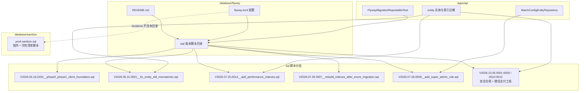
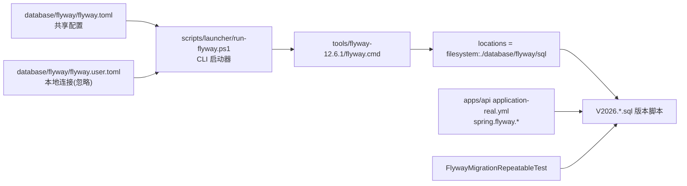
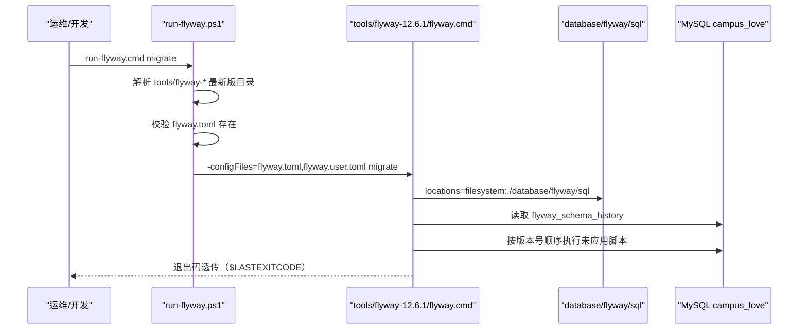
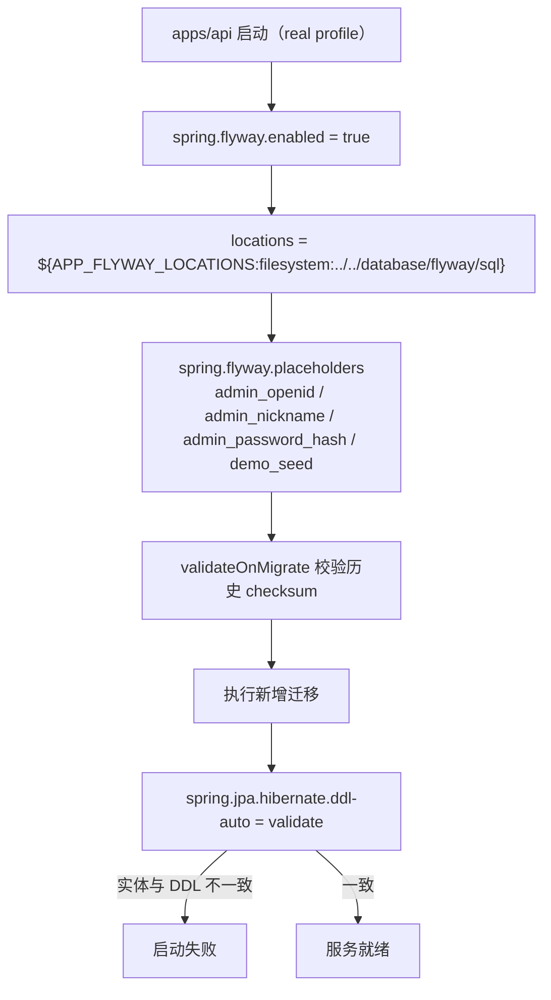
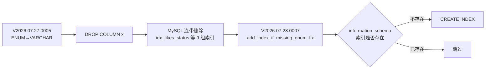
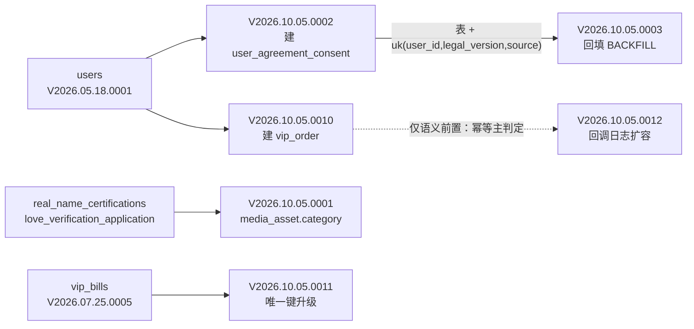
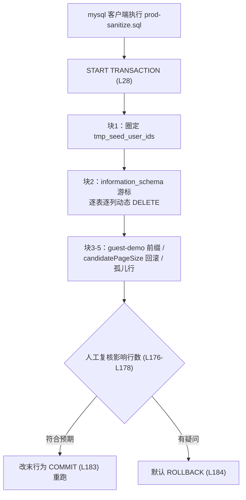
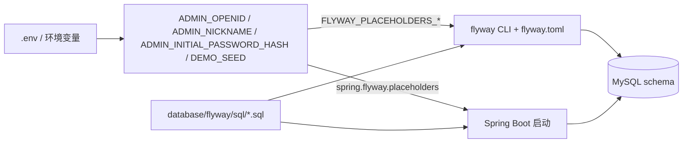
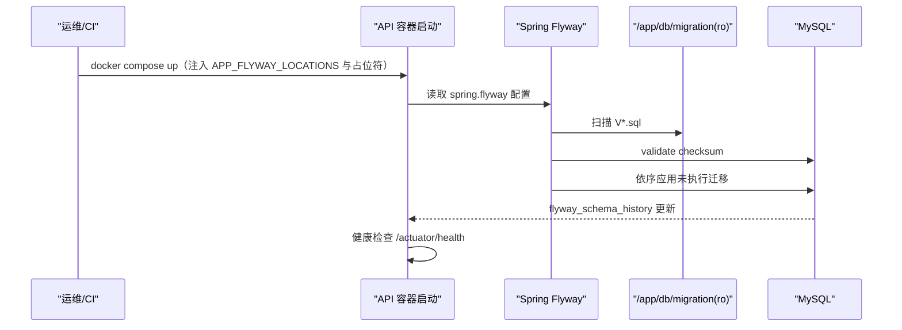

# Flyway数据库迁移管理

<cite>
**本文引用的文件**
- [README.md](file://database/flyway/README.md)
- [flyway.toml](file://database/flyway/flyway.toml)
- [application-real.yml](file://apps/api/src/main/resources/application-real.yml)
- [FlywayMigrationRepeatableTest.java](file://apps/api/src/test/java/com/campuslove/api/database/FlywayMigrationRepeatableTest.java)
- [V2026.05.18.2200__phase0_phase1_client_foundation.sql](file://database/flyway/sql/V2026.05.18.2200__phase0_phase1_client_foundation.sql)
- [V2026.05.31.0001__fix_entity_ddl_mismatches.sql](file://database/flyway/sql/V2026.05.31.0001__fix_entity_ddl_mismatches.sql)
- [V2026.06.25.0005__create_admin_configs.sql](file://database/flyway/sql/V2026.06.25.0005__create_admin_configs.sql)
- [V2026.07.25.0014__add_performance_indexes.sql](file://database/flyway/sql/V2026.07.25.0014__add_performance_indexes.sql)
- [V2026.07.26.0001__add_entity_index_annotations.sql](file://database/flyway/sql/V2026.07.26.0001__add_entity_index_annotations.sql)
- [V2026.07.28.0005__add_indexes.sql](file://database/flyway/sql/V2026.07.28.0005__add_indexes.sql)
- [V2026.07.28.0009__add_super_admin_role.sql](file://database/flyway/sql/V2026.07.28.0009__add_super_admin_role.sql)
- [V2026.08.10.0030__app_asset_url_unique_index.sql](file://database/flyway/sql/V2026.08.10.0030__app_asset_url_unique_index.sql)
- [V2026.07.24.0002__create_media_asset.sql](file://database/flyway/sql/V2026.07.24.0002__create_media_asset.sql)
- [V2026.07.25.0005__create_vip_bills.sql](file://database/flyway/sql/V2026.07.25.0005__create_vip_bills.sql)
- [V2026.07.27.0001__payment_callback_log.sql](file://database/flyway/sql/V2026.07.27.0001__payment_callback_log.sql)
- [V2026.10.05.0001__add_media_asset_category.sql](file://database/flyway/sql/V2026.10.05.0001__add_media_asset_category.sql)
- [V2026.10.05.0002__create_user_agreement_consent.sql](file://database/flyway/sql/V2026.10.05.0002__create_user_agreement_consent.sql)
- [V2026.10.05.0003__backfill_user_agreement_consent.sql](file://database/flyway/sql/V2026.10.05.0003__backfill_user_agreement_consent.sql)
- [V2026.10.05.0010__create_vip_order.sql](file://database/flyway/sql/V2026.10.05.0010__create_vip_order.sql)
- [V2026.10.05.0011__vip_bills_unique_transaction.sql](file://database/flyway/sql/V2026.10.05.0011__vip_bills_unique_transaction.sql)
- [V2026.10.05.0012__extend_payment_callback_log.sql](file://database/flyway/sql/V2026.10.05.0012__extend_payment_callback_log.sql)
- [V2026.05.18.0001__create_users.sql](file://database/flyway/sql/V2026.05.18.0001__create_users.sql)
- [V2026.08.07.0021__seed_50_virtual_users.sql](file://database/flyway/sql/V2026.08.07.0021__seed_50_virtual_users.sql)
- [V2026.08.07.0023__seed_messages_and_visitors.sql](file://database/flyway/sql/V2026.08.07.0023__seed_messages_and_visitors.sql)
- [V2026.08.08.0012__seed_more_virtual_users.sql](file://database/flyway/sql/V2026.08.08.0012__seed_more_virtual_users.sql)
- [sql/README.md](file://database/flyway/sql/README.md)
- [prod-sanitize.sql](file://database/sanitize/prod-sanitize.sql)
- [README.md](file://database/sanitize/README.md)
- [docker-compose.yml](file://docker-compose.yml)
- [VipOrderService.java](file://apps/api/src/main/java/com/campuslove/api/vip/VipOrderService.java)
- [BillingService.java](file://apps/api/src/main/java/com/campuslove/api/vip/BillingService.java)
- [AgreementConsentService.java](file://apps/api/src/main/java/com/campuslove/api/auth/AgreementConsentService.java)
- [LegalTextProvider.java](file://apps/api/src/main/java/com/campuslove/api/clientconfig/LegalTextProvider.java)
- [MediaAsset.java](file://apps/api/src/main/java/com/campuslove/api/entity/MediaAsset.java)
- [PaymentCallbackLog.java](file://apps/api/src/main/java/com/campuslove/api/entity/PaymentCallbackLog.java)
- [VipBill.java](file://apps/api/src/main/java/com/campuslove/api/entity/VipBill.java)
- [run-flyway.cmd](file://scripts/launcher/run-flyway.cmd)
- [run-flyway.ps1](file://scripts/launcher/run-flyway.ps1)
</cite>

## 目录
1. [简介](#简介)
2. [项目结构](#项目结构)
3. [核心组件](#核心组件)
4. [架构总览](#架构总览)
5. [详细组件分析](#详细组件分析)
6. [V2026.10.05 批次迁移](#v20261005-批次迁移)
7. [生产清库脚本 prod-sanitize](#生产清库脚本-prod-sanitize)
8. [迁移脚本命名与版本顺序](#迁移脚本命名与版本顺序)
9. [连接配置与占位符](#连接配置与占位符)
10. [校验与修复流程](#校验与修复流程)
11. [常见迁移场景最佳实践](#常见迁移场景最佳实践)
12. [CI/CD 自动化迁移](#cicd-自动化迁移)
13. [依赖关系分析](#依赖关系分析)
14. [性能考虑](#性能考虑)
15. [故障排查指南](#故障排查指南)
16. [结论](#结论)

## 简介
本页文档化 Campus Love 项目中 Flyway 数据库迁移体系的落地方式：迁移脚本仓库位置 `database/flyway/sql/`、版本命名规范（`V<yyyy.MM.dd.HHmm>__<slug>.sql`）、以及迁移在 Java 后端 `apps/api` 启动链路中的执行位置。内容全部取自仓库内真实文件与真实配置项，覆盖建表基线、索引补齐、枚举迁移后索引重建、超管角色种子数据等实际迁移阶段。

与通用 Flyway 教程不同，本页只描述本项目已经发生过的迁移事实：项目把 DDL 演进拆成「基线建表 → 缺列修复 → 性能索引 → 枚举迁移后重建 → 角色/配置种子」五类脚本，并通过 `FlywayMigrationRepeatableTest` 这类测试保证迁移可重复执行（可重入）。在此之上，本页还记录 `V2026.10.05` 批次（媒体资产分类、协议同意留痕、微信支付订单与回调留痕改造）六支迁移的实际变更，以及位于版本链之外的一次性生产清库脚本 `database/sanitize/prod-sanitize.sql`。

## 项目结构
迁移相关代码集中在 `database/flyway/` 目录，脚本按版本号单调递增排列；消费方是 `apps/api` 的 Spring Boot 数据层与实体注解。同级的 `database/sanitize/` 目录只放一次性运维脚本（`prod-sanitize.sql`），它不在 Flyway 的 `locations` 扫描范围内，详见「生产清库脚本 prod-sanitize」一节。



**图表来源**
- [README.md:1-21](file://database/flyway/README.md#L1-L21)
- [flyway.toml:1-3](file://database/flyway/flyway.toml#L1-L3)
- [V2026.05.18.2200__phase0_phase1_client_foundation.sql:1-94](file://database/flyway/sql/V2026.05.18.2200__phase0_phase1_client_foundation.sql#L1-L94)
- [V2026.07.28.0009__add_super_admin_role.sql:1-50](file://database/flyway/sql/V2026.07.28.0009__add_super_admin_role.sql#L1-L50)
- [V2026.10.05.0010__create_vip_order.sql:1-60](file://database/flyway/sql/V2026.10.05.0010__create_vip_order.sql#L1-L60)
- [prod-sanitize.sql:1-26](file://database/sanitize/prod-sanitize.sql#L1-L26)

## 核心组件
项目的 Flyway 体系由七个真实构件组成，分工是「配置分两层、脚本单目录、入口两条（CLI 与 Spring Boot 启动）、校验靠测试与 validateOnMigrate」。



**图表来源**
- [flyway.toml:1-39](file://database/flyway/flyway.toml#L1-L39)
- [flyway.user.toml.example:1-23](file://database/flyway/flyway.user.toml.example#L1-L23)
- [run-flyway.ps1:12-51](file://scripts/launcher/run-flyway.ps1#L12-L51)
- [database/flyway/sql/README.md:1-42](file://database/flyway/sql/README.md#L1-L42)

### 构件职责
1. **共享配置 `database/flyway/flyway.toml`**：唯一进版本库的 Flyway 配置文件。声明 `[flyway]` 段的 `locations = ["filesystem:./database/flyway/sql"]`、`validateMigrationNaming = true`、`validateOnMigrate = true`、`baselineOnMigrate = false`，以及 `[flyway.placeholders]` 段的全部占位符策略注释。
2. **连接模板 `database/flyway/flyway.user.toml.example`**：只提供 `[environments.default]` 的 `url` / `user` / `password`，真实值写在未纳管的 `flyway.user.toml` 中。模板里的 MySQL 示例库名固定为 `campus_love`，端口 `127.0.0.1:3306`，并带 `useUnicode=true&characterEncoding=UTF-8&serverTimezone=Asia/Shanghai` 参数，注释明确指出历史上有误填其他项目库名 `qihang_platform` 的事故。
3. **CLI 启动器 `scripts/launcher/run-flyway.ps1`（`run-flyway.cmd` 仅转发到它）**：定位 `tools/` 下名字形如 `flyway-*` 的最新版目录，取其 `flyway.cmd` 可执行文件，拼接 `-configFiles=<共享配置>,<用户配置>` 后在仓库根目录执行，并透传退出码。
4. **脚本目录 `database/flyway/sql/`**：全部版本化迁移，实测 203 支 `V2026.*__*.sql`（目录下另有 1 个 `README.md` 约定文档，不计入迁移），按版本号升序执行。
5. **目录约定文档 `database/flyway/sql/README.md`**：版本号规范、历史跳号说明、幂等约束、占位符约束，是新迁移的评审依据。
6. **Spring Boot 集成 `apps/api/src/main/resources/application-real.yml`**：后端以 `real` profile 启动时由 `spring.flyway.*` 触发同一批脚本，占位符走 `${ENV:default}` 语法。
7. **可重入校验测试 `apps/api/src/test/java/com/campuslove/api/database/FlywayMigrationRepeatableTest.java`**：用 `JdbcTemplate` 断言迁移后可重复执行，是「迁移不破坏既有库」的守门测试。

**章节来源**
- [flyway.toml:1-10](file://database/flyway/flyway.toml#L1-L10)
- [flyway.user.toml.example:1-23](file://database/flyway/flyway.user.toml.example#L1-L23)
- [run-flyway.ps1:9-63](file://scripts/launcher/run-flyway.ps1#L9-L63)
- [database/flyway/sql/README.md:5-42](file://database/flyway/sql/README.md#L5-L42)
- [README.md:1-21](file://database/flyway/README.md#L1-L21)
- [FlywayMigrationRepeatableTest.java:38-41](file://apps/api/src/test/java/com/campuslove/api/database/FlywayMigrationRepeatableTest.java#L38-L41)

## 架构总览
迁移有两条执行入口，最终落到同一个脚本目录，因此「一条迁移只需写一次，两条链路都能跑」是本项目的核心设计约束。



**图表来源**
- [run-flyway.ps1:16-63](file://scripts/launcher/run-flyway.ps1#L16-L63)
- [flyway.toml:1-7](file://database/flyway/flyway.toml#L1-L7)
- [flyway.user.toml.example:1-14](file://database/flyway/flyway.user.toml.example#L1-L14)



**图表来源**
- [application-real.yml:68-103](file://apps/api/src/main/resources/application-real.yml#L68-L103)
- [application-real.yml:104-107](file://apps/api/src/main/resources/application-real.yml#L104-L107)
- [flyway.toml:3-7](file://database/flyway/flyway.toml#L3-L7)

两条链路的关系由 `flyway.toml` 的注释显式约束：独立 CLI 通过 `[flyway.placeholders]`（配合 `FLYWAY_PLACEHOLDERS_ADMIN_OPENID` 等环境变量）注入，Spring Boot 通过 `application-real.yml` 的 `${ADMIN_OPENID:...}` 注入，「两条路径必须注入同一份值」，建议在 `.env` / `docker-compose` 中统一定义 `ADMIN_OPENID` 并映射为 `FLYWAY_PLACEHOLDERS_ADMIN_OPENID`；两处均为 fail-fast（无默认值），避免出现「一处有值一处用占位」的静默差异。

容器环境不改动脚本目录本身，而是用 `APP_FLYWAY_LOCATIONS` 把 locations 覆盖为 `filesystem:/app/db/migration`；仓库根 `.env.example` 中该变量的默认值与 yml 内的 `filesystem:../../database/flyway/sql` 保持一致，相对路径以 `apps/api` 为进程工作目录解析。

**章节来源**
- [flyway.toml:12-25](file://database/flyway/flyway.toml#L12-L25)
- [application-real.yml:70-76](file://apps/api/src/main/resources/application-real.yml#L70-L76)

## 详细组件分析
下面按「迁移类别」而非单个文件展开，每类给出仓库中的真实代表脚本与真实语句。

### 基线建表：V2026.05.18.2200__phase0_phase1_client_foundation.sql
该脚本 95 行，是「阶段 0 + 阶段 1 客户端地基」的阶段性脚本，内含 7 处 `CREATE TABLE IF NOT EXISTS`，分别位于 L1、L14、L28、L40、L56、L70、L85。使用 `IF NOT EXISTS` 而不是裸 `CREATE TABLE`，目的是让脚本在已经被手工建过表的开发库上也能跑通——这与 `sql/README.md` 中「DDL 依赖 Flyway 单次执行、不要试图在 SQL 里做 DDL 幂等」的约定并不矛盾：`IF NOT EXISTS` 属于建表语句自身的安全写法，而 MySQL 不支持 `CREATE INDEX IF NOT EXISTS`，索引类脚本必须靠 Flyway 的历史表保证只执行一次。

**章节来源**
- [V2026.05.18.2200__phase0_phase1_client_foundation.sql:1-94](file://database/flyway/sql/V2026.05.18.2200__phase0_phase1_client_foundation.sql#L1-L94)
- [database/flyway/sql/README.md:32-42](file://database/flyway/sql/README.md#L32-L42)

### 实体对齐修复：V2026.05.31.0001__fix_entity_ddl_mismatches.sql
这是「表结构与 Java 实体双向核对」最直接的产物，15 行、4 条 `ALTER TABLE`，文件头注释写明用途为「修复 Entity 与 DDL 字段不一致问题 / P1-H3: 对齐 Java Entity 定义与数据库表结构」：

| 行 | 表 | 动作 | 原因（注释原文要点） |
|----|----|----|----|
| L5 | `daily_questions` | `ADD COLUMN category VARCHAR(32) DEFAULT NULL AFTER question_text` | Entity 已定义，DDL 缺失 |
| L8 | `private_messages` | `ADD COLUMN quote_context TEXT DEFAULT NULL AFTER message_kind` | Entity 已定义，DDL 缺失 |
| L11 | `posts` | `MODIFY COLUMN category ENUM('all','interest','sincere','hometown','anonymous','latest','campus') NOT NULL DEFAULT 'all'` | Entity 已含 `campus`，DDL 缺失 |
| L14 | `daily_benefits` | `MODIFY COLUMN extra_recommend_quota INT NOT NULL DEFAULT 5` | Entity 默认值 5，DDL 为 0 |

配合 `application-real.yml` 的 `spring.jpa.hibernate.ddl-auto: validate`，任何这类缺口都会在 real profile 启动时直接失败，因此项目把修复本身也固化为一条有序迁移，而不是改历史脚本。

**章节来源**
- [V2026.05.31.0001__fix_entity_ddl_mismatches.sql:1-14](file://database/flyway/sql/V2026.05.31.0001__fix_entity_ddl_mismatches.sql#L1-L14)
- [application-real.yml:104-107](file://apps/api/src/main/resources/application-real.yml#L104-L107)

### 索引类迁移：补建与重建
项目里索引演进分成两波，代表脚本为 `V2026.07.25.0014__add_performance_indexes.sql`（114 行）与 `V2026.07.28.0005__add_indexes.sql`（454 行）。0014 的文件头把背景写成 Phase 3 基础设施任务，列出 10 张高频表（`likes`、`posts`、`post_likes`、`post_shares`、`comments`、`check_ins`、`activities`、`audit_log`、`reports`、`private_messages`），并规定「索引命名遵循 `idx_{表}_{列1}_{列2}` 规范」「既有 UNIQUE 约束（如 `uk_post_likes_user_post`）不重复创建」。实际落地的索引名可直接对照，例如 L34 `idx_likes_user_created_at`、L35 `idx_likes_target_user_created_at`、L42 `idx_posts_author_created_at`、L72 `idx_activities_status_activity_date`、L91 `idx_private_messages_conversation_read`。

0014 同时留下一条重要的「规格与实际不符」记录：L25-L28 声明原始任务规格中的 `likes.from_user_id`、`posts.circle_id`、`activities.creator_id/start_time`、`audit_log.user_id/action`、`messages.sender_id/receiver_id/is_read` 与真实表结构不一致，迁移按实际列名落地（如 `posts` 无 `circle_id`，该项直接跳过，见 L41）。

索引类迁移的幂等策略在 L21-L23 写死：MySQL 不支持 `CREATE INDEX IF NOT EXISTS`，因此**脚本自身不做 DDL 幂等**，依赖 Flyway 单次执行与 `validateOnMigrate` 的 checksum 校验；不能手动重跑，需要重放时先用文件下方 DOWN 回滚段删索引。

后续的 `V2026.07.25.0016__add_missing_indexes.sql`（29 行）与 `V2026.07.26.0001__add_entity_index_annotations.sql`（78 行）继续补索引，后者在 L35-L65 建立 `idx_notifications_user_created_at`、`idx_heart_signals_created_at`、`idx_vip_bills_created_at`、`idx_feedback_created_at`、`idx_private_messages_conversation_created_at`、`idx_private_messages_created_at`、`idx_private_messages_delivery_status`；`V2026.08.10.0030__app_asset_url_unique_index.sql`（55 行）则属于唯一索引类补建。

### 枚举迁移的连带损伤与重建：V2026.07.28.0007
这是本项目最值得记录的依赖关系案例。`V2026.07.27.0005__enum_to_varchar_check.sql` 用 `ADD COLUMN x_new → DROP COLUMN x → RENAME` 把 9 个 ENUM 列改为 VARCHAR，而 MySQL 的 `DROP COLUMN` 会连带删除仅包含该列的索引（含复合索引）。0007 的文件头逐条列出被误删的索引：`likes.status` 的 `idx_likes_status` / `idx_likes_status_created_at` / `idx_likes_status_user_created`、`posts.category` 的 `idx_posts_category`、`posts.status` 的 `idx_posts_status` / `idx_posts_status_created_at`、`heart_signals.status` 的 `idx_heart_signals_status`、`notifications.type` 的 `idx_notifications_type` / `idx_notifications_type_created`、`activities.status` 的 `idx_activities_status_activity_date`、`temp_chat_session.phase` 的 `idx_temp_chat_session_phase`、`user_online_status.status` 的 `idx_user_online_status_updated`。

修复采用「辅助存储过程 + information_schema 检查」的可重入写法：L25 `DROP PROCEDURE IF EXISTS add_index_if_missing_enum_fix;`，L27-L31 定义入参 `(tbl_name, idx_name, col_list)`，L33 起在 `IF NOT EXISTS (SELECT 1 ...)` 条件下才创建索引。注释明确该模式与 `V2026.07.28.0005` 同，并说明两种环境的语义：全新环境按 V2026.07.27.0005 → V2026.07.28.0007 顺序执行、索引按需创建；已修复环境靠 information_schema 检查不重复创建。



**图表来源**
- [V2026.07.28.0007__rebuild_indexes_after_enum_migration.sql:1-34](file://database/flyway/sql/V2026.07.28.0007__rebuild_indexes_after_enum_migration.sql#L1-L34)
- [V2026.07.28.0005__add_indexes.sql:1-453](file://database/flyway/sql/V2026.07.28.0005__add_indexes.sql#L1-L453)

### 配置与权限种子：V2026.06.25.0005、V2026.07.28.0009
数据类迁移代表是 `V2026.06.25.0005__create_admin_configs.sql`（137 行）：L22、L33、L45、L56、L67 五处 `CREATE TABLE IF NOT EXISTS`，随后 L82 `INSERT INTO app_config`、L91 `INSERT INTO app_rule`、L100 `INSERT INTO app_switch`、L111 `INSERT INTO match_config`、L122 `INSERT INTO recommend_strategy` 完成后台配置项初始化，其中 `match_config` 正是后端 `MatchConfigEntityRepository`（`apps/api/src/main/java/com/campuslove/api/repository/MatchConfigEntityRepository.java`，L11 声明该接口）读取的表。

`V2026.07.28.0009__add_super_admin_role.sql`（51 行）演示了三条本项目通用做法：
1. **条件守卫**：L20-L26 先用 `information_schema.COLUMNS` 统计 `users.role` 列是否存在（极端情况下上游 `V2026.06.25.0001` 未执行则跳过）。
2. **动态 SQL + 派生表**：L38-L42 用 `SET @sql := IF(...)` 组装 UPDATE，L43-L45 `PREPARE / EXECUTE / DEALLOCATE PREPARE`。注释（L32-L33）指出 MySQL 不允许 UPDATE 的 WHERE 子查询直接引用被更新表（ERROR 1093），故所有子查询都用 `SELECT ... FROM (SELECT ...) t` 派生表包装。
3. **占位符参与业务判断**：L40 的升级规则优先按 `openid = '${admin_openid}'` 精确匹配初始管理员，未命中才回退为 `created_at` 最早的 `ADMIN`，并以 `NOT EXISTS` 保证只在尚无 `SUPER_ADMIN` 时执行；L34-L37 说明 `${admin_openid}` 是 Flyway 纯文本占位符，其非空/非占位/长度≥16 由 `AdminOpenidValidator` 在启动时 fail-fast 校验，因此不在 SQL 中做转义。

回滚不是自动的：L47-L50 以注释形式给出 DOWN 段 `UPDATE users SET role = 'ADMIN' WHERE role = 'SUPER_ADMIN';`，标注「手动执行」。

**章节来源**
- [V2026.07.25.0014__add_performance_indexes.sql:1-45](file://database/flyway/sql/V2026.07.25.0014__add_performance_indexes.sql#L1-L45)
- [V2026.07.26.0001__add_entity_index_annotations.sql:35-65](file://database/flyway/sql/V2026.07.26.0001__add_entity_index_annotations.sql#L35-L65)
- [V2026.07.25.0016__add_missing_indexes.sql:1-28](file://database/flyway/sql/V2026.07.25.0016__add_missing_indexes.sql#L1-L28)
- [V2026.08.10.0030__app_asset_url_unique_index.sql:1-54](file://database/flyway/sql/V2026.08.10.0030__app_asset_url_unique_index.sql#L1-L54)
- [V2026.07.28.0007__rebuild_indexes_after_enum_migration.sql:1-93](file://database/flyway/sql/V2026.07.28.0007__rebuild_indexes_after_enum_migration.sql#L1-L93)
- [V2026.06.25.0005__create_admin_configs.sql:22-122](file://database/flyway/sql/V2026.06.25.0005__create_admin_configs.sql#L22-L122)
- [V2026.07.28.0009__add_super_admin_role.sql:19-50](file://database/flyway/sql/V2026.07.28.0009__add_super_admin_role.sql#L19-L50)
- [MatchConfigEntityRepository.java:11-20](file://apps/api/src/main/java/com/campuslove/api/repository/MatchConfigEntityRepository.java#L11-L20)

## V2026.10.05 批次迁移
本批次六支脚本全部位于 `database/flyway/sql/`（文件系统实测存在，且均已被 git 跟踪），在 wiki 基线 `c088e2d6` 之后由提交 `806410a2` 与 `database/sanitize/prod-sanitize.sql` 一同入库。六支脚本分属两条互不相干的工作流，因此当日序号被分成两段：`.0001`–`.0003` 是「越权面收敛 + 同意可追溯」的安全与合规改造，`.0010`–`.0012` 是微信支付工程补齐（订单生命周期、账单防重放、回调全量留痕）。

| 版本 | 类别 | 作用对象 | 变更性质 |
|---|---|---|---|
| V2026.10.05.0001 | 安全（越权面收敛） | `media_asset` | 加列 + 回填 + 加索引 |
| V2026.10.05.0002 | 合规（同意可追溯） | `user_agreement_consent` | 建表（CHECK / UNIQUE / FK） |
| V2026.10.05.0003 | 合规（存量兜底） | `user_agreement_consent` | 数据回填 `INSERT ... SELECT` |
| V2026.10.05.0010 | 支付工程 | `vip_order` | 建表（订单生命周期 + 状态机） |
| V2026.10.05.0011 | 支付工程（防重放） | `vip_bills` | 先去重，再把普通索引升为唯一键 |
| V2026.10.05.0012 | 支付工程（取证） | `payment_callback_log` | 一条 `ALTER` 增 5 列 |

**章节来源**
- [V2026.10.05.0001__add_media_asset_category.sql:19-36](file://database/flyway/sql/V2026.10.05.0001__add_media_asset_category.sql#L19-L36)
- [V2026.10.05.0002__create_user_agreement_consent.sql:15-28](file://database/flyway/sql/V2026.10.05.0002__create_user_agreement_consent.sql#L15-L28)
- [V2026.10.05.0003__backfill_user_agreement_consent.sql:18-26](file://database/flyway/sql/V2026.10.05.0003__backfill_user_agreement_consent.sql#L18-L26)
- [V2026.10.05.0010__create_vip_order.sql:27-54](file://database/flyway/sql/V2026.10.05.0010__create_vip_order.sql#L27-L54)
- [V2026.10.05.0011__vip_bills_unique_transaction.sql:19-63](file://database/flyway/sql/V2026.10.05.0011__vip_bills_unique_transaction.sql#L19-L63)
- [V2026.10.05.0012__extend_payment_callback_log.sql:19-24](file://database/flyway/sql/V2026.10.05.0012__extend_payment_callback_log.sql#L19-L24)

### 版本号分段与批次内依赖
`0001`–`0003` 与 `0010`–`0012` 之间空着 `0004`–`0009`：从脚本内容可以读出序号与两条工作流对应（低段做安全与合规、高段做微信支付工程），Flyway 本身不要求序号连续、缺号不影响执行顺序（`database/flyway/sql/README.md` L14-L17 把这一点写成审计约定）。两点需要如实记录：其一，README 的「历史版本号跳号说明」表格只登记到 2026.08.09（L19-L27），`2026.10.05` 的这段缺口**没有登记**，应补进该表；其二，同一份 README 的 R4 约定要求「新迁移一律从当前最大序号的下一个连续序号开始」（L29-L30），本批次的分段跳号与该写法不一致——它不影响执行与校验，只影响审计可读性。



**图表来源**
- [V2026.10.05.0002__create_user_agreement_consent.sql:15-25](file://database/flyway/sql/V2026.10.05.0002__create_user_agreement_consent.sql#L15-L25)
- [V2026.10.05.0003__backfill_user_agreement_consent.sql:18-26](file://database/flyway/sql/V2026.10.05.0003__backfill_user_agreement_consent.sql#L18-L26)
- [V2026.10.05.0012__extend_payment_callback_log.sql:14-24](file://database/flyway/sql/V2026.10.05.0012__extend_payment_callback_log.sql#L14-L24)
- [V2026.10.05.0011__vip_bills_unique_transaction.sql:19-49](file://database/flyway/sql/V2026.10.05.0011__vip_bills_unique_transaction.sql#L19-L49)

### 媒体资产分类：V2026.10.05.0001__add_media_asset_category.sql
文件头把动机写成「身份证照片越权面收敛」：上传落盘路径是 `{userId}/{yyyyMM}/{uuid}.jpg`，不含 `id-card`/`verification`/`certification` 关键词，访问侧靠 URL 关键词识别敏感资产的逻辑因此把身份证照片判成 `IMAGE`（登录用户公开可读）。变更是三件事，写在同一支脚本里：

1. **加列**（L19-L20）：`ALTER TABLE media_asset ADD COLUMN category VARCHAR(32) NOT NULL DEFAULT 'GENERAL'`，注释枚举 `GENERAL/AVATAR/POST/VOICE/VIDEO/ID_CARD`，并标注 `ID_CARD` 仅本人/ADMIN 可读。`NOT NULL DEFAULT 'GENERAL'` 让存量行落库即有确定值，应用侧上传时显式改写。
2. **回填**（L23-L32）：`UPDATE media_asset SET category='ID_CARD'` 的范围由三段 URL 的 `UNION` 决定——`real_name_certifications.id_card_front_url`、`real_name_certifications.id_card_back_url`、`love_verification_application.student_id_card_url`，三段各自带 `IS NOT NULL` 过滤；外层再叠一个 `WHERE category='GENERAL'`，含义是**只回填尚未被应用侧显式分类的资产**，不覆盖已有分类。
3. **加索引**（L36）：`CREATE INDEX idx_media_asset_category ON media_asset (category)`，注释（L34-L35）说明它服务管理后台按分类筛选，而非访问侧定位。

两处需要在评审时注意的实现细节：其一，脚本注释（L34-L35）称「url 已唯一使用」，这个前提在版本链上是有据的——基线建表 `V2026.07.24.0002` 本身确实没给 `url` 加约束（只有 `idx_media_user`、`idx_media_type`，L23-L37），但 `V2026.08.10.0030` 早于本批次就建了 `uk_media_asset_url`（先按 `MIN(id)` 清重复、再在 `information_schema` 守卫下 `CREATE UNIQUE INDEX`，L21-L49），所以回填的 `url IN (...)` 对每个资产至多命中一行、不会误伤同路径多行；其二，本批次的加列/加索引遵循目录约定「DDL 不做 SQL 层幂等、依赖 Flyway 单次执行」，`CREATE INDEX` 重放会直接报错，需要重跑时先执行 L16 给出的回滚 `ALTER TABLE media_asset DROP COLUMN category;`（该回滚同样不会删索引，需配套 `DROP INDEX idx_media_asset_category`）。实体侧 `MediaAsset` 已把该列声明为 `nullable = false, length = 32`、默认值 `"GENERAL"`，与 DDL 严格对齐，`ddl-auto: validate` 才不会失败。

**章节来源**
- [V2026.10.05.0001__add_media_asset_category.sql:1-36](file://database/flyway/sql/V2026.10.05.0001__add_media_asset_category.sql#L1-L36)
- [V2026.07.24.0002__create_media_asset.sql:23-37](file://database/flyway/sql/V2026.07.24.0002__create_media_asset.sql#L23-L37)
- [V2026.08.10.0030__app_asset_url_unique_index.sql:21-49](file://database/flyway/sql/V2026.08.10.0030__app_asset_url_unique_index.sql#L21-L49)
- [MediaAsset.java:62-64](file://apps/api/src/main/java/com/campuslove/api/entity/MediaAsset.java#L62-L64)
- [database/flyway/sql/README.md:32-42](file://database/flyway/sql/README.md#L32-L42)

### 协议同意留痕：0002 建表与 0003 回填的先后依赖
`.0002` 建表（L15-L25），`.0003` 只写数据（L18-L26），两者是**硬依赖**：`.0003` 的 `INSERT INTO user_agreement_consent` 既需要 `.0002` 建的表存在，其幂等写法又依赖 `.0002` 定义的唯一键。顺序由版本号保证（`2026.10.05.0002 < 2026.10.05.0003`）；如果 `.0002` 在某个环境失败，`.0003` 必然连带失败并在 `flyway_schema_history` 留下 `success = 0` 的行，此时需按本页「校验与修复流程」的方式处置，而不是手改脚本内容。

`.0002` 落下来的约束有三类：
- **CHECK**：`chk_user_agreement_consent_source CHECK (source IN ('REGISTER','PAYMENT','BACKFILL'))`（L22），与实体层的三个来源常量一一对应（`AgreementConsentService.SOURCE_REGISTER/SOURCE_PAYMENT/SOURCE_BACKFILL`，L36-L40）。
- **语义唯一键**：`uk_user_agreement_consent UNIQUE (user_id, legal_version, source)`（L23），文件头（L9-L10）写明其用途是「同一用户对同一版本+来源只留一条，重复写入幂等跳过」。
- **外键**：`fk_user_agreement_consent_user FOREIGN KEY (user_id) REFERENCES users(id)`（L24），未写 `ON DELETE` 子句，即沿用 MySQL 默认的 `NO ACTION`；另有 `(legal_version, source)` 复合索引服务合规报表按版本统计（L27-L28）。

`.0003` 的回填范围是**全量 `users`**（`FROM users u`，L20，无 openid/时间过滤），每人写一条 `legal_version='v1.0.0'`、`agreed_at=u.created_at`（保留原始注册 timeline）、`ip=NULL`（历史不可考）、`source='BACKFILL'`。幂等做法在文件头 L12-L13 讲得很直白：唯一键只能保证「不重复」，但重复执行时 `INSERT ... SELECT` 会因冲突直接报错，所以先用 `WHERE NOT EXISTS` 子查询排除已存在的 `(user_id, 'v1.0.0', 'BACKFILL')` 行再插入——这是目录约定「INSERT 使用 `WHERE NOT EXISTS` / `ON DUPLICATE KEY` 防重」的标准落地样本。`v1.0.0` 不是随手取的：它等于 `AgreementConsentService.DEFAULT_LEGAL_VERSION`，也与 `LegalTextProvider` 内两份法律文本自述的生效版本一致；注册链路则写 `source='REGISTER'`，与回填行区分开以便审计辨认。

一条与本批次同时生效的耦合值得记住：`.0003` 的 `INSERT ... SELECT` 没有 `demo_seed` 守卫（全库回填是合规要求，与演示数据无关），而版本链里的种子用户并不都受占位符门控（见「生产清库脚本 prod-sanitize」一节），因此只要库中存在 `seed-user-%` 用户，`.0003` 就会为其各补一条 `BACKFILL` 记录；`user_agreement_consent.user_id` 上有指向 `users(id)` 的外键，这决定了后续任何清库动作都必须先删子表衍生行、后删用户行。

**章节来源**
- [V2026.10.05.0002__create_user_agreement_consent.sql:1-28](file://database/flyway/sql/V2026.10.05.0002__create_user_agreement_consent.sql#L1-L28)
- [V2026.10.05.0003__backfill_user_agreement_consent.sql:1-26](file://database/flyway/sql/V2026.10.05.0003__backfill_user_agreement_consent.sql#L1-L26)
- [V2026.05.18.0001__create_users.sql:3-18](file://database/flyway/sql/V2026.05.18.0001__create_users.sql#L3-L18)
- [AgreementConsentService.java:33-40](file://apps/api/src/main/java/com/campuslove/api/auth/AgreementConsentService.java#L33-L40)
- [LegalTextProvider.java:91-91](file://apps/api/src/main/java/com/campuslove/api/clientconfig/LegalTextProvider.java#L91-L91)
- [LegalTextProvider.java:122-122](file://apps/api/src/main/java/com/campuslove/api/clientconfig/LegalTextProvider.java#L122-L122)
- [database/flyway/sql/README.md:32-42](file://database/flyway/sql/README.md#L32-L42)

### 支付工程补齐：0010 / 0011 / 0012
`.0010` 建 `vip_order`（L27-L54），补齐「下单 → 待支付 → 支付成功 → 退款/关单」的订单生命周期：主键 `id`，对外商户订单号 `order_no VARCHAR(32) NOT NULL` 配 `UNIQUE KEY uk_vip_order_no`（L50，回调幂等键），`user_id BIGINT UNSIGNED` + `fk_vip_order_user ... ON DELETE RESTRICT`（L53），套餐三列 `plan_id`/`plan_name`/`plan_days` 是**定价快照**（L31-L33），金额列 `amount_cents INT NOT NULL` 注释写明「分，服务端定价，不信客户端」（L34），支付链路回填列 `openid`/`prepay_id`/`wx_transaction_id`/`refund_id`（L37-L40），时间列 `expire_at`/`paid_at`/`closed_at`/`refunded_at`/`notify_processed_at`（L41-L45），审计列 `created_at`/`updated_at ... ON UPDATE CURRENT_TIMESTAMP`（L46-L47）与乐观锁 `version BIGINT NOT NULL DEFAULT 0`（L49）。表级 `ENGINE=InnoDB DEFAULT CHARSET=utf8mb4 COLLATE=utf8mb4_0900_ai_ci`（L54）。状态机七态在文件头 L11-L19 逐条列出合法迁移，应用侧 `VipOrderService` 的静态迁移表与之完全对应，且 `CLOSED/FAILED/REFUNDED` 无出边。

`.0011` 是本批次唯一**先改数据再改结构**的脚本，三步写在同一文件里：
1. 去重（L19-L35）：`UPDATE vip_bills b JOIN (SELECT transaction_id ... GROUP BY transaction_id HAVING COUNT(*) > 1) dup ... LEFT JOIN (SELECT MIN(id) AS keep_id, transaction_id ... GROUP BY transaction_id) keep ... SET b.transaction_id = NULL WHERE b.id <> keep.keep_id`。即同一个交易号只保留 `id` 最小的那条，其余行**把 `transaction_id` 置为 NULL 而不是删行**——文件头 L13-L16 给的取舍理由是「保留账单记录，但允许同交易号唯一键成立」，同批重复行也一并置 NULL。
2. 加唯一键（L37-L49）：先查 `information_schema.STATISTICS` 里 `uk_vip_bills_transaction` 是否已存在，再用 `SET @ddl := IF(...)` + `PREPARE / EXECUTE / DEALLOCATE PREPARE` 动态执行 `ALTER TABLE vip_bills ADD UNIQUE KEY uk_vip_bills_transaction (transaction_id)`；存在时改跑一条 `SELECT '... already exists'` 空转。注释说明这层防御在正常 Flyway 单次执行下不会被命中。
3. 删旧索引（L51-L63）：同样用 `information_schema` 计数 + 动态 SQL，把被唯一键取代的普通索引 `idx_vip_bills_transaction` 删掉，避免同列重复索引。

上游事实可对照 `V2026.07.25.0005__create_vip_bills.sql`：`transaction_id VARCHAR(128)` 可空（L35），建表时只给了普通索引 `INDEX idx_vip_bills_transaction`（L42）。唯一键允许多个 NULL，因此历史 `FAILED`/无交易号的账单不受影响（`.0011` 头注释 L11-L12）；而「先去重后加约束」的顺序是必需的——若库里已有同交易号的多行，`ADD UNIQUE KEY` 会直接失败并让该版本进入失败态。这个「先 `MIN(id)` 去重、再在 `information_schema` 守卫下建唯一索引」的写法在仓库里已有先例，`V2026.08.10.0030__app_asset_url_unique_index.sql` 对 `media_asset.url` 就是这么做的（L21-L49），两处可以互为模板。该页只做迁移管理层面的叙述：**索引本身的选择性、写入代价与查询改写见「索引设计与性能优化.md」**（同目录，已收录 `.0011`）。L65-L69 的 DOWN 段只给出「删唯一键、加回普通索引」两条手工语句；需要留意它**并不还原**被块 1 置为 NULL 的 `transaction_id`——去重是不可逆的数据变更，回滚结构不等于回滚数据。

`.0012` 扩容回调留痕表：一条 `ALTER TABLE payment_callback_log` 同时增加 `raw_body TEXT`（回调 HTTP 请求体原文）、`headers VARCHAR(1024)`（关键请求头快照 JSON）、`wx_transaction_id VARCHAR(64)`、`mchid VARCHAR(32)`、`detail VARCHAR(512)` 五列（L19-L24），全部可空，动机是原表只有四个摘要字段、验签失败或金额对账失败时无原始报文可查。文件头 L14-L16 同时声明**幂等语义变更**：重复回调的主判定已从 `notification_id` 唯一索引转移到 `.0010` 的 `vip_order` 状态机（订单已 `SUCCESS` 的重复通知直接回成功应答），`notification_id` 的唯一索引退化为留痕去重与对账辅助。DDL 上 `.0012` 与 `.0010` 并无依赖（`payment_callback_log` 早在 `V2026.07.27.0001` 就已建表），二者是语义上的前后件，故仍按版本号顺序执行即可。

**章节来源**
- [V2026.10.05.0010__create_vip_order.sql:1-60](file://database/flyway/sql/V2026.10.05.0010__create_vip_order.sql#L1-L60)
- [V2026.10.05.0011__vip_bills_unique_transaction.sql:1-69](file://database/flyway/sql/V2026.10.05.0011__vip_bills_unique_transaction.sql#L1-L69)
- [V2026.10.05.0012__extend_payment_callback_log.sql:1-34](file://database/flyway/sql/V2026.10.05.0012__extend_payment_callback_log.sql#L1-L34)
- [V2026.07.25.0005__create_vip_bills.sql:30-42](file://database/flyway/sql/V2026.07.25.0005__create_vip_bills.sql#L30-L42)
- [V2026.08.10.0030__app_asset_url_unique_index.sql:21-49](file://database/flyway/sql/V2026.08.10.0030__app_asset_url_unique_index.sql#L21-L49)
- [VipOrderService.java:83-88](file://apps/api/src/main/java/com/campuslove/api/vip/VipOrderService.java#L83-L88)

### 已知不一致：payment_callback_log.amount 的单位注释
`payment_callback_log.amount` 的类型是 `DECIMAL(10,2) NOT NULL`（`V2026.07.27.0001` L24）。同一支脚本里对它有两处互相矛盾的说明：文件头字段清单 L12 写「回调通知中的支付金额（**分**），用于与订单金额对账」，列注释 L24 写「回调通知金额（**元**）」。DECIMAL(10,2) 这种带两位小数的类型与「元」的读法更吻合，而同一支付链路的 `vip_bills.amount` 是 `INT`、注释明确写「分」（`V2026.07.25.0005` L30-L31），`V2026.10.05.0010` 的新列干脆命名成 `amount_cents` 并标注「分」（L34）；应用侧也各说各话：`PaymentCallbackLog` 实体的文档注释与列定义走「元」口径（`BigDecimal`、`precision = 10, scale = 2`，L38、L74-L75），而账单链路整体走「分」口径（`BillingService.createBill` 形参注释 L238、`VipBill` 实体注释 L26 与其 `Integer amount` 字段 L103-L104）。本页只如实记录「同一支迁移里两处自相矛盾、下游两处各取一辞」这一事实，不替代码断言哪一处是权威口径。

**这处不一致不能通过改历史迁移来修**，原因是硬的：`V2026.07.27.0001` 已经应用到各环境、写进了 `flyway_schema_history`，而 Flyway 的 checksum 按**文件内容**计算，`validateOnMigrate = true`（`flyway.toml` L5）会在下一次 `migrate` 前逐条比对；目录约定也明文规定「已应用的历史脚本不得改名/改号/删改内容」（`database/flyway/sql/README.md` L8-L9）。因此哪怕只把一个字符「分」改成「元」，存量库都会在 `validate` 阶段报 checksum mismatch，迁移中断、`real` profile 应用启动失败——把一个注释问题升级成一次线上阻断。

正确做法是**新增一支只改列注释的迁移**：版本号必须大于当前最大版本（即排在 `V2026.10.05.0012` 之后），语句用

```sql
ALTER TABLE payment_callback_log
    MODIFY COLUMN amount DECIMAL(10,2) NOT NULL COMMENT '回调通知金额（元）';
```

要点是列类型、精度、`NOT NULL` 与原表逐字保持一致，只让 `COMMENT` 变化，从而不触碰任何数据；文件头则应写清「单位以何为准」的核对依据（对账实现、微信支付回调报文金额字段单位），而不是再留一句模糊说明。截至本页核实的仓库状态，`database/flyway/sql/` 中提及 `payment_callback_log` 的只有 `V2026.07.27.0001`、`V2026.07.28.0005`（索引）、`V2026.10.05.0012`（L19-L24 只加列、未动 `amount`）三支，**尚不存在只改注释的修复迁移**，因此这处落差仍然有效，后续新增后应同步更新本节。

**章节来源**
- [V2026.07.27.0001__payment_callback_log.sql:9-29](file://database/flyway/sql/V2026.07.27.0001__payment_callback_log.sql#L9-L29)
- [V2026.07.25.0005__create_vip_bills.sql:30-31](file://database/flyway/sql/V2026.07.25.0005__create_vip_bills.sql#L30-L31)
- [V2026.10.05.0010__create_vip_order.sql:34-34](file://database/flyway/sql/V2026.10.05.0010__create_vip_order.sql#L34-L34)
- [V2026.10.05.0012__extend_payment_callback_log.sql:19-24](file://database/flyway/sql/V2026.10.05.0012__extend_payment_callback_log.sql#L19-L24)
- [PaymentCallbackLog.java:38-38](file://apps/api/src/main/java/com/campuslove/api/entity/PaymentCallbackLog.java#L38-L38)
- [PaymentCallbackLog.java:74-75](file://apps/api/src/main/java/com/campuslove/api/entity/PaymentCallbackLog.java#L74-L75)
- [VipBill.java:26-26](file://apps/api/src/main/java/com/campuslove/api/entity/VipBill.java#L26-L26)
- [VipBill.java:103-104](file://apps/api/src/main/java/com/campuslove/api/entity/VipBill.java#L103-L104)
- [BillingService.java:238-238](file://apps/api/src/main/java/com/campuslove/api/vip/BillingService.java#L238-L238)
- [database/flyway/sql/README.md:5-12](file://database/flyway/sql/README.md#L5-L12)
- [flyway.toml:4-7](file://database/flyway/flyway.toml#L4-L7)

## 生产清库脚本 prod-sanitize
`database/sanitize/prod-sanitize.sql`（184 行）与同目录 `README.md`（54 行）是**链外脚本**：`flyway.toml` 的 `locations` 只声明 `filesystem:./database/flyway/sql`（L2），Spring 路径同样只读该目录，因此放在 `database/sanitize/` 下的文件不会被 Flyway 扫描、不写 `flyway_schema_history`、也不参与 checksum 校验。

它清理/脱敏的对象是**演示与 QA 数据行**，脚本分七段（块 0 是参数开关，块 1–6 是圈定、清理与复核）：

| 块 | 行范围 | 动作 |
|---|---|---|
| 0 | L33-L35 | 参数开关 `@purge_super_test_account`（默认 0=保留超级测试账号） |
| 1 | L40-L60 | 临时表 `tmp_seed_user_ids` 圈定 `users.openid LIKE 'seed-user-%'`，可选并入 `local-dev-admin-openid-123456` |
| 2 | L75-L125 | 存储过程 `purge_rows_by_seed_users`：游标遍历 `information_schema.COLUMNS`，凡表里存在清单内 20 个「指向 users.id」的列名（`user_id`/`author_id`/`sender_id`/`user_a_id`/`reporter_id` 等，注释清单 L66-L71、游标内联清单 L90-L97）就动态拼 `DELETE ... WHERE col IN (SELECT id FROM tmp_seed_user_ids)`，并逐表报告影响行数 |
| 3 | L133-L139 | 体验账号运行时演示数据：按 `conversation_uid LIKE 'guest-demo-%'` 删 `private_messages`、`private_conversations`，按 `client_request_id LIKE 'guest-demo-whisper-%'` 删 `whisper_message` |
| 4 | L146-L152 | 回滚被种子迁移改过的配置：`match_config.candidatePageSize` 由 `200` 恢复为 `50`（仅当当前值恰为 200） |
| 5 | L157-L171 | 孤儿行清扫：`post_tags`/`post_likes`/`post_favorites`/`post_view_history`/`comments`/`circle_replies`/`campus_topic_replies` 中父行已不存在的记录 |
| 6 | L176-L178 | 复核查询：剩余种子用户数、剩余 `guest-demo-*` 会话数 |

安全设计上，全脚本包在 `START TRANSACTION`（L28）里，结尾默认 `ROLLBACK`（L184），`COMMIT` 只以注释形式给出（L183）——操作者先看各段报告的行数，确认无误再改成 `COMMIT` 重跑。同目录 README 另列出脚本**不做**的事（下列行号取自 README）：`menus`/`roles`/`dicts`/`schools`/`app_config` 等运营必需配置不清（L40-L43）、种子写入的演示圈子/话题/活动/商品需按 id 甄别（L44-L45）、`uploads/` 下的磁盘文件要配合磁盘清理（L46-L47）、`audit_log`/`payment_callback_log` 等审计与资金凭证按合规要求保留（L48）。

**为什么它不进 Flyway 版本链**，可以从仓库现状逐条读出：
- 语义不是结构演进而是一次性运维动作：版本链的承诺是「每个环境按同一顺序各执行一次、结果收敛到同一 schema」，
  而清库动作只对「库里确实有演示数据」的环境有意义。链上的种子脚本大多**没有** `demo_seed` 守卫
  （只有 `V2026.08.07.0021` L32-L37、`V2026.08.07.0023` L22-L27、`V2026.08.08.0015` L41 引用该占位符），
  例如 `V2026.08.08.0012__seed_more_virtual_users.sql` 无条件插入 id 20057-20116 的虚拟用户（L69-L75），
  所以只要按链建库就会带数据、也就需要按需清理——但清理本身不属于 schema 演进。
- 它不是确定性的：块 2 靠 `information_schema` 游标在运行时决定删哪些表，影响行数取决于库里实际数据；Flyway 把执行结果写入历史后，这类「按环境、随时机选择性执行」的脚本无法重放。
- 它需要人工预览：Flyway 的执行模型是自动应用（成功即记录、失败即标记），与本脚本「默认 `ROLLBACK`、人工核对行数后改 `COMMIT`」的预览式流程正好相反。
- 进链就不可改写：清理范围要随种子链增长扩充列名清单，而历史脚本改内容会触发 checksum 失败（见上一节 `amount` 注释案例），等于把一份需要长期调整的运维清单锁死。
- 与种子迁移直接冲突：若把删除语句编进链，同一环境里 `V2026.08.07.*` 系列种子迁移与它互相抵消，验收/QA 环境将拿不到演示数据。
- 目录约定也没有为它开门：`database/flyway/sql/README.md` 只要求「破坏性修复迁移在文件头写明备份提示与回滚说明」（L42），本脚本以头部注释（L1-L26）满足同等纪律，但选择留在链外由人工执行。

如实记录一处落差：块 6 的注释与 README 表格都期待「剩余种子用户应为 0」，但脚本体内**没有** `DELETE FROM users`，块 2 的游标列名清单也不含主键列 `id`，而 `users` 表本身不含清单中的任何列（基线建表 `V2026.05.18.0001` L3-L18、以及后续 `ALTER TABLE users` 系列都没引入这类列名），所以按脚本现状种子用户行不会被删除，复核查询仍会显示原有人数；用户本体需按 README 的「需运营确认」思路人工处置，且由于 `user_agreement_consent.user_id` 等外键存在，必须先删子表衍生行（块 2 已覆盖）再删用户行。



**图表来源**
- [prod-sanitize.sql:28-35](file://database/sanitize/prod-sanitize.sql#L28-L35)
- [prod-sanitize.sql:75-125](file://database/sanitize/prod-sanitize.sql#L75-L125)
- [prod-sanitize.sql:176-184](file://database/sanitize/prod-sanitize.sql#L176-L184)

**章节来源**
- [prod-sanitize.sql:1-184](file://database/sanitize/prod-sanitize.sql#L1-L184)
- [README.md:3-54](file://database/sanitize/README.md#L3-L54)
- [flyway.toml:1-5](file://database/flyway/flyway.toml#L1-L5)
- [V2026.08.07.0021__seed_50_virtual_users.sql:32-54](file://database/flyway/sql/V2026.08.07.0021__seed_50_virtual_users.sql#L32-L54)
- [V2026.08.08.0012__seed_more_virtual_users.sql:69-75](file://database/flyway/sql/V2026.08.08.0012__seed_more_virtual_users.sql#L69-L75)
- [V2026.05.18.0001__create_users.sql:3-18](file://database/flyway/sql/V2026.05.18.0001__create_users.sql#L3-L18)
- [database/flyway/sql/README.md:32-42](file://database/flyway/sql/README.md#L32-L42)

## 迁移脚本命名与版本顺序
`database/flyway/sql/` 目录当前有 203 个脚本（文件系统实测：`*.sql` 共 203 支，全部以 `V2026.` 开头；
目录下另有一个 `README.md` 约定文档，不属于迁移），命名遵循 `V<yyyy.MM.dd.HHmm>__<slug>.sql`，
即"日期段 + 当日序号段 + 双下划线 + 语义名"。`flyway.toml` 中 `validateMigrationNaming = true`
让 Flyway 在扫描阶段就拒绝不合规的文件名，而不是等到执行时才报错。

版本号以日期开头带来两个性质：
- 顺序由时间线决定，同一天的多个脚本用第四段（`0001`、`0005`、`0016`……）拉开先后；
- 回不去：一旦某个版本被应用到任何环境，它的文件名与内容就成为校验和的一部分，改名或改内容都会
  在下次 `validate` 时失败。

仓库里能直接读出的演进链条如下（每步都是真实文件）：

| 版本 | 文件 | 承担的变更 |
|---|---|---|
| V2026.05.18.0001 | `V2026.05.18.0001__create_users.sql` | 用户主表基线 |
| V2026.05.18.2200 | `V2026.05.18.2200__phase0_phase1_client_foundation.sql` | Phase0/1 客户端底座，7 段 `CREATE ... IF` 建表 |
| V2026.05.31.0001 | `V2026.05.31.0001__fix_entity_ddl_mismatches.sql` | 修复实体与 DDL 不一致：补列、改枚举、改默认值 |
| V2026.06.25.0005 | `V2026.06.25.0005__create_admin_configs.sql` | 建 5 张配置表并插入 `app_config`/`app_rule`/`app_switch`/`match_config`/`recommend_strategy` 种子 |
| V2026.07.25.0014 | `V2026.07.25.0014__add_performance_indexes.sql` | 18 组业务索引（点赞、帖子、评论、签到、活动、审计日志、举报、私信） |
| V2026.07.26.0001 | `V2026.07.26.0001__add_entity_index_annotations.sql` | 把实体上声明的索引补齐到库中（通知、心动信号、账单、反馈、私信 7 个索引） |
| V2026.07.28.0005 | `V2026.07.28.0005__add_indexes.sql` | 453 行的大规模索引补齐 |
| V2026.07.28.0007 | `V2026.07.28.0007__rebuild_indexes_after_enum_migration.sql` | 枚举列迁移后重建被破坏的索引 |
| V2026.07.28.0009 | `V2026.07.28.0009__add_super_admin_role.sql` | 超管角色种子 |
| V2026.08.10.0030 | `V2026.08.10.0030__app_asset_url_unique_index.sql` | 素材 URL 唯一索引 |
| V2026.10.05.0001 | `V2026.10.05.0001__add_media_asset_category.sql` | `media_asset` 加 `category` 列 + 身份证照片回填 + 分类索引 |
| V2026.10.05.0002 | `V2026.10.05.0002__create_user_agreement_consent.sql` | 协议同意留痕表（CHECK + 语义唯一键 + FK） |
| V2026.10.05.0003 | `V2026.10.05.0003__backfill_user_agreement_consent.sql` | 存量用户 `BACKFILL` 同意记录回填（依赖 0002） |
| V2026.10.05.0010 | `V2026.10.05.0010__create_vip_order.sql` | VIP 微信支付订单表与状态机落点 |
| V2026.10.05.0011 | `V2026.10.05.0011__vip_bills_unique_transaction.sql` | 先去重再把 `transaction_id` 升为唯一键 |
| V2026.10.05.0012 | `V2026.10.05.0012__extend_payment_callback_log.sql` | 回调日志表扩容 5 列（原始报文留痕） |

其中 `V2026.10.05` 批次内部又分两段序号（`0001`–`0003` 与 `0010`–`0012`，中间 `0004`–`0009` 空缺），
本页「V2026.10.05 批次迁移」一节交代其分段理由与依赖；该缺口没有登记进 `sql/README.md` 的跳号表
（表格只覆盖到 2026.08.09，见其 L19-L27）。

需要说明一处文档与实现的差异：`database/flyway/README.md` 介绍了可重复迁移的命名（`R__refresh_views.sql`），
但 `database/flyway/sql/` 下当前没有任何 `R__` 前缀脚本——本项目的视图/存储过程类对象仍然以版本化脚本方式管理，
`R__` 只是 README 里保留的约定说明。

**章节来源**
- [flyway.toml:1-9](file://database/flyway/flyway.toml#L1-L9)
- [README.md:17-21](file://database/flyway/README.md#L17-L21)
- [database/flyway/sql/README.md:14-30](file://database/flyway/sql/README.md#L14-L30)
- [V2026.05.18.2200__phase0_phase1_client_foundation.sql:1-94](file://database/flyway/sql/V2026.05.18.2200__phase0_phase1_client_foundation.sql#L1-L94)
- [V2026.05.31.0001__fix_entity_ddl_mismatches.sql:5-14](file://database/flyway/sql/V2026.05.31.0001__fix_entity_ddl_mismatches.sql#L5-L14)
- [V2026.06.25.0005__create_admin_configs.sql:22-122](file://database/flyway/sql/V2026.06.25.0005__create_admin_configs.sql#L22-L122)
- [V2026.07.25.0014__add_performance_indexes.sql:34-91](file://database/flyway/sql/V2026.07.25.0014__add_performance_indexes.sql#L34-L91)
- [V2026.07.26.0001__add_entity_index_annotations.sql:35-65](file://database/flyway/sql/V2026.07.26.0001__add_entity_index_annotations.sql#L35-L65)
- [V2026.10.05.0001__add_media_asset_category.sql:19-36](file://database/flyway/sql/V2026.10.05.0001__add_media_asset_category.sql#L19-L36)
- [V2026.10.05.0002__create_user_agreement_consent.sql:15-28](file://database/flyway/sql/V2026.10.05.0002__create_user_agreement_consent.sql#L15-L28)
- [V2026.10.05.0003__backfill_user_agreement_consent.sql:18-26](file://database/flyway/sql/V2026.10.05.0003__backfill_user_agreement_consent.sql#L18-L26)
- [V2026.10.05.0010__create_vip_order.sql:27-54](file://database/flyway/sql/V2026.10.05.0010__create_vip_order.sql#L27-L54)
- [V2026.10.05.0011__vip_bills_unique_transaction.sql:19-63](file://database/flyway/sql/V2026.10.05.0011__vip_bills_unique_transaction.sql#L19-L63)
- [V2026.10.05.0012__extend_payment_callback_log.sql:19-24](file://database/flyway/sql/V2026.10.05.0012__extend_payment_callback_log.sql#L19-L24)

## 连接配置与占位符
本项目存在**两条互相独立的 Flyway 配置路径**，它们必须注入同一份占位符值，否则同一套脚本会迁出两个不同的库。

1. 独立 CLI 路径：`database/flyway/flyway.toml`
   - `locations = ["filesystem:./database/flyway/sql"]`，`validateMigrationNaming = true`，
     `validateOnMigrate = true`，`baselineOnMigrate = false`。
   - `[flyway.placeholders]` 只提供 `demo_seed = "false"`；`admin_openid`、`admin_nickname`、
     `admin_password_hash` **刻意不给默认值**，缺失时 `migrate` 直接失败。文件注释记录了原因：历史默认值
     `admin-default-openid-change-me` / `系统管理员` / `change_me` 属于弱凭据占位，独立 CLI 若未被环境变量覆盖，
     会创建出可被已知 openid 冒充的 ADMIN 账号。
   - 注入方式（注释里写明）：CLI 参数 `-placeholders.admin_openid=...`，或环境变量
     `FLYWAY_PLACEHOLDERS_ADMIN_OPENID` / `FLYWAY_PLACEHOLDERS_ADMIN_PASSWORD_HASH`。
   - JDBC 连接不写在版本库里：README 要求各自编辑 `database/flyway/flyway.user.toml`（仓库只带
     `flyway.user.toml.example`）。
2. 应用启动路径：`apps/api/src/main/resources/application-real.yml` 的 `spring.flyway`
   - `enabled: true`，`locations: ${APP_FLYWAY_LOCATIONS:filesystem:../../database/flyway/sql}`，
     `baseline-on-migrate: false`。
   - 相对路径基准是进程工作目录（`apps/api`），因此 `../../database` 指向仓库根；容器里由
     `APP_FLYWAY_LOCATIONS=filesystem:/app/db/migration` 覆盖。
   - `placeholders` 用 Spring 属性语法取环境值：`admin_openid: ${ADMIN_OPENID:admin-default-openid-change-me}`、
     `admin_nickname: ${ADMIN_NICKNAME:系统管理员}`、`admin_password_hash: ${ADMIN_INITIAL_PASSWORD_HASH:}`、
     `demo_seed: ${DEMO_SEED:false}`。注意哈希项默认值是**空串**而非某个内置哈希，注释说明未配置时管理员账号
     无法登录，且 real profile 下的口令校验器检测到空哈希会拒绝启动。

占位符语法本身踩过坑：`flyway.toml` 注释记录了"不再自定义双下划线 `__xxx__`"，原因是 Flyway 会把迁移**文件名**
中的 `__` 也当作占位符解析，导致启动失败；因此两条路径统一使用 Flyway 默认的 `${...}` 语法。



[此图为概念流程，不直接对应具体源文件，故不提供图表来源]

**章节来源**
- [flyway.toml:1-39](file://database/flyway/flyway.toml#L1-L39)
- [application-real.yml:68-104](file://apps/api/src/main/resources/application-real.yml#L68-L104)
- [README.md:1-8](file://database/flyway/README.md#L1-L8)

## 校验与修复流程
三道防线保证"库里的结构"与"仓库里的脚本"一致：

- **命名校验**：`validateMigrationNaming = true` 在扫描阶段拒绝不合规文件名。
- **校验和校验**：`validateOnMigrate = true`，每次迁移前比对 `flyway_schema_history` 中已应用记录的 checksum；
  注释明确写的是"防止历史脚本被篡改导致 schema 不一致"。
- **禁止自动 baseline**：`baselineOnMigrate = false`（两条配置路径都一样）。在非空库上自动 baseline 会跳过
  历史迁移，把已有数据的库标记为某个基线版本，等于伪造演进历史。

操作入口按 README 列出的是 `version` / `info` / `migrate` / `validate` / `repair` 五个动作。

应用侧还有一层可重入性测试：`apps/api/src/test/java/com/campuslove/api/database/FlywayMigrationRepeatableTest.java`
以 `@EnabledIfSystemProperty(named = "flyway.repeatable.test", matches = "true")` 为开关，在 mock profile 下让
Spring 自动跑完全部迁移，然后断言 `flyway_schema_history` 中所有记录 `success = 1`
（查询为 `SELECT COUNT(*) FROM flyway_schema_history WHERE success = 1` 与总数 `SELECT COUNT(*) FROM flyway_schema_history`
的比较），从而保证脚本可重复执行而不报错。该测试的注释同时说明：CI 中端到端的 `migrate/validate` 校验由
`flyway-validate` job 负责，本测试只做单元层校验。

「历史不可改写」在本页有一个现成的反面教材：`payment_callback_log.amount` 的注释单位自相矛盾，
按直觉会去把 `V2026.07.27.0001` 的第 12 行或第 24 行改对，但这会让所有已应用该版本的库 checksum 失配、
`migrate` 中断、`real` profile 启动失败。详见「V2026.10.05 批次迁移」一节的「已知不一致」小节。

**章节来源**
- [flyway.toml:3-7](file://database/flyway/flyway.toml#L3-L7)
- [README.md:9-15](file://database/flyway/README.md#L9-L15)
- [FlywayMigrationRepeatableTest.java:16-58](file://apps/api/src/test/java/com/campuslove/api/database/FlywayMigrationRepeatableTest.java#L16-L58)
- [V2026.07.27.0001__payment_callback_log.sql:12-24](file://database/flyway/sql/V2026.07.27.0001__payment_callback_log.sql#L12-L24)
- [database/flyway/sql/README.md:5-12](file://database/flyway/sql/README.md#L5-L12)

## 常见迁移场景最佳实践
从真实脚本可归纳出五类高频变更，每类都有对应文件可作为模板。

- **补列（保持与实体一致）**：`V2026.05.31.0001__fix_entity_ddl_mismatches.sql` 用
  `ALTER TABLE ... ADD COLUMN category VARCHAR(32) DEFAULT NULL AFTER question_text` 这样的形式，
  显式写出 `DEFAULT NULL` 与 `AFTER`，使新列可为存量行取空值、且列序与实体字段阅读顺序一致；
  同文件还用 `MODIFY COLUMN ... ENUM('all','interest','sincere','hometown',...)` 把库里落后的枚举定义追平，
  以及 `MODIFY COLUMN extra_recommend_quota INT NOT NULL DEFAULT 5` 修正默认值漂移。
- **建表幂等**：`V2026.05.18.2200__phase0_phase1_client_foundation.sql` 的 7 处建表全部写成
  `CREATE TABLE IF NOT EXISTS` 形式，使脚本在已初始化库上重跑不报错。
- **加索引**：`V2026.07.25.0014__add_performance_indexes.sql` 按查询场景成组命名，
  如 `idx_likes_user_created_at`、`idx_posts_author_created_at`、`idx_private_messages_conversation_read`，
  索引名直接表达"表 + 过滤列 + 排序列"；`V2026.07.26.0001__add_entity_index_annotations.sql` 则专门补齐
  JPA 实体上已声明但库里缺失的索引（`idx_notifications_user_created_at` 等 7 个）。
- **枚举迁移后重建索引**：`V2026.07.28.0007__rebuild_indexes_after_enum_migration.sql` 的存在本身即是经验教训：
  修改列类型/枚举定义会连带影响依赖它的索引，必须紧跟一个重建脚本，而不是指望 MySQL 自动维持。
- **配置表 + 种子一起落地**：`V2026.06.25.0005__create_admin_configs.sql` 先建
  `app_config`、`app_rule`、`app_switch`、`match_config`、`recommend_strategy`，再在同一脚本内
  `INSERT INTO` 各表的初始行，保证应用启动即可读到配置，不需要额外的数据灌入步骤。
  演示类数据另有占位符门控：`flyway.toml` 的 `demo_seed` 默认 `false`，被它守卫的迁移在生产不写库。
  **但门控并不覆盖全部种子脚本**，需要如实记录：整个 `sql/` 目录里只有 `V2026.08.07.0021`（L32-L37）、
  `V2026.08.07.0023`（L22-L27）与 `V2026.08.08.0015` 三支脚本引用 `demo_seed`，其余按 `seed` 命名的迁移
  都是无条件写库——例如 `V2026.08.08.0012__seed_more_virtual_users.sql` 直接插入 60 个虚拟用户
  （id 20057-20116、`openid` 形如 `seed-user-20057`，见其 L1-L20、L69-L75）。因此「生产不会灌入演示数据」
  只对受守卫的脚本成立，链外清库见「生产清库脚本 prod-sanitize」一节。
- **加列 + 回填 + 建索引写成一支**：`V2026.10.05.0001` 用 `NOT NULL DEFAULT 'GENERAL'` 加列（存量行立即有确定值）、
  紧跟一条 `UPDATE ... WHERE category='GENERAL' AND url IN (...)` 回填、最后 `CREATE INDEX`，三步同一版本内完成，
  避免出现「列已存在但历史数据仍是默认值」的中间态。
- **存量数据回填靠唯一键 + `WHERE NOT EXISTS`**：`V2026.10.05.0002` 先定义语义唯一键
  `uk_user_agreement_consent (user_id, legal_version, source)`，`V2026.10.05.0003` 的 `INSERT ... SELECT`
  再用 `NOT EXISTS` 排除已有行——唯一键负责"不该重复"，`NOT EXISTS` 负责"重跑不报错"，两者缺一不可。
- **给已有列加唯一约束前必须先处置重复行**：`V2026.10.05.0011` 的范式是先 `UPDATE` 去重（保留 `MIN(id)`、
  其余置 `NULL` 而非删行，借 MySQL 唯一键允许多个 NULL 的性质放过历史无交易号账单），再在 `information_schema`
  守卫下用 `PREPARE/EXECUTE` 加 `UNIQUE KEY`，最后删掉被取代的普通索引。直接 `ALTER TABLE ... ADD UNIQUE KEY`
  在脏数据上会整支迁移失败。
- **注释/文档类修正只能以新增迁移的方式做**：`payment_callback_log.amount` 的单位注释自相矛盾（见
  「已知不一致」一节），因为原脚本已进 `flyway_schema_history`，改一字即触发 checksum 失败，
  所以正解是新增一支版本号大于当前最大、只 `MODIFY COLUMN ... COMMENT` 而不动类型/精度/可空性的迁移。

**章节来源**
- [V2026.05.31.0001__fix_entity_ddl_mismatches.sql:5-14](file://database/flyway/sql/V2026.05.31.0001__fix_entity_ddl_mismatches.sql#L5-L14)
- [V2026.05.18.2200__phase0_phase1_client_foundation.sql:1-94](file://database/flyway/sql/V2026.05.18.2200__phase0_phase1_client_foundation.sql#L1-L94)
- [V2026.07.25.0014__add_performance_indexes.sql:34-91](file://database/flyway/sql/V2026.07.25.0014__add_performance_indexes.sql#L34-L91)
- [V2026.07.26.0001__add_entity_index_annotations.sql:35-65](file://database/flyway/sql/V2026.07.26.0001__add_entity_index_annotations.sql#L35-L65)
- [V2026.07.28.0007__rebuild_indexes_after_enum_migration.sql:1-93](file://database/flyway/sql/V2026.07.28.0007__rebuild_indexes_after_enum_migration.sql#L1-L93)
- [V2026.06.25.0005__create_admin_configs.sql:22-122](file://database/flyway/sql/V2026.06.25.0005__create_admin_configs.sql#L22-L122)
- [V2026.10.05.0001__add_media_asset_category.sql:19-36](file://database/flyway/sql/V2026.10.05.0001__add_media_asset_category.sql#L19-L36)
- [V2026.10.05.0002__create_user_agreement_consent.sql:9-25](file://database/flyway/sql/V2026.10.05.0002__create_user_agreement_consent.sql#L9-L25)
- [V2026.10.05.0003__backfill_user_agreement_consent.sql:12-26](file://database/flyway/sql/V2026.10.05.0003__backfill_user_agreement_consent.sql#L12-L26)
- [V2026.10.05.0011__vip_bills_unique_transaction.sql:13-63](file://database/flyway/sql/V2026.10.05.0011__vip_bills_unique_transaction.sql#L13-L63)
- [V2026.07.27.0001__payment_callback_log.sql:12-24](file://database/flyway/sql/V2026.07.27.0001__payment_callback_log.sql#L12-L24)
- [V2026.08.07.0021__seed_50_virtual_users.sql:32-37](file://database/flyway/sql/V2026.08.07.0021__seed_50_virtual_users.sql#L32-L37)
- [V2026.08.07.0023__seed_messages_and_visitors.sql:22-27](file://database/flyway/sql/V2026.08.07.0023__seed_messages_and_visitors.sql#L22-L27)
- [V2026.08.08.0012__seed_more_virtual_users.sql:1-20](file://database/flyway/sql/V2026.08.08.0012__seed_more_virtual_users.sql#L1-L20)
- [V2026.08.08.0012__seed_more_virtual_users.sql:69-75](file://database/flyway/sql/V2026.08.08.0012__seed_more_virtual_users.sql#L69-L75)
- [database/flyway/sql/README.md:32-42](file://database/flyway/sql/README.md#L32-L42)
- [flyway.toml:26-30](file://database/flyway/flyway.toml#L26-L30)

## CI/CD 自动化迁移
当前仓库里迁移的**实际执行位置**是容器启动时由 Spring Boot 触发，而不是 CI 里的一次独立作业：

- `docker-compose.yml` 中 API 服务注入 `APP_FLYWAY_LOCATIONS: filesystem:/app/db/migration`，
  并把脚本目录以只读方式挂载进去：`./database/flyway/sql:/app/db/migration:ro`。
- 同一份编排里有明确的反向约束：迁移目录**不再挂载为 MySQL 的 `initdb.d`**，注释给出的理由是
  "避免迁移脚本重复执行损坏数据"，MySQL 服务侧只保留 CI 初始化脚本。
- 管理员凭据经编排注入：`ADMIN_OPENID: ${ADMIN_OPENID:-}`、`ADMIN_NICKNAME: ${ADMIN_NICKNAME:-系统管理员}`、
  `ADMIN_INITIAL_PASSWORD_HASH: ${ADMIN_INITIAL_PASSWORD_HASH:-}`，注释记录了移除公开默认值
  `admin-default-openid-change-me` 的原因（可被冒充登录）。

**未落地的部分需要如实记录**：`FlywayMigrationRepeatableTest` 的注释声明"CI 中由 flyway-validate job 通过
docker 调用 flyway migrate/validate 完成端到端校验"，但 `.github/workflows/` 下只有 `ci.yml`，其中没有任何
Flyway 相关步骤；`.github/workflows` 之外与 Flyway 有关的只有 `.github/CODEOWNERS` 把 `/database/flyway/`
指派给 `@campus-love/backend-owners @campus-love/release-managers`，以及
`.github/pull_request_template.md` 里一条人工核对项——"当 `database/flyway` 变更时，需在一次性数据库上执行
Flyway migrate + validate"。也就是说，这道校验目前依赖评审清单而非流水线强制项。



**图表来源**
- [docker-compose.yml:236-272](file://docker-compose.yml#L236-L272)
- [application-real.yml:68-77](file://apps/api/src/main/resources/application-real.yml#L68-L77)

**章节来源**
- [docker-compose.yml:41-42](file://docker-compose.yml#L41-L42)
- [docker-compose.yml:114-114](file://docker-compose.yml#L114-L114)
- [docker-compose.yml:230-272](file://docker-compose.yml#L230-L272)
- [FlywayMigrationRepeatableTest.java:27-31](file://apps/api/src/test/java/com/campuslove/api/database/FlywayMigrationRepeatableTest.java#L27-L31)

## 依赖关系分析
迁移体系上下游关系简单但耦合点明确：

- 上游是 **JPA 实体**：实体上的 `@Table` 索引声明与 DDL 之间的落差，正是
  `V2026.07.26.0001__add_entity_index_annotations.sql` 与
  `V2026.05.31.0001__fix_entity_ddl_mismatches.sql` 这类"追平脚本"存在的原因；换句话说，实体改动
  必须同步产出迁移脚本，否则只能在事后被补齐。
- 下游是 **Repository 层**：例如 `MatchConfigEntityRepository` 依赖 `match_config` 表，而该表由
  `V2026.06.25.0005__create_admin_configs.sql` 创建并播种；迁移顺序若被破坏，仓储在运行期才暴露问题。
- 配置来源分叉：`flyway.toml`（CLI）与 `application-real.yml`（Boot）各自维护一份占位符语义，
  两者必须同源，注释把这一点写成明确要求（建议在 `.env` / docker-compose 中统一定义 `ADMIN_OPENID` 再映射为
  `FLYWAY_PLACEHOLDERS_ADMIN_OPENID`）。
- 批次内的脚本级依赖（`V2026.10.05`）：`.0003` 依赖 `.0002` 建的表与其语义唯一键，属于**硬依赖**，
  顺序仅由版本号大小保证；`.0012` 与 `.0010` 之间只有语义依赖（回调幂等主判定移交给 `vip_order` 状态机），
  DDL 上彼此独立，因为 `payment_callback_log` 早在 `V2026.07.27.0001` 就已存在；`.0011` 则依赖上游
  `V2026.07.25.0005` 建表时留下的普通索引 `idx_vip_bills_transaction`，脚本的最后一步就是把它删除。
- 迁移与链外运维脚本的依赖：`V2026.10.05.0003` 给每个存量用户（含种子用户）写入协议同意行，而
  `user_agreement_consent.user_id` 上有指向 `users(id)` 的外键；`database/sanitize/prod-sanitize.sql`
  的动态删除块必须先清掉这类子表衍生行，才谈得上删除用户本体，顺序颠倒会撞外键约束。

**章节来源**
- [MatchConfigEntityRepository.java:11-20](file://apps/api/src/main/java/com/campuslove/api/repository/MatchConfigEntityRepository.java#L11-L20)
- [V2026.06.25.0005__create_admin_configs.sql:22-122](file://database/flyway/sql/V2026.06.25.0005__create_admin_configs.sql#L22-L122)
- [flyway.toml:20-25](file://database/flyway/flyway.toml#L20-L25)
- [V2026.10.05.0002__create_user_agreement_consent.sql:15-25](file://database/flyway/sql/V2026.10.05.0002__create_user_agreement_consent.sql#L15-L25)
- [V2026.10.05.0003__backfill_user_agreement_consent.sql:18-26](file://database/flyway/sql/V2026.10.05.0003__backfill_user_agreement_consent.sql#L18-L26)
- [V2026.10.05.0011__vip_bills_unique_transaction.sql:51-63](file://database/flyway/sql/V2026.10.05.0011__vip_bills_unique_transaction.sql#L51-L63)
- [V2026.07.25.0005__create_vip_bills.sql:35-42](file://database/flyway/sql/V2026.07.25.0005__create_vip_bills.sql#L35-L42)
- [V2026.10.05.0012__extend_payment_callback_log.sql:14-16](file://database/flyway/sql/V2026.10.05.0012__extend_payment_callback_log.sql#L14-L16)
- [prod-sanitize.sql:75-125](file://database/sanitize/prod-sanitize.sql#L75-L125)

## 性能考虑
- **索引迁移是大脚本**：`V2026.07.28.0005__add_indexes.sql` 有 453 行，`V2026.07.25.0014__add_performance_indexes.sql`
  单文件就建立 18 组索引。在大表上一次性加满索引会显著拉长启动时间，因此这类脚本应只在结构变更窗口执行，
  不要和版本发布共用同一次冷启动预算。
- **组合索引要贴合查询**：现有索引名体现的是"过滤列 + 排序列"的组合（如
  `idx_private_messages_conversation_created_at`、`idx_posts_status_created_at`、
  `idx_reports_status_created_at`），而不是单列索引堆砌，这样分页与按时间排序可以共用同一个索引。
- **枚举改动会连带重建**：`V2026.07.28.0007__rebuild_indexes_after_enum_migration.sql` 说明改列类型/枚举定义
  需要额外的重建成本，规划变更时应把重建时间算进去。
- **加约束前先估量数据修正成本**：`V2026.10.05.0011` 把去重 `UPDATE` 与 `ADD UNIQUE KEY` 写在同一支迁移里，
  意味着该版本在 `vip_bills` 上同时是一次全表扫描更新与一次索引重建——去重语句按 `transaction_id` 分组统计两次
  （子查询 `dup` 与 `keep`），在大表上是启动窗口的额外预算；把这类脚本放在结构变更窗口执行，而不是随版本发布冷启动。
- **多列扩容合并成一条 ALTER**：`V2026.10.05.0012` 用一条 `ALTER TABLE ... ADD COLUMN ..., ADD COLUMN ...`
  一次加满 5 列（L19-L24），对 InnoDB 而言是单趟表结构变更；拆成五条则要付五次重建/加列代价。
  新表上的 `CREATE INDEX`（如 `V2026.10.05.0001` L36 的 `idx_media_asset_category`、`.0002` L28 的复合索引）
  属于低基数/中等规模索引，成本可忽略，但同样落在启动窗口内。
- **校验开销可控**：`validateOnMigrate = true` 只在迁移前比对 checksum，不重复执行 SQL；相比之下
  `baselineOnMigrate = false` 避免了在非空库上因基线误判而跳过整段历史所带来的隐性成本。

**章节来源**
- [V2026.07.28.0005__add_indexes.sql:1-453](file://database/flyway/sql/V2026.07.28.0005__add_indexes.sql#L1-L453)
- [V2026.07.25.0014__add_performance_indexes.sql:34-91](file://database/flyway/sql/V2026.07.25.0014__add_performance_indexes.sql#L34-L91)
- [V2026.07.28.0007__rebuild_indexes_after_enum_migration.sql:1-93](file://database/flyway/sql/V2026.07.28.0007__rebuild_indexes_after_enum_migration.sql#L1-L93)
- [V2026.10.05.0011__vip_bills_unique_transaction.sql:19-49](file://database/flyway/sql/V2026.10.05.0011__vip_bills_unique_transaction.sql#L19-L49)
- [V2026.10.05.0012__extend_payment_callback_log.sql:19-24](file://database/flyway/sql/V2026.10.05.0012__extend_payment_callback_log.sql#L19-L24)
- [V2026.10.05.0002__create_user_agreement_consent.sql:27-28](file://database/flyway/sql/V2026.10.05.0002__create_user_agreement_consent.sql#L27-L28)
- [flyway.toml:3-7](file://database/flyway/flyway.toml#L3-L7)

## 故障排查指南
- **启动即失败：占位符缺失**
  - 独立 CLI 报占位符未提供是**预期行为**（`flyway.toml` 注释写明"杜绝弱默认账号"）。修复方式是注入真实值：
    `-placeholders.admin_openid='oXxxx'` 或 `FLYWAY_PLACEHOLDERS_ADMIN_OPENID`，密码哈希用
    `python -c "import bcrypt; print(bcrypt.hashpw(...))"` 生成后以 `FLYWAY_PLACEHOLDERS_ADMIN_PASSWORD_HASH`
    注入。
  - Spring 路径下若 `ADMIN_INITIAL_PASSWORD_HASH` 未设置，会注入空串：管理员账号无法登录，
    real profile 的口令校验器检测到空哈希直接拒绝启动。
- **迁移文件名里的 `__` 触发解析异常**：历史上双下划线占位符语法会把文件名中的 `__` 当占位符解析导致启动失败，
  现在统一为 `${...}`；如果自建脚本仍使用 `__xxx__` 形式，应先改回默认语法。
- **checksum mismatch / validate 失败**：说明已应用过的脚本被改动过。正确做法是恢复脚本原文；
  只有确认元数据表本身错乱时才用 `repair`，否则会掩盖真实的 schema 漂移。**只想改注释/文档也不行**：
  `payment_callback_log.amount` 的单位注释矛盾就是按这一条处置的——原脚本 `V2026.07.27.0001` 保持原文不动，
  修正动作必须以新版本迁移的形式追加（只 `MODIFY COLUMN` 换 `COMMENT`，类型/精度/可空性逐字不变）。
- **加唯一键的迁移报 `Duplicate entry`**：说明表里已有多行同值，约束不可能凭空成立。参照
  `V2026.10.05.0011` 的写法，在同支迁移里先做「保留 `MIN(id)`、其余置 NULL」的去重 `UPDATE`，
  再在 `information_schema` 守卫下用动态 SQL 加约束，最后删掉被取代的旧索引。
- **回填迁移重跑报唯一键冲突**：`INSERT ... SELECT` 不会因为存在唯一键就自动跳过，必须像
  `V2026.10.05.0003` L21-L26 那样先 `WHERE NOT EXISTS` 排除已存在的行。
- **`user_agreement_consent` 的 CHECK 约束不生效**：`.0002` L22 的 `chk_user_agreement_consent_source`
  只有在 MySQL 8.0.16+ 才被强制执行；更早版本会解析并**静默忽略** `CHECK`（不报错，也就不拦非法 `source`）。
  本仓库目标库是 MySQL 8（编排里数据库镜像为 `mysql:8.0.39`，见 `docker-compose.yml` L82-L84；
  `.0010` L54 等处也使用只有 MySQL 8 支持的 `utf8mb4_0900_ai_ci` 排序规则），
  若在更低版本上验证该约束，会发现它能被绕过——这时应回到应用层校验，而不是改历史迁移。
- **locations 找不到脚本**：`filesystem:../../database/flyway/sql` 的相对基准是进程工作目录（`apps/api`）。
  从别处启动会解析失败，容器环境必须用 `APP_FLYWAY_LOCATIONS=filesystem:/app/db/migration` 覆盖。
- **迁移被重复执行、数据损坏**：检查是否把 `database/flyway/sql` 挂进了 MySQL 的 `initdb.d`。
  当前编排明确不这么做，只让 Flyway 容器/应用以只读方式读取脚本目录。
- **测试没跑**：`FlywayMigrationRepeatableTest` 受系统属性门控，需要显式加 `-Dflyway.repeatable.test=true`
  才会执行，否则该断言被跳过而被误认为通过。

**章节来源**
- [flyway.toml:11-39](file://database/flyway/flyway.toml#L11-L39)
- [application-real.yml:83-104](file://apps/api/src/main/resources/application-real.yml#L83-L104)
- [docker-compose.yml:41-42](file://docker-compose.yml#L41-L42)
- [docker-compose.yml:236-240](file://docker-compose.yml#L236-L240)
- [FlywayMigrationRepeatableTest.java:37-38](file://apps/api/src/test/java/com/campuslove/api/database/FlywayMigrationRepeatableTest.java#L37-L38)
- [README.md:9-21](file://database/flyway/README.md#L9-L21)
- [V2026.07.27.0001__payment_callback_log.sql:12-24](file://database/flyway/sql/V2026.07.27.0001__payment_callback_log.sql#L12-L24)
- [V2026.10.05.0002__create_user_agreement_consent.sql:22-25](file://database/flyway/sql/V2026.10.05.0002__create_user_agreement_consent.sql#L22-L25)
- [V2026.10.05.0003__backfill_user_agreement_consent.sql:12-26](file://database/flyway/sql/V2026.10.05.0003__backfill_user_agreement_consent.sql#L12-L26)
- [V2026.10.05.0011__vip_bills_unique_transaction.sql:19-49](file://database/flyway/sql/V2026.10.05.0011__vip_bills_unique_transaction.sql#L19-L49)
- [docker-compose.yml:82-84](file://docker-compose.yml#L82-L84)

## 结论
本项目的 Flyway 体系以 `database/flyway/sql/` 为唯一脚本源，用日期型版本号串起 203 个脚本，
并以 `validateMigrationNaming` + `validateOnMigrate` + `baselineOnMigrate=false` 三项规定住"命名合法、
历史不可改写、不许伪造基线"三条底线。占位符策略的核心取向是安全而非省事：管理员 openid 与密码哈希
在 CLI 路径上完全没有默认值，缺失即失败；在 Spring 路径上默认空串并由启动期校验器拒绝放行。
执行位置则收敛到应用启动时，编排层用只读挂载喂脚本，同时明确禁止把脚本挂进 `initdb.d`。

`V2026.10.05` 批次给这套纪律补了三个新样本：`0001` 示范「加列 + 条件回填 + 建索引」写成一版；
`0002`/`0003` 示范「建表与存量回填分成两版、由唯一键 + `NOT EXISTS` 共同保证可重跑」；
`0010`/`0011`/`0012` 示范「新表与订单状态机承接幂等 → 先去重再给旧列加唯一键 → 扩容留痕列」的支付链路收口。
同样要记住的是那处**尚未修复**的落差：`payment_callback_log.amount` 为 `DECIMAL(10,2)`，其建表迁移
`V2026.07.27.0001` 的文件头（L12）说「分」、列注释（L24）说「元」，两处自相矛盾；由于该迁移已进
`flyway_schema_history`，改动它的内容会让 `validateOnMigrate` 校验失败并阻断启动，因此**不能通过改历史迁移来修**，
正确做法是新增一支只改列注释（`MODIFY COLUMN`，类型/精度/可空性逐字不变）的迁移。链外的
`database/sanitize/prod-sanitize.sql` 则说明另一类事实：数据清理不属于结构演进，它以「事务 + 默认 ROLLBACK +
人工复核行数」的形态存在，被 `locations` 天然排除在版本链之外；链上多数种子脚本并不受 `demo_seed` 守卫，
所以按链建库的实例确实需要这类清理，而当前脚本按现状只清衍生行、未删除种子用户本体。

两处已知落差应当记住：README 描述的可重复迁移命名（`R__refresh_views.sql`）在 `database/flyway/sql/` 中
目前没有对应脚本；测试注释声称的 CI `flyway-validate` job 也未出现在 `.github/workflows/ci.yml` 里，端到端校验
目前落在 PR 清单的人工核对项上。把后者补齐（在流水线里跑一次 `migrate` + `validate`），是这套体系下一步
最直接的加固点。

独立 CLI 的真实入口是 `scripts/launcher/run-flyway.cmd`（3 行，仅转发给同目录的 `run-flyway.ps1`）；
PowerShell 脚本负责拼装执行环境：共享配置取 `database/flyway/flyway.toml`，个人连接配置取
`database/flyway/flyway.user.toml`（缺失时提示参考 `flyway.user.toml.example`），并在 `tools/` 下查找
`flyway-*` 目录里的 `flyway.cmd` 可执行文件，找不到就抛错；不带参数时默认执行 `help`。
README 里"从项目根目录运行 run-flyway.cmd"的说法指的是工作目录，脚本本身位于 `scripts/launcher/` 下。

**章节来源**
- [README.md:1-21](file://database/flyway/README.md#L1-L21)
- [run-flyway.cmd:1-3](file://scripts/launcher/run-flyway.cmd#L1-L3)
- [run-flyway.ps1:12-46](file://scripts/launcher/run-flyway.ps1#L12-L46)
- [V2026.07.27.0001__payment_callback_log.sql:12-24](file://database/flyway/sql/V2026.07.27.0001__payment_callback_log.sql#L12-L24)
- [V2026.10.05.0011__vip_bills_unique_transaction.sql:13-49](file://database/flyway/sql/V2026.10.05.0011__vip_bills_unique_transaction.sql#L13-L49)
- [V2026.10.05.0012__extend_payment_callback_log.sql:14-24](file://database/flyway/sql/V2026.10.05.0012__extend_payment_callback_log.sql#L14-L24)
- [prod-sanitize.sql:1-184](file://database/sanitize/prod-sanitize.sql#L1-L184)
