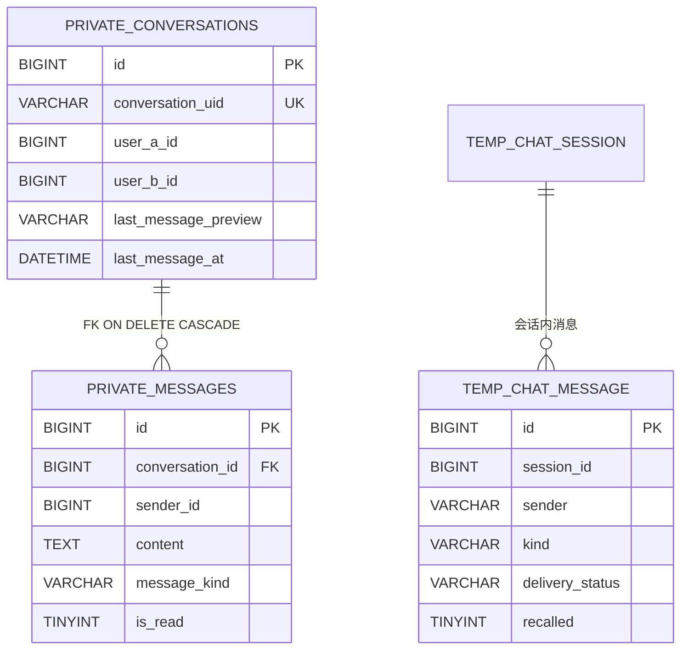
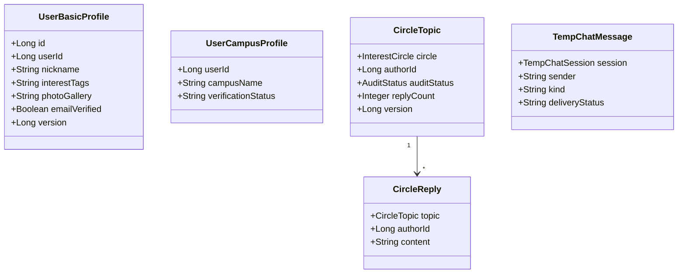

# 数据库Schema概览

<cite>
**本文引用的文件**
- [V2026.05.18.0001__create_users.sql](file://database/flyway/sql/V2026.05.18.0001__create_users.sql)
- [V2026.05.21.0003__create_posts_table.sql](file://database/flyway/sql/V2026.05.21.0003__create_posts_table.sql)
- [V2026.05.24.0002__create_private_conversations.sql](file://database/flyway/sql/V2026.05.24.0002__create_private_conversations.sql)
- [V2026.05.24.0003__create_user_sessions.sql](file://database/flyway/sql/V2026.05.24.0003__create_user_sessions.sql)
- [V2026.05.26.0002__alter_user_basic_profile_add_interest_tags.sql](file://database/flyway/sql/V2026.05.26.0002__alter_user_basic_profile_add_interest_tags.sql)
- [V2026.05.31.0001__fix_entity_ddl_mismatches.sql](file://database/flyway/sql/V2026.05.31.0001__fix_entity_ddl_mismatches.sql)
- [V2026.06.25.0004__add_user_status_and_post_audit_status.sql](file://database/flyway/sql/V2026.06.25.0004__add_user_status_and_post_audit_status.sql)
- [V2026.07.24.0004__add_user_verification_flags.sql](file://database/flyway/sql/V2026.07.24.0004__add_user_verification_flags.sql)
- [V2026.08.07.0024__seed_circle_posts_and_topics.sql](file://database/flyway/sql/V2026.08.07.0024__seed_circle_posts_and_topics.sql)
- [UserBasicProfile.java](file://apps/api/src/main/java/com/campuslove/api/entity/UserBasicProfile.java)
- [UserCampusProfile.java](file://apps/api/src/main/java/com/campuslove/api/entity/UserCampusProfile.java)
- [UserScheduleProfile.java](file://apps/api/src/main/java/com/campuslove/api/entity/UserScheduleProfile.java)
- [CircleTopic.java](file://apps/api/src/main/java/com/campuslove/api/entity/CircleTopic.java)
- [TempChatMessage.java](file://apps/api/src/main/java/com/campuslove/api/entity/TempChatMessage.java)
- [OfficialChatMessage.java](file://apps/api/src/main/java/com/campuslove/api/entity/OfficialChatMessage.java)
- [CircleTopicRepository.java](file://apps/api/src/main/java/com/campuslove/api/repository/CircleTopicRepository.java)
- [TempChatMessageRepository.java](file://apps/api/src/main/java/com/campuslove/api/repository/TempChatMessageRepository.java)
- [UserBasicProfileTest.java](file://apps/api/src/test/java/com/campuslove/api/entity/UserBasicProfileTest.java)
- [flyway.toml](file://database/flyway/flyway.toml)
</cite>

## 目录
1. [简介](#简介)
2. [项目结构](#项目结构)
3. [核心组件](#核心组件)
4. [架构总览](#架构总览)
5. [命名与类型约定](#命名与类型约定)
6. [域划分与表清单](#域划分与表清单)
7. [用户与身份域](#用户与身份域)
8. [内容与社区域](#内容与社区域)
9. [消息与通知域](#消息与通知域)
10. [匹配与推荐域](#匹配与推荐域)
11. [成长与运营域](#成长与运营域)
12. [商业化域](#商业化域)
13. [配置与后台域](#配置与后台域)
14. [键与约束的设计取向](#键与约束的设计取向)
15. [JSON 列的使用边界](#json-列的使用边界)
16. [实体与表的映射关系](#实体与表的映射关系)
17. [依赖关系分析](#依赖关系分析)
18. [性能考虑](#性能考虑)
19. [故障排查指南](#故障排查指南)
20. [结论](#结论)

## 简介
本页给出整个 schema 的鸟瞰：**203 个 `V*.sql` 迁移脚本创建了 111 张表**，
94 个 JPA 实体与 95 个仓储接口覆盖其中被应用直接访问的部分。
所有表统一 `ENGINE=InnoDB`、`CHARSET=utf8mb4`、`COLLATE=utf8mb4_0900_ai_ci`，
并且绝大多数带表级 `COMMENT`（中文），例如 `posts` 的注释是"村口帖子表"、
`private_conversations` 是"私信会话表"。

结构细节按域展开，逐表逐列的定义在子页
`核心表结构设计`（用户相关表 / 匹配相关表 / 消息相关表 / 社区相关表）；
迁移与版本管理在 `Flyway数据库迁移管理`；索引清单在 `索引设计与性能优化`。

## 项目结构
- 单一 DDL 源：`database/flyway/sql/`，无 `R__` 可重复脚本。
- 表名一律小写下划线、多数用**复数**表示集合表（`users`、`posts`、`comments`、`activities`），
  用**单数**表示"一条记录即一个对象/配置"的表（`media_asset`、`outbox_event`、`sensitive_word`、
  `whisper_message`、`match_config`、`recommend_strategy`）。
  少数历史表混用（`interest_tag` 与 `user_interest_tag`、`vip_order` 与 `vip_bills` 并存）。
- 主键统一：`id BIGINT UNSIGNED NOT NULL AUTO_INCREMENT` + `PRIMARY KEY (id)`，
  外键引用列写作 `user_id`、`author_id`、`conversation_id` 等 `BIGINT UNSIGNED`。

## 核心组件
六个基线脚本决定了骨架：

- `V2026.05.18.0001__create_users.sql`（20 行）：`users`，注释即说明"在所有其他迁移之前执行"。
- `V2026.05.21.0003__create_posts_table.sql`（17 行）：`posts`，含 `images JSON`、`tags JSON`、
  `category ENUM(...)`、`likes_count`/`comments_count` 冗余计数与三个索引。
- `V2026.05.24.0002__create_private_conversations.sql`（29 行）：一个脚本建两张表
  （`private_conversations` + `private_messages`）并声明唯一的显式外键约束
  `fk_private_messages_conversation ... ON DELETE CASCADE`。
- `V2026.05.24.0003__create_user_sessions.sql`（11 行）：`user_sessions`，令牌唯一 + 两索引。
- `V2026.05.31.0001__fix_entity_ddl_mismatches.sql`（14 行）：实体与库不一致的追平样本。
- `V2026.06.25.0004__add_user_status_and_post_audit_status.sql`（45 行）：状态列正交化。

**章节来源**
- [V2026.05.18.0001__create_users.sql:1-20](file://database/flyway/sql/V2026.05.18.0001__create_users.sql#L1-L20)
- [V2026.05.21.0003__create_posts_table.sql:1-17](file://database/flyway/sql/V2026.05.21.0003__create_posts_table.sql#L1-L17)
- [V2026.05.24.0002__create_private_conversations.sql:1-29](file://database/flyway/sql/V2026.05.24.0002__create_private_conversations.sql#L1-L29)
- [V2026.05.24.0003__create_user_sessions.sql:1-11](file://database/flyway/sql/V2026.05.24.0003__create_user_sessions.sql#L1-L11)
- [V2026.05.31.0001__fix_entity_ddl_mismatches.sql:5-14](file://database/flyway/sql/V2026.05.31.0001__fix_entity_ddl_mismatches.sql#L5-L14)

## 架构总览

```mermaid
graph TB
    subgraph "身份"
        U["users"]
        UBP["user_basic_profile"]
        UCP["user_campus_profile"]
        USP["user_schedule_profile"]
        US["user_sessions / user_device_session"]
    end
    subgraph "内容"
        P["posts"]
        CM["comments"]
        CT["circle_topics"]
        IC["interest_circles"]
        MA["media_asset"]
    end
    subgraph "互动"
        LK["likes / post_likes / comment_likes"]
        HS["heart_signals"]
        VI["visitors / profile_visitors"]
        UF["user_follows / user_block"]
    end
    subgraph "消息"
        PC["private_conversations"]
        PM["private_messages"]
        TC["temp_chat_session / temp_chat_message"]
        NT["notifications / interaction_events"]
    end
    subgraph "运营与商业化"
        CI["check_ins / daily_questions / social_progress"]
        VB["vip_bills / vip_order / user_wallet"]
        AC["activities / activity_enrollments"]
    end
    subgraph "系统"
        CFG["app_config / app_rule / app_switch"]
        OE["outbox_event"]
        AL["audit_log"]
    end
    U --> UBP
    U --> UCP
    U --> USP
    U --> US
    U --> P
    P --> CM
    IC --> CT
    U --> PC
    PC --> PM
    U --> LK
    LK --> HS
    U --> CI
    U --> VB
    U --> NT
    CFG --> AC
```


[此图为概念流程，不直接对应具体源文件，故不提供图表来源]

## 命名与类型约定
从 DDL 直接可读出的一致约定：

| 约定 | 证据 |
|---|---|
| 主键 `id BIGINT UNSIGNED AUTO_INCREMENT` | `users`(L4)、`posts`(L2)、`private_conversations`(L2) |
| 时间列 `created_at` / `updated_at`，后者 `ON UPDATE CURRENT_TIMESTAMP` | `users`(L16-L17)、`posts`(L12-L13) |
| 展示型默认值写在列上 | `nickname VARCHAR(64) NOT NULL DEFAULT '新同学'`(L6) |
| 状态用 `ENUM` 并给默认值 | `posts.status ENUM('active','deleted','hidden') DEFAULT 'active'`(L9) |
| 分类用 `ENUM` | `posts.category ENUM('all','interest','sincere','hometown','anonymous','latest') DEFAULT 'all'`(L7) |
| 列表/集合用 `JSON` 列 | `posts.images`/`posts.tags`(L5-L6)、`users.interest_tags`(L13) |
| 布尔用 `TINYINT(1)` 或 `BOOLEAN` | `private_messages.is_read TINYINT(1) DEFAULT 0`、`email_verified BOOLEAN NOT NULL DEFAULT FALSE` |
| 表与列都带中文 `COMMENT` | `posts`(L17) 表注释"村口帖子表"；列注释贯穿全表 |
| InnoDB + utf8mb4 + utf8mb4_0900_ai_ci | 三处建表结尾完全一致 |

一处值得注意的类型不一致：消息类型列在 `posts`/`private_messages` 里是不同写法——
`private_messages.message_kind VARCHAR(16) NOT NULL DEFAULT 'text'`，
而临时聊天用实体默认值表达同一语义（`TempChatMessage.kind = "text"`，L42）。
两者都不是 `ENUM`，扩展新消息类型不需要改表，但也没有数据库层的取值约束。

**章节来源**
- [V2026.05.21.0003__create_posts_table.sql:2-17](file://database/flyway/sql/V2026.05.21.0003__create_posts_table.sql#L2-L17)
- [V2026.05.18.0001__create_users.sql:4-17](file://database/flyway/sql/V2026.05.18.0001__create_users.sql#L4-L17)
- [V2026.05.24.0002__create_private_conversations.sql:18-29](file://database/flyway/sql/V2026.05.24.0002__create_private_conversations.sql#L18-L29)
- [V2026.07.24.0004__add_user_verification_flags.sql:10-12](file://database/flyway/sql/V2026.07.24.0004__add_user_verification_flags.sql#L10-L12)
- [TempChatMessage.java:42-42](file://apps/api/src/main/java/com/campuslove/api/entity/TempChatMessage.java#L42-L42)

## 域划分与表清单
111 张表按业务域归类如下（名称全部来自 `CREATE TABLE` 语句）：

- **用户与身份（18）**：`users`、`user_basic_profile`、`user_campus_profile`、`user_schedule_profile`、
  `user_sessions`、`user_device_session`、`user_online_status`、`user_follows`、`user_block`、
  `user_interest_tag`、`user_agreement_consent`、`users_phone_dup_backup`、`third_party_account`、
  `campus_certifications`、`real_name_certifications`、`love_verification_application`、`schools`、
  `user_wallet`。
- **内容与社区（22）**：`posts`、`post_categories`、`post_tags`、`post_likes`、`post_favorites`、
  `post_shares`、`post_draft`、`post_view_history`、`comments`、`comment_likes`、
  `interest_circles`、`circle_memberships`、`circle_topics`、`circle_replies`、
  `campus_topics`、`campus_topic_replies`、`interest_tag`、`visitors`、`profile_visitors`、
  `reports`、`sensitive_word`、`sensitive_word_import_task`。
- **消息与通知（20）**：`private_conversations`、`private_messages`、`temp_chat_session`、
  `temp_chat_message`、`temp_chat_contact_exchange`、`notifications`、`interaction_events`、
  `whisper_message`、`official_accounts`、`official_messages`、`official_chat_messages`、
  `chat_ai_session_context`、`chat_ai_suggestion_log`、`chat_ai_feature_flag`、
  `video_calls`、`video_call_records`、`push_preferences`、`push_summaries`、`dnd_settings`、
  `notify_config`。
- **匹配与推荐（8）**：`likes`、`pass_records`、`heart_signals`、`icebreaker_topics`、
  `recommendation_preferences`、`recommend_strategy`、`match_config`、`user_match_ticket`。
- **成长与运营（19）**：`check_ins`、`daily_questions`、`daily_answers`、`daily_benefits`、
  `make_up_quota`、`social_progress`、`task_claim`、`activities`、`activity_enrollments`、
  `activity_proposal`、`consulting_course`、`consulting_signup`、`invite_code`、`invite_reward`、
  `feedback_tickets`、`feedback_admin_reply`、`user_feedback_ticket`、`error_reports`、
  `search_queries`。
- **商业化（13）**：`vip_bills`、`vip_billing_log`、`vip_order`、`vip_red_packets`、
  `vip_red_packet_claims`、`products`、`promo_codes`、`promo_code_usages`、`shop_items`、
  `wallet_unlocks`、`wallet_transaction_log`、`payment_callback_log`、`media_asset`。
- **系统与后台（11）**：`app_config`、`app_rule`、`app_switch`、`app_login_hero_config`、
  `dicts`、`dict_items`、`menus`、`roles`、`role_menus`、`audit_log`、`outbox_event`。

七组计数相加正好是 111，即这是一次完整划分（`user_wallet` 归入用户与身份域，
商业化域只列支付与钱包流水相关表）。分组依据是表名的业务前缀与 DDL 注释，
不是外键关系——域内跨表引用（例如 `post_tags` 同时服务帖子与标签）在划分时归入主表所在域。

**章节来源**
- [V2026.05.24.0002__create_private_conversations.sql:1-2](file://database/flyway/sql/V2026.05.24.0002__create_private_conversations.sql#L1-L2)
- [V2026.05.21.0003__create_posts_table.sql:1-1](file://database/flyway/sql/V2026.05.21.0003__create_posts_table.sql#L1-L1)
- [V2026.05.18.0001__create_users.sql:3-3](file://database/flyway/sql/V2026.05.18.0001__create_users.sql#L3-L3)

## 用户与身份域
`users` 只放身份与账号级状态；资料外移到三张画像表：

- `users`：`openid`（唯一键 `uk_users_openid`）、`nickname`、`avatar_url`、`bio`、`grade_label`、
  `pronouns`、`phone`、`profile_completion`、`interest_tags JSON`、
  `following_count`/`followers_count`，追加列 `role`、`password`、`status`、`auto_renew_enabled`。
- `user_basic_profile`（实体 439 行）：昵称/简介/年级/代词/性别之外，还承载
  `height`、`educationLevel`、`relationshipStatus`、`hometownProvince/City`、`futureCity`、
  `occupation`、`incomeRange`、`mbti`、`expectedPartner`、`birthYear`，
  以及四个 JSON 字符串列（`interestTags` L59、`futurePlanTags` L100、`photoGallery` L107、
  `personalityTags` L140）与两个认证位（`emailVerified` L160、`idCardVerified` L168）。
- `user_campus_profile`（150 行）：`cityName`/`campusName`/`departmentName` +
  `verificationStatus = "draft"`(L47)。
- `user_schedule_profile`（138 行）：`preferredCampusArea` + `preferredTimeWindowJson`(L39)、
  `courseBlockJson`(L43)。
- 会话三张：`user_sessions`（令牌 + 过期）、`user_device_session`（设备维度）、
  `user_online_status`（在线态）。

设计取向很清楚：**账号列少而稳定，资料列多而易变**，
所以改资料不需要动 `users`，而 `users` 上的每一列（`role`/`status`/`password`）都是权限语义。

**章节来源**
- [V2026.05.18.0001__create_users.sql:3-19](file://database/flyway/sql/V2026.05.18.0001__create_users.sql#L3-L19)
- [UserBasicProfile.java:24-194](file://apps/api/src/main/java/com/campuslove/api/entity/UserBasicProfile.java#L24-L194)
- [UserCampusProfile.java:20-73](file://apps/api/src/main/java/com/campuslove/api/entity/UserCampusProfile.java#L20-L73)
- [UserScheduleProfile.java:20-69](file://apps/api/src/main/java/com/campuslove/api/entity/UserScheduleProfile.java#L20-L69)
- [V2026.07.24.0004__add_user_verification_flags.sql:10-12](file://database/flyway/sql/V2026.07.24.0004__add_user_verification_flags.sql#L10-L12)

## 内容与社区域
`posts` 是内容根表：`author_id`、`content TEXT NOT NULL`、`images JSON`、`tags JSON`、
`category ENUM('all','interest','sincere','hometown','anonymous','latest')`、
`likes_count`/`comments_count` 冗余计数、`status ENUM('active','deleted','hidden')`，
索引 `idx_posts_author`、`idx_posts_category`、`idx_posts_created_at`(L13-L16)。

后来追加的 `audit_status`（`pending/approved/rejected`，默认 `approved`）与 `status` 并存——
脚本注释解释了原因：`status` 的语义是"软删/隐藏"，不该承载审核状态
（`V2026.06.25.0004__add_user_status_and_post_audit_status.sql` L8-L16）。

围绕帖子的关系表成套：`post_likes`、`post_favorites`、`post_shares`、`post_tags`、
`post_categories`、`post_draft`、`post_view_history`、`comments`、`comment_likes`、
`visitors`、`profile_visitors`。圈子侧独立一层：`interest_circles` → `circle_topics` →
`circle_replies`，另有 `circle_memberships`；校园话题是另一套平行结构
`campus_topics` → `campus_topic_replies`。

`CircleTopic`（222 行）把审核三元组落在同一张表上：
`auditStatus = AuditStatus.approved`(L74)、`auditRemark`(L78)、`auditorId`(L82)、`auditedAt`(L86)，
加 `isPinned`(L69) 与 `replyCount`(L65)，枚举 `AuditStatus` 在 L34 声明。

**章节来源**
- [V2026.05.21.0003__create_posts_table.sql:1-17](file://database/flyway/sql/V2026.05.21.0003__create_posts_table.sql#L1-L17)
- [V2026.06.25.0004__add_user_status_and_post_audit_status.sql:2-18](file://database/flyway/sql/V2026.06.25.0004__add_user_status_and_post_audit_status.sql#L2-L18)
- [CircleTopic.java:24-105](file://apps/api/src/main/java/com/campuslove/api/entity/CircleTopic.java#L24-L105)

## 消息与通知域
这是唯一在基线脚本里写下显式外键的域：

```sql
CONSTRAINT fk_private_messages_conversation FOREIGN KEY (conversation_id)
    REFERENCES private_conversations(id) ON DELETE CASCADE
```

同一脚本还定义了会话的唯一性——用**函数式唯一索引**表达"两人一条会话"：

```sql
UNIQUE KEY uk_private_conversations_users ((LEAST(user_a_id, user_b_id)), (GREATEST(user_a_id, user_b_id)))
```

这样 (A,B) 与 (B,A) 无法各自建一条会话，且不需要应用层先查后插。
`private_messages` 的读路径由复合索引 `idx_private_messages_conversation (conversation_id, created_at)`
支撑，正好对应"按会话取消息并按时间排"。



**图表来源**
- [V2026.05.24.0002__create_private_conversations.sql:1-29](file://database/flyway/sql/V2026.05.24.0002__create_private_conversations.sql#L1-L29)
- [TempChatMessage.java:22-81](file://apps/api/src/main/java/com/campuslove/api/entity/TempChatMessage.java#L22-L81)

其余消息结构各自成套：
- 临时匿名聊天：`temp_chat_session` → `temp_chat_message`（实体 174 行：
  `kind`/`body`/`durationSeconds`/`recalled`/`deliveryStatus`/`quoteSnapshot`/`version`）+
  `temp_chat_contact_exchange`。
- 官方账号：`official_accounts`、`official_messages`、`official_chat_messages`
  （实体 98 行，含内部枚举 `Direction`(L28) 与 `direction = Direction.user.name()`(L46)，
  即消息方向用字符串列 + 枚举名表达）。
- 通知与事件：`notifications`、`interaction_events`、`notify_config`、
  `push_preferences`、`push_summaries`、`dnd_settings`（免打扰）。
- 通话与语音：`video_calls`、`video_call_records`。
- AI 辅助：`chat_ai_session_context`、`chat_ai_suggestion_log`、`chat_ai_feature_flag`
  （注意 `chat_ai_feature_flag` 是表级开关，与客户端 `feature-flags.ts` 是两个层面的开关）。

**章节来源**
- [V2026.05.24.0002__create_private_conversations.sql:1-29](file://database/flyway/sql/V2026.05.24.0002__create_private_conversations.sql#L1-L29)
- [TempChatMessage.java:22-81](file://apps/api/src/main/java/com/campuslove/api/entity/TempChatMessage.java#L22-L81)
- [OfficialChatMessage.java:18-55](file://apps/api/src/main/java/com/campuslove/api/entity/OfficialChatMessage.java#L18-L55)

## 匹配与推荐域
- 决策记录：`likes`（喜欢）、`pass_records`（左滑）、`heart_signals`（心动信号）、
  `user_match_ticket`（匹配凭证）。
- 算法输入：`recommendation_preferences`（用户偏好）、`interest_tag` / `user_interest_tag`（标签字典与关系）、
  `user_schedule_profile`（时间窗）、`user_campus_profile`（校区）。
- 算法配置：`match_config` 与 `recommend_strategy` 两张配置表由
  `V2026.06.25.0005__create_admin_configs.sql` 建表并插入初始行，
  因此冷启动即可读到策略，不需要额外初始化。
- 破冰内容：`icebreaker_topics`、`daily_questions`/`daily_answers` 也参与匹配后的对话引导。

域内没有指向 `users` 的显式外键约束（只有 `private_messages` 用了 FK），
关系完整性由应用层与索引保证——这是本 schema 的整体风格。

**章节来源**
- [V2026.05.24.0002__create_private_conversations.sql:26-26](file://database/flyway/sql/V2026.05.24.0002__create_private_conversations.sql#L26-L26)
- [V2026.05.18.0001__create_users.sql:13-15](file://database/flyway/sql/V2026.05.18.0001__create_users.sql#L13-L15)

## 成长与运营域
- 连续行为：`check_ins`（签到）、`daily_benefits`（每日权益）、`make_up_quota`（补签额度）、
  `social_progress`（社交进度）、`task_claim`（任务领取）。
- 内容运营：`daily_questions` / `daily_answers`、`activities` / `activity_enrollments` /
  `activity_proposal`、`consulting_course` / `consulting_signup`。
- 增长：`invite_code` / `invite_reward`、`search_queries`。
- 反馈闭环：`feedback_tickets` + `feedback_admin_reply`，另有近义的
  `user_feedback_ticket` 与 `error_reports`。

这里存在**同域多表命名不统一**的情况：`feedback_tickets` 与 `user_feedback_ticket`
一个是复数集合表、一个是单数对象表，`daily_questions`（复）与 `match_config`（单）混用。
读写时不能靠命名猜表，必须以实体 `@Table(name = "...")` 或迁移 DDL 为准。

**章节来源**
- [V2026.08.07.0024__seed_circle_posts_and_topics.sql:201-228](file://database/flyway/sql/V2026.08.07.0024__seed_circle_posts_and_topics.sql#L201-L228)

## 商业化域
账务链路表齐全：`vip_bills`、`vip_billing_log`、`vip_order`、`payment_callback_log`、
`user_wallet`、`wallet_unlocks`、`wallet_transaction_log`、
`vip_red_packets` / `vip_red_packet_claims`、`products` / `shop_items`、
`promo_codes` / `promo_code_usages`。

三点值得注意：其一，支付回调单独落 `payment_callback_log`，说明回调处理需要留痕与重放；
其二，钱包解锁与交易流水分表（`wallet_unlocks` 记"解锁了什么"、
`wallet_transaction_log` 记"钱怎么动"），余额与用途可交叉核对；
其三，`media_asset` 是素材总表，配合 `V2026.08.10.0030__app_asset_url_unique_index.sql`
的 URL 唯一索引使用。

**章节来源**
- [V2026.05.26.0002__alter_user_basic_profile_add_interest_tags.sql:9-11](file://database/flyway/sql/V2026.05.26.0002__alter_user_basic_profile_add_interest_tags.sql#L9-L11)

## 配置与后台域
- 运行配置：`app_config`、`app_rule`、`app_switch`、`app_login_hero_config`、`notify_config`。
- 权限模型：`roles`、`menus`、`role_menus`（角色—菜单关联），
  与 `users.role` 的粗粒度角色判断配合使用。
- 字典：`dicts` + `dict_items`。
- 审计与投递：`audit_log`（后台操作审计）、`outbox_event`（**事务性 outbox**，
  把"落库"与"发事件"解耦，保证事件不丢）。

`outbox_event` 是这套 schema 里唯一的模式化基础设施表，
它的存在说明事件投递不依赖应用直发 MQ，而是先写表再投递。

**章节来源**
- [V2026.07.24.0004__add_user_verification_flags.sql:4-7](file://database/flyway/sql/V2026.07.24.0004__add_user_verification_flags.sql#L4-L7)

## 键与约束的设计取向
| 手段 | 实例 | 保证的性质 |
|---|---|---|
| 业务唯一键 | `uk_users_openid`(L19)、`uk_user_sessions_token`(L8)、`uk_private_conversations_uid`(L15) | 身份/令牌/会话不可重复 |
| 函数式唯一键 | `uk_private_conversations_users ((LEAST(...)),(GREATEST(...)))`(L16) | 无向配对唯一 |
| 显式外键 | `fk_private_messages_conversation ... ON DELETE CASCADE`(L26) | 会话删除时消息级联清理 |
| 冗余计数列 | `posts.likes_count`/`comments_count`(L8)、`users.following_count`(L14) | 读侧免聚合，写侧需同步 |
| 状态枚举 | `posts.status`、`posts.category`、`users.role`/`status` | 取值受库约束 |
| 乐观锁 | `CircleTopic.version`(L105)、`TempChatMessage.version`(L81)、`UserBasicProfile.version`(L194) | 并发更新不覆盖 |

一个不对称之处：只有 `private_messages` 使用了数据库外键。其余关系（点赞、评论、圈子）
没有 FK 约束，跨表完整性由服务层负责——好处是写入路径不被约束检查拖慢、
迁移改动不容易被 FK 阻塞，代价是清理孤儿数据需要专门的任务。

**章节来源**
- [V2026.05.24.0002__create_private_conversations.sql:15-26](file://database/flyway/sql/V2026.05.24.0002__create_private_conversations.sql#L15-L26)
- [V2026.05.18.0001__create_users.sql:14-19](file://database/flyway/sql/V2026.05.18.0001__create_users.sql#L14-L19)
- [V2026.05.24.0003__create_user_sessions.sql:8-9](file://database/flyway/sql/V2026.05.24.0003__create_user_sessions.sql#L8-L9)
- [CircleTopic.java:105-105](file://apps/api/src/main/java/com/campuslove/api/entity/CircleTopic.java#L105-L105)

## JSON 列的使用边界
`JSON` 列出现在真正需要"多值"的地方，而不是当作文本袋：

- `users.interest_tags JSON DEFAULT NULL`(L13) 与
  `user_basic_profile.interest_tags JSON DEFAULT NULL COMMENT '兴趣标签列表（JSON数组格式，如 ["摄影","篮球","阅读"]）'`
  （L9-L11，用 `AFTER pronouns` 固定列位）——同一语义在两处存在，读取口径需统一。
- `posts.images JSON`(L5) 存图片 URL 数组、`posts.tags JSON`(L6) 存话题标签数组。
- 与之相对，实体侧多用**字符串**存 JSON（`UserBasicProfile.interestTags = "[]"` L59、
  `photoGallery = "[]"` L107、`UserScheduleProfile.preferredTimeWindowJson = "[]"` L39），
  说明部分列在库里虽声明为 `JSON`，应用层仍以字符串读写。

边界结论：`JSON` 列不参与二级索引过滤（无函数索引/生成列），
所以按标签检索必须在应用层解析或由独立关系表承担（`post_tags`、`user_interest_tag` 就是为此存在）。
把新筛选维度塞进 JSON 列是性能陷阱，正确做法是加关系表。

**章节来源**
- [V2026.05.18.0001__create_users.sql:13-13](file://database/flyway/sql/V2026.05.18.0001__create_users.sql#L13-L13)
- [V2026.05.26.0002__alter_user_basic_profile_add_interest_tags.sql:1-11](file://database/flyway/sql/V2026.05.26.0002__alter_user_basic_profile_add_interest_tags.sql#L1-L11)
- [V2026.05.21.0003__create_posts_table.sql:5-6](file://database/flyway/sql/V2026.05.21.0003__create_posts_table.sql#L5-L6)
- [UserBasicProfile.java:59-107](file://apps/api/src/main/java/com/campuslove/api/entity/UserBasicProfile.java#L59-L107)

## 实体与表的映射关系
- 实体一律显式指定表名：`@Table(name = "user_basic_profile")`（L26）、
  `user_campus_profile`(L22)、`user_schedule_profile`(L22)、`circle_topics`(L26)、
  `circle_replies`(L24)、`temp_chat_message`(L24)。
- 关系用对象引用而不是外键列：`CircleTopic.circle`(L45) 指向 `InterestCircle`、
  `CircleReply.topic`(L34) 指向 `CircleTopic`、`TempChatMessage.session`(L34) 指向 `TempChatSession`。
- 94 个实体对 95 个仓储：`CircleTopicRepository`（85 行，L15）、
  `TempChatMessageRepository`（54 行，L14）等。仓储数量略多于实体，
  说明存在同表多仓储（按访问场景拆分）。
- 实体自身有测试：`UserBasicProfileTest`（250 行，L27 持有 profile 字段）。
- 落差修补是一类正式脚本：`V2026.05.31.0001__fix_entity_ddl_mismatches.sql`
  一次处理"补列 / 加引用列 / 改枚举 / 改默认值"四种偏差(L5-L14)。



**图表来源**
- [UserBasicProfile.java:24-194](file://apps/api/src/main/java/com/campuslove/api/entity/UserBasicProfile.java#L24-L194)
- [UserCampusProfile.java:20-73](file://apps/api/src/main/java/com/campuslove/api/entity/UserCampusProfile.java#L20-L73)
- [CircleTopic.java:24-105](file://apps/api/src/main/java/com/campuslove/api/entity/CircleTopic.java#L24-L105)
- [CircleReply.java:22-61](file://apps/api/src/main/java/com/campuslove/api/entity/CircleReply.java#L22-L61)
- [TempChatMessage.java:22-81](file://apps/api/src/main/java/com/campuslove/api/entity/TempChatMessage.java#L22-L81)

**章节来源**
- [CircleTopic.java:24-45](file://apps/api/src/main/java/com/campuslove/api/entity/CircleTopic.java#L24-L45)
- [CircleTopicRepository.java:15-85](file://apps/api/src/main/java/com/campuslove/api/repository/CircleTopicRepository.java#L15-L85)
- [TempChatMessageRepository.java:14-54](file://apps/api/src/main/java/com/campuslove/api/repository/TempChatMessageRepository.java#L14-L54)
- [UserBasicProfileTest.java:25-27](file://apps/api/src/test/java/com/campuslove/api/entity/UserBasicProfileTest.java#L25-L27)
- [V2026.05.31.0001__fix_entity_ddl_mismatches.sql:5-14](file://database/flyway/sql/V2026.05.31.0001__fix_entity_ddl_mismatches.sql#L5-L14)

## 依赖关系分析
- **根表是 `users`**：所有 `user_id`/`author_id`/`sender_id` 回指它；
  资料域三张画像表是 1:1 扩展，会话域三张是 1:N。
- **内容域是二级根**：`posts` → `comments`/`post_likes`/`post_shares`/`post_favorites`；
  `interest_circles` → `circle_topics` → `circle_replies` 自成一条链。
- **消息域自带级联**：`private_conversations` → `private_messages`（FK CASCADE），
  删除会话即删消息；临时聊天同构。
- **配置表被算法读**：`match_config`、`recommend_strategy` 由匹配/推荐链路读取，
  与代码里的 `MatchConfig` 默认值构成"库内配置 + 代码默认"两层（见
  `API接口文档/匹配与推荐API`）。
- **outbox 与审计横向支撑**：`outbox_event` 服务事件投递，`audit_log` 服务后台操作留痕。

**章节来源**
- [V2026.05.24.0002__create_private_conversations.sql:22-26](file://database/flyway/sql/V2026.05.24.0002__create_private_conversations.sql#L22-L26)
- [V2026.05.21.0003__create_posts_table.sql:2-9](file://database/flyway/sql/V2026.05.21.0003__create_posts_table.sql#L2-L9)

## 性能考虑
- **基线脚本就带了读路径索引**：`posts` 建表时即有
  `idx_posts_author`、`idx_posts_category`、`idx_posts_created_at`(L14-L16)，
  `private_messages` 直接建复合索引 `(conversation_id, created_at)`(L25)——
  这两处是"按作者/分类/时间列表"和"按会话拉消息"的最短路径。
- **后期补齐集中在索引脚本**：453 行的 `V2026.07.28.0005__add_indexes.sql`
  与 113 行的 `V2026.07.25.0014__add_performance_indexes.sql` 说明真实慢查询是在上线后被发现的；
  新表设计时应直接从列表接口倒推索引。
- **ENUM 列便于过滤但改动有风险**：改 `posts.category` 会连带影响依赖它的索引，
  历史上就产生过 `V2026.07.28.0007__rebuild_indexes_after_enum_migration.sql`。
- **冗余计数列的读收益**：`likes_count`/`comments_count`/`following_count`
  避免了列表页的聚合子查询，代价是写侧同步与偶尔的校正任务。

**章节来源**
- [V2026.05.21.0003__create_posts_table.sql:13-16](file://database/flyway/sql/V2026.05.21.0003__create_posts_table.sql#L13-L16)
- [V2026.05.24.0002__create_private_conversations.sql:24-25](file://database/flyway/sql/V2026.05.24.0002__create_private_conversations.sql#L24-L25)
- [V2026.05.24.0003__create_user_sessions.sql:9-10](file://database/flyway/sql/V2026.05.24.0003__create_user_sessions.sql#L9-L10)

## 故障排查指南
- **按表名找不到实体**：命名不统一（`feedback_tickets` 与 `user_feedback_ticket` 并存），
  用 `@Table(name = "...")` 反查实体，而不是靠单复数猜。
- **列存在但实体报错（或反之）**：这类偏差历史上由
  `V2026.05.31.0001__fix_entity_ddl_mismatches.sql` 处理；新出现问题应追加同类型脚本，
  不要改已发布脚本（会触发 checksum 失败）。
- **同一对用户出现两条会话**：检查库是否支持函数式唯一索引
  （`uk_private_conversations_users` 用 `LEAST`/`GREATEST`）；
  早期 MySQL 版本不支持表达式唯一键时该约束会静默缺失。
- **标签筛选慢**：`interest_tags`、`posts.tags` 是 JSON 列，没有二级索引可用，
  应改走 `post_tags` / `user_interest_tag` 关系表。
- **删会话后消息残留**：只有 `private_messages` 有 `ON DELETE CASCADE`；
  其余关联表需应用层显式清理，级联删除不适用于它们。
- **统计数字与文档不一致**：表数、索引数会随迁移增长；
  重新枚举时务必用 ASCII 标识符过滤，否则中文注释里的片段会被计入（本项目实测 111 张表）。

**章节来源**
- [V2026.05.31.0001__fix_entity_ddl_mismatches.sql:1-14](file://database/flyway/sql/V2026.05.31.0001__fix_entity_ddl_mismatches.sql#L1-L14)
- [V2026.05.24.0002__create_private_conversations.sql:15-26](file://database/flyway/sql/V2026.05.24.0002__create_private_conversations.sql#L15-L26)
- [flyway.toml:1-9](file://database/flyway/flyway.toml#L1-L9)

## 结论
这套 schema 的骨架是"**一张身份根表 + 六个业务域 + 两张系统支撑表**"：
`users` 与三张画像表承担身份与资料，内容域围绕 `posts`/`interest_circles`，
消息域围绕 `private_conversations`/`temp_chat_session`，
匹配域记录决策（`likes`/`pass_records`/`heart_signals`），
成长与运营域覆盖签到、每日一问、活动与反馈，
商业化域把账单、钱包、订单、回调分表留痕，
`outbox_event` 与 `audit_log` 横向支撑事件投递与审计。

三条全局约定最值得记住：**统一 InnoDB + utf8mb4 + utf8mb4_0900_ai_ci**、
**列与表都写中文 COMMENT**、**状态用 ENUM 且新增状态靠追加脚本而非改历史**。
两条已知代价也要记住：外键只在私信链路使用，其余完整性落在应用层；
JSON 列方便但不能用于过滤，检索维度必须另有关系表。
