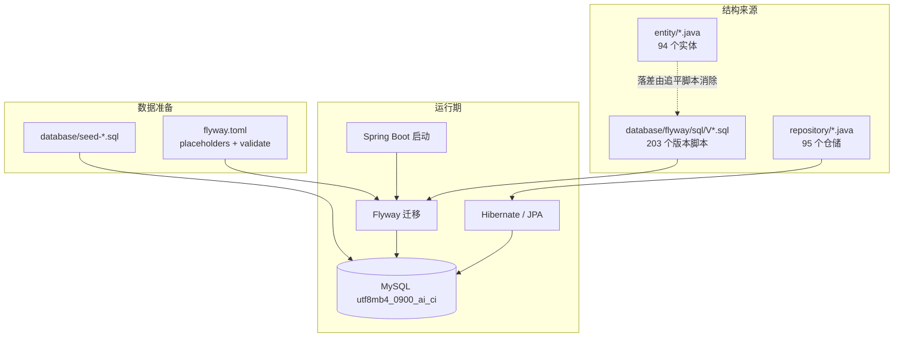
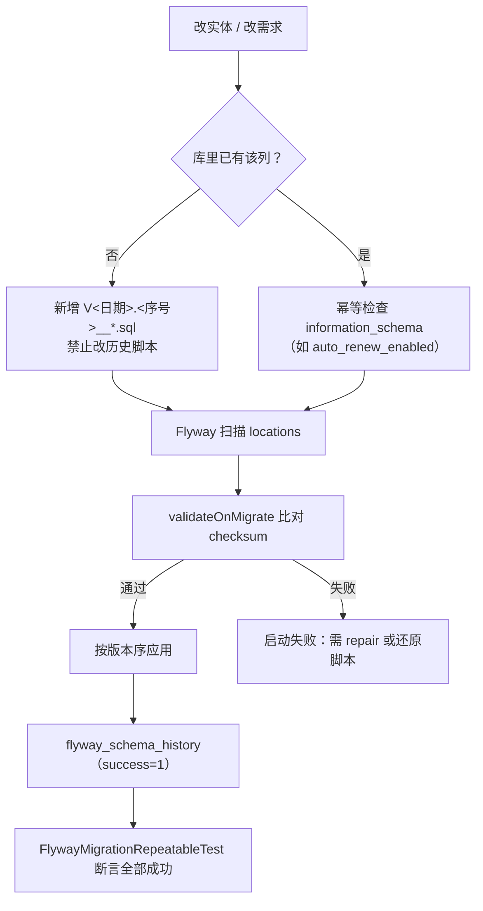
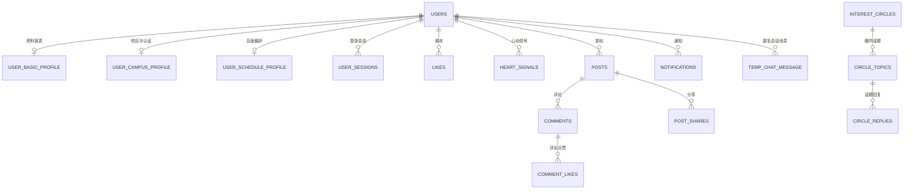
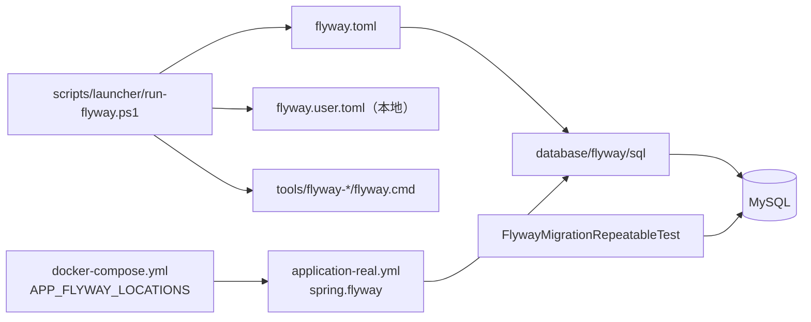

# 数据库设计与迁移

<cite>
**本文引用的文件**
- [flyway.toml](file://database/flyway/flyway.toml)
- [README.md](file://database/flyway/README.md)
- [run-flyway.cmd](file://scripts/launcher/run-flyway.cmd)
- [run-flyway.ps1](file://scripts/launcher/run-flyway.ps1)
- [application-real.yml](file://apps/api/src/main/resources/application-real.yml)
- [docker-compose.yml](file://docker-compose.yml)
- [crontab](file://docker/backup/crontab)
- [backup-mysql.sh](file://scripts/backup-mysql.sh)
- [FlywayMigrationRepeatableTest.java](file://apps/api/src/test/java/com/campuslove/api/database/FlywayMigrationRepeatableTest.java)
- [V2026.05.18.0001__create_users.sql](file://database/flyway/sql/V2026.05.18.0001__create_users.sql)
- [V2026.05.18.2200__phase0_phase1_client_foundation.sql](file://database/flyway/sql/V2026.05.18.2200__phase0_phase1_client_foundation.sql)
- [V2026.05.21.0006__alter_users_add_profile_completion.sql](file://database/flyway/sql/V2026.05.21.0006__alter_users_add_profile_completion.sql)
- [V2026.05.24.0003__create_user_sessions.sql](file://database/flyway/sql/V2026.05.24.0003__create_user_sessions.sql)
- [V2026.05.26.0002__alter_user_basic_profile_add_interest_tags.sql](file://database/flyway/sql/V2026.05.26.0002__alter_user_basic_profile_add_interest_tags.sql)
- [V2026.05.31.0001__fix_entity_ddl_mismatches.sql](file://database/flyway/sql/V2026.05.31.0001__fix_entity_ddl_mismatches.sql)
- [V2026.06.25.0001__add_user_role_and_init_admin.sql](file://database/flyway/sql/V2026.06.25.0001__add_user_role_and_init_admin.sql)
- [V2026.06.25.0002__migrate_admin_password_to_bcrypt.sql](file://database/flyway/sql/V2026.06.25.0002__migrate_admin_password_to_bcrypt.sql)
- [V2026.06.25.0004__add_user_status_and_post_audit_status.sql](file://database/flyway/sql/V2026.06.25.0004__add_user_status_and_post_audit_status.sql)
- [V2026.06.25.0005__create_admin_configs.sql](file://database/flyway/sql/V2026.06.25.0005__create_admin_configs.sql)
- [V2026.06.25.0008__extend_user_password_to_all_users.sql](file://database/flyway/sql/V2026.06.25.0008__extend_user_password_to_all_users.sql)
- [V2026.07.24.0004__add_user_verification_flags.sql](file://database/flyway/sql/V2026.07.24.0004__add_user_verification_flags.sql)
- [V2026.07.25.0004__add_auto_renew_to_users.sql](file://database/flyway/sql/V2026.07.25.0004__add_auto_renew_to_users.sql)
- [V2026.07.25.0014__add_performance_indexes.sql](file://database/flyway/sql/V2026.07.25.0014__add_performance_indexes.sql)
- [V2026.07.25.0017__add_remaining_missing_indexes.sql](file://database/flyway/sql/V2026.07.25.0017__add_remaining_missing_indexes.sql)
- [V2026.07.26.0001__add_entity_index_annotations.sql](file://database/flyway/sql/V2026.07.26.0001__add_entity_index_annotations.sql)
- [V2026.07.28.0005__add_indexes.sql](file://database/flyway/sql/V2026.07.28.0005__add_indexes.sql)
- [V2026.07.28.0007__rebuild_indexes_after_enum_migration.sql](file://database/flyway/sql/V2026.07.28.0007__rebuild_indexes_after_enum_migration.sql)
- [V2026.08.10.0030__app_asset_url_unique_index.sql](file://database/flyway/sql/V2026.08.10.0030__app_asset_url_unique_index.sql)
- [seed-demo-data.sql](file://database/seed-demo-data.sql)
- [seed-post-interactions.sql](file://database/seed-post-interactions.sql)
- [UserBasicProfile.java](file://apps/api/src/main/java/com/campuslove/api/entity/UserBasicProfile.java)
- [UserCampusProfile.java](file://apps/api/src/main/java/com/campuslove/api/entity/UserCampusProfile.java)
- [UserScheduleProfile.java](file://apps/api/src/main/java/com/campuslove/api/entity/UserScheduleProfile.java)
- [CircleTopic.java](file://apps/api/src/main/java/com/campuslove/api/entity/CircleTopic.java)
- [CircleReply.java](file://apps/api/src/main/java/com/campuslove/api/entity/CircleReply.java)
- [TempChatMessage.java](file://apps/api/src/main/java/com/campuslove/api/entity/TempChatMessage.java)
</cite>

## 目录
1. [简介](#简介)
2. [项目结构](#项目结构)
3. [核心组件](#核心组件)
4. [架构总览](#架构总览)
5. [子页面导航与边界](#子页面导航与边界)
6. [数据域划分与表清单](#数据域划分与表清单)
7. [核心实体关系模型](#核心实体关系模型)
8. [版本管理与回滚策略](#版本管理与回滚策略)
9. [种子数据与演示数据](#种子数据与演示数据)
10. [索引设计与查询优化](#索引设计与查询优化)
11. [数据一致性与事务](#数据一致性与事务)
12. [数据访问模式与 ORM 映射](#数据访问模式与-orm-映射)
13. [备份恢复与归档](#备份恢复与归档)
14. [统计口径](#统计口径)
15. [依赖关系分析](#依赖关系分析)
16. [性能考虑](#性能考虑)
17. [故障排查指南](#故障排查指南)
18. [结论](#结论)

## 简介
本页是数据库域的总览，负责三件事：给出 schema 的整体形状（域、表、关系）、
说明结构演进如何被 Flyway 管住（版本、校验、回滚边界）、并把细节路由到子页面。

一句话概括本项目的数据层：**MySQL + Flyway 版本化迁移 + Spring Data JPA**，
迁移脚本是唯一真相源，实体类与库结构靠"追平脚本"保持一致，演示数据用独立 SQL 注入并受占位符门控。

## 项目结构
- `database/flyway/sql/`：迁移脚本目录，203 个 `V*.sql`，命名 `V<yyyy.MM.dd.HHmm>__<slug>.sql`；
  目录里另有 `README.md` 与 `.gitignore`。当前**没有** `R__` 可重复脚本。
- `database/flyway/flyway.toml`：独立 CLI 的 Flyway 配置（39 行），含 `[flyway.placeholders]`。
- `database/flyway/flyway.user.toml.example`：JDBC 连接模板（真实连接不入库）。
- `database/*.sql`：10 个非迁移脚本，全部服务于初始化与演示数据
  （`init-mysql.sql`、`seed-demo-data.sql`、`seed-post-interactions.sql`、`seed-test-users.sql`、
  `seed-match-users-full.sql`、`seed-media-assets.sql`、`seed-refresh-chat-demo-times.sql`、
  `seed-walkthrough-daily-question.sql`、`complete-guest-account.sql`、
  `round5-backfill-guest-age-gender.sql`）。
- `apps/api/src/main/java/com/campuslove/api/entity/`：94 个 JPA 实体。
- `apps/api/src/main/java/com/campuslove/api/repository/`：95 个 Spring Data 仓储接口。
- `scripts/launcher/run-flyway.cmd` / `run-flyway.ps1`：CLI 入口与执行环境拼装。

**图表来源**
- [flyway.toml:1-9](file://database/flyway/flyway.toml#L1-L9)
- [V2026.05.18.0001__create_users.sql:20-20](file://database/flyway/sql/V2026.05.18.0001__create_users.sql#L20-L20)
- [UserBasicProfile.java:24-27](file://apps/api/src/main/java/com/campuslove/api/entity/UserBasicProfile.java#L24-L27)

## 核心组件
- **迁移链**：`V2026.05.18.0001__create_users.sql`（20 行）是第一条，注释即写明
  "在所有其他迁移之前执行，提供用户基础数据表"；随后
  `V2026.05.18.2200__phase0_phase1_client_foundation.sql`（94 行）以 7 段
  `CREATE ... IF` 建出客户端底座所需表。
- **追平类脚本**：`V2026.05.31.0001__fix_entity_ddl_mismatches.sql`（14 行）补列与改枚举；
  `V2026.07.26.0001__add_entity_index_annotations.sql`（77 行）补齐实体声明但库里缺失的索引。
- **配置与权限类**：`V2026.06.25.0005__create_admin_configs.sql`（136 行）建 5 张配置表并播种；
  `V2026.06.25.0001`（21 行）加 `role`；`V2026.06.25.0002`（37 行）加 BCrypt 口令列；
  `V2026.06.25.0004`（45 行）加 `users.status` 与 `posts.audit_status`。
- **索引类**：`V2026.07.25.0014__add_performance_indexes.sql`（113 行，18 组组合索引）、
  `V2026.07.28.0005__add_indexes.sql`（453 行）、
  `V2026.07.25.0017__add_remaining_missing_indexes.sql`（52 行）、
  `V2026.07.28.0007__rebuild_indexes_after_enum_migration.sql`（93 行）。
- **可重入校验**：`FlywayMigrationRepeatableTest`（118 行）断言
  `flyway_schema_history` 中所有记录 `success = 1`。

**章节来源**
- [V2026.05.18.0001__create_users.sql:1-20](file://database/flyway/sql/V2026.05.18.0001__create_users.sql#L1-L20)
- [V2026.05.18.2200__phase0_phase1_client_foundation.sql:1-94](file://database/flyway/sql/V2026.05.18.2200__phase0_phase1_client_foundation.sql#L1-L94)
- [V2026.05.31.0001__fix_entity_ddl_mismatches.sql:5-14](file://database/flyway/sql/V2026.05.31.0001__fix_entity_ddl_mismatches.sql#L5-L14)
- [V2026.06.25.0005__create_admin_configs.sql:22-122](file://database/flyway/sql/V2026.06.25.0005__create_admin_configs.sql#L22-L122)
- [V2026.07.26.0001__add_entity_index_annotations.sql:35-65](file://database/flyway/sql/V2026.07.26.0001__add_entity_index_annotations.sql#L35-L65)
- [FlywayMigrationRepeatableTest.java:16-58](file://apps/api/src/test/java/com/campuslove/api/database/FlywayMigrationRepeatableTest.java#L16-L58)

## 架构总览

[此图为概念流程，不直接对应具体源文件，故不提供图表来源]

## 子页面导航与边界
本页不重复子页细节，只划定边界：

- **数据库Schema概览**：整体 schema 视图与命名约定。
- **核心表结构设计**（含四个子页：用户相关表 / 匹配相关表 / 消息相关表 / 社区相关表）：
  逐表逐列的结构定义。本页只在"核心实体关系模型"给出跨域关系。
- **Flyway数据库迁移管理**：迁移命名、配置源分叉、校验与修复、CLI 入口、CI 现状。
- **种子数据和测试数据**：`database/seed-*.sql` 的注入方式与幂等策略。
- **索引设计与性能优化**：索引清单与慢查询侧的优化。

与相邻文档的分工：`后端API服务/数据访问层` 讲 JPA/Repository/事务；
`系统架构设计/后端架构设计/数据访问层` 讲分层位置；`基础设施与DevOps` 讲 MySQL 容器编排。

**章节来源**
- [README.md:1-21](file://database/flyway/README.md#L1-L21)

## 数据域划分与表清单
迁移脚本共创建 111 张不同的表，可按业务域归组（名称均取自 DDL）：

- 用户与身份：`users`、`user_sessions`、`user_basic_profile`、`user_campus_profile`、
  `user_schedule_profile`、`campus_certifications`、`third_party_account`（用户相关表子页）。
- 匹配与心动：`likes`、`heart_signals`、`match_config`、`icebreaker_topics`、
  `recommendation_preferences`、`recommend_strategy`。
- 消息与会话：`notifications`、`interaction_events`、`private_conversations`、
  `temp_chat_*`、`chat_ai_session_context`、`chat_ai_suggestion_log`、
  `chat_ai_feature_flag`（消息相关表子页）。
- 社区与内容：`posts`、`comments`、`comment_likes`、`post_shares`、`visitors`、
  `interest_circles`、`circle_topics`、`circle_replies`、`circle_memberships`、
  `campus_topics`、`campus_topic_replies`、`interest_tag`、`media_asset`（社区相关表子页）。
- 成长与运营：`check_ins`、`daily_questions`、`daily_answers`、`daily_benefits`、
  `make_up_quota`、`activities`、`activity_enrollments`、`dnd_settings`、
  `social_progress`、`feedback_tickets`、`feedback_admin_reply`、`error_reports`。
- 配置与后台：`app_config`、`app_rule`、`app_switch`、`app_login_hero_config`、
  `notify_config`、`dicts`、`dict_items`、`menus`、`audit_log`、`official_accounts`、
  `official_chat_messages`。

一条横向约定：业务表普遍带 `created_at`/`updated_at`，多张画像与内容表带 `version` 乐观锁列
（例如 `UserBasicProfile` L194、`UserCampusProfile` L73、`UserScheduleProfile` L69、
`CircleTopic` L105、`TempChatMessage` L81）。

**章节来源**
- [V2026.05.24.0003__create_user_sessions.sql:1-11](file://database/flyway/sql/V2026.05.24.0003__create_user_sessions.sql#L1-L11)
- [UserBasicProfile.java:175-194](file://apps/api/src/main/java/com/campuslove/api/entity/UserBasicProfile.java#L175-L194)
- [UserCampusProfile.java:54-73](file://apps/api/src/main/java/com/campuslove/api/entity/UserCampusProfile.java#L54-L73)
- [UserScheduleProfile.java:50-69](file://apps/api/src/main/java/com/campuslove/api/entity/UserScheduleProfile.java#L50-L69)

## 核心实体关系模型
跨域主链是"用户 → 内容 → 互动 → 消息"，用户是所有外键的根：

[此图为概念流程，不直接对应具体源文件，故不提供图表来源]

关系落点可以从实体声明读出：`CircleTopic` 用 `@Table(name = "circle_topics")`(L26) 并把
`circle`(L45) 关联到 `InterestCircle`、审核三元组 `auditStatus`(L74)/`auditorId`(L82)/`auditedAt`(L86)；
`CircleReply` 用 `@Table(name = "circle_replies")`(L24) 并持有 `topic`(L34)；
`TempChatMessage` 用 `@Table(name = "temp_chat_message")`(L24) 并持有 `session`(L34)、
`sender`(L38)、`kind = "text"`(L42)、`deliveryStatus = "sent"`(L58)。

**章节来源**
- [CircleTopic.java:24-105](file://apps/api/src/main/java/com/campuslove/api/entity/CircleTopic.java#L24-L105)
- [CircleReply.java:22-61](file://apps/api/src/main/java/com/campuslove/api/entity/CircleReply.java#L22-L61)
- [TempChatMessage.java:22-58](file://apps/api/src/main/java/com/campuslove/api/entity/TempChatMessage.java#L22-L58)

## 版本管理与回滚策略
- **命名即版本**：`V<yyyy.MM.dd.HHmm>__<slug>.sql`，`flyway.toml` 开启
  `validateMigrationNaming = true`，不合规文件名在扫描阶段被拒。
- **不可改写历史**：`validateOnMigrate = true` 让任何对已应用脚本的改动都变成 checksum 冲突。
  这一条纪律被写进了脚本注释：V2026.07.24.0004 明确"不修改已发布的
  V2026.07.24.0001/V2026.07.24.0002 脚本，仅追加列"(L7)。
- **禁止自动基线**：`baselineOnMigrate = false`（CLI 与应用两侧一致，
  `application-real.yml` L77），避免在非空库上跳过历史迁移。
- **回滚的真实形态**：项目没有 down 脚本，回滚靠"前滚修复"——
  需要撤销某次结构变更时，追加一个新的 `V*` 脚本把它改回去；
  元数据错乱才使用 `repair`（README 列出的动作之一）。
- **幂等追加**：新增列时用 `information_schema` 判列再 `ADD`，
  `V2026.07.25.0004__add_auto_renew_to_users.sql` 就是这么写的(L12-L21)，
  注释理由是"MySQL 不支持 ADD COLUMN IF NOT EXISTS 的版本"的兼容处理。

**章节来源**
- [flyway.toml:1-9](file://database/flyway/flyway.toml#L1-L9)
- [application-real.yml:68-77](file://apps/api/src/main/resources/application-real.yml#L68-L77)
- [V2026.07.24.0004__add_user_verification_flags.sql:1-12](file://database/flyway/sql/V2026.07.24.0004__add_user_verification_flags.sql#L1-L12)
- [V2026.07.25.0004__add_auto_renew_to_users.sql:12-21](file://database/flyway/sql/V2026.07.25.0004__add_auto_renew_to_users.sql#L12-L21)
- [README.md:9-21](file://database/flyway/README.md#L9-L21)

## 种子数据与演示数据
演示数据不在迁移目录里，而是 `database/*.sql` 的独立脚本，执行方式是直接喂给 mysql 客户端。

- `seed-demo-data.sql`（4337 行，428 条 `INSERT INTO`）头部注释说明：
  "演示数据补充脚本（2026-08-07 全模块演示数据补齐）"，用途是"补齐全站各模块演示数据：
  50+ 模拟用户、帖子、评论、喜欢/访客"，执行方式 `mysql -u<user> -p <db> < database/seed-demo-data.sql`，
  并且**幂等**："重复执行前先清理旧种子行，过程固定 user_id 识别"(L1-L7)。
- `seed-post-interactions.sql`（206 行，7 条 `INSERT INTO`）头部写明它是"临时重构脚本"，
  覆盖点赞/收藏/评论/分享/楼中楼/评论点赞；每次执行会先删除本脚本产生的演示数据再重新插入
  （时间戳动态生成），并注明"与迁移 V2026.08.09.0002 Flyway 保持一致"、
  前提是"先执行过 Flyway migrate（V2026.08.07.0024 数据 + V2026.08.09.0001 表结构）"，
  执行命令显式带 `--default-character-set=utf8mb4` 与端口 `-P3307`(L1-L8)。

配置表种子与演示种子是两回事：`app_config`、`app_rule`、`app_switch`、`match_config`、
`recommend_strategy` 的初始行由迁移 `V2026.06.25.0005__create_admin_configs.sql` 自带
（`INSERT INTO app_config`(L82) 等），因此应用冷启动即可读到配置。
真正的演示数据受占位符门控：`flyway.toml` 的 `demo_seed = "false"`(L30) 是默认值，
注释（L26-L29）写明"虚拟用户/演示私信/画像随机种子等迁移仅在 demo_seed=true 时写入数据，
生产不会灌入虚拟用户/演示数据"，CLI 可用 `-placeholders.demo_seed=true` 覆盖，
Spring 侧由 `application-real.yml` 的 `demo_seed: ${DEMO_SEED:false}`(L103) 注入。

**章节来源**
- [seed-demo-data.sql:1-7](file://database/seed-demo-data.sql#L1-L7)
- [seed-post-interactions.sql:1-8](file://database/seed-post-interactions.sql#L1-L8)
- [V2026.06.25.0005__create_admin_configs.sql:82-122](file://database/flyway/sql/V2026.06.25.0005__create_admin_configs.sql#L82-L122)
- [flyway.toml:26-30](file://database/flyway/flyway.toml#L26-L30)
- [application-real.yml:101-104](file://apps/api/src/main/resources/application-real.yml#L101-L104)

## 索引设计与查询优化
索引以"过滤列 + 排序列"的组合形态成组落地，命名直接表达查询意图：

- `V2026.07.25.0014__add_performance_indexes.sql` 一批建出 18 组，
  如 `idx_likes_user_created_at`(L34)、`idx_posts_author_created_at`(L42)、
  `idx_comments_post_created_at`(L59)、`idx_check_ins_user_created_at`(L66)、
  `idx_activities_status_activity_date`(L72)、`idx_audit_log_operator_created_at`(L77)、
  `idx_reports_status_created_at`(L82)、`idx_private_messages_conversation_read`(L91)。
- `V2026.07.25.0017__add_remaining_missing_indexes.sql` 的注释把动机写在脚本里：
  点名 `posts.status` 是"帖子列表过滤（几乎所有查询都带 status='active'）"(L11)、
  `heart_signals.status` 服务"待处理心动信号扫描"(L13)、`likes.status` 服务"有效点赞过滤"(L14)。
- `V2026.07.28.0005__add_indexes.sql`（453 行）是一次集中补齐；
  `V2026.07.26.0001__add_entity_index_annotations.sql` 则专门消除"实体已声明、库里没有"的落差
  （`idx_notifications_user_created_at` L35、`idx_private_messages_delivery_status` L65 等）。
- 唯一约束属于数据完整性而非性能：`uk_users_openid`(L19)、
  `uk_user_sessions_token`(L8) 与素材 URL 唯一索引
  `V2026.08.10.0030__app_asset_url_unique_index.sql`（54 行）。
- 枚举变更会破坏依赖它的索引，因此有专门的重建脚本
  `V2026.07.28.0007__rebuild_indexes_after_enum_migration.sql`（93 行）。

**章节来源**
- [V2026.07.25.0014__add_performance_indexes.sql:34-91](file://database/flyway/sql/V2026.07.25.0014__add_performance_indexes.sql#L34-L91)
- [V2026.07.25.0017__add_remaining_missing_indexes.sql:11-14](file://database/flyway/sql/V2026.07.25.0017__add_remaining_missing_indexes.sql#L11-L14)
- [V2026.07.26.0001__add_entity_index_annotations.sql:35-65](file://database/flyway/sql/V2026.07.26.0001__add_entity_index_annotations.sql#L35-L65)
- [V2026.07.28.0005__add_indexes.sql:1-453](file://database/flyway/sql/V2026.07.28.0005__add_indexes.sql#L1-L453)
- [V2026.07.28.0007__rebuild_indexes_after_enum_migration.sql:1-93](file://database/flyway/sql/V2026.07.28.0007__rebuild_indexes_after_enum_migration.sql#L1-L93)
- [V2026.08.10.0030__app_asset_url_unique_index.sql:1-54](file://database/flyway/sql/V2026.08.10.0030__app_asset_url_unique_index.sql#L1-L54)

## 数据一致性与事务
一致性由三类机制共同保证，都能在结构里找到落点：

1. **乐观锁列**：`version` 出现在画像、内容与消息实体上
   （`UserBasicProfile` L194、`UserCampusProfile` L73、`UserScheduleProfile` L69、
   `CircleTopic` L105、`TempChatMessage` L81），并发更新靠版本比较而不是行锁排队。
2. **唯一键定义业务不变式**：`uk_users_openid`(L19) 保证一个 openid 一个账号，
   `uk_user_sessions_token`(L8) 保证令牌不复用；`role` 的插入语句用
   "仅当不存在 role='ADMIN' 时才插入"来避免重复初始化(L17 附近的条件插入)。
3. **状态列正交**：`users.role`（身份）与 `users.status`（可用性）分开建模，
   脚本注释明确"`disabled` 用户禁止登录"(L17-L18)；`posts` 也没有把"软删/隐藏"与"审核"
   混在一个列里，而是另建 `audit_status`（`pending/approved/rejected`，默认 `approved`）(L12-L16)。
4. **口令不可逆**：管理员口令走 `users.password` 的 BCrypt 哈希
   （`V2026.06.25.0002__migrate_admin_password_to_bcrypt.sql` L6-L18），
   后续脚本把该列语义扩展到密码登录用户（`V2026.06.25.0008` L5-L23）。

事务边界本身属于 JPA 层（`@Transactional` 在服务实现中），本页只说明结构层面的一致式；
事务与并发的细节见 `后端API服务/数据访问层`。

**章节来源**
- [V2026.05.18.0001__create_users.sql:18-19](file://database/flyway/sql/V2026.05.18.0001__create_users.sql#L18-L19)
- [V2026.05.24.0003__create_user_sessions.sql:8-8](file://database/flyway/sql/V2026.05.24.0003__create_user_sessions.sql#L8-L8)
- [V2026.06.25.0001__add_user_role_and_init_admin.sql:9-21](file://database/flyway/sql/V2026.06.25.0001__add_user_role_and_init_admin.sql#L9-L21)
- [V2026.06.25.0004__add_user_status_and_post_audit_status.sql:12-18](file://database/flyway/sql/V2026.06.25.0004__add_user_status_and_post_audit_status.sql#L12-L18)
- [V2026.06.25.0002__migrate_admin_password_to_bcrypt.sql:6-18](file://database/flyway/sql/V2026.06.25.0002__migrate_admin_password_to_bcrypt.sql#L6-L18)
- [CircleTopic.java:105-105](file://apps/api/src/main/java/com/campuslove/api/entity/CircleTopic.java#L105-L105)

## 数据访问模式与 ORM 映射
- 94 个实体对 95 个仓储接口，命名与实体同域；实体用 `@Table(name = "...")` 显式对齐表名
  （`user_basic_profile`、`user_campus_profile`、`user_schedule_profile`、
  `circle_topics`、`circle_replies`、`temp_chat_message` 都可在声明行读到）。
- 列表型字段以 JSON 列或 JSON 字符串列存储：`users.interest_tags JSON DEFAULT NULL`(L13)、
  `user_basic_profile.interest_tags JSON DEFAULT NULL COMMENT '兴趣标签列表（JSON数组格式…）'`
  并用 `AFTER pronouns` 固定列位(L9-L11)，实体侧则是 `interestTags = "[]"`(L59) 这类字符串默认值；
  **JSON 列不参与 SQL 级筛选**，标签匹配在应用层完成。
- 实体与库的落差被当作一类正式变更处理：`V2026.05.31.0001__fix_entity_ddl_mismatches.sql`
  同时做"补列"（`ADD COLUMN category ... AFTER question_text` L5）、
  "引用列"（`ADD COLUMN quote_context TEXT ... AFTER message_kind` L8）、
  "改枚举"(L11) 与 "改默认值"（`MODIFY COLUMN extra_recommend_quota INT NOT NULL DEFAULT 5` L14）。
- 计数冗余在账号行上（`following_count`/`followers_count` L14-L15），
  用写侧同步换读侧免 JOIN。

访问模式、投影与缓存的完整讨论见 `后端API服务/数据访问层`。

**章节来源**
- [V2026.05.18.0001__create_users.sql:13-15](file://database/flyway/sql/V2026.05.18.0001__create_users.sql#L13-L15)
- [V2026.05.26.0002__alter_user_basic_profile_add_interest_tags.sql:9-11](file://database/flyway/sql/V2026.05.26.0002__alter_user_basic_profile_add_interest_tags.sql#L9-L11)
- [V2026.05.31.0001__fix_entity_ddl_mismatches.sql:5-14](file://database/flyway/sql/V2026.05.31.0001__fix_entity_ddl_mismatches.sql#L5-L14)
- [UserBasicProfile.java:24-59](file://apps/api/src/main/java/com/campuslove/api/entity/UserBasicProfile.java#L24-L59)

## 备份恢复与归档
备份在本项目是**编排内自动化**，由一个 cron sidecar 容器驱动，而不是运维手工动作。

- **服务定义**：`docker-compose.yml` 的 `backup` 服务（L585 起）用 `alpine:3.19.4`，
  容器名 `campus-backup`，`restart: unless-stopped`，
  `depends_on` 同时要求 `mysql` 与 `redis` 达到 `service_healthy`；
  编排顶部注释把它列为"10. backup — MySQL 定时备份（cron sidecar）"(L14)。
- **凭据纪律**：备份容器不内置默认口令——
  `DB_PASSWORD: ${DB_PASSWORD:-${MYSQL_ROOT_PASSWORD:?MYSQL_ROOT_PASSWORD is required}}`(L600 起区块)
  与 `MYSQL_PASSWORD: ${MYSQL_ROOT_PASSWORD:?MYSQL_ROOT_PASSWORD is required}`，
  注释记录了"Task 22：移除默认密码"的动作；Redis 侧同理要求 `REDIS_PASSWORD`。
- **调度方式**：`docker/backup/crontab`（21 行）头部写明
  "2026-08-05 起本文件不再挂载到容器（infra #20）"，实际 cron 由 backup 服务的启动命令
  按 `BACKUP_CRON` 环境变量动态生成到 `/etc/crontabs/backup`，因此改周期无需重建镜像；
  该文件只保留默认值与格式参考——**每天 02:00**(`0 2 * * * /backup.sh >> /backup/cron.log 2>&1`，L21)。
  注释还记录了一次真实故障：宿主脚本挂载到 `/backup.sh`，而 crontab 曾调用
  `/usr/local/bin/backup-mysql.sh`，路径不一致导致 cron 触发后 "command not found"(L13-L17)。
- **备份内容**：`scripts/backup-mysql.sh`（301 行）头部列出四步职责——
  `mysqldump` 全量备份并用 `--single-transaction` 保证一致性、`gzip` 压缩（典型压缩比 5-10 倍）、
  Redis `BGSAVE` 后复制 `dump.rdb`（P3-D.3 新增）、**滚动保留 7 天**
  （`BACKUP_RETENTION_DAYS` 可配，同时清理 `.sql.gz` 与 `.rdb`）。
  产出文件名形如 `${BACKUP_DIR}/${MYSQL_DATABASE}-${TIMESTAMP}.sql.gz`(L87)，
  目录默认 `BACKUP_DIR=/backups`(L59)，压缩级别 `BACKUP_COMPRESS_LEVEL` 默认 6，
  退出码 2 表示 `mysqldump` 失败(L35)。脚本还显式设置了最小 PATH，
  因为容器内可能找不到 `mysqldump`/`redis-cli`/`gzip`(L43)。
- **目录对齐**：`BACKUP_DIR: /backups` 与脚本 `BACKUP_DIR` 对齐（宿主 `./backups` ↔ 容器 `/backups`，
  注释标为 infra #16）；同一处注释还记录了"移除未使用的 mysql-backup 死卷"(L46)。
- **禁止用 initdb.d 跑迁移**：编排注释的理由是"避免迁移脚本重复执行损坏数据"(L41-L42)，
  迁移目录只以只读方式挂载给应用容器（`./database/flyway/sql:/app/db/migration:ro` L272）。
- **恢复顺序**：先让 Flyway 把 schema 追到目标版本，再导入数据快照，否则快照结构与脚本
  对不上，`validateOnMigrate = true`(L5) 会直接失败。校验和因此同时是"备份恢复是否正确"的审计线。

**章节来源**
- [docker-compose.yml:14-14](file://docker-compose.yml#L14-L14)
- [docker-compose.yml:41-46](file://docker-compose.yml#L41-L46)
- [docker-compose.yml:585-615](file://docker-compose.yml#L585-L615)
- [docker-compose.yml:269-272](file://docker-compose.yml#L269-L272)
- [crontab:1-21](file://docker/backup/crontab#L1-L21)
- [backup-mysql.sh:6-59](file://scripts/backup-mysql.sh#L6-L59)
- [backup-mysql.sh:87-99](file://scripts/backup-mysql.sh#L87-L99)
- [flyway.toml:3-7](file://database/flyway/flyway.toml#L3-L7)

## 统计口径
本页引用的数字都来自对仓库的直接枚举，读者可用同样方式复核：

- 迁移脚本：`database/flyway/sql/V*.sql` 计 203 个；`R__*.sql` 计 0 个。
- 表：脚本中 `CREATE TABLE` 去重后 111 个表名（统计要求标识符为 ASCII，
  否则中文注释里的 "CREATE TABLE …" 片段会被误计）。
- 索引：仅 `CREATE INDEX` 形式去重后 53 个索引名；把 `ALTER TABLE … ADD INDEX/KEY` 也计入后
  共 74 个不同索引名。两个数字都对，差别只在口径，引用时必须说明用的是哪一种。
- 实体：`entity/*.java` 94 个；仓储：`repository/*.java` 95 个。
- 编码：203 个迁移脚本均可按 UTF-8 解码（0 个非 UTF-8）；
  其中 `V2026.06.25.0001__add_user_role_and_init_admin.sql` 带 UTF-8 BOM，
  解析首行时需要留意。
- 演示数据：`seed-demo-data.sql` 4337 行 / 428 条 `INSERT INTO`；
  `seed-post-interactions.sql` 206 行 / 7 条 `INSERT INTO`。

**章节来源**
- [flyway.toml:1-3](file://database/flyway/flyway.toml#L1-L3)
- [seed-demo-data.sql:1-4337](file://database/seed-demo-data.sql#L1-L4337)
- [seed-post-interactions.sql:1-206](file://database/seed-post-interactions.sql#L1-L206)

## 依赖关系分析
- **两条配置源指向同一套脚本**：`flyway.toml`（CLI，`locations = ["filesystem:./database/flyway/sql"]` L2）
  与 `application-real.yml`（Boot，`locations: ${APP_FLYWAY_LOCATIONS:filesystem:../../database/flyway/sql}` L76）。
  前者的相对基准是仓库根、后者是 `apps/api` 进程工作目录，容器里由
  `APP_FLYWAY_LOCATIONS=filesystem:/app/db/migration`(L240) 覆盖。
- **CLI 入口依赖外部工具目录**：`run-flyway.ps1` 在 `tools/` 下寻找 `flyway-*` 里的
  `flyway.cmd`，找不到就抛错(L16-L27)，并区分共享配置与个人配置
  （`flyway.toml` 与 `flyway.user.toml`，L12-L14）。
- **实体 → 脚本的反向依赖**：`V2026.07.26.0001__add_entity_index_annotations.sql`
  的存在意味着实体是索引的声明源之一；改实体索引要同步产出迁移，否则只能事后追平。
- **可测性依赖**：`FlywayMigrationRepeatableTest` 以系统属性
  `flyway.repeatable.test` 为开关（`@EnabledIfSystemProperty` L37），默认不参与常规测试运行。

**图表来源**
- [run-flyway.ps1:12-46](file://scripts/launcher/run-flyway.ps1#L12-L46)
- [flyway.toml:1-2](file://database/flyway/flyway.toml#L1-L2)
- [application-real.yml:68-77](file://apps/api/src/main/resources/application-real.yml#L68-L77)
- [docker-compose.yml:236-240](file://docker-compose.yml#L236-L240)
- [FlywayMigrationRepeatableTest.java:37-38](file://apps/api/src/test/java/com/campuslove/api/database/FlywayMigrationRepeatableTest.java#L37-L38)

**章节来源**
- [run-flyway.cmd:1-3](file://scripts/launcher/run-flyway.cmd#L1-L3)
- [run-flyway.ps1:12-46](file://scripts/launcher/run-flyway.ps1#L12-L46)

## 性能考虑
- **索引补齐是重活**：453 行的 `V2026.07.28.0005__add_indexes.sql` 在已灌数据的库上
  执行时间可观，应与结构变更窗口一起安排，而不是放进常规发布冷启动。
- **单文件列数控制读放大**：`user_basic_profile` 有 40 余列且含多个 JSON 字符串列，
  列表场景应只取必要分块（资料接口用分块 DTO 的原因）。
- **JSON 列不可用于过滤**：`interest_tags` 之类只能用 `JSON_CONTAINS` 或应用层解析，
  常规二级索引帮不上；推荐打分因此在应用层完成（每个共同标签 +10 分的口径）。
- **冗余计数换查询**：`following_count`/`followers_count`、`reply_count`（`CircleTopic` L65）
  都以空间与写侧同步换读侧的免 JOIN。
- **`users` 是根表**：所有画像与会话按 `user_id` 回指，任何按用户维度的扫描都依赖这条路径，
  会话表额外为 `expires_at` 建索引以支撑过期扫描(L10)。

**章节来源**
- [V2026.07.28.0005__add_indexes.sql:1-453](file://database/flyway/sql/V2026.07.28.0005__add_indexes.sql#L1-L453)
- [V2026.05.24.0003__create_user_sessions.sql:9-10](file://database/flyway/sql/V2026.05.24.0003__create_user_sessions.sql#L9-L10)
- [V2026.05.26.0002__alter_user_basic_profile_add_interest_tags.sql:1-11](file://database/flyway/sql/V2026.05.26.0002__alter_user_basic_profile_add_interest_tags.sql#L1-L11)
- [CircleTopic.java:61-65](file://apps/api/src/main/java/com/campuslove/api/entity/CircleTopic.java#L61-L65)

## 故障排查指南
- **启动即校验失败**：说明历史脚本被改动过。先还原脚本原文，只有确认
  `flyway_schema_history` 元数据错乱时才 `repair`。
- **迁移没跑但表已存在**：检查是否用了错误的 `locations` 基准——从非 `apps/api` 目录启动时
  `filesystem:../../database/flyway/sql` 解析不到脚本；容器必须覆盖 `APP_FLYWAY_LOCATIONS`。
- **CLI 报找不到 flyway**：`run-flyway.ps1` 在 `tools/flyway-*` 下可执行文件缺失时会直接抛错(L21-L27)。
- **占位符缺失导致 migrate 失败**：管理员 openid 与口令哈希在 CLI 侧刻意不给默认值，
  这是防弱凭据的预期行为；用 `-placeholders.` 或 `FLYWAY_PLACEHOLDERS_*` 注入真实值。
- **演示数据没进库**：`demo_seed` 默认 `false`，需要显式置真；
  另外 `seed-*.sql` 是手工脚本，不属于迁移，不会随启动自动执行。
- **首行注释被误读**：带 UTF-8 BOM 的脚本在按行解析时，第一行注释前会多出 BOM 字节，
  自研工具解析 DDL 时应统一剥离 BOM。
- **测试没验证迁移可重入**：`FlywayMigrationRepeatableTest` 需要
  `-Dflyway.repeatable.test=true` 才启用，否则该断言被跳过而被当成通过。

**章节来源**
- [flyway.toml:11-39](file://database/flyway/flyway.toml#L11-L39)
- [application-real.yml:68-77](file://apps/api/src/main/resources/application-real.yml#L68-L77)
- [run-flyway.ps1:16-27](file://scripts/launcher/run-flyway.ps1#L16-L27)
- [V2026.06.25.0001__add_user_role_and_init_admin.sql:1-1](file://database/flyway/sql/V2026.06.25.0001__add_user_role_and_init_admin.sql#L1-L1)
- [FlywayMigrationRepeatableTest.java:37-38](file://apps/api/src/test/java/com/campuslove/api/database/FlywayMigrationRepeatableTest.java#L37-L38)

## 结论
数据库域的形状是：**203 个版本脚本、111 张表、53 个显式命名索引、94 个实体、95 个仓储**，
外加 10 个 `database/*.sql` 的初始化与演示脚本。结构演进由 Flyway 单源管理，
三条硬规则（命名校验、校验和校验、禁止自动基线）把"历史不可改写"变成机器约束；
没有 down 脚本，回滚一律通过前滚新脚本完成。

跨域关系以 `users` 为根，内容域（帖子/评论/圈子）与消息域（通知/会话/临时聊天）各自成链，
一致性靠唯一键、正交状态列与 `version` 乐观锁撑起；
JSON 列承担标签与相册这类可变列表，代价是不参与 SQL 过滤。
演示数据与迁移分离，并被 `demo_seed` 门控，生产默认不灌入虚拟用户。

两处应当补齐：`docker/backup/crontab` 已不再挂载、只作默认值参考，cron 由 `BACKUP_CRON` 生成，
这个机制目前只写在注释里、没有任何校验保证两者一致；可重入校验测试默认不执行，
需要显式加 `-Dflyway.repeatable.test=true`，因此"迁移可重入"并非常规流水线上的常驻断言。
备份侧已具备每日 `mysqldump --single-transaction` + Redis `BGSAVE` 与 7 天滚动保留，
但仓库内没有异地复制或恢复演练脚本，恢复顺序也只存在于注释。
深入细节请按"子页面导航与边界"一节的分工进入对应子页。
