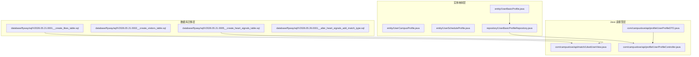
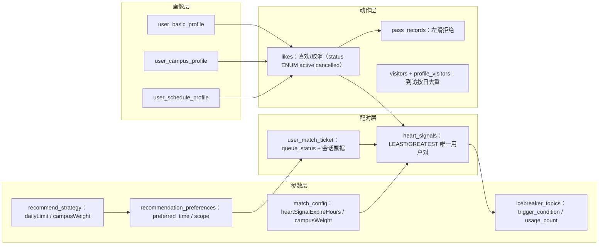
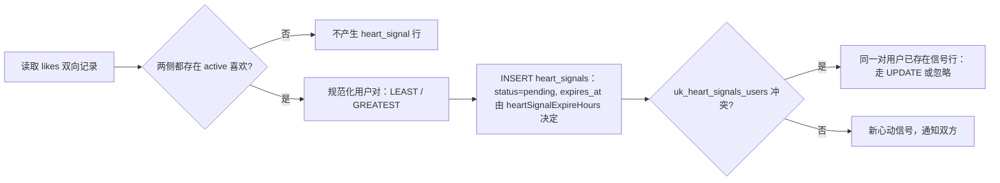
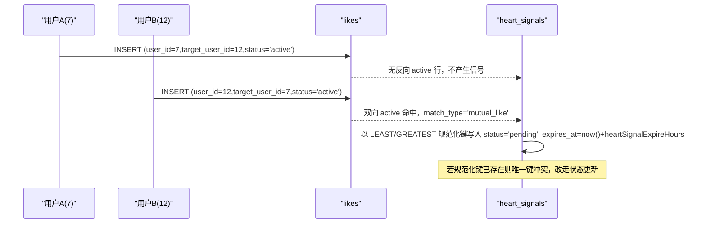
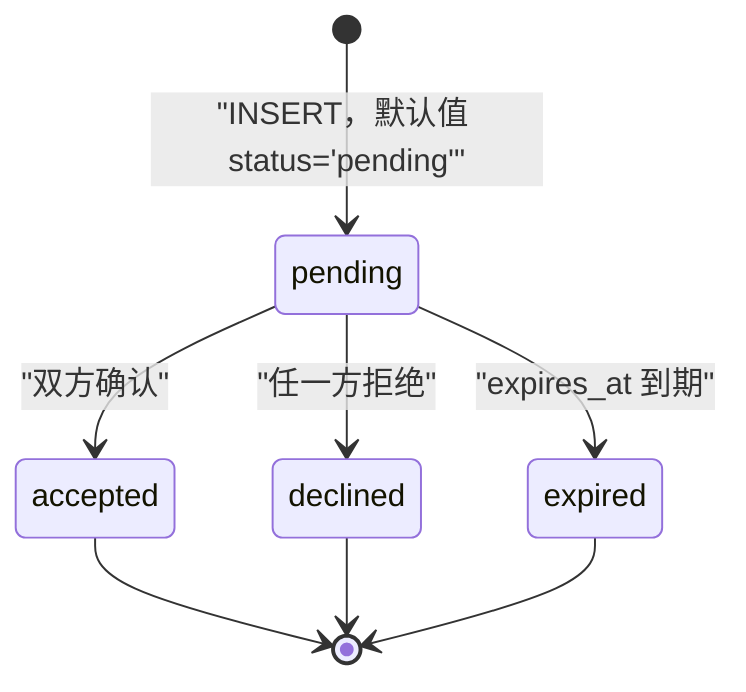
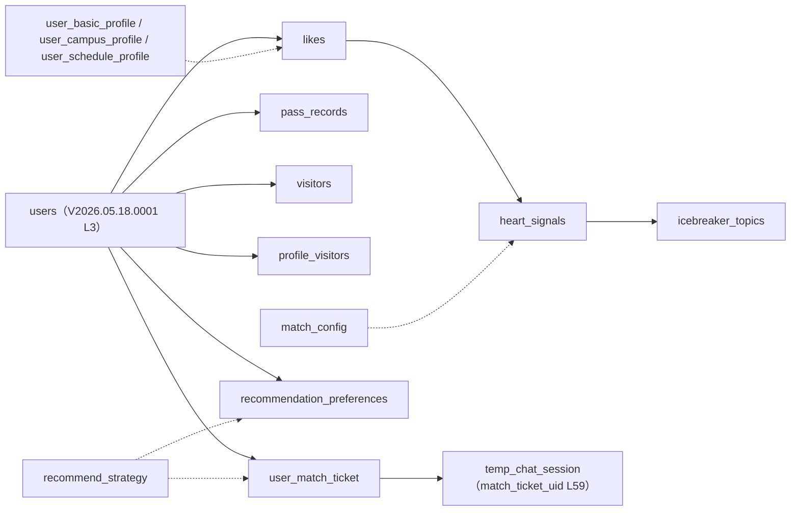

# 匹配相关表

<cite>
**本文引用的文件**
- [V2026.05.18.0001__create_users.sql](file://database/flyway/sql/V2026.05.18.0001__create_users.sql)
- [V2026.05.18.2200__phase0_phase1_client_foundation.sql](file://database/flyway/sql/V2026.05.18.2200__phase0_phase1_client_foundation.sql)
- [V2026.05.21.0001__create_likes_table.sql](file://database/flyway/sql/V2026.05.21.0001__create_likes_table.sql)
- [V2026.05.21.0002__create_visitors_table.sql](file://database/flyway/sql/V2026.05.21.0002__create_visitors_table.sql)
- [V2026.05.21.0005__create_heart_signals_table.sql](file://database/flyway/sql/V2026.05.21.0005__create_heart_signals_table.sql)
- [V2026.05.24.0001__create_recommendation_preferences.sql](file://database/flyway/sql/V2026.05.24.0001__create_recommendation_preferences.sql)
- [V2026.05.26.0001__alter_heart_signals_add_match_type.sql](file://database/flyway/sql/V2026.05.26.0001__alter_heart_signals_add_match_type.sql)
- [V2026.05.29.0001__create_pass_records.sql](file://database/flyway/sql/V2026.05.29.0001__create_pass_records.sql)
- [V2026.05.30.0003__create_icebreaker_topics.sql](file://database/flyway/sql/V2026.05.30.0003__create_icebreaker_topics.sql)
- [V2026.05.30.0004__create_interaction_events.sql](file://database/flyway/sql/V2026.05.30.0004__create_interaction_events.sql)
- [V2026.06.25.0005__create_admin_configs.sql](file://database/flyway/sql/V2026.06.25.0005__create_admin_configs.sql)
- [V2026.07.25.0011__create_profile_visitors.sql](file://database/flyway/sql/V2026.07.25.0011__create_profile_visitors.sql)
- [V2026.07.25.0014__add_performance_indexes.sql](file://database/flyway/sql/V2026.07.25.0014__add_performance_indexes.sql)
- [V2026.07.26.0001__add_entity_index_annotations.sql](file://database/flyway/sql/V2026.07.26.0001__add_entity_index_annotations.sql)
- [V2026.07.26.0002__add_open_id_unique_constraint.sql](file://database/flyway/sql/V2026.07.26.0002__add_open_id_unique_constraint.sql)
- [V2026.07.26.0004__p8_database_standardization.sql](file://database/flyway/sql/V2026.07.26.0004__p8_database_standardization.sql)
- [README.md](file://database/flyway/sql/README.md)
- [LikedUserView.java](file://apps/api/src/main/java/com/campuslove/api/match/LikedUserView.java)
- [UserProfileDTO.java](file://apps/api/src/main/java/com/campuslove/api/profile/UserProfileDTO.java)
- [UserProfileController.java](file://apps/api/src/main/java/com/campuslove/api/profile/UserProfileController.java)
- [UserIndexSyncListener.java](file://apps/api/src/main/java/com/campuslove/api/search/UserIndexSyncListener.java)
- [UserBasicProfile.java](file://apps/api/src/main/java/com/campuslove/api/entity/UserBasicProfile.java)
- [UserCampusProfile.java](file://apps/api/src/main/java/com/campuslove/api/entity/UserCampusProfile.java)
- [UserScheduleProfile.java](file://apps/api/src/main/java/com/campuslove/api/entity/UserScheduleProfile.java)
- [UserBasicProfileRepository.java](file://apps/api/src/main/java/com/campuslove/api/repository/UserBasicProfileRepository.java)
- [UserBasicProfileTest.java](file://apps/api/src/test/java/com/campuslove/api/entity/UserBasicProfileTest.java)
</cite>

## 目录
1. [简介](#简介)
2. [项目结构](#项目结构)
3. [核心组件](#核心组件)
4. [架构总览](#架构总览)
5. [匹配域表清单](#匹配域表清单)
6. [详细组件分析](#详细组件分析)
7. [双向匹配算法与用户对唯一性](#双向匹配算法与用户对唯一性)
8. [匹配状态流转与过期清理](#匹配状态流转与过期清理)
9. [索引与唯一约束](#索引与唯一约束)
10. [迁移演进与 Flyway 编排](#迁移演进与-flyway-编排)
11. [数据模型与实体映射](#数据模型与实体映射)
12. [依赖关系分析](#依赖关系分析)
13. [性能考虑](#性能考虑)
14. [能力缺口登记](#能力缺口登记)
15. [故障排查指南](#故障排查指南)
16. [结论](#结论)

## 简介
本页文档化 Campus Love 后端「匹配域」的数据库表结构：喜欢记录表 `likes`、访客记录表 `visitors`、心动信号表 `heart_signals`，以及支撑匹配展示的三张用户档案表 `user_basic_profile` / `user_campus_profile` / `user_schedule_profile`。表的物理定义以 `database/flyway/sql/` 下的 Flyway 迁移脚本为唯一事实来源，实体侧的映射以 `apps/api/src/main/java/com/campuslove/api/entity/` 下的 JPA 注解为对照。

匹配域的行为链路（谁喜欢了谁、双向是否命中、心动信号如何分类）都由这几张表的列与约束承载，本文逐列给出出处，不做推测性描述。与本页同级已存在 [用户相关表](file://.qoder/repowiki/zh/content/数据库设计与迁移/核心表结构设计/用户相关表.md) 与 [核心表结构设计](file://.qoder/repowiki/zh/content/数据库设计与迁移/核心表结构设计/核心表结构设计.md)，通用建表约定（字符集、审计列命名、乐观锁列等）只在需要解释匹配域为何这样设计时引用，不重复展开。

## 项目结构
匹配域相关文件分布在两个层次：SQL 迁移定义物理表，Java 侧定义读模型与实体映射。



**图表来源**
- [V2026.05.21.0001__create_likes_table.sql:1-12](file://database/flyway/sql/V2026.05.21.0001__create_likes_table.sql#L1-L12)
- [V2026.05.21.0002__create_visitors_table.sql:1-10](file://database/flyway/sql/V2026.05.21.0002__create_visitors_table.sql#L1-L10)
- [V2026.05.21.0005__create_heart_signals_table.sql:1-14](file://database/flyway/sql/V2026.05.21.0005__create_heart_signals_table.sql#L1-L14)
- [V2026.05.26.0001__alter_heart_signals_add_match_type.sql:1-11](file://database/flyway/sql/V2026.05.26.0001__alter_heart_signals_add_match_type.sql#L1-L11)
- [LikedUserView.java:1-17](file://apps/api/src/main/java/com/campuslove/api/match/LikedUserView.java#L1-L17)
- [UserBasicProfile.java:24-27](file://apps/api/src/main/java/com/campuslove/api/entity/UserBasicProfile.java#L24-L27)

## 核心组件
匹配域由「关系事实表 + 配置表 + 读模型」三组组件构成。关系事实表记录用户对之间的一次动作（喜欢、pass、到访、心动信号），配置表决定算法参数与推荐策略，读模型把表数据组装成前端可渲染的档案视图。

| 组件 | 类型 | 物理载体 | 首次定义迁移 | 归属 |
|---|---|---|---|---|
| `likes` | 关系事实表 | MySQL `InnoDB` 表 | `V2026.05.21.0001__create_likes_table.sql` | 喜欢动作流水 |
| `visitors` | 关系事实表 | MySQL `InnoDB` 表 | `V2026.05.21.0002__create_visitors_table.sql` | 旧版访客按日去重记录 |
| `heart_signals` | 关系事实表 | MySQL `InnoDB` 表 | `V2026.05.21.0005__create_heart_signals_table.sql` | 双向配对结果与状态机 |
| `pass_records` | 关系事实表 | MySQL `InnoDB` 表 | `V2026.05.29.0001__create_pass_records.sql` | 左滑拒绝记录 |
| `profile_visitors` | 关系事实表 | MySQL `InnoDB` 表 | `V2026.07.25.0011__create_profile_visitors.sql` | 主页访客按日去重记录 |
| `user_match_ticket` | 匹配工单表 | MySQL `InnoDB` 表 | `V2026.05.18.2200__phase0_phase1_client_foundation.sql` | 排队配对票据 |
| `recommendation_preferences` | 偏好表 | MySQL `InnoDB` 表 | `V2026.05.24.0001__create_recommendation_preferences.sql` | 用户推荐偏好（一人一行） |
| `match_config` | 配置表 | MySQL `InnoDB` KV 表 | `V2026.06.25.0005__create_admin_configs.sql` | 匹配算法参数 |
| `recommend_strategy` | 配置表 | MySQL `InnoDB` KV 表 | `V2026.06.25.0005__create_admin_configs.sql` | 推荐策略参数 |
| `icebreaker_topics` | 内容表 | MySQL 表 | `V2026.05.30.0003__create_icebreaker_topics.sql` | 破冰话题库与使用计数 |
| `UserBasicProfile` / `UserCampusProfile` / `UserScheduleProfile` | JPA 实体 | `@Table` 映射 | 见 `apps/api/.../entity/` | 匹配展示所需的画像维度 |
| `LikedUserView` | Java 读模型 | `record`/类型 | `apps/api/.../match/LikedUserView.java` | 「我喜欢的人」列表投影 |

`match_config` 的键注释里点名了 `heartSignalExpireHours` 与 `campusWeight`，`recommend_strategy` 的键注释里点名了 `dailyLimit` 与 `campusWeight`，两表的建表注释分别标注「与 `RecommendationConfig` 字段一一对应」「与 `MatchConfig` / `RecommendationConfig` 默认值保持一致」，说明这两张表是后台可编辑的算法参数落库位置。

**章节来源**
- [V2026.05.21.0001__create_likes_table.sql:1-12](file://database/flyway/sql/V2026.05.21.0001__create_likes_table.sql#L1-L12)
- [V2026.05.21.0002__create_visitors_table.sql:1-10](file://database/flyway/sql/V2026.05.21.0002__create_visitors_table.sql#L1-L10)
- [V2026.05.21.0005__create_heart_signals_table.sql:1-14](file://database/flyway/sql/V2026.05.21.0005__create_heart_signals_table.sql#L1-L14)
- [V2026.05.29.0001__create_pass_records.sql:3-12](file://database/flyway/sql/V2026.05.29.0001__create_pass_records.sql#L3-L12)
- [V2026.07.25.0011__create_profile_visitors.sql:17-26](file://database/flyway/sql/V2026.07.25.0011__create_profile_visitors.sql#L17-L26)
- [V2026.05.18.2200__phase0_phase1_client_foundation.sql:40-54](file://database/flyway/sql/V2026.05.18.2200__phase0_phase1_client_foundation.sql#L40-L54)
- [V2026.05.24.0001__create_recommendation_preferences.sql:1-10](file://database/flyway/sql/V2026.05.24.0001__create_recommendation_preferences.sql#L1-L10)
- [V2026.06.25.0005__create_admin_configs.sql:56-79](file://database/flyway/sql/V2026.06.25.0005__create_admin_configs.sql#L56-L79)
- [V2026.05.30.0003__create_icebreaker_topics.sql:4-13](file://database/flyway/sql/V2026.05.30.0003__create_icebreaker_topics.sql#L4-L13)
- [LikedUserView.java:10-17](file://apps/api/src/main/java/com/campuslove/api/match/LikedUserView.java#L10-L17)

## 架构总览
匹配域的数据流分三条：动作写入（`likes` / `pass_records` / `visitors` / `profile_visitors`）、配对结果维护（`heart_signals`）、参数与偏好读取（`match_config` / `recommend_strategy` / `recommendation_preferences` / `user_match_ticket`）。展示侧再由画像三表补齐对方的可匹配属性。



**图表来源**
- [V2026.05.21.0001__create_likes_table.sql:5-9](file://database/flyway/sql/V2026.05.21.0001__create_likes_table.sql#L5-L9)
- [V2026.05.21.0005__create_heart_signals_table.sql:5-13](file://database/flyway/sql/V2026.05.21.0005__create_heart_signals_table.sql#L5-L13)
- [V2026.05.26.0001__alter_heart_signals_add_match_type.sql:9-11](file://database/flyway/sql/V2026.05.26.0001__alter_heart_signals_add_match_type.sql#L9-L11)
- [V2026.06.25.0005__create_admin_configs.sql:56-75](file://database/flyway/sql/V2026.06.25.0005__create_admin_configs.sql#L56-L75)
- [V2026.05.18.2200__phase0_phase1_client_foundation.sql:40-54](file://database/flyway/sql/V2026.05.18.2200__phase0_phase1_client_foundation.sql#L40-L54)
- [V2026.05.30.0003__create_icebreaker_topics.sql:4-13](file://database/flyway/sql/V2026.05.30.0003__create_icebreaker_topics.sql#L4-L13)

Java 侧的取数出口在本次取证范围内只覆盖到档案读模型：`UserProfileController` 挂在 `/api/v1/profile`，暴露 `GET /me` 与 `GET /{userId}`，其返回结构由 `UserProfileDTO` 的嵌套类型（`Basic` / `Identity` / `Intro` / `Relationship` / `Media` / `Relation` / `Post` / `Story`）描述；「我喜欢的人」列表投影为 `match` 包下的 `LikedUserView`。匹配域的关系表本身未在事实包中出现对应 JPA 实体或 Repository，因此本页对表行为的全部结论都以 SQL DDL 为准。

**章节来源**
- [UserProfileController.java:33-72](file://apps/api/src/main/java/com/campuslove/api/profile/UserProfileController.java#L33-L72)
- [UserProfileDTO.java:8-37](file://apps/api/src/main/java/com/campuslove/api/profile/UserProfileDTO.java#L8-L37)
- [LikedUserView.java:10-17](file://apps/api/src/main/java/com/campuslove/api/match/LikedUserView.java#L10-L17)
- [UserBasicProfileRepository.java:12-30](file://apps/api/src/main/java/com/campuslove/api/repository/UserBasicProfileRepository.java#L12-L30)

## 匹配域表清单
下表是匹配域在 `database/flyway/sql/` 中真实存在的全部表（表名逐条来自 DDL 的 `CREATE TABLE IF NOT EXISTS` 行）。

| 表名 | 表注释 | 建表迁移 | 唯一约束 | 主键 |
|---|---|---|---|---|
| `likes` | `用户喜欢记录表` | `V2026.05.21.0001` | `uk_likes_user_target (user_id, target_user_id)` | `id` |
| `visitors` | `访客记录表` | `V2026.05.21.0002` | `uk_visitors_visitor_visited_date (visitor_id, visited_user_id, (DATE(created_at)))` | `id` |
| `heart_signals` | `心动信号表` | `V2026.05.21.0005` | `uk_heart_signals_users ((LEAST(user_a_id,user_b_id)),(GREATEST(user_a_id,user_b_id)))` | `id` |
| `pass_records` | `左滑(pass)记录表` | `V2026.05.29.0001` | `uk_pass_records_user_passed (user_id, passed_user_id)` | `id` |
| `profile_visitors` | `个人主页访客记录表` | `V2026.07.25.0011` | `uk_profile_visitors_visitor_host_date (visitor_id, host_id, (DATE(visited_at)))` | `id` |
| `recommendation_preferences` | `推荐偏好设置表` | `V2026.05.24.0001` | `uk_recommendation_preferences_user (user_id)` | `id` |
| `user_match_ticket` | 无表注释 | `V2026.05.18.2200` | `uk_user_match_ticket_uid (ticket_uid)` | `id` |
| `match_config` | `匹配算法配置表` | `V2026.06.25.0005` | 列级 `config_key VARCHAR(128) NOT NULL UNIQUE` | `id` |
| `recommend_strategy` | `推荐策略配置表` | `V2026.06.25.0005` | 列级 `strategy_key VARCHAR(128) NOT NULL UNIQUE` | `id` |
| `icebreaker_topics` | 无表注释 | `V2026.05.30.0003` | 无唯一约束（仅 `id` 主键） | `id` |

实体关系如下（关系按列语义与 DDL 中点名的引用列绘制；`temp_chat_session.match_ticket_uid` 是匹配域里唯一在 DDL 中显式书写的跨表引用列，且不是数据库外键）：

```mermaid
erDiagram
USERS ||--o{ LIKES : "user_id / target_user_id"
USERS ||--o{ PASS_RECORDS : "user_id / passed_user_id"
USERS ||--o{ VISITORS : "visitor_id / visited_user_id"
USERS ||--o{ PROFILE_VISITORS : "visitor_id / host_id"
USERS ||--o{ USER_MATCH_TICKET : "user_id"
USERS ||--|| RECOMMENDATION_PREFERENCES : "user_id (uk)"
LIKES ||--o{ HEART_SIGNALS : "mutual_like -> user_a_id/user_b_id"
HEART_SIGNALS ||--o{ ICEBREAKER_TOPICS : "match_type=topic"
USER_MATCH_TICKET ||--o{ TEMP_CHAT_SESSION : "match_ticket_uid"
MATCH_CONFIG ||--o{ HEART_SIGNALS : "heartSignalExpireHours -> expires_at"
RECOMMEND_STRATEGY ||--o{ RECOMMENDATION_PREFERENCES : "dailyLimit / campusWeight"
USERS {
  BIGINT UNSIGNED id
}
LIKES {
  BIGINT UNSIGNED id
  BIGINT UNSIGNED user_id
  BIGINT UNSIGNED target_user_id
  ENUM status
  DATETIME created_at
  DATETIME updated_at
}
HEART_SIGNALS {
  BIGINT UNSIGNED id
  BIGINT UNSIGNED user_a_id
  BIGINT UNSIGNED user_b_id
  ENUM status
  VARCHAR match_type
  DATETIME expires_at
  DATETIME created_at
  DATETIME updated_at
}
PASS_RECORDS {
  BIGINT UNSIGNED id
  BIGINT UNSIGNED user_id
  BIGINT UNSIGNED passed_user_id
  DATETIME created_at
}
VISITORS {
  BIGINT UNSIGNED id
  BIGINT UNSIGNED visitor_id
  BIGINT UNSIGNED visited_user_id
  DATETIME created_at
}
PROFILE_VISITORS {
  BIGINT UNSIGNED id
  BIGINT UNSIGNED visitor_id
  BIGINT UNSIGNED host_id
  DATETIME visited_at
}
USER_MATCH_TICKET {
  BIGINT UNSIGNED id
  VARCHAR ticket_uid
  BIGINT UNSIGNED user_id
  VARCHAR queue_status
  JSON topic_ids_json
  VARCHAR time_window_code
  INT duration_minutes
  VARCHAR temp_chat_session_uid
}
RECOMMENDATION_PREFERENCES {
  BIGINT UNSIGNED id
  BIGINT UNSIGNED user_id
  VARCHAR preferred_time
  VARCHAR scope
}
MATCH_CONFIG {
  BIGINT id
  VARCHAR config_key
  VARCHAR config_value
}
RECOMMEND_STRATEGY {
  BIGINT id
  VARCHAR strategy_key
  VARCHAR strategy_value
}
ICEBREAKER_TOPICS {
  BIGINT id
  VARCHAR content
  VARCHAR category
  VARCHAR trigger_condition
  INT usage_count
  BOOLEAN is_active
}
```

**图表来源**
- [V2026.05.21.0001__create_likes_table.sql:1-12](file://database/flyway/sql/V2026.05.21.0001__create_likes_table.sql#L1-L12)
- [V2026.05.21.0002__create_visitors_table.sql:1-10](file://database/flyway/sql/V2026.05.21.0002__create_visitors_table.sql#L1-L10)
- [V2026.05.21.0005__create_heart_signals_table.sql:1-14](file://database/flyway/sql/V2026.05.21.0005__create_heart_signals_table.sql#L1-L14)
- [V2026.05.26.0001__alter_heart_signals_add_match_type.sql:9-11](file://database/flyway/sql/V2026.05.26.0001__alter_heart_signals_add_match_type.sql#L9-L11)
- [V2026.05.29.0001__create_pass_records.sql:3-12](file://database/flyway/sql/V2026.05.29.0001__create_pass_records.sql#L3-L12)
- [V2026.07.25.0011__create_profile_visitors.sql:17-26](file://database/flyway/sql/V2026.07.25.0011__create_profile_visitors.sql#L17-L26)
- [V2026.05.18.2200__phase0_phase1_client_foundation.sql:40-64](file://database/flyway/sql/V2026.05.18.2200__phase0_phase1_client_foundation.sql#L40-L64)
- [V2026.05.24.0001__create_recommendation_preferences.sql:1-10](file://database/flyway/sql/V2026.05.24.0001__create_recommendation_preferences.sql#L1-L10)
- [V2026.06.25.0005__create_admin_configs.sql:56-75](file://database/flyway/sql/V2026.06.25.0005__create_admin_configs.sql#L56-L75)
- [V2026.05.30.0003__create_icebreaker_topics.sql:4-13](file://database/flyway/sql/V2026.05.30.0003__create_icebreaker_topics.sql#L4-L13)

**章节来源**
- [V2026.05.21.0001__create_likes_table.sql:1-12](file://database/flyway/sql/V2026.05.21.0001__create_likes_table.sql#L1-L12)
- [V2026.05.21.0005__create_heart_signals_table.sql:1-14](file://database/flyway/sql/V2026.05.21.0005__create_heart_signals_table.sql#L1-L14)
- [V2026.05.29.0001__create_pass_records.sql:3-12](file://database/flyway/sql/V2026.05.29.0001__create_pass_records.sql#L3-L12)

## 详细组件分析

### heart_signals 心动信号表
心动信号是「一次配对结果」的持久化载体，一行代表一对用户（而不是一个用户），因此它的唯一键按用户对建立。

| 列 | 类型与约束 | 注释/取值 | 出处 |
|---|---|---|---|
| `id` | `BIGINT UNSIGNED NOT NULL AUTO_INCREMENT` | 代理主键 | DDL L2 |
| `user_a_id` | `BIGINT UNSIGNED NOT NULL` | `用户A` | DDL L3 |
| `user_b_id` | `BIGINT UNSIGNED NOT NULL` | `用户B` | DDL L4 |
| `status` | `ENUM('pending','accepted','expired','declined') NOT NULL DEFAULT 'pending'` | `状态` | DDL L5 |
| `match_type` | `VARCHAR(20) DEFAULT 'mutual_like'`，位置 `AFTER status` | `mutual_like` / `topic` / `coffee` / `study` / `quick` | 迁移 L10-L11 |
| `expires_at` | `DATETIME NOT NULL` | `过期时间`，无默认值，写入方必须显式提供 | DDL L6 |
| `created_at` | `DATETIME NOT NULL DEFAULT CURRENT_TIMESTAMP` | 审计列 | DDL L7 |
| `updated_at` | `DATETIME NOT NULL DEFAULT CURRENT_TIMESTAMP ON UPDATE CURRENT_TIMESTAMP` | 审计列 | DDL L8 |
| 主键 | `PRIMARY KEY (id)` | — | DDL L9 |
| 唯一键 | `UNIQUE KEY uk_heart_signals_users ((LEAST(user_a_id, user_b_id)), (GREATEST(user_a_id, user_b_id)))` | 函数式唯一索引 | DDL L10 |
| 普通索引 | `idx_heart_signals_user_a` / `idx_heart_signals_user_b` / `idx_heart_signals_expires_at` | 两侧查卡 + 过期扫描 | DDL L11-L13 |
| 存储 | `ENGINE=InnoDB DEFAULT CHARSET=utf8mb4 COLLATE=utf8mb4_0900_ai_ci COMMENT='心动信号表'` | — | DDL L14 |

`match_type` 是后加的列，DDL 注释逐条枚举了业务含义：`mutual_like` 表示「互相喜欢产生的心动信号」并作为默认值，`topic` 为话题匹配、`coffee` 为咖啡散步、`study` 为自习搭子、`quick` 为快速匹配，且脚本头部注释明确「话题匹配/咖啡散步/自习搭子/快速匹配：由匹配表单产生的信号」。默认值 `mutual_like` 保证历史行在加列后自动归入互相喜欢类，无需回填。后续迁移为 `heart_signals` 补了 `idx_heart_signals_created_at`（按创建时间排序的列表索引）。



[此图为概念流程，由 DDL 的唯一键与默认值约束推导，不直接对应具体源文件，故不提供图表来源]

**章节来源**
- [V2026.05.21.0005__create_heart_signals_table.sql:1-14](file://database/flyway/sql/V2026.05.21.0005__create_heart_signals_table.sql#L1-L14)
- [V2026.05.26.0001__alter_heart_signals_add_match_type.sql:1-11](file://database/flyway/sql/V2026.05.26.0001__alter_heart_signals_add_match_type.sql#L1-L11)
- [V2026.07.26.0001__add_entity_index_annotations.sql:35-40](file://database/flyway/sql/V2026.07.26.0001__add_entity_index_annotations.sql#L35-L40)
- [V2026.06.25.0005__create_admin_configs.sql:56-64](file://database/flyway/sql/V2026.06.25.0005__create_admin_configs.sql#L56-L64)

### likes 喜欢记录表
喜欢是有向动作：一行代表「`user_id` 喜欢 `target_user_id`」，取消不删行而是把 `status` 改为 `cancelled`。

| 列 | 类型与约束 | 注释/取值 | 出处 |
|---|---|---|---|
| `id` | `BIGINT UNSIGNED NOT NULL AUTO_INCREMENT` | 代理主键 | DDL L2 |
| `user_id` | `BIGINT UNSIGNED NOT NULL` | `发起喜欢的用户ID` | DDL L3 |
| `target_user_id` | `BIGINT UNSIGNED NOT NULL` | `被喜欢的用户ID` | DDL L4 |
| `status` | `ENUM('active','cancelled') NOT NULL DEFAULT 'active'` | `状态` | DDL L5 |
| `created_at` | `DATETIME NOT NULL DEFAULT CURRENT_TIMESTAMP` | 喜欢发生时间 | DDL L6 |
| `updated_at` | `DATETIME ... ON UPDATE CURRENT_TIMESTAMP` | 取消时间（由更新自动刷新） | DDL L7 |
| 主键 | `PRIMARY KEY (id)` | — | DDL L8 |
| 唯一键 | `UNIQUE KEY uk_likes_user_target (user_id, target_user_id)` | 防重复喜欢 | DDL L9 |
| 普通索引 | `idx_likes_target_user (target_user_id)` | 查「谁喜欢我」 | DDL L10 |
| 普通索引 | `idx_likes_created_at (created_at)` | 时间排序 | DDL L11 |
| 存储 | `ENGINE=InnoDB ... COMMENT='用户喜欢记录表'` | — | DDL L12 |

防重复机制就是 `uk_likes_user_target`：同一有向对最多一行，重复喜欢不会产生新行，因此「取消后重新喜欢」在表层面是 UPDATE 既有行的 `status`（`ENUM('active','cancelled')` 的存在正是为软取消而非删除让路）。双向匹配则是该唯一键的对偶查询：`WHERE user_id = :me AND target_user_id = :other` 与 `WHERE user_id = :other AND target_user_id = :me` 同时存在 `status='active'` 才算互相喜欢，后者可由 `idx_likes_target_user` 支撑。

后续两次索引迁移为 `likes` 追加了复合索引：`V2026.07.25.0014` 一次性加了 `idx_likes_user_created_at (user_id, created_at)`、`idx_likes_target_user_created_at (target_user_id, created_at)`、`idx_likes_status_created_at (status, created_at)`；`V2026.07.26.0004` 在「任务规格要求为以下表补全索引（部分已存在，本节使用 `CREATE INDEX` 幂等补全）」的说明下补了 `idx_likes_status_user_created`。

**章节来源**
- [V2026.05.21.0001__create_likes_table.sql:1-12](file://database/flyway/sql/V2026.05.21.0001__create_likes_table.sql#L1-L12)
- [V2026.07.25.0014__add_performance_indexes.sql:21-36](file://database/flyway/sql/V2026.07.25.0014__add_performance_indexes.sql#L21-L36)
- [V2026.07.26.0004__p8_database_standardization.sql:184-212](file://database/flyway/sql/V2026.07.26.0004__p8_database_standardization.sql#L184-L212)
- [LikedUserView.java:10-17](file://apps/api/src/main/java/com/campuslove/api/match/LikedUserView.java#L10-L17)

### visitors 与 profile_visitors：访客按日去重
两张访客表的去重策略一致，都是「同一天、同一有向对只留一条」，但实现列不同，`profile_visitors` 是较新的规范化版本。

| 表 | 列 | 类型与约束 | 出处 |
|---|---|---|---|
| `visitors` | `id` | `BIGINT UNSIGNED NOT NULL AUTO_INCREMENT` | DDL L2 |
| `visitors` | `visitor_id` | `BIGINT UNSIGNED NOT NULL`，注释 `访客用户ID` | DDL L3 |
| `visitors` | `visited_user_id` | `BIGINT UNSIGNED NOT NULL`，注释 `被访用户ID` | DDL L4 |
| `visitors` | `created_at` | `DATETIME NOT NULL DEFAULT CURRENT_TIMESTAMP`（无 `updated_at`） | DDL L5 |
| `visitors` | 唯一键 | `uk_visitors_visitor_visited_date (visitor_id, visited_user_id, (DATE(created_at)))` | DDL L7 |
| `visitors` | 索引 | `idx_visitors_visited_user` / `idx_visitors_created_at` | DDL L8-L9 |
| `profile_visitors` | `visitor_id` | `BIGINT UNSIGNED NOT NULL`，注释 `访客用户ID` | DDL L19 |
| `profile_visitors` | `host_id` | `BIGINT UNSIGNED NOT NULL`，注释 `被访主页用户ID` | DDL L20 |
| `profile_visitors` | `visited_at` | `DATETIME NOT NULL DEFAULT CURRENT_TIMESTAMP`，注释 `访问时间` | DDL L21 |
| `profile_visitors` | 唯一键 | `uk_profile_visitors_visitor_host_date (visitor_id, host_id, (DATE(visited_at)))` | DDL L23 |
| `profile_visitors` | 索引 | `idx_profile_visitors_host` / `idx_profile_visitors_visited_at` | DDL L24-L25 |

去重的关键是把 `DATE(created_at)` / `DATE(visited_at)` 作为函数列放进唯一键，数据库层直接拒绝同日重复到访：第二次到访同一主页不再插入新行，也不产生「当日浏览次数」这类计数列。两张表的唯一键都要求函数式索引（MySQL 8.0 表达式索引），因此 `created_at` / `visited_at` 不能改成普通日期列，否则唯一性语义失效。两张表都是纯 append 结构：`visitors` 完全没有 `updated_at`，`profile_visitors` 也没有。

**章节来源**
- [V2026.05.21.0002__create_visitors_table.sql:1-10](file://database/flyway/sql/V2026.05.21.0002__create_visitors_table.sql#L1-L10)
- [V2026.07.25.0011__create_profile_visitors.sql:17-26](file://database/flyway/sql/V2026.07.25.0011__create_profile_visitors.sql#L17-L26)

### pass_records：左滑拒绝
`pass_records` 表达与 `likes` 相反的单向动作，同样是 append + 唯一键防重，但没有状态列。

| 列 | 类型与约束 | 注释/取值 | 出处 |
|---|---|---|---|
| `id` | `BIGINT UNSIGNED NOT NULL AUTO_INCREMENT` | 代理主键 | DDL L4 |
| `user_id` | `BIGINT UNSIGNED NOT NULL` | `执行pass的用户ID` | DDL L5 |
| `passed_user_id` | `BIGINT UNSIGNED NOT NULL` | `被pass的用户ID` | DDL L6 |
| `created_at` | `DATETIME NOT NULL DEFAULT CURRENT_TIMESTAMP` | pass 发生时间 | DDL L7 |
| 主键 | `PRIMARY KEY (id)` | — | DDL L8 |
| 唯一键 | `uk_pass_records_user_passed (user_id, passed_user_id)` | 同一有向对只记一次 | DDL L9 |
| 索引 | `idx_pass_records_user_id (user_id)` / `idx_pass_records_created_at (created_at)` | 过滤推荐池 + 时间排序 | DDL L10-L11 |
| 存储 | `ENGINE=InnoDB DEFAULT CHARSET=utf8mb4 COLLATE=utf8mb4_0900_ai_ci COMMENT='左滑(pass)记录表'` | — | DDL L12 |

与 `likes` 的差异有三处：无 `status`（pass 不可撤销、不存在软删除）、无 `updated_at`、唯一键不带函数列（永久屏蔽而非按日屏蔽）。`V2026.07.26.0004` 又为它补了 `idx_pass_records_user_created`，用于「按用户取近期 pass 列表」这类推荐过滤。

**章节来源**
- [V2026.05.29.0001__create_pass_records.sql:3-12](file://database/flyway/sql/V2026.05.29.0001__create_pass_records.sql#L3-L12)
- [V2026.07.26.0004__p8_database_standardization.sql:208-216](file://database/flyway/sql/V2026.07.26.0004__p8_database_standardization.sql#L208-L216)

### user_match_ticket：排队匹配工单
工单表是「表单式匹配」的载体，字段设计成一次排队的完整快照。

| 列 | 类型与约束 | 语义 | 出处 |
|---|---|---|---|
| `id` | `BIGINT UNSIGNED NOT NULL AUTO_INCREMENT` | 代理主键 | L41 |
| `ticket_uid` | `VARCHAR(64) NOT NULL` | 对外暴露的工单号 | L42 |
| `user_id` | `BIGINT UNSIGNED NOT NULL` | 发起人 | L43 |
| `queue_status` | `VARCHAR(32) NOT NULL DEFAULT 'queued'` | 排队状态 | L44 |
| `topic_ids_json` | `JSON NOT NULL` | 所选话题 ID 列表（JSON 存储） | L45 |
| `time_window_code` | `VARCHAR(64) NOT NULL` | 期望时间段编码 | L46 |
| `duration_minutes` | `INT NOT NULL` | 期望时长 | L47 |
| `temp_chat_session_uid` | `VARCHAR(64) DEFAULT NULL` | 配对成功后的临时会话号，可空 | L48 |
| `created_at` / `updated_at` | `DATETIME NOT NULL DEFAULT CURRENT_TIMESTAMP`(+`ON UPDATE`) | 审计列 | L49-L50 |
| 唯一键 | `uk_user_match_ticket_uid (ticket_uid)` | 工单号唯一 | L52 |
| 索引 | `idx_user_match_ticket_user_status (user_id, queue_status)` | 查「我的进行中工单」 | L53 |
| 存储 | `ENGINE=InnoDB DEFAULT CHARSET=utf8mb4 COLLATE=utf8mb4_0900_ai_ci`（无表注释） | — | L54 |

`temp_chat_session` 在同一脚本里紧随其后，其 `match_ticket_uid VARCHAR(64) NOT NULL`、`phase VARCHAR(32) NOT NULL DEFAULT 'matching'`、`closes_at DATETIME NOT NULL`、`closed_reason VARCHAR(32) DEFAULT NULL` 是匹配域唯一出现的外键语义列（按工单号引用，而非数据库 FK）。工单的 `topic_ids_json` 与破冰话题库、`heart_signals.match_type='topic'` 构成话题匹配闭环的三个数据点。

**章节来源**
- [V2026.05.18.2200__phase0_phase1_client_foundation.sql:40-64](file://database/flyway/sql/V2026.05.18.2200__phase0_phase1_client_foundation.sql#L40-L64)

### match_config 与 recommend_strategy：算法参数表
两表是结构对称的 KV 表，由后台管理端编辑、应用层解析，注释里保留了键名示例与解析约定。

| 表 | 列 | 类型与约束 | 注释 | 出处 |
|---|---|---|---|---|
| `match_config` | `config_key` | `VARCHAR(128) NOT NULL UNIQUE` | `配置键（如 heartSignalExpireHours、campusWeight）` | L58 |
| `match_config` | `config_value` | `VARCHAR(64) NOT NULL` | `配置值（字符串存储，应用层解析为 int/double/boolean）` | L59 |
| `match_config` | `description` | `VARCHAR(255) DEFAULT ''` | `配置说明` | L60 |
| `match_config` | `updated_by` | `BIGINT`（可空） | `最后更新者用户ID` | L61 |
| `match_config` | 审计列 | `created_at` / `updated_at` 同标准 | — | L62-L63 |
| `recommend_strategy` | `strategy_key` | `VARCHAR(128) NOT NULL UNIQUE` | `策略键（如 dailyLimit、campusWeight）` | L69 |
| `recommend_strategy` | `strategy_value` | `VARCHAR(64) NOT NULL` | `策略值（字符串存储，应用层解析）` | L70 |
| `recommend_strategy` | `description` / `updated_by` | `VARCHAR(255) DEFAULT ''` / `BIGINT` | `策略说明` / `最后更新者用户ID` | L71-L72 |

两表都落在 `V2026.06.25.0005__create_admin_configs.sql` 里，与 `app_config`、`app_rule`、`app_switch` 同一脚本；脚本内注释标注 `recommend_strategy` 为「推荐策略配置表（与 RecommendationConfig 字段一一对应）」，seed 段注释标注「使用内置默认值，与 `MatchConfig` / `RecommendationConfig` 默认值保持一致」。同脚本里 `app_config` 的 seed 写法是 `INSERT ... ON DUPLICATE KEY UPDATE config_value = config_value`（L82-L88），说明这套配置表的可重复执行思路是唯一键 + upsert；本次读取的片段中未出现针对 `match_config` / `recommend_strategy` 的等价 seed 语句。匹配参数以字符串落库、由应用层转型，意味着改参数不需要发版，但类型错误只会在运行期暴露。

**章节来源**
- [V2026.06.25.0005__create_admin_configs.sql:22-24](file://database/flyway/sql/V2026.06.25.0005__create_admin_configs.sql#L22-L24)
- [V2026.06.25.0005__create_admin_configs.sql:56-88](file://database/flyway/sql/V2026.06.25.0005__create_admin_configs.sql#L56-L88)

### recommendation_preferences：推荐偏好
一人一行的用户偏好表，`uk_recommendation_preferences_user (user_id)` 把基数固定为 1:1。

| 列 | 类型与约束 | 注释/取值 | 出处 |
|---|---|---|---|
| `id` | `BIGINT UNSIGNED NOT NULL AUTO_INCREMENT` | 代理主键 | L2 |
| `user_id` | `BIGINT UNSIGNED NOT NULL` | `用户ID` | L3 |
| `preferred_time` | `VARCHAR(8) NOT NULL DEFAULT '12:00'` | `推荐时间偏好`，形如 `HH:MM` | L4 |
| `scope` | `VARCHAR(32) NOT NULL DEFAULT 'campus_first'` | `推荐范围: campus_first/city/unlimited` | L5 |
| 审计列 | `created_at` / `updated_at` | 标准双列 | L6-L7 |
| 唯一键 | `uk_recommendation_preferences_user (user_id)` | 一人一条 | L9 |
| 存储 | `ENGINE=InnoDB ... COMMENT='推荐偏好设置表'` | — | L10 |

`scope` 的三档取值是枚举注释而非 `ENUM` 列，改动成本低但取值校验在应用层；`campus_first` 是默认档，与 `match_config` / `recommend_strategy` 里都点名的 `campusWeight` 呼应，说明校区权重是推荐排序的第一因子。

**章节来源**
- [V2026.05.24.0001__create_recommendation_preferences.sql:1-10](file://database/flyway/sql/V2026.05.24.0001__create_recommendation_preferences.sql#L1-L10)
- [V2026.06.25.0005__create_admin_configs.sql:56-75](file://database/flyway/sql/V2026.06.25.0005__create_admin_configs.sql#L56-L75)

### icebreaker_topics：破冰话题库
匹配成功后的开场内容由这张表供给，它是匹配域里唯一带计数列的表。

| 列 | 类型与约束 | 语义 | 出处 |
|---|---|---|---|
| `id` | `BIGINT AUTO_INCREMENT PRIMARY KEY` | 主键内联声明 | L5 |
| `content` | `VARCHAR(200) NOT NULL` | 话题文案 | L6 |
| `category` | `VARCHAR(50) NOT NULL` | 分类：`interests` / `campus` / `lifestyle` / `daily` / `fun` | L7、L16-L28 |
| `trigger_condition` | `VARCHAR(100)`（可空） | 触发条件 | L8 |
| `usage_count` | `INT NOT NULL DEFAULT 0` | 使用次数 | L9 |
| `is_active` | `BOOLEAN NOT NULL DEFAULT TRUE` | 启用开关 | L10 |
| 审计列 | `created_at` / `updated_at` | 标准双列 | L11-L12 |

迁移脚本在建表后立即插入通用种子话题（例如「你最近在看什么书？」归入 `interests`、「你最喜欢的校园角落是哪里？」归入 `campus`），分类值直接由种子数据的第二个字段体现。这张表没有唯一键、没有引擎/字符集声明（走 MySQL 默认），与匹配域其他表不一致；`usage_count` 的更新方式（是否随信号生成自增）在 DDL 与本次取证范围内没有对应语句，因此只记录列的存在。

**章节来源**
- [V2026.05.30.0003__create_icebreaker_topics.sql:4-28](file://database/flyway/sql/V2026.05.30.0003__create_icebreaker_topics.sql#L4-L28)

## 双向匹配算法与用户对唯一性
`heart_signals` 的核心设计难点是「一对用户只能有一条信号」，而用户有两个方向。若唯一键写成 `UNIQUE (user_a_id, user_b_id)`，`(7,12)` 与 `(12,7)` 会被视为两行，同一对用户可能拿到两条 pending 信号。DDL 用两个函数表达式列把方向性消掉：

```sql
UNIQUE KEY uk_heart_signals_users (
  (LEAST(user_a_id, user_b_id)),
  (GREATEST(user_a_id, user_b_id))
)
```

效果是每次写入都由 MySQL 计算一对「规范化」的排序键：较小 ID 落在第一列、较大 ID 落在第二列，两行只有在规范化键相同才冲突。

| 写入行 | `LEAST` 结果 | `GREATEST` 结果 | 与首行关系 |
|---|---|---|---|
| `(user_a_id=7, user_b_id=12)` | 7 | 12 | 基线 |
| `(user_a_id=12, user_b_id=7)` | 7 | 12 | 唯一键冲突，被拒绝 |
| `(user_a_id=7, user_b_id=9)` | 7 | 9 | 不同用户，可插入 |

匹配判定所依赖的另一半约束在 `likes`：`uk_likes_user_target (user_id, target_user_id)` 使每个有向喜欢至多一行，`status` 的 `active/cancelled` 决定这行是否参与匹配。互相喜欢的判据因此是两个方向各存在一行 `status='active'`；`visitors` 与 `pass_records` 提供反向过滤（到访与被 pass 不影响喜欢行本身，但 `pass_records` 的永久唯一键意味着被 pass 的用户对不可能出现「双向 active 喜欢 + 无 pass 记录」的组合被重复推荐）。



[此图为概念流程，由 `likes` 与 `heart_signals` 的 DDL 约束推导，不直接对应具体源文件，故不提供图表来源]

实现层面的三点约束值得记录：
1. 唯一键是函数索引，普通列顺序写入不会自动规范化，`user_a_id` / `user_b_id` 本身可以任意方向存，规范化只发生在索引上。
2. `expires_at DATETIME NOT NULL` 无默认值，任何写入路径都必须给出过期时间，参数来源是 `match_config` 中注释点名的 `heartSignalExpireHours`。
3. `uk_heart_signals_users` 保证「一对一行」，所以信号是长期存在的记录而非流水，状态迁移靠 `status` 与 `updated_at`，靠 `idx_heart_signals_user_a` / `idx_heart_signals_user_b` 从任一侧检索。

**章节来源**
- [V2026.05.21.0005__create_heart_signals_table.sql:3-13](file://database/flyway/sql/V2026.05.21.0005__create_heart_signals_table.sql#L3-L13)
- [V2026.05.21.0001__create_likes_table.sql:3-11](file://database/flyway/sql/V2026.05.21.0001__create_likes_table.sql#L3-L11)
- [V2026.05.29.0001__create_pass_records.sql:5-11](file://database/flyway/sql/V2026.05.29.0001__create_pass_records.sql#L5-L11)
- [V2026.06.25.0005__create_admin_configs.sql:58-59](file://database/flyway/sql/V2026.06.25.0005__create_admin_configs.sql#L58-L59)

## 匹配状态流转与过期清理
`heart_signals.status` 是匹配域唯一的状态机列，四值全在 `ENUM` 里穷举，默认 `pending`。



**图表来源**
- [V2026.05.21.0005__create_heart_signals_table.sql:5-6](file://database/flyway/sql/V2026.05.21.0005__create_heart_signals_table.sql#L5-L6)

业务含义与承载列：

| 状态 | 含义 | 相关列 | 依据 |
|---|---|---|---|
| `pending` | 已生成、等待回应，是写入初值 | `status` 默认值 | DDL L5 |
| `accepted` | 双向确认成功 | `updated_at` 随状态更新自动刷新 | DDL L8 |
| `expired` | 超过 `expires_at` 失效 | `expires_at` + `idx_heart_signals_expires_at` | DDL L6、L13 |
| `declined` | 明确拒绝 | 与 `pass_records` 语义相邻但分表 | DDL L5 |

过期机制的存储侧证据只有两列：`expires_at NOT NULL`（强制写入方给定时效）和 `idx_heart_signals_expires_at`（为「按到期时间扫描」准备的索引）。时效数值本身不在 DDL 里，`match_config.config_key` 注释给出的 `heartSignalExpireHours` 是唯一被命名的旋钮，`config_value` 是字符串、由应用层解析为 int。由于同一对用户只有一行，`expired` 或 `declined` 之后再次配对需要复用同一行并改状态，而不是新插一行——这是唯一键带来的直接后果，也是清理策略只需要「改状态 + 保留行」的理由。

`likes.status` 与 `pass_records` 没有过期列，三者的时效口径不同：喜欢是长期有效（除非 `cancelled`）、pass 是永久屏蔽、心动信号是限时。

**章节来源**
- [V2026.05.21.0005__create_heart_signals_table.sql:5-13](file://database/flyway/sql/V2026.05.21.0005__create_heart_signals_table.sql#L5-L13)
- [V2026.05.21.0001__create_likes_table.sql:5-5](file://database/flyway/sql/V2026.05.21.0001__create_likes_table.sql#L5-L5)
- [V2026.05.29.0001__create_pass_records.sql:9-9](file://database/flyway/sql/V2026.05.29.0001__create_pass_records.sql#L9-L9)
- [V2026.06.25.0005__create_admin_configs.sql:58-60](file://database/flyway/sql/V2026.06.25.0005__create_admin_configs.sql#L58-L60)

## 索引与唯一约束
匹配域共有 7 个表级 `UNIQUE KEY`（其中 `heart_signals`、`visitors`、`profile_visitors` 三个是表达式唯一键）、2 个列级 `UNIQUE`（两张 KV 配置表）、18 个普通索引，其中 6 个由后期迁移追加。下表按表汇总，索引名逐条来自 DDL 原文。

| 表 | 索引名 | 列/表达式 | 类别 | 引入迁移 |
|---|---|---|---|---|
| `likes` | `uk_likes_user_target` | `(user_id, target_user_id)` | 唯一 | `V2026.05.21.0001` L9 |
| `likes` | `idx_likes_target_user` | `(target_user_id)` | 普通 | `V2026.05.21.0001` L10 |
| `likes` | `idx_likes_created_at` | `(created_at)` | 普通 | `V2026.05.21.0001` L11 |
| `likes` | `idx_likes_user_created_at` | `(user_id, created_at)` | 普通 | `V2026.07.25.0014` L34 |
| `likes` | `idx_likes_target_user_created_at` | `(target_user_id, created_at)` | 普通 | `V2026.07.25.0014` L35 |
| `likes` | `idx_likes_status_created_at` | `(status, created_at)` | 普通 | `V2026.07.25.0014` L36 |
| `likes` | `idx_likes_status_user_created` | 状态 + 用户 + 时间组合 | 普通 | `V2026.07.26.0004` L208 |
| `heart_signals` | `uk_heart_signals_users` | `(LEAST(user_a_id,user_b_id), GREATEST(user_a_id,user_b_id))` | 表达式唯一 | `V2026.05.21.0005` L10 |
| `heart_signals` | `idx_heart_signals_user_a` | `(user_a_id)` | 普通 | `V2026.05.21.0005` L11 |
| `heart_signals` | `idx_heart_signals_user_b` | `(user_b_id)` | 普通 | `V2026.05.21.0005` L12 |
| `heart_signals` | `idx_heart_signals_expires_at` | `(expires_at)` | 普通 | `V2026.05.21.0005` L13 |
| `heart_signals` | `idx_heart_signals_created_at` | 按创建时间 | 普通 | `V2026.07.26.0001` L40 |
| `visitors` | `uk_visitors_visitor_visited_date` | `(visitor_id, visited_user_id, (DATE(created_at)))` | 表达式唯一 | `V2026.05.21.0002` L7 |
| `visitors` | `idx_visitors_visited_user` | `(visited_user_id)` | 普通 | `V2026.05.21.0002` L8 |
| `visitors` | `idx_visitors_created_at` | `(created_at)` | 普通 | `V2026.05.21.0002` L9 |
| `profile_visitors` | `uk_profile_visitors_visitor_host_date` | `(visitor_id, host_id, (DATE(visited_at)))` | 表达式唯一 | `V2026.07.25.0011` L23 |
| `profile_visitors` | `idx_profile_visitors_host` | `(host_id)` | 普通 | `V2026.07.25.0011` L24 |
| `profile_visitors` | `idx_profile_visitors_visited_at` | `(visited_at)` | 普通 | `V2026.07.25.0011` L25 |
| `pass_records` | `uk_pass_records_user_passed` | `(user_id, passed_user_id)` | 唯一 | `V2026.05.29.0001` L9 |
| `pass_records` | `idx_pass_records_user_id` | `(user_id)` | 普通 | `V2026.05.29.0001` L10 |
| `pass_records` | `idx_pass_records_created_at` | `(created_at)` | 普通 | `V2026.05.29.0001` L11 |
| `pass_records` | `idx_pass_records_user_created` | 用户 + 时间组合 | 普通 | `V2026.07.26.0004` L212 |
| `recommendation_preferences` | `uk_recommendation_preferences_user` | `(user_id)` | 唯一（1:1） | `V2026.05.24.0001` L9 |
| `user_match_ticket` | `uk_user_match_ticket_uid` | `(ticket_uid)` | 唯一 | `V2026.05.18.2200` L52 |
| `user_match_ticket` | `idx_user_match_ticket_user_status` | `(user_id, queue_status)` | 普通 | `V2026.05.18.2200` L53 |
| `match_config` | 列级 `UNIQUE` | `config_key` | 唯一 | `V2026.06.25.0005` L58 |
| `recommend_strategy` | 列级 `UNIQUE` | `strategy_key` | 唯一 | `V2026.06.25.0005` L69 |
| `icebreaker_topics` | 无 | 仅 `id` 主键 | — | `V2026.05.30.0003` L5 |

约束形态有三类：普通列组合（`likes` / `pass_records` / `recommendation_preferences`）、表达式索引（`heart_signals` 的 `LEAST/GREATEST`、两张访客表的 `DATE(...)`）、列级 `UNIQUE`（两张 KV 配置表）。表达式唯一键依赖 MySQL 8.0 的函数索引能力，`DATE()` 依赖 `DATETIME` 列不能被改成 `DATE` 或加时区偏移，否则「自然日」边界漂移。

历史环境修补是这一域的另一条线索：`V2026.07.26.0002__add_open_id_unique_constraint.sql` 的注释记录「`CREATE TABLE` 时已声明 `UNIQUE KEY uk_users_openid`，但部分历史环境可能因（历史原因）缺失」，`V2026.07.26.0004` 也写着「任务规格要求为以下表补全索引（部分已存在，本节使用 `CREATE INDEX` 幂等补全）」。也就是说匹配域的唯一约束不能假设「建表脚本里有就一定在库里」，需要以 `SHOW INDEX` 复核。

**章节来源**
- [V2026.05.21.0001__create_likes_table.sql:8-12](file://database/flyway/sql/V2026.05.21.0001__create_likes_table.sql#L8-L12)
- [V2026.05.21.0002__create_visitors_table.sql:6-10](file://database/flyway/sql/V2026.05.21.0002__create_visitors_table.sql#L6-L10)
- [V2026.05.21.0005__create_heart_signals_table.sql:9-14](file://database/flyway/sql/V2026.05.21.0005__create_heart_signals_table.sql#L9-L14)
- [V2026.05.29.0001__create_pass_records.sql:8-12](file://database/flyway/sql/V2026.05.29.0001__create_pass_records.sql#L8-L12)
- [V2026.07.25.0011__create_profile_visitors.sql:22-26](file://database/flyway/sql/V2026.07.25.0011__create_profile_visitors.sql#L22-L26)
- [V2026.05.18.2200__phase0_phase1_client_foundation.sql:51-54](file://database/flyway/sql/V2026.05.18.2200__phase0_phase1_client_foundation.sql#L51-L54)
- [V2026.05.24.0001__create_recommendation_preferences.sql:8-10](file://database/flyway/sql/V2026.05.24.0001__create_recommendation_preferences.sql#L8-L10)
- [V2026.06.25.0005__create_admin_configs.sql:56-75](file://database/flyway/sql/V2026.06.25.0005__create_admin_configs.sql#L56-L75)
- [V2026.07.25.0014__add_performance_indexes.sql:21-36](file://database/flyway/sql/V2026.07.25.0014__add_performance_indexes.sql#L21-L36)
- [V2026.07.26.0001__add_entity_index_annotations.sql:26-45](file://database/flyway/sql/V2026.07.26.0001__add_entity_index_annotations.sql#L26-L45)
- [V2026.07.26.0002__add_open_id_unique_constraint.sql:7-7](file://database/flyway/sql/V2026.07.26.0002__add_open_id_unique_constraint.sql#L7-L7)

## 迁移演进与 Flyway 编排
匹配域的表不是一次性建好的，命名版本（`V<yyyy.MM.dd.NNNN>__<描述>.sql`）体现了三个阶段：地基期（05.18）、社交功能铺开期（05.21–05.30）、后台配置与索引标准化期（06.25–07.26）。

| 顺序 | 迁移文件 | 对匹配域做了什么 |
|---|---|---|
| 1 | `V2026.05.18.2200__phase0_phase1_client_foundation.sql` | 建 `user_basic_profile`（L1）、`user_campus_profile`（L14）、`user_schedule_profile`（L28）、`user_match_ticket`（L40）、`temp_chat_session`（L56） |
| 2 | `V2026.05.21.0001__create_likes_table.sql` | 建 `likes`，带 `uk_likes_user_target` |
| 3 | `V2026.05.21.0002__create_visitors_table.sql` | 建 `visitors`，带 `DATE(created_at)` 表达式唯一键 |
| 4 | `V2026.05.21.0005__create_heart_signals_table.sql` | 建 `heart_signals`，带 `LEAST/GREATEST` 表达式唯一键与 `expires_at` |
| 5 | `V2026.05.24.0001__create_recommendation_preferences.sql` | 建 `recommendation_preferences`（1 用户 1 行） |
| 6 | `V2026.05.26.0001__alter_heart_signals_add_match_type.sql` | `ALTER TABLE heart_signals ADD COLUMN match_type VARCHAR(20) DEFAULT 'mutual_like' AFTER status` |
| 7 | `V2026.05.29.0001__create_pass_records.sql` | 建 `pass_records` |
| 8 | `V2026.05.30.0003__create_icebreaker_topics.sql` | 建 `icebreaker_topics` 并插入种子话题（L16 起） |
| 9 | `V2026.06.25.0005__create_admin_configs.sql` | 建 `match_config`、`recommend_strategy` 及默认值 seed |
| 10 | `V2026.07.25.0011__create_profile_visitors.sql` | 建规范化访客表 `profile_visitors` |
| 11 | `V2026.07.25.0014__add_performance_indexes.sql` | 为 `likes` 追加 3 个复合索引 |
| 12 | `V2026.07.26.0001__add_entity_index_annotations.sql` | 追加 `idx_heart_signals_created_at` |
| 13 | `V2026.07.26.0004__p8_database_standardization.sql` | 补 `idx_likes_status_user_created`、`idx_pass_records_user_created` |

结构演进的三个可观察结论：

1. 匹配域是「先建关系表、后补参数表」。`heart_signals` 在 05.21 建表，`match_config` 到 06.25 才出现，所以过期时长最初只能在代码里；参数落库是后补的能力。
2. 加列走 `ALTER` 且显式指定 `AFTER status`，保持列序稳定，`match_type` 与状态列相邻便于阅读与 `SELECT *` 兼容。
3. 索引补齐集中在 07.25/07.26 两个脚本，注释里明确记录了幂等口径分歧：`sql/README.md` L36 与 `V2026.07.25.0014` L21、`V2026.07.26.0001` L26 都写「MySQL 不支持 `CREATE INDEX IF NOT EXISTS`，重复执行会报错」，而 `V2026.07.26.0004` L13 写「MySQL 8.0+ 支持 `CREATE INDEX IF NOT EXISTS`，可直接使用」。同一仓库内两种口径并存，实际执行前应以目标实例版本为准。

本页不描述 Flyway 的执行配置与占位符：本次取证未读取 `database/flyway/flyway.toml`，相关细节见 [能力缺口登记](#能力缺口登记)。

**章节来源**
- [README.md:36-36](file://database/flyway/sql/README.md#L36-L36)
- [V2026.05.18.2200__phase0_phase1_client_foundation.sql:40-64](file://database/flyway/sql/V2026.05.18.2200__phase0_phase1_client_foundation.sql#L40-L64)
- [V2026.05.26.0001__alter_heart_signals_add_match_type.sql:1-11](file://database/flyway/sql/V2026.05.26.0001__alter_heart_signals_add_match_type.sql#L1-L11)
- [V2026.07.25.0014__add_performance_indexes.sql:21-36](file://database/flyway/sql/V2026.07.25.0014__add_performance_indexes.sql#L21-L36)
- [V2026.07.26.0001__add_entity_index_annotations.sql:26-45](file://database/flyway/sql/V2026.07.26.0001__add_entity_index_annotations.sql#L26-L45)
- [V2026.07.26.0004__p8_database_standardization.sql:13-13](file://database/flyway/sql/V2026.07.26.0004__p8_database_standardization.sql#L13-L13)
- [V2026.07.26.0004__p8_database_standardization.sql:184-216](file://database/flyway/sql/V2026.07.26.0004__p8_database_standardization.sql#L184-L216)

## 数据模型与实体映射
匹配关系表（`likes` / `visitors` / `profile_visitors` / `pass_records` / `heart_signals` / `user_match_ticket` / `match_config` / `recommend_strategy` / `recommendation_preferences` / `icebreaker_topics`）在本次取证范围内没有出现对应的 JPA 实体类：事实包里的 `@Table` 注解只覆盖三张画像表。因此本页把这些表当作「SQL 定义、Java 侧以投影类型消费」的模型来处理。

画像侧的映射关系如下（`@Entity` / `@Table` 行号来自实体源码）：

| 实体类 | `@Table(name=...)` | 源码位置 | 与匹配域的用途 |
|---|---|---|---|
| `UserBasicProfile` | `user_basic_profile` | `@Entity` L24、`@Table` L26、类型 L27 | 提供匹配条件属性 |
| `UserCampusProfile` | `user_campus_profile` | `@Entity` L20、`@Table` L22、类型 L23 | 校区/院系同城因子 |
| `UserScheduleProfile` | `user_schedule_profile` | `@Entity` L20、`@Table` L22、类型 L23 | 可约时间段 |

`UserBasicProfile` 中与匹配直接相关的列（共 439 行的实体，字段声明集中在 L31-L194）：

| 列字段 | 声明行 | 匹配语义 |
|---|---|---|
| `userId` | L35 | 与 `users.id` 关联的用户维度 |
| `nickname` / `bio` | L39 / L43 | 卡片展示 |
| `gradeLabel` / `pronouns` / `gender` | L47 / L51 / L55 | 性别与称呼，是「想找什么性别」的判定输入 |
| `interestTags = "[]"` | L59 | JSON 数组文本，话题匹配的属性来源 |
| `height` / `educationLevel` / `birthYear` | L67 / L74 / L152 | 硬性条件筛选 |
| `relationshipStatus` | L81 | 单身前提过滤 |
| `hometownProvince` / `hometownCity` / `futureCity` | L85 / L89 / L93 | 地域因子，与 `recommendation_preferences.scope` 的 `city` 档对应 |
| `futurePlanTags = "[]"` / `personalityTags = "[]"` | L100 / L140 | 多值标签，JSON 文本存储 |
| `photoGallery = "[]"` / `halfBodyPhotoUrl` / `personalVideoUrl` / `profileBackgroundUrl` | L107 / L111 / L115 / L119 | 卡片素材 |
| `occupation` / `incomeRange` | L126 / L133 | 社会化属性筛选 |
| `mbti` / `expectedPartner` | L144 / L148 | 软性匹配与择偶期望文本 |
| `emailVerified` / `idCardVerified` | L160 / L168 | 布尔可信度位，默认 `Boolean.FALSE` |
| `createdAt` / `updatedAt` / `version` | L175 / L182 / L194 | 审计 + 乐观锁（`version = 0L`） |

`UserCampusProfile` 的 `cityName`(L35)、`campusName`(L39)、`departmentName`(L43) 与 `verificationStatus = "draft"`(L47) 决定校区权重能否生效：`verificationStatus` 默认草稿态，未认证的校区数据不应参与 `campus_first` 排序。`UserScheduleProfile` 的 `preferredTimeWindowJson = "[]"`(L39) 与 `courseBlockJson = "[]"`(L43) 在列语义上对应 `user_match_ticket.time_window_code`(L46) 与 `duration_minutes`(L47)，但两者之间没有数据库外键，一致性由应用层维持。

读模型侧：`LikedUserView`（`match` 包，共 17 行，类型声明在 L10）是「我喜欢的人」这一列表的投影；`UserProfileDTO`（共 37 行）把档案拆成 `Basic`(L22) / `Identity`(L23) / `Intro`(L24) / `Relationship`(L25) / `Media`(L26) / `Relation`(L27) / `Post`(L35) / `Story`(L36) 八类嵌套结构，其中 `Relation` 是匹配域与档案接口相接的位置；`UserProfileController` 以 `@RequestMapping("/api/v1/profile")`(L34) 暴露 `GET /me`(L63-L64) 与 `GET /{userId}`(L72)。检索侧 `UserIndexSyncListener`（`@Component` L29）通过 `onCertificationApproved(CertificationApprovedEvent)`(L41) 在校园认证通过后同步用户索引，意味着匹配候选池的可见性与认证事件挂钩。实体层的行为约束另有测试覆盖：`UserBasicProfileTest`（共 250 行，类型 L25，夹具字段 `profile` L27）。

**章节来源**
- [UserBasicProfile.java:24-194](file://apps/api/src/main/java/com/campuslove/api/entity/UserBasicProfile.java#L24-L194)
- [UserCampusProfile.java:20-73](file://apps/api/src/main/java/com/campuslove/api/entity/UserCampusProfile.java#L20-L73)
- [UserScheduleProfile.java:20-69](file://apps/api/src/main/java/com/campuslove/api/entity/UserScheduleProfile.java#L20-L69)
- [UserBasicProfileRepository.java:12-12](file://apps/api/src/main/java/com/campuslove/api/repository/UserBasicProfileRepository.java#L12-L12)
- [UserBasicProfileTest.java:25-27](file://apps/api/src/test/java/com/campuslove/api/entity/UserBasicProfileTest.java#L25-L27)
- [UserIndexSyncListener.java:29-41](file://apps/api/src/main/java/com/campuslove/api/search/UserIndexSyncListener.java#L29-L41)
- [UserProfileController.java:33-72](file://apps/api/src/main/java/com/campuslove/api/profile/UserProfileController.java#L33-L72)
- [UserProfileDTO.java:8-37](file://apps/api/src/main/java/com/campuslove/api/profile/UserProfileDTO.java#L8-L37)
- [LikedUserView.java:10-17](file://apps/api/src/main/java/com/campuslove/api/match/LikedUserView.java#L10-L17)
- [V2026.05.18.2200__phase0_phase1_client_foundation.sql:40-54](file://database/flyway/sql/V2026.05.18.2200__phase0_phase1_client_foundation.sql#L40-L54)

## 依赖关系分析
匹配域内部是「引用列 + 唯一键」维持的软依赖，本次实读的所有匹配域 DDL 都不含 `FOREIGN KEY` 约束（只有 `PRIMARY KEY` / `UNIQUE KEY` / `KEY` 三类）。



**图表来源**
- [V2026.05.18.0001__create_users.sql:3-3](file://database/flyway/sql/V2026.05.18.0001__create_users.sql#L3-L3)
- [V2026.05.21.0001__create_likes_table.sql:1-12](file://database/flyway/sql/V2026.05.21.0001__create_likes_table.sql#L1-L12)
- [V2026.05.21.0005__create_heart_signals_table.sql:1-14](file://database/flyway/sql/V2026.05.21.0005__create_heart_signals_table.sql#L1-L14)
- [V2026.05.29.0001__create_pass_records.sql:3-12](file://database/flyway/sql/V2026.05.29.0001__create_pass_records.sql#L3-L12)
- [V2026.07.25.0011__create_profile_visitors.sql:17-26](file://database/flyway/sql/V2026.07.25.0011__create_profile_visitors.sql#L17-L26)
- [V2026.05.18.2200__phase0_phase1_client_foundation.sql:40-64](file://database/flyway/sql/V2026.05.18.2200__phase0_phase1_client_foundation.sql#L40-L64)
- [V2026.05.24.0001__create_recommendation_preferences.sql:1-10](file://database/flyway/sql/V2026.05.24.0001__create_recommendation_preferences.sql#L1-L10)
- [V2026.06.25.0005__create_admin_configs.sql:56-75](file://database/flyway/sql/V2026.06.25.0005__create_admin_configs.sql#L56-L75)
- [V2026.05.30.0003__create_icebreaker_topics.sql:4-13](file://database/flyway/sql/V2026.05.30.0003__create_icebreaker_topics.sql#L4-L13)

依赖方向带来的三条工程后果：

1. 无外键 = 删除用户不会级联清理 `likes` / `heart_signals` / `pass_records`，孤立行只能靠应用层或运维脚本回收；同时 `user_id` 类列的 `BIGINT UNSIGNED` 必须与 `users.id` 的类型严格一致，否则隐式转换会让索引失效。
2. 配置表到事实表是「读依赖」，不是写入依赖：`match_config` / `recommend_strategy` 用 KV 字符串保存参数，DDL 层无法校验其取值是否落在 `heart_signals.status` / `match_type` 的允许集合里。
3. `visitors` 与 `profile_visitors` 是同一职责的两代实现，列名（`visited_user_id` vs `host_id`）、时间列名（`created_at` vs `visited_at`）都不同，读取方需要同时兼容才能覆盖历史数据。

**章节来源**
- [V2026.05.21.0002__create_visitors_table.sql:1-10](file://database/flyway/sql/V2026.05.21.0002__create_visitors_table.sql#L1-L10)
- [V2026.07.25.0011__create_profile_visitors.sql:17-26](file://database/flyway/sql/V2026.07.25.0011__create_profile_visitors.sql#L17-L26)
- [V2026.06.25.0005__create_admin_configs.sql:59-59](file://database/flyway/sql/V2026.06.25.0005__create_admin_configs.sql#L59-L59)

## 性能考虑
索引布局已经按查询形态收敛过两轮，从 DDL 可以还原每条索引对应的读路径。

| 查询形态 | 依赖索引 | 引入位置 |
|---|---|---|
| 我发出过哪些喜欢（按时间倒序分页） | `idx_likes_user_created_at` | `V2026.07.25.0014` L34 |
| 谁喜欢我（按时间倒序分页） | `idx_likes_target_user`、`idx_likes_target_user_created_at` | `V2026.05.21.0001` L10、`V2026.07.25.0014` L35 |
| 按状态过滤喜欢再排序 | `idx_likes_status_created_at`、`idx_likes_status_user_created` | `V2026.07.25.0014` L36、`V2026.07.26.0004` L208 |
| 双向喜欢判定（对侧一行是否存在） | `uk_likes_user_target` 直接命中 | `V2026.05.21.0001` L9 |
| 我的心动信号列表 | `idx_heart_signals_user_a`、`idx_heart_signals_user_b` | `V2026.05.21.0005` L11-L12 |
| 到期扫描 | `idx_heart_signals_expires_at` | `V2026.05.21.0005` L13 |
| 按创建时间排序信号 | `idx_heart_signals_created_at` | `V2026.07.26.0001` L40 |
| 推荐池排除已 pass | `idx_pass_records_user_id`、`idx_pass_records_user_created` | `V2026.05.29.0001` L10、`V2026.07.26.0004` L212 |
| 我的进行中工单 | `idx_user_match_ticket_user_status` | `V2026.05.18.2200` L53 |
| 访客列表（按被访者） | `idx_visitors_visited_user`、`idx_profile_visitors_host` | `V2026.05.21.0002` L8、`V2026.07.25.0011` L24 |

几个实现层要点：

- 表达式唯一键（`LEAST`/`GREATEST`、`DATE()`）只在写入时求值，读侧无法用 `WHERE LEAST(user_a_id, user_b_id)=?` 之外的形式复用该索引；因此 `heart_signals` 的检索仍以两个单列索引为主，`uk_heart_signals_users` 主要承担去重职责。
- 三张状态列都选了 `ENUM`（`likes.status` 两值、`heart_signals.status` 四值、`temp_chat_session.phase` 用 `VARCHAR(32)`），ENUM 的存储紧凑且可排序，但新增取值必须走 `ALTER`，`match_type` 选择 `VARCHAR(20)` 而非 ENUM 正是为了后续加匹配类型不再改表结构。
- `updated_at ... ON UPDATE CURRENT_TIMESTAMP` 让状态翻转不需要显式写时间列，减少一次赋值也保证了审计列不被应用层遗漏。
- `user_match_ticket.topic_ids_json` 是 `JSON NOT NULL` 列，`user_basic_profile` / `user_schedule_profile` 的多值属性则是 `TEXT` 风格的 JSON 字符串（实体默认值 `"[]"`），两者都不能直接建普通索引，按标签筛选需要在应用层过滤或引入生成列，DDL 里没有这类生成列与索引。
- `icebreaker_topics.usage_count` 是唯一的计数器列，热话题自增会在同一行上形成锁竞争；表上没有任何索引，按 `category` / `is_active` 取话题是全表扫描，话题库规模小（种子数据一次性插入十余条）时可接受。
- 索引补齐脚本的幂等风险直接体现在注释里：`V2026.07.25.0014` L21 与 `V2026.07.26.0001` L26 声明 MySQL 不支持 `CREATE INDEX IF NOT EXISTS`、重复执行会报错，这意味着索引迁移失败后需要人工判断「索引是否已存在」再决定重放，而不是简单重试。

**章节来源**
- [V2026.05.21.0001__create_likes_table.sql:5-11](file://database/flyway/sql/V2026.05.21.0001__create_likes_table.sql#L5-L11)
- [V2026.05.21.0005__create_heart_signals_table.sql:5-13](file://database/flyway/sql/V2026.05.21.0005__create_heart_signals_table.sql#L5-L13)
- [V2026.05.29.0001__create_pass_records.sql:9-11](file://database/flyway/sql/V2026.05.29.0001__create_pass_records.sql#L9-L11)
- [V2026.07.25.0011__create_profile_visitors.sql:23-25](file://database/flyway/sql/V2026.07.25.0011__create_profile_visitors.sql#L23-L25)
- [V2026.05.18.2200__phase0_phase1_client_foundation.sql:44-53](file://database/flyway/sql/V2026.05.18.2200__phase0_phase1_client_foundation.sql#L44-L53)
- [V2026.05.30.0003__create_icebreaker_topics.sql:4-13](file://database/flyway/sql/V2026.05.30.0003__create_icebreaker_topics.sql#L4-L13)
- [V2026.07.25.0014__add_performance_indexes.sql:21-36](file://database/flyway/sql/V2026.07.25.0014__add_performance_indexes.sql#L21-L36)
- [V2026.07.26.0001__add_entity_index_annotations.sql:26-45](file://database/flyway/sql/V2026.07.26.0001__add_entity_index_annotations.sql#L26-L45)
- [UserBasicProfile.java:59-59](file://apps/api/src/main/java/com/campuslove/api/entity/UserBasicProfile.java#L59-L59)
- [UserScheduleProfile.java:39-43](file://apps/api/src/main/java/com/campuslove/api/entity/UserScheduleProfile.java#L39-L43)

## 能力缺口登记
官方生成指令要求覆盖的若干能力，在本次取证材料（事实包 #50 + 实读的 15 个 SQL/Java 文件）里没有对应证据。为避免臆造，逐条登记如下，均按「仓库里本次未取得接入证据」处理，不代表全仓库不存在。

| 被要求描述的能力 | 取证结果 | 已确认存在的相关物证 |
|---|---|---|
| 双向匹配的算法实现（服务层代码） | 无证据：事实包未出现任何匹配服务类、`@*Mapping` 路由或 Repository | 只有 `likes` / `heart_signals` 的 DDL 约束 |
| 喜欢 / pass 的接口与每日次数限制 | 无证据：`dailyLimit` 只出现在 `recommend_strategy` 的键注释里，未读到读取该键的代码 | `V2026.06.25.0005` L69 |
| 过期时间清理机制（定时任务或批量 UPDATE/DELETE 语句） | 无证据：迁移目录内未出现清理 `heart_signals` 的 DML；仅有时效列与索引 | `expires_at` L6、`idx_heart_signals_expires_at` L13 |
| 访客统计计数更新规则 | 无证据：两张访客表都只有唯一键，没有任何计数列；`icebreaker_topics.usage_count` 的更新语句亦未出现 | `V2026.05.21.0002` L7、`V2026.05.30.0003` L9 |
| 匹配成功率分析 | 无证据：匹配域没有漏斗或统计聚合表 | 唯一可能承载行为事件的是 `interaction_events`（仅确认建表行，未读列定义） |
| 用户体验优化（排序权重、曝光策略实现） | 无证据：`campusWeight` 仅作为键名出现在两张配置表注释中 | `V2026.06.25.0005` L58、L69 |
| 数据一致性保证方案（事务边界、对账任务） | 无证据：匹配域 DDL 无外键，也未读到补偿逻辑 | 各表 `PRIMARY KEY` / `UNIQUE KEY` 声明 |
| 匹配表的 JPA 实体与 Repository | 本次取证范围内未出现（事实包的 `@Table` 只覆盖三张画像表） | `UserBasicProfile` L26、`UserCampusProfile` L22、`UserScheduleProfile` L22 |
| `visitors` 与 `profile_visitors` 的读写切换关系 | 无证据，只能确认两表并存且列名不同 | `V2026.05.21.0002` L3-L4、`V2026.07.25.0011` L19-L20 |
| Flyway 执行配置、占位符与迁移命令 | 未读取 `database/flyway/flyway.toml`，故本页不作描述 | 仅读到 `database/flyway/sql/README.md` L36 的幂等性提示 |
| 匹配域表的测试覆盖 | 无证据：事实包内只有画像实体测试 | `UserBasicProfileTest` L25-L27 |

若后续要补齐这些缺口，最小取证路径是：在 `apps/api` 内定位读写 `likes` / `heart_signals` 的 Repository 与 Service、检查是否存在调度 `expired` 状态的任务、读取 `database/flyway/flyway.toml` 与 `interaction_events` 的列定义。

**章节来源**
- [V2026.06.25.0005__create_admin_configs.sql:56-75](file://database/flyway/sql/V2026.06.25.0005__create_admin_configs.sql#L56-L75)
- [V2026.05.21.0005__create_heart_signals_table.sql:6-13](file://database/flyway/sql/V2026.05.21.0005__create_heart_signals_table.sql#L6-L13)
- [V2026.05.21.0002__create_visitors_table.sql:7-9](file://database/flyway/sql/V2026.05.21.0002__create_visitors_table.sql#L7-L9)
- [V2026.05.30.0003__create_icebreaker_topics.sql:9-9](file://database/flyway/sql/V2026.05.30.0003__create_icebreaker_topics.sql#L9-L9)
- [V2026.05.30.0004__create_interaction_events.sql:3-3](file://database/flyway/sql/V2026.05.30.0004__create_interaction_events.sql#L3-L3)
- [V2026.07.25.0011__create_profile_visitors.sql:17-26](file://database/flyway/sql/V2026.07.25.0011__create_profile_visitors.sql#L17-L26)
- [README.md:36-36](file://database/flyway/sql/README.md#L36-L36)
- [UserBasicProfileTest.java:25-27](file://apps/api/src/test/java/com/campuslove/api/entity/UserBasicProfileTest.java#L25-L27)

## 故障排查指南
按约束反推，匹配域最可能出现的四类数据层故障与判定方法如下。

| 现象 | 根因（约束层） | 判定方式 |
|---|---|---|
| 取消喜欢后再次喜欢报重复键 | `uk_likes_user_target (user_id, target_user_id)` 不含 `status`，`cancelled` 行仍占位；应 UPDATE 而非 INSERT | 查该有向对是否已存在行 |
| 同一对用户出现两条心动信号 | `uk_heart_signals_users` 依赖表达式唯一键；若某环境里该键没有以函数列形式落地（例如被建成普通列组合），方向相反的两行就不再互相冲突 | `SHOW INDEX FROM heart_signals` 检查 `Column_name` 是否为 `(LEAST(...))` / `(GREATEST(...))` |
| 同日多次到访产生多条访客记录 | `DATE(created_at)` / `DATE(visited_at)` 表达式唯一键未生效，或时间列被改成 UTC 存储导致「自然日」错位 | 对比同一 `visitor_id+host_id` 在 24 小时内的行数 |
| 索引补齐迁移执行失败 | MySQL 不支持 `CREATE INDEX IF NOT EXISTS`，重复执行必报错 | 先查索引是否已存在，再决定跳过 |
| `heart_signals` 写入报 `expires_at` 无默认值 | `expires_at DATETIME NOT NULL` 无默认值，写入方必须显式给值，取值应来自 `match_config.heartSignalExpireHours` | 检查写入语句是否包含该列 |
| 老环境缺少某个唯一键 | 迁移注释已承认「`CREATE TABLE` 时已声明 UNIQUE KEY，但部分历史环境可能缺失」，索引类迁移同理 | 以 `SHOW INDEX` 实际结果为准，不信脚本 |

排查顺序建议：先用 `SHOW CREATE TABLE` 比对 DDL 与线上结构差异（尤其函数索引是否落地），再看具体迁移脚本的版本时间戳顺序（`V2026.05.18.2200` 早于 `V2026.05.21.0001`，但晚于 `V2026.05.18.1600`），最后确认 `match_config` / `recommend_strategy` 中的字符串值能否被应用层解析成预期类型。

**章节来源**
- [V2026.05.21.0001__create_likes_table.sql:5-9](file://database/flyway/sql/V2026.05.21.0001__create_likes_table.sql#L5-L9)
- [V2026.05.21.0005__create_heart_signals_table.sql:6-14](file://database/flyway/sql/V2026.05.21.0005__create_heart_signals_table.sql#L6-L14)
- [V2026.05.21.0002__create_visitors_table.sql:5-10](file://database/flyway/sql/V2026.05.21.0002__create_visitors_table.sql#L5-L10)
- [V2026.07.25.0011__create_profile_visitors.sql:21-26](file://database/flyway/sql/V2026.07.25.0011__create_profile_visitors.sql#L21-L26)
- [V2026.07.26.0002__add_open_id_unique_constraint.sql:7-7](file://database/flyway/sql/V2026.07.26.0002__add_open_id_unique_constraint.sql#L7-L7)
- [V2026.07.25.0014__add_performance_indexes.sql:21-21](file://database/flyway/sql/V2026.07.25.0014__add_performance_indexes.sql#L21-L21)
- [V2026.06.25.0005__create_admin_configs.sql:58-60](file://database/flyway/sql/V2026.06.25.0005__create_admin_configs.sql#L58-L60)

## 结论
匹配域的存储设计可以概括成三句话：动作以「有向唯一键」记录，配对以「规范化用户对唯一键」收敛，参数以「KV 字符串表」外置。

- `likes` 用 `uk_likes_user_target` + `ENUM('active','cancelled')` 实现「一对其一行、取消不删行」；`pass_records` 用同构唯一键但去掉状态列，表达永久屏蔽；两者共同构成双向判定的输入。
- `heart_signals` 用 `(LEAST(...), GREATEST(...))` 表达式唯一键把方向性消除，保证一对用户至多一条信号，配合 `status` 四态枚举与 `expires_at` 形成状态机；`match_type` 通过 `ALTER ... AFTER status` 后补，把「互相喜欢」与四类表单匹配（`topic` / `coffee` / `study` / `quick`）合并到同一张表。
- `visitors` / `profile_visitors` 用 `DATE()` 表达式唯一键把去重下沉到数据库层，取代应用层查询后判断。
- `user_match_ticket` 承载排队匹配的完整快照（`queue_status`、`topic_ids_json`、`time_window_code`、`duration_minutes`、`temp_chat_session_uid`），并靠 `temp_chat_session.match_ticket_uid` 与会话相连，是匹配域中唯一在 DDL 里显式书写的跨表引用列。
- `match_config` / `recommend_strategy` 把 `heartSignalExpireHours`、`campusWeight`、`dailyLimit` 等参数落库并允许后台修改，`recommendation_preferences` 把用户侧的 `preferred_time` 与 `scope`（`campus_first`/`city`/`unlimited`）固化为一人一行。
- 索引不是一次到位：`likes` 的三条复合索引、`heart_signals` 的创建时间索引、`likes`/`pass_records` 的标准化补齐索引分散在 `V2026.07.25.0014`、`V2026.07.26.0001`、`V2026.07.26.0004` 三个后期迁移中，且脚本之间对 `CREATE INDEX` 幂等性的表述并不一致，落地时需以实例版本与 `SHOW INDEX` 为准。

匹配域整体没有外键、没有级联、没有数据库层校验的枚举一致性，所有跨表关系（喜欢对→心动信号、工单→临时会话、偏好→策略参数）都由列语义和应用层维持；加上算法服务层、过期清理任务、成功率统计在本次取证材料中均无证据（见 [能力缺口登记](#能力缺口登记)），本页的结论边界止于「表结构与约束」这一层。

**章节来源**
- [V2026.05.21.0001__create_likes_table.sql:1-12](file://database/flyway/sql/V2026.05.21.0001__create_likes_table.sql#L1-L12)
- [V2026.05.21.0005__create_heart_signals_table.sql:1-14](file://database/flyway/sql/V2026.05.21.0005__create_heart_signals_table.sql#L1-L14)
- [V2026.05.26.0001__alter_heart_signals_add_match_type.sql:1-11](file://database/flyway/sql/V2026.05.26.0001__alter_heart_signals_add_match_type.sql#L1-L11)
- [V2026.05.18.2200__phase0_phase1_client_foundation.sql:40-64](file://database/flyway/sql/V2026.05.18.2200__phase0_phase1_client_foundation.sql#L40-L64)
- [V2026.05.24.0001__create_recommendation_preferences.sql:1-10](file://database/flyway/sql/V2026.05.24.0001__create_recommendation_preferences.sql#L1-L10)
- [V2026.06.25.0005__create_admin_configs.sql:56-75](file://database/flyway/sql/V2026.06.25.0005__create_admin_configs.sql#L56-L75)
- [V2026.05.29.0001__create_pass_records.sql:3-12](file://database/flyway/sql/V2026.05.29.0001__create_pass_records.sql#L3-L12)
- [V2026.07.25.0011__create_profile_visitors.sql:17-26](file://database/flyway/sql/V2026.07.25.0011__create_profile_visitors.sql#L17-L26)
- [V2026.07.26.0004__p8_database_standardization.sql:184-216](file://database/flyway/sql/V2026.07.26.0004__p8_database_standardization.sql#L184-L216)
- [LikedUserView.java:10-17](file://apps/api/src/main/java/com/campuslove/api/match/LikedUserView.java#L10-L17)

