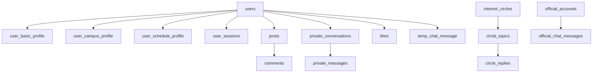
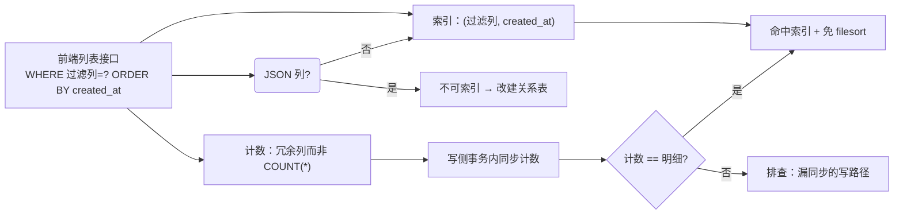

# 核心表结构设计

<cite>
**本文引用的文件**
- [V2026.05.18.0001__create_users.sql](file://database/flyway/sql/V2026.05.18.0001__create_users.sql)
- [V2026.05.21.0003__create_posts_table.sql](file://database/flyway/sql/V2026.05.21.0003__create_posts_table.sql)
- [V2026.05.21.0006__alter_users_add_profile_completion.sql](file://database/flyway/sql/V2026.05.21.0006__alter_users_add_profile_completion.sql)
- [V2026.05.24.0002__create_private_conversations.sql](file://database/flyway/sql/V2026.05.24.0002__create_private_conversations.sql)
- [V2026.05.24.0003__create_user_sessions.sql](file://database/flyway/sql/V2026.05.24.0003__create_user_sessions.sql)
- [V2026.05.26.0002__alter_user_basic_profile_add_interest_tags.sql](file://database/flyway/sql/V2026.05.26.0002__alter_user_basic_profile_add_interest_tags.sql)
- [V2026.05.31.0001__fix_entity_ddl_mismatches.sql](file://database/flyway/sql/V2026.05.31.0001__fix_entity_ddl_mismatches.sql)
- [V2026.06.25.0001__add_user_role_and_init_admin.sql](file://database/flyway/sql/V2026.06.25.0001__add_user_role_and_init_admin.sql)
- [V2026.06.25.0004__add_user_status_and_post_audit_status.sql](file://database/flyway/sql/V2026.06.25.0004__add_user_status_and_post_audit_status.sql)
- [V2026.07.24.0004__add_user_verification_flags.sql](file://database/flyway/sql/V2026.07.24.0004__add_user_verification_flags.sql)
- [V2026.07.25.0004__add_auto_renew_to_users.sql](file://database/flyway/sql/V2026.07.25.0004__add_auto_renew_to_users.sql)
- [V2026.07.25.0014__add_performance_indexes.sql](file://database/flyway/sql/V2026.07.25.0014__add_performance_indexes.sql)
- [V2026.07.25.0017__add_remaining_missing_indexes.sql](file://database/flyway/sql/V2026.07.25.0017__add_remaining_missing_indexes.sql)
- [V2026.07.26.0001__add_entity_index_annotations.sql](file://database/flyway/sql/V2026.07.26.0001__add_entity_index_annotations.sql)
- [V2026.07.26.0003__add_version_columns.sql](file://database/flyway/sql/V2026.07.26.0003__add_version_columns.sql)
- [UserBasicProfile.java](file://apps/api/src/main/java/com/campuslove/api/entity/UserBasicProfile.java)
- [UserCampusProfile.java](file://apps/api/src/main/java/com/campuslove/api/entity/UserCampusProfile.java)
- [UserScheduleProfile.java](file://apps/api/src/main/java/com/campuslove/api/entity/UserScheduleProfile.java)
- [CircleTopic.java](file://apps/api/src/main/java/com/campuslove/api/entity/CircleTopic.java)
- [CircleReply.java](file://apps/api/src/main/java/com/campuslove/api/entity/CircleReply.java)
- [CampusTopicReply.java](file://apps/api/src/main/java/com/campuslove/api/entity/CampusTopicReply.java)
- [TempChatMessage.java](file://apps/api/src/main/java/com/campuslove/api/entity/TempChatMessage.java)
- [CommentLike.java](file://apps/api/src/main/java/com/campuslove/api/village/CommentLike.java)
- [OfficialChatMessage.java](file://apps/api/src/main/java/com/campuslove/api/entity/OfficialChatMessage.java)
</cite>

## 目录
1. [简介](#简介)
2. [项目结构](#项目结构)
3. [核心组件](#核心组件)
4. [架构总览](#架构总览)
5. [子页面导航与边界](#子页面导航与边界)
6. [四张领域根表](#四张领域根表)
7. [跨表通用列约定](#跨表通用列约定)
8. [主键与外键策略](#主键与外键策略)
9. [枚举与状态列](#枚举与状态列)
10. [JSON 列与关系表的分界](#json-列与关系表的分界)
11. [冗余计数列](#冗余计数列)
12. [乐观锁与审计列](#乐观锁与审计列)
13. [索引落点速查](#索引落点速查)
14. [实体与表的对照方法](#实体与表的对照方法)
15. [依赖关系分析](#依赖关系分析)
16. [性能考虑](#性能考虑)
17. [故障排查指南](#故障排查指南)
18. [结论](#结论)

## 简介
`核心表结构设计` 把 111 张表按业务域拆成四份逐表文档。本页只维护**跨域共用的结构规律**：
所有表共享的主键/审计/锁策略、状态列的建模方式、JSON 列与关系表的分界、
冗余计数的取舍，以及"实体与表怎么对照"的方法。

四张领域根表分别是 `users`（身份）、`posts`（内容）、`interest_circles`（社区）、
`private_conversations`（消息），其余表都是它们的扩展或关系表。

## 项目结构
- 结构定义：`database/flyway/sql/`（203 个 `V*.sql`）。
- 持久化映射：`apps/api/.../entity/`（94 个实体）与 `village/`、`chat/` 包内的少量实体/关系类
  （如 `CommentLike`）。
- 子文档：
  - `核心表结构设计/用户相关表`
  - `核心表结构设计/匹配相关表`
  - `核心表结构设计/消息相关表`
  - `核心表结构设计/社区相关表`

## 核心组件
四张根表的建表脚本都在 5 月 18 日至 5 月 24 日这一周内定形：

| 根表 | 脚本 | 行数 | 关键结构 |
|---|---|---|---|
| `users` | `V2026.05.18.0001__create_users.sql` | 20 | `openid` 唯一、`profile_completion`、关注/粉丝计数、`interest_tags JSON` |
| `posts` | `V2026.05.21.0003__create_posts_table.sql` | 17 | `category`/`status` 双枚举、`images JSON`、`tags JSON`、两个计数 |
| `private_conversations` + `private_messages` | `V2026.05.24.0002__create_private_conversations.sql` | 29 | 函数式唯一键、FK CASCADE、复合索引 |
| `user_sessions` | `V2026.05.24.0003__create_user_sessions.sql` | 11 | 令牌唯一 + user/expires 双索引 |

（`interest_circles` 的建表脚本属于社区域，详见 `社区相关表`。）

**章节来源**
- [V2026.05.18.0001__create_users.sql:1-20](file://database/flyway/sql/V2026.05.18.0001__create_users.sql#L1-L20)
- [V2026.05.21.0003__create_posts_table.sql:1-17](file://database/flyway/sql/V2026.05.21.0003__create_posts_table.sql#L1-L17)
- [V2026.05.24.0002__create_private_conversations.sql:1-29](file://database/flyway/sql/V2026.05.24.0002__create_private_conversations.sql#L1-L29)
- [V2026.05.24.0003__create_user_sessions.sql:1-11](file://database/flyway/sql/V2026.05.24.0003__create_user_sessions.sql#L1-L11)

## 架构总览


[此图为概念流程，不直接对应具体源文件，故不提供图表来源]



[此图为概念流程，不直接对应具体源文件，故不提供图表来源]

## 子页面导航与边界
本页与四份子文档的分工是"规律 vs 清单"：

- **用户相关表**：`users` 的追加列（`role`/`password`/`status`/`auto_renew_enabled`）、
  三张画像表的逐列定义、会话三表、认证位与徽章字段。
- **匹配相关表**：`likes`、`pass_records`、`heart_signals`、`match_config`、
  `recommendation_preferences`、`recommend_strategy`、`icebreaker_topics`、`user_match_ticket`。
- **消息相关表**：`private_conversations`、`private_messages`、临时聊天三表、
  通知与互动事件、官方号三表、通话与语音、推送偏好与免打扰。
- **社区相关表**：`posts` 及其点赞/收藏/分享/标签/草稿/浏览历史、评论与评论点赞、
  圈子与话题、校园话题、举报与敏感词、素材。

任何"某张表有哪些列"的问题属于子文档；任何"为什么这样建模"的问题在本页。

## 四张领域根表
- **`users`**：16 列基线（`id`、`openid`、`nickname`、`avatar_url`、`bio`、`grade_label`、
  `pronouns`、`phone`、`profile_completion`、`interest_tags`、`following_count`、
  `followers_count`、`created_at`、`updated_at`），`UNIQUE KEY uk_users_openid`(L19)，
  表注释"用户表"、字符序 `utf8mb4_0900_ai_ci`(L20)。
- **`posts`**：`author_id` + `content TEXT NOT NULL` + `images JSON` + `tags JSON` +
  `category ENUM(...)` + `likes_count` + `comments_count` + `status ENUM('active','deleted','hidden')`，
  三个索引 `idx_posts_author`/`idx_posts_category`/`idx_posts_created_at`(L14-L16)，
  表注释"村口帖子表"(L17)。
- **`private_conversations`**：`conversation_uid` 唯一 +
  `uk_private_conversations_users ((LEAST(user_a_id,user_b_id)),(GREATEST(...)))`(L16)
  保证无向配对唯一；两张表用 FK 相连（L26）。
- **`interest_circles`**：社区域根表，话题与成员关系向下展开（见 `社区相关表`）。

**章节来源**
- [V2026.05.18.0001__create_users.sql:3-20](file://database/flyway/sql/V2026.05.18.0001__create_users.sql#L3-L20)
- [V2026.05.21.0003__create_posts_table.sql:2-17](file://database/flyway/sql/V2026.05.21.0003__create_posts_table.sql#L2-L17)
- [V2026.05.24.0002__create_private_conversations.sql:1-29](file://database/flyway/sql/V2026.05.24.0002__create_private_conversations.sql#L1-L29)

## 跨表通用列约定
在四张根表与实体上反复出现的同一组约定：

1. **主键**：`id BIGINT UNSIGNED NOT NULL AUTO_INCREMENT` + `PRIMARY KEY (id)`。
2. **时间**：`created_at DATETIME NOT NULL DEFAULT CURRENT_TIMESTAMP`，
   `updated_at ... ON UPDATE CURRENT_TIMESTAMP`（由库维护，不依赖应用写）。
3. **默认值写在列上**：`nickname ... NOT NULL DEFAULT '新同学'`(L6)、
   `profile_completion INT NOT NULL DEFAULT 0`(L12)、`posts.status ... DEFAULT 'active'`(L9)。
4. **中文 COMMENT 覆盖到列**：`posts` 的每一列都带注释(L4-L11)。
5. **表级 COMMENT + 引擎 + 字符集**：`ENGINE=InnoDB DEFAULT CHARSET=utf8mb4 COLLATE=utf8mb4_0900_ai_ci`(L20)。

**章节来源**
- [V2026.05.18.0001__create_users.sql:4-17](file://database/flyway/sql/V2026.05.18.0001__create_users.sql#L4-L17)
- [V2026.05.21.0003__create_posts_table.sql:4-12](file://database/flyway/sql/V2026.05.21.0003__create_posts_table.sql#L4-L12)

## 主键与外键策略
本 schema **只在一处使用数据库外键**：

```sql
CONSTRAINT fk_private_messages_conversation FOREIGN KEY (conversation_id)
    REFERENCES private_conversations(id) ON DELETE CASCADE
```

即"删会话必删消息"这一条被交给数据库保证，其余跨表完整性由应用层负责。
这样做的代价与收益都明确：

- 收益：写入路径不受 FK 检查约束，迁移与数据回填不易被约束阻塞；
  删表顺序不需要拓扑排序。
- 代价：孤儿数据只能靠任务清理；`user_id` 写错不会被数据库拦下。

唯一键承担了大量业务不变式：`uk_users_openid`(L19)、`uk_user_sessions_token`(L8)、
`uk_private_conversations_uid`(L15)、`uk_private_conversations_users`(L16)、
`uk_likes_user_target(user_id, target_user_id)`（`V2026.07.26.0003` L193）、
`uk_users_phone`（`V2026.08.08.0003`）。其中后两条属于**后期补加**，
说明"关系唯一性"是在上线后才被逐条确认的。

**章节来源**
- [V2026.05.24.0002__create_private_conversations.sql:15-26](file://database/flyway/sql/V2026.05.24.0002__create_private_conversations.sql#L15-L26)
- [V2026.05.18.0001__create_users.sql:19-19](file://database/flyway/sql/V2026.05.18.0001__create_users.sql#L19-L19)
- [V2026.05.24.0003__create_user_sessions.sql:8-8](file://database/flyway/sql/V2026.05.24.0003__create_user_sessions.sql#L8-L8)
- [V2026.07.26.0003__add_version_columns.sql:193-193](file://database/flyway/sql/V2026.07.26.0003__add_version_columns.sql#L193-L193)

## 枚举与状态列
状态语义一律用 `ENUM` 建模，并且**一个列只表达一个维度**：

- `posts.category ENUM('all','interest','sincere','hometown','anonymous','latest')`(L7)：内容分类。
- `posts.status ENUM('active','deleted','hidden')`(L9)：软删/隐藏。
- `posts.audit_status ENUM('pending','approved','rejected') DEFAULT 'approved'`：
  由 `V2026.06.25.0004__add_user_status_and_post_audit_status.sql` 追加，
  脚本注释解释了不能复用 `status` 的原因——"原 posts 表 status 枚举（active/deleted/hidden）
  语义为软删/隐藏"(L8-L13)。
- `users.role VARCHAR(16) 'USER'/'ADMIN'`（`V2026.06.25.0001` L9-L10）与
  `users.status 'active'/'disabled'`（`V2026.06.25.0004` L12-L18）刻意正交：
  前者是身份、后者是可用性，"disabled 用户禁止登录"。
- 认证徽章则用两个布尔列而非枚举：
  `email_verified` / `id_card_verified` `BOOLEAN NOT NULL DEFAULT FALSE`
  （`V2026.07.24.0004` L10-L12），优先级 school > email > idcard > none 由应用判定(L6-L7)。

一处不一致：`private_messages.message_kind VARCHAR(16) DEFAULT 'text'`(L22) 用字符串列而非枚举，
临时聊天侧同样以 `kind = "text"` 的字符串字段建模，扩展新消息类型不需要改表，但没有库级取值约束。

**章节来源**
- [V2026.05.21.0003__create_posts_table.sql:7-9](file://database/flyway/sql/V2026.05.21.0003__create_posts_table.sql#L7-L9)
- [V2026.06.25.0004__add_user_status_and_post_audit_status.sql:8-18](file://database/flyway/sql/V2026.06.25.0004__add_user_status_and_post_audit_status.sql#L8-L18)
- [V2026.06.25.0001__add_user_role_and_init_admin.sql:9-12](file://database/flyway/sql/V2026.06.25.0001__add_user_role_and_init_admin.sql#L9-L12)
- [V2026.07.24.0004__add_user_verification_flags.sql:6-12](file://database/flyway/sql/V2026.07.24.0004__add_user_verification_flags.sql#L6-L12)
- [V2026.05.24.0002__create_private_conversations.sql:22-22](file://database/flyway/sql/V2026.05.24.0002__create_private_conversations.sql#L22-L22)

## JSON 列与关系表的分界
判断标准是"是否需要被查询条件使用"：

- **只用于展示、不参与过滤** → JSON 列。
  `posts.images JSON`(L5)、`posts.tags JSON`(L6)、`users.interest_tags JSON`(L13)、
  `user_basic_profile.interest_tags JSON ... AFTER pronouns`(L9-L11)。
- **需要按值检索或计数** → 独立关系表。
  `post_tags`（帖子↔标签）、`comment_likes`（`CommentLike` 以 `commentId`+`userId` 建关系，
  `@Table`(L22)、字段 L32-L45）、`user_follows`、`circle_memberships`、`post_favorites`。
- **半结构化偏好**（时间窗、课程块、相册）继续用 JSON 字符串：
  `UserScheduleProfile.preferredTimeWindowJson = "[]"`(L39)、`courseBlockJson = "[]"`(L43)、
  `UserBasicProfile.photoGallery = "[]"`(L107)。

一条硬约束：JSON 列没有二级索引可用，任何"按标签筛选"的需求若走 JSON 就会全表扫；
新增可筛选维度时必须建关系表，而不是往 JSON 里塞。

**章节来源**
- [V2026.05.21.0003__create_posts_table.sql:5-6](file://database/flyway/sql/V2026.05.21.0003__create_posts_table.sql#L5-L6)
- [V2026.05.26.0002__alter_user_basic_profile_add_interest_tags.sql:9-11](file://database/flyway/sql/V2026.05.26.0002__alter_user_basic_profile_add_interest_tags.sql#L9-L11)
- [UserScheduleProfile.java:35-43](file://apps/api/src/main/java/com/campuslove/api/entity/UserScheduleProfile.java#L35-L43)
- [UserBasicProfile.java:59-107](file://apps/api/src/main/java/com/campuslove/api/entity/UserBasicProfile.java#L59-L107)
- [CommentLike.java:20-45](file://apps/api/src/main/java/com/campuslove/api/village/CommentLike.java#L20-L45)

## 冗余计数列
列表页避免聚合子查询的通用手法是把计数存在"多"的一方：

- `users.following_count` / `followers_count`(L14-L15)：关注关系统计在账号行上。
- `posts.likes_count` / `comments_count`(L8-L9)：帖子列表一次读出点赞与评论数。
- `circle_topics.reply_count`(L65，默认 0)：话题列表不 COUNT 回复表。
- `private_conversations.last_message_preview` / `last_message_at`(L6-L7)：
  会话列表连"最后一条消息"都冗余下来，避免每行再查一次消息表。

代价一致：写侧必须同步。因此这类列的更新点应与主操作在同一事务内完成
（消息发送、点赞、回复、关注），否则列表与详情会互相矛盾——
排查"计数与明细不一致"的问题时，先找写侧是否漏同步。

**章节来源**
- [V2026.05.18.0001__create_users.sql:14-15](file://database/flyway/sql/V2026.05.18.0001__create_users.sql#L14-L15)
- [V2026.05.21.0003__create_posts_table.sql:8-9](file://database/flyway/sql/V2026.05.21.0003__create_posts_table.sql#L8-L9)
- [V2026.05.24.0002__create_private_conversations.sql:6-7](file://database/flyway/sql/V2026.05.24.0002__create_private_conversations.sql#L6-L7)
- [CircleTopic.java:61-69](file://apps/api/src/main/java/com/campuslove/api/entity/CircleTopic.java#L61-L69)

## 乐观锁与审计列
`version` 列由一次集中迁移统一补齐：`V2026.07.26.0003__add_version_columns.sql`（345 行）
的类注释写明目标是"为所有 JPA Entity 添加 @Version 乐观锁字段，
对应数据库层需要为所有业务表新增 version 列（BIGINT DEFAULT 0）"，
同时"补齐关键表的唯一约束与外键约束"(L1-L8)。

在实体侧可以逐条看到落点：`UserBasicProfile.version = 0L`(L194)、
`UserCampusProfile`(L73)、`UserScheduleProfile`(L69)、`CircleTopic`(L105)、
`CircleReply`(L61)、`CampusTopicReply`(L61)、`TempChatMessage`(L81)。

审计列分两类：时间列（`created_at`/`updated_at`）由 DDL 默认值维护；
操作人列（如 `CircleTopic.auditorId` L82、`auditedAt` L86、`auditRemark` L78）
则是业务审核链的一部分，而不是通用审计日志——通用后台操作审计另有 `audit_log` 表。

**章节来源**
- [V2026.07.26.0003__add_version_columns.sql:1-8](file://database/flyway/sql/V2026.07.26.0003__add_version_columns.sql#L1-L8)
- [V2026.07.26.0003__add_version_columns.sql:193-193](file://database/flyway/sql/V2026.07.26.0003__add_version_columns.sql#L193-L193)
- [UserBasicProfile.java:175-194](file://apps/api/src/main/java/com/campuslove/api/entity/UserBasicProfile.java#L175-L194)
- [CircleTopic.java:74-105](file://apps/api/src/main/java/com/campuslove/api/entity/CircleTopic.java#L74-L105)
- [TempChatMessage.java:69-81](file://apps/api/src/main/java/com/campuslove/api/entity/TempChatMessage.java#L69-L81)

## 索引落点速查
四张根表与关系表的关键索引（完整推导见 `索引设计与性能优化`）：

| 表 | 索引 | 来源 |
|---|---|---|
| `users` | `uk_users_openid`；`idx_users_profile_completion`；`idx_users_phone`；`idx_users_created_at` | 建表 L19、`V2026.05.21.0006` L3、`V2026.07.25.0017` L20、L24 |
| `posts` | `idx_posts_author`/`idx_posts_category`/`idx_posts_created_at`；后补 `idx_posts_author_created_at`、`idx_posts_status_created_at`、`idx_posts_status` | 建表 L14-L16、`V2026.07.25.0014` L42-L43、`V2026.07.25.0017` L32 |
| `private_messages` | `idx_private_messages_conversation (conversation_id, created_at)`、`idx_private_messages_sender`；后补 `idx_private_messages_delivery_status` | 建表 L25、`V2026.07.26.0001` L65 |
| `user_sessions` | `uk_user_sessions_token`、`idx_user_sessions_user`、`idx_user_sessions_expires` | `V2026.05.24.0003` L8-L10 |
| `likes` / `heart_signals` / `comments` | `idx_likes_*_created_at`、`idx_comments_post_created_at` 等 18 组；`idx_likes_status`、`idx_heart_signals_status` | `V2026.07.25.0014` L34-L60、`V2026.07.25.0017` L40-L44 |

**章节来源**
- [V2026.07.25.0014__add_performance_indexes.sql:34-91](file://database/flyway/sql/V2026.07.25.0014__add_performance_indexes.sql#L34-L91)
- [V2026.07.25.0017__add_remaining_missing_indexes.sql:20-44](file://database/flyway/sql/V2026.07.25.0017__add_remaining_missing_indexes.sql#L20-L44)
- [V2026.07.26.0001__add_entity_index_annotations.sql:35-65](file://database/flyway/sql/V2026.07.26.0001__add_entity_index_annotations.sql#L35-L65)

## 实体与表的对照方法
从实体读到表，或反向核对，固定用四步：

1. 看 `@Table(name = "...")`：`user_basic_profile`(L26)、`user_campus_profile`(L22)、
   `user_schedule_profile`(L22)、`circle_topics`(L26)、`circle_replies`(L24)、
   `temp_chat_message`(L24)。实体与仓储的对应清单见各子文档。
2. 看 `@Version` 字段是否存在，与 `V2026.07.26.0003` 的补齐范围交叉验证。
3. 用 `V2026.05.31.0001__fix_entity_ddl_mismatches.sql` 这类"追平脚本"反查历史落差：
   它一次处理了缺列(`ADD COLUMN ... AFTER ...` L5、L8)、枚举落后(L11)与默认值漂移(L14) 三类问题。
4. 索引落差用 `V2026.07.26.0001__add_entity_index_annotations.sql` 核对：
   文件里逐条列出的索引名可以直接对应到实体声明。

实体侧的可测性也有对应文件（如 `UserBasicProfileTest` 250 行），
改字段时应同时看它，避免只改 DDL 不改断言。

**章节来源**
- [UserBasicProfile.java:24-35](file://apps/api/src/main/java/com/campuslove/api/entity/UserBasicProfile.java#L24-L35)
- [UserCampusProfile.java:20-27](file://apps/api/src/main/java/com/campuslove/api/entity/UserCampusProfile.java#L20-L27)
- [CircleTopic.java:24-34](file://apps/api/src/main/java/com/campuslove/api/entity/CircleTopic.java#L24-L34)
- [CircleReply.java:22-29](file://apps/api/src/main/java/com/campuslove/api/entity/CircleReply.java#L22-L29)
- [TempChatMessage.java:22-34](file://apps/api/src/main/java/com/campuslove/api/entity/TempChatMessage.java#L22-L34)
- [V2026.05.31.0001__fix_entity_ddl_mismatches.sql:5-14](file://database/flyway/sql/V2026.05.31.0001__fix_entity_ddl_mismatches.sql#L5-L14)
- [V2026.07.26.0001__add_entity_index_annotations.sql:35-65](file://database/flyway/sql/V2026.07.26.0001__add_entity_index_annotations.sql#L35-L65)

## 依赖关系分析
- **根表 → 扩展表**：`users` 派生 3 张 1:1 画像表与 3 张会话/在线态表；
  `posts` 派生 6 张互动表；`interest_circles` 派生话题与回复。
- **匿名链的结构特征**：`TempChatMessage.sender`(L38) 是会话内标识而非 `user_id`，
  `quoteSnapshot`(L62) 内联被引用消息，二者共同支撑"匿名 + 引用不依赖原文存活"。
- **官方号链**：`official_accounts` → `official_messages`（广播）与
  `official_chat_messages`（会话，`OfficialChatMessage` 以 `direction = Direction.user.name()` L46
  区分收发方向）。
- **校园话题与圈子话题是两套并行结构**：`CircleTopic`/`CircleReply`（L26、L24）与
  `campus_topics`/`CampusTopicReply`（表 `campus_topic_replies` L21，带 `isAnonymous` L42），
  命名相似但不是同一套表，改动时容易误伤。
- **配置表被算法消费**：`match_config`、`recommend_strategy` 与代码默认值构成两层
  （见 `API接口文档/匹配与推荐API`）。

```mermaid
graph LR
    U["users"] --> T3["3 张画像表（1:1）"]
    U --> S3["会话/在线/设备（1:N）"]
    P["posts"] --> I6["6 张互动表"]
    IC["interest_circles"] --> CT2["circle_topics → circle_replies"]
    CT2 -.并行不共享.→ CP["campus_topics → campus_topic_replies"]
    PC2["private_conversations"] --> PM2["private_messages（FK CASCADE）"]
    OA2["official_accounts"] --> OM["official_messages"]
    OA2 --> OC2["official_chat_messages"]
```

**图表来源**
- [CampusTopicReply.java:19-42](file://apps/api/src/main/java/com/campuslove/api/entity/CampusTopicReply.java#L19-L42)
- [CircleTopic.java:24-34](file://apps/api/src/main/java/com/campuslove/api/entity/CircleTopic.java#L24-L34)
- [OfficialChatMessage.java:18-46](file://apps/api/src/main/java/com/campuslove/api/entity/OfficialChatMessage.java#L18-L46)
- [TempChatMessage.java:34-62](file://apps/api/src/main/java/com/campuslove/api/entity/TempChatMessage.java#L34-L62)

**章节来源**
- [V2026.05.24.0002__create_private_conversations.sql:22-26](file://database/flyway/sql/V2026.05.24.0002__create_private_conversations.sql#L22-L26)

## 性能考虑
- **列表页决定索引形态**：`idx_*_created_at` 成批出现(L34-L91)，
  因为"过滤 + 按时间倒序 + 分页"是本项目的标准读法。
- **计数列换免 JOIN**：见"冗余计数列"一节；读侧收益、写侧成本。
- **FK CASCADE 只有一处**：级联删除范围可控，其余删除需应用层显式处理。
- **JSON 不可索引**：筛选维度必须落关系表，否则退化为全表扫。
- **`version` 列的成本**：每次更新多一次版本比较；主键定位场景下开销可忽略。

**章节来源**
- [V2026.07.25.0014__add_performance_indexes.sql:34-91](file://database/flyway/sql/V2026.07.25.0014__add_performance_indexes.sql#L34-L91)
- [V2026.07.25.0017__add_remaining_missing_indexes.sql:11-14](file://database/flyway/sql/V2026.07.25.0017__add_remaining_missing_indexes.sql#L11-L14)

## 故障排查指南
- **列存在但实体没有（或反之）**：按"实体与表的对照方法"四步走；
  历史上这类偏差就是由 `V2026.05.31.0001__fix_entity_ddl_mismatches.sql` 处理的(L5-L14)。
- **计数与明细不一致**：查写侧是否在事务内同步更新计数列(L8-L9、L14-L15、L65)。
- **同一对用户出现两条会话**：函数式唯一键依赖 `LEAST`/`GREATEST` 表达式索引，
  MySQL 版本不支持时约束静默缺失(L16)。
- **列表接口慢**：优先检查排序列是否进了索引末位（缺 `created_at` 就会 filesort）。
- **筛选无结果或全表扫**：确认筛选字段不是 JSON 列；改用 `post_tags`、
  `user_interest_tag` 这类关系表。
- **改枚举后索引失效**：需要配套重建脚本（`V2026.07.28.0007`，
  见 `索引设计与性能优化`）。
- **误把校园话题当圈子话题**：两套表并行存在，`CampusTopicReply` 与 `CircleReply` 字段不同。

**章节来源**
- [V2026.05.31.0001__fix_entity_ddl_mismatches.sql:5-14](file://database/flyway/sql/V2026.05.31.0001__fix_entity_ddl_mismatches.sql#L5-L14)
- [CampusTopicReply.java:19-61](file://apps/api/src/main/java/com/campuslove/api/entity/CampusTopicReply.java#L19-L61)
- [CircleReply.java:22-61](file://apps/api/src/main/java/com/campuslove/api/entity/CircleReply.java#L22-L61)

## 结论
四张根表定下了整套 schema 的骨架，其余 107 张表是它们的扩展与关系。
跨域规律可以浓缩成六条：**自增 BIGINT 主键 + 库维护的时间列 + 列级默认值与中文注释**；
**状态用 ENUM 且一列一维度**；**唯一键表达业务不变式（含一处表达式唯一键）**；
**外键只用于私信级联，其余完整性在应用层**；**展示型多值用 JSON、可筛选多值用关系表**；
**列表性能靠"过滤列 + created_at"复合索引与冗余计数列**。

逐表逐列的清单请看四份子文档；迁移与索引的演进过程看
`数据库设计与迁移/Flyway数据库迁移管理` 与 `索引设计与性能优化`。
