# 消息相关表

<cite>
**本文引用的文件**
- [V2026.05.24.0002__create_private_conversations.sql](file://database/flyway/sql/V2026.05.24.0002__create_private_conversations.sql)
- [V2026.05.29.0002__alter_visitors_add_is_read_and_conversations_add_pinned.sql](file://database/flyway/sql/V2026.05.29.0002__alter_visitors_add_is_read_and_conversations_add_pinned.sql)
- [V2026.06.01.0001__add_recall_delivery_quote_to_messages.sql](file://database/flyway/sql/V2026.06.01.0001__add_recall_delivery_quote_to_messages.sql)
- [PrivateMessageService.java](file://apps/api/src/main/java/com/campuslove/api/chat/PrivateMessageService.java)
- [RealPrivateMessageService.java](file://apps/api/src/main/java/com/campuslove/api/chat/RealPrivateMessageService.java)
- [MockPrivateMessageService.java](file://apps/api/src/main/java/com/campuslove/api/chat/MockPrivateMessageService.java)
- [PrivateMessageController.java](file://apps/api/src/main/java/com/campuslove/api/chat/PrivateMessageController.java)
- [PrivateConversation.java](file://apps/api/src/main/java/com/campuslove/api/entity/PrivateConversation.java)
- [PrivateMessage.java](file://apps/api/src/main/java/com/campuslove/api/entity/PrivateMessage.java)
- [PrivateConversationRepository.java](file://apps/api/src/main/java/com/campuslove/api/repository/PrivateConversationRepository.java)
- [PrivateMessageRepository.java](file://apps/api/src/main/java/com/campuslove/api/repository/PrivateMessageRepository.java)
- [MessageView.java](file://apps/api/src/main/java/com/campuslove/api/chat/MessageView.java)
- [V2026.05.31.0001__fix_entity_ddl_mismatches.sql](file://database/flyway/sql/V2026.05.31.0001__fix_entity_ddl_mismatches.sql)
- [V2026.07.26.0003__add_version_columns.sql](file://database/flyway/sql/V2026.07.26.0003__add_version_columns.sql)
- [V2026.07.26.0004__p8_database_standardization.sql](file://database/flyway/sql/V2026.07.26.0004__p8_database_standardization.sql)
- [V2026.08.08.0020__add_private_messages_duration_seconds.sql](file://database/flyway/sql/V2026.08.08.0020__add_private_messages_duration_seconds.sql)
- [V2026.08.10.0021__add_private_messages_deleted_for_sender.sql](file://database/flyway/sql/V2026.08.10.0021__add_private_messages_deleted_for_sender.sql)
- [V2026.08.10.0031__add_conversation_mute.sql](file://database/flyway/sql/V2026.08.10.0031__add_conversation_mute.sql)
- [V2026.05.27.0001__create_temp_chat_tables.sql](file://database/flyway/sql/V2026.05.27.0001__create_temp_chat_tables.sql)
- [PrivateMessageSoftDeleteTest.java](file://apps/api/src/test/java/com/campuslove/api/chat/PrivateMessageSoftDeleteTest.java)
- [TempChatMessageService.java](file://apps/api/src/main/java/com/campuslove/api/chat/TempChatMessageService.java)
- [VoiceMessageService.java](file://apps/api/src/main/java/com/campuslove/api/chat/VoiceMessageService.java)
- [flyway.toml](file://database/flyway/flyway.toml)
- [V2026.07.25.0014__add_performance_indexes.sql](file://database/flyway/sql/V2026.07.25.0014__add_performance_indexes.sql)
- [V2026.07.25.0017__add_remaining_missing_indexes.sql](file://database/flyway/sql/V2026.07.25.0017__add_remaining_missing_indexes.sql)
- [V2026.07.26.0001__add_entity_index_annotations.sql](file://database/flyway/sql/V2026.07.26.0001__add_entity_index_annotations.sql)
- [V2026.07.27.0005__enum_to_varchar_check.sql](file://database/flyway/sql/V2026.07.27.0005__enum_to_varchar_check.sql)
- [V2026.07.28.0004__audit_fields.sql](file://database/flyway/sql/V2026.07.28.0004__audit_fields.sql)
- [V2026.07.28.0005__add_indexes.sql](file://database/flyway/sql/V2026.07.28.0005__add_indexes.sql)
- [V2026.08.09.0003__seed_comment_likes_for_demo_posts.sql](file://database/flyway/sql/V2026.08.09.0003__seed_comment_likes_for_demo_posts.sql)
- [ConversationView.java](file://apps/api/src/main/java/com/campuslove/api/chat/ConversationView.java)
- [MessageWebSocketHandler.java](file://apps/api/src/main/java/com/campuslove/api/chat/MessageWebSocketHandler.java)
- [TempChatCleanupService.java](file://apps/api/src/main/java/com/campuslove/api/chat/TempChatCleanupService.java)
- [TempChatViewMapper.java](file://apps/api/src/main/java/com/campuslove/api/chat/TempChatViewMapper.java)
- [GuestDemoDataProvisioner.java](file://apps/api/src/main/java/com/campuslove/api/auth/GuestDemoDataProvisioner.java)
- [DtoMapper.java](file://apps/api/src/main/java/com/campuslove/api/dto/DtoMapper.java)
- [apps/client/src/pages/messages/index.vue](file://apps/client/src/pages/messages/index.vue)
</cite>

## 目录
1. [简介](#简介)
2. [项目结构](#项目结构)
3. [核心组件](#核心组件)
4. [架构总览](#架构总览)
5. [数据模型](#数据模型)
6. [详细组件分析](#详细组件分析)
7. [依赖关系分析](#依赖关系分析)
8. [性能考虑](#性能考虑)
9. [配置与开关](#配置与开关)
10. [故障排查指南](#故障排查指南)
11. [能力缺口登记](#能力缺口登记)
12. [结论](#结论)
13. [附录](#附录)

## 简介
本页聚焦 Campus Love 后端「消息」域的持久化结构：由 Flyway 迁移脚本建立的 `private_conversations`（私信会话表）与 `private_messages`（私信消息表），以及围绕这两张表的增量迁移（置顶列、撤回/投递/引用列）。文档同时把这些表结构映射到 JPA 实体与 `com.campuslove.api.chat` 包下的服务实现，说明唯一性约束、`conversation_uid` 生成策略、用户对双向排序、分页查询、已读状态、撤回与软删除的实际实现位置。

范围界定：本页只覆盖数据库表结构与直接读写这些表的 Java 代码路径；临时聊天（内存态）与语音文件存储只在「与消息表交互」的部分出现。

**章节来源**
- [PrivateMessageService.java:10](file://apps/api/src/main/java/com/campuslove/api/chat/PrivateMessageService.java#L10)

## 项目结构
消息相关表相关文件分布在两个层次：迁移脚本层（`database/flyway/sql`）与实体/服务层（`apps/api/src/main/java/com/campuslove/api/chat`、`.../entity`）。迁移脚本按日期编号顺序演进，实体类是运行期真值来源。

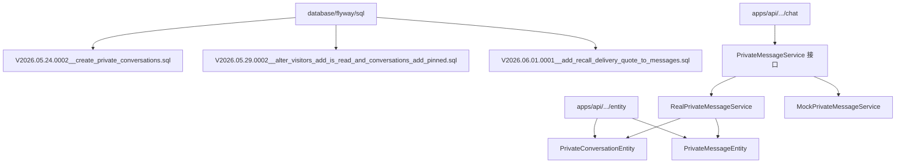

[此图为概念流程，不直接对应具体源文件，故不提供图表来源]

图中的 `PrivateConversationEntity` / `PrivateMessageEntity` 是概念名；实际实体类为 `PrivateConversation`（[PrivateConversation.java:20-23](file://apps/api/src/main/java/com/campuslove/api/entity/PrivateConversation.java#L20-L23)，`@Table(name = "private_conversations")`）与 `PrivateMessage`（[PrivateMessage.java:37-40](file://apps/api/src/main/java/com/campuslove/api/entity/PrivateMessage.java#L37-L40)，`@Table(name = "private_messages", ...)`）。

**章节来源**
- [V2026.05.24.0002__create_private_conversations.sql:1-29](file://database/flyway/sql/V2026.05.24.0002__create_private_conversations.sql#L1-L29)
- [V2026.06.01.0001__add_recall_delivery_quote_to_messages.sql:1-11](file://database/flyway/sql/V2026.06.01.0001__add_recall_delivery_quote_to_messages.sql#L1-L11)

## 核心组件
消息域由四层组件构成：迁移层（DDL）、实体层（JPA 映射）、仓储层（查询语义）、服务层（业务规则）。四层之间的对应关系是本页所有结论的骨架。

| 组件 | 类型 | 职责 | 落点 |
| --- | --- | --- | --- |
| `private_conversations` | MySQL 表 | 用户对会话、最后消息预览、置顶、双侧静音 | 迁移 V2026.05.24.0002 L1-L15 |
| `private_messages` | MySQL 表 | 单条私信内容、类型、已读/撤回/投递/软删状态 | 迁移 V2026.05.24.0002 L17-L29 |
| `PrivateConversation` | JPA 实体 | 表列到字段的映射，含 `@Version` 乐观锁与审计监听 | 实体文件 L20-L85 |
| `PrivateMessage` | JPA 实体 | 表列映射 + `@Table(indexes=...)` 索引声明 + `@ManyToOne` 关联 | 实体文件 L37-L133 |
| `PrivateConversationRepository` | Spring Data 接口 | 用户对查询、UID 查询、会话列表排序 | 仓储文件 L14-L51 |
| `PrivateMessageRepository` | Spring Data 接口 | 分页读、批量已读、批量未读统计、级联删除 | 仓储文件 L18-L158 |
| `PrivateMessageService` | 业务接口 | 9 个会话/消息能力的方法契约 | 接口文件 L10-L116 |
| `RealPrivateMessageService` | 真实现 | 读写两张表 + WebSocket 推送 + 内容安全 | 服务文件 L52-L801 |
| `MockPrivateMessageService` | 内存实现 | 无库环境下返回固定会话/消息 | 服务文件 L14-L119 |
| `PrivateMessageController` | REST 入口 | `/api/v1/messages` 8 个端点、分页与类型白名单校验 | 控制器文件 L36-L220 |
| `MessageWebSocketHandler` | STOMP 入口 | `/app/chat/send` 落库并推送 `/queue/messages` | 处理器文件 L43-L134 |

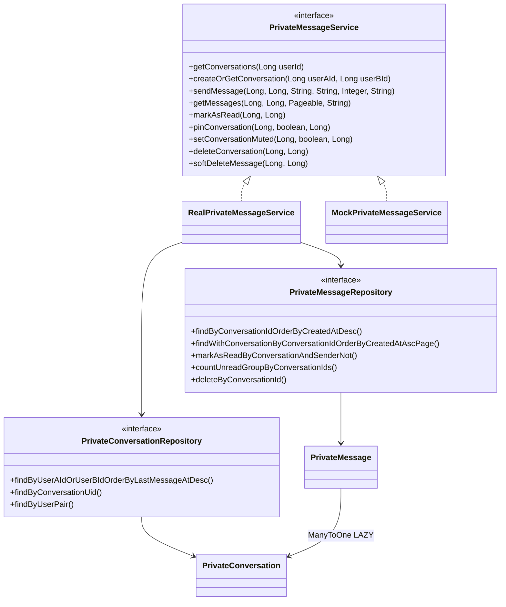

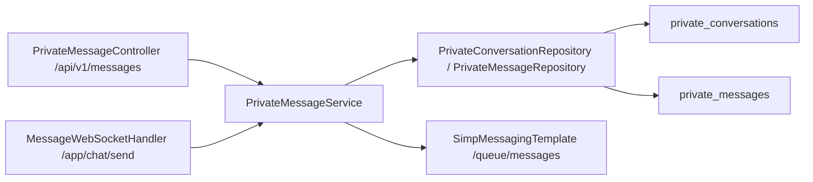

**图表来源**
- [PrivateMessageController.java:36-105](file://apps/api/src/main/java/com/campuslove/api/chat/PrivateMessageController.java#L36-L105)
- [MessageWebSocketHandler.java:43-134](file://apps/api/src/main/java/com/campuslove/api/chat/MessageWebSocketHandler.java#L43-L134)
- [RealPrivateMessageService.java:52-97](file://apps/api/src/main/java/com/campuslove/api/chat/RealPrivateMessageService.java#L52-L97)
- [PrivateMessageRepository.java:18-158](file://apps/api/src/main/java/com/campuslove/api/repository/PrivateMessageRepository.java#L18-L158)
- [PrivateConversationRepository.java:14-51](file://apps/api/src/main/java/com/campuslove/api/repository/PrivateConversationRepository.java#L14-L51)

**章节来源**
- [V2026.05.24.0002__create_private_conversations.sql:1-29](file://database/flyway/sql/V2026.05.24.0002__create_private_conversations.sql#L1-L29)
- [PrivateConversation.java:20-85](file://apps/api/src/main/java/com/campuslove/api/entity/PrivateConversation.java#L20-L85)
- [PrivateMessage.java:37-133](file://apps/api/src/main/java/com/campuslove/api/entity/PrivateMessage.java#L37-L133)
- [PrivateMessageService.java:10-116](file://apps/api/src/main/java/com/campuslove/api/chat/PrivateMessageService.java#L10-L116)
- [RealPrivateMessageService.java:52-97](file://apps/api/src/main/java/com/campuslove/api/chat/RealPrivateMessageService.java#L52-L97)
- [MockPrivateMessageService.java:14-119](file://apps/api/src/main/java/com/campuslove/api/chat/MockPrivateMessageService.java#L14-L119)
- [PrivateMessageController.java:36-220](file://apps/api/src/main/java/com/campuslove/api/chat/PrivateMessageController.java#L36-L220)
- [MessageWebSocketHandler.java:20-134](file://apps/api/src/main/java/com/campuslove/api/chat/MessageWebSocketHandler.java#L20-L134)

## 架构总览
消息域的读写通路有两条入口、一条服务实现、两张表。REST 入口是 `PrivateMessageController`（`@RequestMapping("/api/v1/messages")`，控制器 L36-L39）；实时入口是 `MessageWebSocketHandler` 的 `@MessageMapping("/chat/send")`（处理器 L106）。两条入口最终都调用 `RealPrivateMessageService.sendMessage`，因此 `private_messages` 的写入点只有一个（服务 L261-L273），这保证了会话预览 `last_message_preview`、`last_message_at` 与消息行的一致性（服务 L284-L287）。

持久化层的关键设计决定：

- 会话与消息是「一对多 + 级联删除」关系，DB 层由 `fk_private_messages_conversation ... ON DELETE CASCADE` 保证（迁移 L28），应用层另用 `deleteByConversationId` 显式批删（仓储 L155-L158）。
- 用户对的唯一性由函数式唯一索引 `uk_private_conversations_users ((LEAST(...)), (GREATEST(...)))` 保证（迁移 L12），因此表里不需要把「(A,B) 与 (B,A)」都插入一行。
- 会话列表排序由 JPQL `ORDER BY pc.lastMessageAt DESC` 决定（仓储 L23），置顶列 `pinned` 由迁移 V2026.05.29.0002 L7 引入。
- 已读态是双列体系：`private_messages.is_read`（迁移 L23）+ `delivery_status`（V2026.06.01.0001 L11）；`visitors.is_read` 属另一张表，同批迁移引入（V2026.05.29.0002 L3），与私信无关，此处仅作对照说明以免混淆。

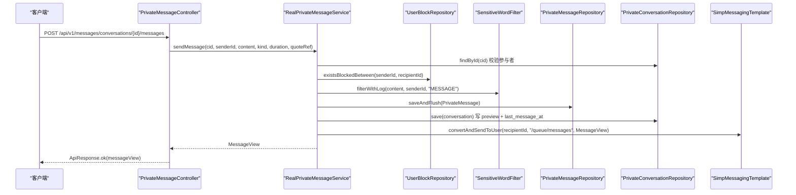

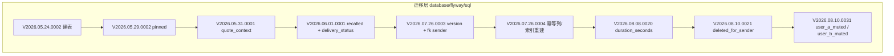

[此图为迁移时间线，节点即脚本文件名，逐条对应同名脚本，不额外指向单一源文件]

**图表来源**
- [RealPrivateMessageService.java:211-309](file://apps/api/src/main/java/com/campuslove/api/chat/RealPrivateMessageService.java#L211-L309)
- [PrivateMessageController.java:94-105](file://apps/api/src/main/java/com/campuslove/api/chat/PrivateMessageController.java#L94-L105)

**章节来源**
- [V2026.05.24.0002__create_private_conversations.sql:11-28](file://database/flyway/sql/V2026.05.24.0002__create_private_conversations.sql#L11-L28)
- [V2026.05.29.0002__alter_visitors_add_is_read_and_conversations_add_pinned.sql:1-7](file://database/flyway/sql/V2026.05.29.0002__alter_visitors_add_is_read_and_conversations_add_pinned.sql#L1-L7)
- [V2026.05.31.0001__fix_entity_ddl_mismatches.sql:7-11](file://database/flyway/sql/V2026.05.31.0001__fix_entity_ddl_mismatches.sql#L7-L11)
- [V2026.06.01.0001__add_recall_delivery_quote_to_messages.sql:1-11](file://database/flyway/sql/V2026.06.01.0001__add_recall_delivery_quote_to_messages.sql#L1-L11)
- [V2026.08.08.0020__add_private_messages_duration_seconds.sql:1-5](file://database/flyway/sql/V2026.08.08.0020__add_private_messages_duration_seconds.sql#L1-L5)
- [V2026.08.10.0021__add_private_messages_deleted_for_sender.sql:1-15](file://database/flyway/sql/V2026.08.10.0021__add_private_messages_deleted_for_sender.sql#L1-L15)
- [V2026.08.10.0031__add_conversation_mute.sql:1-4](file://database/flyway/sql/V2026.08.10.0031__add_conversation_mute.sql#L1-L4)
- [PrivateConversationRepository.java:23-27](file://apps/api/src/main/java/com/campuslove/api/repository/PrivateConversationRepository.java#L23-L27)
- [PrivateMessageRepository.java:155-158](file://apps/api/src/main/java/com/campuslove/api/repository/PrivateMessageRepository.java#L155-L158)

## 数据模型
两张核心表的每一列都由「DDL 迁移」与「JPA 实体注解」双向核对后列出。行号口径：SQL 用迁移脚本实际行，实体用 `.java` 实际行。

### private_conversations（私信会话表）

| 列 | 类型与约束 | DDL 出处 | 实体字段 / 出处 |
| --- | --- | --- | --- |
| `id` | `BIGINT UNSIGNED NOT NULL AUTO_INCREMENT`，PRIMARY KEY | 迁移 L2-L3、L10 | `id` `@GeneratedValue(IDENTITY)` L25-L27 |
| `conversation_uid` | `VARCHAR(64) NOT NULL` | 迁移 L3 | `conversationUid` `unique = true` L30-L31 |
| `user_a_id` | `BIGINT UNSIGNED NOT NULL` | 迁移 L4 | `userAId` L34-L35 |
| `user_b_id` | `BIGINT UNSIGNED NOT NULL` | 迁移 L5 | `userBId` L38-L39 |
| `last_message_preview` | `VARCHAR(255) DEFAULT NULL` | 迁移 L6 | `lastMessagePreview` L42-L43 |
| `last_message_at` | `DATETIME DEFAULT NULL` | 迁移 L7 | `lastMessageAt` L46-L47 |
| `created_at` | `DATETIME NOT NULL DEFAULT CURRENT_TIMESTAMP` | 迁移 L8 | `createdAt` `@CreatedDate` L63-L66 |
| `updated_at` | `DATETIME NOT NULL DEFAULT CURRENT_TIMESTAMP ON UPDATE CURRENT_TIMESTAMP` | 迁移 L9 | `updatedAt` `@LastModifiedDate` L70-L73 |
| `pinned` | `TINYINT(1) NOT NULL DEFAULT 0`，`AFTER last_message_at` | V2026.05.29.0002 L7 | `pinned` `nullable = false` 初值 false L50-L51 |
| `user_a_muted` | `TINYINT(1) NOT NULL DEFAULT 0`，`AFTER pinned` | V2026.08.10.0031 L3 | `userAMuted` L54-L55 |
| `user_b_muted` | `TINYINT(1) NOT NULL DEFAULT 0`，`AFTER user_a_muted` | V2026.08.10.0031 L4 | `userBMuted` L58-L59 |
| `version` | 由 `add_version_column_if_missing('private_conversations')` 补列 | V2026.07.26.0003 L107 | `version` `@Version` `BIGINT DEFAULT 0` L83-L85 |

键与索引：PRIMARY KEY `id`（迁移 L10）、`UNIQUE KEY uk_private_conversations_uid (conversation_uid)`（L11）、函数式唯一键 `uk_private_conversations_users ((LEAST(user_a_id,user_b_id)),(GREATEST(user_a_id,user_b_id)))`（L12）、`KEY idx_private_conversations_user_a`（L13）、`KEY idx_private_conversations_user_b`（L14）。追加索引见 V2026.07.28.0005 L107 与 L113（`(user_a_id, last_message_at)`、`(user_b_id, last_message_at)` 复合索引）。存储引擎与字符集：`ENGINE=InnoDB DEFAULT CHARSET=utf8mb4 COLLATE=utf8mb4_0900_ai_ci COMMENT='私信会话表'`（L15）。

### private_messages（私信消息表）

| 列 | 类型与约束 | DDL 出处 | 实体字段 / 出处 |
| --- | --- | --- | --- |
| `id` | `BIGINT UNSIGNED NOT NULL AUTO_INCREMENT`，PRIMARY KEY | 迁移 L18、L25 | `id` `@GeneratedValue(IDENTITY)` L58-L60 |
| `conversation_id` | `BIGINT UNSIGNED NOT NULL` | 迁移 L19 | `conversation` `@ManyToOne(LAZY)` + `@JoinColumn` L63-L65 |
| `sender_id` | `BIGINT UNSIGNED NOT NULL` | 迁移 L20 | `senderId`（裸 `Long`，无实体关联）L68-L69 |
| `content` | `TEXT NOT NULL` | 迁移 L21 | `content` `columnDefinition = "TEXT"` L72-L73 |
| `message_kind` | `VARCHAR(16) NOT NULL DEFAULT 'text'` | 迁移 L22 | `messageKind` 初值 `"text"` L76-L77 |
| `is_read` | `TINYINT(1) NOT NULL DEFAULT 0` | 迁移 L23 | `isRead` `TINYINT(1) DEFAULT 0` L95-L96 |
| `created_at` | `DATETIME NOT NULL DEFAULT CURRENT_TIMESTAMP` | 迁移 L24 | `createdAt` `@CreatedDate` `updatable = false` L118-L121 |
| `recalled` | `TINYINT(1) NOT NULL DEFAULT 0` | V2026.06.01.0001 L10 | `recalled` L99-L100 |
| `delivery_status` | `VARCHAR(16) NOT NULL DEFAULT 'sent'` | V2026.06.01.0001 L11 | `deliveryStatus` 初值 `"sent"` L113-L114 |
| `quote_context` | `TEXT DEFAULT NULL`，`AFTER message_kind` | V2026.05.31.0001 L8 | `quoteContext` `columnDefinition = "TEXT"` L91-L92 |
| `duration_seconds` | `INT NULL` | V2026.08.08.0020 L5 | `durationSeconds` L83-L84 |
| `deleted_for_sender` | `TINYINT(1) NOT NULL DEFAULT 0` | V2026.08.10.0021 L15 | `deletedForSender` L109-L110 |
| `version` | 由 `add_version_column_if_missing('private_messages')` 补列 | V2026.07.26.0003 L108 | `version` `@Version` L131-L133 |

键与索引：PRIMARY KEY（迁移 L25）、`KEY idx_private_messages_conversation (conversation_id, created_at)`（L26）、`KEY idx_private_messages_sender (sender_id)`（L27）、`CONSTRAINT fk_private_messages_conversation FOREIGN KEY (conversation_id) REFERENCES private_conversations(id) ON DELETE CASCADE`（L28）。增量索引：`idx_private_messages_sender_created_at`、`idx_private_messages_conversation_read`（V2026.07.25.0014 L90-L91）、`idx_pm_conv_read`（V2026.07.26.0004 L166）、`idx_private_messages_conversation_created_at` / `idx_private_messages_created_at` / `idx_private_messages_delivery_status`（V2026.07.26.0001 L53-L66）、`idx_private_messages_conv_delivery`（V2026.07.26.0004 L192-L193）、`is_read` 相关补充（V2026.07.25.0017 L26-L27）。实体侧以 `@Table(indexes = {...})` 声明同名 6 个索引（实体 L39-L55）。外键补充：`add_fk_if_missing('private_messages','sender_id','users','fk_private_messages_sender','CASCADE')`（V2026.07.26.0003 L274，同文件 L272 注明已有 `fk_private_messages_conversation`）。

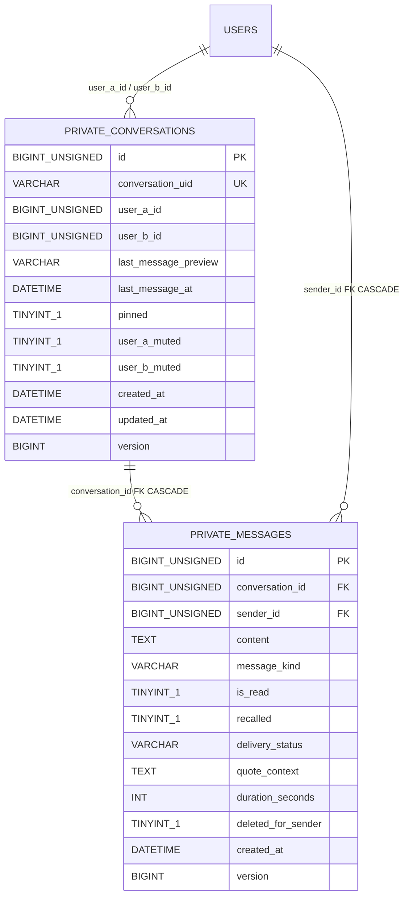

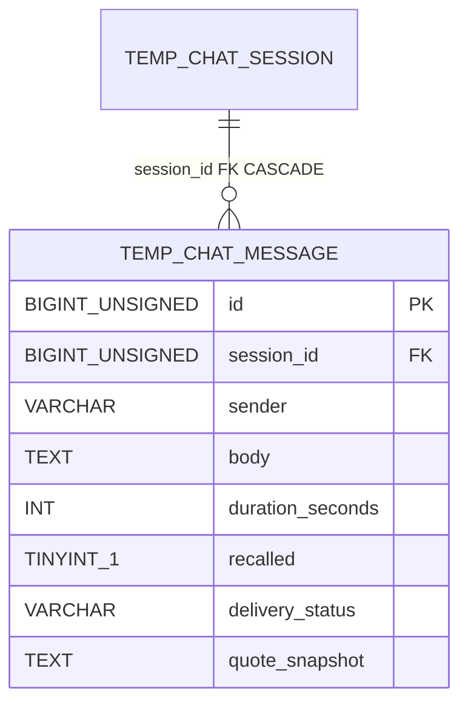

对照表：`temp_chat_message`（临时聊天消息）由 V2026.05.27.0001 L34-L44 建表，L43 给 `(session_id, created_at)` 索引、L44 给 `fk_temp_chat_message_session ... ON DELETE CASCADE`；V2026.06.01.0001 L4-L7 为它加了 `recalled`、`delivery_status`、`quote_snapshot` 三列——注意引用快照在临时聊天侧叫 `quote_snapshot`，在私信侧叫 `quote_context`，两张表列名并不统一。它不属于本页主表，列出仅用于区分「撤回/引用能力实际落在哪张表」。

**图表来源**
- [V2026.05.24.0002__create_private_conversations.sql:1-29](file://database/flyway/sql/V2026.05.24.0002__create_private_conversations.sql#L1-L29)
- [V2026.06.01.0001__add_recall_delivery_quote_to_messages.sql:4-11](file://database/flyway/sql/V2026.06.01.0001__add_recall_delivery_quote_to_messages.sql#L4-L11)
- [V2026.05.27.0001__create_temp_chat_tables.sql:34-44](file://database/flyway/sql/V2026.05.27.0001__create_temp_chat_tables.sql#L34-L44)

**章节来源**
- [V2026.05.24.0002__create_private_conversations.sql:1-29](file://database/flyway/sql/V2026.05.24.0002__create_private_conversations.sql#L1-L29)
- [V2026.05.29.0002__alter_visitors_add_is_read_and_conversations_add_pinned.sql:3-7](file://database/flyway/sql/V2026.05.29.0002__alter_visitors_add_is_read_and_conversations_add_pinned.sql#L3-L7)
- [V2026.05.31.0001__fix_entity_ddl_mismatches.sql:7-8](file://database/flyway/sql/V2026.05.31.0001__fix_entity_ddl_mismatches.sql#L7-L8)
- [V2026.08.08.0020__add_private_messages_duration_seconds.sql:4-5](file://database/flyway/sql/V2026.08.08.0020__add_private_messages_duration_seconds.sql#L4-L5)
- [V2026.08.10.0021__add_private_messages_deleted_for_sender.sql:14-15](file://database/flyway/sql/V2026.08.10.0021__add_private_messages_deleted_for_sender.sql#L14-L15)
- [V2026.08.10.0031__add_conversation_mute.sql:3-4](file://database/flyway/sql/V2026.08.10.0031__add_conversation_mute.sql#L3-L4)
- [V2026.07.25.0014__add_performance_indexes.sql:85-91](file://database/flyway/sql/V2026.07.25.0014__add_performance_indexes.sql#L85-L91)
- [V2026.07.25.0017__add_remaining_missing_indexes.sql:26-27](file://database/flyway/sql/V2026.07.25.0017__add_remaining_missing_indexes.sql#L26-L27)
- [V2026.07.26.0001__add_entity_index_annotations.sql:53-66](file://database/flyway/sql/V2026.07.26.0001__add_entity_index_annotations.sql#L53-L66)
- [V2026.07.26.0003__add_version_columns.sql:106-111](file://database/flyway/sql/V2026.07.26.0003__add_version_columns.sql#L106-L111)
- [V2026.07.26.0004__p8_database_standardization.sql:163-193](file://database/flyway/sql/V2026.07.26.0004__p8_database_standardization.sql#L163-L193)
- [V2026.07.28.0005__add_indexes.sql:102-113](file://database/flyway/sql/V2026.07.28.0005__add_indexes.sql#L102-L113)
- [PrivateConversation.java:20-85](file://apps/api/src/main/java/com/campuslove/api/entity/PrivateConversation.java#L20-L85)
- [PrivateMessage.java:37-133](file://apps/api/src/main/java/com/campuslove/api/entity/PrivateMessage.java#L37-L133)
- [V2026.05.27.0001__create_temp_chat_tables.sql:34-44](file://database/flyway/sql/V2026.05.27.0001__create_temp_chat_tables.sql#L34-L44)

## 详细组件分析
### 会话唯一性约束与 conversation_uid

`private_conversations` 有两条唯一约束，分工不同：

- `uk_private_conversations_uid (conversation_uid)`（迁移 L11）：对外可寻址的稳定标识，实体侧同步声明 `unique = true`（实体 L30-L31）。
- `uk_private_conversations_users ((LEAST(user_a_id, user_b_id)), (GREATEST(user_a_id, user_b_id)))`（迁移 L12）：MySQL 8.0 函数式唯一索引，把「用户对」规范化为 (小值, 大值) 后判重。因此 (A→B) 与 (B→A) 在索引层是同一个键，DB 直接拒绝重复会话行。

`conversation_uid` 的生成策略在 `RealPrivateMessageService.generateConversationUid`（服务 L771-L775）：先 `Math.min/Math.max` 得到 `min`/`max`（与函数索引的 LEAST/GREATEST 同构），再拼成 `conv-{min}-{max}-{UUID 前 8 位}`。前缀保证「用户对」维度可读可辨，随机后缀保证列的唯一约束可满足——同一对用户重建会话时不会撞 UID。UID 由 `conversation.setConversationUid(...)` 在插入前写入（服务 L196）。

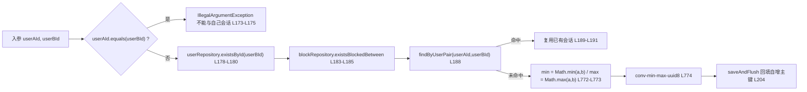

**图表来源**
- [RealPrivateMessageService.java:167-206](file://apps/api/src/main/java/com/campuslove/api/chat/RealPrivateMessageService.java#L167-L206)
- [RealPrivateMessageService.java:771-775](file://apps/api/src/main/java/com/campuslove/api/chat/RealPrivateMessageService.java#L771-L775)

### 用户对的双向排序保证

三个层次共同保证「一个用户对只有一条会话」：

1. DDL 层：函数式唯一键（迁移 L12）。
2. 查询层：`findByUserPair` 用 `(userAId=:a AND userBId=:b) OR (userAId=:b AND userBId=:a)` 做双向匹配（仓储 L44-L50），返回 `Optional`，与唯一键语义一致。
3. 生成层：UID 内部已按 min/max 排序（服务 L772-L774）。

需要注意的是，列 `user_a_id` / `user_b_id` 在插入时直接使用调用方传入的顺序（服务 L197-L198），并不强制 a 是较小 ID；双向性只靠唯一键与 `findByUserPair` 兜住。会话列表读取则用 `findByUserAIdOrUserBIdOrderByLastMessageAtDesc(userId, userId)`（仓储 L23-L27），两个参数都传当前用户，覆盖「我在 A 侧」和「我在 B 侧」两种行。

### 消息写入与 last_message_preview 截断策略

`sendMessage` 是 `private_messages` 的唯一业务写入点（服务 L211-L309），单条消息行写入 7 个字段：`conversation`、`senderId`、`content`（敏感词过滤后的文本）、`messageKind`、`quoteContext`、`durationSeconds`、`isRead=false`、`createdAt`（服务 L261-L269），随后 `saveAndFlush` 立即回填自增主键（服务 L271-L273）。

预览截断的三条分支（服务 L276-L283）：

| 消息类型 | 预览生成方式 | 出处 |
| --- | --- | --- |
| `quote` | `buildQuotePreview(filteredContent)` 从引用文本提取纯文本摘要 | 服务 L277-L278 |
| `activity` | `buildActivityPreview(filteredContent)` 解析 JSON 取标题 | 服务 L279-L280 |
| 其他（text/image/voice/emoji…） | `length > 50 ? substring(0,50) + "..." : 原文` | 服务 L281-L283 |

列宽余量：`last_message_preview VARCHAR(255)`（迁移 L6）远大于 50+3 的截断长度，因此该列不会因预览超长被截断；真正的内容上限来自入口校验 `@Size(max = 5000)`（控制器 L214）与 WS 侧常量 `MAX_MESSAGE_CONTENT_LENGTH = 5000`（处理器 L48）。写入预览的同时更新 `last_message_at` 与 `updated_at`（服务 L284-L287），后者是会话列表排序键。

### 分页查询

`getMessages` 支持双向分页（服务 L320-L349）：`order` 为 `asc` 时走 `findWithConversationByConversationIdOrderByCreatedAtAscPage`（仓储 L87-L94，`@EntityGraph(attributePaths = "conversation")` + JPQL `ORDER BY m.createdAt ASC`）；否则走 `findByConversationIdOrderByCreatedAtDesc`（仓储 L39-L45，`ORDER BY m.createdAt DESC`）。两路 JPQL 都带软删过滤条件 `(m.deletedForSender = false OR m.senderId <> :currentUserId)`（仓储 L40、L89）。

入口参数由控制器约束：`page` 默认 0 且 `@Min(0)`、`size` 默认 20 且 `@Min(1) @Max(100)`、`order` 默认 `desc`（控制器 L76-L85），组装成 `PageRequest.of(page, size)` 传入服务。命中索引 `idx_private_messages_conversation (conversation_id, created_at)`（迁移 L26）与后续补建的 `idx_private_messages_conversation_created_at`（V2026.07.26.0001 L55-L56）。读取的副作用是顺带把对方消息标为已读（服务 L343-L344）。

### 已读状态管理

已读涉及两个维度：

- 消息级 `private_messages.is_read`（迁移 L23；实体 L95-L96）。写入路径为批量 UPDATE：`markAsReadByConversationAndSenderNot`，JPQL 为 `UPDATE PrivateMessage m SET m.isRead = true WHERE m.conversation.id = :conversationId AND m.senderId <> :currentUserId AND m.isRead = false`，带 `@Modifying(clearAutomatically = true)`（仓储 L123-L126）。服务层 `markAsRead` 只做参数校验后直接调用（服务 L355-L364），REST 入口是 `PUT /api/v1/messages/conversations/{id}/read`（控制器 L111-L117）。
- 会话级未读计数：`countUnreadGroupByConversationIds` 以 `conversation.id IN :ids AND senderId <> :uid AND isRead = false GROUP BY conversation.id` 投影返回（仓储 L135-L147），服务用 `batchLoadUnreadCounts` 折成 Map（服务 L138-L141、L154-L161）。同一维度还有逐会话计数方法 `countByConversationIdAndSenderIdNotAndIsRead`（仓储 L104）。

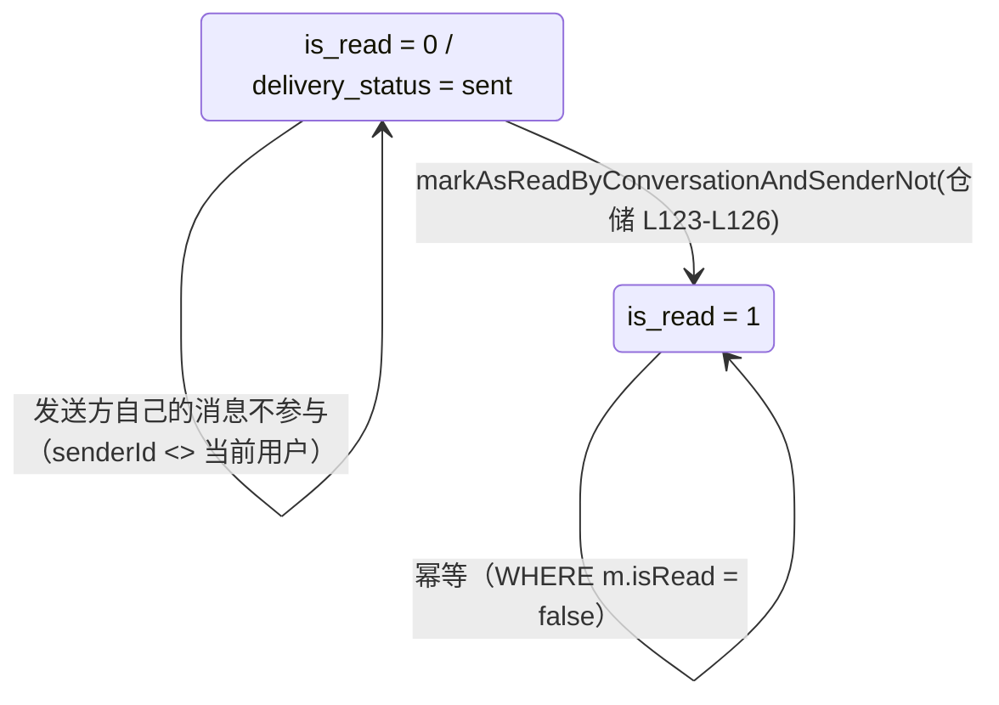

**图表来源**
- [PrivateMessageRepository.java:123-126](file://apps/api/src/main/java/com/campuslove/api/repository/PrivateMessageRepository.java#L123-L126)
- [V2026.06.01.0001__add_recall_delivery_quote_to_messages.sql:9-11](file://database/flyway/sql/V2026.06.01.0001__add_recall_delivery_quote_to_messages.sql#L9-L11)

### 会话置顶与排序规则

`pinned` 列由 V2026.05.29.0002 L7 加入（`TINYINT(1) NOT NULL DEFAULT 0`，位置 `AFTER last_message_at`），实体映射为 `Boolean pinned = false`（实体 L50-L51）。写入口 `pinConversation`（服务 L371-L389）：先按 `conversationId` 取会话，校验当前用户是参与者，再 `setPinned` + 刷新 `updatedAt` 保存；对应端点 `PUT /api/v1/messages/conversations/{id}/pin?pinned=`（控制器 L125-L133）。

排序规则的实际落点需要如实区分：仓储的 JPQL 只按 `pc.lastMessageAt DESC` 排序（仓储 L23），SQL 层没有任何 `ORDER BY pinned`；`pinned` 只是随 `ConversationView` 字段返回（服务 L594 取值并兜底 false，视图定义见 `ConversationView` L20）。置顶组优先发生在客户端——`pinnedTopSessions` 过滤 `s.pinned` 后与其余会话拼接（`apps/client/src/pages/messages/index.vue` L121-L139）。因此「置顶优先」是展示层规则，不是数据库排序规则。

### 会话级免打扰

`user_a_muted` / `user_b_muted` 由 V2026.08.10.0031 L3-L4 引入（分列、默认 0，位置 `AFTER pinned` / `AFTER user_a_muted`），实体映射 L54-L59。服务实现按当前用户所在侧写入：`userAId` 等于当前用户则改 `userAMuted`，否则改 `userBMuted`（服务 L415-L419），从而杜绝「A 的静音操作改写 B 的标记」。端点 `PUT /api/v1/messages/conversations/{id}/mute?muted=`（控制器 L144-L152），视图字段 `muted`（`ConversationView` L26）。

### 删除会话与消息软删

两条删除路径语义不同：

- 硬删会话：`deleteConversation`（服务 L432-L454）校验参与者后，先 `messageRepository.deleteByConversationId` 批删消息（仓储 L155-L158，`@Modifying` + `DELETE FROM PrivateMessage WHERE m.conversation.id = :conversationId`），再 `conversationRepository.delete`。DDL 侧的 `ON DELETE CASCADE`（迁移 L28）是同一条链路的库层兜底。接口文档明确非参与者抛 `IllegalArgumentException`（服务接口 L77-L84）。
- 软删单条消息：`softDeleteMessage`（服务 L466-L490）只允许发送者本人操作，非属主与不存在统一抛 `ResourceNotFoundException("消息不存在或无权操作")`（服务 L473-L479），已删则幂等返回（服务 L481-L485）；落库仅把 `deleted_for_sender` 置 1（服务 L487-L488，列定义 V2026.08.10.0021 L15）。读取侧的隐藏逻辑见上文分页查询的 JPQL 条件（仓储 L40、L89）。行为契约在 `PrivateMessageSoftDeleteTest`（测试类 L29、被测字段 L38）中有回归覆盖。

### 撤回与投递状态（实现现状）

库层能力已就位：`recalled`、`delivery_status` 两列由 V2026.06.01.0001 L9-L11 加到 `private_messages`（同脚本 L4-L7 给 `temp_chat_message` 加了 `recalled`、`delivery_status`、`quote_snapshot`），实体映射为 `recalled = false`（L99-L100，注释「仅发送者本人可在 2 分钟内撤回」）与 `deliveryStatus = "sent"`（L113-L114）。V2026.07.26.0004 L119-L121 用 `add_column_if_missing` 幂等重建这两列。

代码层现状（逐条核对后的事实）：私信链路里没有任何把 `PrivateMessage.recalled` 写为 `true` 的调用点——`setRecalled(true)` 只出现在临时聊天服务 `TempChatMessageService`（该文件 L318，作用于 `TempChatMessage` 实体），其撤回入口是 `recallMessage(sessionId, messageId, currentUserId)`（同文件 L262）；`PrivateMessageService` 接口的 9 个方法里也没有撤回方法（接口 L10-L116）。同样，私信的 `delivery_status` 只有写入 `"sent"` 的路径：实体初值 `"sent"`（L114）、种子数据 `pm.setDeliveryStatus("sent")`（`GuestDemoDataProvisioner` L192）；读取侧 `DtoMapper` 仅透传 `entity.getDeliveryStatus()`（`DtoMapper` L229），临时聊天视图映射同样原样带出（`TempChatViewMapper` L154-L155）。因此 `delivered`/`read` 两个值目前只是 DDL 注释里的约定（V2026.06.01.0001 L6、L11），没有私信侧的推进代码。已读语义实际由 `is_read` 承担（见上文）。

### 消息类型扩展设计

类型列是 `message_kind VARCHAR(16) NOT NULL DEFAULT 'text'`（迁移 L22），实体 `String messageKind = "text"`（实体 L76-L77）。用 VARCHAR 而非 ENUM 是刻意选择：库内 ENUM 列的收敛记录在 `V2026.07.27.0005__enum_to_varchar_check.sql`（该脚本 L2-L10 说明「ENUM 新增枚举值需 ALTER 全表重建，故统一改 VARCHAR(32) + CHECK」，L26-L34 列出被转换的 9 个 ENUM 列），这 9 列不含 `private_messages.message_kind`——私信类型从一开始就是 VARCHAR，无需转换。代价是库层没有 CHECK 约束，白名单只存在于入口校验：`@Pattern(regexp = "(?i)TEXT|IMAGE|VOICE|VIDEO|EMOJI|ACTIVITY")` + `@Size(max = 32)`（控制器 L215-L217），以及 `(?i)` 大小写不敏感匹配后由服务统一 `toLowerCase` 归一（服务 L241-L243）。注释还记录了 `SYSTEM` 已从白名单移除（控制器 L206-L207），防止客户端伪造系统消息。

新增一种类型只需扩白名单 + 服务侧分支，不需要 DDL 变更；已有的扩展实例是 `quote`（引用）与 `activity`（活动卡片）：`quoteRef` 命中同会话消息时写 `quote_context` 快照并把 `resolvedKind` 改为 `quote`（服务 L252-L258），`activity` 的 content 约定为 JSON `{"title","desc","tag","targetUrl"}`（控制器 L203-L204），JSON 解析用 `ObjectMapper` 而非手写 `indexOf`（服务 L64-L65）。语音类型额外用 `duration_seconds INT NULL`（V2026.08.08.0020 L5；实体 L83-L84）承载时长，入口约束 `@Min(0) @Max(60)`（控制器 L218）；语音文件本身的落盘与 URL 前缀在 `VoiceMessageService`（`store` 方法 L109、`urlPrefix` L83、`storageRoot` L93），不进 `content` 列之外的表。

### 实时同步与视图模型

消息行的即时下发由 `SimpMessagingTemplate.convertAndSendToUser(recipientId, "/queue/messages", messageView)` 完成（服务 L291-L296），推送目标是用户级队列 `/user/{userId}/queue/messages`（处理器 L27）。WS 入口 `/app/chat/send` 的私信分支复用 `RealPrivateMessageService.sendMessage` 落库（处理器 L76-L83 的注入注释记录了这一修复动因：此前「WS 私信仅推送不落库」导致历史、未读、预览三处不一致），并在推送后同步更新会话预览（处理器 L216 注释、L205-L207 与 L255-L257 的推送调用）。`senderId` 取自 STOMP 认证 Principal 而非 payload（处理器 L100、L109-L116），WS 侧另有 `kind` 长度限制 `MAX_MESSAGE_KIND_LENGTH = 32`（处理器 L51、L127-L130）。

视图模型是 record：`MessageView` 有 9 个分量，含 `quoteContext` 与 `durationSeconds`，并保留两个向后兼容构造器（视图 L9-L30）；`ConversationView` 有 15 个分量，把 `unreadCount`、`pinned`、`muted`、`phase`、`sessionType`、`relationship` 一并带给前端（视图 L7-L29，兼容构造器 L31-L49）。

### Mock 与真实现的双实现

`PrivateMessageService` 接口（L10）有两个实现：`RealPrivateMessageService`（`@Service`，L52-L53，真读写两张表）与 `MockPrivateMessageService`（`@Service`，L13-L14，内存态）。Mock 侧同名方法齐备——`getConversations`(L17)、`createOrGetConversation`(L46)、`getMessages`(L65)、`markAsRead`(L88)、`pinConversation`(L95)、`deleteConversation`(L102)、`softDeleteMessage`(L109)、`setConversationMuted`(L116)，因此在无数据库环境下接口契约与端点行为可保持一致；涉及真实表结构验证的回归以 `PrivateMessageSoftDeleteTest`（L29）针对真实服务（L38）执行。

**章节来源**
- [V2026.05.24.0002__create_private_conversations.sql:1-29](file://database/flyway/sql/V2026.05.24.0002__create_private_conversations.sql#L1-L29)
- [V2026.05.29.0002__alter_visitors_add_is_read_and_conversations_add_pinned.sql:1-7](file://database/flyway/sql/V2026.05.29.0002__alter_visitors_add_is_read_and_conversations_add_pinned.sql#L1-L7)
- [V2026.06.01.0001__add_recall_delivery_quote_to_messages.sql:1-11](file://database/flyway/sql/V2026.06.01.0001__add_recall_delivery_quote_to_messages.sql#L1-L11)
- [V2026.08.10.0021__add_private_messages_deleted_for_sender.sql:1-15](file://database/flyway/sql/V2026.08.10.0021__add_private_messages_deleted_for_sender.sql#L1-L15)
- [V2026.08.10.0031__add_conversation_mute.sql:1-4](file://database/flyway/sql/V2026.08.10.0031__add_conversation_mute.sql#L1-L4)
- [V2026.08.08.0020__add_private_messages_duration_seconds.sql:1-5](file://database/flyway/sql/V2026.08.08.0020__add_private_messages_duration_seconds.sql#L1-L5)
- [V2026.05.31.0001__fix_entity_ddl_mismatches.sql:7-11](file://database/flyway/sql/V2026.05.31.0001__fix_entity_ddl_mismatches.sql#L7-L11)
- [V2026.07.27.0005__enum_to_varchar_check.sql:1-34](file://database/flyway/sql/V2026.07.27.0005__enum_to_varchar_check.sql#L1-L34)
- [V2026.07.26.0004__p8_database_standardization.sql:112-121](file://database/flyway/sql/V2026.07.26.0004__p8_database_standardization.sql#L112-L121)
- [V2026.07.26.0001__add_entity_index_annotations.sql:53-66](file://database/flyway/sql/V2026.07.26.0001__add_entity_index_annotations.sql#L53-L66)
- [PrivateConversation.java:20-85](file://apps/api/src/main/java/com/campuslove/api/entity/PrivateConversation.java#L20-L85)
- [PrivateMessage.java:37-133](file://apps/api/src/main/java/com/campuslove/api/entity/PrivateMessage.java#L37-L133)
- [PrivateMessageRepository.java:26-158](file://apps/api/src/main/java/com/campuslove/api/repository/PrivateMessageRepository.java#L26-L158)
- [PrivateConversationRepository.java:14-51](file://apps/api/src/main/java/com/campuslove/api/repository/PrivateConversationRepository.java#L14-L51)
- [RealPrivateMessageService.java:106-490](file://apps/api/src/main/java/com/campuslove/api/chat/RealPrivateMessageService.java#L106-L490)
- [RealPrivateMessageService.java:525-601](file://apps/api/src/main/java/com/campuslove/api/chat/RealPrivateMessageService.java#L525-L601)
- [RealPrivateMessageService.java:771-801](file://apps/api/src/main/java/com/campuslove/api/chat/RealPrivateMessageService.java#L771-L801)
- [PrivateMessageService.java:10-116](file://apps/api/src/main/java/com/campuslove/api/chat/PrivateMessageService.java#L10-L116)
- [MockPrivateMessageService.java:13-119](file://apps/api/src/main/java/com/campuslove/api/chat/MockPrivateMessageService.java#L13-L119)
- [PrivateMessageController.java:76-220](file://apps/api/src/main/java/com/campuslove/api/chat/PrivateMessageController.java#L76-L220)
- [MessageWebSocketHandler.java:20-134](file://apps/api/src/main/java/com/campuslove/api/chat/MessageWebSocketHandler.java#L20-L134)
- [MessageView.java:9-31](file://apps/api/src/main/java/com/campuslove/api/chat/MessageView.java#L9-L31)
- [ConversationView.java:7-49](file://apps/api/src/main/java/com/campuslove/api/chat/ConversationView.java#L7-L49)
- [TempChatMessageService.java:262-318](file://apps/api/src/main/java/com/campuslove/api/chat/TempChatMessageService.java#L262-L318)
- [GuestDemoDataProvisioner.java:192](file://apps/api/src/main/java/com/campuslove/api/auth/GuestDemoDataProvisioner.java#L192)
- [DtoMapper.java:229](file://apps/api/src/main/java/com/campuslove/api/dto/DtoMapper.java#L229)
- [TempChatViewMapper.java:154-155](file://apps/api/src/main/java/com/campuslove/api/chat/TempChatViewMapper.java#L154-L155)
- [PrivateMessageSoftDeleteTest.java:29-38](file://apps/api/src/test/java/com/campuslove/api/chat/PrivateMessageSoftDeleteTest.java#L29-L38)
- [VoiceMessageService.java:83-109](file://apps/api/src/main/java/com/campuslove/api/chat/VoiceMessageService.java#L83-L109)
- [apps/client/src/pages/messages/index.vue:119-139](file://apps/client/src/pages/messages/index.vue#L119-L139)

## 依赖关系分析
表与表、表与代码之间的依赖是单向收敛的：消息表依赖会话表，会话表依赖用户表，反向不依赖。

- 库内依赖：`private_messages.conversation_id` → `private_conversations.id`，由命名外键 `fk_private_messages_conversation` 声明并 `ON DELETE CASCADE`（迁移 L28）；`private_messages.sender_id` → `users(id)` 由 V2026.07.26.0003 L274 通过 `add_fk_if_missing` 补建，同文件 L272 明确记录「已有 fk_private_messages_conversation」、L14 记录该依赖关系。`private_conversations.user_a_id` / `user_b_id` 与 `users(id)` 的关联只存在于语义层（迁移 L4-L5 的列注释与实体 L34-L39），全部消息相关迁移脚本中没有指向 `users` 的外键约束，也没有 CHECK 约束。
- 实体依赖：`PrivateMessage.conversation` 是 `@ManyToOne(fetch = LAZY)` + `@JoinColumn(name = "conversation_id", nullable = false, foreignKey = @ForeignKey(name = "fk_private_messages_conversation"))`（实体 L63-L65），外键名与 DDL 对齐；`senderId` 是裸 `Long`（实体 L68-L69），刻意不建实体关联，避免对 `users` 的额外加载。`PrivateConversation` 无 `@OneToMany` 反向集合（实体 L20-L85 全字段清单可见），因此删除会话不会因为实体级联而自动删消息，必须依赖仓储的显式批删或 DDL 的 CASCADE。
- 代码依赖：`RealPrivateMessageService` 构造器注入 6 个协作者（服务 L83-L97）——`PrivateConversationRepository`、`PrivateMessageRepository`、`UserRepository`、`SimpMessagingTemplate`、`SensitiveWordFilter`、`UserBlockRepository`；另有 2 个 `@Autowired(required = false)` 字段（`SocialProgressService` L72-L73、`ContentSecurityChecker` L80-L81），缺失时分别跳过埋点与统一安全检查（服务 L300-L306、L503-L505）。控制器只依赖接口 `PrivateMessageService`（控制器 L41-L45），WS 处理器对 `PrivateMessageService` 用 `@Autowired(required = false)`（处理器 L82-L83）。
- 跨域依赖：`getConversations` 在读会话时联查拉黑关系（服务 L116-L128，`blockRepository.findBlockedRelationUserIds`），`createOrGetConversation` 与 `sendMessage` 都调用 `blockRepository.existsBlockedBetween`（服务 L183-L185、L235-L237）。这意味着「消息可见性」不完全由消息表决定，`user_block` 关系会在应用层过滤。

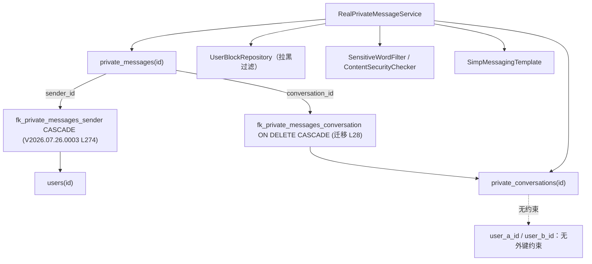

**图表来源**
- [V2026.05.24.0002__create_private_conversations.sql:17-29](file://database/flyway/sql/V2026.05.24.0002__create_private_conversations.sql#L17-L29)
- [V2026.07.26.0003__add_version_columns.sql:106-111](file://database/flyway/sql/V2026.07.26.0003__add_version_columns.sql#L106-L111)

**章节来源**
- [V2026.05.24.0002__create_private_conversations.sql:1-29](file://database/flyway/sql/V2026.05.24.0002__create_private_conversations.sql#L1-L29)
- [V2026.07.26.0003__add_version_columns.sql:106-111](file://database/flyway/sql/V2026.07.26.0003__add_version_columns.sql#L106-L111)
- [PrivateConversation.java:20-85](file://apps/api/src/main/java/com/campuslove/api/entity/PrivateConversation.java#L20-L85)
- [PrivateMessage.java:56-133](file://apps/api/src/main/java/com/campuslove/api/entity/PrivateMessage.java#L56-L133)
- [RealPrivateMessageService.java:57-97](file://apps/api/src/main/java/com/campuslove/api/chat/RealPrivateMessageService.java#L57-L97)
- [RealPrivateMessageService.java:116-128](file://apps/api/src/main/java/com/campuslove/api/chat/RealPrivateMessageService.java#L116-L128)
- [RealPrivateMessageService.java:183-237](file://apps/api/src/main/java/com/campuslove/api/chat/RealPrivateMessageService.java#L183-L237)
- [PrivateMessageController.java:41-45](file://apps/api/src/main/java/com/campuslove/api/chat/PrivateMessageController.java#L41-L45)
- [MessageWebSocketHandler.java:53-87](file://apps/api/src/main/java/com/campuslove/api/chat/MessageWebSocketHandler.java#L53-L87)

## 性能考虑
### 索引覆盖的三类查询

| 查询场景 | 使用的索引 | 出处 |
| --- | --- | --- |
| 会话消息按时间分页（首屏 desc / 上拉 asc） | `idx_private_messages_conversation (conversation_id, created_at)`；后补同键的 `idx_private_messages_conversation_created_at` | 建表迁移 L26；V2026.07.26.0001 L55-L56 |
| 会话未读数统计 | `idx_private_messages_conversation_read (conversation_id, is_read, created_at)` 与轻量版 `idx_pm_conv_read (conversation_id, is_read)` | V2026.07.25.0014 L91；V2026.07.26.0004 L166；is_read 维度补充说明见 V2026.07.25.0017 L26-L27 |
| 按发送者查历史 | `idx_private_messages_sender (sender_id)`、`idx_private_messages_sender_created_at (sender_id, created_at)` | 建表迁移 L27；V2026.07.25.0014 L90 |
| 投递状态过滤 / 未送达扫描 | `idx_private_messages_delivery_status (delivery_status)`、`idx_private_messages_conv_delivery (conversation_id, delivery_status, created_at)` | V2026.07.26.0001 L63-L66；V2026.07.26.0004 L191-L193 |
| 会话列表按最后消息时间排序 | `idx_private_conversations_user_a`、`idx_private_conversations_user_b`、复合 `idx_private_conversations_user_a_last_msg`、`idx_private_conversations_user_b_last_msg` | 建表迁移 L13-L14；V2026.07.28.0005 L107、L113 |

实体侧把消息表的 6 个索引名原样写进 `@Table(indexes = {...})`（实体 L39-L55），注释说明「与数据库 Flyway 脚本保持一致」（实体 L24），V2026.07.26.0001 的头部注释则记录了这些索引已在先前迁移中创建、不重复建（该文件 L13）。回滚语句以注释形式保留在迁移脚本里（V2026.07.25.0014 L112-L113、V2026.07.26.0001 L75-L77）。

### 读放大治理（已落地的四处）

- 会话列表用户信息批量预加载：先收集 distinct 的对方 userId，再 `userRepository.findAllById` 一次查成 Map（服务 L788-L801），列表路径调用在 L131-L136；注释明确动机是避免 `toConversationView` 循环里的 N+1（服务 L102、L522-L523）。
- 会话未读数 GROUP BY：`countUnreadGroupByConversationIds`（仓储 L135-L140）一次返回全部会话的未读投影，替代逐会话 count（服务 L138-L141 注释 `infra R2-00247`）。
- 消息分页的关联预加载：`@EntityGraph(attributePaths = "conversation")` 把 LAZY 的 `conversation` 用 LEFT OUTER JOIN 一次带出（仓储 L47-L62、L76-L94，注释 Task 2.2.4）。
- 列表接口不分摊 TEXT 列：会话列表只读 `private_conversations` 的 `last_message_preview VARCHAR(255)`（迁移 L6），完整正文留在 `private_messages.content TEXT`（迁移 L21），避免会话页把全部消息体拉进内存。

### 写放大与批量更新

已读更新是单条 UPDATE 而非逐条 save（仓储 L115-L126，`@Modifying(clearAutomatically = true)`）；删除会话是单条 DELETE 批删消息再删会话（仓储 L149-L158，服务 L447-L450）。写消息与会话预览在同一事务内两次 `save`（服务 L273、L287），用 `saveAndFlush` 而非 `save` 的原因是实体带 `@Version` 时 `save` 走 merge 返回新托管实例，必须接收返回值才能回填自增主键（服务 L202-L204、L271-L273 注释）。

### 并发与容量

- 乐观锁：两张表都有 `version` 列（V2026.07.26.0003 L107-L108），实体 `@Version` 声明（会话实体 L83-L85、消息实体 L131-L133），冲突抛 `ObjectOptimisticLockingFailureException` 并由全局异常处理转 HTTP 409（实体注释 L78-L79、L126-L127 同文）。
- 分页上限：`size` 被 `@Max(100)` 硬限（控制器 L80），防止单次拉取过多消息行。
- 刷屏防护：`POST /conversations/{id}/messages` 带 `@RateLimit(capacity = 30, refillTokens = 1, key = "#request.remoteAddr")`（控制器 L94-L95），创建/发送端点带 `@Idempotent`（控制器 L62、L96）。
- 容量层面的现状：消息相关迁移脚本中没有分区表、归档表或历史清理任务的定义（`database/flyway/sql` 全目录检索仅见种子脚本里的 `ROW_NUMBER() OVER (PARTITION BY ...)` 窗口函数，如 V2026.08.09.0003 L18），也没有 `private_messages` 的 `updated_at` 列（消息实体字段清单到 `createdAt` 为止，实体 L116-L121；V2026.07.28.0004 只对 `private_conversations` 同时补 `created_at`/`updated_at`，对 `private_messages` 只补 `created_at`，见该文件 L134-L136）。临时聊天侧才有清理服务 `TempChatCleanupService`（该文件 L209-L214 的推送调用），私信无对应清理通路。

**章节来源**
- [V2026.05.24.0002__create_private_conversations.sql:1-29](file://database/flyway/sql/V2026.05.24.0002__create_private_conversations.sql#L1-L29)
- [V2026.07.25.0014__add_performance_indexes.sql:85-91](file://database/flyway/sql/V2026.07.25.0014__add_performance_indexes.sql#L85-L91)
- [V2026.07.25.0014__add_performance_indexes.sql:112-113](file://database/flyway/sql/V2026.07.25.0014__add_performance_indexes.sql#L112-L113)
- [V2026.07.25.0017__add_remaining_missing_indexes.sql:10-27](file://database/flyway/sql/V2026.07.25.0017__add_remaining_missing_indexes.sql#L10-L27)
- [V2026.07.26.0001__add_entity_index_annotations.sql:13-77](file://database/flyway/sql/V2026.07.26.0001__add_entity_index_annotations.sql#L13-L77)
- [V2026.07.26.0003__add_version_columns.sql:106-111](file://database/flyway/sql/V2026.07.26.0003__add_version_columns.sql#L106-L111)
- [V2026.07.26.0004__p8_database_standardization.sql:163-193](file://database/flyway/sql/V2026.07.26.0004__p8_database_standardization.sql#L163-L193)
- [V2026.07.28.0004__audit_fields.sql:134-139](file://database/flyway/sql/V2026.07.28.0004__audit_fields.sql#L134-L139)
- [V2026.07.28.0005__add_indexes.sql:102-113](file://database/flyway/sql/V2026.07.28.0005__add_indexes.sql#L102-L113)
- [V2026.08.09.0003__seed_comment_likes_for_demo_posts.sql:18](file://database/flyway/sql/V2026.08.09.0003__seed_comment_likes_for_demo_posts.sql#L18)
- [PrivateMessage.java:24-55](file://apps/api/src/main/java/com/campuslove/api/entity/PrivateMessage.java#L24-L55)
- [PrivateMessageRepository.java:39-158](file://apps/api/src/main/java/com/campuslove/api/repository/PrivateMessageRepository.java#L39-L158)
- [RealPrivateMessageService.java:102-161](file://apps/api/src/main/java/com/campuslove/api/chat/RealPrivateMessageService.java#L102-L161)
- [RealPrivateMessageService.java:261-287](file://apps/api/src/main/java/com/campuslove/api/chat/RealPrivateMessageService.java#L261-L287)
- [RealPrivateMessageService.java:771-801](file://apps/api/src/main/java/com/campuslove/api/chat/RealPrivateMessageService.java#L771-L801)
- [PrivateMessageController.java:76-105](file://apps/api/src/main/java/com/campuslove/api/chat/PrivateMessageController.java#L76-L105)
- [TempChatCleanupService.java:209-214](file://apps/api/src/main/java/com/campuslove/api/chat/TempChatCleanupService.java#L209-L214)
- [PrivateConversation.java:74-85](file://apps/api/src/main/java/com/campuslove/api/entity/PrivateConversation.java#L74-L85)

## 配置与开关
### 迁移执行配置

`database/flyway/flyway.toml` 定义了消息表所在的迁移集如何被执行：

- `locations = ["filesystem:./database/flyway/sql"]`（L2），即本页所有 DDL 的来源目录。
- `validateMigrationNaming = true`（L3）——文件名必须满足 `V<版本>__<描述>.sql`，本页三个脚本 `V2026.05.24.0002__…`、`V2026.05.29.0002__…`、`V2026.06.01.0001__…` 都遵循该命名。
- `validateOnMigrate = true`（L5，Task 25.1）：启动时校验已应用迁移的 checksum，防止历史脚本被改动导致 schema 漂移；这也是 `V2026.07.27.0005` 头部「禁止修改任何已应用的迁移脚本，仅通过新增脚本完成迁移」（该脚本 L12-L14）的制度来源。
- `baselineOnMigrate = false`（L7，Task 25.1）：禁止在非空库上自动 baseline，避免跳过历史迁移。
- 占位符：使用 Flyway 默认 `${...}` 语法，不再自定义双下划线（L8-L9 记录了历史故障——迁移文件名里的 `__` 曾被当作占位符解析导致启动失败）。`demo_seed = "false"`（L30）：演示种子私信/虚拟用户类迁移仅在 `demo_seed=true` 时写数据（L26-L29），CLI 覆盖方式 `flyway -placeholders.demo_seed=true migrate`（L28）。管理员相关占位符 `admin_openid` / `admin_nickname` / `admin_password_hash` 无默认值，缺失时 migrate 直接失败（L12-L19、L31-L37）。
- Spring Boot 侧与 CLI 侧的占位符来源不同：`application-real.yml` 用 `${ADMIN_OPENID:...}` 注入，独立 CLI 走本文件的 `[flyway.placeholders]`（L20-L24 要求两处注入同一份值）。

### 实现切换开关

`PrivateMessageService` 的两个实现靠 Spring Profile 分流：真实现 `@Profile("real") @Service`（服务 L51-L53），内存实现 `@Profile("mock") @Service`（Mock L12-L14）。`real` profile 下 `VoiceMessageService` 同为 `@Profile("real") @Service`（该文件 L49-L51），mock 环境不存在语音落盘。跨 profile 的可选协作者用 `@Autowired(required = false)` 注入：`SocialProgressService`（服务 L72-L73）、`ContentSecurityChecker`（服务 L80-L81）、WS 侧的 `TempChatSessionService` / `TempChatMessageService` / `PrivateMessageService`（处理器 L59-L60、L66-L67、L82-L83），处理器注释明确 mock 模式下这些 Bean 为 null 时退化为「仅转发，不校验/不落库」（处理器 L38-L40）。

### 行为参数

| 参数 | 取值 | 出处 |
| --- | --- | --- |
| 预览截断长度 | 50 字符 + `"..."` | `RealPrivateMessageService` L281-L283 |
| 分页默认/上限 | `page=0`、`size=20`、`size ≤ 100`、`order=desc` | `PrivateMessageController` L79-L81 |
| 消息正文长度上限 | REST `@Size(max=5000)`；WS 常量 5000 | 控制器 L214；处理器 L48 |
| `kind` 白名单与长度 | `(?i)TEXT\|IMAGE\|VOICE\|VIDEO\|EMOJI\|ACTIVITY`，`@Size(max=32)`；WS 侧常量 32 | 控制器 L215-L217；处理器 L51 |
| 语音时长范围 | `@Min(0) @Max(60)` | 控制器 L218 |
| `quoteRef` 上限 | `@Size(max=64)` | 控制器 L219 |
| 发送频率限制 | 桶容量 30、每秒补 1 令牌、按 `remoteAddr` | 控制器 L95 |
| 业务时区 | `LocalDateTime.now(TimeZones.BUSINESS)` | 服务 L194、L239、L387、L420 |
| 语音 URL 前缀 | `${file-storage.upload-prefix:/api/v1/media/}`，可用 `FILE_STORAGE_PREFIX` 覆盖 | `VoiceMessageService` L82-L83 |
| 语音落盘根目录 | `${file-storage.base-dir:uploads}`，可用 `FILE_STORAGE_BASE_DIR` 覆盖 | `VoiceMessageService` L92-L93 |
| 内容安全场景码 | 私信用 `scene = "4"`（社交日志），命中 `risky` 拒绝、`review` 放行并告警 | 服务 L247、L502-L515 |
| 敏感词过滤标记 | `filterWithLog(content, senderId, "MESSAGE")` | 服务 L250 |

**章节来源**
- [flyway.toml:1-39](file://database/flyway/flyway.toml#L1-L39)
- [V2026.07.27.0005__enum_to_varchar_check.sql:12-14](file://database/flyway/sql/V2026.07.27.0005__enum_to_varchar_check.sql#L12-L14)
- [RealPrivateMessageService.java:51-81](file://apps/api/src/main/java/com/campuslove/api/chat/RealPrivateMessageService.java#L51-L81)
- [RealPrivateMessageService.java:194-283](file://apps/api/src/main/java/com/campuslove/api/chat/RealPrivateMessageService.java#L194-L283)
- [RealPrivateMessageService.java:387-420](file://apps/api/src/main/java/com/campuslove/api/chat/RealPrivateMessageService.java#L387-L420)
- [RealPrivateMessageService.java:494-516](file://apps/api/src/main/java/com/campuslove/api/chat/RealPrivateMessageService.java#L494-L516)
- [MockPrivateMessageService.java:12-14](file://apps/api/src/main/java/com/campuslove/api/chat/MockPrivateMessageService.java#L12-L14)
- [PrivateMessageController.java:76-105](file://apps/api/src/main/java/com/campuslove/api/chat/PrivateMessageController.java#L76-L105)
- [PrivateMessageController.java:213-220](file://apps/api/src/main/java/com/campuslove/api/chat/PrivateMessageController.java#L213-L220)
- [MessageWebSocketHandler.java:38-60](file://apps/api/src/main/java/com/campuslove/api/chat/MessageWebSocketHandler.java#L38-L60)
- [VoiceMessageService.java:49-93](file://apps/api/src/main/java/com/campuslove/api/chat/VoiceMessageService.java#L49-L93)

## 故障排查指南
### 运行期异常与对应抛点

| 现象 | 触发条件 | 抛出位置 |
| --- | --- | --- |
| `Cannot create conversation with yourself` | `userAId.equals(userBId)` | 服务 L173-L175 |
| `User not found: {id}` | `userRepository.existsById(userBId)` 为假 | 服务 L177-L180 |
| `Conversation not found: {id}` | `conversationRepository.findById` 未命中 | 服务 L222-L223、L328-L329、L378-L379、L406-L407、L439-L440 |
| `Sender is not a participant of this conversation` | 发送者既不是 A 也不是 B | 服务 L225-L228 |
| `User is not a participant of this conversation` | 读取/置顶/静音/删除时非参与者 | 服务 L331-L333、L381-L384、L410-L412、L442-L445 |
| `消息包含违规内容，无法发送` | 内容安全判定 `risky` | 服务 L507-L511 |
| `消息不存在或无权操作`（404） | 消息 ID 不存在，或请求者不是发送者本人 | 服务 L473-L479 |
| HTTP 409 Conflict | `@Version` 乐观锁冲突 | 实体注释 L78-L79（会话）、L126-L127（消息） |
| 拉黑后发送失败（BLOCKED） | `blockRepository.existsBlockedBetween` 命中 | 服务 L183-L185、L230-L237 |

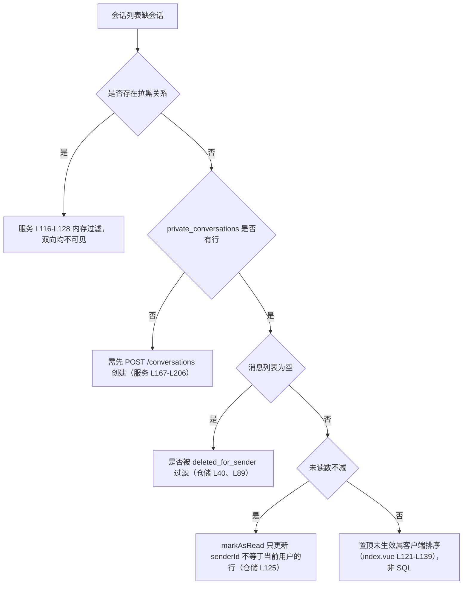

**图表来源**
- [RealPrivateMessageService.java:116-206](file://apps/api/src/main/java/com/campuslove/api/chat/RealPrivateMessageService.java#L116-L206)
- [PrivateMessageRepository.java:39-126](file://apps/api/src/main/java/com/campuslove/api/repository/PrivateMessageRepository.java#L39-L126)

### schema 层排查

- Flyway 启动失败且报 checksum 不一致：`validateOnMigrate = true`（flyway.toml L5）会拒绝被改动的历史脚本，正确做法是新增脚本而不是改旧脚本（`V2026.07.27.0005` L12-L14 亦作此约束）。
- 报占位符缺失：`flyway.toml` 不给 `admin_*` 占位符默认值（L12-L19、L31-L37），CLI 需 `-placeholders.…` 或 `FLYWAY_PLACEHOLDERS_…` 环境变量注入；迁移文件名里的 `__` 不参与占位符解析（L8-L9 记录了历史故障）。
- 演示私信没有数据：`demo_seed = "false"` 是默认值（flyway.toml L30），演示种子迁移在 `demo_seed=true` 时才写数据（L26-L29）。
- 列缺失报错（如 `deleted_for_sender`、`duration_seconds`、`user_a_muted`、`pinned`、`quote_context`、`recalled`）：逐列对应 V2026.08.10.0021 L15、V2026.08.08.0020 L5、V2026.08.10.0031 L3-L4、V2026.05.29.0002 L7、V2026.05.31.0001 L8、V2026.06.01.0001 L10；`V2026.07.26.0004` 用 `add_column_if_missing` 幂等重建了其中部分列（该文件 L103、L109、L119-L121），可用于修复漂移库。
- 私信语音气泡时长为 0：检查 `duration_seconds` 是否已迁移（V2026.08.08.0020 L5），以及 `message_kind` 是否被规范化为小写 `voice`（服务 L241-L243 说明了大小写规范化与前端 `mapToMessageItem` 的对应关系）。
- WS 发的消息刷新后消失：`privateMessageService` 在 mock profile 下为 null，此时处理器只做转发不落库（处理器 L38-L40、L76-L83），需确认运行在 `real` profile（服务 L51-L53）。
- 删除会话后残留消息：`deleteConversation` 在同一事务内先批删再删会话（服务 L447-L450），若观察到残留，核对 `fk_private_messages_conversation ... ON DELETE CASCADE`（迁移 L28）与 `idx_private_messages_conv_delivery` 等索引是否被手工改动（回滚语句模板见 V2026.07.25.0014 L112-L113）。

**章节来源**
- [RealPrivateMessageService.java:167-516](file://apps/api/src/main/java/com/campuslove/api/chat/RealPrivateMessageService.java#L167-L516)
- [PrivateMessageRepository.java:39-126](file://apps/api/src/main/java/com/campuslove/api/repository/PrivateMessageRepository.java#L39-L126)
- [PrivateConversation.java:74-85](file://apps/api/src/main/java/com/campuslove/api/entity/PrivateConversation.java#L74-L85)
- [PrivateMessage.java:122-133](file://apps/api/src/main/java/com/campuslove/api/entity/PrivateMessage.java#L122-L133)
- [MessageWebSocketHandler.java:38-83](file://apps/api/src/main/java/com/campuslove/api/chat/MessageWebSocketHandler.java#L38-L83)
- [flyway.toml:1-39](file://database/flyway/flyway.toml#L1-L39)
- [V2026.07.26.0004__p8_database_standardization.sql:100-121](file://database/flyway/sql/V2026.07.26.0004__p8_database_standardization.sql#L100-L121)
- [V2026.07.25.0014__add_performance_indexes.sql:112-113](file://database/flyway/sql/V2026.07.25.0014__add_performance_indexes.sql#L112-L113)
- [apps/client/src/pages/messages/index.vue:119-139](file://apps/client/src/pages/messages/index.vue#L119-L139)

## 能力缺口登记
本页的生成指令要求覆盖若干能力。逐条对照仓库证据后，以下几项目在消息相关表的实现中找不到支撑，按「要求 → 判定依据」如实登记，不做推测性描述。

1. 「消息撤回功能的实现机制」（私信侧未实现）。判定依据：`private_messages.recalled` 列确实存在（V2026.06.01.0001 L10），实体有字段与读写方法（`PrivateMessage` L99-L100、L211-L217），但接口 `PrivateMessageService` 的 9 个方法中没有撤回方法（该文件 L10-L116），控制器 8 个端点中也没有撤回端点（`PrivateMessageController` L51-L186）；全仓 `setRecalled(true)` 只出现在 `TempChatMessageService` L318，作用于 `TempChatMessage` 实体，其入口 `recallMessage(sessionId, messageId, currentUserId)` 在同文件 L262。结论：撤回能力目前只落在临时聊天表，私信表有列、有注释里的「2 分钟内撤回」约定，无写入通路。
2. 「投递状态管理」只有初值。判定依据：`delivery_status VARCHAR(16) NOT NULL DEFAULT 'sent'`（V2026.06.01.0001 L11）、实体初值 `"sent"`（`PrivateMessage` L113-L114）、种子数据显式写 `"sent"`（`GuestDemoDataProvisioner` L192）；`markAsRead` 走的是 `is_read` 列（`PrivateMessageRepository` L123-L126），不涉及 `delivery_status`。全仓没有把私信 `delivery_status` 置为 `delivered` 或 `read` 的代码。结论：注释里的三态是约定，非实现。
3. 「会话置顶功能的消息排序规则」不在数据库层。判定依据：会话列表 JPQL 只有 `ORDER BY pc.lastMessageAt DESC`（`PrivateConversationRepository` L23），无 `pinned` 排序；服务侧 `pinConversation` 只写列并刷新 `updatedAt`（`RealPrivateMessageService` L386-L388），`pinned` 作为视图字段返回（L594）；置顶组优先发生在客户端（`apps/client/src/pages/messages/index.vue` L121-L139）。结论：置顶排序规则是展示层规则，DB 层未实现「置顶优先 + 时间次之」的复合排序。
4. 「消息类型的扩展设计」缺库层约束。判定依据：`message_kind VARCHAR(16)`（迁移 L22）没有 CHECK 约束，ENUM→VARCHAR 的统一改造脚本 `V2026.07.27.0005` 覆盖的 9 个 ENUM 列（该文件 L26-L34）不含消息表任何列，说明消息类型从未是 ENUM、也没有借该迁移补上 CHECK；类型合法性只由入口 `@Pattern`（`PrivateMessageController` L215-L217）与服务端 `toLowerCase` 归一（`RealPrivateMessageService` L243）保证。结论：新增类型无需 DDL 变更，但库层可写入任意 16 字符内的值。
5. 「大数据量下的性能优化方案」只到索引与批处理为止。判定依据：可用的是组合索引（迁移 L26-L27；V2026.07.25.0014 L90-L91；V2026.07.26.0001 L55-L66；V2026.07.26.0004 L166、L192-L193）、GROUP BY 批量未读（`PrivateMessageRepository` L135-L140）、`@EntityGraph` 预加载（同文件 L59-L62、L87-L94）、`@Modifying` 批量更新/删除（L123-L126、L155-L158）；`database/flyway/sql` 目录检索 `PARTITION`、`ARCHIVE`、`archive_` 仅命中种子脚本中的窗口函数 `ROW_NUMBER() OVER (PARTITION BY post_id ...)`（如 V2026.08.09.0003 L18），没有消息表分区定义、归档表或冷数据搬迁迁移。结论：无分区/归档/冷热分离证据。
6. `private_messages` 没有 `updated_at` 列。判定依据：建表迁移的消息表段落只到 `created_at`（L24），实体字段清单同样没有 `updatedAt`（`PrivateMessage` L56-L133）；审计列补齐脚本对会话表同时补 `created_at` 与 `updated_at`，对消息表只补 `created_at`（V2026.07.28.0004 L134-L136）。结论：消息行的修改时间不可追溯，撤回/软删只能靠 `created_at` 与业务日志推断。
7. 会话表的用户对没有外键。判定依据：`fk_private_messages_conversation`（迁移 L28）与 `fk_private_messages_sender`（V2026.07.26.0003 L274，同文件 L272 说明已有会话外键）是消息域仅有的两条外键；`private_conversations.user_a_id` / `user_b_id`（迁移 L4-L5）在所有消息相关迁移中没有 REFERENCES 约束，实体侧也是裸 `Long`（`PrivateConversation` L34-L39）。结论：需要靠 `createOrGetConversation` 里的 `userRepository.existsById(userBId)` 做存在性校验（服务 L177-L180），且只校验了 B 侧。
8. 「实时消息同步」没有离线补推与消息状态回执。判定依据：推送是单点用户队列（`RealPrivateMessageService` L291-L296；处理器 L27 的 `/user/{userId}/queue/messages`），没有基于 `delivery_status` 的重发或补推任务（该列无推进代码，见第 2 条），也没有已读回执的下行推送；客户端一致性依赖重新调用 `GET /conversations/{id}/messages`（控制器 L76-L85）。
9. 无消息编辑/转发/收藏的表结构。判定依据：`private_messages` 全列清单为 id、conversation_id、sender_id、content、message_kind、is_read、created_at、recalled、delivery_status、quote_context、duration_seconds、deleted_for_sender、version（迁移 L18-L24 + L11 + L8 + L5 + L15 + V2026.07.26.0003 L108），其中不存在编辑标记、转发来源 ID 或收藏列；服务接口也没有对应方法（`PrivateMessageService` L10-L116）。
10. Mock 实现不读写任何表。判定依据：`MockPrivateMessageService` 是 `@Profile("mock")` 的内存实现（该文件 L12-L14），方法签名与真实现一致（L17、L46、L65、L88、L95、L102、L109、L116），但没有 Repository 依赖。结论：mock 环境下的行为不能作为表结构验证依据，结构回归需 `real` profile 与 `PrivateMessageSoftDeleteTest`（该测试 L29、L38 直接持有 `RealPrivateMessageService`）。

**章节来源**
- [V2026.06.01.0001__add_recall_delivery_quote_to_messages.sql:1-11](file://database/flyway/sql/V2026.06.01.0001__add_recall_delivery_quote_to_messages.sql#L1-L11)
- [V2026.07.27.0005__enum_to_varchar_check.sql:12-34](file://database/flyway/sql/V2026.07.27.0005__enum_to_varchar_check.sql#L12-L34)
- [V2026.07.28.0004__audit_fields.sql:134-139](file://database/flyway/sql/V2026.07.28.0004__audit_fields.sql#L134-L139)
- [V2026.07.26.0003__add_version_columns.sql:106-111](file://database/flyway/sql/V2026.07.26.0003__add_version_columns.sql#L106-L111)
- [V2026.08.09.0003__seed_comment_likes_for_demo_posts.sql:18](file://database/flyway/sql/V2026.08.09.0003__seed_comment_likes_for_demo_posts.sql#L18)
- [PrivateMessageService.java:10-116](file://apps/api/src/main/java/com/campuslove/api/chat/PrivateMessageService.java#L10-L116)
- [PrivateMessageController.java:51-186](file://apps/api/src/main/java/com/campuslove/api/chat/PrivateMessageController.java#L51-L186)
- [TempChatMessageService.java:262-318](file://apps/api/src/main/java/com/campuslove/api/chat/TempChatMessageService.java#L262-L318)
- [GuestDemoDataProvisioner.java:192](file://apps/api/src/main/java/com/campuslove/api/auth/GuestDemoDataProvisioner.java#L192)
- [PrivateMessageRepository.java:123-140](file://apps/api/src/main/java/com/campuslove/api/repository/PrivateMessageRepository.java#L123-L140)
- [PrivateConversationRepository.java:23-27](file://apps/api/src/main/java/com/campuslove/api/repository/PrivateConversationRepository.java#L23-L27)
- [MockPrivateMessageService.java:12-116](file://apps/api/src/main/java/com/campuslove/api/chat/MockPrivateMessageService.java#L12-L116)
- [PrivateMessageSoftDeleteTest.java:29-38](file://apps/api/src/test/java/com/campuslove/api/chat/PrivateMessageSoftDeleteTest.java#L29-L38)
- [apps/client/src/pages/messages/index.vue:119-139](file://apps/client/src/pages/messages/index.vue#L119-L139)

## 结论
消息相关表的设计核心是三件事：用函数式唯一索引把「用户对」压成一行会话、用 `conversation_uid` 给这行一个对外可寻址的稳定标识、用「会话行冗余预览 + 消息行明细」分离列表与详情的读取成本。建表脚本 V2026.05.24.0002（L1-L29）给出骨架，此后 7 个增量迁移按能力逐项补齐列：`pinned`（V2026.05.29.0002 L7）、`quote_context`（V2026.05.31.0001 L8）、`recalled` 与 `delivery_status`（V2026.06.01.0001 L10-L11）、`version`（V2026.07.26.0003 L107-L108）、幂等重建（V2026.07.26.0004 L103-L121）、`duration_seconds`（V2026.08.08.0020 L5）、`deleted_for_sender`（V2026.08.10.0021 L15）、`user_a_muted` / `user_b_muted`（V2026.08.10.0031 L3-L4）。

实体层与 DDL 的关系是「实体追平库」而非「库由实体生成」：`PrivateMessage` 显式写出 6 个索引名与外键名（L39-L55、L63-L65），列定义用 `columnDefinition` 精确到 `TEXT`、`TINYINT(1) DEFAULT 0`、`BIGINT DEFAULT 0`（L72、L95、L99、L109、L132）。`V2026.05.31.0001` 的存在本身就是这一纪律的证据——它修的是「Entity 已定义、DDL 缺失」的漂移（该文件 L1-L2、L8）。

实现层的取舍也值得记录：写入点收敛到 `RealPrivateMessageService.sendMessage` 一处（L211-L309），REST 与 WebSocket 两条入口共用（处理器 L76-L83），因此预览、未读、历史三者不会出现双通道不一致；读的复杂度放在仓储层用 JPQL + `@EntityGraph` + GROUP BY 投影消化（仓储 L39-L94、L135-L140）；而「撤回」「投递状态推进」「置顶排序」这三件在指令里被点名的能力，目前只有列、注释或客户端实现，缺服务层通路，已在能力缺口登记中逐条给出判定依据。

**章节来源**
- [V2026.05.24.0002__create_private_conversations.sql:1-29](file://database/flyway/sql/V2026.05.24.0002__create_private_conversations.sql#L1-L29)
- [V2026.05.31.0001__fix_entity_ddl_mismatches.sql:1-14](file://database/flyway/sql/V2026.05.31.0001__fix_entity_ddl_mismatches.sql#L1-L14)
- [PrivateMessage.java:24-133](file://apps/api/src/main/java/com/campuslove/api/entity/PrivateMessage.java#L24-L133)
- [PrivateConversation.java:20-85](file://apps/api/src/main/java/com/campuslove/api/entity/PrivateConversation.java#L20-L85)
- [RealPrivateMessageService.java:211-309](file://apps/api/src/main/java/com/campuslove/api/chat/RealPrivateMessageService.java#L211-L309)
- [MessageWebSocketHandler.java:76-83](file://apps/api/src/main/java/com/campuslove/api/chat/MessageWebSocketHandler.java#L76-L83)
- [PrivateMessageRepository.java:39-140](file://apps/api/src/main/java/com/campuslove/api/repository/PrivateMessageRepository.java#L39-L140)

## 附录
### 迁移脚本与列的对应清单

| 迁移脚本 | 作用对象 | 关键行 | 引入的列/键 |
| --- | --- | --- | --- |
| `V2026.05.24.0002__create_private_conversations.sql` | 两张表建表 | L1-L15 / L17-L29 | `conversation_uid`、函数式唯一键、`idx_private_messages_conversation`、`fk_private_messages_conversation` |
| `V2026.05.27.0001__create_temp_chat_tables.sql` | 临时聊天表（对照） | L34-L44 | `idx_temp_chat_message_session`、`fk_temp_chat_message_session` |
| `V2026.05.29.0002__…conversations_add_pinned.sql` | 会话表 | L7 | `pinned`（同脚本 L3 给 `visitors` 加 `is_read`，与私信无关） |
| `V2026.05.31.0001__fix_entity_ddl_mismatches.sql` | 消息表 | L8 | `quote_context`（修 Entity 与 DDL 漂移） |
| `V2026.06.01.0001__add_recall_delivery_quote_to_messages.sql` | 两张消息表 | L4-L7 / L9-L11 | `recalled`、`delivery_status`、（临时侧）`quote_snapshot` |
| `V2026.07.25.0014__add_performance_indexes.sql` | 消息表 | L90-L91 | `idx_private_messages_sender_created_at`、`idx_private_messages_conversation_read` |
| `V2026.07.25.0017__add_remaining_missing_indexes.sql` | 消息表 | L26-L27 | 未读计数相关索引补充 |
| `V2026.07.26.0001__add_entity_index_annotations.sql` | 消息表 | L53-L66 | `idx_private_messages_conversation_created_at`、`idx_private_messages_created_at`、`idx_private_messages_delivery_status` |
| `V2026.07.26.0003__add_version_columns.sql` | 两张表 | L107-L108 | `version`；L274 `fk_private_messages_sender` |
| `V2026.07.26.0004__p8_database_standardization.sql` | 两张表 | L103-L121、L166、L192-L193 | `add_column_if_missing` / `add_index_if_missing` 幂等重建 |
| `V2026.07.27.0005__enum_to_varchar_check.sql` | 9 个历史 ENUM 列 | L26-L34 | ENUM → `VARCHAR(32)` + CHECK（不含消息表列） |
| `V2026.07.28.0004__audit_fields.sql` | 两张表 | L134-L136 | 会话 `created_at`/`updated_at`、消息 `created_at` |
| `V2026.07.28.0005__add_indexes.sql` | 会话表 | L107、L113 | `(user_a_id, last_message_at)`、`(user_b_id, last_message_at)` |
| `V2026.08.08.0020__add_private_messages_duration_seconds.sql` | 消息表 | L5 | `duration_seconds` |
| `V2026.08.10.0021__add_private_messages_deleted_for_sender.sql` | 消息表 | L15 | `deleted_for_sender` |
| `V2026.08.10.0031__add_conversation_mute.sql` | 会话表 | L3-L4 | `user_a_muted`、`user_b_muted` |

### 端点与表操作对照

| 方法与路径 | 表操作 | 出处 |
| --- | --- | --- |
| `GET /api/v1/messages/conversations` | 读会话 + 读未读计数 + 读拉黑关系 | 控制器 L51-L55；服务 L106-L145 |
| `POST /api/v1/messages/conversations` | 写会话（幂等、`@Idempotent`） | 控制器 L61-L67；服务 L167-L206 |
| `GET /api/v1/messages/conversations/{id}/messages` | 读消息（分页）+ 批量更新 `is_read` | 控制器 L76-L85；服务 L320-L349 |
| `POST /api/v1/messages/conversations/{id}/messages` | 写消息 + 更新会话预览 | 控制器 L94-L105；服务 L211-L309 |
| `PUT /api/v1/messages/conversations/{id}/read` | 批量更新 `is_read` | 控制器 L111-L117；服务 L355-L364 |
| `PUT /api/v1/messages/conversations/{id}/pin` | 更新 `pinned` | 控制器 L125-L133；服务 L371-L389 |
| `PUT /api/v1/messages/conversations/{id}/mute` | 更新 `user_a_muted` / `user_b_muted` | 控制器 L144-L152；服务 L399-L422 |
| `DELETE /api/v1/messages/conversations/{id}` | 硬删消息 + 硬删会话 | 控制器 L163-L169；服务 L432-L454 |
| `DELETE /api/v1/messages/{messageId}` | 更新 `deleted_for_sender` | 控制器 L180-L186；服务 L466-L490 |
| STOMP `SEND /app/chat/send` → `/user/{userId}/queue/messages` | 复用私信落库 + 推送 | 处理器 L106-L134、L27 |

### 给消息表加一列的标准动作

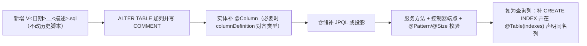

[此图为流程示意，节点动作分别对应上文各表引用的真实文件，不单独指向某一个源文件]

### 术语

- 「用户对双向」：同一对用户无论谁先发起，会话表中只有一行；由 `LEAST`/`GREATEST` 函数式唯一键与 `findByUserPair` 的双向 OR 条件共同保证（迁移 L12；仓储 L44-L50）。
- 「软删（微信语义）」：删除只影响发送者本人的可见性，条件式 `deleted_for_sender = 0 OR sender_id <> 当前用户`（V2026.08.10.0021 L8-L9；仓储 L40、L89）。
- 「会话预览」：`last_message_preview` 是消息正文的截断副本，非独立消息（服务 L276-L284）。
- 「双侧静音」：静音标记按用户在 A 侧还是 B 侧分别存两列，互不影响（V2026.08.10.0031 L3-L4；服务 L415-L419）。

**章节来源**
- [V2026.05.24.0002__create_private_conversations.sql:1-29](file://database/flyway/sql/V2026.05.24.0002__create_private_conversations.sql#L1-L29)
- [V2026.05.27.0001__create_temp_chat_tables.sql:34-44](file://database/flyway/sql/V2026.05.27.0001__create_temp_chat_tables.sql#L34-L44)
- [V2026.05.29.0002__alter_visitors_add_is_read_and_conversations_add_pinned.sql:3-7](file://database/flyway/sql/V2026.05.29.0002__alter_visitors_add_is_read_and_conversations_add_pinned.sql#L3-L7)
- [V2026.05.31.0001__fix_entity_ddl_mismatches.sql:7-11](file://database/flyway/sql/V2026.05.31.0001__fix_entity_ddl_mismatches.sql#L7-L11)
- [V2026.06.01.0001__add_recall_delivery_quote_to_messages.sql:4-11](file://database/flyway/sql/V2026.06.01.0001__add_recall_delivery_quote_to_messages.sql#L4-L11)
- [V2026.07.25.0014__add_performance_indexes.sql:90-91](file://database/flyway/sql/V2026.07.25.0014__add_performance_indexes.sql#L90-L91)
- [V2026.07.25.0017__add_remaining_missing_indexes.sql:26-27](file://database/flyway/sql/V2026.07.25.0017__add_remaining_missing_indexes.sql#L26-L27)
- [V2026.07.26.0001__add_entity_index_annotations.sql:53-66](file://database/flyway/sql/V2026.07.26.0001__add_entity_index_annotations.sql#L53-L66)
- [V2026.07.26.0003__add_version_columns.sql:106-111](file://database/flyway/sql/V2026.07.26.0003__add_version_columns.sql#L106-L111)
- [V2026.07.26.0004__p8_database_standardization.sql:100-121](file://database/flyway/sql/V2026.07.26.0004__p8_database_standardization.sql#L100-L121)
- [V2026.07.27.0005__enum_to_varchar_check.sql:26-34](file://database/flyway/sql/V2026.07.27.0005__enum_to_varchar_check.sql#L26-L34)
- [V2026.07.28.0004__audit_fields.sql:134-139](file://database/flyway/sql/V2026.07.28.0004__audit_fields.sql#L134-L139)
- [V2026.07.28.0005__add_indexes.sql:102-113](file://database/flyway/sql/V2026.07.28.0005__add_indexes.sql#L102-L113)
- [V2026.08.08.0020__add_private_messages_duration_seconds.sql:4-5](file://database/flyway/sql/V2026.08.08.0020__add_private_messages_duration_seconds.sql#L4-L5)
- [V2026.08.10.0021__add_private_messages_deleted_for_sender.sql:8-15](file://database/flyway/sql/V2026.08.10.0021__add_private_messages_deleted_for_sender.sql#L8-L15)
- [V2026.08.10.0031__add_conversation_mute.sql:3-4](file://database/flyway/sql/V2026.08.10.0031__add_conversation_mute.sql#L3-L4)
- [PrivateMessageController.java:51-186](file://apps/api/src/main/java/com/campuslove/api/chat/PrivateMessageController.java#L51-L186)
- [RealPrivateMessageService.java:106-490](file://apps/api/src/main/java/com/campuslove/api/chat/RealPrivateMessageService.java#L106-L490)
- [MessageWebSocketHandler.java:27-134](file://apps/api/src/main/java/com/campuslove/api/chat/MessageWebSocketHandler.java#L27-L134)
- [PrivateConversationRepository.java:23-50](file://apps/api/src/main/java/com/campuslove/api/repository/PrivateConversationRepository.java#L23-L50)
- [PrivateMessageRepository.java:39-94](file://apps/api/src/main/java/com/campuslove/api/repository/PrivateMessageRepository.java#L39-L94)
- [PrivateMessage.java:39-55](file://apps/api/src/main/java/com/campuslove/api/entity/PrivateMessage.java#L39-L55)
