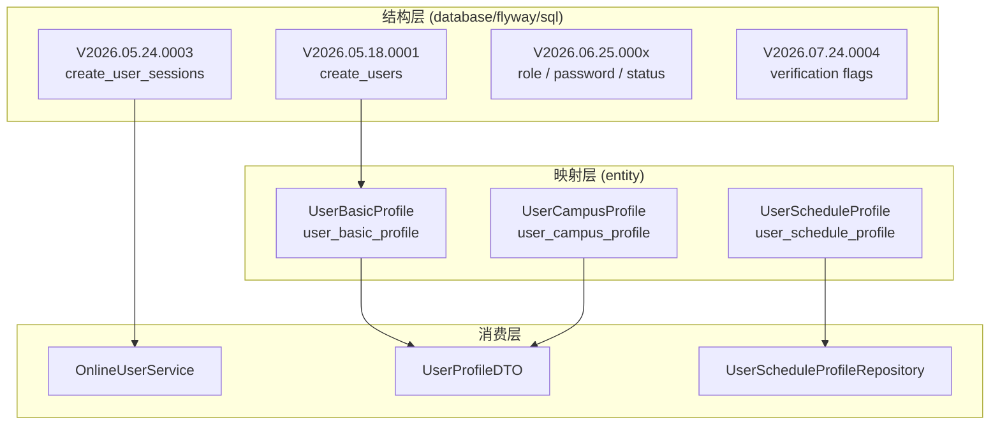
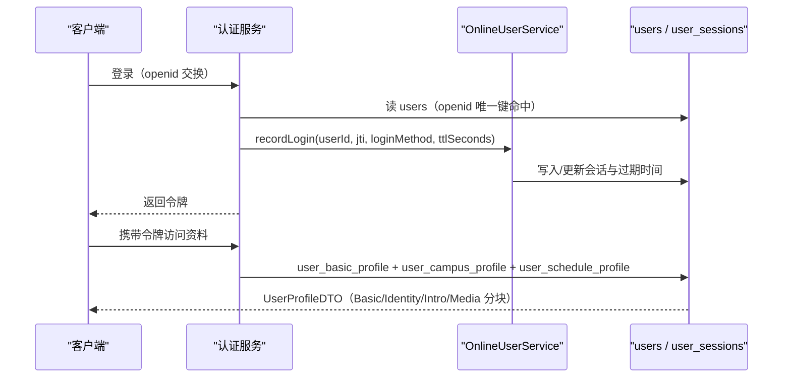
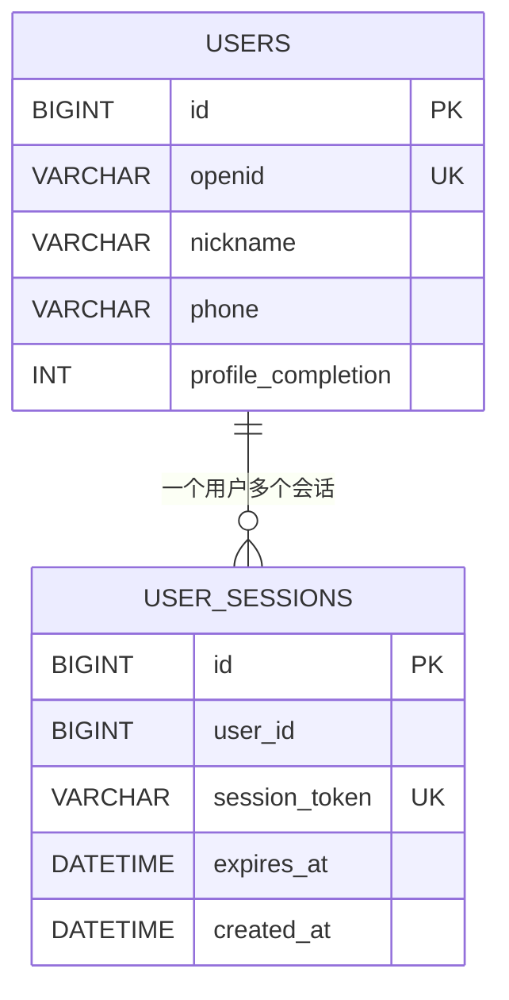
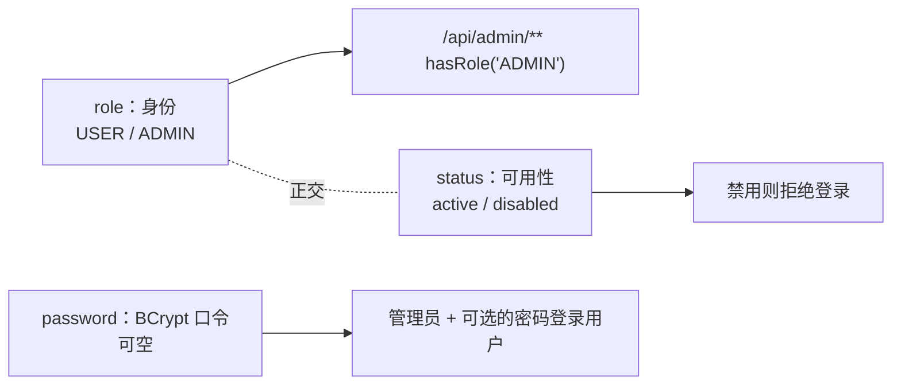

# 用户相关表

<cite>
**本文引用的文件**
- [V2026.05.18.0001__create_users.sql](file://database/flyway/sql/V2026.05.18.0001__create_users.sql)
- [V2026.05.21.0006__alter_users_add_profile_completion.sql](file://database/flyway/sql/V2026.05.21.0006__alter_users_add_profile_completion.sql)
- [V2026.05.24.0003__create_user_sessions.sql](file://database/flyway/sql/V2026.05.24.0003__create_user_sessions.sql)
- [V2026.05.26.0002__alter_user_basic_profile_add_interest_tags.sql](file://database/flyway/sql/V2026.05.26.0002__alter_user_basic_profile_add_interest_tags.sql)
- [V2026.06.25.0001__add_user_role_and_init_admin.sql](file://database/flyway/sql/V2026.06.25.0001__add_user_role_and_init_admin.sql)
- [V2026.06.25.0002__migrate_admin_password_to_bcrypt.sql](file://database/flyway/sql/V2026.06.25.0002__migrate_admin_password_to_bcrypt.sql)
- [V2026.06.25.0004__add_user_status_and_post_audit_status.sql](file://database/flyway/sql/V2026.06.25.0004__add_user_status_and_post_audit_status.sql)
- [V2026.06.25.0008__extend_user_password_to_all_users.sql](file://database/flyway/sql/V2026.06.25.0008__extend_user_password_to_all_users.sql)
- [V2026.07.24.0004__add_user_verification_flags.sql](file://database/flyway/sql/V2026.07.24.0004__add_user_verification_flags.sql)
- [V2026.07.25.0004__add_auto_renew_to_users.sql](file://database/flyway/sql/V2026.07.25.0004__add_auto_renew_to_users.sql)
- [V2026.07.25.0017__add_remaining_missing_indexes.sql](file://database/flyway/sql/V2026.07.25.0017__add_remaining_missing_indexes.sql)
- [UserBasicProfile.java](file://apps/api/src/main/java/com/campuslove/api/entity/UserBasicProfile.java)
- [UserCampusProfile.java](file://apps/api/src/main/java/com/campuslove/api/entity/UserCampusProfile.java)
- [UserScheduleProfile.java](file://apps/api/src/main/java/com/campuslove/api/entity/UserScheduleProfile.java)
- [UserScheduleProfileRepository.java](file://apps/api/src/main/java/com/campuslove/api/repository/UserScheduleProfileRepository.java)
- [UserSessionView.java](file://apps/api/src/main/java/com/campuslove/api/auth/UserSessionView.java)
- [OnlineUserService.java](file://apps/api/src/main/java/com/campuslove/api/auth/OnlineUserService.java)
- [UserProfileDTO.java](file://apps/api/src/main/java/com/campuslove/api/profile/UserProfileDTO.java)
</cite>

## 目录
1. [简介](#简介)
2. [项目结构](#项目结构)
3. [核心组件](#核心组件)
4. [架构总览](#架构总览)
5. [users 主表](#users-主表)
6. [user_sessions 会话表](#user_sessions-会话表)
7. [user_basic_profile 资料宽表](#user_basic_profile-资料宽表)
8. [校区画像与日程画像](#校区画像与日程画像)
9. [角色、状态与口令字段](#角色状态与口令字段)
10. [认证徽章字段](#认证徽章字段)
11. [迁移演进顺序](#迁移演进顺序)
12. [依赖关系分析](#依赖关系分析)
13. [性能考虑](#性能考虑)
14. [故障排查指南](#故障排查指南)
15. [结论](#结论)

## 简介
用户域的数据由五张表承担，各自职责不重叠：

- `users`：账号身份与最基础的展示字段，是所有外键指向的根表；迁移注释直接写明"在所有其他迁移之前执行，
  提供用户基础数据表"。
- `user_sessions`：会话令牌与过期时间，一个用户多行。
- `user_basic_profile`：资料宽表，30 余个可空列覆盖昵称、简介、年级、代词、性别、兴趣标签、身高、学历、
  感情状态、家乡、未来城市与规划、相册、职业收入、性格标签、MBTI、理想型、出生年、邮箱与身份证认证位。
- `user_campus_profile`：校区归属（城市、校区、院系）与校园认证状态。
- `user_schedule_profile`：见面偏好（校区区域、时间窗 JSON、课程块 JSON）。

设计取向很明确：**身份与状态留在 `users`，可变的展示信息外移到 `user_basic_profile`**，
派生型偏好各自独立成表，彼此用 `userId` 关联而不是把列继续堆到 `users` 上。

## 项目结构
- 结构定义（DDL）：`database/flyway/sql/`，用户相关的脚本共 11 个，基线脚本
  `V2026.05.18.0001__create_users.sql` 只有 20 行，后续能力全部靠追加脚本演进。
- 持久化映射：`apps/api/src/main/java/com/campuslove/api/entity/` 下的
  `UserBasicProfile`（439 行）、`UserCampusProfile`（150 行）、`UserScheduleProfile`（138 行）。
- 仓储：`repository/UserScheduleProfileRepository`（28 行，L11 声明类型）。
- 会话与在线态：`auth/OnlineUserService`（351 行）与 `auth/UserSessionView`（43 行）。
- 对外投影：`profile/UserProfileDTO`（37 行），内部按用途切成
  `Basic`(L22)、`Identity`(L23)、`Intro`(L24)、`Relationship`(L25)、`Media`(L26)、`Relation`(L27)、
  `Post`(L35)、`Story`(L36) 等嵌套类型。



**图表来源**
- [V2026.05.18.0001__create_users.sql:1-20](file://database/flyway/sql/V2026.05.18.0001__create_users.sql#L1-L20)
- [V2026.05.24.0003__create_user_sessions.sql:1-11](file://database/flyway/sql/V2026.05.24.0003__create_user_sessions.sql#L1-L11)
- [UserBasicProfile.java:24-31](file://apps/api/src/main/java/com/campuslove/api/entity/UserBasicProfile.java#L24-L31)
- [UserCampusProfile.java:20-27](file://apps/api/src/main/java/com/campuslove/api/entity/UserCampusProfile.java#L20-L27)
- [UserScheduleProfile.java:20-27](file://apps/api/src/main/java/com/campuslove/api/entity/UserScheduleProfile.java#L20-L27)

## 核心组件
- **`users`**：`id`、`openid`、`nickname`、`avatar_url`、`bio`、`grade_label`、`pronouns`、`phone`、
  `profile_completion`、`interest_tags`、`following_count`、`followers_count`、`created_at`、`updated_at`
  在建表时一次定形，之后追加 `role`、`password`、`status`、`auto_renew_enabled`。
- **`user_sessions`**：`user_id` + `session_token`(512) + `expires_at`，令牌唯一。
- **`UserBasicProfile`**：`@Entity`(L24) + `@Table(name = "user_basic_profile")`(L26)，
  字段清单见"资料宽表"一节。
- **`UserCampusProfile`**：`@Table(name = "user_campus_profile")`(L22)，`verificationStatus = "draft"`(L47)。
- **`UserScheduleProfile`**：`@Table(name = "user_schedule_profile")`(L22)，
  `preferredTimeWindowJson = "[]"`(L39) 与 `courseBlockJson = "[]"`(L43)。
- **`OnlineUserService`**：`@Service`(L40)，方法 `recordLogin(Long userId, String jti, String loginMethod, long ttlSeconds)`(L103)、
  `removeLogin(Long userId)`(L143)、`getSession(Long userId)`(L164)、`listOnlineSessions()`(L204)，
  内部类型 `OnlineSessionRecord`(L329) 带 `loginAtIso()`(L332) 与 `remainingTtlSeconds()`(L337)，
  以及 `OnlineSessionEntry`(L349)。

**章节来源**
- [V2026.05.18.0001__create_users.sql:3-20](file://database/flyway/sql/V2026.05.18.0001__create_users.sql#L3-L20)
- [UserBasicProfile.java:24-194](file://apps/api/src/main/java/com/campuslove/api/entity/UserBasicProfile.java#L24-L194)
- [UserCampusProfile.java:20-73](file://apps/api/src/main/java/com/campuslove/api/entity/UserCampusProfile.java#L20-L73)
- [UserScheduleProfile.java:20-69](file://apps/api/src/main/java/com/campuslove/api/entity/UserScheduleProfile.java#L20-L69)
- [OnlineUserService.java:40-204](file://apps/api/src/main/java/com/campuslove/api/auth/OnlineUserService.java#L40-L204)

## 架构总览
一次登录要落两个地方：账号身份在 `users`，会话在 `user_sessions`（在线态由 `OnlineUserService` 维护）。
资料读取则跨 `user_basic_profile` 与两张画像表拼装成 `UserProfileDTO`。



**图表来源**
- [OnlineUserService.java:103-164](file://apps/api/src/main/java/com/campuslove/api/auth/OnlineUserService.java#L103-L164)
- [V2026.05.24.0003__create_user_sessions.sql:1-11](file://database/flyway/sql/V2026.05.24.0003__create_user_sessions.sql#L1-L11)
- [UserProfileDTO.java:8-36](file://apps/api/src/main/java/com/campuslove/api/profile/UserProfileDTO.java#L8-L36)

## users 主表
建表脚本 `V2026.05.18.0001__create_users.sql`（20 行）逐列定义了主表：

| 列 | 类型与约束 | 语义 |
|---|---|---|
| `id` | `BIGINT UNSIGNED NOT NULL AUTO_INCREMENT` | 主键，被其余用户表以 `user_id` 引用 |
| `openid` | `VARCHAR(128) NOT NULL` | 微信身份，`UNIQUE KEY uk_users_openid`(L19) 保证一人一号 |
| `nickname` | `VARCHAR(64) NOT NULL DEFAULT '新同学'` | 注册即有默认名，非空约束因此不会阻塞建号 |
| `avatar_url` | `VARCHAR(512) DEFAULT NULL` | 头像可空 |
| `bio` | `TEXT DEFAULT NULL` | 简介 |
| `grade_label` | `VARCHAR(32) DEFAULT NULL` | 年级标签，社区侧的年龄由此推导 |
| `pronouns` | `VARCHAR(32) DEFAULT NULL` | 代词 |
| `phone` | `VARCHAR(32) DEFAULT NULL` | 手机号，可空且非唯一 |
| `profile_completion` | `INT NOT NULL DEFAULT 0` | 资料完成度，后续单独建索引 |
| `interest_tags` | `JSON DEFAULT NULL` | 兴趣标签，主表也留了一份 |
| `following_count` / `followers_count` | `INT NOT NULL DEFAULT 0` | 关注/粉丝计数冗余在账号行 |
| `created_at` / `updated_at` | `DATETIME NOT NULL DEFAULT CURRENT_TIMESTAMP`，后者带 `ON UPDATE CURRENT_TIMESTAMP` | 审计时间由数据库维护 |

表选项是 `ENGINE=InnoDB DEFAULT CHARSET=utf8mb4 COLLATE=utf8mb4_0900_ai_ci`，
注释为 `COMMENT='用户表'`(L20)——`utf8mb4_0900_ai_ci` 要求 MySQL 8.0 系列，这与后续脚本
（例如自动续费列迁移）注释里"MySQL 8.0+ 支持"的措辞一致。

值得注意的是 `V2026.05.21.0006__alter_users_add_profile_completion.sql`（3 行）并没有加列，
它的注释解释了原因："`users` 表在 V2026.05.18.0001 已包含 profile_completion/following_count/followers_count 列，
此处不再重复添加，仅保留索引创建"，实际语句只有一条
`CREATE INDEX idx_users_profile_completion ON users(profile_completion);`(L3)。

**章节来源**
- [V2026.05.18.0001__create_users.sql:1-20](file://database/flyway/sql/V2026.05.18.0001__create_users.sql#L1-L20)
- [V2026.05.21.0006__alter_users_add_profile_completion.sql:1-3](file://database/flyway/sql/V2026.05.21.0006__alter_users_add_profile_completion.sql#L1-L3)

## user_sessions 会话表
`V2026.05.24.0003__create_user_sessions.sql`（11 行）结构很短但索引取向清楚：



**图表来源**
- [V2026.05.18.0001__create_users.sql:3-19](file://database/flyway/sql/V2026.05.18.0001__create_users.sql#L3-L19)
- [V2026.05.24.0003__create_user_sessions.sql:1-11](file://database/flyway/sql/V2026.05.24.0003__create_user_sessions.sql#L1-L11)

- `session_token VARCHAR(512) NOT NULL` + `UNIQUE KEY uk_user_sessions_token`(L8)：令牌本身唯一，
  长度 512 预留了较长令牌的余量。
- `KEY idx_user_sessions_user (user_id)`(L9)：按用户查会话。
- `KEY idx_user_sessions_expires (expires_at)`(L10)：按过期时间清理/扫描——这是该表唯一"按时间范围扫"的入口，
  没有它过期清理会退化成全表扫描。
- 应用侧对应 `OnlineUserService.recordLogin(userId, jti, loginMethod, ttlSeconds)`(L103) 与
  `removeLogin(userId)`(L143)、`getSession(userId)`(L164)、`listOnlineSessions()`(L204)；
  `OnlineSessionRecord.remainingTtlSeconds()`(L337) 表示在线态自身携带 TTL，而不是每次都回查库。
  只读视图 `UserSessionView`(L8) 用于把会话信息返回给调用方而不暴露内部记录结构。

**章节来源**
- [V2026.05.24.0003__create_user_sessions.sql:1-11](file://database/flyway/sql/V2026.05.24.0003__create_user_sessions.sql#L1-L11)
- [OnlineUserService.java:103-204](file://apps/api/src/main/java/com/campuslove/api/auth/OnlineUserService.java#L103-L204)
- [UserSessionView.java:8-43](file://apps/api/src/main/java/com/campuslove/api/auth/UserSessionView.java#L8-L43)

## user_basic_profile 资料宽表
实体 `UserBasicProfile`（439 行）以 `@Table(name = "user_basic_profile")`(L26) 映射，
除 `id`(L31)、`userId`(L35) 与时间/版本字段外的业务列（行号为实体声明行）：

- 基础展示：`nickname`(L39)、`bio`(L43)、`gradeLabel`(L47)、`pronouns`(L51)、`gender`(L55)
- 兴趣与个性：`interestTags = "[]"`(L59)、`personalityTags = "[]"`(L140)、`mbti`(L144)、`expectedPartner`(L148)
- 身体与背景：`height`(L67)、`educationLevel`(L74)、`birthYear`(L152)
- 感情与地域：`relationshipStatus`(L81)、`hometownProvince`(L85)、`hometownCity`(L89)、
  `futureCity`(L93)、`futurePlanTags = "[]"`(L100)
- 媒体：`photoGallery = "[]"`(L107)、`halfBodyPhotoUrl`(L111)、`personalVideoUrl`(L115)、
  `profileBackgroundUrl`(L119)
- 社会经济：`occupation`(L126)、`incomeRange`(L133)
- 认证位：`emailVerified = Boolean.FALSE`(L160)、`idCardVerified = Boolean.FALSE`(L168)
- 审计与并发：`createdAt`(L175)、`updatedAt`(L182)、`version = 0L`(L194)

三点约定值得单独说：
1. **列表型字段用 JSON 字符串存，默认 `"[]"`**：`interestTags`、`personalityTags`、`futurePlanTags`、
   `photoGallery` 都这样初始化，因此读取侧永远不需要处理 null，但也意味着不能按标签做 SQL 级过滤，
   只能在应用层解析。
2. **DDL 与实体是双向补齐的**：`V2026.05.26.0002__alter_user_basic_profile_add_interest_tags.sql`
   给表加 `interest_tags JSON DEFAULT NULL COMMENT '兴趣标签列表（JSON数组格式，如 ["摄影","篮球","阅读"]）'`
   并用 `AFTER pronouns`(L9-L11) 固定列位置；脚本注释同时写明用途是"推荐算法中的兴趣标签匹配，
   每个共同标签 +10 分"，即这张表的列直接参与打分口径。
3. **`version` 列存在**：资料更新走乐观锁，避免多端同时编辑互相覆盖。

**章节来源**
- [UserBasicProfile.java:24-194](file://apps/api/src/main/java/com/campuslove/api/entity/UserBasicProfile.java#L24-L194)
- [V2026.05.26.0002__alter_user_basic_profile_add_interest_tags.sql:1-11](file://database/flyway/sql/V2026.05.26.0002__alter_user_basic_profile_add_interest_tags.sql#L1-L11)

## 校区画像与日程画像
两张画像表结构对称：都是 `id` + `userId` + 业务列 + `createdAt`/`updatedAt` + `version`。

- `user_campus_profile`（`UserCampusProfile`，150 行）：`cityName`(L35)、`campusName`(L39)、
  `departmentName`(L43)，以及 `verificationStatus = "draft"`(L47)。默认值 `draft` 说明校园认证是
  一个有状态流转的字段（草稿起步），而不是布尔位；`version`(L73) 同样提供乐观锁。
- `user_schedule_profile`（`UserScheduleProfile`，138 行）：`preferredCampusArea`(L35)、
  `preferredTimeWindowJson = "[]"`(L39)、`courseBlockJson = "[]"`(L43)、`version = 0L`(L69)。
  时间窗与课程块都以 JSON 数组字符串存放，配合 `preferredCampusArea` 表达"在哪儿、什么时候方便"。
  仓储是 `UserScheduleProfileRepository`（28 行，L11）。

对外组装时，资料不是一次全量吐出：`UserProfileDTO` 把字段切成
`Basic`/`Identity`/`Intro`/`Relationship`/`Media`/`Relation` 等嵌套块（L22-L27），
另附 `Post`(L35)、`Story`(L36) 用于个人页的内容位，
这样"看列表"与"看主页"可以取不同分块而不是共用一个大对象。

**章节来源**
- [UserCampusProfile.java:20-147](file://apps/api/src/main/java/com/campuslove/api/entity/UserCampusProfile.java#L20-L147)
- [UserScheduleProfile.java:20-135](file://apps/api/src/main/java/com/campuslove/api/entity/UserScheduleProfile.java#L20-L135)
- [UserScheduleProfileRepository.java:11-28](file://apps/api/src/main/java/com/campuslove/api/repository/UserScheduleProfileRepository.java#L11-L28)
- [UserProfileDTO.java:8-36](file://apps/api/src/main/java/com/campuslove/api/profile/UserProfileDTO.java#L8-L36)

## 角色、状态与口令字段
`users` 的三个"权限型"列都是后加的，且各自解决一个明确问题：

- **`role`**（`V2026.06.25.0001__add_user_role_and_init_admin.sql`，21 行）：
  `ALTER TABLE users ADD COLUMN role VARCHAR(16) NOT NULL DEFAULT 'USER' COMMENT '用户角色: USER/ADMIN'`(L9-L10)，
  随后 `UPDATE users SET role = 'USER' WHERE role IS NULL OR role = ''`(L12) 回填存量行，
  再用 `INSERT INTO users (openid, nickname, role, profile_completion, following_count, followers_count, created_at, updated_at)`
  (L17) 初始化管理员。脚本注释写明三点约束：与 `SecurityConfig` 中 `/api/admin/**` 的
  `hasRole('ADMIN')` 校验配合；仅当尚不存在 `role='ADMIN'` 的用户时才插入，避免重复初始化；
  管理员口令**不在本脚本初始化**，由应用层通过环境变量 `ADMIN_PASSWORD` 配置
  （见 `RealAuthService#loginAsAdmin`）， openid 与昵称通过占位符 `${admin_openid}` 注入。
- **`password`**（`V2026.06.25.0002__migrate_admin_password_to_bcrypt.sql`，37 行）：新增
  `VARCHAR(100)` 可空列存 BCrypt 哈希，并为 `role='ADMIN'` 的账号初始化哈希；
  默认哈希由 Flyway 占位符 `${admin_password_hash}` 提供、可用环境变量 `ADMIN_PASSWORD_HASH` 覆盖，
  脚本注释显式给出安全警告：明文口令来自环境变量 `ADMIN_PASSWORD`。
  随后 `V2026.06.25.0008__extend_user_password_to_all_users.sql`（52 行）把该列语义从"仅管理员"
  扩展为"管理员与密码登录的普通用户"，注释记录了前因：V2026.06.25.0002 的 javadoc 曾限制仅管理员使用；
  该脚本用幂等方式确认列存在（若 0002 已执行则跳过），并说明若开通密码登录，
  注册时由 `RealAuthService` 调用 `passwordEncoder.encode()` 写入。
- **`status`**（`V2026.06.25.0004__add_user_status_and_post_audit_status.sql`，45 行）：新增
  `active/disabled`、默认 `active`；注释强调 `status` 与 `role` **正交**——`role` 表示身份、
  `status` 表示账号是否可用，`disabled` 用户禁止登录。同一脚本还给 `posts` 加
  `audit_status`（`pending/approved/rejected`，默认 `approved`），
  理由是原 `posts.status` 枚举（`active/deleted/hidden`）语义是"软删/隐藏"，不适合承载审核状态。
- **`auto_renew_enabled`**（`V2026.07.25.0004__add_auto_renew_to_users.sql`，34 行）：VIP 自动续费开关，
  `TINYINT(1)`、默认 `0`（关闭）以保证存量用户不受影响。该脚本用 `information_schema.COLUMNS` 查询
  列是否存在再决定是否 `ADD`(L18-L21)，注释解释这是对"MySQL 不支持 `ADD COLUMN IF NOT EXISTS` 的版本"的兼容做法。



[此图为概念流程，不直接对应具体源文件，故不提供图表来源]

**章节来源**
- [V2026.06.25.0001__add_user_role_and_init_admin.sql:9-21](file://database/flyway/sql/V2026.06.25.0001__add_user_role_and_init_admin.sql#L9-L21)
- [V2026.06.25.0002__migrate_admin_password_to_bcrypt.sql:6-18](file://database/flyway/sql/V2026.06.25.0002__migrate_admin_password_to_bcrypt.sql#L6-L18)
- [V2026.06.25.0004__add_user_status_and_post_audit_status.sql:2-18](file://database/flyway/sql/V2026.06.25.0004__add_user_status_and_post_audit_status.sql#L2-L18)
- [V2026.06.25.0008__extend_user_password_to_all_users.sql:5-23](file://database/flyway/sql/V2026.06.25.0008__extend_user_password_to_all_users.sql#L5-L23)
- [V2026.07.25.0004__add_auto_renew_to_users.sql:1-21](file://database/flyway/sql/V2026.07.25.0004__add_auto_renew_to_users.sql#L1-L21)

## 认证徽章字段
`V2026.07.24.0004__add_user_verification_flags.sql`（12 行）为 `user_basic_profile` 追加两列：

```sql
ALTER TABLE user_basic_profile
    ADD COLUMN email_verified BOOLEAN NOT NULL DEFAULT FALSE,
    ADD COLUMN id_card_verified BOOLEAN NOT NULL DEFAULT FALSE;
```

脚本注释给出了这两列存在的唯一理由：支持 `getVerificationBadgeLevel` 返回 `email` / `idcard` 徽章级别，
并写死优先级 **school > email > idcard > none**(L6)。同时它记录了一条纪律："不修改已发布的
V2026.07.24.0001/V2026.07.24.0002 脚本，仅追加列"(L7)——这正是 Flyway checksum 校验下的正确做法。
实体侧对应 `emailVerified = Boolean.FALSE`(L160) 与 `idCardVerified = Boolean.FALSE`(L168)，
默认值与 DDL 的 `NOT NULL DEFAULT FALSE` 一致。

校区认证徽章的"school"级不来自这两列，而来自 `user_campus_profile.verificationStatus`（默认 `draft`，L47），
两者组合才构成完整徽章判定链。

**章节来源**
- [V2026.07.24.0004__add_user_verification_flags.sql:1-12](file://database/flyway/sql/V2026.07.24.0004__add_user_verification_flags.sql#L1-L12)
- [UserBasicProfile.java:160-168](file://apps/api/src/main/java/com/campuslove/api/entity/UserBasicProfile.java#L160-L168)
- [UserCampusProfile.java:47-47](file://apps/api/src/main/java/com/campuslove/api/entity/UserCampusProfile.java#L47-L47)

## 迁移演进顺序
用户表的变更严格追加、从不回改，按时间线可以读出产品重心的移动：

| 版本 | 变更 | 性质 |
|---|---|---|
| V2026.05.18.0001 | 建 `users`，含 `profile_completion`、关注计数、`interest_tags JSON` | 基线 |
| V2026.05.21.0006 | 只建 `idx_users_profile_completion`，注释说明列已在基线中存在 | 索引补齐 |
| V2026.05.24.0003 | 建 `user_sessions`（令牌唯一 + user/expires 双索引） | 新表 |
| V2026.05.26.0002 | `user_basic_profile.interest_tags JSON` + `AFTER pronouns` | 加列 |
| V2026.06.25.0001 | `users.role` + 存量回填 + 管理员初始化（占位符注入） | 权限 |
| V2026.06.25.0002 | `users.password` VARCHAR(100) 存 BCrypt，仅管理员初始化 | 安全 |
| V2026.06.25.0004 | `users.status`；`posts.audit_status` | 状态正交 |
| V2026.06.25.0008 | `password` 语义扩展到普通密码登录用户 | 语义扩展 |
| V2026.07.24.0004 | `user_basic_profile.email_verified` / `id_card_verified` | 徽章 |
| V2026.07.25.0004 | `users.auto_renew_enabled` TINYINT(1) 默认 0（幂等检查列） | 商业化 |
| V2026.07.25.0017 | 补齐仍缺失的索引，其中两条作用在 `users`（L19、L23） | 索引补齐 |

顺序上有两点容易被忽视：`interest_tags` 同时存在于 `users` 与 `user_basic_profile`（后者是 5.26 才补的），
读取口径要以实体 `UserBasicProfile.interestTags`(L59) 为准；`password` 的可用性直到
V2026.06.25.0008 才被扩展到普通用户，早于该版本的库中该列只服务管理员。

**章节来源**
- [V2026.05.18.0001__create_users.sql:1-20](file://database/flyway/sql/V2026.05.18.0001__create_users.sql#L1-L20)
- [V2026.05.21.0006__alter_users_add_profile_completion.sql:1-3](file://database/flyway/sql/V2026.05.21.0006__alter_users_add_profile_completion.sql#L1-L3)
- [V2026.06.25.0001__add_user_role_and_init_admin.sql:1-21](file://database/flyway/sql/V2026.06.25.0001__add_user_role_and_init_admin.sql#L1-L21)
- [V2026.06.25.0008__extend_user_password_to_all_users.sql:1-23](file://database/flyway/sql/V2026.06.25.0008__extend_user_password_to_all_users.sql#L1-L23)
- [V2026.07.25.0017__add_remaining_missing_indexes.sql:19-23](file://database/flyway/sql/V2026.07.25.0017__add_remaining_missing_indexes.sql#L19-L23)

## 依赖关系分析
- 所有画像表以 `userId` 指向 `users.id`，没有任何一张表把资料列复制回 `users`，
  因此"账号存在"与"资料完整"是两件事，`profile_completion` 正是用来表达后者的量化位。
- `users.following_count` / `followers_count` 是冗余计数，真实关系在关注表；计数列的存在使列表页
  不需要 JOIN，代价是关注关系变更时必须同步。
- `user_sessions` 与 `OnlineUserService` 构成一对：表存令牌与过期，服务存在线记录与 TTL
  （`remainingTtlSeconds`，L337）。二者若不同步，会出现"库里过期、内存里还在线"。
- 徽章判定跨两张表：`user_basic_profile.email_verified`/`id_card_verified` 与
  `user_campus_profile.verificationStatus`，优先级 school > email > idcard > none 由应用侧实现，
  数据库只提供原料。
- 权限侧 `users.role` 与 `SecurityConfig` 的 `/api/admin/** hasRole('ADMIN')` 绑定；
  `users.status` 则与登录准入绑定。

**章节来源**
- [UserBasicProfile.java:31-35](file://apps/api/src/main/java/com/campuslove/api/entity/UserBasicProfile.java#L31-L35)
- [UserCampusProfile.java:27-31](file://apps/api/src/main/java/com/campuslove/api/entity/UserCampusProfile.java#L27-L31)
- [UserScheduleProfile.java:27-31](file://apps/api/src/main/java/com/campuslove/api/entity/UserScheduleProfile.java#L27-L31)
- [V2026.05.18.0001__create_users.sql:14-15](file://database/flyway/sql/V2026.05.18.0001__create_users.sql#L14-L15)
- [V2026.07.24.0004__add_user_verification_flags.sql:4-6](file://database/flyway/sql/V2026.07.24.0004__add_user_verification_flags.sql#L4-L6)

## 性能考虑
- **索引都是按查询补的，不是照列建的**：`idx_users_profile_completion`（按完成度筛未完成资料的用户）、
  `idx_user_sessions_user`、`idx_user_sessions_expires` 各自对应一个确定的访问模式；
  `V2026.07.25.0017__add_remaining_missing_indexes.sql` 的注释还点名了 `posts.status` 这类
  "几乎所有查询都带"的过滤列，说明索引清单来自实际慢查询而不是形式化覆盖。
- **宽表读取代价集中在资料页**：`user_basic_profile` 40 余列，但 `photoGallery`、`personalityTags` 等
  JSON 字符串列可能很长；列表场景应只取需要的分块（`UserProfileDTO` 的 Basic/Intro/Media 切分正为此存在）。
- **`VARCHAR(512)` 的会话令牌**：`session_token` 定长 512 且带唯一索引，索引体积不小；
  这是"令牌长度优先于索引成本"的取舍，若日后缩短令牌可以直接减小该列。
- **乐观锁列在四张表上都有**（`version`：`UserBasicProfile` L194、`UserCampusProfile` L73、
  `UserScheduleProfile` L69、`CampusTopicReply` 等同款约定），代价是每次更新多一个版本比较，
  收益是避免资料被并发覆盖后无法追溯。

**章节来源**
- [V2026.05.21.0006__alter_users_add_profile_completion.sql:3-3](file://database/flyway/sql/V2026.05.21.0006__alter_users_add_profile_completion.sql#L3-L3)
- [V2026.05.24.0003__create_user_sessions.sql:8-10](file://database/flyway/sql/V2026.05.24.0003__create_user_sessions.sql#L8-L10)
- [V2026.07.25.0017__add_remaining_missing_indexes.sql:11-14](file://database/flyway/sql/V2026.07.25.0017__add_remaining_missing_indexes.sql#L11-L14)
- [UserBasicProfile.java:107-194](file://apps/api/src/main/java/com/campuslove/api/entity/UserBasicProfile.java#L107-L194)

## 故障排查指南
- **新环境建表失败，报 collation 不支持**：`utf8mb4_0900_ai_ci` 只在 MySQL 8.0+ 存在，
  老版本 MySQL 5.7 会在 `users` 建表这一步直接失败，先核对实例版本。
- **管理员账号没被创建**：`V2026.06.25.0001` 的插入是条件性的——仅当不存在 `role='ADMIN'` 用户时才插，
  且 openid/昵称来自占位符注入；若占位符缺失，Flyway 会因占位符未提供而失败，管理员自然不存在。
- **管理员无法登录但账号存在**：口令来自 `users.password` 的 BCrypt 哈希，默认值由
  `${admin_password_hash}` 注入，可用 `ADMIN_PASSWORD_HASH` 覆盖；脚本注释明确默认明文口令走
  `ADMIN_PASSWORD` 环境变量，两者不一致就会出现"账号在、口令不对"。
- **禁用用户仍能登录**：`status` 与 `role` 正交，`disabled` 的拦截在应用层；
  只在库里改了 `status` 而没有走应用的准入逻辑，就会出现该现象。
- **资料列缺失（例如没有 `email_verified`）**：徽章两列是 V2026.07.24.0004 追加的，
  该脚本只追加、不改历史脚本，因此若库的迁移历史停在更早版本，需要确认后续脚本已执行
  （查 `flyway_schema_history` 的 `success`）。
- **同一用户出现多份兴趣标签且不一致**：`users.interest_tags` 与
  `user_basic_profile.interest_tags` 都存在，写入应以实体 `UserBasicProfile.interestTags` 的路径为准，
  否则推荐侧读到的与页面显示的不是同一份。
- **自动续费列重复执行报错**：`V2026.07.25.0004` 用 `information_schema` 判列是否存在再 ADD，
  若手工在库里加过同名列，脚本会跳过而不报错——因此"看起来没生效"往往是列已存在但默认值不同。

**章节来源**
- [V2026.05.18.0001__create_users.sql:20-20](file://database/flyway/sql/V2026.05.18.0001__create_users.sql#L20-L20)
- [V2026.06.25.0001__add_user_role_and_init_admin.sql:9-21](file://database/flyway/sql/V2026.06.25.0001__add_user_role_and_init_admin.sql#L9-L21)
- [V2026.06.25.0002__migrate_admin_password_to_bcrypt.sql:6-18](file://database/flyway/sql/V2026.06.25.0002__migrate_admin_password_to_bcrypt.sql#L6-L18)
- [V2026.06.25.0004__add_user_status_and_post_audit_status.sql:12-18](file://database/flyway/sql/V2026.06.25.0004__add_user_status_and_post_audit_status.sql#L12-L18)
- [V2026.07.25.0004__add_auto_renew_to_users.sql:12-21](file://database/flyway/sql/V2026.07.25.0004__add_auto_renew_to_users.sql#L12-L21)
- [V2026.05.26.0002__alter_user_basic_profile_add_interest_tags.sql:9-11](file://database/flyway/sql/V2026.05.26.0002__alter_user_basic_profile_add_interest_tags.sql#L9-L11)

## 结论
用户域用五张表把"身份、会话、资料、校区、日程"分开放：`users` 只承担身份与账号级状态，
`user_sessions` 承担令牌与过期，`user_basic_profile` 承担 40 余列展示资料，
`user_campus_profile` 与 `user_schedule_profile` 承担两类派生画像。所有画像表用 `userId` 回指 `users.id`，
并统一带 `createdAt`/`updatedAt`/`version`。

权限相关三列是分三次加上的：`role` 管身份（USER/ADMIN，与 `/api/admin/**` 的角色校验绑定）、
`status` 管可用性（active/disabled，禁用即拒登录）、`password` 管口令（BCrypt，从"仅管理员"扩展到密码登录用户）。
认证徽章则由 `email_verified`/`id_card_verified` 与 `user_campus_profile.verificationStatus` 共同支撑，
优先级 school > email > idcard > none 由应用侧判定。

整套结构最重要的纪律写在 V2026.07.24.0004 的注释里：不修改已发布脚本，只追加新脚本；
需要幂等时用 `information_schema` 判列（如自动续费列），而不是改写历史 DDL。任何想"顺手改一下老脚本"
的做法都会在 `validateOnMigrate` 下变成校验和冲突。
