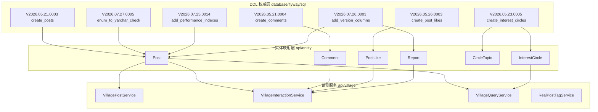
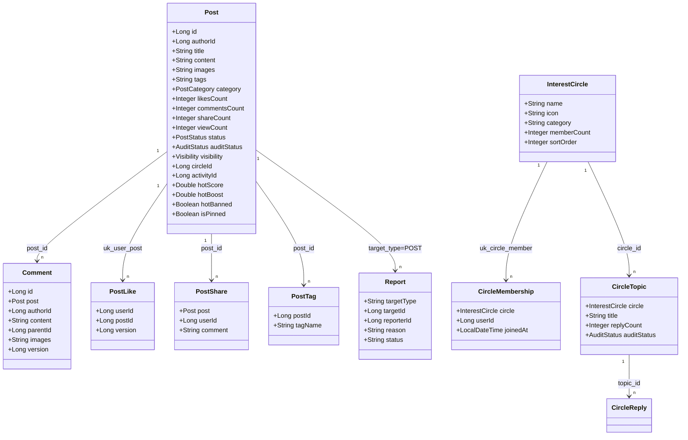
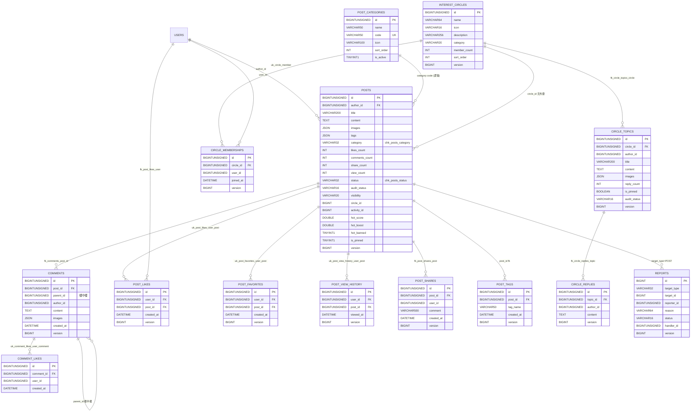
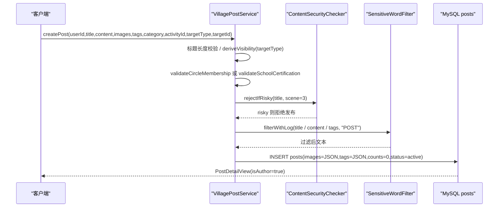
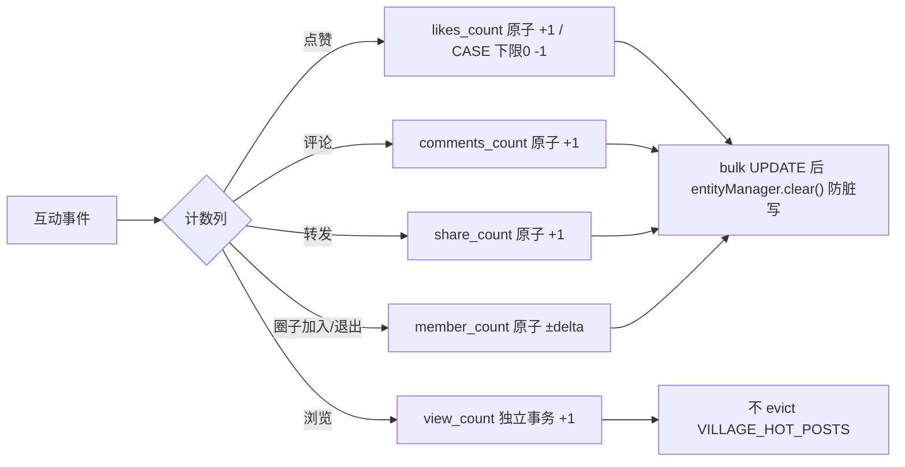
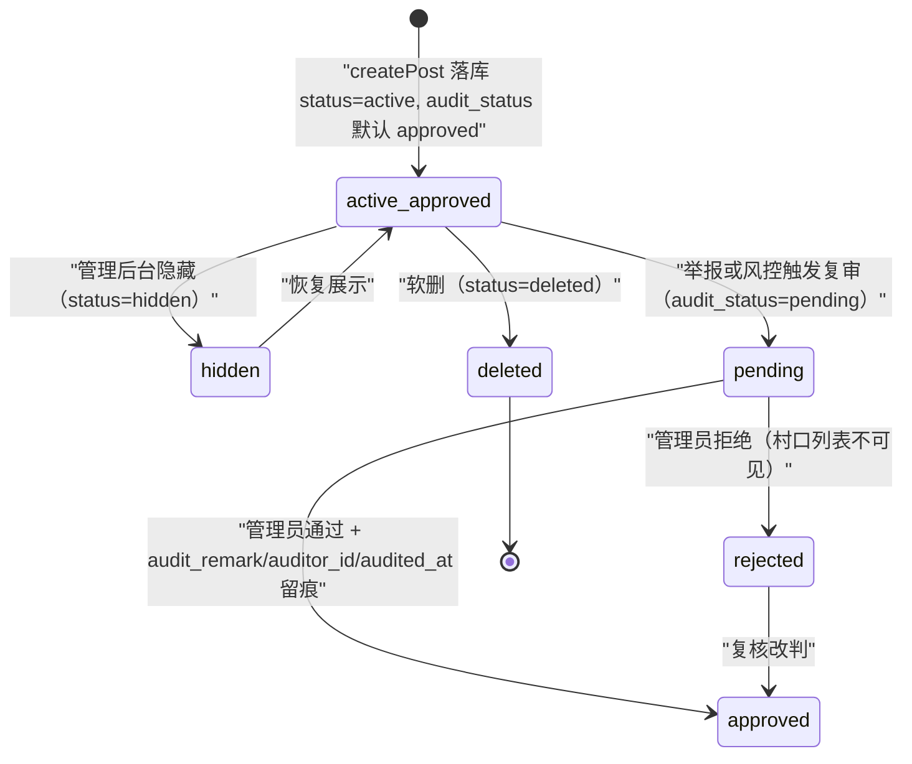
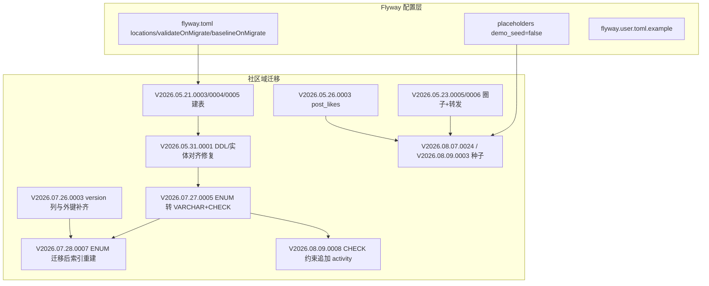
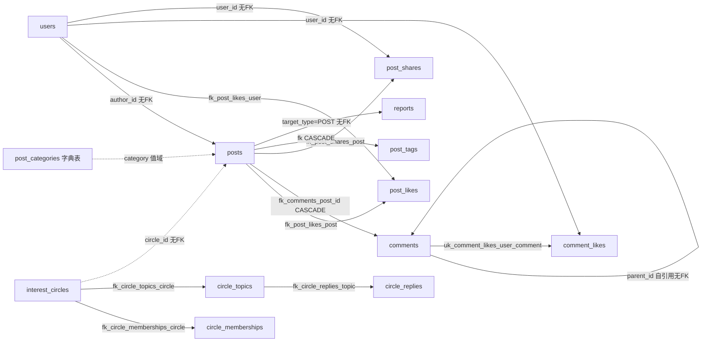
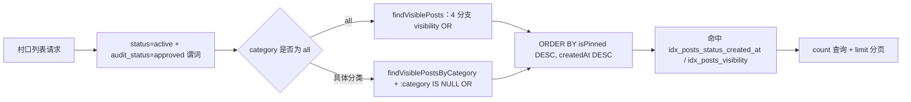

# 社区相关表

<cite>
**本文引用的文件**
- [V2026.05.21.0003__create_posts_table.sql](file://database/flyway/sql/V2026.05.21.0003__create_posts_table.sql)
- [V2026.05.21.0004__create_comments_table.sql](file://database/flyway/sql/V2026.05.21.0004__create_comments_table.sql)
- [V2026.05.26.0003__create_post_likes.sql](file://database/flyway/sql/V2026.05.26.0003__create_post_likes.sql)
- [V2026.05.23.0005__create_interest_circles.sql](file://database/flyway/sql/V2026.05.23.0005__create_interest_circles.sql)
- [V2026.08.07.0024__seed_circle_posts_and_topics.sql](file://database/flyway/sql/V2026.08.07.0024__seed_circle_posts_and_topics.sql)
- [V2026.08.09.0003__seed_comment_likes_for_demo_posts.sql](file://database/flyway/sql/V2026.08.09.0003__seed_comment_likes_for_demo_posts.sql)
- [VillagePostService.java](file://apps/api/src/main/java/com/campuslove/api/village/VillagePostService.java)
- [RealPostTagService.java](file://apps/api/src/main/java/com/campuslove/api/village/RealPostTagService.java)
- [MockPostTagService.java](file://apps/api/src/main/java/com/campuslove/api/village/MockPostTagService.java)
- [PostSummaryView.java](file://apps/api/src/main/java/com/campuslove/api/village/PostSummaryView.java)
- [PostAuthorView.java](file://apps/api/src/main/java/com/campuslove/api/village/PostAuthorView.java)
- [PostTagService.java](file://apps/api/src/main/java/com/campuslove/api/village/PostTagService.java)
- [V2026.05.23.0006__create_post_shares.sql](file://database/flyway/sql/V2026.05.23.0006__create_post_shares.sql)
- [V2026.05.28.0010__create_post_tags.sql](file://database/flyway/sql/V2026.05.28.0010__create_post_tags.sql)
- [V2026.05.29.0003__create_post_categories.sql](file://database/flyway/sql/V2026.05.29.0003__create_post_categories.sql)
- [V2026.06.26.0001__create_reports.sql](file://database/flyway/sql/V2026.06.26.0001__create_reports.sql)
- [V2026.05.31.0001__fix_entity_ddl_mismatches.sql](file://database/flyway/sql/V2026.05.31.0001__fix_entity_ddl_mismatches.sql)
- [V2026.06.25.0004__add_user_status_and_post_audit_status.sql](file://database/flyway/sql/V2026.06.25.0004__add_user_status_and_post_audit_status.sql)
- [V2026.07.27.0005__enum_to_varchar_check.sql](file://database/flyway/sql/V2026.07.27.0005__enum_to_varchar_check.sql)
- [V2026.08.09.0008__fix_posts_category_check.sql](file://database/flyway/sql/V2026.08.09.0008__fix_posts_category_check.sql)
- [V2026.08.08.0002__add_comments_parent_id.sql](file://database/flyway/sql/V2026.08.08.0002__add_comments_parent_id.sql)
- [V2026.08.08.0018__add_posts_title.sql](file://database/flyway/sql/V2026.08.08.0018__add_posts_title.sql)
- [V2026.09.06.0001__add_comment_images.sql](file://database/flyway/sql/V2026.09.06.0001__add_comment_images.sql)
- [V2026.08.11.0001__add_post_hot_columns.sql](file://database/flyway/sql/V2026.08.11.0001__add_post_hot_columns.sql)
- [V2026.08.07.0017__add_forum_admin_fields.sql](file://database/flyway/sql/V2026.08.07.0017__add_forum_admin_fields.sql)
- [V2026.09.01.0003__add_post_visibility.sql](file://database/flyway/sql/V2026.09.01.0003__add_post_visibility.sql)
- [V2026.08.09.0004__add_posts_activity_id.sql](file://database/flyway/sql/V2026.08.09.0004__add_posts_activity_id.sql)
- [V2026.08.10.0032__add_category_to_interest_circles.sql](file://database/flyway/sql/V2026.08.10.0032__add_category_to_interest_circles.sql)
- [V2026.08.31.0001__add_circle_topic_audit_fields.sql](file://database/flyway/sql/V2026.08.31.0001__add_circle_topic_audit_fields.sql)
- [V2026.07.25.0014__add_performance_indexes.sql](file://database/flyway/sql/V2026.07.25.0014__add_performance_indexes.sql)
- [V2026.07.25.0017__add_remaining_missing_indexes.sql](file://database/flyway/sql/V2026.07.25.0017__add_remaining_missing_indexes.sql)
- [V2026.07.26.0003__add_version_columns.sql](file://database/flyway/sql/V2026.07.26.0003__add_version_columns.sql)
- [V2026.07.28.0007__rebuild_indexes_after_enum_migration.sql](file://database/flyway/sql/V2026.07.28.0007__rebuild_indexes_after_enum_migration.sql)
- [V2026.08.09.0001__create_post_favorites_and_view_history.sql](file://database/flyway/sql/V2026.08.09.0001__create_post_favorites_and_view_history.sql)
- [V2026.06.25.0006__create_notify_config_and_sensitive_words.sql](file://database/flyway/sql/V2026.06.25.0006__create_notify_config_and_sensitive_words.sql)
- [flyway.toml](file://database/flyway/flyway.toml)
- [Post.java](file://apps/api/src/main/java/com/campuslove/api/entity/Post.java)
- [Comment.java](file://apps/api/src/main/java/com/campuslove/api/entity/Comment.java)
- [PostLike.java](file://apps/api/src/main/java/com/campuslove/api/entity/PostLike.java)
- [InterestCircle.java](file://apps/api/src/main/java/com/campuslove/api/entity/InterestCircle.java)
- [CircleMembership.java](file://apps/api/src/main/java/com/campuslove/api/entity/CircleMembership.java)
- [CircleTopic.java](file://apps/api/src/main/java/com/campuslove/api/entity/CircleTopic.java)
- [CircleReply.java](file://apps/api/src/main/java/com/campuslove/api/entity/CircleReply.java)
- [PostShare.java](file://apps/api/src/main/java/com/campuslove/api/entity/PostShare.java)
- [PostTag.java](file://apps/api/src/main/java/com/campuslove/api/entity/PostTag.java)
- [PostCategoryEntity.java](file://apps/api/src/main/java/com/campuslove/api/entity/PostCategoryEntity.java)
- [Report.java](file://apps/api/src/main/java/com/campuslove/api/entity/Report.java)
- [VillageInteractionService.java](file://apps/api/src/main/java/com/campuslove/api/village/VillageInteractionService.java)
- [VillageQueryService.java](file://apps/api/src/main/java/com/campuslove/api/village/VillageQueryService.java)
- [PostRepository.java](file://apps/api/src/main/java/com/campuslove/api/repository/PostRepository.java)
- [HotScoreCalculator.java](file://apps/api/src/main/java/com/campuslove/api/village/HotScoreCalculator.java)
- [RealPostSearchService.java](file://apps/api/src/main/java/com/campuslove/api/search/RealPostSearchService.java)
- [RealCircleService.java](file://apps/api/src/main/java/com/campuslove/api/discover/RealCircleService.java)
- [PostReportController.java](file://apps/api/src/main/java/com/campuslove/api/village/PostReportController.java)
- [SensitiveWordFilter.java](file://apps/api/src/main/java/com/campuslove/api/config/SensitiveWordFilter.java)
- [ContentSecurityChecker.java](file://apps/api/src/main/java/com/campuslove/api/config/ContentSecurityChecker.java)
- [V2026.07.26.0004__p8_database_standardization.sql](file://database/flyway/sql/V2026.07.26.0004__p8_database_standardization.sql)
- [V2026.08.24.0001__create_post_draft.sql](file://database/flyway/sql/V2026.08.24.0001__create_post_draft.sql)
- [VillagePostServiceTest.java](file://apps/api/src/test/java/com/campuslove/api/village/VillagePostServiceTest.java)
</cite>

## 目录
1. [简介](#简介)
2. [项目结构](#项目结构)
3. [核心组件](#核心组件)
4. [架构总览](#架构总览)
5. [详细组件分析](#详细组件分析)
6. [帖子分类枚举与筛选口径](#帖子分类枚举与筛选口径)
7. [审核状态与互动计数机制](#审核状态与互动计数机制)
8. [JSON 字段与标签体系](#json 字段与标签体系)
9. [迁移编排与配置](#迁移编排与配置)
10. [依赖关系分析](#依赖关系分析)
11. [性能考虑](#性能考虑)
12. [故障排查指南](#故障排查指南)
13. [能力缺口登记](#能力缺口登记)
14. [结论](#结论)
15. [附录](#附录)

## 简介

本页聚焦 Campus Love 社区域（村口/圈子/评论/点赞）在关系型数据库上的表结构设计，覆盖四张核心表及其配套种子数据迁移：

- `posts` —— 帖子主表，承载标题、正文、图片、标签、话题、作者与互动计数。
- `comments` —— 评论表，支持帖子维度的评论树。
- `post_likes` —— 帖子点赞表，以唯一约束实现「一人一赞」去重。
- `interest_circles` 及同批迁移引入的圈子成员关系表 —— 兴趣圈子的主体与成员维护。

文档以 `database/flyway/sql/` 下的 Flyway 迁移脚本为唯一权威定义来源，并与 `apps/api/src/main/java/com/campuslove/api/village/` 下的读视图/服务实现做双向核对，确保文档中的列名、类型与默认值不出现在源码之外的虚构成分。

**章节来源**
- [V2026.05.21.0003__create_posts_table.sql](file://database/flyway/sql/V2026.05.21.0003__create_posts_table.sql)

## 项目结构

社区域表结构的定义分布在两个物理位置，二者通过 Hibernate 的 `ddl-auto=validate` 强校验绑定在一起：

- **DDL 权威层**：`database/flyway/sql/` 下按版本号排序的迁移脚本。社区域建表脚本共 8 个（`posts`、`comments`、`post_likes`、`post_shares`、`post_tags`、`post_categories`、`interest_circles` 系列四表、`reports`），另有 11 个 `ALTER` 脚本按时间追加列与索引，以及 4 个种子脚本向社区表灌数据。
- **实体映射层**：`apps/api/src/main/java/com/campuslove/api/entity/` 下的 11 个 JPA 实体（`Post`、`Comment`、`PostLike`、`PostShare`、`PostTag`、`PostCategoryEntity`、`InterestCircle`、`CircleMembership`、`CircleTopic`、`CircleReply`、`Report`），通过 `@Table(indexes = ...)`、`@UniqueConstraint`、`@JoinColumn(foreignKey = ...)` 与 SQL 中的索引名、约束名逐字对齐。

[此图为概念流程，不直接对应具体源文件，故不提供图表来源]

目录约定上，社区读写被切成两类：写路径与交互计数集中在 `VillagePostService`（发帖）与 `VillageInteractionService`（点赞/评论/转发/浏览），读路径与筛选口径集中在 `VillageQueryService`，标签维度单独由 `PostTagService` 接口 + `RealPostTagService`/`MockPostTagService` 双实现承担（profile 为 `real` 时走真库，否则走内存 mock）。举报由 `PostReportController` 复用 `Report` 实体写入 `reports` 表。

**章节来源**
- [V2026.05.21.0003__create_posts_table.sql:1-17](file://database/flyway/sql/V2026.05.21.0003__create_posts_table.sql#L1-L17)
- [V2026.05.23.0005__create_interest_circles.sql:1-52](file://database/flyway/sql/V2026.05.23.0005__create_interest_circles.sql#L1-L52)
- [V2026.07.27.0005__enum_to_varchar_check.sql:1-35](file://database/flyway/sql/V2026.07.27.0005__enum_to_varchar_check.sql#L1-L35)
- [V2026.08.09.0001__create_post_favorites_and_view_history.sql:11-15](file://database/flyway/sql/V2026.08.09.0001__create_post_favorites_and_view_history.sql#L11-L15)
- [PostTagService.java:9](file://apps/api/src/main/java/com/campuslove/api/village/PostTagService.java#L9)
- [RealPostTagService.java:37-38](file://apps/api/src/main/java/com/campuslove/api/village/RealPostTagService.java#L37-L38)
- [MockPostTagService.java:18-19](file://apps/api/src/main/java/com/campuslove/api/village/MockPostTagService.java#L18-L19)
- [PostReportController.java:33-48](file://apps/api/src/main/java/com/campuslove/api/village/PostReportController.java#L33-L48)

## 核心组件

社区域共 13 张落库表（不含 `campus_topics` 校园圈话题这套平行体系），按职责分四组。逐表的建表出处与列清单如下。

### 帖子主表 posts

建表脚本 `V2026.05.21.0003` 定义 12 列 + 3 索引：`id BIGINT UNSIGNED AUTO_INCREMENT`、`author_id BIGINT UNSIGNED NOT NULL`、`content TEXT NOT NULL`、`images JSON DEFAULT NULL`、`tags JSON DEFAULT NULL`、`category ENUM(...) NOT NULL DEFAULT 'all'`、`likes_count INT NOT NULL DEFAULT 0`、`comments_count INT NOT NULL DEFAULT 0`、`status ENUM('active','deleted','hidden') NOT NULL DEFAULT 'active'`、`created_at DATETIME DEFAULT CURRENT_TIMESTAMP`、`updated_at DATETIME ... ON UPDATE CURRENT_TIMESTAMP`，主键 `PRIMARY KEY (id)`，索引 `idx_posts_author(author_id)`、`idx_posts_category(category)`、`idx_posts_created_at(created_at)`，表选项 `ENGINE=InnoDB DEFAULT CHARSET=utf8mb4 COLLATE=utf8mb4_0900_ai_ci COMMENT='村口帖子表'`。

后续 7 个迁移向该表追加 15 列，全部为 `ADD COLUMN` 演进、不回改原脚本：

| 列 | 类型/默认 | 引入迁移 |
| --- | --- | --- |
| `share_count` | `INT NOT NULL DEFAULT 0`，`AFTER comments_count` | V2026.05.23.0006 L14-15 |
| `audit_status` / `audit_remark` / `auditor_id` / `audited_at` | `VARCHAR(16) NOT NULL DEFAULT 'approved'` / `VARCHAR(500)` / `BIGINT UNSIGNED` / `DATETIME` | V2026.06.25.0004 L34-38 |
| `version` | `BIGINT NOT NULL DEFAULT 0`（乐观锁） | V2026.07.26.0003 L90 |
| `is_pinned` | `TINYINT(1) NOT NULL DEFAULT 0` | V2026.08.07.0017 L17-32 |
| `title` | `VARCHAR(200) NULL`，`AFTER author_id` | V2026.08.08.0018 L7-8 |
| `view_count` | `INT NOT NULL DEFAULT 0`（实体 `Post.viewCount` 注释指明由 V2026.08.09.0001 新增） | V2026.08.09.0001；实体 [Post.java:140-145](file://apps/api/src/main/java/com/campuslove/api/entity/Post.java#L140-L145) |
| `activity_id` | `BIGINT NULL`，`AFTER audit_status` | V2026.08.09.0004 L18-19 |
| `hot_score` / `hot_boost` / `hot_banned` | `DOUBLE NOT NULL DEFAULT 0` / `DOUBLE NOT NULL DEFAULT 1.0` / `TINYINT(1) NOT NULL DEFAULT 0` | V2026.08.11.0001 L12-15 |
| `visibility` / `circle_id` | `VARCHAR(20) NOT NULL DEFAULT 'public'` / `BIGINT NULL` | V2026.09.01.0003 L18-48 |

### 评论与回复 comments / comment_likes

`comments` 建表定义 6 列：`id`、`post_id BIGINT UNSIGNED NOT NULL`、`author_id BIGINT UNSIGNED NOT NULL`、`content TEXT NOT NULL`、`created_at DATETIME DEFAULT CURRENT_TIMESTAMP`，主键 + `idx_comments_post_id`、`idx_comments_author_id`、`idx_comments_created_at` 三个索引，以及外键 `fk_comments_post_id FOREIGN KEY (post_id) REFERENCES posts(id) ON DELETE CASCADE`。实体侧 `Comment.post` 用 `@ManyToOne(LAZY)` + `@JoinColumn(name = "post_id", nullable = false, foreignKey = @ForeignKey(name = "fk_comments_post_id"))` 复刻同一约束名。

`parent_id BIGINT UNSIGNED NULL COMMENT '父评论ID（楼中楼回复）' AFTER post_id` 与 `idx_comments_parent_id` 由 V2026.08.08.0002 追加；`images JSON NULL COMMENT '评论图片URL JSON数组' AFTER content` 由 V2026.09.06.0001 以 `information_schema.COLUMNS` 探测后动态 `PREPARE` 追加（列已存在则执行 `SELECT 1` 跳过）。

`comment_likes` 与 `posts`/`comments` 同批在 V2026.08.08.0002 建立：4 列 + `UNIQUE KEY uk_comment_likes_user_comment (user_id, comment_id)` + `KEY idx_comment_likes_comment (comment_id)`。

### 点赞/收藏/浏览/转发四张关系表

`post_likes`（V2026.05.26.0003）与 `post_favorites`（V2026.08.09.0001）结构同构：`id / user_id / post_id / created_at`，唯一键 `uk_post_likes_user_post (user_id, post_id)` / `uk_post_favorites_user_post (user_id, post_id)`，双外键 `fk_*_user → users(id)`、`fk_*_post → posts(id)` 均 `ON DELETE CASCADE`，并各带 `idx_*_user`、`idx_*_post` 两个索引；`post_favorites` 额外带 `version BIGINT NOT NULL DEFAULT 0`。`post_view_history` 用 `uk_post_view_history_user_post (user_id, post_id)` 保证一人一帖一条记录、重复浏览仅 `upsert` 刷新 `viewed_at`。

`post_shares`（V2026.05.23.0006）是唯一带业务文本的关系表：`comment VARCHAR(500) DEFAULT NULL COMMENT '可选附加评论'`，只有 `fk_post_shares_post` 一个外键（`user_id` 未建外键，直至 V2026.07.26.0003 才补 `version` 列与外键族）。

### 圈子域四表与分类/标签/举报辅助表

`interest_circles`（`name VARCHAR(64)`、`icon VARCHAR(16) DEFAULT '📋'`、`description VARCHAR(256)`、`member_count INT DEFAULT 0`、`sort_order INT DEFAULT 0`、`KEY idx_interest_circles_sort`）→ `circle_memberships`（`UNIQUE KEY uk_circle_member (circle_id, user_id)` + `fk_circle_memberships_circle` 级联）→ `circle_topics`（`title VARCHAR(200)`、`images JSON`、`reply_count INT DEFAULT 0`、`is_pinned BOOLEAN DEFAULT FALSE`）→ `circle_replies`（`fk_circle_replies_topic` 级联），四表同批建于 V2026.05.23.0005。

辅助表：`post_tags`（V2026.05.28.0010，`tag_name VARCHAR(50)` + `idx_post_tags_post`、`idx_post_tags_tag` + 无约束名 `FOREIGN KEY (post_id) REFERENCES posts(id) ON DELETE CASCADE`）、`post_categories`（V2026.05.29.0003，`UNIQUE KEY uk_post_categories_code (code)`，并内置 5 条种子分类 dating/study/life/activity/help）、`reports`（V2026.06.26.0001，`target_type VARCHAR(32)`、`status VARCHAR(16) DEFAULT 'PENDING'`、`idx_reports_target (target_type, target_id)`）。

**图表来源**
- [Post.java:39-233](file://apps/api/src/main/java/com/campuslove/api/entity/Post.java#L39-L233)
- [Comment.java:24-76](file://apps/api/src/main/java/com/campuslove/api/entity/Comment.java#L24-L76)
- [PostLike.java:23-57](file://apps/api/src/main/java/com/campuslove/api/entity/PostLike.java#L23-L57)
- [PostShare.java:24-61](file://apps/api/src/main/java/com/campuslove/api/entity/PostShare.java#L24-L61)
- [PostTag.java:22-54](file://apps/api/src/main/java/com/campuslove/api/entity/PostTag.java#L22-L54)
- [InterestCircle.java:21-72](file://apps/api/src/main/java/com/campuslove/api/entity/InterestCircle.java#L21-L72)
- [CircleMembership.java:20-50](file://apps/api/src/main/java/com/campuslove/api/entity/CircleMembership.java#L20-L50)
- [CircleTopic.java:26-105](file://apps/api/src/main/java/com/campuslove/api/entity/CircleTopic.java#L26-L105)
- [Report.java:22-85](file://apps/api/src/main/java/com/campuslove/api/entity/Report.java#L22-L85)

**章节来源**
- [V2026.05.21.0003__create_posts_table.sql:1-17](file://database/flyway/sql/V2026.05.21.0003__create_posts_table.sql#L1-L17)
- [V2026.05.21.0004__create_comments_table.sql:1-12](file://database/flyway/sql/V2026.05.21.0004__create_comments_table.sql#L1-L12)
- [V2026.05.26.0003__create_post_likes.sql:1-16](file://database/flyway/sql/V2026.05.26.0003__create_post_likes.sql#L1-L16)
- [V2026.05.23.0005__create_interest_circles.sql:1-52](file://database/flyway/sql/V2026.05.23.0005__create_interest_circles.sql#L1-L52)
- [V2026.05.23.0006__create_post_shares.sql:1-15](file://database/flyway/sql/V2026.05.23.0006__create_post_shares.sql#L1-L15)
- [V2026.05.28.0010__create_post_tags.sql:1-11](file://database/flyway/sql/V2026.05.28.0010__create_post_tags.sql#L1-L11)
- [V2026.05.29.0003__create_post_categories.sql:1-21](file://database/flyway/sql/V2026.05.29.0003__create_post_categories.sql#L1-L21)
- [V2026.06.26.0001__create_reports.sql:23-38](file://database/flyway/sql/V2026.06.26.0001__create_reports.sql#L23-L38)
- [V2026.08.08.0002__add_comments_parent_id.sql:1-21](file://database/flyway/sql/V2026.08.08.0002__add_comments_parent_id.sql#L1-L21)
- [V2026.08.08.0018__add_posts_title.sql:1-16](file://database/flyway/sql/V2026.08.08.0018__add_posts_title.sql#L1-L16)
- [V2026.09.06.0001__add_comment_images.sql:1-17](file://database/flyway/sql/V2026.09.06.0001__add_comment_images.sql#L1-L17)
- [V2026.08.11.0001__add_post_hot_columns.sql:12-18](file://database/flyway/sql/V2026.08.11.0001__add_post_hot_columns.sql#L12-L18)
- [V2026.08.09.0004__add_posts_activity_id.sql:17-27](file://database/flyway/sql/V2026.08.09.0004__add_posts_activity_id.sql#L17-L27)
- [V2026.09.01.0003__add_post_visibility.sql:17-62](file://database/flyway/sql/V2026.09.01.0003__add_post_visibility.sql#L17-L62)
- [V2026.08.10.0032__add_category_to_interest_circles.sql:1-13](file://database/flyway/sql/V2026.08.10.0032__add_category_to_interest_circles.sql#L1-L13)
- [V2026.08.31.0001__add_circle_topic_audit_fields.sql:1-10](file://database/flyway/sql/V2026.08.31.0001__add_circle_topic_audit_fields.sql#L1-L10)
- [V2026.08.09.0001__create_post_favorites_and_view_history.sql:17-50](file://database/flyway/sql/V2026.08.09.0001__create_post_favorites_and_view_history.sql#L17-L50)

## 架构总览

社区域以 `posts` 为聚合根：互动关系（点赞/收藏/浏览/转发/标签）全部通过 `post_id` 外键挂在帖子下，`comments` 与 `reports` 分别向下引用 `posts(id)` 与逻辑引用（`target_type + target_id`）。圈子域自成一套四表树（`interest_circles → circle_topics → circle_replies` 加 `circle_memberships`），帖子表通过 `circle_id` 弱关联（无外键）回指圈子，使圈子帖与圈子话题两套体系并存。

**图表来源**
- [V2026.05.21.0003__create_posts_table.sql:1-17](file://database/flyway/sql/V2026.05.21.0003__create_posts_table.sql#L1-L17)
- [V2026.05.21.0004__create_comments_table.sql:1-12](file://database/flyway/sql/V2026.05.21.0004__create_comments_table.sql#L1-L12)
- [V2026.05.26.0003__create_post_likes.sql:2-16](file://database/flyway/sql/V2026.05.26.0003__create_post_likes.sql#L2-L16)
- [V2026.05.23.0005__create_interest_circles.sql:1-52](file://database/flyway/sql/V2026.05.23.0005__create_interest_circles.sql#L1-L52)
- [V2026.05.23.0006__create_post_shares.sql:1-15](file://database/flyway/sql/V2026.05.23.0006__create_post_shares.sql#L1-L15)
- [V2026.05.28.0010__create_post_tags.sql:3-11](file://database/flyway/sql/V2026.05.28.0010__create_post_tags.sql#L3-L11)
- [V2026.05.29.0003__create_post_categories.sql:3-13](file://database/flyway/sql/V2026.05.29.0003__create_post_categories.sql#L3-L13)
- [V2026.06.26.0001__create_reports.sql:23-38](file://database/flyway/sql/V2026.06.26.0001__create_reports.sql#L23-L38)
- [V2026.08.08.0002__add_comments_parent_id.sql:7-21](file://database/flyway/sql/V2026.08.08.0002__add_comments_parent_id.sql#L7-L21)
- [V2026.08.09.0001__create_post_favorites_and_view_history.sql:18-50](file://database/flyway/sql/V2026.08.09.0001__create_post_favorites_and_view_history.sql#L18-L50)
- [V2026.09.01.0003__add_post_visibility.sql:17-62](file://database/flyway/sql/V2026.09.01.0003__add_post_visibility.sql#L17-L62)
- [V2026.08.10.0032__add_category_to_interest_circles.sql:3](file://database/flyway/sql/V2026.08.10.0032__add_category_to_interest_circles.sql#L3)
- [V2026.08.31.0001__add_circle_topic_audit_fields.sql:6-10](file://database/flyway/sql/V2026.08.31.0001__add_circle_topic_audit_fields.sql#L6-L10)

读侧不引入视图或物化表，全部由 `PostRepository` 的 JPQL 组合查询完成。主列表查询 `findVisiblePosts` / `findVisiblePostsByCategory` 在一条 JPQL 里同时施加 `status`、`audit_status` 与 4 分支 `visibility` 过滤（`public_` 恒可见；`school` 需作者与当前用户 `campusName` 相同；`interest` 需 `circleId ∈ memberCircleIds`；`friends` 需本人或已 `Like.active` 或已关注），并固定 `ORDER BY p.isPinned DESC, p.createdAt DESC`。这条语句是「表结构 + 应用层过滤」协同的核心证据：**权限语义没有落进 DDL，而是落在查询谓词里**。

**章节来源**
- [PostRepository.java:372-416](file://apps/api/src/main/java/com/campuslove/api/repository/PostRepository.java#L372-L416)
- [VillageQueryService.java:180-245](file://apps/api/src/main/java/com/campuslove/api/village/VillageQueryService.java#L180-L245)
- [Post.java:39-59](file://apps/api/src/main/java/com/campuslove/api/entity/Post.java#L39-L59)

## 详细组件分析

### posts 写入链路与列的落库时机

`VillagePostService.createPost` 是 `posts` 唯一的写入口（`@Transactional` + `@CacheEvict(cacheNames = CacheNames.VILLAGE_HOT_POSTS, allEntries = true)`），签名为 `(Long userId, String title, String content, List<String> images, List<String> tags, String category, Long activityId, String targetType, Long targetId)`。落库前的字段处理顺序固定：

1. 标题长度校验（`POST_TITLE_MIN_LENGTH` / `POST_TITLE_MAX_LENGTH` 常量阈值，非法即抛 `ErrorMessages.POST_TITLE_REQUIRED_LENGTH`）。
2. 由 `targetType`（`general | circle | campus`）经 `deriveVisibility` 映射为 `Visibility`；`interest` 分支要求 `targetId` 非空并调用 `validateCircleMembership`，`school` 分支调用 `validateSchoolCertification`。
3. `rejectIfRisky(title/content, userId, "3", ...)` 走 `ContentSecurityChecker`（微信 msgSecCheck v2，`scene=3` 论坛），命中 risky 直接拒绝；checker 异常时降级本地敏感词。
4. `sensitiveWordFilter.filterWithLog(..., "POST")` 过滤标题与正文，`filterTagList` 过滤标签。
5. `post.setImages(queryService.toJsonString(images))` / `setTags(toJsonString(filteredTags))` 把 `List<String>` 序列化为 JSON 字符串列。
6. `PostCategory.valueOf(category)` 包 `try/catch`，非法值转 400（infra R2-00216：原实现未捕获直接 500）。
7. 计数列显式初始化为 0：`setLikesCount(0)`、`setCommentsCount(0)`、`setShareCount(0)`。

注意 `activityId` 的宽松语义：仅当 `activityRepository.existsById(activityId)` 为真才写入，活动不存在时静默置 null 而非报错，这与 `posts.activity_id BIGINT NULL` 且**未建外键**的 DDL 选择一致。

**图表来源**
- [VillagePostService.java:146-230](file://apps/api/src/main/java/com/campuslove/api/village/VillagePostService.java#L146-L230)
- [ContentSecurityChecker.java:16](file://apps/api/src/main/java/com/campuslove/api/config/ContentSecurityChecker.java#L16)
- [SensitiveWordFilter.java:26](file://apps/api/src/main/java/com/campuslove/api/config/SensitiveWordFilter.java#L26)

### 互动计数：四列三种更新语义

`posts` 的 4 个冗余计数列（`likes_count`、`comments_count`、`share_count`、`view_count`）在 `VillageInteractionService` 中统一改为**数据库侧单条 bulk UPDATE**（修复编号 FIN-00018），避免「读-改-写」造成的丢失更新：

- 点赞（`toggleLikePost`）：已赞则删 `PostLike` 并执行 `UPDATE Post p SET p.likesCount = CASE WHEN p.likesCount > 0 THEN p.likesCount - 1 ELSE 0 END, p.updatedAt = :now WHERE p.id = :postId`（下限 0）；未赞则 `postLikeRepository.save(new PostLike(userId, postId))` 后 `p.likesCount + 1`。去重的最终保证不是这段 Java，而是 `uk_post_likes_user_post (user_id, post_id)`。
- 评论：`commentRepository.saveAndFlush(comment)` 立即回填 IDENTITY 主键（实体带 `@Version` 时 `save` 走 `merge` 返回新托管实例，必须接收返回值），再执行 `UPDATE Post p SET p.commentsCount = p.commentsCount + 1, p.updatedAt = :now ...`。
- 转发：`postShareRepository.saveAndFlush(share)` + `UPDATE Post p SET p.shareCount = p.shareCount + 1 ...`。
- 浏览：`recordPostView` 用 `@Transactional(propagation = Propagation.REQUIRES_NEW)` 独立事务执行 `UPDATE Post p SET p.viewCount = p.viewCount + 1 WHERE p.id = :postId`，匿名（`userId == null`）只累加计数、不写 `post_view_history`；且**刻意不做缓存失效**——注释明确「浏览量是模糊指标，热门列表短暂陈旧可接受；若每次详情都 evict VILLAGE_HOT_POSTS 会击穿缓存」。

一个易被忽略的并发陷阱（infra R2-00015）：`entityManager.clear()` 必须在 bulk UPDATE 之后调用，否则同事务内已被加载的 `Post` 托管实体在提交 flush 时会用本地旧值覆盖刚写入的原子结果，形成脏写回归。取消点赞分支正是这样处理：bulk UPDATE → `clear()` → 再对 detached 实体 `setLikesCount(newCount)` 仅用于本次响应。

`member_count`（`interest_circles`）与 `reply_count`（`circle_topics`）同属冗余计数族，`RealCircleService` 用 JPQL `UPDATE InterestCircle c SET c.memberCount = c.memberCount + 1 WHERE c.id = :circleId`（加入）与 `CASE WHEN c.memberCount > :delta THEN c.memberCount - :delta ELSE 0 END`（退出，按 `memberships.size()` 递减、下限 0）实现原子增减（修复编号 FIN-00038）。

[此图为概念流程，不直接对应具体源文件，故不提供图表来源]

**章节来源**
- [VillagePostService.java:146-230](file://apps/api/src/main/java/com/campuslove/api/village/VillagePostService.java#L146-L230)
- [VillagePostService.java:166](file://apps/api/src/main/java/com/campuslove/api/village/VillagePostService.java#L166)
- [VillageInteractionService.java:122-200](file://apps/api/src/main/java/com/campuslove/api/village/VillageInteractionService.java#L122-L200)
- [VillageInteractionService.java:295-320](file://apps/api/src/main/java/com/campuslove/api/village/VillageInteractionService.java#L295-L320)
- [VillageInteractionService.java:348-435](file://apps/api/src/main/java/com/campuslove/api/village/VillageInteractionService.java#L348-L435)
- [VillageInteractionService.java:470-510](file://apps/api/src/main/java/com/campuslove/api/village/VillageInteractionService.java#L470-L510)
- [RealCircleService.java:259-344](file://apps/api/src/main/java/com/campuslove/api/discover/RealCircleService.java#L259-L344)
- [V2026.05.26.0003__create_post_likes.sql:8-15](file://database/flyway/sql/V2026.05.26.0003__create_post_likes.sql#L8-L15)
- [V2026.05.23.0005__create_interest_circles.sql:6](file://database/flyway/sql/V2026.05.23.0005__create_interest_circles.sql#L6)
- [V2026.05.23.0005__create_interest_circles.sql:31](file://database/flyway/sql/V2026.05.23.0005__create_interest_circles.sql#L31)

## 帖子分类枚举与筛选口径

`posts.category` 的取值域经历三次扩展，DDL 与 Java 枚举的差值被两个修复脚本填平：

| 阶段 | 迁移 | 取值域 | 列类型 |
| --- | --- | --- | --- |
| 建表 | V2026.05.21.0003 L7 | `all, interest, sincere, hometown, anonymous, latest`（6 值，`DEFAULT 'all'`） | `ENUM(...)` |
| 对齐实体 | V2026.05.31.0001 L11 | 追加 `campus`（7 值） | `MODIFY COLUMN ... ENUM(...)` |
| ENUM→VARCHAR | V2026.07.27.0005 L158-164 | 同 7 值 | `VARCHAR(32) NOT NULL DEFAULT 'all'` + `CONSTRAINT chk_posts_category CHECK (category IN (...))` |
| 追加 activity | V2026.08.09.0008 L20-26 | 追加 `activity`（8 值） | 先 `MODIFY COLUMN category VARCHAR(32)`（纠正误执行的 MODIFY ENUM），再 `DROP CHECK chk_posts_category` + `ADD CONSTRAINT chk_posts_category CHECK (category IN ('all','interest','sincere','hometown','anonymous','latest','campus','activity'))` |

实体侧 `Post.PostCategory` 枚举声明为 `all, interest, sincere, hometown, anonymous, latest, campus, activity`，与最后一行完全一致；`@Column(columnDefinition = "ENUM('all',...,'activity') DEFAULT 'all'")` 只是文档性声明，实际列类型由迁移固定为 `VARCHAR(32)`，映射靠 `@Enumerated(EnumType.STRING)` 完成，因此枚举加值不再需要 DDL 变更——这正是 V2026.08.09.0004 注释所述口径。

业务含义（以建表 COMMENT 与服务实现为准）：`interest` 兴趣、`sincere` 真诚的、`hometown` 家乡、`anonymous` 匿名、`campus` 校园圈、`activity` 活动链接帖、`all` 不限分类。

**`latest` 的特殊性**：它是 DDL/CHECK 里的合法取值，但在读侧并不作为分类过滤维度使用。`VillageQueryService.getPosts` 把 `latest` 用作 `sortBy` 的默认值——`String effectiveSort = sortBy != null ? sortBy : "latest"`，`"hottest".equals(effectiveSort)` 时 `Sort.by(DESC, "likesCount")`，否则 `Sort.by(DESC, "isPinned").and(Sort.by(DESC, "createdAt"))`。也就是说 `latest` 在枚举中占位、在查询中表现为排序口径。

**枚举外的虚拟 Tab 值**：`campus`、`following`、`samecity`、`discover`、`city` 是前端 Tab key。其中 `campus` 恰与枚举同值，`following` 不是枚举值（VillageQueryService 注释明确「following 不属于帖子分类枚举，不应走到枚举解析」，此前 `parseCategory` 对 `following` 抛 400 导致圈子页不可用，2026-08-07 修复为在 `parseCategory` 之前短路）。因此筛选口径的实际分派是：先按 Tab key 短路（`campus` → `getCampusCategoryPosts`、`following` → 按 `loadFollowedUserIds` 取作者集合、`samecity`/`discover`/`city` 走另一组重载），剩下 `category != null && !"all".equals(category)` 才 `parseCategory` + `findVisiblePostsByCategory`。非法值统一转 400 并回显 `ErrorMessages.UNSUPPORTED_POST_CATEGORY_PREFIX + category + ", 仅支持: " + Arrays.toString(PostCategory.values())`。

`post_categories` 表（V2026.05.29.0003）与上述 `category` 列**不是同一套体系**：它是一张独立的字典表（`name`/`code`/`icon`/`sort_order`/`is_active`，`UNIQUE KEY uk_post_categories_code (code)`），种子 5 条为 dating/study/life/activity/help；`posts` 没有指向它的 `category_id` 外键，二者仅靠 `code` 语义呼应。

**章节来源**
- [V2026.05.21.0003__create_posts_table.sql:7](file://database/flyway/sql/V2026.05.21.0003__create_posts_table.sql#L7)
- [V2026.05.31.0001__fix_entity_ddl_mismatches.sql:10-11](file://database/flyway/sql/V2026.05.31.0001__fix_entity_ddl_mismatches.sql#L10-L11)
- [V2026.07.27.0005__enum_to_varchar_check.sql:156-174](file://database/flyway/sql/V2026.07.27.0005__enum_to_varchar_check.sql#L156-L174)
- [V2026.08.09.0008__fix_posts_category_check.sql:1-26](file://database/flyway/sql/V2026.08.09.0008__fix_posts_category_check.sql#L1-L26)
- [V2026.08.09.0004__add_posts_activity_id.sql:24-27](file://database/flyway/sql/V2026.08.09.0004__add_posts_activity_id.sql#L24-L27)
- [Post.java:62-65](file://apps/api/src/main/java/com/campuslove/api/entity/Post.java#L62-L65)
- [Post.java:123-126](file://apps/api/src/main/java/com/campuslove/api/entity/Post.java#L123-L126)
- [VillageQueryService.java:180-245](file://apps/api/src/main/java/com/campuslove/api/village/VillageQueryService.java#L180-L245)
- [VillageQueryService.java:266-315](file://apps/api/src/main/java/com/campuslove/api/village/VillageQueryService.java#L266-L315)
- [VillageQueryService.java:397-402](file://apps/api/src/main/java/com/campuslove/api/village/VillageQueryService.java#L397-L402)
- [V2026.05.29.0003__create_post_categories.sql:1-21](file://database/flyway/sql/V2026.05.29.0003__create_post_categories.sql#L1-L21)
- [PostCategoryEntity.java:16-53](file://apps/api/src/main/java/com/campuslove/api/entity/PostCategoryEntity.java#L16-L53)

## 审核状态与互动计数机制

`posts.status` 与 `posts.audit_status` 是两条正交的可见性轴，V2026.06.25.0004 的脚本注释把这层设计意图写实了：`status` 控制「是否在村口列表展示」（`active` 才展示，枚举为 `active/deleted/hidden`），`audit_status` 控制「管理员审核结果」（`approved` 才算通过），并预告「后续可在 VillageService 中增加 `audit_status = 'approved'` 的过滤」。该过滤后来确实落到查询里：`findVisiblePosts` / `findVisiblePostsByCategory` 均带 `AND p.auditStatus = :auditStatus`，调用点固定传 `AuditStatus.approved`。

[此图为概念流程，不直接对应具体源文件，故不提供图表来源]

审核四列的类型选择同样记录了演进决策：V2026.06.25.0004 直接用 `VARCHAR(16) NOT NULL DEFAULT 'approved'` 而非 ENUM，与同批 `users.status VARCHAR(16)` 一致，早于 Task 25.2 的全库 ENUM→VARCHAR 统一；实体 `@Column(name = "audit_status", nullable = false, columnDefinition = "VARCHAR(16) DEFAULT 'approved'")` 与之逐字对齐。存量回填采用 `UPDATE posts SET audit_status = 'approved' WHERE audit_status IS NULL OR audit_status = ''`，避免历史帖子因新列被判定为未审核而消失。索引 `idx_posts_audit_status` 与 `idx_users_status` 在同脚本 L44-45 建立。

同一套审核语义被复制到圈子与校园圈话题两张表：`circle_topics` 由 V2026.08.31.0001 追加 `audit_status VARCHAR(16) NOT NULL DEFAULT 'approved'` / `audit_remark VARCHAR(500)` / `auditor_id BIGINT` / `audited_at DATETIME`（脚本注释：圈子发帖后进入待审、由管理后台审核、默认 approved 以兼容存量）；`campus_topics` 由 V2026.08.07.0017 追加 `status VARCHAR(16) DEFAULT 'active'` + 同族审核四列，并建 `idx_campus_topics_status`、`idx_campus_topics_audit_status` 两个索引。注意 `auditor_id` 在两处的类型不一致：`posts.auditor_id` 是 `BIGINT UNSIGNED`，`circle_topics.auditor_id` 是 `BIGINT`，且两者都**未建外键**指向 `users`。

计数的最终一致性不由冗余列保证，而由关系表的唯一键保证：`likes_count` 对应 `uk_post_likes_user_post`、`comments_count` 对应 `comments` 行（含 `parent_id IS NULL` 区分根评论）、`share_count` 对应 `post_shares` 行、收藏数不写回 `posts` 而是 `HotScoreCalculator` 实时 `postFavoriteRepository.countByPostId(post.getId())`。种子脚本 `V2026.08.07.0024` 直接以 `INSERT INTO posts (... likes_count, comments_count, share_count, audit_status, category, status, is_pinned ...)` 写入 `10 + (u.id MOD 90), 2 + (u.id MOD 12), 0` 与 `'approved', 'interest', 'active'`，说明冗余计数允许与关系表行数不等（演示数据）。

**章节来源**
- [V2026.06.25.0004__add_user_status_and_post_audit_status.sql:1-45](file://database/flyway/sql/V2026.06.25.0004__add_user_status_and_post_audit_status.sql#L1-L45)
- [V2026.08.31.0001__add_circle_topic_audit_fields.sql:1-10](file://database/flyway/sql/V2026.08.31.0001__add_circle_topic_audit_fields.sql#L1-L10)
- [V2026.08.07.0017__add_forum_admin_fields.sql:1-50](file://database/flyway/sql/V2026.08.07.0017__add_forum_admin_fields.sql#L1-L50)
- [V2026.08.07.0017__add_forum_admin_fields.sql:74-111](file://database/flyway/sql/V2026.08.07.0017__add_forum_admin_fields.sql#L74-L111)
- [Post.java:67-83](file://apps/api/src/main/java/com/campuslove/api/entity/Post.java#L67-L83)
- [Post.java:147-157](file://apps/api/src/main/java/com/campuslove/api/entity/Post.java#L147-L157)
- [Post.java:190-209](file://apps/api/src/main/java/com/campuslove/api/entity/Post.java#L190-L209)
- [CircleTopic.java:72-86](file://apps/api/src/main/java/com/campuslove/api/entity/CircleTopic.java#L72-L86)
- [PostRepository.java:376-416](file://apps/api/src/main/java/com/campuslove/api/repository/PostRepository.java#L376-L416)
- [HotScoreCalculator.java:66-84](file://apps/api/src/main/java/com/campuslove/api/village/HotScoreCalculator.java#L66-L84)
- [V2026.08.07.0024__seed_circle_posts_and_topics.sql:22-30](file://database/flyway/sql/V2026.08.07.0024__seed_circle_posts_and_topics.sql#L22-L30)

## JSON 字段与标签体系

社区域共有 4 个 `JSON` 列：`posts.images`、`posts.tags`（均 `JSON DEFAULT NULL COMMENT '图片URL数组' / '话题标签数组'`，V2026.05.21.0003 L5-L6）、`circle_topics.images`（`JSON DEFAULT NULL`，V2026.05.23.0005 L30）、`comments.images`（`JSON NULL COMMENT '评论图片URL JSON数组' AFTER content`，V2026.09.06.0001 L12，脚本注释明确「与 posts.images 同口径」）。

DDL 默认值与实体默认值存在一处刻意差异：建表脚本写 `JSON DEFAULT NULL`，实体写 `@Column(name = "images", columnDefinition = "JSON DEFAULT '[]'") private String images = "[]"`（`tags` 同）。落地结果是：**列允许 NULL，但应用层永不下发 null**——`createPost` 恒经 `queryService.toJsonString(images)` / `toJsonString(filteredTags)`，评论侧恒经 `imagesToJson(images)`，空列表序列化为 `"[]"`；种子脚本恒用 `JSON_ARRAY(...)`（无图时 `JSON_ARRAY()`）。因此读侧按「空数组」而非「NULL」判定无图，`PostSummaryView` / `PostDetailView` 的解析路径只处理数组。

标签是**双轨**结构：

- `posts.tags` JSON 数组：随帖子一起写入的自由标签，走 `filterTagList` 敏感词过滤，无独立索引，检索靠 `p.tags LIKE CONCAT('%', :keyword, '%')` 的中缀 LIKE。
- `post_tags` 关联表（V2026.05.28.0010）：`(post_id, tag_name VARCHAR(50), created_at)`，带 `INDEX idx_post_tags_post (post_id)`、`INDEX idx_post_tags_tag (tag_name)` 与 `FOREIGN KEY (post_id) REFERENCES posts(id) ON DELETE CASCADE`，用于标签筛选与聚合。

`RealPostTagService` 的标签集合是常量而非字典表：`PRESET_TAGS = List.of("校园日常", "兴趣分享", "找搭子", "求助", "表白墙", "校友动态", "生活记录", "技术交流")`。`getPostsByTag` 两步：`postTagRepository.findByTagName(tagName)` 取 `post_id` 去重 → `postRepository.findByIdInAndStatusOrderByCreatedAtDesc(postIds, PostStatus.active, PageRequest.of(page, size, Sort.by(DESC, "createdAt")))`。`getPopularTags` 在 R4-00356 优化为单条聚合：`postTagRepository.findByTagNameIn(PRESET_TAGS)` 一次拉全部关联记录、内存 `groupingBy(tagName)` 收集 `LinkedHashSet` 去重的 postIds，替代原「每标签 2 次查询 ≈ 16 次 SQL/请求」；封面候选取每标签 `Collections.max(ids)`（自增 ID 近似最新）后一次批量查。`MockPostTagService` 提供同名 `getTags/getPopularTags/getPostsByTag` 与 `MockTaggedPost` 内部类型，供非 `real` profile 使用。

`V2026.08.07.0024` 种子脚本同时写两张表（`INSERT INTO posts ... tags=JSON_ARRAY(m.tag)` 与 `INSERT INTO post_tags (post_id, tag_name, created_at)`），是双轨一致性的唯一维护点；脚本头部也自述其评论策略：「comments 表（按 post_id，楼中楼用 parent_id 语义 → 本表无 parent_id 字段，采用『引用内容』文本模拟楼中楼，评论区按时间倒序展示）」——即该种子早于 `parent_id`（V2026.08.08.0002）落地，而 `V2026.08.09.0003` 的评论点赞种子已改用 `parent_id IS NULL` + `ROW_NUMBER() OVER (PARTITION BY post_id ORDER BY id)` 精确挑根评论。

**章节来源**
- [V2026.05.21.0003__create_posts_table.sql:5-6](file://database/flyway/sql/V2026.05.21.0003__create_posts_table.sql#L5-L6)
- [V2026.05.23.0005__create_interest_circles.sql:30](file://database/flyway/sql/V2026.05.23.0005__create_interest_circles.sql#L30)
- [V2026.09.06.0001__add_comment_images.sql:1-17](file://database/flyway/sql/V2026.09.06.0001__add_comment_images.sql#L1-L17)
- [V2026.05.28.0010__create_post_tags.sql:1-11](file://database/flyway/sql/V2026.05.28.0010__create_post_tags.sql#L1-L11)
- [Post.java:115-121](file://apps/api/src/main/java/com/campuslove/api/entity/Post.java#L115-L121)
- [Comment.java:62-63](file://apps/api/src/main/java/com/campuslove/api/entity/Comment.java#L62-L63)
- [PostTag.java:22-54](file://apps/api/src/main/java/com/campuslove/api/entity/PostTag.java#L22-L54)
- [RealPostTagService.java:37-140](file://apps/api/src/main/java/com/campuslove/api/village/RealPostTagService.java#L37-L140)
- [MockPostTagService.java:18-60](file://apps/api/src/main/java/com/campuslove/api/village/MockPostTagService.java#L18-L60)
- [VillagePostService.java:197-212](file://apps/api/src/main/java/com/campuslove/api/village/VillagePostService.java#L197-L212)
- [VillageInteractionService.java:415-420](file://apps/api/src/main/java/com/campuslove/api/village/VillageInteractionService.java#L415-L420)
- [PostRepository.java:275-292](file://apps/api/src/main/java/com/campuslove/api/repository/PostRepository.java#L275-L292)
- [V2026.08.07.0024__seed_circle_posts_and_topics.sql:10-30](file://database/flyway/sql/V2026.08.07.0024__seed_circle_posts_and_topics.sql#L10-L30)
- [V2026.08.07.0024__seed_circle_posts_and_topics.sql:88](file://database/flyway/sql/V2026.08.07.0024__seed_circle_posts_and_topics.sql#L88)
- [V2026.08.09.0003__seed_comment_likes_for_demo_posts.sql:1-25](file://database/flyway/sql/V2026.08.09.0003__seed_comment_likes_for_demo_posts.sql#L1-L25)

## 迁移编排与配置

Flyway 配置在 `database/flyway/flyway.toml`：`locations = ["filesystem:./database/flyway/sql"]`、`validateMigrationNaming = true`、`validateOnMigrate = true`（Task 25.1：校验已应用迁移的 checksum，防历史脚本被篡改导致 schema 不一致）、`baselineOnMigrate = false`（Task 25.1：禁止在非空库自动 baseline，避免跳过历史迁移）。占位符沿用 Flyway 默认 `${...}` 语法，脚本注释记录了一次事故：「历史上曾因迁移文件名中的 `__` 被当作占位符解析导致启动失败」，因此不再自定义双下划线占位符。

演示数据由占位符开关守卫：`demo_seed = "false"` 为默认值，R4-00420/00422/00423 约定「虚拟用户/演示私信/画像随机种子等迁移仅在 `demo_seed=true` 时写入数据」，CLI 可 `flyway -placeholders.demo_seed=true migrate` 覆盖，Spring Boot 侧由 `application-real.yml` 的 `spring.flyway.placeholders.demo-seed` 注入。管理员凭据类占位符（`admin_openid`、`admin_nickname`、`admin_password_hash`）在 Task 22/FIN-00268 与 R4-00409 中**移除了默认值**，未注入即 fail-fast 报错；`flyway.toml` 不支持 `${VAR}` 原生环境变量语法，故只能经 `FLYWAY_PLACEHOLDERS_*` 环境变量或 `-placeholders.` CLI 参数注入，且需与 Spring Boot 路径的 `ADMIN_OPENID` 保持同一份值（R4-00410）。

社区域迁移遵循三条一致的工程约束：

1. **禁止回改已应用脚本**。V2026.07.27.0005 头部写明「Task 25.2 强制约束：禁止修改任何已应用的迁移脚本（V2026.05.* / V2026.06.* / V2026.07.25.* / V2026.07.27.0001-0004），仅通过新增本脚本完成 ENUM → VARCHAR+CHECK 的迁移」。当 V2026.08.09.0004 早期草稿误含 `MODIFY ENUM` 时，处理方式是「文件内容已更新移除该语句」并另发 V2026.08.09.0008 兜底修正，而非改写历史版本。
2. **幂等可重跑**。三种手法并存：`information_schema.COLUMNS`/`STATISTICS`/`check_constraints` 计数判断后 `PREPARE/EXECUTE` 动态 DDL（V2026.09.01.0003、V2026.08.07.0017、V2026.09.06.0001）；辅助存储过程 + `CALL`（V2026.07.27.0005 的 `convert_enum_to_varchar_check_25_2`、V2026.07.26.0003 的 `add_version_column_if_missing`/`add_fk_if_missing`、V2026.07.28.0007 的 `add_index_if_missing_enum_fix`）；数据侧 `WHERE NOT EXISTS` + 固定内容指纹（种子脚本）。V2026.07.27.0005 的存储过程还额外清理上次失败遗留的 `<col>_new` 列。
3. **回滚说明写进脚本尾部**。V2026.07.25.0014 L99-111、V2026.07.26.0003 L342-343、V2026.07.28.0007 L85-87、V2026.08.07.0017 L113-123 都以注释形式列出对应 `DROP INDEX` / `DROP FOREIGN KEY` / `DROP COLUMN` 手工回滚语句；V2026.07.27.0005 L244 则明确本类迁移**不可逆**（DROP 原 ENUM 列后无法恢复枚举元数据）。

版本列与外键补齐由 V2026.07.26.0003 统一执行：对 `posts`、`post_tags`、`post_likes`、`post_shares`、`comments`、`interest_circles`、`circle_topics`、`circle_replies`、`circle_memberships`、`reports` 逐一 `CALL add_version_column_if_missing(...)`，并补 `add_fk_if_missing('reports','reporter_id','users','fk_reports_reporter','CASCADE')`、`add_fk_if_missing('reports','handler_id','users','fk_reports_handler','SET NULL')`。V2026.08.09.0001 头部把这条约束讲透了：「version 列必带（V2026.07.26.0003 起全业务表要求，实体 @Version，ddl-auto=validate 会校验列名/类型/约束名与实体一致）」——这是本页面所有 DDL/实体双向核对能够成立的根因。

[此图为概念流程，不直接对应具体源文件，故不提供图表来源]

**章节来源**
- [flyway.toml:1-39](file://database/flyway/flyway.toml#L1-L39)
- [V2026.07.27.0005__enum_to_varchar_check.sql:1-60](file://database/flyway/sql/V2026.07.27.0005__enum_to_varchar_check.sql#L1-L60)
- [V2026.07.27.0005__enum_to_varchar_check.sql:103-139](file://database/flyway/sql/V2026.07.27.0005__enum_to_varchar_check.sql#L103-L139)
- [V2026.07.27.0005__enum_to_varchar_check.sql:242-250](file://database/flyway/sql/V2026.07.27.0005__enum_to_varchar_check.sql#L242-L250)
- [V2026.07.26.0003__add_version_columns.sql:90-124](file://database/flyway/sql/V2026.07.26.0003__add_version_columns.sql#L90-L124)
- [V2026.07.26.0003__add_version_columns.sql:297-307](file://database/flyway/sql/V2026.07.26.0003__add_version_columns.sql#L297-L307)
- [V2026.07.26.0003__add_version_columns.sql:342-343](file://database/flyway/sql/V2026.07.26.0003__add_version_columns.sql#L342-L343)
- [V2026.07.28.0007__rebuild_indexes_after_enum_migration.sql:10-58](file://database/flyway/sql/V2026.07.28.0007__rebuild_indexes_after_enum_migration.sql#L10-L58)
- [V2026.07.28.0007__rebuild_indexes_after_enum_migration.sql:85-87](file://database/flyway/sql/V2026.07.28.0007__rebuild_indexes_after_enum_migration.sql#L85-L87)
- [V2026.07.25.0014__add_performance_indexes.sql:38-83](file://database/flyway/sql/V2026.07.25.0014__add_performance_indexes.sql#L38-L83)
- [V2026.07.25.0014__add_performance_indexes.sql:99-111](file://database/flyway/sql/V2026.07.25.0014__add_performance_indexes.sql#L99-L111)
- [V2026.08.09.0001__create_post_favorites_and_view_history.sql:11-15](file://database/flyway/sql/V2026.08.09.0001__create_post_favorites_and_view_history.sql#L11-L15)

## 依赖关系分析

外键是社区域唯一被 DDL 强制的跨表依赖，全部为 `ON DELETE CASCADE`，构成「删帖即清互动」的删除扇出：

| 子表.列 | 引用目标 | 约束名 | 出处 |
| --- | --- | --- | --- |
| `comments.post_id` | `posts(id)` | `fk_comments_post_id` | V2026.05.21.0004 L11 |
| `post_likes.user_id` | `users(id)` | `fk_post_likes_user` | V2026.05.26.0003 L11 |
| `post_likes.post_id` | `posts(id)` | `fk_post_likes_post` | V2026.05.26.0003 L12 |
| `post_shares.post_id` | `posts(id)` | `fk_post_shares_post` | V2026.05.23.0006 L11 |
| `post_tags.post_id` | `posts(id)` | 匿名 FK | V2026.05.28.0010 L10 |
| `circle_memberships.circle_id` | `interest_circles(id)` | `fk_circle_memberships_circle` | V2026.05.23.0005 L21 |
| `circle_topics.circle_id` | `interest_circles(id)` | `fk_circle_topics_circle` | V2026.05.23.0005 L38 |
| `circle_replies.topic_id` | `circle_topics(id)` | `fk_circle_replies_topic` | V2026.05.23.0005 L51 |
| `post_favorites.user_id / post_id` | `users(id) / posts(id)` | `fk_post_favorites_user / _post` | V2026.08.09.0001 L28-29 |
| `post_view_history.user_id / post_id` | `users(id) / posts(id)` | `fk_post_view_history_user / _post` | V2026.08.09.0001 L46-47 |
| `reports.reporter_id` | `users(id)` | `fk_reports_reporter`（CASCADE） | V2026.07.26.0003 L300 |
| `reports.handler_id` | `users(id)` | `fk_reports_handler`（SET NULL） | V2026.07.26.0003 L307 |

**未被外键约束的引用**（弱依赖，靠应用层维持）：`posts.author_id`（V2026.05.21.0003 只建索引不建 FK）、`comments.author_id`、`comments.parent_id`（自引用，V2026.08.08.0002 仅 `ADD INDEX idx_comments_parent_id`）、`circle_memberships.user_id`、`circle_topics.author_id`、`circle_replies.author_id`、`post_shares.user_id`、`posts.circle_id`、`posts.activity_id`、`reports.target_id`。实体侧 `Comment.post` / `PostShare.post` / `CircleMembership.circle` / `CircleTopic.circle` / `CircleReply.topic` 用 `@ManyToOne(LAZY)` + 显式 `@ForeignKey(name=...)` 复述 DDL 约束名，`Post.authorId` / `Comment.authorId` 等则保持为裸 `Long`——映射策略与 DDL 的强弱依赖划分严格对应。

[此图为概念流程，不直接对应具体源文件，故不提供图表来源]

Java 侧依赖呈三层：`VillageController`/`PostTagController`/`PostReportController` → `VillagePostService`（写）+ `VillageInteractionService`（互动）+ `VillageQueryService`（读，1212 行，含 `parseCategory`、`toJsonString`、`loadMemberCircleIds`、`loadUserCampusName`）→ `PostRepository`/`CommentRepository`/`PostLikeRepository`/`PostShareRepository`/`PostTagRepository`/`ReportRepository` 等。`VillageInteractionService` 对 `Post` 计数列的更新绕过 Repository 直接使用 `entityManager.createQuery(...)`，是社区域唯一出现裸 JPQL bulk UPDATE 的位置。

**章节来源**
- [V2026.05.21.0003__create_posts_table.sql:2-16](file://database/flyway/sql/V2026.05.21.0003__create_posts_table.sql#L2-L16)
- [V2026.05.21.0004__create_comments_table.sql:7-11](file://database/flyway/sql/V2026.05.21.0004__create_comments_table.sql#L7-L11)
- [V2026.05.26.0003__create_post_likes.sql:9-15](file://database/flyway/sql/V2026.05.26.0003__create_post_likes.sql#L9-L15)
- [V2026.05.23.0005__create_interest_circles.sql:19-51](file://database/flyway/sql/V2026.05.23.0005__create_interest_circles.sql#L19-L51)
- [V2026.05.23.0006__create_post_shares.sql:8-11](file://database/flyway/sql/V2026.05.23.0006__create_post_shares.sql#L8-L11)
- [V2026.05.28.0010__create_post_tags.sql:8-10](file://database/flyway/sql/V2026.05.28.0010__create_post_tags.sql#L8-L10)
- [V2026.08.09.0001__create_post_favorites_and_view_history.sql:26-47](file://database/flyway/sql/V2026.08.09.0001__create_post_favorites_and_view_history.sql#L26-L47)
- [V2026.08.08.0002__add_comments_parent_id.sql:7-20](file://database/flyway/sql/V2026.08.08.0002__add_comments_parent_id.sql#L7-L20)
- [V2026.07.26.0003__add_version_columns.sql:297-307](file://database/flyway/sql/V2026.07.26.0003__add_version_columns.sql#L297-L307)
- [Comment.java:32-49](file://apps/api/src/main/java/com/campuslove/api/entity/Comment.java#L32-L49)
- [PostShare.java:32-42](file://apps/api/src/main/java/com/campuslove/api/entity/PostShare.java#L32-L42)
- [CircleMembership.java:28-34](file://apps/api/src/main/java/com/campuslove/api/entity/CircleMembership.java#L28-L34)
- [CircleReply.java:32-38](file://apps/api/src/main/java/com/campuslove/api/entity/CircleReply.java#L32-L38)
- [Report.java:31-56](file://apps/api/src/main/java/com/campuslove/api/entity/Report.java#L31-L56)
- [VillageInteractionService.java:160-200](file://apps/api/src/main/java/com/campuslove/api/village/VillageInteractionService.java#L160-L200)
- [PostReportController.java:33-70](file://apps/api/src/main/java/com/campuslove/api/village/PostReportController.java#L33-L70)

## 性能考虑

社区域被建出或重建的索引，按表归集（每条均有 `CREATE INDEX`/`ADD INDEX`/`KEY` 实体出处）：

- **posts**：`idx_posts_author(author_id)`、`idx_posts_category(category)`、`idx_posts_created_at(created_at)`（建表脚本 L14-16）；`idx_posts_author_created_at(author_id, created_at)`、`idx_posts_status_created_at(status, created_at)`（V2026.07.25.0014 L42-43）；`idx_posts_status(status)`（V2026.07.25.0017 L30-32，注释「帖子列表过滤（几乎所有查询都带 status='active'）」，并在 V2026.07.28.0007 L57 因 ENUM→VARCHAR 转换后重建）；`idx_posts_audit_status(audit_status)`（V2026.06.25.0004 L45）；`idx_posts_activity(activity_id)`（V2026.08.09.0004 L22）；`idx_posts_hot_score(hot_score)`（V2026.08.11.0001 L18，注释「榜单查询：按热度分降序（MySQL 索引默认升序，降序扫描即可）」）；`idx_posts_visibility(visibility, status, created_at)`（V2026.09.01.0003 L57）。
- **comments**：`idx_comments_post_id`、`idx_comments_author_id`、`idx_comments_created_at`（建表 L8-10）+ `idx_comments_parent_id`（V2026.08.08.0002 L9）+ `idx_comments_post_created_at(post_id, created_at)`、`idx_comments_author_created_at(author_id, created_at)`（V2026.07.25.0014 L59-60，服务「帖子评论分页、用户评论历史」）。
- **post_likes / post_favorites / post_view_history / post_shares / post_tags**：`uk_post_likes_user_post` 兼作去重与查询前缀，另有 `idx_post_likes_user`、`idx_post_likes_post`（V2026.05.26.0003 L14-15）、`idx_post_likes_user_created_at(user_id, created_at)`（V2026.07.25.0014 L49）；`idx_post_favorites_user/post`、`idx_post_view_history_user/post`（V2026.08.09.0001 L31-32、L49-50）；`idx_post_shares_post/user/created`（V2026.05.23.0006 L8-10）与 `idx_post_shares_post_created_at`、`idx_post_shares_user_created_at`（V2026.07.25.0014 L53-54）；`idx_post_tags_post`、`idx_post_tags_tag`（V2026.05.28.0010 L8-9）。V2026.07.25.0014 L20 明确「既有 UNIQUE 约束（如 uk_post_likes_user_post）不重复创建」。
- **圈子域**：`idx_interest_circles_sort(sort_order)`、`uk_circle_member(circle_id,user_id)`、`idx_circle_memberships_user(user_id)`、`idx_circle_topics_circle/author/created`、`idx_circle_replies_topic/author/created`（V2026.05.23.0005）。注意 `circle_memberships` **只有** `idx_circle_memberships_user`，`uk_circle_member` 的 `circle_id` 前缀覆盖按圈查成员。
- **reports**：`idx_reports_status`、`idx_reports_target(target_type,target_id)`、`idx_reports_reporter`（V2026.06.26.0001 L35-37）+ `idx_reports_status_created_at`、`idx_reports_reporter_created_at`（V2026.07.25.0014 L82-83）+ `idx_reports_created_at`（V2026.07.26.0004 L200）。

[此图为概念流程，不直接对应具体源文件，故不提供图表来源]

排序与索引的匹配度是本页最需要注意的性能点：`findVisiblePosts` 固定 `ORDER BY p.isPinned DESC, p.createdAt DESC`，而 DDL 中不存在含 `is_pinned` 的索引，`idx_posts_status_created_at` / `idx_posts_visibility` 均无法直接消除该排序，置顶优先只能靠 filesort 完成。热度榜则把成本前置：`hot_score` 由定时任务预落列（`HotScoreCalculator.calculateScore` 返回 `raw / Math.pow(ageHours + 2.0, gravity) * boost`，权重键 `hot.likesWeight=1.0`、`hot.commentsWeight=3.0`、`hot.sharesWeight=2.0`、`hot.viewsWeight=0.1`，`hot_banned` 为真时直接返回 0），配合 `idx_posts_hot_score` 实现「重算周期内查询零计算」。

搜索是显式的非索引路径。`PostRepository.searchByKeyword` 的 JPQL 为 `title/content/tags LIKE CONCAT('%', :keyword, '%')` 三列中缀 OR，方法注释直说「校园规模纯 SQL 搜索（与用户搜索同口径），不引入全文索引；相关性排序在内存完成」。`RealPostSearchService` 再以 `CANDIDATE_LIMIT = 200` 一次性拉取候选、按 `TITLE_EXACT=100 / TITLE_PREFIX=80 / TAG_HIT=70 / TITLE_INFIX=60 / CONTENT_EXACT=55 / CONTENT_PREFIX=45 / CONTENT_INFIX=30` 打分，并取 `命中位置`（title → tag → content 优先）。中缀 LIKE 无法使用 `idx_posts_*` 任何 B+Tree 索引，200 条上限是这条路径的性能护栏。

**章节来源**
- [V2026.05.21.0003__create_posts_table.sql:13-17](file://database/flyway/sql/V2026.05.21.0003__create_posts_table.sql#L13-L17)
- [V2026.05.21.0004__create_comments_table.sql:7-12](file://database/flyway/sql/V2026.05.21.0004__create_comments_table.sql#L7-L12)
- [V2026.05.26.0003__create_post_likes.sql:8-16](file://database/flyway/sql/V2026.05.26.0003__create_post_likes.sql#L8-L16)
- [V2026.05.23.0005__create_interest_circles.sql:9-11](file://database/flyway/sql/V2026.05.23.0005__create_interest_circles.sql#L9-L11)
- [V2026.05.23.0005__create_interest_circles.sql:34-39](file://database/flyway/sql/V2026.05.23.0005__create_interest_circles.sql#L34-L39)
- [V2026.05.23.0005__create_interest_circles.sql:47-52](file://database/flyway/sql/V2026.05.23.0005__create_interest_circles.sql#L47-L52)
- [V2026.05.23.0006__create_post_shares.sql:7-12](file://database/flyway/sql/V2026.05.23.0006__create_post_shares.sql#L7-L12)
- [V2026.05.28.0010__create_post_tags.sql:8-11](file://database/flyway/sql/V2026.05.28.0010__create_post_tags.sql#L8-L11)
- [V2026.06.26.0001__create_reports.sql:17-21](file://database/flyway/sql/V2026.06.26.0001__create_reports.sql#L17-L21)
- [V2026.06.26.0001__create_reports.sql:35-38](file://database/flyway/sql/V2026.06.26.0001__create_reports.sql#L35-L38)
- [V2026.07.25.0014__add_performance_indexes.sql:8-20](file://database/flyway/sql/V2026.07.25.0014__add_performance_indexes.sql#L8-L20)
- [V2026.07.25.0014__add_performance_indexes.sql:38-60](file://database/flyway/sql/V2026.07.25.0014__add_performance_indexes.sql#L38-L60)
- [V2026.07.25.0017__add_remaining_missing_indexes.sql:11](file://database/flyway/sql/V2026.07.25.0017__add_remaining_missing_indexes.sql#L11)
- [V2026.07.25.0017__add_remaining_missing_indexes.sql:30-32](file://database/flyway/sql/V2026.07.25.0017__add_remaining_missing_indexes.sql#L30-L32)
- [V2026.07.28.0007__rebuild_indexes_after_enum_migration.sql:55-58](file://database/flyway/sql/V2026.07.28.0007__rebuild_indexes_after_enum_migration.sql#L55-L58)
- [V2026.08.11.0001__add_post_hot_columns.sql:13-18](file://database/flyway/sql/V2026.08.11.0001__add_post_hot_columns.sql#L13-L18)
- [V2026.09.01.0003__add_post_visibility.sql:50-59](file://database/flyway/sql/V2026.09.01.0003__add_post_visibility.sql#L50-L59)
- [V2026.08.09.0001__create_post_favorites_and_view_history.sql:30-50](file://database/flyway/sql/V2026.08.09.0001__create_post_favorites_and_view_history.sql#L30-L50)
- [PostRepository.java:275-292](file://apps/api/src/main/java/com/campuslove/api/repository/PostRepository.java#L275-L292)
- [RealPostSearchService.java:37-80](file://apps/api/src/main/java/com/campuslove/api/search/RealPostSearchService.java#L37-L80)
- [RealPostSearchService.java:142-169](file://apps/api/src/main/java/com/campuslove/api/search/RealPostSearchService.java#L142-L169)
- [HotScoreCalculator.java:35-92](file://apps/api/src/main/java/com/campuslove/api/village/HotScoreCalculator.java#L35-L92)
- [PostRepository.java:372-416](file://apps/api/src/main/java/com/campuslove/api/repository/PostRepository.java#L372-L416)

## 故障排查指南

**`Check constraint 'chk_posts_category' is violated`**。INSERT/UPDATE `category` 时报此错，说明新枚举值只加了 Java 侧 `Post.PostCategory` 而没同步 CHECK。修复范式就是 V2026.08.09.0008：先 `ALTER TABLE posts MODIFY COLUMN category VARCHAR(32) NOT NULL DEFAULT 'all'`（纠正误执行的 `MODIFY ENUM`），再 `DROP CHECK chk_posts_category` → `ADD CONSTRAINT ... CHECK (category IN (...8 值...))`。脚本注释解释「先 DROP 再 ADD 保证本迁移可安全执行一次」，且要求 MySQL 8.0.16+。

**ENUM 列在老版本 MySQL 上写入非法值不报错**。V2026.07.27.0005 兼容性说明段列出：MySQL 8.0.0–8.0.15 与 5.7 会解析但忽略 CHECK 语法；本项目用 `utf8mb4_0900_ai_ci`（要求 8.0+）故 CHECK 生效；若降级部署，「本脚本仍可执行（列类型转换有效），但 CHECK 不生效，需在应用层（Java Entity / Service）做枚举值校验」。应用层的这道兜底就是 `parseCategory` / `createPost` 里 `PostCategory.valueOf` 的 `try/catch` → 400。

**ENUM→VARCHAR 迁移后索引疑似消失**。ENUM 列迁移走的是「ADD `<col>_new` → UPDATE 拷贝 → DROP 原列 → RENAME 回原名」，DROP 列会带走其上的索引。V2026.07.28.0007 专门重建 `idx_posts_category`、`idx_posts_status`、`idx_posts_status_created_at`（脚本头部 L10-11 记录了这份映射表）。排查手法：`CALL add_index_if_missing_enum_fix('posts','idx_posts_status','status')` 幂等补建。反向注意：V2026.07.27.0005 L247-248 声明「索引基于列名而非类型，本迁移不删除/重建索引」，与 V2026.07.28.0007 的实际补建动作互为补充——前者指未受影响的表，后者收拾被列重建波及的三个索引。

**点赞/评论/转发计数与关系表行数不符**。先看是否踩到脏写：`VillageInteractionService` 在 bulk UPDATE 后必须 `entityManager.clear()`（infra R2-00015），否则同事务内已加载的 `Post` 托管实例在提交 flush 时以本地旧值覆盖原子结果。再确认 `entityManager != null`——测试构造器注入时 `entityManager` 为 null，代码回退到实体「读-改-写」与 `postLikeRepository.deleteByUserIdAndPostId(...)` 派生删除，这条路径没有原子保护，仅存在于单测环境。计数修复只能重跑聚合：`SELECT coalesce(sum(coalesce(p.likesCount,0)),0) FROM Post p WHERE p.authorId = :authorId` 之类的统计口径在 `PostRepository` 中已存在，可参照 `post_likes` 按 `post_id` 重算。

**浏览量导致缓存击穿**。`recordPostView` 是 `REQUIRES_NEW` 且明确不做 `@CacheEvict(VILLAGE_HOT_POSTS)`；若有人为「浏览量实时」补上缓存失效，热门列表缓存会被每次详情页访问打穿。

**评论「点赞看不出来」**。V2026.08.09.0003 记录了这次演示数据事故及其修法：原 `comment_likes` 种子按全局前 40 条根评论点赞，长期演进的库中早期评论占位导致种子帖评论点赞数为 0；改为按帖子分区（`ROW_NUMBER() OVER (PARTITION BY post_id ORDER BY id)`，每帖前 4 条根评论配 10005–10008），并以 `NOT EXISTS` 保证幂等。

**楼中楼在演示帖上不成树**。V2026.08.07.0024 的评论种子写在该迁移之前，脚本自述「本表无 parent_id 字段，采用『引用内容』文本模拟楼中楼，评论区按时间倒序展示」；`parent_id` 由 V2026.08.08.0002 才补齐。判定方法：`SELECT id FROM comments WHERE parent_id IS NULL` 计数是否等于该帖评论总数。

**实体校验启动失败（`ddl-auto=validate`）**。V2026.08.09.0001 L11-15 给出了这条约束的完整含义：version 列必带、约束/索引命名必须与实体 `@Table`/`@UniqueConstraint`/`@JoinColumn` 逐字一致。社区域的版本列集中在 V2026.07.26.0003 L90-99、L124（`posts`、`post_categories`、`post_tags`、`post_likes`、`post_shares`、`comments`、`interest_circles`、`circle_topics`、`circle_replies`、`circle_memberships`、`reports`）。新建社区表时，`CALL add_version_column_if_missing('新表')` 与实体 `@Column(name = "version", nullable = false, columnDefinition = "BIGINT DEFAULT 0") private Long version = 0L` 必须成对出现。

**举报状态不流转**。`reports.status` 是 `VARCHAR(16) NOT NULL DEFAULT 'PENDING'` 且**没有 CHECK 约束**（V2026.06.26.0001 L30）；写侧 `PostReportController` 以常量 `TARGET_TYPE_POST = "POST"`、`STATUS_PENDING = "PENDING"` 落库，非法值不会被数据库拒绝。管理端读侧的三元口径 `PENDING/HANDLED/REJECTED` 只出现在脚本注释与 `handle_remark`/`handled_at`/`handler_id` 字段语义里。

**章节来源**
- [V2026.08.09.0008__fix_posts_category_check.sql:1-26](file://database/flyway/sql/V2026.08.09.0008__fix_posts_category_check.sql#L1-L26)
- [V2026.07.27.0005__enum_to_varchar_check.sql:17-23](file://database/flyway/sql/V2026.07.27.0005__enum_to_varchar_check.sql#L17-L23)
- [V2026.07.27.0005__enum_to_varchar_check.sql:47-59](file://database/flyway/sql/V2026.07.27.0005__enum_to_varchar_check.sql#L47-L59)
- [V2026.07.27.0005__enum_to_varchar_check.sql:242-250](file://database/flyway/sql/V2026.07.27.0005__enum_to_varchar_check.sql#L242-L250)
- [V2026.07.28.0007__rebuild_indexes_after_enum_migration.sql:5-58](file://database/flyway/sql/V2026.07.28.0007__rebuild_indexes_after_enum_migration.sql#L5-L58)
- [VillageInteractionService.java:160-200](file://apps/api/src/main/java/com/campuslove/api/village/VillageInteractionService.java#L160-L200)
- [VillageInteractionService.java:295-320](file://apps/api/src/main/java/com/campuslove/api/village/VillageInteractionService.java#L295-L320)
- [PostRepository.java:114](file://apps/api/src/main/java/com/campuslove/api/repository/PostRepository.java#L114)
- [V2026.08.09.0003__seed_comment_likes_for_demo_posts.sql:1-25](file://database/flyway/sql/V2026.08.09.0003__seed_comment_likes_for_demo_posts.sql#L1-L25)
- [V2026.08.07.0024__seed_circle_posts_and_topics.sql:10-18](file://database/flyway/sql/V2026.08.07.0024__seed_circle_posts_and_topics.sql#L10-L18)
- [V2026.08.09.0001__create_post_favorites_and_view_history.sql:11-15](file://database/flyway/sql/V2026.08.09.0001__create_post_favorites_and_view_history.sql#L11-L15)
- [V2026.07.26.0003__add_version_columns.sql:90-124](file://database/flyway/sql/V2026.07.26.0003__add_version_columns.sql#L90-L124)
- [V2026.06.26.0001__create_reports.sql:23-38](file://database/flyway/sql/V2026.06.26.0001__create_reports.sql#L23-L38)
- [PostReportController.java:50-77](file://apps/api/src/main/java/com/campuslove/api/village/PostReportController.java#L50-L77)
- [Comment.java:75-76](file://apps/api/src/main/java/com/campuslove/api/entity/Comment.java#L75-L76)

## 能力缺口登记

catalog prompt 提出的要求中，以下各项在仓库内找不到对应证据，逐条登记判定依据。

1. **「全文搜索索引优化」——未实现，且是显式设计决策**。依据：`database/flyway/sql/` 全目录检索无 `FULLTEXT`、无 `MATCH(...) AGAINST`、无 `ft_` 前缀索引名；`V2026.08.24.0001` 里唯一命中的 `fulltext` 字样实为 `uk_post_draft_user` 被正则误匹配。`PostRepository.searchByKeyword` 方法注释直陈「校园规模纯 SQL 搜索（与用户搜索同口径），不引入全文索引；相关性排序在内存完成」。因此不存在 ngram 分词、中文全文索引或 `innodb_ft_*` 相关配置。
2. **分类枚举值「业务含义」缺书面定义**。依据：`posts.category` 在 DDL 中只有 `COMMENT '分类'`（V2026.05.21.0003 L7）与 V2026.08.09.0008 的取值清单，六个 prompt 点名列（`all/interest/sincere/hometown/anonymous/latest`）均无逐值释义注释；`Post.PostCategory` 枚举声明为单行 `{ all, interest, sincere, hometown, anonymous, latest, campus, activity }`，无 JavaDoc 分项说明。本页正文只描述可被证据支撑的部分（取值域演进、`latest` 实际作排序口径），未虚构各分类的业务规则。
3. **`anonymous` 匿名发帖在表结构层无支撑**。依据：`posts` 无 `is_anonymous` 列（建表 12 列 + 15 追加列中均无），`Post` 实体亦无对应字段；同库的 `daily_answers` 表反而有 `is_anonymous`（见 V2026.08.07.0024 L216 的 INSERT 列清单）。`anonymous` 目前仅是 `category` 的一个取值。
4. **审核状态无自动化链路**。依据：`AuditStatus` 枚举 JavaDoc 写「pending：待审核（新建帖子默认不进入此状态，由举报或风控触发）」，但 `createPost` 显式使用 `audit_status` 默认 `approved`、未提供进入 pending 的路径；`reports` 与 `posts.audit_status` 之间无触发器、无外键、无写回代码（`PostReportController` 只 INSERT `reports`，不改 `posts`）。
5. **评论层级只有单层弱约束**。依据：`comments.parent_id` 为 `BIGINT UNSIGNED NULL` 且 V2026.08.08.0002 只 `ADD INDEX idx_comments_parent_id`，既无 `FOREIGN KEY (parent_id) REFERENCES comments(id)`，也无深度限制或「父评论必须同帖」的数据库校验；`posts.comments_count` 对楼中楼回复是否计入无 DDL/代码级区分口径。
6. **圈子成员关系无退出留痕与角色维度**。依据：`circle_memberships` 仅 5 列（`id/circle_id/user_id/joined_at/version`），无 `left_at`、无 `role`/`is_admin`；退出实现是直接删行 + `member_count` 原子递减（`RealCircleService` L330-344），删除后历史不可查。
7. **JSON 列无结构校验**。依据：`posts.images`/`posts.tags`/`circle_topics.images` 为 `JSON DEFAULT NULL`、`comments.images` 为 `JSON NULL`，全库无针对这些列的 `CHECK (JSON_TYPE(...) = 'ARRAY')` 或 `JSON_SCHEMA_*` 约束；数组元素须为 URL 字符串的规范只存在于实体默认值 `"[]"` 与种子脚本的 `JSON_ARRAY(CONCAT('https://images.pexels.com/...'))`。
8. **`idx_posts_circle_id` 只存在于实体声明、无 DDL 落点**。依据：`Post.java` L56-57 在 `@Table(indexes=...)` 中声明该索引并注明「V2026.09.01.0003 迁移新增，Batch B 圈子发帖」，但 `database/flyway/sql/` 全目录检索 `idx_posts_circle_id` 零命中；V2026.09.01.0003 实际只建了 `idx_posts_visibility(visibility, status, created_at)`。这是当前实体-DDL 索引清单的一处真实不一致，本文不将其写成已生效的索引。
9. **垃圾信息过滤无频率维度**。依据：社区域无发帖/评论/点赞频控表或列（无 `rate_limit`、无 `post_throttle`）；`reports` 表注释提到 `idx_reports_reporter (reporter_id)` 用于「按举报人查询（防刷举报）」，但仅是查询便利，无阈值约束。现有防护只有 `sensitive_word` 字典表（`word VARCHAR(128)` + `uk_sensitive_word` + `idx_sensitive_word_category`，`category` 取值 POLITICS/PORN/ABUSE/AD/OTHER 为注释说明而非 CHECK）与 `ContentSecurityChecker` 的外部内容安全接口。
10. **`post_categories` 字典表与 `posts.category` 未打通**。依据：`posts` 无 `category_id` 列（全部 27 列中无此列），`post_categories.code` 的种子值 `dating/study/life/activity/help` 与 `chk_posts_category` 允许的 8 值（`all/interest/sincere/hometown/anonymous/latest/campus/activity`）交集仅 `activity`。两者是并存的两套分类体系，本页不合并描述。
11. **「用户体验优化技术方案」仅有排序与热度两处落地证据**。依据：可验证的仅有 `ORDER BY p.isPinned DESC, p.createdAt DESC`（`PostRepository.findVisiblePosts` L374）、`is_pinned` 置顶列与 `hot_score/hot_boost/hot_banned` 三列及其定时重算；无 A/B、无个性化推荐权重写入社区表的证据（推荐偏好落在 `recommendation_preferences` 表，属另一页范围）。

**章节来源**
- [V2026.05.21.0003__create_posts_table.sql:1-17](file://database/flyway/sql/V2026.05.21.0003__create_posts_table.sql#L1-L17)
- [V2026.08.09.0008__fix_posts_category_check.sql:24-26](file://database/flyway/sql/V2026.08.09.0008__fix_posts_category_check.sql#L24-L26)
- [V2026.07.27.0005__enum_to_varchar_check.sql:156-164](file://database/flyway/sql/V2026.07.27.0005__enum_to_varchar_check.sql#L156-L164)
- [V2026.08.08.0002__add_comments_parent_id.sql:7-9](file://database/flyway/sql/V2026.08.08.0002__add_comments_parent_id.sql#L7-L9)
- [V2026.05.23.0005__create_interest_circles.sql:13-22](file://database/flyway/sql/V2026.05.23.0005__create_interest_circles.sql#L13-L22)
- [V2026.05.29.0003__create_post_categories.sql:15-21](file://database/flyway/sql/V2026.05.29.0003__create_post_categories.sql#L15-L21)
- [V2026.09.01.0003__add_post_visibility.sql:50-59](file://database/flyway/sql/V2026.09.01.0003__add_post_visibility.sql#L50-L59)
- [V2026.06.26.0001__create_reports.sql:17-21](file://database/flyway/sql/V2026.06.26.0001__create_reports.sql#L17-L21)
- [V2026.06.25.0006__create_notify_config_and_sensitive_words.sql:36-43](file://database/flyway/sql/V2026.06.25.0006__create_notify_config_and_sensitive_words.sql#L36-L43)
- [V2026.08.07.0024__seed_circle_posts_and_topics.sql:216](file://database/flyway/sql/V2026.08.07.0024__seed_circle_posts_and_topics.sql#L216)
- [Post.java:54-57](file://apps/api/src/main/java/com/campuslove/api/entity/Post.java#L54-L57)
- [Post.java:72-83](file://apps/api/src/main/java/com/campuslove/api/entity/Post.java#L72-L83)
- [Post.java:211-233](file://apps/api/src/main/java/com/campuslove/api/entity/Post.java#L211-L233)
- [PostRepository.java:275-292](file://apps/api/src/main/java/com/campuslove/api/repository/PostRepository.java#L275-L292)
- [PostRepository.java:374-376](file://apps/api/src/main/java/com/campuslove/api/repository/PostRepository.java#L374-L376)
- [RealCircleService.java:324-344](file://apps/api/src/main/java/com/campuslove/api/discover/RealCircleService.java#L324-L344)
- [VillagePostService.java:166-180](file://apps/api/src/main/java/com/campuslove/api/village/VillagePostService.java#L166-L180)

## 结论

社区域的表结构由 8 个建表脚本与 11 个演进脚本构成，其特征可归纳为四点：

第一，**ENUM 全量退场，CHECK 接管值域**。`posts.category` 与 `posts.status` 是 V2026.07.27.0005 覆盖的 9 个 ENUM 列中的第 2、3 项，转换后值域由 `chk_posts_category`（8 值）与 `chk_posts_status`（`active/deleted/hidden`）承担；此后新增分类值只需 `DROP CHECK` + `ADD CHECK`（V2026.08.09.0008 追加 `activity`），不再需要 `MODIFY COLUMN` 全表重建，Java 枚举加值也无需 DDL 变更（V2026.08.09.0004 注释）。同批的 `audit_status`、`visibility`、`reports.status`、`interest_circles.category` 从一开始就选 `VARCHAR(16)/VARCHAR(20)/VARCHAR(32)/VARCHAR(20)`，其中 `visibility` 的脚本还专门写了一段「若列已存在但是 ENUM 类型（早期草稿误用）→ 转回 VARCHAR(20)」的纠偏分支，明确「不能用 ENUM」。

第二，**冗余计数列 + 关系表唯一键的双保险**。`likes_count/comments_count/share_count/view_count` 与 `member_count/reply_count` 全部改为数据库侧 bulk UPDATE 原子增减（FIN-00018/FIN-00038），且点赞、收藏、浏览历史三类关系全部以 `UNIQUE(user_id, post_id)` 作为幂等终局；浏览计数独立事务、不失效缓存，是「模糊指标不追求强一致」的显式取舍。

第三，**权限语义在查询而非 DDL**。`visibility` 四值（`public_/school/interest/friends`）与 `status`、`audit_status` 三轴共同决定一条帖子是否出现在列表里，全部体现在 `findVisiblePosts` 的谓词与 `ORDER BY isPinned DESC, createdAt DESC` 上；数据库侧只提供 `idx_posts_visibility(visibility, status, created_at)` 这一条组合索引来配合。

第四，**约束密度按数据可信度分配**。互动关系表带全套外键 + 级联，业务文本表（`comments` 只锁 `post_id`、`reports` 的 `target_type/status` 无 CHECK）与弱关联列（`author_id`、`circle_id`、`activity_id`、`parent_id`、`target_id`）刻意不建外键，使种子数据可以引用尚不存在的用户、管理端改写状态不受数据库阻挡。全文搜索、JSON 结构校验、匿名发帖列、圈子成员退出留痕四项在本页可判定的范围内确认为缺口（见「能力缺口登记」）。

**章节来源**
- [V2026.07.27.0005__enum_to_varchar_check.sql:25-35](file://database/flyway/sql/V2026.07.27.0005__enum_to_varchar_check.sql#L25-L35)
- [V2026.08.09.0008__fix_posts_category_check.sql:1-26](file://database/flyway/sql/V2026.08.09.0008__fix_posts_category_check.sql#L1-L26)
- [V2026.09.01.0003__add_post_visibility.sql:9-37](file://database/flyway/sql/V2026.09.01.0003__add_post_visibility.sql#L9-L37)
- [V2026.06.25.0004__add_user_status_and_post_audit_status.sql:16-24](file://database/flyway/sql/V2026.06.25.0004__add_user_status_and_post_audit_status.sql#L16-L24)
- [VillageInteractionService.java:122-125](file://apps/api/src/main/java/com/campuslove/api/village/VillageInteractionService.java#L122-L125)
- [VillageInteractionService.java:415-435](file://apps/api/src/main/java/com/campuslove/api/village/VillageInteractionService.java#L415-L435)
- [PostRepository.java:372-416](file://apps/api/src/main/java/com/campuslove/api/repository/PostRepository.java#L372-L416)
- [V2026.08.09.0004__add_posts_activity_id.sql:11-27](file://database/flyway/sql/V2026.08.09.0004__add_posts_activity_id.sql#L11-L27)

## 附录

### 社区表列的追加时间线

[此图为概念流程，不直接对应具体源文件，故不提供图表来源]

### 术语对照

- **村口**：`posts` 表的业务名（建表 `COMMENT='村口帖子表'`），对应 `com.campuslove.api.village` 包。
- **楼中楼**：`comments.parent_id` 指向同帖另一条评论的行文形态，NULL 即根评论；V2026.08.08.0002 脚本标题即「楼中楼评论 + 评论点赞」。
- **冗余计数列**：直接存在 `posts`/`interest_circles`/`circle_topics` 行内、由应用侧原子 UPDATE 维护的 `*_count` 列，与关系表行数不保证强一致。
- **正交状态轴**：`status`（是否展示）/ `audit_status`（审核结论）/ `visibility`（可见人群）三列语义互不覆盖，V2026.06.25.0004 注释以「正交」描述 `users.status` 与 `role`、`posts.status` 与 `audit_status` 两对关系。
- **弱关联列**：`posts.author_id`、`posts.circle_id`、`posts.activity_id`、`comments.parent_id`、`reports.target_id` 这类有索引或有注释、但无 `FOREIGN KEY` 的外键语义列。

**章节来源**
- [V2026.05.21.0003__create_posts_table.sql:17](file://database/flyway/sql/V2026.05.21.0003__create_posts_table.sql#L17)
- [V2026.05.23.0006__create_post_shares.sql:14-15](file://database/flyway/sql/V2026.05.23.0006__create_post_shares.sql#L14-L15)
- [V2026.08.08.0002__add_comments_parent_id.sql:1-4](file://database/flyway/sql/V2026.08.08.0002__add_comments_parent_id.sql#L1-L4)
- [V2026.06.25.0004__add_user_status_and_post_audit_status.sql:16-24](file://database/flyway/sql/V2026.06.25.0004__add_user_status_and_post_audit_status.sql#L16-L24)
- [V2026.08.09.0001__create_post_favorites_and_view_history.sql:1-15](file://database/flyway/sql/V2026.08.09.0001__create_post_favorites_and_view_history.sql#L1-L15)
- [V2026.08.11.0001__add_post_hot_columns.sql:1-18](file://database/flyway/sql/V2026.08.11.0001__add_post_hot_columns.sql#L1-L18)
- [PostAuthorView.java:15-42](file://apps/api/src/main/java/com/campuslove/api/village/PostAuthorView.java#L15-L42)
- [PostSummaryView.java:8](file://apps/api/src/main/java/com/campuslove/api/village/PostSummaryView.java#L8)
- [VillagePostServiceTest.java:25-31](file://apps/api/src/test/java/com/campuslove/api/village/VillagePostServiceTest.java#L25-L31)
- [V2026.07.26.0004__p8_database_standardization.sql:200](file://database/flyway/sql/V2026.07.26.0004__p8_database_standardization.sql#L200)
- [V2026.05.28.0010__create_post_tags.sql:3-11](file://database/flyway/sql/V2026.05.28.0010__create_post_tags.sql#L3-L11)
- [V2026.08.24.0001__create_post_draft.sql:18-19](file://database/flyway/sql/V2026.08.24.0001__create_post_draft.sql#L18-L19)
- [V2026.06.25.0006__create_notify_config_and_sensitive_words.sql:36-43](file://database/flyway/sql/V2026.06.25.0006__create_notify_config_and_sensitive_words.sql#L36-L43)
- [V2026.07.25.0014__add_performance_indexes.sql:38-60](file://database/flyway/sql/V2026.07.25.0014__add_performance_indexes.sql#L38-L60)
- [V2026.07.25.0017__add_remaining_missing_indexes.sql:30-32](file://database/flyway/sql/V2026.07.25.0017__add_remaining_missing_indexes.sql#L30-L32)
- [V2026.07.26.0003__add_version_columns.sql:90-124](file://database/flyway/sql/V2026.07.26.0003__add_version_columns.sql#L90-L124)
- [V2026.07.28.0007__rebuild_indexes_after_enum_migration.sql:55-58](file://database/flyway/sql/V2026.07.28.0007__rebuild_indexes_after_enum_migration.sql#L55-L58)
- [V2026.08.07.0017__add_forum_admin_fields.sql:16-32](file://database/flyway/sql/V2026.08.07.0017__add_forum_admin_fields.sql#L16-L32)
- [V2026.08.08.0018__add_posts_title.sql:6-16](file://database/flyway/sql/V2026.08.08.0018__add_posts_title.sql#L6-L16)
- [V2026.08.09.0004__add_posts_activity_id.sql:17-22](file://database/flyway/sql/V2026.08.09.0004__add_posts_activity_id.sql#L17-L22)
- [V2026.08.10.0032__add_category_to_interest_circles.sql:1-13](file://database/flyway/sql/V2026.08.10.0032__add_category_to_interest_circles.sql#L1-L13)
- [V2026.08.31.0001__add_circle_topic_audit_fields.sql:1-10](file://database/flyway/sql/V2026.08.31.0001__add_circle_topic_audit_fields.sql#L1-L10)
- [V2026.09.06.0001__add_comment_images.sql:1-17](file://database/flyway/sql/V2026.09.06.0001__add_comment_images.sql#L1-L17)
- [V2026.05.26.0003__create_post_likes.sql:2-16](file://database/flyway/sql/V2026.05.26.0003__create_post_likes.sql#L2-L16)
- [V2026.06.26.0001__create_reports.sql:23-38](file://database/flyway/sql/V2026.06.26.0001__create_reports.sql#L23-L38)
- [V2026.05.29.0003__create_post_categories.sql:3-21](file://database/flyway/sql/V2026.05.29.0003__create_post_categories.sql#L3-L21)

