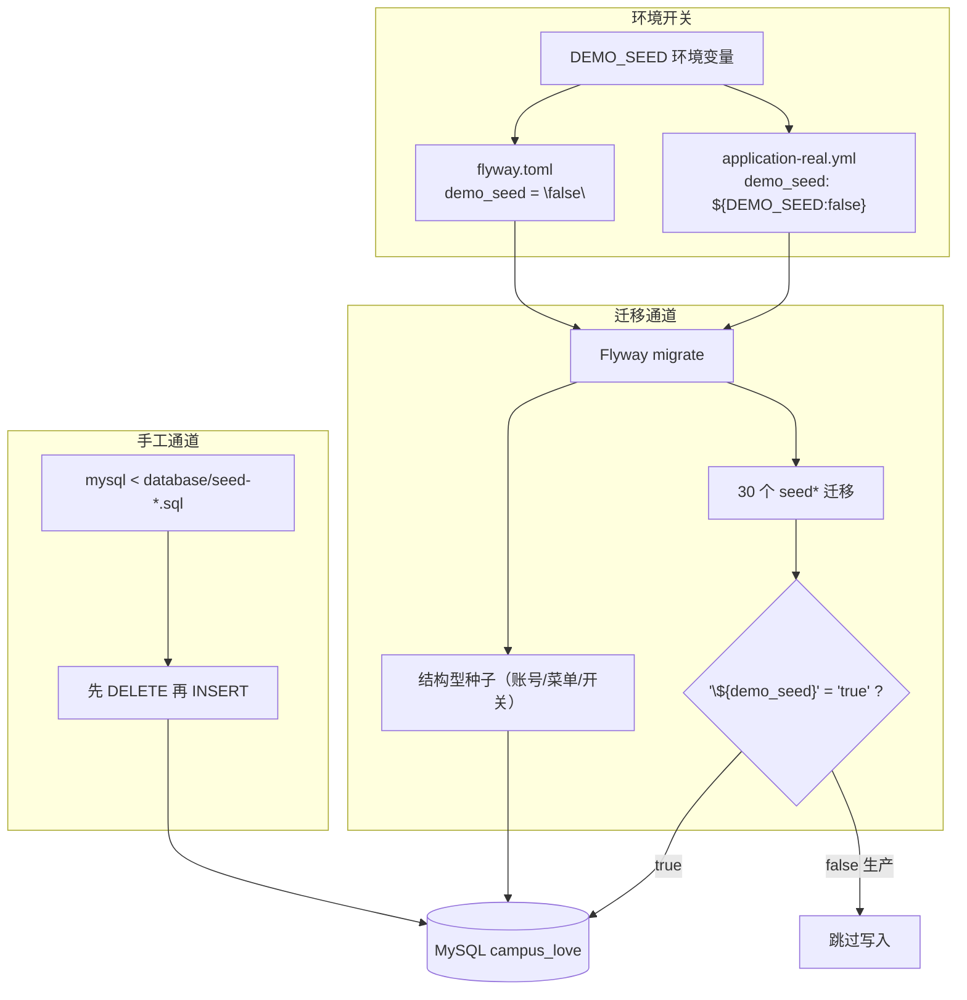
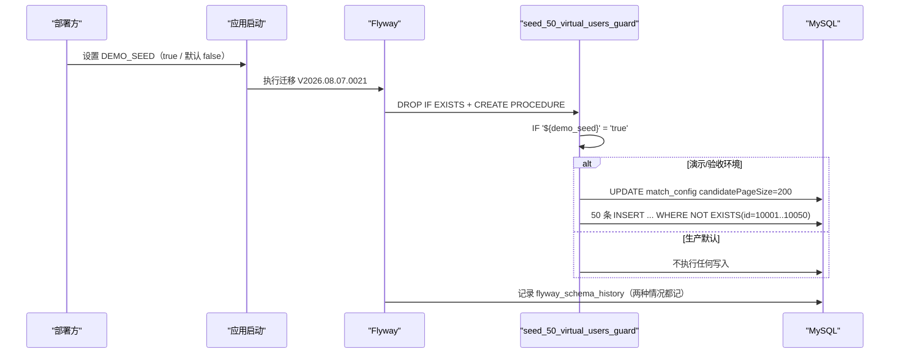
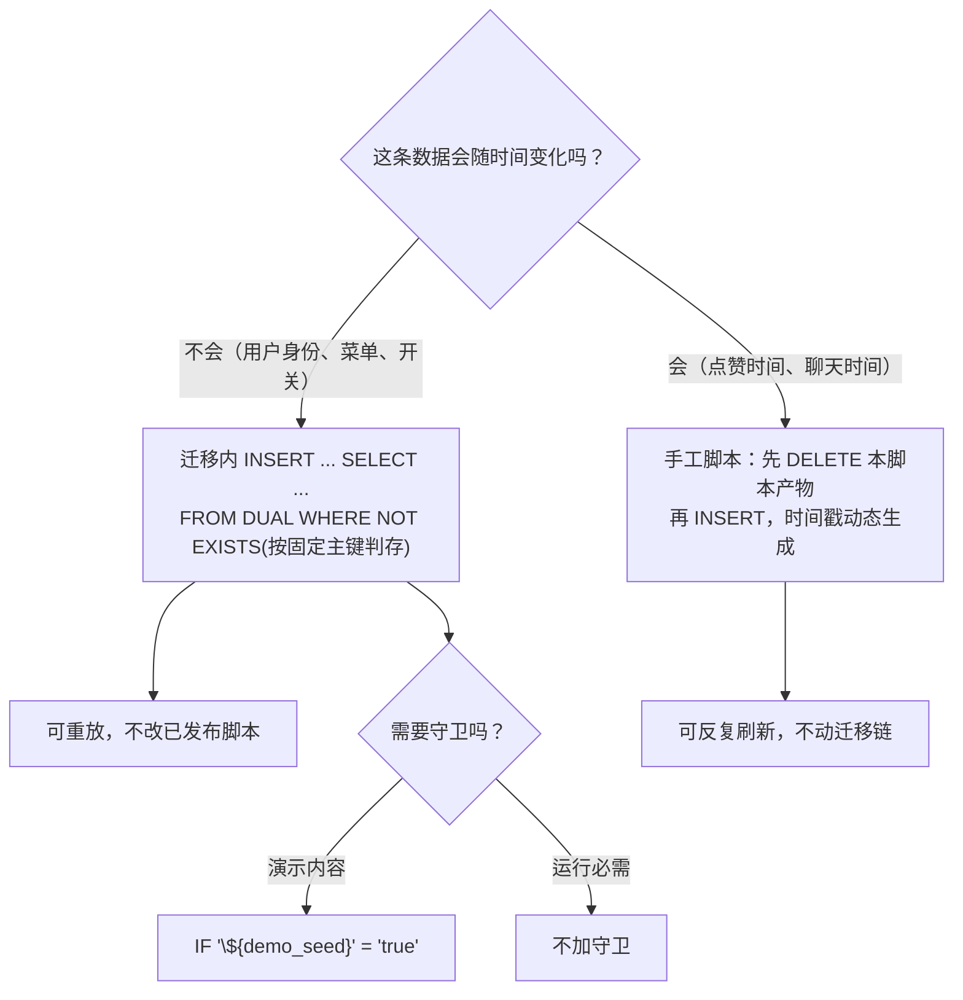

# 种子数据和测试数据

<cite>
**本文引用的文件**
- [init-mysql.sql](file://database/init-mysql.sql)
- [seed-demo-data.sql](file://database/seed-demo-data.sql)
- [seed-post-interactions.sql](file://database/seed-post-interactions.sql)
- [seed-test-users.sql](file://database/seed-test-users.sql)
- [seed-match-users-full.sql](file://database/seed-match-users-full.sql)
- [seed-media-assets.sql](file://database/seed-media-assets.sql)
- [seed-refresh-chat-demo-times.sql](file://database/seed-refresh-chat-demo-times.sql)
- [seed-walkthrough-daily-question.sql](file://database/seed-walkthrough-daily-question.sql)
- [complete-guest-account.sql](file://database/complete-guest-account.sql)
- [round5-backfill-guest-age-gender.sql](file://database/round5-backfill-guest-age-gender.sql)
- [V2026.08.07.0004__seed_super_test_account.sql](file://database/flyway/sql/V2026.08.07.0004__seed_super_test_account.sql)
- [V2026.08.07.0016__seed_admin_menu_for_existing_admins.sql](file://database/flyway/sql/V2026.08.07.0016__seed_admin_menu_for_existing_admins.sql)
- [V2026.08.07.0021__seed_50_virtual_users.sql](file://database/flyway/sql/V2026.08.07.0021__seed_50_virtual_users.sql)
- [V2026.08.07.0022__seed_profiles_and_posts.sql](file://database/flyway/sql/V2026.08.07.0022__seed_profiles_and_posts.sql)
- [V2026.08.07.0023__seed_messages_and_visitors.sql](file://database/flyway/sql/V2026.08.07.0023__seed_messages_and_visitors.sql)
- [V2026.08.07.0024__seed_circle_posts_and_topics.sql](file://database/flyway/sql/V2026.08.07.0024__seed_circle_posts_and_topics.sql)
- [V2026.08.07.0025__seed_activities_checkin_wallet.sql](file://database/flyway/sql/V2026.08.07.0025__seed_activities_checkin_wallet.sql)
- [V2026.08.08.0012__seed_more_virtual_users.sql](file://database/flyway/sql/V2026.08.08.0012__seed_more_virtual_users.sql)
- [V2026.08.08.0015__discover_card_profile_fields.sql](file://database/flyway/sql/V2026.08.08.0015__discover_card_profile_fields.sql)
- [V2026.08.08.0019__seed_acceptance_demo_data.sql](file://database/flyway/sql/V2026.08.08.0019__seed_acceptance_demo_data.sql)
- [V2026.08.09.0002__seed_post_likes_favorites_and_views.sql](file://database/flyway/sql/V2026.08.09.0002__seed_post_likes_favorites_and_views.sql)
- [V2026.08.09.0005__seed_chat_demo_user_47.sql](file://database/flyway/sql/V2026.08.09.0005__seed_chat_demo_user_47.sql)
- [V2026.08.09.0007__seed_today_channel_demo_posts.sql](file://database/flyway/sql/V2026.08.09.0007__seed_today_channel_demo_posts.sql)
- [V2026.09.01.0001__seed_commerce_switches.sql](file://database/flyway/sql/V2026.09.01.0001__seed_commerce_switches.sql)
- [flyway.toml](file://database/flyway/flyway.toml)
- [application-real.yml](file://apps/api/src/main/resources/application-real.yml)
- [docker-compose.yml](file://docker-compose.yml)
</cite>

## 目录
1. [简介](#简介)
2. [项目结构](#项目结构)
3. [核心组件](#核心组件)
4. [架构总览](#架构总览)
5. [两条灌数据通道](#两条灌数据通道)
6. [demo_seed 占位符守卫](#demo-seed-占位符守卫)
7. [虚拟用户池与推荐候选池](#虚拟用户池与推荐候选池)
8. [幂等写法：NOT EXISTS 与先删后插](#幂等写法not-exists-与先删后插)
9. [版本化种子脚本清单](#版本化种子脚本清单)
10. [手工重灌脚本清单](#手工重灌脚本清单)
11. [体验账号与走查数据](#体验账号与走查数据)
12. [后台与商业化种子](#后台与商业化种子)
13. [容器初始化脚本的边界](#容器初始化脚本的边界)
14. [依赖关系分析](#依赖关系分析)
15. [性能考虑](#性能考虑)
16. [故障排查指南](#故障排查指南)
17. [结论](#结论)

## 简介
演示与测试数据在本仓库分两条通道落地：

1. **版本化种子**：`database/flyway/sql/` 里 30 个名字含 `seed` 的迁移脚本，
   随 Flyway 一起执行，其中真正写虚拟用户/演示私信的三个脚本受 `${demo_seed}` 占位符守卫。
2. **手工重灌脚本**：`database/seed-*.sql` 等 10 个脚本，由 `mysql < file` 执行，
   面向"随时把演示数据刷成今天的样子"，不进迁移链。

两条通道的差异不是历史遗留，而是职责差异：迁移里的种子**一次性、可校验、默认不污染生产**；
手工脚本**可反复执行、时间戳动态生成**，专门给验收与演示环境用。

## 项目结构
- `database/`：10 个非迁移脚本 —— `init-mysql.sql`(19 行)、`seed-demo-data.sql`(4337 行)、
  `seed-post-interactions.sql`(206 行)、`seed-match-users-full.sql`(259 行)、
  `seed-test-users.sql`(70 行)、`seed-media-assets.sql`(92 行)、
  `seed-refresh-chat-demo-times.sql`(43 行)、`seed-walkthrough-daily-question.sql`(45 行)、
  `complete-guest-account.sql`(47 行)、`round5-backfill-guest-age-gender.sql`(48 行)。
- `database/flyway/sql/`：30 个 `*seed*` / `*demo*` 迁移脚本，
  最大的是 `V2026.08.07.0021__seed_50_virtual_users.sql`（511 行 / 56 条 INSERT）与
  `V2026.08.09.0007__seed_today_channel_demo_posts.sql`（507 行 / 43 条 INSERT）。
- 配置面：`flyway.toml` 的 `[flyway.placeholders]`（`demo_seed = "false"`）、
  `application-real.yml` 的 `demo_seed: ${DEMO_SEED:false}`。

## 核心组件
- **守卫式种子迁移**：`V2026.08.07.0021__seed_50_virtual_users.sql`、
  `V2026.08.07.0023__seed_messages_and_visitors.sql`、
  `V2026.08.08.0015__discover_card_profile_fields.sql` ——
  这三个脚本是 `demo_seed` 占位符的实际消费者。
- **无守卫的结构化种子**：`V2026.08.07.0004__seed_super_test_account.sql`（63 行 / 4 INSERT）、
  `V2026.08.07.0016__seed_admin_menu_for_existing_admins.sql`（31 行 / 2 INSERT）、
  `V2026.09.01.0001__seed_commerce_switches.sql`（35 行 / 6 INSERT）——
  灌的是**运行必需的账号、菜单与开关**，不是演示内容，因此不受守卫影响。
- **内容型种子**：`V2026.08.07.0022__seed_profiles_and_posts.sql`（142 行）、
  `V2026.08.07.0024__seed_circle_posts_and_topics.sql`（241 行，写 `posts`/`post_tags`/
  `comments`/`daily_questions`/`daily_answers`）、
  `V2026.08.07.0025__seed_activities_checkin_wallet.sql`（179 行 / 11 INSERT）。
- **重灌型手工脚本**：`seed-demo-data.sql`（428 条 INSERT）与
  `seed-post-interactions.sql`（7 条 INSERT + 先删后插）。

**章节来源**
- [V2026.08.07.0021__seed_50_virtual_users.sql:25-58](file://database/flyway/sql/V2026.08.07.0021__seed_50_virtual_users.sql#L25-L58)
- [V2026.08.07.0004__seed_super_test_account.sql:1-63](file://database/flyway/sql/V2026.08.07.0004__seed_super_test_account.sql#L1-L63)
- [V2026.08.07.0024__seed_circle_posts_and_topics.sql:22-228](file://database/flyway/sql/V2026.08.07.0024__seed_circle_posts_and_topics.sql#L22-L228)

## 架构总览


[此图为概念流程，不直接对应具体源文件，故不提供图表来源]

## 两条灌数据通道
| 维度 | 版本化种子（迁移内） | 手工重灌（`database/seed-*.sql`） |
|---|---|---|
| 触发 | 应用启动或 `flyway migrate` | 人工执行 `mysql ... < 文件` |
| 是否记入 `flyway_schema_history` | 是 | 否 |
| 可重复执行 | 靠 `NOT EXISTS` / 存储过程守卫 | 靠"先删本脚本产生的行再插入" |
| 生产污染风险 | 由 `demo_seed=false` 拦截 | 不由迁移链触发，风险是误执行 |
| 时间语义 | 写死或 `NOW()` 一次 | 每次执行重算时间戳（"今天"） |
| 典型文件 | `V2026.08.07.0021`、`V2026.08.09.0007` | `seed-demo-data.sql`、`seed-post-interactions.sql` |

`seed-post-interactions.sql` 头部把这层关系写得很明确：它是"临时重构脚本"，
**每次执行会先删除本脚本产生的演示数据再重新插入**（时间戳动态生成），
并且"与迁移 V2026.08.09.0002 Flyway 保持一致，本脚本无重复执行风险"；
前提条件是"先执行过 Flyway migrate（V2026.08.07.0024 数据 + V2026.08.09.0001 表结构）"，
执行命令显式带 `--default-character-set=utf8mb4` 与端口 `-P3307`(L1-L8)。

**章节来源**
- [seed-post-interactions.sql:1-8](file://database/seed-post-interactions.sql#L1-L8)
- [V2026.08.09.0002__seed_post_likes_favorites_and_views.sql:1-180](file://database/flyway/sql/V2026.08.09.0002__seed_post_likes_favorites_and_views.sql#L1-L180)

## demo_seed 占位符守卫
`V2026.08.07.0021__seed_50_virtual_users.sql` 的头部注释把守卫语义写全了：

```
demo_seed=true（演示/验收环境，DEMO_SEED=true）时执行数据写入；
生产（默认 demo_seed=false）不会灌入虚拟用户，推荐池不混入假数据、
环境需在开启校验前按 demo_seed 语义重新评估（validateOnMigrate=true 时 …）
```

守卫的**实现形态是存储过程包一层 IF**：

```sql
DELIMITER $$
DROP PROCEDURE IF EXISTS seed_50_virtual_users_guard $$
CREATE PROCEDURE seed_50_virtual_users_guard()
BEGIN
  IF '${demo_seed}' = 'true' THEN
    ...   -- 全部写入语句在这个分支里
```

三点值得注意：
1. 用 `DROP PROCEDURE IF EXISTS` + `CREATE PROCEDURE` 包裹，使脚本在迁移重放时不因"过程已存在"失败。
2. 条件写成 `IF '${demo_seed}' = 'true'` —— 占位符由 Flyway 在执行前替换，
   所以生产环境执行到的是"IF 'false' = 'true'"，一条写入也不执行，但**迁移记录仍然生成**
   （版本历史一致，数据不同）。
3. `flyway.toml` 的 CLI 侧默认 `demo_seed = "false"`，可用 `-placeholders.demo_seed=true` 覆盖；
   Spring 侧由 `application-real.yml` 的 `demo_seed: ${DEMO_SEED:false}` 注入，
   注释记录了 R4-00420/00422/00423 三条守卫任务号。

**章节来源**
- [V2026.08.07.0021__seed_50_virtual_users.sql:25-37](file://database/flyway/sql/V2026.08.07.0021__seed_50_virtual_users.sql#L25-L37)
- [flyway.toml:26-30](file://database/flyway/flyway.toml#L26-L30)
- [application-real.yml:101-104](file://apps/api/src/main/resources/application-real.yml#L101-L104)

## 虚拟用户池与推荐候选池
50 个虚拟用户的写法体现了几条约定：

- **固定主键区间**：注释"固定 id 10001-10050；openid 用 seed-user-{id} 保证唯一"，
  因此这批账号是可识别的（`openid LIKE 'seed-user-%'`），清理与排除都有依据。
- **列值贴近真实**：`INSERT INTO users (id, openid, nickname, avatar_url, bio, phone, role, status,
  profile_completion, interest_tags, following_count, followers_count, campus_name, created_at, updated_at)`，
  头像用 `https://images.pexels.com/photos/...` 真实外链，
  手机号用 `1370000xxxx` 规整号段，`interest_tags` 用 `JSON_ARRAY('阅读','摄影','篮球','音乐')`。
- **种子顺带调配置**：脚本第 0 步先执行
  `UPDATE match_config SET config_value = '200' ... WHERE config_key = 'candidatePageSize'`(L39-L44)，
  注释理由是"扩大推荐候选池（否则新用户不进匹配页）"，并把 `description` 一起改成
  "匹配候选用户分页查询数量上限（已扩至 200 容纳 50+ 虚拟用户池）"。
  这与代码里的默认值 `candidatePageSize = 50`（`MatchConfig` L20）构成"默认值 50、演示环境覆盖为 200"的两层。
- **补充池**：`V2026.08.08.0012__seed_more_virtual_users.sql`（228 行 / 17 INSERT）
  在 8 月 8 日继续扩池，`V2026.08.09.0007__seed_today_channel_demo_posts.sql`（507 行 / 43 INSERT）
  则给"今日"频道灌帖子。



**图表来源**
- [V2026.08.07.0021__seed_50_virtual_users.sql:25-58](file://database/flyway/sql/V2026.08.07.0021__seed_50_virtual_users.sql#L25-L58)

**章节来源**
- [V2026.08.07.0021__seed_50_virtual_users.sql:39-58](file://database/flyway/sql/V2026.08.07.0021__seed_50_virtual_users.sql#L39-L58)
- [V2026.08.08.0012__seed_more_virtual_users.sql:1-228](file://database/flyway/sql/V2026.08.08.0012__seed_more_virtual_users.sql#L1-L228)
- [V2026.08.09.0007__seed_today_channel_demo_posts.sql:1-507](file://database/flyway/sql/V2026.08.09.0007__seed_today_channel_demo_posts.sql#L1-L507)

## 幂等写法：NOT EXISTS 与先删后插


[此图为概念流程，不直接对应具体源文件，故不提供图表来源]

仓库里能看到三种可重复执行策略，适用场景不同：

1. **按主键判存**（迁移内）：
   ```sql
   INSERT INTO users (...) SELECT 10001, 'seed-user-10001', ...
   FROM DUAL WHERE NOT EXISTS (SELECT 1 FROM users WHERE id = 10001);
   ```
   命中固定 id 就跳过，不依赖唯一键报错，也不会覆盖已改动的演示数据。
2. **先删本脚本产物再插**（手工脚本）：`seed-post-interactions.sql` 的注释明确
   "每次执行会先删除本脚本产生的演示数据……再重新插入（时间戳动态生成）"，
   适合"演示时间必须是今天"的需求。
3. **按固定 user_id 识别清理**：`seed-demo-data.sql` 头部写"幂等：重复执行前先清理旧种子行，
   过程固定 user_id 识别"(L1-L7)。

第 1 种用于迁移（不可回改、必须能重放），第 2、3 种用于手工脚本（要求"刷新"而非"追加"）。
选择准则是：**这条数据需不需要随时间变化**。帖子点赞时间需要（否则演示页全是三天前的），
虚拟用户身份不需要（固定 id 更稳）。

**章节来源**
- [V2026.08.07.0021__seed_50_virtual_users.sql:46-58](file://database/flyway/sql/V2026.08.07.0021__seed_50_virtual_users.sql#L46-L58)
- [seed-post-interactions.sql:1-8](file://database/seed-post-interactions.sql#L1-L8)
- [seed-demo-data.sql:1-7](file://database/seed-demo-data.sql#L1-L7)

## 版本化种子脚本清单
按体量与用途列举主要脚本（行数与 INSERT 条数为直接统计）：

| 脚本 | 行数 | INSERT | 灌什么 |
|---|---|---|---|
| `V2026.08.07.0021__seed_50_virtual_users.sql` | 511 | 56 | 虚拟用户池 + 候选池扩容（守卫）|
| `V2026.08.09.0007__seed_today_channel_demo_posts.sql` | 507 | 43 | 今日频道帖子 |
| `V2026.08.07.0024__seed_circle_posts_and_topics.sql` | 241 | 7 | `posts`、`post_tags`、`comments`、`daily_questions`、`daily_answers` |
| `V2026.08.08.0012__seed_more_virtual_users.sql` | 228 | 17 | 追加虚拟用户 |
| `V2026.08.07.0023__seed_messages_and_visitors.sql` | 204 | 14 | 私信与访客（守卫）|
| `V2026.08.07.0025__seed_activities_checkin_wallet.sql` | 179 | 11 | 活动、签到、钱包 |
| `V2026.08.09.0002__seed_post_likes_favorites_and_views.sql` | 180 | 7 | 帖子点赞/收藏/浏览 |
| `V2026.08.09.0005__seed_chat_demo_user_47.sql` | 182 | 6 | 体验账号 47 的聊天数据 |
| `V2026.08.08.0019__seed_acceptance_demo_data.sql` | 101 | 9 | 验收演示数据 |
| `V2026.08.07.0022__seed_profiles_and_posts.sql` | 142 | 6 | 资料与帖子 |
| `V2026.08.07.0004__seed_super_test_account.sql` | 63 | 4 | 超级测试账号 |
| `V2026.08.07.0016__seed_admin_menu_for_existing_admins.sql` | 31 | 2 | 给既有管理员补后台菜单 |
| `V2026.09.01.0001__seed_commerce_switches.sql` | 35 | 6 | 商业化开关 |

另有 `V2026.09.12.0005__seed_circle_replies_match_counts.sql`（70 行 / 4 INSERT）
与 `V2026.08.15.0002__seed_standard_interest_circles.sql`（39 行 / 8 INSERT）等
较小的运营字段种子；`V2026.09.18.0002__r11_seed_content_diversify.sql`（107 行）
与 `V2026.09.12.0003__qa_seed_location_realign.sql`（24 行）**不含 INSERT**，
它们做的是 UPDATE 型的数据校正，被命名为 seed 但实质是回填。

**章节来源**
- [V2026.08.07.0022__seed_profiles_and_posts.sql:1-142](file://database/flyway/sql/V2026.08.07.0022__seed_profiles_and_posts.sql#L1-L142)
- [V2026.08.07.0023__seed_messages_and_visitors.sql:1-204](file://database/flyway/sql/V2026.08.07.0023__seed_messages_and_visitors.sql#L1-L204)
- [V2026.08.07.0025__seed_activities_checkin_wallet.sql:1-179](file://database/flyway/sql/V2026.08.07.0025__seed_activities_checkin_wallet.sql#L1-L179)
- [V2026.08.09.0005__seed_chat_demo_user_47.sql:1-182](file://database/flyway/sql/V2026.08.09.0005__seed_chat_demo_user_47.sql#L1-L182)
- [V2026.09.18.0002__r11_seed_content_diversify.sql:1-107](file://database/flyway/sql/V2026.09.18.0002__r11_seed_content_diversify.sql#L1-L107)

## 手工重灌脚本清单
`database/` 下 10 个脚本，按"是否新增行"分三组：

- **大量插入**：`seed-demo-data.sql`（4337 行 / 428 INSERT，全模块演示数据：
  50+ 模拟用户、帖子、评论、喜欢/访客）、`seed-match-users-full.sql`（259 行 / 3 INSERT，
  匹配链路完整化）、`seed-test-users.sql`（70 行 / 2 INSERT）、
  `seed-media-assets.sql`（92 行 / 2 INSERT）、`seed-post-interactions.sql`（206 行 / 7 INSERT）、
  `seed-walkthrough-daily-question.sql`（45 行 / 2 INSERT，头部注明"体验走查数据补充，
  2026-08-08 修正版，按真实库状态核对"）、`complete-guest-account.sql`（47 行 / 1 INSERT，
  体验账号 47 资料完善）。
- **纯 UPDATE 回填**：`seed-refresh-chat-demo-times.sql`（43 行 / 0 INSERT，
  "刷新体验账号 47 的演示聊天时间为『今天』，可重复执行"）、
  `round5-backfill-guest-age-gender.sql`（48 行 / 0 INSERT，"第五轮 R1 种子数据补齐 + 圈子去重"）。
- **环境初始化**：`init-mysql.sql`（19 行）。

这组脚本的共同点是**都可以反复执行**，因此都必须在脚本内自带清理或条件写入；
`seed-refresh-chat-demo-times.sql` 把这一点写在标题里（"可重复执行"）。

**章节来源**
- [seed-demo-data.sql:1-7](file://database/seed-demo-data.sql#L1-L7)
- [seed-match-users-full.sql:1-259](file://database/seed-match-users-full.sql#L1-L259)
- [seed-test-users.sql:1-70](file://database/seed-test-users.sql#L1-L70)
- [seed-media-assets.sql:1-92](file://database/seed-media-assets.sql#L1-L92)
- [seed-refresh-chat-demo-times.sql:1-43](file://database/seed-refresh-chat-demo-times.sql#L1-L43)
- [round5-backfill-guest-age-gender.sql:1-48](file://database/round5-backfill-guest-age-gender.sql#L1-L48)
- [complete-guest-account.sql:1-47](file://database/complete-guest-account.sql#L1-L47)
- [seed-walkthrough-daily-question.sql:1-45](file://database/seed-walkthrough-daily-question.sql#L1-L45)

## 体验账号与走查数据
体验（guest）账号 47 是演示链路上的特殊角色，围绕它有四个脚本：
`V2026.08.09.0005__seed_chat_demo_user_47.sql`（迁移，182 行 / 6 INSERT）、
`complete-guest-account.sql`（补全资料，47 行 / 1 INSERT）、
`seed-refresh-chat-demo-times.sql`（把聊天时间刷成今天，43 行 / 0 INSERT）、
`round5-backfill-guest-age-gender.sql`（回填年龄性别 + 圈子去重，48 行）。

因此"体验账号看起来不像新用户"通常不是缺陷而是数据陈旧：
执行一次 `seed-refresh-chat-demo-times.sql` 即可让会话时间回到今天，
而不需要改动任何迁移。

同时要注意体验入口本身是**默认关闭**的：应用配置里
"体验账号入口（app.guest-login.enabled）默认关闭，本地联调可通过
`APP_GUEST_LOGIN_ENABLED=true` 临时开启，上线前确认关闭"。
灌了演示账号但入口关着，就会表现为"数据在、进不去"。

**章节来源**
- [V2026.08.09.0005__seed_chat_demo_user_47.sql:1-182](file://database/flyway/sql/V2026.08.09.0005__seed_chat_demo_user_47.sql#L1-L182)
- [complete-guest-account.sql:1-47](file://database/complete-guest-account.sql#L1-L47)
- [seed-refresh-chat-demo-times.sql:1-43](file://database/seed-refresh-chat-demo-times.sql#L1-L43)
- [round5-backfill-guest-age-gender.sql:1-48](file://database/round5-backfill-guest-age-gender.sql#L1-L48)

## 后台与商业化种子
并非所有种子都属于"演示内容"。三类是**运行必需**的：

- **超级测试账号**：`V2026.08.07.0004__seed_super_test_account.sql`（63 行 / 4 INSERT）。
- **后台菜单**：`V2026.08.07.0016__seed_admin_menu_for_existing_admins.sql`（31 行 / 2 INSERT）
  专门"为既有管理员补菜单"，`V2026.08.09.0016__seed_media_audit_menu.sql`（28 行 / 2 INSERT）
  与 `V2026.08.11.0003__seed_hot_menus.sql`（44 行 / 5 INSERT）继续补菜单项；
  这些落在 `menus` / `role_menus` 表上，缺了管理员登录后会看到空侧栏。
- **商业化开关**：`V2026.09.01.0001__seed_commerce_switches.sql`（35 行 / 6 INSERT）
  往 `app_switch` 一类配置表写开关行；配置表本身由
  `V2026.06.25.0005__create_admin_configs.sql` 建表并首批播种。

这三类**不受 `demo_seed` 守卫**——它们是功能可用的前提，
把它误当成演示数据关闭掉，会让后台或商业化模块看起来"坏了"。

**章节来源**
- [V2026.08.07.0016__seed_admin_menu_for_existing_admins.sql:1-31](file://database/flyway/sql/V2026.08.07.0016__seed_admin_menu_for_existing_admins.sql#L1-L31)
- [V2026.08.09.0016__seed_media_audit_menu.sql:1-28](file://database/flyway/sql/V2026.08.09.0016__seed_media_audit_menu.sql#L1-L28)
- [V2026.08.11.0003__seed_hot_menus.sql:1-44](file://database/flyway/sql/V2026.08.11.0003__seed_hot_menus.sql#L1-L44)
- [V2026.09.01.0001__seed_commerce_switches.sql:1-35](file://database/flyway/sql/V2026.09.01.0001__seed_commerce_switches.sql#L1-L35)

## 容器初始化脚本的边界
`database/init-mysql.sql`（19 行）是 MySQL 容器的
`docker-entrypoint-initdb.d/00-init.sql`，它的注释划清了边界（infra R2-00002）：

- 业务库与业务账号由官方镜像根据 `MYSQL_DATABASE` / `MYSQL_USER` / `MYSQL_PASSWORD`
  自动创建，**本脚本不再重复创建库/用户，也不得包含任何明文凭据**；
- 它保留的唯一职责是"为 CI 环境创建隔离的测试库（可选）"，不需要时可整体留空。

另一条相关约束在编排里：迁移目录**不挂载**为 `initdb.d`，
注释理由是"避免迁移脚本重复执行损坏数据"，MySQL 服务侧只保留 CI 初始化脚本；
迁移脚本以只读方式挂给应用容器（`./database/flyway/sql:/app/db/migration:ro`）。

这条边界很重要：如果误把 `database/flyway/sql/*.sql` 放进 `initdb.d`，
每次新建卷都会执行一遍迁移，与 Flyway 的 `flyway_schema_history` 记账冲突。

**章节来源**
- [init-mysql.sql:1-19](file://database/init-mysql.sql#L1-L19)
- [docker-compose.yml:41-42](file://docker-compose.yml#L41-L42)
- [docker-compose.yml:114-114](file://docker-compose.yml#L114-L114)
- [docker-compose.yml:269-272](file://docker-compose.yml#L269-L272)

## 依赖关系分析
- **种子 ← 表结构**：内容型种子必须在建表之后，
  `seed-post-interactions.sql` 显式写明前置是 `V2026.08.07.0024`（数据）与
  `V2026.08.09.0001`（表结构）。
- **种子 → 算法参数**：`V2026.08.07.0021` 同时改 `match_config` 的 `candidatePageSize`，
  说明演示数据量与推荐候选池是耦合的，灌用户就必须同步扩容。
- **种子 ← 占位符**：三个守卫脚本依赖 `demo_seed`，其值来自两个不同通道
  （`flyway.toml` 与 `application-real.yml`），两条路径必须注入同一值，
  否则 CLI 与启动迁移的结果会不一致。
- **手工脚本 ↔ 迁移**：`seed-post-interactions.sql` 与 `V2026.08.09.0002`
  成对维护（注释声明"与迁移保持一致"），这是本项目里唯一显式声明的双写关系。
- **体验账号 → 功能开关**：`guest-login` 开关决定演示账号能否进入，
  与登录链路（`AuthController` 的 `/guest-login`）绑定。

**章节来源**
- [seed-post-interactions.sql:5-8](file://database/seed-post-interactions.sql#L5-L8)
- [V2026.08.07.0021__seed_50_virtual_users.sql:39-44](file://database/flyway/sql/V2026.08.07.0021__seed_50_virtual_users.sql#L39-L44)
- [flyway.toml:26-30](file://database/flyway/flyway.toml#L26-L30)
- [application-real.yml:101-104](file://apps/api/src/main/resources/application-real.yml#L101-L104)

## 性能考虑
- **迁移期最长的是 500 行级种子**：`V2026.08.07.0021`（511 行）与
  `V2026.08.09.0007`（507 行）在冷启动时会真的花时间；
  演示环境首次启动慢多半卡在这里，而不是索引脚本。
- **`FROM DUAL WHERE NOT EXISTS` 的代价**：每条插入前做一次存在性查询，
  56 条 INSERT 就是 56 次探测，换来的是可重放；
  在按主键探测（`WHERE id = 10001`）时走主键，成本可忽略。
- **手工重灌脚本体量最大**：`seed-demo-data.sql` 单文件 4337 行 / 428 条 INSERT，
  执行时应作为一次独立作业，不要与应用启动叠加。
- **时间刷新是 UPDATE**：`seed-refresh-chat-demo-times.sql` 0 条 INSERT，
  只做时间列更新，重灌成本远低于重插数据。

**章节来源**
- [V2026.08.07.0021__seed_50_virtual_users.sql:46-58](file://database/flyway/sql/V2026.08.07.0021__seed_50_virtual_users.sql#L46-L58)
- [seed-demo-data.sql:1-4337](file://database/seed-demo-data.sql#L1-L4337)
- [seed-refresh-chat-demo-times.sql:1-43](file://database/seed-refresh-chat-demo-times.sql#L1-L43)

## 故障排查指南
- **库里没有虚拟用户**：先看 `DEMO_SEED` 是否为 `true`。默认 `false` 时守卫分支整体跳过，
  但 `flyway_schema_history` 里这些迁移**仍显示成功**——这是最容易误判的地方。
- **开了 demo_seed 但仍缺数据**：检查两条注入通道是否一致，
  CLI 用 `-placeholders.demo_seed=true`，启动用 `DEMO_SEED=true`；
  只开一条会导致两种环境数据不同。
- **推荐页看不到新用户**：确认 `match_config` 的 `candidatePageSize` 已被种子改为 200；
  停留在代码默认 50 时候选池会把新种子用户挤出。
- **管理员登录后后台菜单为空**：菜单是种子写入的（`V2026.08.07.0016` 等），
  若管理员账号晚于该迁移创建，需要重跑补菜单逻辑或手工插 `role_menus`。
- **手工脚本执行报字符集/乱码**：按脚本头部给的命令带
  `--default-character-set=utf8mb4`，端口按编排是 `-P3307`。
- **演示数据时间都是历史日期**：这正是 `seed-refresh-chat-demo-times.sql` 的用途，
  重复执行即可，不要改迁移。
- **全新环境出现重复键错误**：确认没有把 `database/flyway/sql` 挂进 `initdb.d`
  （那会让迁移在无 Flyway 记账的情况下执行一遍）。

**章节来源**
- [V2026.08.07.0021__seed_50_virtual_users.sql:25-37](file://database/flyway/sql/V2026.08.07.0021__seed_50_virtual_users.sql#L25-L37)
- [flyway.toml:26-30](file://database/flyway/flyway.toml#L26-L30)
- [seed-post-interactions.sql:5-8](file://database/seed-post-interactions.sql#L5-L8)
- [docker-compose.yml:41-42](file://docker-compose.yml#L41-L42)

## 结论
本仓库的种子与测试数据体系有明确分工：**30 个版本化 seed 迁移负责"环境一次性到位"，
10 个 `database/*.sql` 手工脚本负责"随时可刷新"**。真正决定生产洁净度的是
`demo_seed` 守卫——它用存储过程 `IF '${demo_seed}' = 'true'` 把写入包起来，
默认 `false`，CLI 与 Spring 两条通道各自注入，且**守卫跳过不影响迁移记账**。

三条容易踩的实践结论值得记住：
一是**别把所有 seed 当演示数据**，超级测试账号、后台菜单、商业化开关是功能可用的前提，
不受守卫控制；二是**灌虚拟用户必须同时扩 `candidatePageSize`**，
否则推荐与匹配页看不到新池子；三是**时间陈旧问题用
`seed-refresh-chat-demo-times.sql` 解决**，而不是改动已发布的迁移。

`init-mysql.sql` 的注释则给出这套体系的底线：库与账号交给镜像环境变量，
初始化脚本不带明文凭据，迁移目录绝不进 `initdb.d`。
