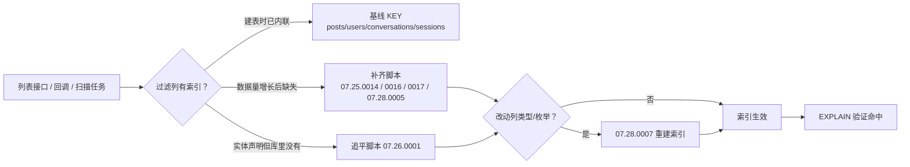
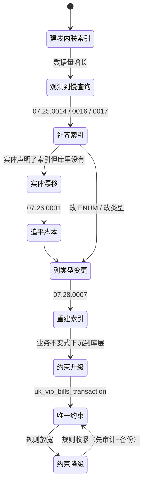
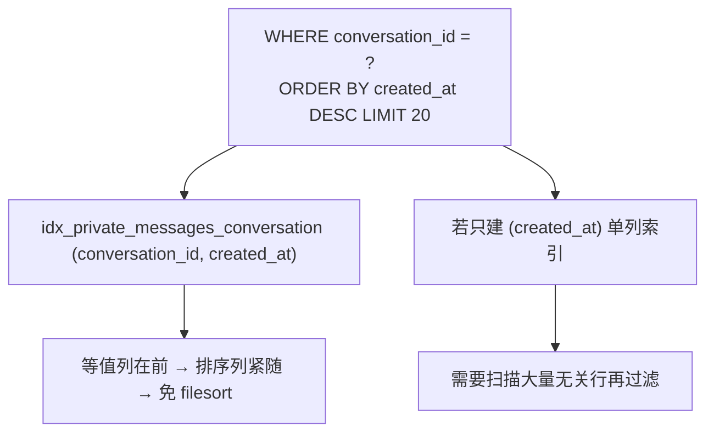

# 索引设计与性能优化

<cite>
**本文引用的文件**
- [V2026.05.18.0001__create_users.sql](file://database/flyway/sql/V2026.05.18.0001__create_users.sql)
- [V2026.05.21.0003__create_posts_table.sql](file://database/flyway/sql/V2026.05.21.0003__create_posts_table.sql)
- [V2026.05.21.0006__alter_users_add_profile_completion.sql](file://database/flyway/sql/V2026.05.21.0006__alter_users_add_profile_completion.sql)
- [V2026.05.24.0002__create_private_conversations.sql](file://database/flyway/sql/V2026.05.24.0002__create_private_conversations.sql)
- [V2026.05.24.0003__create_user_sessions.sql](file://database/flyway/sql/V2026.05.24.0003__create_user_sessions.sql)
- [V2026.07.25.0013__add_check_in_make_up.sql](file://database/flyway/sql/V2026.07.25.0013__add_check_in_make_up.sql)
- [V2026.07.25.0014__add_performance_indexes.sql](file://database/flyway/sql/V2026.07.25.0014__add_performance_indexes.sql)
- [V2026.07.25.0016__add_missing_indexes.sql](file://database/flyway/sql/V2026.07.25.0016__add_missing_indexes.sql)
- [V2026.07.25.0017__add_remaining_missing_indexes.sql](file://database/flyway/sql/V2026.07.25.0017__add_remaining_missing_indexes.sql)
- [V2026.07.26.0001__add_entity_index_annotations.sql](file://database/flyway/sql/V2026.07.26.0001__add_entity_index_annotations.sql)
- [V2026.07.26.0002__add_open_id_unique_constraint.sql](file://database/flyway/sql/V2026.07.26.0002__add_open_id_unique_constraint.sql)
- [V2026.07.26.0003__add_version_columns.sql](file://database/flyway/sql/V2026.07.26.0003__add_version_columns.sql)
- [V2026.07.27.0004__drop_promo_code_usages_unique_constraint.sql](file://database/flyway/sql/V2026.07.27.0004__drop_promo_code_usages_unique_constraint.sql)
- [V2026.07.28.0005__add_indexes.sql](file://database/flyway/sql/V2026.07.28.0005__add_indexes.sql)
- [V2026.07.28.0007__rebuild_indexes_after_enum_migration.sql](file://database/flyway/sql/V2026.07.28.0007__rebuild_indexes_after_enum_migration.sql)
- [V2026.08.08.0002__add_comments_parent_id.sql](file://database/flyway/sql/V2026.08.08.0002__add_comments_parent_id.sql)
- [V2026.08.08.0003__users_phone_unique.sql](file://database/flyway/sql/V2026.08.08.0003__users_phone_unique.sql)
- [V2026.08.10.0030__app_asset_url_unique_index.sql](file://database/flyway/sql/V2026.08.10.0030__app_asset_url_unique_index.sql)
- [V2026.10.05.0011__vip_bills_unique_transaction.sql](file://database/flyway/sql/V2026.10.05.0011__vip_bills_unique_transaction.sql)
- [flyway.toml](file://database/flyway/flyway.toml)
- [CircleTopic.java](file://apps/api/src/main/java/com/campuslove/api/entity/CircleTopic.java)
- [UserBasicProfile.java](file://apps/api/src/main/java/com/campuslove/api/entity/UserBasicProfile.java)
</cite>

## 目录
1. [简介](#简介)
2. [项目结构](#项目结构)
3. [核心组件](#核心组件)
4. [架构总览](#架构总览)
5. [索引的三个来源](#索引的三个来源)
6. [基线内联索引](#基线内联索引)
7. [业务查询补齐索引](#业务查询补齐索引)
8. [复合索引的列序设计](#复合索引的列序设计)
9. [唯一约束作为完整性而非性能手段](#唯一约束作为完整性而非性能手段)
10. [约束降级与撤销](#约束降级与撤销)
11. [枚举迁移后的索引重建](#枚举迁移后的索引重建)
12. [乐观锁列的批量补齐](#乐观锁列的批量补齐)
13. [统计口径](#统计口径)
14. [依赖关系分析](#依赖关系分析)
15. [性能考虑](#性能考虑)
16. [故障排查指南](#故障排查指南)
17. [结论](#结论)

## 简介
本项目的索引不是一次性设计出来的，而是**随真实查询压力分四批补齐**的：
建表时内联少量索引 → 数据量增长后补高频过滤列 → 为实体声明的索引做追平 →
最后用唯一约束把若干"只能靠应用层兜底"的业务不变式落到库层。

本页聚焦三件事：索引从哪里来、列序为什么这样排、
以及**约束升级/降级背后的事故驱动**（手机号唯一、支付回调重放、每用户多次用码）。

## 项目结构
索引相关脚本集中在 `database/flyway/sql/`，按目的可分四类：

- **建表内联**：`V2026.05.18.0001__create_users.sql`、`V2026.05.21.0003__create_posts_table.sql`、
  `V2026.05.24.0002__create_private_conversations.sql`、`V2026.05.24.0003__create_user_sessions.sql`。
- **补齐类**：`V2026.07.25.0014__add_performance_indexes.sql`（113 行）、
  `V2026.07.25.0016__add_missing_indexes.sql`（28 行）、
  `V2026.07.25.0017__add_remaining_missing_indexes.sql`（52 行）、
  `V2026.07.26.0001__add_entity_index_annotations.sql`（77 行）、
  `V2026.07.28.0005__add_indexes.sql`（453 行）。
- **约束类**：`V2026.07.26.0002__add_open_id_unique_constraint.sql`、
  `V2026.08.08.0003__users_phone_unique.sql`（34 行）、
  `V2026.08.10.0030__app_asset_url_unique_index.sql`（54 行）、
  `V2026.10.05.0011__vip_bills_unique_transaction.sql`（69 行）。
- **修复类**：`V2026.07.28.0007__rebuild_indexes_after_enum_migration.sql`（93 行）、
  `V2026.07.27.0004__drop_promo_code_usages_unique_constraint.sql`（40 行）。

## 核心组件
- **性能索引批**：`V2026.07.25.0014` 一次建 18 组"过滤列 + created_at"复合索引
  （`idx_likes_user_created_at` L34、`idx_posts_author_created_at` L42、
  `idx_comments_post_created_at` L59、`idx_check_ins_user_created_at` L66、
  `idx_audit_log_operator_created_at` L77、`idx_private_messages_sender_created_at` L90 等）。
- **缺失索引批**：`V2026.07.25.0016` 头部说明背景是"部分表缺少高频查询字段的索引，
  导致在数据量增长后查询性能下降"，补 `idx_activities_city(city_name)`(L16)、
  `idx_activities_campus(campus_name)`(L20)、`idx_feedback_status(status)`(L24)、
  `idx_cert_status(status)`(L28)。
- **剩余补齐批**：`V2026.07.25.0017` 补 `idx_users_phone`(L20)、
  `idx_users_created_at`(L24)、`idx_pm_conv_read(conversation_id, is_read)`(L28)、
  `idx_posts_status`(L32)、`idx_visitors_visited_read(visited_user_id, is_read)`(L36)、
  `idx_heart_signals_status`(L40)、`idx_likes_status`(L44)、
  `idx_it_category_active(category, is_active)`(L48)、`idx_it_usage_count`(L52)。
- **实体追平批**：`V2026.07.26.0001` 把实体声明但库里没有的索引建出来
  （`idx_notifications_user_created_at` L35、`idx_heart_signals_created_at` L40、
  `idx_vip_bills_created_at` L45、`idx_feedback_created_at` L50、
  `idx_private_messages_conversation_created_at` L55、`idx_private_messages_created_at` L60、
  `idx_private_messages_delivery_status` L65）。
- **唯一约束批**：`uk_users_openid`(openid)、`uk_users_phone`(phone)、
  `uk_vip_bills_transaction`(transaction_id)、`uk_likes_user_target(user_id, target_user_id)`、
  `uk_private_conversations_uid`、`uk_private_conversations_users`（函数式）。

**章节来源**
- [V2026.07.25.0014__add_performance_indexes.sql:34-91](file://database/flyway/sql/V2026.07.25.0014__add_performance_indexes.sql#L34-L91)
- [V2026.07.25.0016__add_missing_indexes.sql:1-28](file://database/flyway/sql/V2026.07.25.0016__add_missing_indexes.sql#L1-L28)
- [V2026.07.25.0017__add_remaining_missing_indexes.sql:11-52](file://database/flyway/sql/V2026.07.25.0017__add_remaining_missing_indexes.sql#L11-L52)
- [V2026.07.26.0001__add_entity_index_annotations.sql:35-65](file://database/flyway/sql/V2026.07.26.0001__add_entity_index_annotations.sql#L35-L65)

## 架构总览

[此图为概念流程，不直接对应具体源文件，故不提供图表来源]

## 索引的三个来源
1. **建表内联**：作者在建表时就写出了主读路径。
   `posts` 有 `idx_posts_author`、`idx_posts_category`、`idx_posts_created_at`(L14-L16)；
   `user_sessions` 有 `idx_user_sessions_user`、`idx_user_sessions_expires`(L9-L10)。
2. **运行期补齐**：`V2026.07.25.0016` 的注释直说原因是"数据量增长后查询性能下降"，
   这是典型的"上线后 EXPLAIN 驱动"。
3. **实体反向追平**：`V2026.07.26.0001` 的名字（add_entity_index_annotations）本身就是说明——
   JPA 实体上写了索引，但 `ddl-auto` 没建，于是用迁移补齐。

三个来源的优先级不同：内联代表设计意图，补齐代表观测到的慢查询，
追平代表实体与库的漂移。看一张表有哪些索引时，三类脚本都要查，只看建表脚本会漏。

**章节来源**
- [V2026.05.21.0003__create_posts_table.sql:13-16](file://database/flyway/sql/V2026.05.21.0003__create_posts_table.sql#L13-L16)
- [V2026.05.24.0003__create_user_sessions.sql:9-10](file://database/flyway/sql/V2026.05.24.0003__create_user_sessions.sql#L9-L10)
- [V2026.07.25.0016__add_missing_indexes.sql:1-8](file://database/flyway/sql/V2026.07.25.0016__add_missing_indexes.sql#L1-L8)
- [V2026.07.26.0001__add_entity_index_annotations.sql:35-65](file://database/flyway/sql/V2026.07.26.0001__add_entity_index_annotations.sql#L35-L65)

[此图为概念流程，不直接对应具体源文件，故不提供图表来源]

## 基线内联索引
`V2026.05.21.0006__alter_users_add_profile_completion.sql`（3 行）是一个有意思的反例：
它**没有加列**，只加了一条索引，并在注释里解释为什么不加列——
"users 表在 V2026.05.18.0001 已包含 profile_completion/following_count/followers_count 列，
此处不再重复添加，仅保留索引创建"(L1-L2)，实际语句只有
`CREATE INDEX idx_users_profile_completion ON users(profile_completion);`(L3)。

这条索引服务的是"按资料完成度筛用户"的运营/引导查询，
说明 `profile_completion` 从一开始就被当作可过滤字段设计（`INT NOT NULL DEFAULT 0` L12）。

**章节来源**
- [V2026.05.21.0006__alter_users_add_profile_completion.sql:1-3](file://database/flyway/sql/V2026.05.21.0006__alter_users_add_profile_completion.sql#L1-L3)
- [V2026.05.18.0001__create_users.sql:12-13](file://database/flyway/sql/V2026.05.18.0001__create_users.sql#L12-L13)

## 业务查询补齐索引
`V2026.07.25.0017` 把"为什么建这条索引"写进注释，是本项目最能直接复用的一份依据：

| 索引 | 列 | 服务的查询（注释原意） |
|---|---|---|
| `idx_posts_status`(L32) | `status` | 帖子列表过滤，"几乎所有查询都带 status='active'"(L11) |
| `idx_heart_signals_status`(L40) | `status` | 待处理心动信号扫描(L13) |
| `idx_likes_status`(L44) | `status` | 有效点赞过滤(L14) |
| `idx_pm_conv_read`(L28) | `conversation_id, is_read` | 会话内未读消息统计 |
| `idx_visitors_visited_read`(L36) | `visited_user_id, is_read` | "谁来看过我"的未读列表 |
| `idx_it_category_active`(L48) | `category, is_active` | 按分类取启用标签 |
| `idx_users_phone`(L20) / `idx_users_created_at`(L24) | 单列 | 手机号定位与注册时间排序 |

`status` 这一列在 `posts`、`heart_signals`、`likes` 三张表上都单独建了索引，
反映出一个共同模式：**列表接口都带"只看有效行"的谓词**。
把 `is_read` 放进第二个位置（`idx_pm_conv_read`、`idx_visitors_visited_read`）
则是因为未读判断总是在"先定位会话/被访者"之后发生。

**章节来源**
- [V2026.07.25.0017__add_remaining_missing_indexes.sql:11-52](file://database/flyway/sql/V2026.07.25.0017__add_remaining_missing_indexes.sql#L11-L52)

## 复合索引的列序设计
`V2026.07.25.0014` 的命名规则把列序直接写进名字：**过滤列在前，时间列在后**。

- `idx_likes_user_created_at` / `idx_likes_target_user_created_at` / `idx_likes_status_created_at`(L34-L36)：
  同一张 `likes` 按三种入口各建一条（我喜欢了谁 / 谁喜欢我 / 按状态筛后再按时间）。
- `idx_posts_author_created_at`、`idx_posts_status_created_at`(L42-L43)。
- `idx_post_likes_user_created_at`、`idx_post_shares_post_created_at`、
  `idx_post_shares_user_created_at`(L49-L54)。
- `idx_comments_post_created_at`、`idx_comments_author_created_at`(L59-L60)。
- `idx_audit_log_operator_created_at`、`idx_audit_log_operation_created_at`(L77-L78)。
- `idx_reports_status_created_at`、`idx_reports_reporter_created_at`(L82-L83)。
- `idx_activities_status_activity_date`(L72)——这条把日期列命名为 `activity_date` 而不是
  `created_at`，因为活动列表按**活动时间**排序，不是按创建时间。

另一条独立的复合索引来自建表脚本：
`idx_private_messages_conversation (conversation_id, created_at)`(L24-L25)，
它一开始就确立了"按会话 + 时间游标拉消息"的访问形态；
`V2026.07.26.0001` 又补了 `idx_private_messages_conversation_created_at`(L55)，
说明实体侧声明与手写 DDL 曾经不一致，需要追平。

列中 `created_at` 的必要性在于：列表页几乎总是 `WHERE 过滤列 = ? ORDER BY created_at DESC LIMIT n`，
把排序列纳入索引可以让 MySQL 避免 filesort。

[此图为概念流程，不直接对应具体源文件，故不提供图表来源]

**章节来源**
- [V2026.07.25.0014__add_performance_indexes.sql:34-91](file://database/flyway/sql/V2026.07.25.0014__add_performance_indexes.sql#L34-L91)
- [V2026.05.24.0002__create_private_conversations.sql:24-25](file://database/flyway/sql/V2026.05.24.0002__create_private_conversations.sql#L24-L25)
- [V2026.07.26.0001__add_entity_index_annotations.sql:55-60](file://database/flyway/sql/V2026.07.26.0001__add_entity_index_annotations.sql#L55-L60)

## 唯一约束作为完整性而非性能手段
若干"唯一索引"其实是业务不变式，性能是副产品：

- **`uk_users_openid(openid)`**：在 `users` 建表时就是 `UNIQUE KEY`(L19)，
  保证一个微信身份一个账号。后续 `V2026.07.26.0002__add_open_id_unique_constraint.sql`
  再次以独立脚本处理 openid 唯一约束，属于对既有约束的确认/补齐动作。
- **`uk_private_conversations_users ((LEAST(user_a_id,user_b_id)),(GREATEST(...)))`**(L16)：
  用函数式唯一键表达"两人之间只有一条会话"，与方向无关；
  这是本项目唯一使用表达式作为索引键的地方。
- **`uk_likes_user_target(user_id, target_user_id)`**（`V2026.07.26.0003` L193）：
  保证同一用户对同一目标只能有一条喜欢记录，把"重复右滑"挡在库层。
- **`uk_vip_bills_transaction(transaction_id)`**（`V2026.10.05.0011` L45）：
  背景注释写得很清楚——建表时 `transaction_id` 只是普通索引
  `idx_vip_bills_transaction`，"同一笔支付重复开通 VIP"只有应用层校验兜底，
  而应用层幂等可被绕过（"同 orderNo 换新 notificationId 重放回调"），
  数据库层拦不住重复账单，因此升级为唯一约束；同一脚本 L69 仍保留普通索引
  `idx_vip_bills_transaction`，形成"唯一约束保证不重复 + 普通索引保证查询走索引"的搭配。
- **`uk_users_phone(phone)`**（`V2026.08.08.0003` L34 结尾）：见下一节的破坏性前置处理。

**章节来源**
- [V2026.05.18.0001__create_users.sql:19-19](file://database/flyway/sql/V2026.05.18.0001__create_users.sql#L19-L19)
- [V2026.05.24.0002__create_private_conversations.sql:15-16](file://database/flyway/sql/V2026.05.24.0002__create_private_conversations.sql#L15-L16)
- [V2026.07.26.0002__add_open_id_unique_constraint.sql:1-35](file://database/flyway/sql/V2026.07.26.0002__add_open_id_unique_constraint.sql#L1-L35)
- [V2026.07.26.0003__add_version_columns.sql:193-193](file://database/flyway/sql/V2026.07.26.0003__add_version_columns.sql#L193-L193)
- [V2026.10.05.0011__vip_bills_unique_transaction.sql:1-69](file://database/flyway/sql/V2026.10.05.0011__vip_bills_unique_transaction.sql#L1-L69)

## 约束降级与撤销
唯一约束并非只增不减，两个真实案例说明**业务规则变化必须同步回库层**：

- **`V2026.07.27.0004__drop_promo_code_usages_unique_constraint.sql`（40 行）**：
  头部写明"移除 promo_code_usages 唯一约束，支持 `max_uses_per_user > 1`"，
  背景是 `V2026.07.25.0003` 建表时留下了
  `UNIQUE KEY uk_promo_code_usages (promo_code_id, user_id)`，
  该约束把"每人一码"钉死，与后来允许的多次使用规则冲突；
  脚本在 L40 用 `idx_promo_code_usages(promo_code_id, user_id)` 把唯一键**降级为普通索引**，
  保留查询能力但取消唯一性限制。
- **`V2026.08.08.0003__users_phone_unique.sql`（34 行）**：反过来是**升级**，
  而它带着一段醒目的安全提示（R4-00419）：本迁移对重复手机号行执行
  "phone 置 NULL"，属**破坏性数据修复**，"重复数据会静默丢失（如换绑记录），且无审计"，
  因此要求执行前必须：先审计受影响行
  （`SELECT phone, COUNT(*) FROM users WHERE phone IS NOT NULL AND phone <> ''
  GROUP BY phone HAVING COUNT(*) > 1;`），再备份受影响行(L1-L10)。
  这张备份落到了独立表 `users_phone_dup_backup`（见 schema 清单）。

这两个方向相反的脚本给出同一条纪律：**加唯一约束之前必须先处置存量重复行**，
减唯一约束之后要补普通索引以免查询退化。

**章节来源**
- [V2026.07.27.0004__drop_promo_code_usages_unique_constraint.sql:1-40](file://database/flyway/sql/V2026.07.27.0004__drop_promo_code_usages_unique_constraint.sql#L1-L40)
- [V2026.08.08.0003__users_phone_unique.sql:1-34](file://database/flyway/sql/V2026.08.08.0003__users_phone_unique.sql#L1-L34)

## 枚举迁移后的索引重建
`V2026.07.28.0007__rebuild_indexes_after_enum_migration.sql`（93 行）的存在本身就是一条经验：
修改列类型或枚举定义会使依赖该列的索引需要重建。

典型链路是：`V2026.05.31.0001__fix_entity_ddl_mismatches.sql` 用
`MODIFY COLUMN category ENUM('all','interest','sincere','hometown','anonymous',...)`
把库里的枚举定义追平到实体(L11)；一旦这类改动落到被索引的列（如 `posts.category`），
就要有后续的重建脚本。规划结构变更时，
**"改枚举"要按两步预算**：改列 + 重建索引，不能指望 MySQL 自动维持可用状态。

同日还有一次大规模索引补齐（`V2026.07.28.0005`，453 行），
说明这一段时期的性能工作集中在索引面上。

**章节来源**
- [V2026.07.28.0007__rebuild_indexes_after_enum_migration.sql:1-93](file://database/flyway/sql/V2026.07.28.0007__rebuild_indexes_after_enum_migration.sql#L1-L93)
- [V2026.07.28.0005__add_indexes.sql:1-453](file://database/flyway/sql/V2026.07.28.0005__add_indexes.sql#L1-L453)
- [V2026.05.31.0001__fix_entity_ddl_mismatches.sql:11-11](file://database/flyway/sql/V2026.05.31.0001__fix_entity_ddl_mismatches.sql#L11-L11)

## 乐观锁列的批量补齐
`V2026.07.26.0003__add_version_columns.sql`（345 行）是性能与一致性交汇的一份脚本：
它的目标是"数据一致性基础设施（Task 2.1）"，为**所有业务表**加 `version BIGINT DEFAULT 0` 列，
对应实体侧的 `@Version`，同时"补齐关键表的唯一约束与外键约束"(L1-L8)。

代价是明显的：给每张业务表加一列，意味着每次更新都多一次版本比较；
收益是并发编辑不再互相覆盖（资料、话题、消息都在其上）。
从索引角度看，`version` 列本身**没有被建索引**——它只参与 `WHERE id = ? AND version = ?`
这类主键定位，不需要独立索引。

**章节来源**
- [V2026.07.26.0003__add_version_columns.sql:1-8](file://database/flyway/sql/V2026.07.26.0003__add_version_columns.sql#L1-L8)
- [V2026.07.26.0003__add_version_columns.sql:193-193](file://database/flyway/sql/V2026.07.26.0003__add_version_columns.sql#L193-L193)
- [UserBasicProfile.java:194-194](file://apps/api/src/main/java/com/campuslove/api/entity/UserBasicProfile.java#L194-L194)
- [CircleTopic.java:105-105](file://apps/api/src/main/java/com/campuslove/api/entity/CircleTopic.java#L105-L105)

## 统计口径
- 迁移脚本中以 `CREATE INDEX` / `CREATE KEY` / `ALTER TABLE ... ADD INDEX` / `ADD KEY`
  出现的**不同索引名共 74 个**；仅统计 `CREATE INDEX` 形式是 53 个。两个数都对，取决于是否计入
  `ADD INDEX` 写法，引用时必须说明口径。
- 本页表格中逐条列出的索引名与行号来自对各脚本的正则解析（标识符限定 ASCII，避免中文注释误计）。
- 列序信息来自索引定义括号内的列清单；建表内联的 `KEY`（如 `idx_posts_author`）
  与后补的 `idx_posts_author_created_at` 是两条不同索引，不是同一索引的两个版本。

**章节来源**
- [V2026.07.25.0014__add_performance_indexes.sql:34-91](file://database/flyway/sql/V2026.07.25.0014__add_performance_indexes.sql#L34-L91)
- [V2026.07.25.0017__add_remaining_missing_indexes.sql:20-52](file://database/flyway/sql/V2026.07.25.0017__add_remaining_missing_indexes.sql#L20-L52)
- [V2026.07.28.0005__add_indexes.sql:1-453](file://database/flyway/sql/V2026.07.28.0005__add_indexes.sql#L1-L453)

## 依赖关系分析
- **索引 ← 接口形态**：`idx_posts_status` 对应帖子列表谓词、
  `idx_pm_conv_read` 对应未读计数、`idx_visitors_visited_read` 对应访客未读列表——
  每条索引都能反推到一个具体接口（见 `API接口文档` 各子页的端点清单）。
- **索引 ← 实体声明**：`V2026.07.26.0001` 证明实体是索引的另一个声明源，
  两者不一致时以库为准、以脚本追平。
- **约束 ← 业务规则**：`uk_promo_code_usages` 被撤销对应"每用户可用多次"，
  `uk_vip_bills_transaction` 被新增对应"回调不可重放入账"。
- **迁移顺序依赖**：索引脚本依赖列已存在（`status`、`is_read`、`parent_id`），
  因此 `V2026.08.08.0002__add_comments_parent_id.sql` 在 L9 加列的同名索引必须
  与加列语句处于同一脚本内，避免跨脚本依赖失败。
- **校验依赖**：`validateOnMigrate = true` 使这些索引脚本一旦执行就不可改写；
  要调整索引只能追加新脚本（`V2026.07.28.0007` 重建即是一例）。

**章节来源**
- [V2026.08.08.0002__add_comments_parent_id.sql:1-9](file://database/flyway/sql/V2026.08.08.0002__add_comments_parent_id.sql#L1-L9)
- [V2026.07.27.0004__drop_promo_code_usages_unique_constraint.sql:1-40](file://database/flyway/sql/V2026.07.27.0004__drop_promo_code_usages_unique_constraint.sql#L1-L40)
- [V2026.10.05.0011__vip_bills_unique_transaction.sql:1-69](file://database/flyway/sql/V2026.10.05.0011__vip_bills_unique_transaction.sql#L1-L69)
- [flyway.toml:3-7](file://database/flyway/flyway.toml#L3-L7)

## 性能考虑
- **索引数量与写放大**：`likes` 上同时存在 `idx_likes_user_created_at`、
  `idx_likes_target_user_created_at`、`idx_likes_status_created_at`、`idx_likes_status`、
  `uk_likes_user_target` 五条二级结构，每一次右滑写入都要维护它们；
  写多读少的表应优先合并前缀相同的索引。
- **大批量建索引的时间成本**：453 行的 `V2026.07.28.0005` 在已有数据上执行会显著拉长启动时间，
  应与结构变更窗口一起安排，而不是塞进常规发布。
- **唯一约束可以替代一次查询**：`uk_vip_bills_transaction` 生效后，
  重复回调在插入时即失败，应用层不再需要"先查后插"的竞态防护。
- **函数式唯一键的成本**：`LEAST`/`GREATEST` 表达式索引让会话表在插入时就要计算并比较表达式，
  换来的是省掉一次"反向查询是否已有会话"。
- **未被索引覆盖的字段**：JSON 列（`posts.tags`、`interest_tags`）无法用普通二级索引过滤，
  相关能力由 `post_tags`、`idx_it_category_active`、`idx_it_usage_count` 这类
  关系表索引承担。
- **排序列必须进索引**：`idx_*_created_at` 的普遍存在说明列表接口按时间排序是常态，
  缺了它即使过滤命中也会退化成 filesort。

**章节来源**
- [V2026.07.25.0014__add_performance_indexes.sql:34-36](file://database/flyway/sql/V2026.07.25.0014__add_performance_indexes.sql#L34-L36)
- [V2026.07.25.0017__add_remaining_missing_indexes.sql:44-52](file://database/flyway/sql/V2026.07.25.0017__add_remaining_missing_indexes.sql#L44-L52)
- [V2026.07.28.0005__add_indexes.sql:1-453](file://database/flyway/sql/V2026.07.28.0005__add_indexes.sql#L1-L453)
- [V2026.05.24.0002__create_private_conversations.sql:16-16](file://database/flyway/sql/V2026.05.24.0002__create_private_conversations.sql#L16-L16)

## 故障排查指南
- **索引存在但查询不走**：先确认查询谓词与索引前缀列一致
  （`idx_posts_author_created_at` 对 `WHERE status = ? ORDER BY created_at` 无用，
  应走 `idx_posts_status_created_at`）。
- **列表页偶发全表扫描**：检查是否用了 JSON 列过滤（`posts.tags`、`interest_tags`），
  这类条件不会被二级索引命中，应改走关系表。
- **加唯一约束的迁移执行失败（重复键）**：这是设计如此。参照
  `V2026.08.08.0003` 的要求：先跑审计 SELECT 找出重复行、备份，再决定如何合并；
  不要直接改成 `INSERT IGNORE` 或跳过约束。
- **改枚举后查询变慢**：索引可能已随列定义失效，需要 `V2026.07.28.0007` 那样的重建脚本。
- **回调重复入账**：确认 `uk_vip_bills_transaction` 已生效；
  只有普通索引 `idx_vip_bills_transaction` 时数据库不会阻止重复账单。
- **每人只能用一次优惠码，但业务允许多次**：这是旧唯一约束残留，
  正确形态是 `V2026.07.27.0004` 的降级写法（唯一键 → 普通索引）。
- **索引数量在文档与库中对不上**：先统一口径——`CREATE INDEX` 53 个、
  含 `ALTER TABLE ADD INDEX` 共 74 个，两者不是矛盾而是不同统计范围。

**章节来源**
- [V2026.08.08.0003__users_phone_unique.sql:1-34](file://database/flyway/sql/V2026.08.08.0003__users_phone_unique.sql#L1-L34)
- [V2026.07.28.0007__rebuild_indexes_after_enum_migration.sql:1-93](file://database/flyway/sql/V2026.07.28.0007__rebuild_indexes_after_enum_migration.sql#L1-L93)
- [V2026.10.05.0011__vip_bills_unique_transaction.sql:1-69](file://database/flyway/sql/V2026.10.05.0011__vip_bills_unique_transaction.sql#L1-L69)
- [V2026.07.27.0004__drop_promo_code_usages_unique_constraint.sql:1-40](file://database/flyway/sql/V2026.07.27.0004__drop_promo_code_usages_unique_constraint.sql#L1-L40)

## 结论
索引体系是**观测驱动**的：建表只放最显然的几条，
随后由 `V2026.07.25.0014 / 0016 / 0017` 与 `V2026.07.28.0005` 批量补齐，
再由 `V2026.07.26.0001` 追平实体声明。命名规范表达了设计意图——
`idx_<表>_<列>[_created_at]`，前缀列是过滤条件，末列是排序条件。

约束层面有三次值得记住的决策：`uk_vip_bills_transaction` 把支付幂等从应用层下沉到库层；
`uk_users_phone` 在加约束前强制"审计 + 备份"，并把重复行置 NULL 的破坏性写进注释；
`uk_promo_code_usages` 则因业务规则放宽被降级为普通索引。
这三条一起说明：**唯一约束是业务规则的表达，改规则必须同时改约束**，
而改约束的数据影响要按破坏性变更来走流程。
