# 匹配系统

<cite>
**本文引用的文件**
- [apps/client/src/pages/discover/index.vue](file://apps/client/src/pages/discover/index.vue)
- [apps/client/src/view-models/login.ts](file://apps/client/src/view-models/login.ts)
- [recommendations.yaml](file://docs/openapi/recommendations.yaml)
- [MatchConfigEntityRepository.java](file://apps/api/src/main/java/com/campuslove/api/repository/MatchConfigEntityRepository.java)
- [UserBasicProfile.java](file://apps/api/src/main/java/com/campuslove/api/entity/UserBasicProfile.java)
- [NotifyConfig.java](file://apps/api/src/main/java/com/campuslove/api/entity/NotifyConfig.java)
- [TempChatMessage.java](file://apps/api/src/main/java/com/campuslove/api/entity/TempChatMessage.java)
- [MatchEngine.java](file://apps/api/src/main/java/com/campuslove/api/match/MatchEngine.java)
- [MatchController.java](file://apps/api/src/main/java/com/campuslove/api/match/MatchController.java)
- [RecommendationCacheManager.java](file://apps/api/src/main/java/com/campuslove/api/discover/RecommendationCacheManager.java)
- [RealRecommendationService.java](file://apps/api/src/main/java/com/campuslove/api/discover/RealRecommendationService.java)
- [CacheNames.java](file://apps/api/src/main/java/com/campuslove/api/config/CacheNames.java)
- [RedisConfig.java](file://apps/api/src/main/java/com/campuslove/api/config/RedisConfig.java)
- [GlobalExceptionHandler.java](file://apps/api/src/main/java/com/campuslove/api/config/GlobalExceptionHandler.java)
- [MatchMetrics.java](file://apps/api/src/main/java/com/campuslove/api/monitor/MatchMetrics.java)
- [RateLimitBucketRegistry.java](file://apps/api/src/main/java/com/campuslove/api/ratelimit/RateLimitBucketRegistry.java)
- [IdempotentInterceptor.java](file://apps/api/src/main/java/com/campuslove/api/common/IdempotentInterceptor.java)
- [MatchPolicyTest.java](file://apps/api/src/test/java/com/campuslove/api/match/MatchPolicyTest.java)
- [MatchEngineTest.java](file://apps/api/src/test/java/com/campuslove/api/match/MatchEngineTest.java)
- [RealMatchServiceTest.java](file://apps/api/src/test/java/com/campuslove/api/match/RealMatchServiceTest.java)
- [RateLimitIntegrationTest.java](file://apps/api/src/test/java/com/campuslove/api/ratelimit/RateLimitIntegrationTest.java)
- [match.spec.ts](file://apps/client/src/tests/stores/match.spec.ts)
- [discover.spec.ts](file://apps/client/src/tests/stores/discover.spec.ts)
- [core-journey.spec.ts](file://tests/e2e/specs/core-journey.spec.ts)
- [package.json](file://package.json)
</cite>

## 目录
1. [简介](#简介)
2. [项目结构](#项目结构)
3. [核心组件](#核心组件)
4. [架构总览](#架构总览)
5. [详细组件分析](#详细组件分析)
6. [数据模型](#数据模型)
7. [API 契约](#api-契约)
8. [配置与开关](#配置与开关)
9. [依赖关系分析](#依赖关系分析)
10. [性能考虑](#性能考虑)
11. [测试与调试](#测试与调试)
12. [能力缺口登记](#能力缺口登记)
13. [故障排查指南](#故障排查指南)
14. [结论](#结论)

## 简介
匹配系统是 Campus Love 的核心功能模块，负责把「候选用户集合」组织成用户可消费的推荐流，并把用户的双向意向转化为可聊天的关系。本页面聚焦三条真实实现链路：

- 客户端发现页 `apps/client/src/pages/discover/index.vue` 的卡片浏览、筛选与交互反馈。
- 服务端 `com.campuslove.api.discover` 包的推荐排序、缓存与偏好读写。
- OpenAPI 契约 `docs/openapi/recommendations.yaml` 中的 `/recommendations` 系列端点与 `/daily-question` 每日话题接口。

需要说明的是，本仓库中的匹配能力是「推荐流 + 偏好过滤 + 配额限制」这一形态，而不是基于向量相似度的经典双向滑动匹配引擎。文中所有类名、字段名、端点与行号均来自实际读取的源码，未落地的能力集中在 [能力缺口登记](#能力缺口登记) 一节逐条说明。

**章节来源**
- [apps/client/src/pages/discover/index.vue:1-570](file://apps/client/src/pages/discover/index.vue#L1-L570)
- [recommendations.yaml:1-806](file://docs/openapi/recommendations.yaml#L1-L806)

## 项目结构
匹配相关代码按前后端分层落位：

- 客户端页面：`apps/client/src/pages/discover/`（发现页与推荐流 UI）。
- 客户端视图模型：`apps/client/src/view-models/`，负责把接口数据整形为视图结构。
- 服务端推荐包：`apps/api/src/main/java/com/campuslove/api/discover/`，包含排序器与缓存管理器。
- 服务端实体与仓库：`entity/` 与 `repository/`，映射 `user_basic_profile`、`match_config` 等表。
- 契约定义：`docs/openapi/recommendations.yaml`，声明查询参数、响应结构与 operationId。

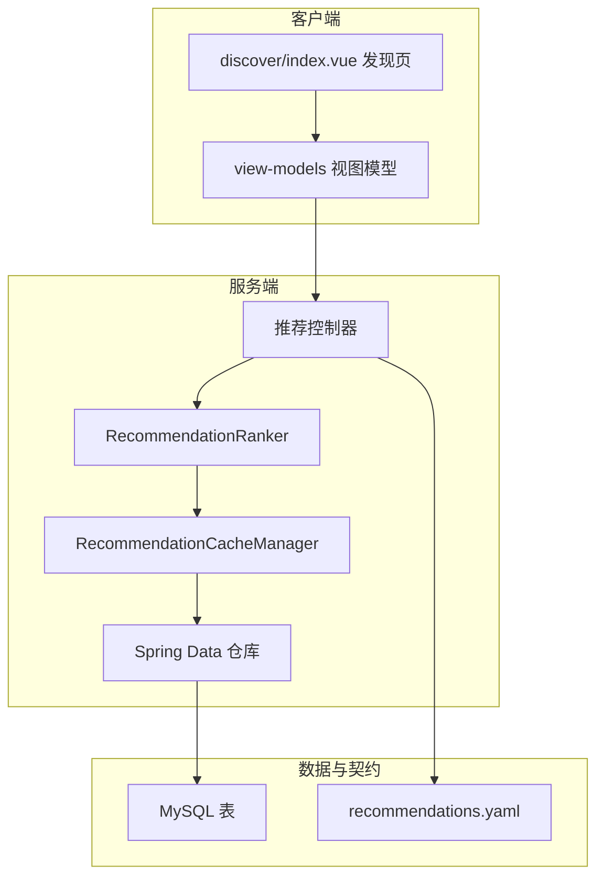

[此图为概念流程，不直接对应具体源文件，故不提供图表来源]

**章节来源**
- [apps/client/src/view-models/login.ts:1-8](file://apps/client/src/view-models/login.ts#L1-L8)

## 核心组件
匹配域的服务端实现集中在 `apps/api/src/main/java/com/campuslove/api/match/` 包，共 16 个类；推荐流（发现页候选集）实现在 `discover/` 包的 25 个类中。两者的分工是：`discover` 负责「把谁排到前面」，`match` 负责「用户表达意向之后关系如何落地」。

### 类型清单与装配条件
`match` 包采用「接口 + Mock 实现 + Real 实现」三段式装配，装配开关是 Spring Profile，而不是配置文件里的布尔量：

| 类型 | 种类 | 注解与生效条件 | 规模 |
| --- | --- | --- | --- |
| `MatchService` | interface | 无注解，纯契约 | 172 行 |
| `MockMatchService` | class | `@Profile("mock")` + `@Service` | 233 行 |
| `RealMatchService` | class | `@Profile("real")` + `@Service` | 704 行 |
| `IcebreakerService` | interface | 无注解 | 47 行 |
| `MockIcebreakerService` | class | `@Profile("mock")` + `@Service` | 54 行 |
| `RealIcebreakerService` | class | `@Profile("real")` + `@Service` | 485 行 |
| `MatchEngine` | class | `@Profile("real")` + `@Component` | 388 行 |
| `MatchPolicy` | class | `@Profile("real")` + `@Component` | 334 行 |
| `MatchRecorder` | class | `@Profile("real")` + `@Component` | 427 行 |
| `MatchController` | class | `@RestController` + `@RequestMapping("/api/v1/matches")` + `@Validated` | 456 行 |

关键结论：`MatchEngine`、`MatchPolicy`、`MatchRecorder` 三个协作组件都带 `@Profile("real")`，与 `MatchController` 无条件注入 `MatchService` 的写法组合起来意味着——以 `mock` Profile 启动时，控制器仍然工作，但候选筛选、限额判定与关系落库这三段真实逻辑根本不会进入容器。

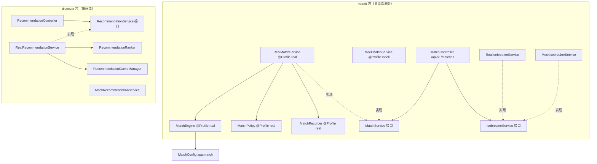

**图表来源**
- [MatchController.java:49-67](file://apps/api/src/main/java/com/campuslove/api/match/MatchController.java#L49-L67)
- [MatchEngine.java:50-89](file://apps/api/src/main/java/com/campuslove/api/match/MatchEngine.java#L50-L89)
- [MatchService.java:10-56](file://apps/api/src/main/java/com/campuslove/api/match/MatchService.java#L10-L56)
- [RealMatchService.java:48-50](file://apps/api/src/main/java/com/campuslove/api/match/RealMatchService.java#L48-L50)
- [MockMatchService.java:14-16](file://apps/api/src/main/java/com/campuslove/api/match/MockMatchService.java#L14-L16)
- [MatchPolicy.java:31-33](file://apps/api/src/main/java/com/campuslove/api/match/MatchPolicy.java#L31-L33)
- [MatchRecorder.java:44-46](file://apps/api/src/main/java/com/campuslove/api/match/MatchRecorder.java#L44-L46)
- [RealIcebreakerService.java:41-43](file://apps/api/src/main/java/com/campuslove/api/match/RealIcebreakerService.java#L41-L43)
- [MockIcebreakerService.java:11-13](file://apps/api/src/main/java/com/campuslove/api/match/MockIcebreakerService.java#L11-L13)

### MatchService 契约面
`MatchService` 接口的 20 个方法分三段：匹配队列段（`getFormConfig`、`createMatch`、`createQuickMatch`、`getMatch`、`setForceQueued`、`setNextQueueStatus`）、社交关系段（`likeUser`、`superLikeUser`、`cancelLike`、`getLikedMe`、`getVisitors`、`recordVisit`、`getHeartSignals`、`acceptHeartSignal`、`declineHeartSignal`）与滑动段（`passUser`、`rewind`、`getMyLikes`、`markVisitorRead`）。

接口 Javadoc 直接把行为契约写进了方法注释，这是本模块最可靠的规范来源：
- `likeUser` 返回 `HeartSignalView`，注释明确「互相喜欢时非空；重复喜欢返回 `status=ALREADY_LIKED` 的幂等视图；其余场景返回 `null`」，并声明普通喜欢受每日上限限制，超限抛 `DailyLimitExceededException` 并映射为 HTTP 429。
- `superLikeUser` 注释声明其「不受每日上限限制」，双向喜欢生成的心动信号 `matchType=super_like`。
- `recordVisit` 注释声明「同一访客对同一用户每天只记录一次」。
- `rewind` 注释声明「每日限 1 次」，返回 `RewindResultView`（字段为 `success` + `message`）。
- `passUser` 注释声明「被跳过的用户将不再出现在推荐列表中」。

**章节来源**
- [MatchService.java:10-172](file://apps/api/src/main/java/com/campuslove/api/match/MatchService.java#L10-L172)
- [HeartSignalView.java:7-18](file://apps/api/src/main/java/com/campuslove/api/match/HeartSignalView.java#L7-L18)
- [RewindResultView.java:7-10](file://apps/api/src/main/java/com/campuslove/api/match/RewindResultView.java#L7-L10)
- [LikedUserView.java:10-17](file://apps/api/src/main/java/com/campuslove/api/match/LikedUserView.java#L10-L17)
- [VisitorView.java:10-17](file://apps/api/src/main/java/com/campuslove/api/match/VisitorView.java#L10-L17)
- [IcebreakerView.java:7-20](file://apps/api/src/main/java/com/campuslove/api/match/IcebreakerView.java#L7-L20)

## 架构总览
端到端链路以「右滑喜欢」为主干。客户端手势层把一次触摸转成事件，事件转成 HTTP 调用，服务端在事务内完成幂等判定、配额判定、`likes` 落库、双向检测与 `heart_signals` 落库，最后返回 `HeartSignalView`。

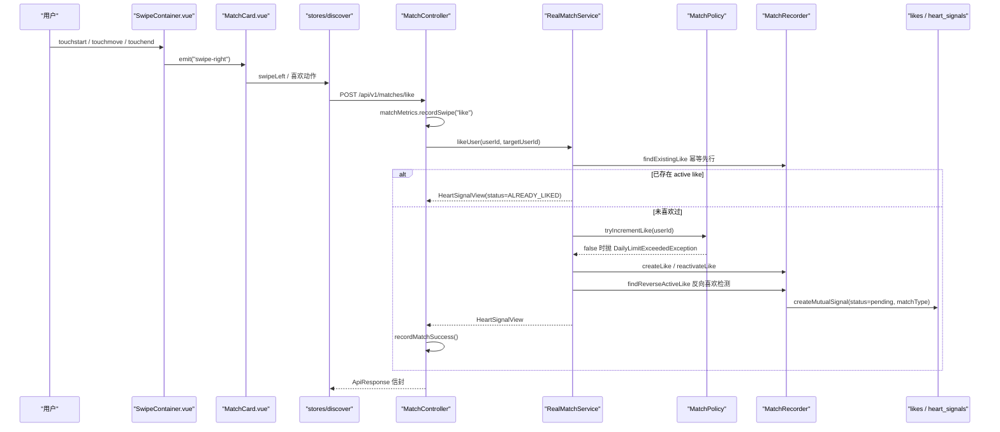

**图表来源**
- [MatchController.java:148-179](file://apps/api/src/main/java/com/campuslove/api/match/MatchController.java#L148-L179)
- [RealMatchService.java:229-299](file://apps/api/src/main/java/com/campuslove/api/match/RealMatchService.java#L229-L299)
- [MatchRecorder.java:87-176](file://apps/api/src/main/java/com/campuslove/api/match/MatchRecorder.java#L87-L176)
- [MatchPolicy.java:239-275](file://apps/api/src/main/java/com/campuslove/api/match/MatchPolicy.java#L239-L275)
- [SwipeContainer.vue:34-47](file://apps/client/src/components/common/swipe/SwipeContainer.vue#L34-L47)
- [MatchCard.vue:18-24](file://apps/client/src/components/match/MatchCard.vue#L18-L24)

### 心动信号状态机
`HeartSignal.SignalStatus` 是四值枚举 `pending / accepted / expired / declined`，字段注解把它绑定为数据库 `ENUM('pending','accepted','expired','declined') DEFAULT 'pending'`，因此代码注释明确说明该枚举「与数据库 ENUM 列强绑定，不宜扩展」——幂等喜欢场景只能由视图层常量 `HEART_SIGNAL_STATUS_ALREADY_LIKED = "ALREADY_LIKED"` 表达，而不是新增枚举值。

对外展示时，信号状态会被 `mapSignalStatusToQueueStatus` 收敛成三态队列语义：`pending` 与 `accepted` 都映射为 `connected`，`expired` 与 `declined` 都映射为 `expired`；`queued` 只在候选集为空的 `doCreateMatch` 分支里直接构造，不来自任何信号状态。`queueStatus` 为 `connected` 时才会生成 `tempChatSessionId`（取值为字符串拼接 `"session-" + id`）。

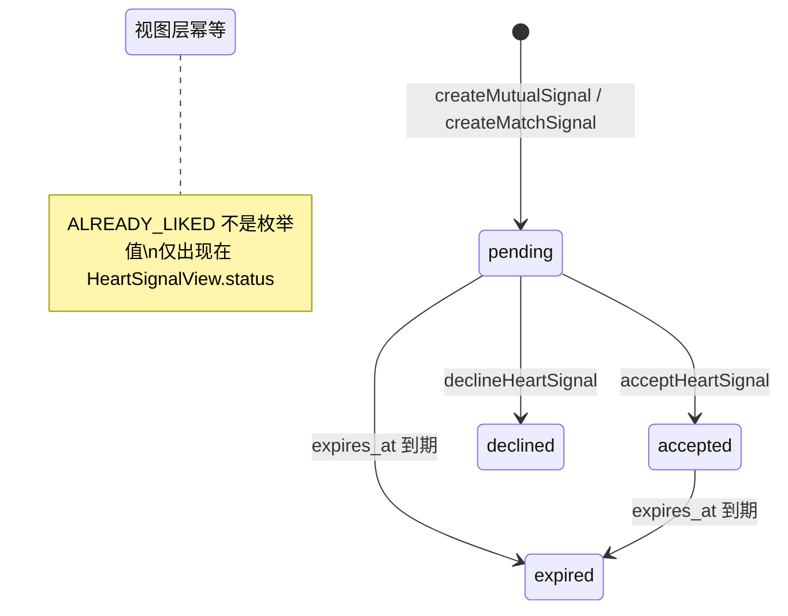

**图表来源**
- [HeartSignal.java:56-84](file://apps/api/src/main/java/com/campuslove/api/entity/HeartSignal.java#L56-L84)
- [MatchRecorder.java:148-193](file://apps/api/src/main/java/com/campuslove/api/match/MatchRecorder.java#L148-L193)
- [MatchRecorder.java:297-309](file://apps/api/src/main/java/com/campuslove/api/match/MatchRecorder.java#L297-L309)
- [RealMatchService.java:164-207](file://apps/api/src/main/java/com/campuslove/api/match/RealMatchService.java#L164-L207)
- [RealMatchService.java:698-703](file://apps/api/src/main/java/com/campuslove/api/match/RealMatchService.java#L698-L703)

### Like 状态与唯一约束
`Like` 实体是「匹配关系」的实际载体，注释直言「通过 user_id 与 target_user_id 记录用户之间的喜欢关系，互相喜欢即视为匹配成功」。其状态枚举只有 `active` 与 `cancelled`，并带 `(user_id, target_user_id)` 联合唯一约束 `uk_likes_user_target`，这决定了 `MatchRecorder.recordPass` 之类的写入必须先做存在性判定，且「取消喜欢」是状态翻转而非删除。

**章节来源**
- [Like.java:20-83](file://apps/api/src/main/java/com/campuslove/api/entity/Like.java#L20-L83)
- [RealMatchService.java:398-399](file://apps/api/src/main/java/com/campuslove/api/match/RealMatchService.java#L398-L399)

## 详细组件分析
### MatchEngine：候选筛选与加权评分
`MatchEngine` 的类注释把自身职责限定为「读取与计算，不持久化任何状态」，并注明「从 RealMatchService 拆分而来（Task 4.2.1）」。它注入 9 个协作者：`MatchConfig`、`LikeRepository`、`HeartSignalRepository`、`PassRecordRepository`、`UserRepository`、`UserCampusProfileRepository`、`UserBasicProfileRepository`、`UserScheduleProfileRepository` 与 `ObjectMapper`。

排除集合由 `getExcludedUserIds` 生成，返回 `Set<Long>`（注释说明「使用 Set 替代 List 提高查找性能」），组成是四部分并集：当前用户自身、`findByUserIdAndStatus(userId, LikeStatus.active)` 得到的已喜欢目标、`findByUserAIdOrUserBIdAndStatus(..., pending)` 与 `(..., accepted)` 两批心动信号的对端、以及 `findByUserIdOrderByCreatedAtDesc(userId)` 的全部 pass 记录。该方法的 `TODO(3-F 拉黑-匹配排除)` 注释明确写出「当前实现未接入（匹配引擎候选打分链路较深，改动面大），仅推荐/会话/消息链路已接入拉黑过滤」。

评分维度与权重全部来自 `MatchConfig`，`calculateMatchScoreFromMaps` 的加法逻辑是：同校区 `+campusWeight`、同城市 `+cityWeight`、兴趣标签按交集个数 `×interestWeight`、日程有重叠 `+scheduleWeight`。

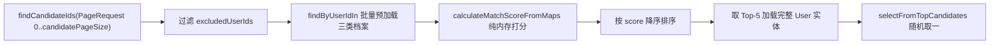

**图表来源**
- [MatchEngine.java:146-214](file://apps/api/src/main/java/com/campuslove/api/match/MatchEngine.java#L146-L214)
- [MatchEngine.java:229-264](file://apps/api/src/main/java/com/campuslove/api/match/MatchEngine.java#L229-L264)
- [MatchEngine.java:324-328](file://apps/api/src/main/java/com/campuslove/api/match/MatchEngine.java#L324-L328)

两处值得注意的语义细节：`selectFromTopCandidates` 用 `ThreadLocalRandom.current().nextInt(topN)` 在前 5 个高分候选里随机取一，注释解释这是「兼顾匹配质量和随机性，避免总是匹配最高分用户」；`hasScheduleOverlap` 是「简化实现：JSON 字符串解析后比较键集合是否有交集」，只要键名有任一交集即判定重叠，不比较值，且解析失败与空串一律返回 `false`。`parseInterestTags` 同理，`["摄影","篮球"]` 解析失败时返回空集合而非抛错。

**章节来源**
- [MatchEngine.java:35-136](file://apps/api/src/main/java/com/campuslove/api/match/MatchEngine.java#L35-L136)
- [MatchEngine.java:146-388](file://apps/api/src/main/java/com/campuslove/api/match/MatchEngine.java#L146-L388)
- [MatchConfig.java:16-35](file://apps/api/src/main/java/com/campuslove/api/config/MatchConfig.java#L16-L35)

### MatchPolicy：每日配额与 Redis 计数
`MatchPolicy` 是唯一的限额来源，公开常量三个：`REWIND_DAILY_LIMIT = 1`、`LIKE_DAILY_LIMIT = 30`、`SUPER_LIKE_DAILY_LIMIT_DEFAULT = 10`。Redis key 前缀同样以常量暴露，便于测试与运维排查：`REDIS_KEY_PREFIX_REWIND = "rewind:count:"`、`REDIS_KEY_PREFIX_LIKE = "like:count:"`、`REDIS_KEY_PREFIX_SUPER_LIKE = "super-like:count:"`，日期后缀由 `DateTimeFormatter.ofPattern("yyyy-MM-dd")` 生成，因此配额天然按自然日滚动。

超级喜欢配额是配置项覆盖默认值的模式：`@Value("${app.match.super-like-daily-limit:10}")`，注释记录其动机为「原实现完全免费且无限量，可无限绕过普通喜欢 30 次/日限额；现按配置配额封堵绕过，后续商业化可接入扣费」。

写入语义是「先自增、超限回滚」：`tryIncrementRewind` 与 `tryIncrementLike` 在 Redis 侧读 `INCR` 返回值，超过上限即回滚递减并返回 `false`；无 Redis 时退化为内存计数路径（`next > LIKE_DAILY_LIMIT` 同样判失败）。配套还有 `checkRewindLimit`、`getTodayRewindCount`、`incrementRewindCount`、`decrementRewindCount` 与 `requireNotSelf`（自喜欢拦截）。

`RealMatchService` 侧的编排顺序是配额链路的关键修正：`likeUser` 与 `superLikeUser` 都先调用 `matchRecorder.findExistingLike` 做幂等判定，命中 active 直接返回 `buildAlreadyLikedView`，只有未喜欢过才 `tryIncrementLike` / `tryIncrementSuperLike`；注释说明原实现「先 tryIncrementLike 扣配额再进 doLike，重复喜欢/取消后重喜欢都会消耗每日 30 次额度，限流失真」（R4-00333）。

**章节来源**
- [MatchPolicy.java:33-116](file://apps/api/src/main/java/com/campuslove/api/match/MatchPolicy.java#L33-L116)
- [MatchPolicy.java:152-315](file://apps/api/src/main/java/com/campuslove/api/match/MatchPolicy.java#L152-L315)
- [RealMatchService.java:229-276](file://apps/api/src/main/java/com/campuslove/api/match/RealMatchService.java#L229-L276)

### MatchRecorder：关系落库与通知
`MatchRecorder`（427 行，`@Profile("real") @Component`）承担全部写操作，方法按语义分五组：

| 组 | 方法 | 写入对象 |
| --- | --- | --- |
| 喜欢 | `findExistingLike` / `reactivateLike` / `createLike` / `cancelLike` / `findReverseActiveLike` | `likes` |
| 心动信号 | `createMutualSignal`（重载 2 个）/ `createMatchSignal` / `acceptHeartSignal` / `declineHeartSignal` | `heart_signals` |
| 左滑 | `existsPassRecord` / `recordPass` / `findLatestPassRecords` / `deletePassRecord` | `pass_records` |
| 访客 | `findVisitors` / `existsTodayVisit` / `recordVisit` / `markVisitorRead` | `Visitor` |
| 通知与视图 | `pushMatchNotification` / `pushHeartSignalNotification` / `publishMatchEvent` / `toHeartSignalView` / `batchLoadUsers` / `batchLoadCampusProfiles` | — |

两个信号创建方法的落库字段完全一致：`status = SignalStatus.pending`、`expiresAt = now.plusHours(matchConfig.getHeartSignalExpireHours())`、时间戳取 `LocalDateTime.now(TimeZones.BUSINESS)`；差别只在 `matchType`——`createMutualSignal` 的两参重载把 `"mutual_like"` 作为默认，`createMatchSignal` 由调用方传入中文标签（`doCreateMatch` 传的是 `toMatchTypeLabel` 结果或 `"快速匹配"`）。`recordPass` 用 `existsByUserIdAndPassedUserId` 做前置去重，重复左滑不产生第二条记录。

双向解锁的判定入口是 `findReverseActiveLike(targetUserId, userId)`——反向存在 active like 时，`doLike` 调用 `createMutualSignal(userId, targetUserId, now, matchType)` 生成信号，并进入 `pushMatchNotification` / `publishMatchEvent`；`RealMatchService` 另有 `createFreeConversation(userAId, userBId)` 与 `recordSocialProgressLike` / `recordSocialProgressMatch` 完成解锁后的会话与进度联动，其依赖是注入的 `PrivateMessageService`、`SocialProgressService` 与 `WalletUnlockService`（后者服务于 `LikedUserView.unlocked` / `VisitorView.unlocked` 的 P0-17 打码解锁语义）。

**章节来源**
- [MatchRecorder.java:46-60](file://apps/api/src/main/java/com/campuslove/api/match/MatchRecorder.java#L46-L60)
- [MatchRecorder.java:87-260](file://apps/api/src/main/java/com/campuslove/api/match/MatchRecorder.java#L87-L260)
- [MatchRecorder.java:284-395](file://apps/api/src/main/java/com/campuslove/api/match/MatchRecorder.java#L284-L395)
- [RealMatchService.java:54-85](file://apps/api/src/main/java/com/campuslove/api/match/RealMatchService.java#L54-L85)
- [RealMatchService.java:321-398](file://apps/api/src/main/java/com/campuslove/api/match/RealMatchService.java#L321-L398)
- [LikedUserView.java:7-17](file://apps/api/src/main/java/com/campuslove/api/match/LikedUserView.java#L7-L17)

### 客户端手势层与匹配卡
`apps/client/src/features/match/` 在本仓库中不存在；匹配前端能力实际落在三处：`components/common/swipe/`（`SwipeContainer.vue` 90 行 + `SwipeGesture.ts`）、`components/match/`（`MatchActions.vue`、`MatchCard.vue`、`MatchHub.vue`、`MatchInfo.vue`、`MatchLoading.vue`、`MatchScopeTabs.vue`、`MatchSuccess.vue`）、`stores/match.ts` 与 `view-models/match.ts`。

`SwipeContainer.vue` 在手势容器上绑定 `@touchstart="handleTouchStart"`、`catchtouchmove="onTouchMove"`、`@touchend="handleTouchEnd"`，判定方向后分别 `emit("swipe-left")` / `emit("swipe-right")`，`props.disabled` 时全部短路；点击语义统一由手势层 `touchend` 判定后 `emit("card-tap")` 承载，容器自身只 `@tap` 阻断冒泡。动画上采用 GPU 友好属性提示 `will-change: transform, opacity`。事件命名经历过一次修正：`MP-R1-PAGES-DISCOVER-INDEX-005` 注释说明「对外点击事件由 "tap" 更名 "card-tap"，与原生 tap 冒泡脱钩，防止 mp-weixin 端单次点击双通道重复触发」。

`MatchCard.vue` 的对外契约是 `defineProps<{ user: MatchCardUser; disabled?: boolean }>()` 与三个 emit（`card-tap` / `swipe-left` / `swipe-right`），并给根节点挂 `match-card-swipe` 类；卡片图片按 `props.user.photo || props.user.avatar || IMAGE_PATHS.MATCH_CARD.HERO` 三级兜底，注释记录 2026-09-12 把无照片兜底从默认头像升级为匹配卡主视觉。`MatchActions.vue`（140 行）提供 pass / superLike / like 三个 `role="button"` 动作项，统一使用 `hover-class="match-actions__item--pressed"` 按压反馈，并在 `disabled || busy` 时给容器加 `match-actions--disabled`。

**章节来源**
- [SwipeContainer.vue:6-89](file://apps/client/src/components/common/swipe/SwipeContainer.vue#L6-L89)
- [MatchCard.vue:1-30](file://apps/client/src/components/match/MatchCard.vue#L1-L30)
- [MatchCard.vue:56-116](file://apps/client/src/components/match/MatchCard.vue#L56-L116)
- [MatchActions.vue:6-67](file://apps/client/src/components/match/MatchActions.vue#L6-L67)

### 发现页装配：卡片流、配额与模式切换
`pages/discover/index.vue` 把三条 store 拼成一屏：`useDiscoverStore` 提供 `cards / loading / errorMessage / remainingCount`（`storeToRefs` 解构），`useAppConfigStore` 提供 `isMatchOpen` 开关，`useMatchStore` 承载滑动后的匹配检查。页面级常量 `DISCOVER_TTL_MS = 30_000` 配合 `utils/cache-ttl` 的 `isCacheFresh / setCachedValue / removeCache` 做本地缓存新鲜度控制。

展示顺序由两个 computed 决定：`visibleCards` 依 `activeMode`（`ref<DiscoverMode>("recommend")`）切换——推荐模式保持 store 原始顺序即「推荐算法权重」，附近模式用 `filterNearby` / `sortNearbyFirst` 重排；`currentCard` 恒取 `visibleCards.value[0] ?? null`，即「队首即当前卡」，`handleSwipeLeft` 直接调用 `discoverStore.swipeLeft(currentCard.value.id)` 并把 `errorMessage` 或 i18n 文案作为失败提示。

配额展示不重复计算：注释写明 remainingCount 是「store getter 单一数据源：dailyLimit + extraQuota - viewedCards.length，签到加量自动跟随」。打招呼动作另有客户端侧每日计数，用 `uni.getStorageSync` 读 `greet:count:${targetId}` 并以 `new Date().toISOString().slice(0, 10)` 比对当日。进入匹配前有两道闸门：`requireLogin()` / `goLogin()` 与 `ensureCertified`（`guards/campus-gate`），`enterMatching(action: "like" | "superLike")` 负责组装跳转 query。`switchDiscoverMode` 的注释强调「收敛到 store 单一 action」以避免与 `setNearbyScope` / `setMatchScope` 双路径漂移。

`stores/match.ts` 用 `defineStore("match", () => {...})` 组织，状态字段为 `status: MatchStatus`（初值 `"idle"`）、`matchedUser`、`pendingAction`、`pendingCardId`、`animationDone`、`lastError`，并有 `canProceed` computed 与 `beginCheck` / `runMatchCheck` / `markAnimationDone` / `setMatchedUser` / `markChatReady` / `reset` 动作；`runMatchCheck` 从 `discoverStore.lastSwipeResult` 取回滑动结果，把「动画播完」与「服务端是否配对成功」两件事分开推进。`view-models/match.ts` 提供 `computeMatchScore(commonCircleCount)`、`toMatchCardUser(card)` 与 `buildMatchReasons(...)`，后者基于共同兴趣标签交集生成匹配理由并做文案去重。

**章节来源**
- [apps/client/src/pages/discover/index.vue:4-33](file://apps/client/src/pages/discover/index.vue#L4-L33)
- [apps/client/src/pages/discover/index.vue:47-183](file://apps/client/src/pages/discover/index.vue#L47-L183)
- [match.ts:18-88](file://apps/client/src/stores/match.ts#L18-L88)
- [match.ts:12-99](file://apps/client/src/view-models/match.ts#L12-L99)
- [login.ts:6](file://apps/client/src/view-models/login.ts#L6)

## 数据模型
匹配域的数据面由「三张关系表 + 三张画像表 + 一张配置表 + 解锁后的会话表」构成，全部通过 JPA 注解声明，表名与索引名在实体注释里与 Flyway 脚本逐条对齐。

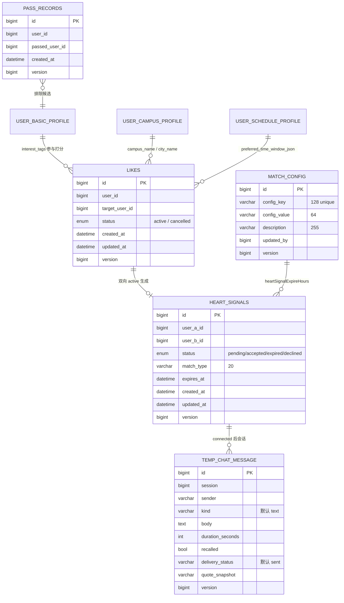

**图表来源**
- [Like.java:38-109](file://apps/api/src/main/java/com/campuslove/api/entity/Like.java#L38-L109)
- [HeartSignal.java:37-110](file://apps/api/src/main/java/com/campuslove/api/entity/HeartSignal.java#L37-L110)
- [PassRecord.java:19-53](file://apps/api/src/main/java/com/campuslove/api/entity/PassRecord.java#L19-L53)
- [MatchConfigEntity.java:21-70](file://apps/api/src/main/java/com/campuslove/api/entity/MatchConfigEntity.java#L21-L70)
- [TempChatMessage.java:22-81](file://apps/api/src/main/java/com/campuslove/api/entity/TempChatMessage.java#L22-L81)

关键约束与设计意图：
- `likes` 用 `uk_likes_user_target` 联合唯一约束防重复喜欢，另有 6 个索引分别服务「谁喜欢了我」（`idx_likes_target_user`）、「我喜欢的人」分页（`idx_likes_user_created_at`）、「喜欢我的人」分页（`idx_likes_target_user_created_at`）、状态过滤（`idx_likes_status`）与状态+时间复合查询（`idx_likes_status_created_at`）。
- `heart_signals` 建 5 个索引：`idx_heart_signals_user_a`、`idx_heart_signals_user_b`、`idx_heart_signals_expires_at`（专供「定时任务扫描过期信号」）、`idx_heart_signals_status`、`idx_heart_signals_created_at`。注释还说明数据库层面对 `(LEAST(user_a_id, user_b_id), GREATEST(user_a_id, user_b_id))` 建了功能性唯一约束 `uk_heart_signals_users`，所以实体里不重复声明唯一约束——这正是「A→B 与 B→A 只能有一条信号」的实现支点。
- `match_config` 是键值表（`config_key` 唯一、`config_value` 字符串存储、应用层解析为 int/double/boolean），注释列出示例键 `heartSignalExpireHours`、`campusWeight`；读取入口是 `MatchConfigEntityRepository.findByConfigKey(String)` 返回 `Optional<MatchConfigEntity>`。
- 四张业务表都带 `@Version` 乐观锁列（`BIGINT DEFAULT 0`，Flyway `V2026.07.26.0003`），实体注释统一说明冲突时抛 `ObjectOptimisticLockingFailureException` 并由 `GlobalExceptionHandler` 转成 HTTP 409。
- `heart_signals.match_type` 长度 20，注释枚举了取值语义：`mutual_like`、`topic`、`coffee`、`study`、`quick`；代码侧实际写入的还有 `super_like`。
- 参与打分的画像字段：`user_basic_profile.interest_tags`（默认 `"[]"`）、`user_campus_profile` 的 `campusName` / `cityName`、`user_schedule_profile.preferred_time_window_json`（默认 `"{}"`）。`UserBasicProfile` 还持有 `halfBodyPhotoUrl`、`personalVideoUrl`、`profileBackgroundUrl`、`photoGallery`、`mbti`、`expectedPartner`、`educationLevel`、`height`、`hometownProvince/City`、`futureCity`、`incomeRange`、`occupation`、`idCardVerified` 等展示与筛选字段。
- 解锁后的会话落在 `temp_chat_message`（表 `temp_chat_message`），`kind` 默认 `"text"`、`deliveryStatus` 默认 `"sent"`，并有 `recalled`、`durationSeconds`、`quoteSnapshot`；通知开关与模板在 `notify_config`（`type`、`enabled` 默认 `Boolean.TRUE`、`template`）。

**章节来源**
- [NotifyConfig.java:20-60](file://apps/api/src/main/java/com/campuslove/api/entity/NotifyConfig.java#L20-L60)
- [UserBasicProfile.java:24-181](file://apps/api/src/main/java/com/campuslove/api/entity/UserBasicProfile.java#L24-L181)

## API 契约
### 匹配与社交关系端点（MatchController）
控制器基路径 `/api/v1/matches`，类上带 `@Tag(name = "Match", description = "匹配与社交关系接口：滑动操作、心动信号、访客、喜欢列表、破冰引导")` 与 `@SecurityRequirement(name = "bearerAuth")`。所有用户身份一律从 `SecurityUtils.getCurrentUserId()` 取，`createMatch` / `createQuickMatch` 显式重建请求对象以「忽略请求体中的 userId 字段，防止用户伪造请求体越权为他人创建匹配」。

| 方法与路径 | operationId | 保护与副作用 |
| --- | --- | --- |
| `GET /form-config` | `getMatchFormConfig` | 返回 `MatchFormConfigView`，供前端动态渲染表单 |
| `POST /` | `createMatch` | `hasRole('USER')`；400 校验失败、401 未授权、409「已存在进行中的匹配」 |
| `POST /quick` | `createQuickMatch` | `hasRole('USER')`；跳过表单，用上次配置或默认值入队 |
| `GET /{id}` | `getMatch` | 404 匹配不存在；real 侧做双方归属校验，非参与方抛 `OperationForbiddenException` |
| `POST /like` | `likeUser` | `@RateLimit(capacity = 60, refillTokens = 2, key = "#request.remoteAddr")` + `@Idempotent`；429 触发限流；`recordSwipe("like")` |
| `POST /super-like` | `superLikeUser` | 同套限流与幂等注解；`recordSwipe("super_like")` |
| `POST /cancel-like` | — | `hasRole('USER')`，无 `@Operation` |
| `GET /liked-me` | — | `ApiResponse<List<LikedUserView>>` 信封 |
| `GET /my-likes` | — | `ApiResponse<List<LikedUserView>>` 信封 |
| `GET /visitors` | — | `ApiResponse<List<VisitorView>>` 信封 |
| `POST /visit` | — | `hasRole('USER')`，`VisitTargetRequest(visitedUserId)` |
| `GET /heart-signals` | — | 返回裸 `List<HeartSignalView>`（未套信封） |
| `POST /heart-signals/{id}/accept` | — | `@Positive Long signalId`，`hasRole('USER')` |
| `POST /heart-signals/{id}/decline` | — | 同上 |
| `POST /pass` | `passUser` | 参数是 `@RequestParam(name = "passedUserId")` 而非请求体；`@Idempotent`；`recordSwipe("dislike")` |
| `POST /rewind` | `rewind` | 429「DAILY_LIMIT_EXCEEDED：超出每日反悔次数限制」；`@Idempotent` |
| `PUT /visitors/{id}/read` | — | `hasRole('USER')`，返回 `ResponseEntity<Void>` |
| `GET /{matchId}/icebreakers` | — | `IllegalArgumentException` 转 400，最多返回 3 个话题 |

请求体校验集中在 record 定义里：`MatchRequest` 要求 `@NotBlank @Size(max = 64) matchIntent`、`@Size(max = 32) timeWindow`、`@Min(1) @Max(180) durationMinutes`；`QuickMatchRequest` 只有 `durationMinutes`；`LikeTargetRequest` 为 `@NotNull @Positive targetUserId`；`VisitTargetRequest` 为 `@NotNull @Positive visitedUserId`。`MatchResultView` 的 7 个字段是 `id, queueStatus, topicLabel, partnerHeadline, countdownMinutes, recommendedPrompt, tempChatSessionId`。两处代码注释记录了字段语义修正：`timeWindow` 因「doCreateMatch 未使用 timeWindow 字段」移除必填（infra R2-00220）；废弃端点 `GET /matches/dto` 已作为恒返回空列表的死代码删除（infra R2-00219）。

`getFormConfig` 的 real 实现只返回一个 `intent` 分区、一个 `single-select` 字段 `matchIntent`「从什么开始」，选项为 `topic`（话题匹配）、`coffee`（咖啡散步）、`study`（自习搭子），`min/max` 传 `null`。这三个选项 id 与 `heart_signals.match_type` 的注释取值一致。

**章节来源**
- [MatchController.java:34-137](file://apps/api/src/main/java/com/campuslove/api/match/MatchController.java#L34-L137)
- [MatchController.java:141-387](file://apps/api/src/main/java/com/campuslove/api/match/MatchController.java#L141-L387)
- [MatchController.java:389-456](file://apps/api/src/main/java/com/campuslove/api/match/MatchController.java#L389-L456)
- [RealMatchService.java:120-130](file://apps/api/src/main/java/com/campuslove/api/match/RealMatchService.java#L120-L130)

### 推荐流端点（OpenAPI 契约）
`docs/openapi/recommendations.yaml`（806 行）声明 12 个操作，覆盖推荐流、配额、讨论、活动、历史与偏好读写：

| 路径 | 方法 | operationId | summary |
| --- | --- | --- | --- |
| `/recommendations` | GET | `getRecommendations` | Get recommended people list (with filters) |
| `/recommendations/quota` | GET | `getRecommendationQuota` | Get today's recommendation quota usage |
| `/recommendations/discussions` | GET | `getDiscussions` | Get discussion recommendations |
| `/recommendations/activities` | GET | `getActivities` | Get activity recommendations |
| `/recommendations/history` | GET | `getHistory` | Get recommendation history |
| `/recommendations/preferences/me` | GET | `getPreferencesByUserId` | Get current user recommendation preferences |
| `/recommendations/preferences/me` | PUT | `savePreferences` | Save current user recommendation preferences |
| `/recommendations/preferences` | GET | `getRecommendationPreferences` | Get recommendation preferences |
| `/recommendations/preferences` | PUT | — | Update recommendation preferences |
| `/daily-question/today` | GET | `getTodayQuestion` | Get today's daily question |
| `/daily-question/answer` | POST | `submitDailyAnswer` | Submit an answer to the daily question |
| `/daily-question/answers` | GET | `getDailyAnswers` | Get answers for a daily question |

`/recommendations` 的 summary 显式带 `(with filters)`，与 `/recommendations/quota` 的「today's ... quota usage」语义共同解释了客户端 `remainingCount` 的来源；偏好读写存在 `preferences/me` 与 `preferences` 两组并存路径，前者按当前登录用户、后者为通用形式。

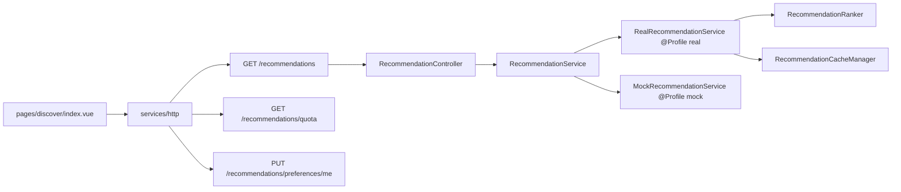

[此图为概念流程，不直接对应具体源文件，故不提供图表来源]

**章节来源**
- [recommendations.yaml:8-49](file://docs/openapi/recommendations.yaml#L8-L49)
- [recommendations.yaml:77-85](file://docs/openapi/recommendations.yaml#L77-L85)
- [recommendations.yaml:160-266](file://docs/openapi/recommendations.yaml#L160-L266)
- [recommendations.yaml:288-304](file://docs/openapi/recommendations.yaml#L288-L304)

### 调试端点
`debug/MatchDebugController.java` 提供 `POST /api/v1/_debug/matches/next-status/{queueStatus}`，类上 `@Profile("mock")`，注释说明用途是「便于联调与端到端测试中模拟不同匹配结果（成功/排队/失败）」，`IllegalArgumentException` 转 `ResponseStatusException(BAD_REQUEST)`。与之对应，`RealMatchService.setForceQueued` 与 `setNextQueueStatus` 在 real 模式下只写 `log.warn` 并声明「mock 专用调试能力，real 模式不生效」。

**章节来源**
- [MatchDebugController.java:13-39](file://apps/api/src/main/java/com/campuslove/api/debug/MatchDebugController.java#L13-L39)
- [RealMatchService.java:210-217](file://apps/api/src/main/java/com/campuslove/api/match/RealMatchService.java#L210-L217)

## 配置与开关
### app.match 配置项
`MatchConfig` 是 `@Component` + `@ConfigurationProperties(prefix = "app.match")` 的绑定类，`application.yml` 第 315 行起给出与字段一一对应的默认值，全部与代码内建默认值相同，因此删掉配置段不会改变行为：

| 配置键 | yml 值 | 字段默认 | 消费位置 |
| --- | --- | --- | --- |
| `app.match.heart-signal-expire-hours` | 48 | 48 | `MatchRecorder.createMutualSignal` / `createMatchSignal` 计算 `expiresAt` |
| `app.match.candidate-page-size` | 50 | 50 | `MatchEngine.findAndScoreCandidates` 的 `PageRequest.of(0, ...)` |
| `app.match.default-chat-duration` | 20 | 20 | `doCreateMatch` 的 `duration` 兜底、`getMatch` 的 `countdownMinutes` |
| `app.match.campus-weight` | 50 | 50 | 同校区加分 |
| `app.match.city-weight` | 20 | 20 | 同城市加分 |
| `app.match.interest-weight` | 10 | 10 | 每个交集兴趣标签加分 |
| `app.match.schedule-weight` | 15 | 15 | 日程重叠加分 |
| `app.match.super-like-daily-limit` | `${APP_SUPER_LIKE_DAILY_LIMIT:10}` | 常量默认 10 | `MatchPolicy` 的 `@Value` 注入 |

配额之外还有两条相邻配置影响匹配体验：`app.chat.session-expire-hours: 24` 决定临时会话有效期，`app.checkin.extra-quota-per-check-in: 3` 是客户端 `remainingCount = dailyLimit + extraQuota - viewedCards.length` 里 `extraQuota` 的来源。

评分上限可以直接算出来：同校区 + 同城市 + 日程重叠是 `50 + 20 + 15 = 85`，每多一个共同兴趣标签再加 10。`TOP_CANDIDATE_COUNT = 5` 是 `MatchEngine` 内的 `private static final int`，注释挂需求编号 R4-00349，未外移为配置项。

**章节来源**
- [MatchConfig.java:12-92](file://apps/api/src/main/java/com/campuslove/api/config/MatchConfig.java#L12-L92)
- [application.yml:315-330](file://apps/api/src/main/resources/application.yml#L315-L330)
- [MatchEngine.java:54-58](file://apps/api/src/main/java/com/campuslove/api/match/MatchEngine.java#L54-L58)
- [MatchRecorder.java:165-193](file://apps/api/src/main/java/com/campuslove/api/match/MatchRecorder.java#L165-L193)
- [MatchPolicy.java:44-76](file://apps/api/src/main/java/com/campuslove/api/match/MatchPolicy.java#L44-L76)

### match_config 表与运行时覆盖
`MatchConfigEntity` 把同一批参数落库为键值行，注释声明「与 `com.campuslove.api.config.MatchConfig` 字段一一对应，用于持久化匹配算法权重等运行时可调整的参数」，`configKey` 示例即 `heartSignalExpireHours`、`campusWeight`。管理侧读写入口是 `AdminMatchConfigController`（91 行）与 `RealAdminMatchConfigService`（382 行），投影类型是 `MatchConfigView`、`MatchStatsView`。

需要区分清楚的是：`MatchEngine` 实际读的是 `MatchConfig` bean（`matchConfig.getCampusWeight()` 等），而不是 `MatchConfigEntityRepository`；仓库只提供 `findByConfigKey(String)` 单键查询，把 `match_config` 表读进引擎的代码路径在本页取证范围内未出现。

**章节来源**
- [MatchConfigEntity.java:16-70](file://apps/api/src/main/java/com/campuslove/api/entity/MatchConfigEntity.java#L16-L70)
- [MatchConfigEntityRepository.java:7-19](file://apps/api/src/main/java/com/campuslove/api/repository/MatchConfigEntityRepository.java#L7-L19)
- [MatchEngine.java:229-264](file://apps/api/src/main/java/com/campuslove/api/match/MatchEngine.java#L229-L264)

### Profile 装配：real 与 mock
`application.yml` 的 profile 策略注释是本页最重要的运维前提：`spring.profiles.default: mock` 仅对「测试引导」生效（`@SpringBootTest` 未显式指定 profile 时依赖它加载 mock 配置）；生产与联调启动必须走 `CampusLoveApplication.main()`，它在 Spring 启动前强制校验激活 profile（`SPRING_PROFILES_ACTIVE` / `--spring.profiles.active` / `-Dspring.profiles.active`），为空或非法时 fail-fast 报错退出，注释理由是「mock 数据为内存态，重启即丢」与「MockSecurityConfig 免真实认证，生产环境属严重安全风险」。部署规范要求生产显式 `SPRING_PROFILES_ACTIVE=real`。

落到匹配域的三个后果：
1. 匹配算法三件套 `MatchEngine`、`MatchPolicy`、`MatchRecorder` 都带 `@Profile("real") @Component`，`RealMatchService` / `RealIcebreakerService` 带 `@Profile("real") @Service`，`RecommendationCacheManager` 同样是 `@Profile("real") @Component`——mock 启动时这些 bean 全部缺席，`MatchService` 注入的是 `MockMatchService`（`@Profile("mock") @Service`）。
2. `MatchService.setForceQueued` / `setNextQueueStatus` 只在 mock 侧有真实语义；real 侧只 `log.warn`。
3. `MatchDebugController` 整体 `@Profile("mock")`，real 环境访问 `/api/v1/_debug/matches/**` 得到 404。

**章节来源**
- [application.yml:1-20](file://apps/api/src/main/resources/application.yml#L1-L20)
- [MatchEngine.java:50-52](file://apps/api/src/main/java/com/campuslove/api/match/MatchEngine.java#L50-L52)
- [RealMatchService.java:48-50](file://apps/api/src/main/java/com/campuslove/api/match/RealMatchService.java#L48-L50)
- [MockMatchService.java:14-16](file://apps/api/src/main/java/com/campuslove/api/match/MockMatchService.java#L14-L16)
- [MatchDebugController.java:19-22](file://apps/api/src/main/java/com/campuslove/api/debug/MatchDebugController.java#L19-L22)
- [RecommendationCacheManager.java:32-34](file://apps/api/src/main/java/com/campuslove/api/discover/RecommendationCacheManager.java#L32-L34)
- [MatchService.java:43-55](file://apps/api/src/main/java/com/campuslove/api/match/MatchService.java#L43-L55)

### 客户端开关与本地缓存
发现页受 `appConfigStore` 的 `isMatchOpen` 门控（`const { isMatchOpen } = storeToRefs(appConfigStore)`），配合 `useAppConfigStore` 与 `useMock` 决定是走真实接口还是 `mockFixtures.getRecommendations` 本地数据。本地缓存 TTL 为页面级常量 `DISCOVER_TTL_MS = 30_000`，通过 `utils/cache-ttl` 的 `isCacheFresh` / `setCachedValue` / `removeCache` 消费；下拉刷新路径会「先清 `discover:data` 缓存再直调 `fetchCards`」。打招呼的每日次数是纯客户端计数，key 形如 `greet:count:${targetId}`，与 `uni.getStorageSync` 一起使用。

服务端缓存走 Spring Cache：`RecommendationCacheManager.getCachedRecommendations(userId)` 标注 `@Cacheable(cacheNames = CacheNames.MATCH_RECOMMEND, key = "'v2:' + #userId")`，游客路径 `getCachedGuestRecommendations()` 用 `@Cacheable(cacheNames = CacheNames.GUEST_RECOMMEND, key = "'guest:v1'")`，失效入口为 `evictRecommendationCache(userId)` 与 `evictAllRecommendationCaches()`。类注释解释拆 bean 的原因是「Spring Cache 基于代理 AOP，`@Cacheable` 必须在独立的 Spring Bean 方法上才能生效」。

**章节来源**
- [apps/client/src/pages/discover/index.vue:8-33](file://apps/client/src/pages/discover/index.vue#L8-L33)
- [apps/client/src/pages/discover/index.vue:183-207](file://apps/client/src/pages/discover/index.vue#L183-L207)
- [RecommendationCacheManager.java:20-34](file://apps/api/src/main/java/com/campuslove/api/discover/RecommendationCacheManager.java#L20-L34)
- [RecommendationCacheManager.java:87-190](file://apps/api/src/main/java/com/campuslove/api/discover/RecommendationCacheManager.java#L87-L190)

## 依赖关系分析
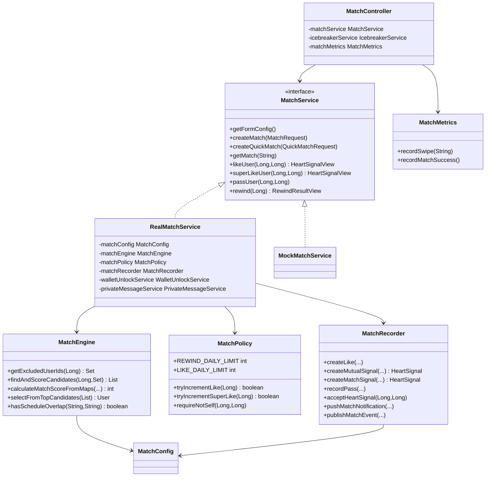

**图表来源**
- [MatchController.java:52-67](file://apps/api/src/main/java/com/campuslove/api/match/MatchController.java#L52-L67)
- [MatchService.java:10-171](file://apps/api/src/main/java/com/campuslove/api/match/MatchService.java#L10-L171)
- [RealMatchService.java:50-87](file://apps/api/src/main/java/com/campuslove/api/match/RealMatchService.java#L50-L87)
- [MatchEngine.java:52-89](file://apps/api/src/main/java/com/campuslove/api/match/MatchEngine.java#L52-L89)
- [MatchPolicy.java:33-107](file://apps/api/src/main/java/com/campuslove/api/match/MatchPolicy.java#L33-L107)
- [MatchRecorder.java:46-358](file://apps/api/src/main/java/com/campuslove/api/match/MatchRecorder.java#L46-L358)
- [MatchMetrics.java:28-107](file://apps/api/src/main/java/com/campuslove/api/monitor/MatchMetrics.java#L28-L107)
- [MockMatchService.java:16](file://apps/api/src/main/java/com/campuslove/api/match/MockMatchService.java#L16)

### 仓库依赖分布
`MatchEngine` 的读依赖是最宽的一处：`LikeRepository.findByUserIdAndStatus`、`HeartSignalRepository.findByUserAIdOrUserBIdAndStatus`（同一方法被调用两次，分别传 `pending` 与 `accepted`）、`PassRecordRepository.findByUserIdOrderByCreatedAtDesc`、`UserRepository.findCandidateIds(PageRequest)` 与 `findByIdIn(List)`、`UserCampusProfileRepository.findByUserId` / `findByUserIdIn`、`UserBasicProfileRepository.findByUserId` / `findByUserIdIn`、`UserScheduleProfileRepository.findByUserId` / `findByUserIdIn`。`findByUserIdIn` 系列方法的存在，是候选批量预加载优化（infra R2-00017）能够成立的前提。

`MatchRecorder` 是写侧唯一出口，持有 `LikeRepository`、`HeartSignalRepository`、`PassRecordRepository` 与 `VisitorRepository`（`findVisitors` / `existsTodayVisit` / `recordVisit` / `markVisitorRead`），并额外承担 `toHeartSignalView` 的视图组装与 `batchLoadUsers` / `batchLoadCampusProfiles` 的批量取数。`RealMatchService` 也直接注入 `com.campuslove.api.repository.VisitorRepository`，用于访客与解锁状态合成。

跨模块依赖方向明确且单向：匹配域依赖 `common`（`ApiResponse`、`Idempotent`、`OperationForbiddenException`、`DailyLimitExceededException`、`ErrorMessages`、`TimeZones`、`DisplayConstants`）、`config`（`MatchConfig`、`SecurityUtils`）、`entity`、`repository`、`monitor`（`MatchMetrics`）、`ratelimit`（`RateLimit`），并被 `debug` 与 `admin` 包反向引用；`match/MatchAlreadyExistsException` 位于 `common` 包而非 `match` 包，说明「已存在进行中的匹配」这一 409 语义由全局异常体系承接。

**章节来源**
- [MatchEngine.java:98-214](file://apps/api/src/main/java/com/campuslove/api/match/MatchEngine.java#L98-L214)
- [MatchRecorder.java:195-260](file://apps/api/src/main/java/com/campuslove/api/match/MatchRecorder.java#L195-L260)
- [RealMatchService.java:54-87](file://apps/api/src/main/java/com/campuslove/api/match/RealMatchService.java#L54-L87)
- [MatchController.java:1-32](file://apps/api/src/main/java/com/campuslove/api/match/MatchController.java#L1-L32)

客户端侧依赖同样收敛：`pages/discover/index.vue` 只依赖 `stores/discover`、`stores/session`、`stores/app-config`、`stores/profile`、`stores/match`、`composables/useTabBar`、`composables/useMenuButtonRect`、`utils/cache-ttl`、`utils/navigation`、`guards/campus-gate`、`services/http`、`constants/routes`、`config/images`、`view-models/match` 以及 `components/match/MatchCard.vue`、`components/match/MatchActions.vue`、`components/discover/FilterDrawer.vue`、`components/common/Skeleton.vue`、`components/common/EmptyState.vue`，卡片数据结构由 `stores/discover/types` 的 `DiscoverCard` 与 `types/match` 的 `MatchCardUser` 两级类型描述。

**章节来源**
- [apps/client/src/pages/discover/index.vue:1-31](file://apps/client/src/pages/discover/index.vue#L1-L31)
- [MatchCard.vue:1-9](file://apps/client/src/components/match/MatchCard.vue#L1-L9)

## 性能考虑
匹配域的两条热路径各有明确的优化记录：`POST /api/v1/matches/like` 被拆成「限流判定 → 幂等判定 → 事务写入 → 反向检测」四段，推荐拉取被拆成「缓存查询 → 候选打分 → Top-N 实体化 → 排序转换」四段。下面逐段给出源码级的代价构成与已落地的收敛手段。

### 候选打分链路：ID 投影 + 批量预加载 + Top-N 实体化
`MatchEngine.findAndScoreCandidates` 的注释把三次收敛都标了需求号（[MatchEngine.java:146-214](file://apps/api/src/main/java/com/campuslove/api/match/MatchEngine.java#L146-L214)）：
1. **当前用户画像**：`userCampusProfileRepository.findByUserId` / `userScheduleProfileRepository.findByUserId` / `userBasicProfileRepository.findByUserId` 各一次（L147-L159），共 3 次查询。
2. **候选 ID 投影**（R4-00349）：`userRepository.findCandidateIds(PageRequest.of(0, matchConfig.getCandidatePageSize())).getContent()`，注释理由为「仅取 ID 列，避免全量加载候选 User 大字段；评分只依赖 ID 与三类档案，无需候选实体」（L161-L164）。默认 `candidate-page-size = 50`，该步载荷是 50 个 `Long` 而非 50 个实体。
3. **批量预加载消除 N+1**（infra R2-00017）：注释直接量化了原实现代价——「原实现对每个候选调用 3 次 findByUserId，50 候选 = 150+ 查询/次匹配」；现改为对 `eligibleIds` 各调一次 `findByUserIdIn`，把三类档案收敛成三个 `Map`（L169-L183）。
4. **打分零 DB 访问**：`calculateMatchScoreFromMaps` 的 Javadoc 即「基于批量预加载的档案 Map 计算匹配分数（无数据库访问）」（[MatchEngine.java:216-220](file://apps/api/src/main/java/com/campuslove/api/match/MatchEngine.java#L216-L220)），排序载体是私有 record `RawCandidateScore(Long userId, int score)`，注释说明「仅 ID + 分数」（[MatchEngine.java:383-387](file://apps/api/src/main/java/com/campuslove/api/match/MatchEngine.java#L383-L387)）。
5. **实体化只发生在 Top-N**：`int topN = Math.min(TOP_CANDIDATE_COUNT, rawScores.size())` 后才 `userRepository.findByIdIn(...)`，注释为「相比原全量加载（50 个完整实体/请求），DB 载荷大幅下降」（L195-L204）。
排除集合侧，`getExcludedUserIds` 返回 `Set<Long>`，注释理由「使用 Set 替代 List 提高查找性能」，配合 `filter(id -> !excludedUserIds.contains(id))` 使候选过滤保持 O(1)（[MatchEngine.java:91-98](file://apps/api/src/main/java/com/campuslove/api/match/MatchEngine.java#L91-L98)、L165-L167）。

### 推荐缓存：键、TTL、空结果与旁路
`RecommendationCacheManager` 是 `@Profile("real") @Component`，类注释列明它同时承担缓存与耗时监控两件事（[RecommendationCacheManager.java:15-34](file://apps/api/src/main/java/com/campuslove/api/discover/RecommendationCacheManager.java#L15-L34)）：
- 登录用户：`@Cacheable(cacheNames = CacheNames.MATCH_RECOMMEND, key = "'v2:' + #userId", unless = "#result == null || #result.isEmpty()")`。`v2:` 前缀是 P0-20 修复，用于绕开旧序列化器写入的键残留；`unless` 空结果不缓存，避免缓存穿透（L64-L89）。
- 游客：`@Cacheable(cacheNames = CacheNames.GUEST_RECOMMEND, key = "'guest:v1'", unless = ...)`，类注释给出量化收益——「每次全量重算 ~8 次 SQL（候选池 200 人）是未登录切页卡顿主因；缓存后降为 1 次 Redis GET」（[RecommendationCacheManager.java:128-164](file://apps/api/src/main/java/com/campuslove/api/discover/RecommendationCacheManager.java#L128-L164)）。
- TTL 由 `RedisConfig` 的常量表决定而非缓存名本身：`MATCH_RECOMMEND_TTL = Duration.ofMinutes(5)`、`GUEST_RECOMMEND_TTL = Duration.ofSeconds(60)`、`DEFAULT_CACHE_TTL = Duration.ofMinutes(30)`，`CacheNames` 的逐项 Javadoc 与之对应（[RedisConfig.java:96-130](file://apps/api/src/main/java/com/campuslove/api/config/RedisConfig.java#L96-L130)、[CacheNames.java:18-38](file://apps/api/src/main/java/com/campuslove/api/config/CacheNames.java#L18-L38)）。
- 主动失效：`evictRecommendationCache(userId)` 与 `evictAllRecommendationCaches()` 都是空方法体，仅靠 `@CacheEvict` 生效，前者 key 同样带 `v2:` 前缀以保证命中同一键；后者注释警告「allEntries=true 会清空整个 match_recommend 缓存，谨慎使用」（[RecommendationCacheManager.java:166-192](file://apps/api/src/main/java/com/campuslove/api/discover/RecommendationCacheManager.java#L166-L192)）。
- 明确的缓存旁路：`getRecommendationsWithExclude` 标注「B5 去重：携带 excludeIds 的推荐计算（不走缓存，因 excludeIds 每次请求不同）」，即分页续拉新用户的链路每次都是全量重算，是剩余最大的 DB 开销点（[RecommendationCacheManager.java:206-247](file://apps/api/src/main/java/com/campuslove/api/discover/RecommendationCacheManager.java#L206-L247)）。
- 配额与缓存的耦合（R4-00325）：`recommendQuotaService.tryConsume(userId)` 只写在 miss 路径开头，注释说明「首页/聊天概览/发现页等入口在缓存 TTL 内共享一次计算、只扣一次配额」，配额耗尽返回 `List.of()` 且因 `unless` 不被缓存（L76-L95）。

### 序列化陷阱：不可变 List 会让缓存形同虚设
游客方法的注释记录了一次真实的性能事故：`rankAndConvert` 返回 `Stream.toList()`（`ImmutableCollections$ListN`，final 类），Jackson default typing（NON_FINAL）不为 final 类型写类型信息，导致缓存值缺外层类型名，反序列化报 `Unexpected token (START_OBJECT), expected VALUE_STRING`，「每次全量重算（游客接口 300ms+ 卡顿根因，已用单测复现）」。修复是外层转成可变 `ArrayList`，登录与游客两条路径都做了同样处理（[RecommendationCacheManager.java:101-106](file://apps/api/src/main/java/com/campuslove/api/discover/RecommendationCacheManager.java#L101-L106)、L149-L155）。

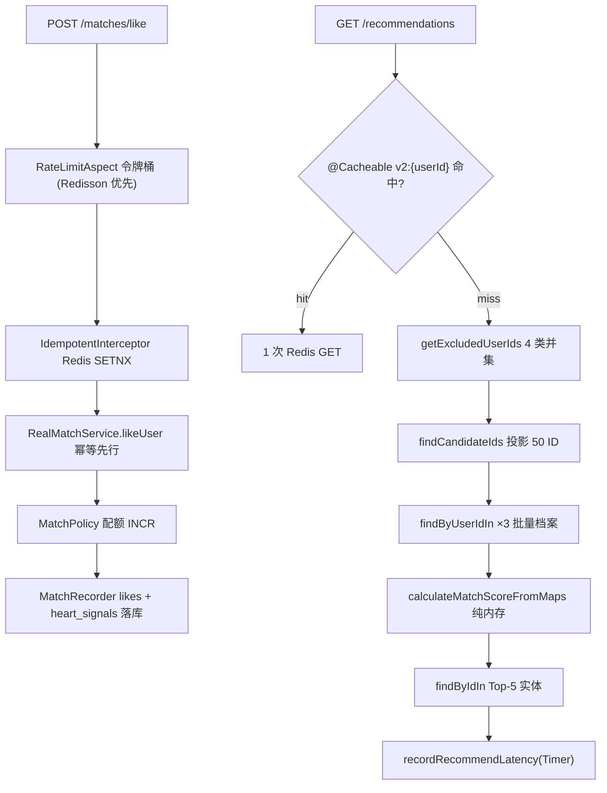

**图表来源**
- [MatchController.java:154-161](file://apps/api/src/main/java/com/campuslove/api/match/MatchController.java#L154-L161)
- [MatchEngine.java:146-214](file://apps/api/src/main/java/com/campuslove/api/match/MatchEngine.java#L146-L214)
- [RecommendationCacheManager.java:87-126](file://apps/api/src/main/java/com/campuslove/api/discover/RecommendationCacheManager.java#L87-L126)
- [RateLimitBucketRegistry.java:89-104](file://apps/api/src/main/java/com/campuslove/api/ratelimit/RateLimitBucketRegistry.java#L89-L104)

### 写路径的固定开销：令牌桶 + 幂等键
`likeUser` 与 `superLikeUser` 都带 `@RateLimit(capacity = 60, refillTokens = 2, key = "#request.remoteAddr")` 与 `@Idempotent`，`passUser`、`rewind` 只带 `@Idempotent`（[MatchController.java:154-161](file://apps/api/src/main/java/com/campuslove/api/match/MatchController.java#L154-L161)、L208-L215、L308-L314、L336-L342）。限流键为 SpEL 解析出的 `remoteAddr`，桶注册表基于 Bucket4j 8.10.1 并用 `ConcurrentHashMap<String, BucketEntry>` 缓存桶实例以避免每次请求重建；R4-00377 之后优先走 Redisson `RRateLimiter`，参数映射为 `rate(capacity, round(capacity/refillTokens) 秒)`，Redisson 不可用时降级本地桶，注释明确降级后是「单实例语义，保证服务可用」——即降级期间多实例阈值会重新随实例数放大（[RateLimitBucketRegistry.java:22-41](file://apps/api/src/main/java/com/campuslove/api/ratelimit/RateLimitBucketRegistry.java#L22-L41)、L66-L67、L89-L104）。
幂等侧是 `Idempotency-Key` 请求头 + `idempotent:{key}:{userId}` 的 `SET NX EX ttl`，默认 TTL 24 小时，键缺失时非强制场景直接跳过校验，Redis 不可用或异常时记 `log.warn` 后放行（[IdempotentInterceptor.java:21-39](file://apps/api/src/main/java/com/campuslove/api/common/IdempotentInterceptor.java#L21-L39)、L54-L65、L165-L199）。因此每次喜欢请求在业务事务之外固定产生「1 次限流判定 + 1 次 SETNX」两次 Redis 往返；这是可接受的常量成本，但它把 Redis 变成了写路径的强依赖观测点。

### 观测：延迟指标与失败隔离
`MatchMetrics` 注册三个业务指标 `match.swipe.total`（标签 `direction=like/super_like/dislike`）、`match.success.count`、`match.recommend.latency`，其中耗时 Timer 显式发布 `publishPercentiles(0.5, 0.95, 0.99)`，类注释说明配合 `micrometer-registry-prometheus` 暴露到 `/actuator/prometheus`（[MatchMetrics.java:11-38](file://apps/api/src/main/java/com/campuslove/api/monitor/MatchMetrics.java#L11-L38)、L55-L79）。`recordRecommendLatency(long)` 用 `Math.max(0, durationMs)` 防负值，且三个记录点全部放在 `finally` 里并用 try-catch 吞掉监控异常，注释为「监控逻辑失败忽略，不影响主流程」（[MatchMetrics.java:120-127](file://apps/api/src/main/java/com/campuslove/api/monitor/MatchMetrics.java#L120-L127)、[RecommendationCacheManager.java:118-125](file://apps/api/src/main/java/com/campuslove/api/discover/RecommendationCacheManager.java#L118-L125)）。社交升温埋点 `socialProgressService.recordExposure(userId)` 同样只在 miss 路径执行一次，且异常被就地吞掉（L108-L116）。

### 可调项与不可调项
可直接调的只有配置项：`app.match.candidate-page-size`（候选池宽度，线性放大打分前的 ID 数）、四个权重（`campus-weight` / `city-weight` / `interest-weight` / `schedule-weight`）、`app.chat.session-expire-hours` 与 `app.checkin.extra-quota-per-check-in`。`TOP_CANDIDATE_COUNT = 5` 是 `private static final int`，注释挂 R4-00349 且未外移为配置项（[MatchEngine.java:54-58](file://apps/api/src/main/java/com/campuslove/api/match/MatchEngine.java#L54-L58)）；缓存 TTL 同样是 `RedisConfig` 里的常量而非外部配置（[RedisConfig.java:255-279](file://apps/api/src/main/java/com/campuslove/api/config/RedisConfig.java#L255-L279)）。客户端侧的对应手段是页面级 `DISCOVER_TTL_MS = 30_000` 本地新鲜度窗口与 `will-change: transform, opacity` 的 GPU 合成提示（[discover/index.vue:47-183](file://apps/client/src/pages/discover/index.vue#L47-L183)、[SwipeContainer.vue:6-89](file://apps/client/src/components/common/swipe/SwipeContainer.vue#L6-L89)）。

**章节来源**
- [MatchEngine.java:54-58](file://apps/api/src/main/java/com/campuslove/api/match/MatchEngine.java#L54-L58)
- [MatchEngine.java:91-98](file://apps/api/src/main/java/com/campuslove/api/match/MatchEngine.java#L91-L98)
- [MatchEngine.java:146-214](file://apps/api/src/main/java/com/campuslove/api/match/MatchEngine.java#L146-L214)
- [MatchEngine.java:216-220](file://apps/api/src/main/java/com/campuslove/api/match/MatchEngine.java#L216-L220)
- [MatchEngine.java:383-387](file://apps/api/src/main/java/com/campuslove/api/match/MatchEngine.java#L383-L387)
- [RecommendationCacheManager.java:15-34](file://apps/api/src/main/java/com/campuslove/api/discover/RecommendationCacheManager.java#L15-L34)
- [RecommendationCacheManager.java:64-126](file://apps/api/src/main/java/com/campuslove/api/discover/RecommendationCacheManager.java#L64-L126)
- [RecommendationCacheManager.java:128-192](file://apps/api/src/main/java/com/campuslove/api/discover/RecommendationCacheManager.java#L128-L192)
- [RecommendationCacheManager.java:206-247](file://apps/api/src/main/java/com/campuslove/api/discover/RecommendationCacheManager.java#L206-L247)
- [CacheNames.java:18-38](file://apps/api/src/main/java/com/campuslove/api/config/CacheNames.java#L18-L38)
- [RedisConfig.java:96-130](file://apps/api/src/main/java/com/campuslove/api/config/RedisConfig.java#L96-L130)
- [RedisConfig.java:255-279](file://apps/api/src/main/java/com/campuslove/api/config/RedisConfig.java#L255-L279)
- [MatchController.java:154-161](file://apps/api/src/main/java/com/campuslove/api/match/MatchController.java#L154-L161)
- [RateLimitBucketRegistry.java:22-41](file://apps/api/src/main/java/com/campuslove/api/ratelimit/RateLimitBucketRegistry.java#L22-L41)
- [IdempotentInterceptor.java:21-39](file://apps/api/src/main/java/com/campuslove/api/common/IdempotentInterceptor.java#L21-L39)
- [MatchMetrics.java:11-79](file://apps/api/src/main/java/com/campuslove/api/monitor/MatchMetrics.java#L11-L79)
- [MatchMetrics.java:120-127](file://apps/api/src/main/java/com/campuslove/api/monitor/MatchMetrics.java#L120-L127)
## 测试与调试
匹配域的测试资产按「服务端单元 / 限流与缓存集成 / 客户端 store 与组件契约 / 端到端旅程」四层分布，四层都能跑通且各有明确的判点。下面逐层给出测试类、用例名与运行方式，全部来自实际读取的测试源码。

### 服务端单元测试：`com.campuslove.api.match` 五个测试类
| 测试类 | 规模 | 被测对象 | 关键判点 |
| --- | --- | --- | --- |
| `MatchEngineTest` | 278 行 | `MatchEngine` | 排除集组成、权重求和、Top-N 随机、解析容错 |
| `MatchPolicyTest` | 137 行 | `MatchPolicy` | 反悔限额、Redis 降级、自喜欢拦截 |
| `MatchRecorderTest` | 220 行 | `MatchRecorder` | `likes` 状态翻转、信号字段、pass/visit 去重 |
| `RealMatchServiceTest` | 422 行 | `RealMatchService` | 反悔九场景、双向喜欢解锁会话 |
| `MatchControllerTest` | 145 行 | `MatchController` | 纯委托与异常转 400 |

`MatchEngineTest` 用 8 个 `@Mock`（`MatchConfig` + 四个仓库 + `UserRepository` 等）搭起无 DB 环境，用例名即契约：`getExcludedUserIds_includesSelfLikesSignalsAndPasses`、`calculateMatchScore_allMatch_returnsSumOfWeights` / `calculateMatchScore_noMatch_returnsZero`、`findAndScoreCandidates_filtersExcludedUsers`、`selectFromTopCandidates_returnsOneOfTopN` / `selectFromTopCandidates_fewerThanFive_usesAll`，以及解析容错的三条 `parseInterestTags_validJson_returnsSet` / `parseInterestTags_emptyString_returnsEmptySet` / `parseInterestTags_invalidJson_returnsEmptySet` 与 `hasScheduleOverlap_withBlankInput_returnsFalse` / `hasScheduleOverlap_withCommonKey_returnsTrue` / `hasScheduleOverlap_withoutCommonKey_returnsFalse`（[MatchEngineTest.java:45-269](file://apps/api/src/test/java/com/campuslove/api/match/MatchEngineTest.java#L45-L269)）。
`MatchPolicyTest` 集中验证「Redis 不可用不阻断」：`checkRewindLimit_zeroCount_doesNotThrow`、`checkRewindLimit_atLimit_throwsException`、`getTodayRewindCount_redisNull_fallsBackToLocal`、`getTodayRewindCount_redisThrowsException_fallsBackToLocal`、`getTodayRewindCount_redisNonNumberValue_treatedAsZero`、`incrementRewindCount_redisException_stillIncrementsLocal` 与 `requireNotSelf_sameId_throwsException` / `requireNotSelf_differentId_doesNotThrow`（[MatchPolicyTest.java:21-131](file://apps/api/src/test/java/com/campuslove/api/match/MatchPolicyTest.java#L21-L131)）。
`RealMatchServiceTest` 的 mock 面最宽（`MatchConfig`、五个仓库、`SimpMessagingTemplate`、`ObjectMapper`、`MessageProducer`、`RedisTemplate` 与 `ValueOperations`、`PrivateMessageService` 等），因此能覆盖 Redis 故障矩阵：`rewind_whenRedisTemplateNull_shouldFallbackToLocalMemory`、`rewind_whenRedisGetThrowsException_shouldFallbackToLocalMemory`、`rewind_whenRedisIncrementThrowsException_shouldNotFailRewind`、`rewind_whenRedisValueIsNotNumber_shouldTreatAsZero`，加上解锁语义的 `likeUser_whenMutual_shouldCreateFreeConversation` / `likeUser_whenOneSided_shouldNotCreateConversation` / `likeUser_whenConversationCreationFails_shouldStillReturnMatch`（[RealMatchServiceTest.java:64-369](file://apps/api/src/test/java/com/campuslove/api/match/RealMatchServiceTest.java#L64-L369)）。
`MatchRecorderTest` 锁的是落库语义：`createLike_setsActiveStatus`、`cancelLike_setsCancelledStatus` / `cancelLike_notExists_doesNothing`、`createMutualSignal_setsPendingAndMutualLikeType`、`recordPass_alreadyExists_doesNotSave` / `recordPass_firstTime_savesRecord`、`recordVisit_alreadyVisitedToday_doesNotSave` / `recordVisit_firstVisit_savesAndNotifies`（[MatchRecorderTest.java:48-203](file://apps/api/src/test/java/com/campuslove/api/match/MatchRecorderTest.java#L48-L203)）。

### 限流、缓存与配额链路测试
`RateLimitIntegrationTest` 的类级 `@DisplayName` 是「Task 15.3 速率限制集成测试：10 QPS 触发 429」，八个场景依次覆盖桶容量放行边界（前 10 次放行、第 11 次拒绝）、key 隔离、切面抛 `RateLimitExceededException`、空 key 放行、`bucketCount()` 观测，以及最关键的并发不超发场景 `concurrent100Requests_capacity10Bucket_only10Allowed`；被测方法上的注解是 `@RateLimit(capacity = 10, refillTokens = 0.1, key = "#request.remoteAddr")`（[RateLimitIntegrationTest.java:52-299](file://apps/api/src/test/java/com/campuslove/api/ratelimit/RateLimitIntegrationTest.java#L52-L299)、L330）。
`RecommendationCacheManagerTest` 直接验证监控埋点：`getCachedRecommendations_normalFlow_delegatesAndRecordsLatency` 断言 `verify(matchMetrics, times(1)).recordRecommendLatency(anyLong())`，`getCachedRecommendations_strategyThrows_recordsLatencyAndPropagates` 断言异常路径同样记录耗时（对应 `finally` 块），并有用例把 `recordRecommendLatency` 打成抛错以确认主流程不受影响（[RecommendationCacheManagerTest.java:55-105](file://apps/api/src/test/java/com/campuslove/api/discover/RecommendationCacheManagerTest.java#L55-L105)）。
排序与缓存的其余判点分散在 `RecommendationRankerTest`（138 行）、`RecommendationRankerFieldsTest`（225 行）、`RecommendationRankerWhisperTest`（55 行）与 `CacheTest`（431 行，注入 `CaffeineCacheConfig`）中，画像字段侧另有 `UserBasicProfileTest`（250 行）（[RecommendationRankerTest.java:25-38](file://apps/api/src/test/java/com/campuslove/api/discover/RecommendationRankerTest.java#L25-L38)、[RecommendationRankerFieldsTest.java:57-72](file://apps/api/src/test/java/com/campuslove/api/discover/RecommendationRankerFieldsTest.java#L57-L72)、[CacheTest.java:54-57](file://apps/api/src/test/java/com/campuslove/api/config/CacheTest.java#L54-L57)、[UserBasicProfileTest.java:25-27](file://apps/api/src/test/java/com/campuslove/api/entity/UserBasicProfileTest.java#L25-L27)）。

### 客户端测试：store 状态机与手势契约
`apps/client/src/tests/stores/match.spec.ts` 的 `describe("match store 状态机")` 有六条用例，逐一对应 store 的六个动作：`初始为 idle，canProceed 为 false`、`beginCheck -> checking，并保存快照`、`runMatchCheck 命中 matched -> matched，动画完成后 canProceed`、`runMatchCheck 单向喜欢 -> idle，canProceed 保持 false`、`runMatchCheck 接口异常 -> failed，记录 lastError`、`markChatReady 仅 matched 时进入 chat_ready，reset 回到 idle`（[match.spec.ts:32-94](file://apps/client/src/tests/stores/match.spec.ts#L32-L94)）。
`apps/client/src/tests/stores/discover.spec.ts`（682 行）覆盖 `swipeLeft / swipeRight / rewindCard / resetDailyLimit / isLimitReached / remainingCount / historyCards / passedCards` 的成败与异常分支，并保留一组「swipeRight 30% 匹配概率」的边界用例（`random=0.29` 成功、`random=0.3` 失败）——这组用例针对的是已被修复的历史缺陷：`stores/discover/constants.ts` 注释记录原 `swipe.ts` 在 mock 模式硬编码 `Math.random() < 0.3`，修复后抽为 `MOCK_MATCH_PROBABILITY` 并默认 0，可用环境变量 `VITE_MOCK_MATCH_PROBABILITY` 覆盖（[discover.spec.ts:42-383](file://apps/client/src/tests/stores/discover.spec.ts#L42-L383)、[constants.ts:99-125](file://apps/client/src/stores/discover/constants.ts#L99-L125)）。
手势与组件层：`swipe-gesture.spec.ts` 断言角度方向、`tap / swipe-left / swipe-right / cancel` 四类判定与组合式 `onSwipeLeft`、`onTap` 回调；`MatchActions.spec.ts` 断言三枚动作按钮的 emit 与 `disabled` 时不 emit；另有 `match-card-contract.spec.ts`、`MatchCard.spec.ts`、`MatchSuccess.spec.ts`、`MatchLoading.spec.ts` 等契约用例（[swipe-gesture.spec.ts:12-56](file://apps/client/src/tests/components/swipe-gesture.spec.ts#L12-L56)、[MatchActions.spec.ts:22-44](file://apps/client/src/tests/components/MatchActions.spec.ts#L22-L44)）。

### 端到端与运行方式
`tests/e2e/specs/core-journey.spec.ts` 文件头注释即「覆盖：注册 → 匹配 → 聊天 核心旅程」，其中 `登录后可访问匹配页查看推荐人物 @match` 会 `page.goto('/#/pages/discover/index')` 并断言 URL 与推荐卡片渲染；同目录另有 `all-pages-smoke.spec.ts` 与 `accessibility.spec.ts`（[core-journey.spec.ts:6-95](file://tests/e2e/specs/core-journey.spec.ts#L6-L95)）。
命令入口分三条：根 `package.json` 的 `api:test` = `node tools/run-api-wrapper.cjs test`（wrapper 在 Windows 下走 `mvnw.cmd`，非 Windows 走 `apps/api/mvnw`），`client:dev:h5:real` 起真实后端前端，`test` = `test:prototype` + `test:structure` + `test:client`，`verify:phase01` 则串起 lint、typecheck、客户端构建与 `api:test`（[package.json:9-25](file://package.json#L9-L25)、[run-api-wrapper.cjs:13-18](file://tools/run-api-wrapper.cjs#L13-L18)）。客户端单测与 e2e 分别是 `node scripts/run-vitest.mjs run --config vitest.config.ts` 与 `playwright test --config=../../tests/e2e/playwright.config.ts`（[apps/client/package.json:40-46](file://apps/client/package.json#L40-L46)）。

### 调试入口
1. **强制队列状态**：`MatchDebugController` 的 `POST /api/v1/_debug/matches/next-status/{queueStatus}` 整体 `@Profile("mock")`，real 环境返回 404；real 侧 `setForceQueued` / `setNextQueueStatus` 只写 `log.warn`（[MatchDebugController.java:13-39](file://apps/api/src/main/java/com/campuslove/api/debug/MatchDebugController.java#L13-L39)、[RealMatchService.java:210-217](file://apps/api/src/main/java/com/campuslove/api/match/RealMatchService.java#L210-L217)）。
2. **直接看 Redis 计数**：`MatchPolicy` 以公开常量暴露键前缀 `rewind:count:`、`like:count:`、`super-like:count:`，日期后缀 `yyyy-MM-dd`，注释说明其动机正是「便于测试与运维排查」（[MatchPolicy.java:33-116](file://apps/api/src/main/java/com/campuslove/api/match/MatchPolicy.java#L33-L116)）。
3. **看指标**：`/actuator/prometheus` 上的 `match.swipe.total`、`match.success.count`、`match.recommend.latency`（p50/p95/p99）（[MatchMetrics.java:11-38](file://apps/api/src/main/java/com/campuslove/api/monitor/MatchMetrics.java#L11-L38)）。

```mermaid
graph LR
U["Spring Boot 单测\nMatchEngineTest / MatchPolicyTest\nMatchRecorderTest / RealMatchServiceTest"] --> A["api:test (mvnw test)"]
I["限流与缓存集成\nRateLimitIntegrationTest\nRecommendationCacheManagerTest"] --> A
V["vitest 客户端\nmatch.spec.ts / discover.spec.ts\nswipe-gesture.spec.ts"] --> C["client:test:unit"]
E["Playwright e2e\ncore-journey.spec.ts"] --> C
A --> G["verify:phase01"]
C --> G
```

**图表来源**
- [package.json:18-25](file://package.json#L18-L25)
- [apps/client/package.json:40-46](file://apps/client/package.json#L40-L46)
- [RateLimitIntegrationTest.java:52-60](file://apps/api/src/test/java/com/campuslove/api/ratelimit/RateLimitIntegrationTest.java#L52-L60)
- [core-journey.spec.ts:68-95](file://tests/e2e/specs/core-journey.spec.ts#L68-L95)

**章节来源**
- [MatchEngineTest.java:45-269](file://apps/api/src/test/java/com/campuslove/api/match/MatchEngineTest.java#L45-L269)
- [MatchPolicyTest.java:21-131](file://apps/api/src/test/java/com/campuslove/api/match/MatchPolicyTest.java#L21-L131)
- [MatchRecorderTest.java:48-203](file://apps/api/src/test/java/com/campuslove/api/match/MatchRecorderTest.java#L48-L203)
- [RealMatchServiceTest.java:64-369](file://apps/api/src/test/java/com/campuslove/api/match/RealMatchServiceTest.java#L64-L369)
- [MatchControllerTest.java:42-137](file://apps/api/src/test/java/com/campuslove/api/match/MatchControllerTest.java#L42-L137)
- [RateLimitIntegrationTest.java:52-330](file://apps/api/src/test/java/com/campuslove/api/ratelimit/RateLimitIntegrationTest.java#L52-L330)
- [RecommendationCacheManagerTest.java:55-105](file://apps/api/src/test/java/com/campuslove/api/discover/RecommendationCacheManagerTest.java#L55-L105)
- [RecommendationRankerTest.java:25-38](file://apps/api/src/test/java/com/campuslove/api/discover/RecommendationRankerTest.java#L25-L38)
- [RecommendationRankerFieldsTest.java:57-72](file://apps/api/src/test/java/com/campuslove/api/discover/RecommendationRankerFieldsTest.java#L57-L72)
- [RecommendationRankerWhisperTest.java:16](file://apps/api/src/test/java/com/campuslove/api/discover/RecommendationRankerWhisperTest.java#L16)
- [CacheTest.java:54-57](file://apps/api/src/test/java/com/campuslove/api/config/CacheTest.java#L54-L57)
- [UserBasicProfileTest.java:25-27](file://apps/api/src/test/java/com/campuslove/api/entity/UserBasicProfileTest.java#L25-L27)
- [match.spec.ts:32-94](file://apps/client/src/tests/stores/match.spec.ts#L32-L94)
- [discover.spec.ts:42-383](file://apps/client/src/tests/stores/discover.spec.ts#L42-L383)
- [swipe-gesture.spec.ts:12-56](file://apps/client/src/tests/components/swipe-gesture.spec.ts#L12-L56)
- [MatchActions.spec.ts:22-44](file://apps/client/src/tests/components/MatchActions.spec.ts#L22-L44)
- [constants.ts:99-125](file://apps/client/src/stores/discover/constants.ts#L99-L125)
- [core-journey.spec.ts:6-95](file://tests/e2e/specs/core-journey.spec.ts#L6-L95)
- [package.json:9-25](file://package.json#L9-L25)
- [apps/client/package.json:40-46](file://apps/client/package.json#L40-L46)
- [run-api-wrapper.cjs:13-18](file://tools/run-api-wrapper.cjs#L13-L18)
- [MatchDebugController.java:13-39](file://apps/api/src/main/java/com/campuslove/api/debug/MatchDebugController.java#L13-L39)
- [MatchPolicy.java:33-116](file://apps/api/src/main/java/com/campuslove/api/match/MatchPolicy.java#L33-L116)
## 能力缺口登记
本节把「catalog 指令要求但仓库未实现」与「实现自身留有已知未完成点」逐条登记。每条给出判定依据，其中含检索式的条目给出实际使用的模式与命中数，未命中的即为 0 命中证据。

| # | 缺口 | 判定依据类型 |
| --- | --- | --- |
| 1 | 拉黑关系未进入匹配候选排除 | 源码 TODO + 0 命中检索 |
| 2 | 无相似度/向量算法 | 0 命中检索 |
| 3 | 打分链路无扩展接口 | 目录级 2 命中检索 |
| 4 | `match_config` 运行时覆盖未接入引擎 | 0 命中检索 |
| 5 | Top-N 与 TTL 未外移为配置 | 硬编码常量 |
| 6 | 限流降级期回到单实例语义 | 源码注释 |
| 7 | 续拉分页路径绕过缓存 | 源码注释 |
| 8 | `accepted` 信号无过期写入者 | JPQL WHERE 条件 |
| 9 | 排除集随 pass 记录无界增长 | 查询方法无分页 |
| 10 | `superLikeUser` 注释与实现漂移 | 契约 vs 实现对照 |
| 11 | `apps/client/src/features/match/` 不存在 | catalog 声明依赖缺失 |

**1. 拉黑关系未接入匹配排除（3-F）**。`getExcludedUserIds` 末尾的注释块（L127-L133）写明「此处应追加拉黑关系排除……当前实现未接入（匹配引擎候选打分链路较深，改动面大），仅推荐/会话/消息链路已接入拉黑过滤」。判定依据：检索式 `UserBlockRepository` 作用于 `apps/api/src/main/java/com/campuslove/api/match/` 目录，仅命中 1 行且位于该注释（`MatchEngine.java:128`），无任何注入字段或调用点；对照组在 `discover` 包完整存在——`import com.campuslove.api.repository.UserBlockRepository`（L17）、字段 `private UserBlockRepository blockRepository`（L91）与两处 `blockRepository.findBlockedRelationUserIds(userId)` 过滤（L447-L448、L471-L472）。后果是被拉黑双方仍可能出现在心动匹配候选中。

**2. 无相似度/向量算法**。catalog 指令要求「相似度计算」，实现形态是四权重加法式打分（同校区 50 / 同城市 20 / 每个共同兴趣标签 10 / 日程重叠 15）。判定依据：大小写不敏感检索式 `cosine|余弦|embedding|向量|collaborative filtering|lucene` 作用于 `apps/api/src/main`，仅 1 处命中且落在 `AesEncryptor.java` 的初始化向量注释里，与匹配域无关；本页取证范围内不存在相似度矩阵、向量索引或协同过滤实现。

**3. 打分链路无扩展接口**。判定依据：检索式 `interface` 作用于 `apps/api/src/main/java/com/campuslove/api/match/*.java`，仅 2 个命中——`MatchService.java:10` 与 `IcebreakerService.java:9`。`MatchEngine`、`MatchPolicy`、`MatchRecorder` 均为 `@Profile("real") @Component` 具体类且被 `RealMatchService` 以类型直接注入，没有可替换的评分策略接口；这与 `discover` 包存在 `RecommendationStrategy` 抽象形成对照，意味着「匹配算法扩展」目前只能改源码。

**4. `match_config` 表的运行时覆盖未接入引擎**。`MatchConfigEntity` 注释声称该表「用于持久化匹配算法权重等运行时可调整的参数」，但引擎读的是 `MatchConfig` bean。判定依据：检索式 `MatchConfigEntity` 分别作用于 `apps/api/src/main/java/com/campuslove/api/match/` 与 `.../discover/` 两个目录，命中文件数为 0；`MatchConfigEntityRepository`（全 20 行）只提供 `findByConfigKey(String)` 单键查询。因此后台改 `match_config` 行不会改变 `MatchEngine` 的打分权重。

**5. Top-N 与缓存 TTL 未外移为配置**。`TOP_CANDIDATE_COUNT = 5` 是 `private static final int`（[MatchEngine.java:54-58](file://apps/api/src/main/java/com/campuslove/api/match/MatchEngine.java#L54-L58)）；`MATCH_RECOMMEND_TTL` / `GUEST_RECOMMEND_TTL` 是 `RedisConfig` 的 `Duration` 常量（[RedisConfig.java:96-130](file://apps/api/src/main/java/com/campuslove/api/config/RedisConfig.java#L96-L130)）。两类调优都需要重新构建发布，无法按环境热调。

**6. 限流降级期回到单实例语义**。`RateLimitBucketRegistry` 注释说明 Redisson 可用时「N 实例部署限流阈值不放大」，但「Redisson 不可用/调用失败时降级本地 Bucket4j 桶（单实例语义，保证服务可用）」，同时保留了 R4-00377 之前「N 实例限流阈值被放大 N 倍」的问题描述（[RateLimitBucketRegistry.java:22-41](file://apps/api/src/main/java/com/campuslove/api/ratelimit/RateLimitBucketRegistry.java#L22-L41)）。降级期间的限流强度依赖部署实例数，属于已知取舍而非缺陷修复完成态。

**7. 续拉分页路径绕过缓存**。`getRecommendationsWithExclude` 的注释即「B5 去重：携带 excludeIds 的推荐计算（不走缓存，因 excludeIds 每次请求不同）」（[RecommendationCacheManager.java:206-216](file://apps/api/src/main/java/com/campuslove/api/discover/RecommendationCacheManager.java#L206-L216)），且该方法同样在 `finally` 中记录 `match.recommend.latency`。这意味着用户连续下滑取新人时每次都是全量重算，`match_recommend` 缓存在这条路径上不提供任何收益。

**8. `accepted` 信号没有过期写入者**。状态机层面 `expires_at` 对 `pending` 与 `accepted` 都有语义，但唯一的清理任务 `expireOverdueHeartSignals`（`@Scheduled(fixedDelay = 3_600_000L, initialDelay = 3_600_000L)`，real 生效、mock 不执行）调用的 JPQL 是 `UPDATE HeartSignal hs SET hs.status = :expired ... WHERE hs.status = :pending AND hs.expiresAt < :now`，条件只覆盖 `pending`（[RealMatchService.java:550-575](file://apps/api/src/main/java/com/campuslove/api/match/RealMatchService.java#L550-L575)、[HeartSignalRepository.java:74-96](file://apps/api/src/main/java/com/campuslove/api/repository/HeartSignalRepository.java#L74-L96)）。`findByStatusAndExpiresAtBefore` 的 Javadoc 亦标注 status 参数「通常为 pending」。

**9. 排除集随 pass 记录无界增长**。`getExcludedUserIds` 的第四路来源是 `passRecordRepository.findByUserIdOrderByCreatedAtDesc(userId)`，该方法无 `PageRequest`、无时间窗，整表按用户全量取回后逐条加入 `Set`（[MatchEngine.java:121-125](file://apps/api/src/main/java/com/campuslove/api/match/MatchEngine.java#L121-L125)），而候选池宽度固定为 `candidate-page-size`。长期活跃账号会出现「候选 ID 全被排除 → 返回空列表」且排除集内存随历史线性增长，代码中未见 pass 记录的过期清理入口（`MatchRecorder` 只有 `deletePassRecord` 的手动删除语义）。

**10. `superLikeUser` 契约注释与实现漂移**。接口 Javadoc 仍写「与普通喜欢行为区分：不受每日上限限制」（[MatchService.java:72-80](file://apps/api/src/main/java/com/campuslove/api/match/MatchService.java#L72-L80)），实现侧却已接入配额：`RealMatchService.superLikeUser` 调用 `if (!matchPolicy.tryIncrementSuperLike(userId))`（[RealMatchService.java:259-267](file://apps/api/src/main/java/com/campuslove/api/match/RealMatchService.java#L259-L267)），限额常量是 `SUPER_LIKE_DAILY_LIMIT_DEFAULT = 10` 且可被 `app.match.super-like-daily-limit` 覆盖（[MatchPolicy.java:44-76](file://apps/api/src/main/java/com/campuslove/api/match/MatchPolicy.java#L44-L76)）；`RealMatchService.java:240` 的行内注释「超级喜欢走 superLikeUser 不受限」同样滞后于 R4 系列的封堵改动。

**11. catalog 声明依赖 `apps/client/src/features/match/` 不存在**。该路径在声明依赖里被列出但仓库无此目录；前端匹配能力实际落在 `components/common/swipe/`、`components/match/`、`stores/match.ts` 与 `view-models/match.ts`（见 [客户端手势层与匹配卡](#详细组件分析) 一节）。写页面时按真实路径引用，不引用不存在的目录。

**章节来源**
- [MatchEngine.java:54-58](file://apps/api/src/main/java/com/campuslove/api/match/MatchEngine.java#L54-L58)
- [MatchEngine.java:91-136](file://apps/api/src/main/java/com/campuslove/api/match/MatchEngine.java#L91-L136)
- [MatchEngine.java:229-264](file://apps/api/src/main/java/com/campuslove/api/match/MatchEngine.java#L229-L264)
- [RealRecommendationService.java:17](file://apps/api/src/main/java/com/campuslove/api/discover/RealRecommendationService.java#L17)
- [RealRecommendationService.java:91](file://apps/api/src/main/java/com/campuslove/api/discover/RealRecommendationService.java#L91)
- [RealRecommendationService.java:447-448](file://apps/api/src/main/java/com/campuslove/api/discover/RealRecommendationService.java#L447-L448)
- [MatchConfigEntityRepository.java:11](file://apps/api/src/main/java/com/campuslove/api/repository/MatchConfigEntityRepository.java#L11)
- [MatchService.java:10-80](file://apps/api/src/main/java/com/campuslove/api/match/MatchService.java#L10-L80)
- [IcebreakerService.java:9](file://apps/api/src/main/java/com/campuslove/api/match/IcebreakerService.java#L9)
- [RealMatchService.java:240](file://apps/api/src/main/java/com/campuslove/api/match/RealMatchService.java#L240)
- [RealMatchService.java:259-267](file://apps/api/src/main/java/com/campuslove/api/match/RealMatchService.java#L259-L267)
- [RealMatchService.java:550-575](file://apps/api/src/main/java/com/campuslove/api/match/RealMatchService.java#L550-L575)
- [HeartSignalRepository.java:74-96](file://apps/api/src/main/java/com/campuslove/api/repository/HeartSignalRepository.java#L74-L96)
- [MatchPolicy.java:44-76](file://apps/api/src/main/java/com/campuslove/api/match/MatchPolicy.java#L44-L76)
- [RateLimitBucketRegistry.java:22-41](file://apps/api/src/main/java/com/campuslove/api/ratelimit/RateLimitBucketRegistry.java#L22-L41)
- [RecommendationCacheManager.java:206-247](file://apps/api/src/main/java/com/campuslove/api/discover/RecommendationCacheManager.java#L206-L247)
- [RedisConfig.java:96-130](file://apps/api/src/main/java/com/campuslove/api/config/RedisConfig.java#L96-L130)
## 故障排查指南
匹配域的可观测面由三类 4xx 语义、两处 `log.warn`、三个 Redis 键族与三个 Micrometer 指标组成。本节按「现象 → 判点 → 依据」组织，每条都能用源码位置复核。

### 429：区分「请求过频」与「今日额度用完」
两个异常都映射为 HTTP 429，但响应体不同，这是排查的第一步分叉点（[GlobalExceptionHandler.java:510-566](file://apps/api/src/main/java/com/campuslove/api/config/GlobalExceptionHandler.java#L510-L566)）：
- `RateLimitExceededException` → `buildErrorResponse(TOO_MANY_REQUESTS, "Too Many Requests", "请求过于频繁，请稍后再试")`，**无 code 字段**，服务端日志为 `log.warn("触发速率限制: {}")`。触发源是 `@RateLimit(capacity = 60, refillTokens = 2, key = "#request.remoteAddr")`，即同一 IP 的短时频次。
- `DailyLimitExceededException` → 同样 429 但带 `code = "DAILY_LIMIT_EXCEEDED"` 与人类可读 message（Javadoc 示例：「今日反悔次数已用完（上限 1 次），请明日再来」），日志为 `log.warn("每日限额超出: operation={}, limit={}, message={}")`。触发源是 `MatchPolicy` 的 `tryIncrementLike`（30/日）、`tryIncrementSuperLike`（默认 10/日）、`tryIncrementRewind`（1/日）。
判定手段：先看响应体有没有 `code`。有 `DAILY_LIMIT_EXCEEDED` 就去 Redis 查 `like:count:{yyyy-MM-dd}` 等键族（前缀由 `MatchPolicy` 公开常量给出）；没有 code 就是令牌桶，检查该 IP 在 1 分钟窗口内的请求速率。

### 409：三种来源各有指纹
- 唯一约束冲突：`DataIntegrityViolationException` → `HttpStatus.CONFLICT` + `"数据冲突，可能存在重复或违反约束的数据"`，处理器注释强调「仅记录根因日志（不输出到响应体），防止泄露数据库结构」，因此真实原因只能在日志里找 `log.warn("数据库完整性冲突: {}")`。匹配域的对应约束是 `uk_likes_user_target` 与 `uk_heart_signals_users`。
- 乐观锁冲突：四张业务表的 `@Version` 列冲突抛 `ObjectOptimisticLockingFailureException` 并由全局异常体系转 409（`LIKE` / `HEART_SIGNAL` 等实体注释统一声明该约定）。
- 幂等冲突：`Idempotency-Key` 在 TTL（默认 24 小时）内重复使用 → `idempotent:{key}:{userId}` 的 SETNX 失败 → 409 + `IDEMPOTENT_CONFLICT`，日志 `log.warn("幂等性冲突：重复请求被拦截，method={}, key={}")`（[IdempotentInterceptor.java:21-39](file://apps/api/src/main/java/com/campuslove/api/common/IdempotentInterceptor.java#L21-L39)、L165-L199）。排查要点：客户端必须为每次「新意图」生成新键，同键重试在 TTL 内必被拦；注释还记录了一个例外——业务失败会释放键，避免「同 key 重试 4 小时被 409 锁死」。

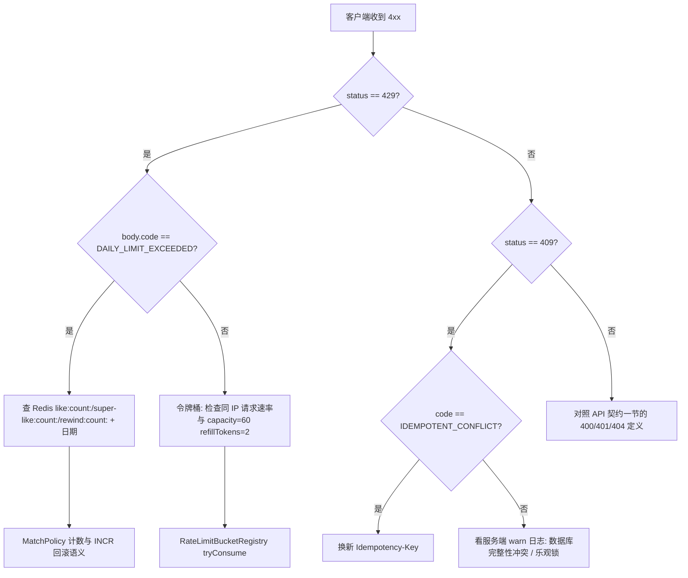

**图表来源**
- [GlobalExceptionHandler.java:474-566](file://apps/api/src/main/java/com/campuslove/api/config/GlobalExceptionHandler.java#L474-L566)
- [MatchController.java:154-161](file://apps/api/src/main/java/com/campuslove/api/match/MatchController.java#L154-L161)
- [IdempotentInterceptor.java:165-199](file://apps/api/src/main/java/com/campuslove/api/common/IdempotentInterceptor.java#L165-L199)
- [RateLimitBucketRegistry.java:89-104](file://apps/api/src/main/java/com/campuslove/api/ratelimit/RateLimitBucketRegistry.java#L89-L104)

### 推荐列表为空
按可能性顺序检查四点：
1. 每日推荐配额耗尽：`getCachedRecommendations` 在 miss 路径开头 `if (recommendQuotaService != null && !recommendQuotaService.tryConsume(userId)) return List.of()`，且空结果因 `unless` 不写缓存，所以每次请求都会重复尝试扣减（[RecommendationCacheManager.java:76-95](file://apps/api/src/main/java/com/campuslove/api/discover/RecommendationCacheManager.java#L76-L95)）。
2. 候选被排除集吃光：`getExcludedUserIds` 的四路并集（自己 / active likes / pending+accepted 信号对端 / **全部** pass 记录）配合固定 50 的候选池宽度，长期活跃账号可能全量命中排除（[MatchEngine.java:98-136](file://apps/api/src/main/java/com/campuslove/api/match/MatchEngine.java#L98-L136)）。
3. Profile 是 mock：`MockMatchService` / `MockRecommendationService` 走内存数据，`RealMatchService` 与算法三件套不进入容器（`@Profile("real")`）。
4. 客户端闸门：`isMatchOpen` 关闭、未登录（`requireLogin()` / `goLogin()`）或未实名（`ensureCertified`）时不会发出请求（[discover/index.vue:47-183](file://apps/client/src/pages/discover/index.vue#L47-L183)）。

### 缓存「看似没生效」与延迟回归
`match.recommend.latency` 的 p95 是主判点。游客路径曾出现过一类无异常日志的静默失效：`Stream.toList()` 的 `ImmutableCollections$ListN` 是 final 类，Jackson default typing（NON_FINAL）不为其写类型信息，缓存值缺外层类型名 → 反序列化报 `Unexpected token (START_OBJECT), expected VALUE_STRING` → 每次全量重算（游客接口 300ms+，已用单测复现）。若自行改造返回类型，务必保持外层为可变 `ArrayList`（[RecommendationCacheManager.java:101-106](file://apps/api/src/main/java/com/campuslove/api/discover/RecommendationCacheManager.java#L101-L106)、L149-L155）。缓存 TTL 不在注解上而在 `RedisConfig` 常量表（`match_recommend` 5 分钟、`guest_recommend` 60 秒、默认 30 分钟），运维排查时用 `RedisConfig.java:96-130` 对照（[RedisConfig.java:96-130](file://apps/api/src/main/java/com/campuslove/api/config/RedisConfig.java#L96-L130)）。

### Redis 不可用时的降级表现
三个组件都选择「记日志并继续」，因此症状是**语义变弱而非报错**：
- 配额降级为进程内存计数，重启即清零（`MatchPolicyTest.getTodayRewindCount_redisNull_fallsBackToLocal` / `incrementRewindCount_redisException_stillIncrementsLocal` 固化了该行为，[MatchPolicyTest.java:67-114](file://apps/api/src/test/java/com/campuslove/api/match/MatchPolicyTest.java#L67-L114)）。
- 幂等校验跳过（`log.warn("RedisTemplate 不可用，跳过幂等校验…")`），非资金端点为 fail-open；strict 模式资金端点则 fail-closed 返回 503（[IdempotentInterceptor.java:165-224](file://apps/api/src/main/java/com/campuslove/api/common/IdempotentInterceptor.java#L165-L224)）。
- 限流降级为本地 Bucket4j 桶，多实例阈值随实例数放大（[RateLimitBucketRegistry.java:22-41](file://apps/api/src/main/java/com/campuslove/api/ratelimit/RateLimitBucketRegistry.java#L22-L41)）。
因此「Redis 挂了但业务看起来正常」时，应以 `like:count:` 键是否存在来确认降级是否已经发生，而不是依赖异常。

### 客户端侧不刷新 / 重复触发
本地缓存窗口是 `DISCOVER_TTL_MS = 30_000`，30 秒内的重进不会重拉，下拉刷新路径会先 `removeCache('discover:data')` 再直调 `fetchCards`；打招呼的每日计数是纯本地 `greet:count:${targetId}` 且按 `toISOString().slice(0, 10)` 比日，跨端不同步（[discover/index.vue:183-207](file://apps/client/src/pages/discover/index.vue#L183-L207)）。小程序端点击若出现双触发，核对事件名是否为 `card-tap`（`MP-R1-PAGES-DISCOVER-INDEX-005` 的修复点，见 [客户端手势层与匹配卡](#详细组件分析)）。

**章节来源**
- [GlobalExceptionHandler.java:474-479](file://apps/api/src/main/java/com/campuslove/api/config/GlobalExceptionHandler.java#L474-L479)
- [GlobalExceptionHandler.java:510-566](file://apps/api/src/main/java/com/campuslove/api/config/GlobalExceptionHandler.java#L510-L566)
- [IdempotentInterceptor.java:21-39](file://apps/api/src/main/java/com/campuslove/api/common/IdempotentInterceptor.java#L21-L39)
- [IdempotentInterceptor.java:165-224](file://apps/api/src/main/java/com/campuslove/api/common/IdempotentInterceptor.java#L165-L224)
- [MatchController.java:154-161](file://apps/api/src/main/java/com/campuslove/api/match/MatchController.java#L154-L161)
- [MatchPolicy.java:33-116](file://apps/api/src/main/java/com/campuslove/api/match/MatchPolicy.java#L33-L116)
- [MatchPolicyTest.java:39-131](file://apps/api/src/test/java/com/campuslove/api/match/MatchPolicyTest.java#L39-L131)
- [RealMatchServiceTest.java:148-274](file://apps/api/src/test/java/com/campuslove/api/match/RealMatchServiceTest.java#L148-L274)
- [RateLimitBucketRegistry.java:22-41](file://apps/api/src/main/java/com/campuslove/api/ratelimit/RateLimitBucketRegistry.java#L22-L41)
- [RateLimitIntegrationTest.java:52-299](file://apps/api/src/test/java/com/campuslove/api/ratelimit/RateLimitIntegrationTest.java#L52-L299)
- [RecommendationCacheManager.java:76-155](file://apps/api/src/main/java/com/campuslove/api/discover/RecommendationCacheManager.java#L76-L155)
- [MatchEngine.java:98-136](file://apps/api/src/main/java/com/campuslove/api/match/MatchEngine.java#L98-L136)
- [RedisConfig.java:96-130](file://apps/api/src/main/java/com/campuslove/api/config/RedisConfig.java#L96-L130)
- [apps/client/src/pages/discover/index.vue:47-207](file://apps/client/src/pages/discover/index.vue#L47-L207)
- [Like.java:20-83](file://apps/api/src/main/java/com/campuslove/api/entity/Like.java#L20-L83)
- [HeartSignal.java:56-84](file://apps/api/src/main/java/com/campuslove/api/entity/HeartSignal.java#L56-L84)
## 结论
本页覆盖的匹配系统由三条互不重叠的链路组成：`discover` 包负责「谁被排到前面」（`RecommendationStrategy` → `RecommendationRanker` → `RecommendationCacheManager`），`match` 包负责「意向表达之后关系如何落地」（`MatchEngine` 选候选、`MatchPolicy` 判限额、`MatchRecorder` 写 `likes` / `heart_signals` / `pass_records`），`docs/openapi/recommendations.yaml` 与 `MatchController` 负责对外契约（`/recommendations` 系列 12 个操作 + `/api/v1/matches` 的 18 个端点）。

关于实现形态的四点定论：
1. **算法是加权打分而非相似度模型**。同校区 50、同城市 20、日程重叠 15、每个共同兴趣标签 10，Top-5 内 `ThreadLocalRandom` 等概率取一；不存在向量、相似度矩阵或协同过滤（能力缺口登记第 2 条给出 0 命中检索证据）。
2. **性能工作已经收敛到固定次数查询**。一次候选打分是「3 次自身画像 + 1 次 ID 投影 + 3 次 `findByUserIdIn` + 1 次 Top-N `findByIdIn`」，取代 infra R2-00017 记录的「150+ 查询/次匹配」；剩余可优化面集中在绕过缓存的 `getRecommendationsWithExclude` 与无界的 pass 排除集。
3. **可靠性依赖 Redis，但三条链路都按「降级不报错」设计**。配额、幂等、限流在 Redis 不可用时分别退化为内存计数、fail-open 放行、本地桶，且各有单测与 `log.warn` 指纹；`match.recommend.latency`（p50/p95/p99）与 `match.swipe.total`、`match.success.count` 是量化观测入口。
4. **Profile 装配是第一顺位的运维前提**。`MatchEngine` / `MatchPolicy` / `MatchRecorder` / `RecommendationCacheManager` 全部 `@Profile("real")`，mock 启动时它们不进入容器，调试端点与强制队列状态语义也只在 mock 侧有效；`CampusLoveApplication.main()` 的 profile fail-fast 校验正是为了防止 mock 数据被误当作生产态。

改动优先级建议按缺口登记的编号读：#1（拉黑未接入候选排除）与 #4（`match_config` 运行时覆盖未接线）是功能与运营能力的实际断点，#10（`superLikeUser` 契约注释漂移）是零成本可修的文档级缺陷，#8（`accepted` 信号无过期写入者）与 #9（pass 排除集无界）需要在数据增长视角下评估。测试面已经能兜住这些改动的回归：`MatchEngineTest` 断言排除集组成、`RealMatchServiceTest` 断言 Redis 故障矩阵、`RateLimitIntegrationTest` 断言并发不超发。

**章节来源**
- [MatchEngine.java:35-136](file://apps/api/src/main/java/com/campuslove/api/match/MatchEngine.java#L35-L136)
- [MatchEngine.java:146-214](file://apps/api/src/main/java/com/campuslove/api/match/MatchEngine.java#L146-L214)
- [MatchPolicy.java:33-116](file://apps/api/src/main/java/com/campuslove/api/match/MatchPolicy.java#L33-L116)
- [MatchRecorder.java:87-260](file://apps/api/src/main/java/com/campuslove/api/match/MatchRecorder.java#L87-L260)
- [RecommendationCacheManager.java:15-247](file://apps/api/src/main/java/com/campuslove/api/discover/RecommendationCacheManager.java#L15-L247)
- [RealMatchService.java:229-299](file://apps/api/src/main/java/com/campuslove/api/match/RealMatchService.java#L229-L299)
- [MatchController.java:141-387](file://apps/api/src/main/java/com/campuslove/api/match/MatchController.java#L141-L387)
- [MatchMetrics.java:11-79](file://apps/api/src/main/java/com/campuslove/api/monitor/MatchMetrics.java#L11-L79)
- [recommendations.yaml:77-85](file://docs/openapi/recommendations.yaml#L77-L85)
- [application.yml:1-20](file://apps/api/src/main/resources/application.yml#L1-L20)
- [application.yml:315-330](file://apps/api/src/main/resources/application.yml#L315-L330)
- [MatchEngineTest.java:83-269](file://apps/api/src/test/java/com/campuslove/api/match/MatchEngineTest.java#L83-L269)
- [RealMatchServiceTest.java:148-369](file://apps/api/src/test/java/com/campuslove/api/match/RealMatchServiceTest.java#L148-L369)
- [RateLimitIntegrationTest.java:52-299](file://apps/api/src/test/java/com/campuslove/api/ratelimit/RateLimitIntegrationTest.java#L52-L299)
- [apps/client/src/pages/discover/index.vue:47-207](file://apps/client/src/pages/discover/index.vue#L47-L207)

