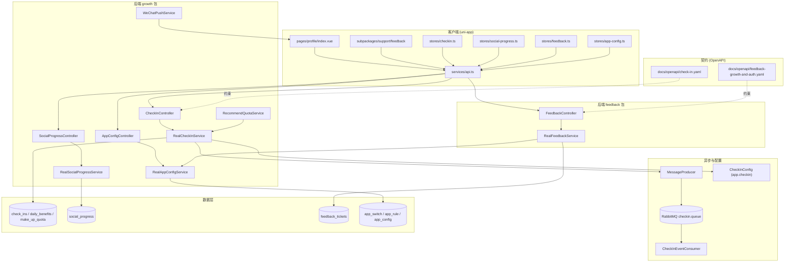
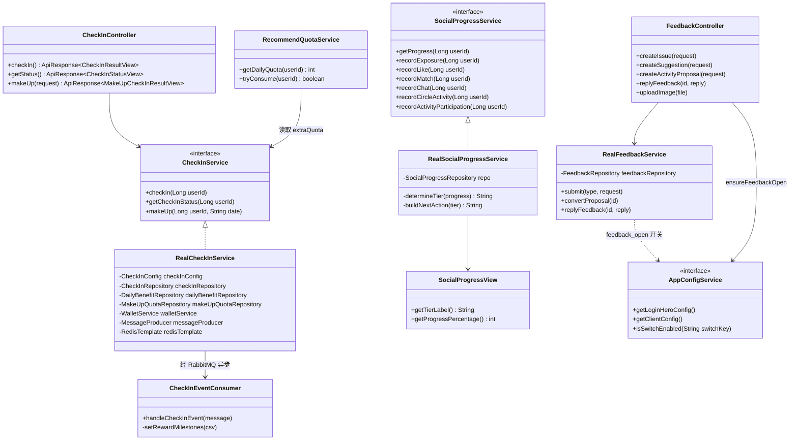
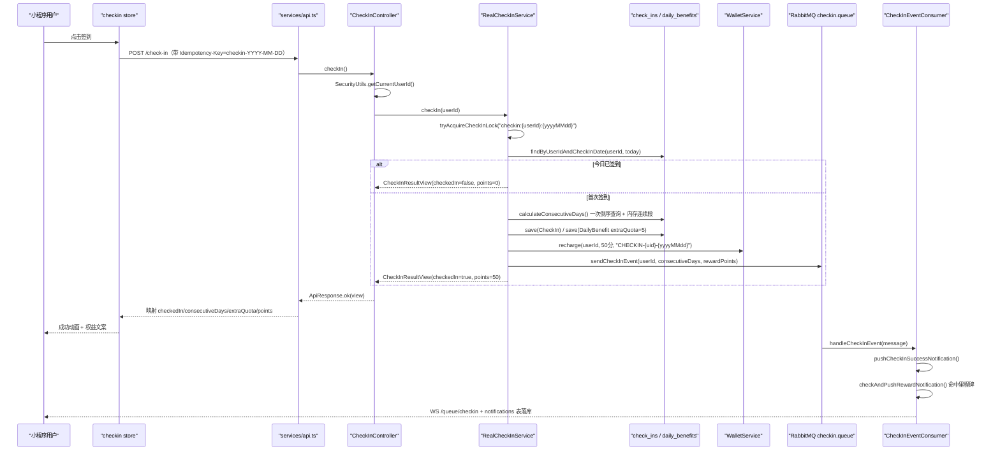
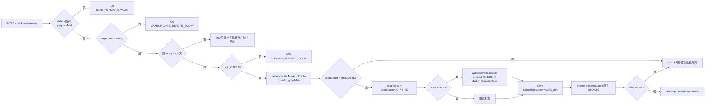
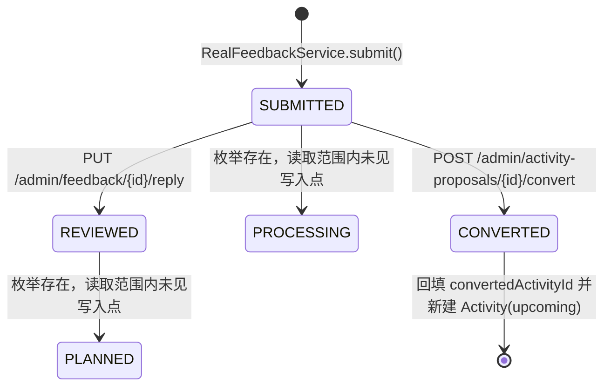
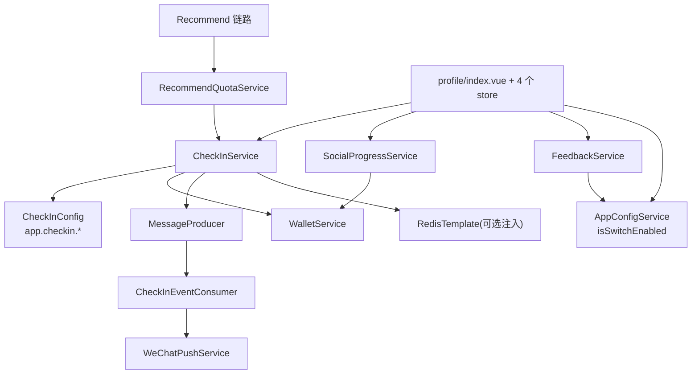
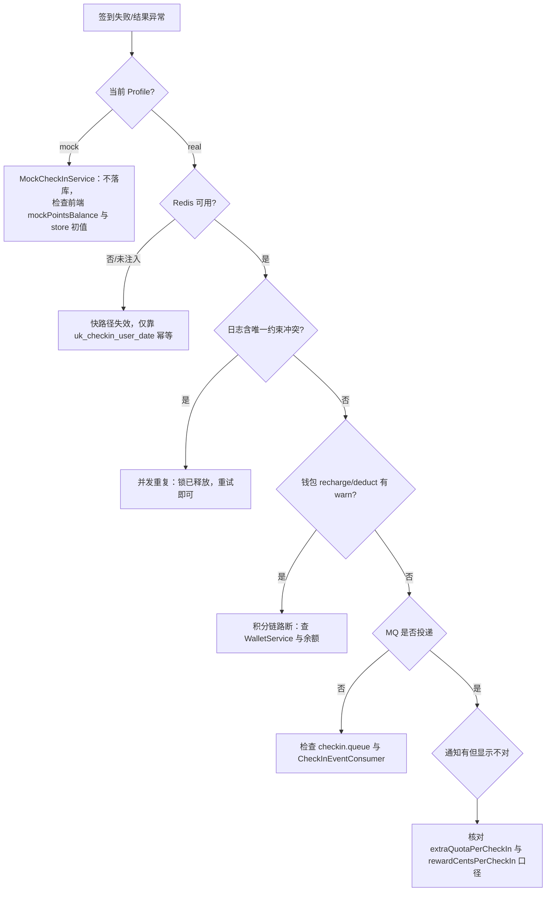

# 反馈成长体系

<cite>
**本文引用的文件**
- [feedback-growth-and-auth.yaml](file://docs/openapi/feedback-growth-and-auth.yaml)
- [AppConfigController.java](file://apps/api/src/main/java/com/campuslove/api/growth/AppConfigController.java)
- [AppConfigService.java](file://apps/api/src/main/java/com/campuslove/api/growth/AppConfigService.java)
- [AppConfigView.java](file://apps/api/src/main/java/com/campuslove/api/growth/AppConfigView.java)
- [PushSummaryService.java](file://apps/api/src/main/java/com/campuslove/api/growth/PushSummaryService.java)
- [WeChatPushService.java](file://apps/api/src/main/java/com/campuslove/api/growth/WeChatPushService.java)
- [NotifyConfig.java](file://apps/api/src/main/java/com/campuslove/api/entity/NotifyConfig.java)
- [UserBasicProfile.java](file://apps/api/src/main/java/com/campuslove/api/entity/UserBasicProfile.java)
- [UserCampusProfile.java](file://apps/api/src/main/java/com/campuslove/api/entity/UserCampusProfile.java)
- [UserScheduleProfile.java](file://apps/api/src/main/java/com/campuslove/api/entity/UserScheduleProfile.java)
- [UserProfileDTO.java](file://apps/api/src/main/java/com/campuslove/api/profile/UserProfileDTO.java)
- [ProfileConfigView.java](file://apps/api/src/main/java/com/campuslove/api/profile/ProfileConfigView.java)
- [index.vue](file://apps/client/src/pages/profile/index.vue)
- [CheckInController.java](file://apps/api/src/main/java/com/campuslove/api/growth/CheckInController.java)
- [CheckInService.java](file://apps/api/src/main/java/com/campuslove/api/growth/CheckInService.java)
- [RealCheckInService.java](file://apps/api/src/main/java/com/campuslove/api/growth/RealCheckInService.java)
- [CheckInConfig.java](file://apps/api/src/main/java/com/campuslove/api/config/CheckInConfig.java)
- [SocialProgressController.java](file://apps/api/src/main/java/com/campuslove/api/growth/SocialProgressController.java)
- [RealSocialProgressService.java](file://apps/api/src/main/java/com/campuslove/api/growth/RealSocialProgressService.java)
- [SocialProgressView.java](file://apps/api/src/main/java/com/campuslove/api/growth/SocialProgressView.java)
- [RecommendQuotaService.java](file://apps/api/src/main/java/com/campuslove/api/growth/RecommendQuotaService.java)
- [RealAppConfigService.java](file://apps/api/src/main/java/com/campuslove/api/growth/RealAppConfigService.java)
- [FeedbackController.java](file://apps/api/src/main/java/com/campuslove/api/feedback/FeedbackController.java)
- [RealFeedbackService.java](file://apps/api/src/main/java/com/campuslove/api/feedback/RealFeedbackService.java)
- [SubmissionStatus.java](file://apps/api/src/main/java/com/campuslove/api/feedback/SubmissionStatus.java)
- [FeedbackTicketType.java](file://apps/api/src/main/java/com/campuslove/api/feedback/FeedbackTicketType.java)
- [Feedback.java](file://apps/api/src/main/java/com/campuslove/api/entity/Feedback.java)
- [CheckIn.java](file://apps/api/src/main/java/com/campuslove/api/entity/CheckIn.java)
- [MakeUpQuota.java](file://apps/api/src/main/java/com/campuslove/api/entity/MakeUpQuota.java)
- [CheckInEventConsumer.java](file://apps/api/src/main/java/com/campuslove/api/mq/CheckInEventConsumer.java)
- [check-in.yaml](file://docs/openapi/check-in.yaml)
- [V2026.05.18.1600__add_growth_feedback_and_ai_reserved.sql](file://database/flyway/sql/V2026.05.18.1600__add_growth_feedback_and_ai_reserved.sql)
- [V2026.05.23.0002__create_check_ins.sql](file://database/flyway/sql/V2026.05.23.0002__create_check_ins.sql)
- [V2026.05.28.0002__create_social_progress.sql](file://database/flyway/sql/V2026.05.28.0002__create_social_progress.sql)
- [V2026.05.28.0008__create_daily_benefits.sql](file://database/flyway/sql/V2026.05.28.0008__create_daily_benefits.sql)
- [checkin.ts](file://apps/client/src/stores/checkin.ts)
- [feedback.ts](file://apps/client/src/stores/feedback.ts)
- [social-progress.ts](file://apps/client/src/stores/social-progress.ts)
- [app-config.ts](file://apps/client/src/stores/app-config.ts)
- [api.ts](file://apps/client/src/services/api.ts)
</cite>

## 目录
1. [简介](#简介)
2. [项目结构](#项目结构)
3. [核心组件](#核心组件)
4. [架构总览](#架构总览)
5. [详细组件分析](#详细组件分析)
6. [数据模型](#数据模型)
7. [配置与开关](#配置与开关)
8. [依赖关系分析](#依赖关系分析)
9. [性能考虑](#性能考虑)
10. [故障排查指南](#故障排查指南)
11. [能力缺口登记](#能力缺口登记)
12. [结论](#结论)

## 简介
本页面向 Campus Love（校园恋爱小程序）中"反馈成长"这一主题的**已落地实现**。与页面标题对应的代码资产集中在两个后端包与两个契约/客户端位置：

- `apps/api/.../api/growth/`：应用配置读取（`AppConfigController` / `AppConfigService` / `AppConfigView`）与微信订阅消息推送（`WeChatPushService` / `PushSummaryService`）。
- `apps/api/.../api/entity/`：成长画像侧的 JPA 实体 `UserBasicProfile`、`UserCampusProfile`、`UserScheduleProfile`，以及通知配置实体 `NotifyConfig`。
- `docs/openapi/feedback-growth-and-auth.yaml`：2501 行的 OpenAPI 契约，覆盖 `/app-config/login-hero`、`/auth/*`、`/profile/stats`、`/profile/basic` 等入口。
- `apps/client/src/pages/profile/index.vue`：3945 行的"我的/资料"页面，是成长画像数据的展示与编辑端。

需要明确的是：本仓库当前实现的是**"画像成长 + 配置化首页 + 订阅消息反馈"**这条链路，而非通用意义上的签到积分等级体系。详细核对与判定依据集中在[能力缺口登记](#能力缺口登记)一节。

**章节来源**
- [AppConfigController.java:14-43](file://apps/api/src/main/java/com/campuslove/api/growth/AppConfigController.java#L14-L43)
- [feedback-growth-and-auth.yaml:33-224](file://docs/openapi/feedback-growth-and-auth.yaml#L33-L224)

## 项目结构

"反馈成长"在仓库中不是一棵独立的目录树，而是由**后端两个业务包 + 一个配置类 + 一个 MQ 通道 + 客户端四个 Pinia store**拼装出来的体系。各资产的真实落点如下：

| 层 | 落点 | 承担的职责 |
| --- | --- | --- |
| 契约层 | `docs/openapi/check-in.yaml`、`docs/openapi/feedback-growth-and-auth.yaml` | 定义 `/check-in`、`/check-in/status`、`/check-in/make-up`、`/feedback/*`、`/profile/stats` 等入口的请求/响应结构 |
| 后端·成长 | `apps/api/src/main/java/com/campuslove/api/growth/` | 签到（`CheckInController`/`RealCheckInService`）、社交升温漏斗（`SocialProgressController`/`RealSocialProgressService`）、应用配置与开关（`RealAppConfigService`）、推荐配额联动（`RecommendQuotaService`）、订阅消息推送（`WeChatPushService`） |
| 后端·反馈 | `apps/api/src/main/java/com/campuslove/api/feedback/` | 工单提交与状态流转（`FeedbackController`/`RealFeedbackService`）、类型与状态枚举（`FeedbackTicketType`/`SubmissionStatus`）、视图（`SubmissionRecordView`/`SubmissionDetailView`） |
| 后端·配置 | `apps/api/src/main/java/com/campuslove/api/config/CheckInConfig.java` | `app.checkin` 前缀的两个可调数值：单次签到额外推荐配额、单次签到交友币奖励 |
| 后端·消息 | `apps/api/src/main/java/com/campuslove/api/mq/` | `MessageProducer.sendCheckInEvent` → RabbitMQ `checkin.queue` → `CheckInEventConsumer` 回流为 WebSocket 推送与站内通知 |
| 持久层 | `apps/api/.../entity/`（`CheckIn`、`DailyBenefit`、`MakeUpQuota`、`Feedback`、`SocialProgress`、`NotifyConfig`）+ `database/flyway/sql/` | 表结构与实体映射 |
| 客户端 | `apps/client/src/stores/checkin.ts`、`feedback.ts`、`social-progress.ts`、`app-config.ts`；`services/api.ts`；`pages/profile/index.vue`、`subpackages/support/feedback/index.vue`、`subpackages/profile-extra/feedback/history.vue`、`subpackages/profile-extra/profile/tasks` | 状态编排、请求封装、成长数据展示与反馈填报入口 |



**图表来源**
- [CheckInController.java:21-86](file://apps/api/src/main/java/com/campuslove/api/growth/CheckInController.java#L21-L86)
- [RealCheckInService.java:94-141](file://apps/api/src/main/java/com/campuslove/api/growth/RealCheckInService.java#L94-L141)
- [SocialProgressController.java:21-41](file://apps/api/src/main/java/com/campuslove/api/growth/SocialProgressController.java#L21-L41)
- [FeedbackController.java:33-203](file://apps/api/src/main/java/com/campuslove/api/feedback/FeedbackController.java#L33-L203)
- [RealAppConfigService.java:67-88](file://apps/api/src/main/java/com/campuslove/api/growth/RealAppConfigService.java#L67-L88)
- [RecommendQuotaService.java:37-85](file://apps/api/src/main/java/com/campuslove/api/growth/RecommendQuotaService.java#L37-L85)
- [CheckInEventConsumer.java:29-102](file://apps/api/src/main/java/com/campuslove/api/mq/CheckInEventConsumer.java#L29-L102)
- [CheckInConfig.java:12-36](file://apps/api/src/main/java/com/campuslove/api/config/CheckInConfig.java#L12-L36)

**章节来源**
- [check-in.yaml:16-77](file://docs/openapi/check-in.yaml#L16-L77)
- [feedback-growth-and-auth.yaml:947-1108](file://docs/openapi/feedback-growth-and-auth.yaml#L947-L1108)
- [index.vue:68-127](file://apps/client/src/pages/profile/index.vue#L68-L127)

### 与同级文档的边界

本页做的是**体系级串联**，不重复展开单点实现。以下四块各有专页，本页只在"链路交界"处引用：

- 签到的逐方法实现细节（Redis 日限锁 key 构造、月历查询、补签 SQL）→ 《每日签到系统》（`后端API服务/核心业务服务/成长体系服务/`）。
- 工单落库字段、附件序列化、越权校验细节 → 《反馈收集服务》（`后端API服务/核心业务服务/`）。
- `app_switch`/`app_rule`/`app_config` 三表聚合与后台维护 → 《应用配置管理》。
- 六层漏斗各 `record*` 计数器的写入点 → 《社交进度追踪》。

## 核心组件

按"谁持有状态、谁产生副作用"划分，体系由五类组件构成：

1. **入口控制器**：`CheckInController`（`/api/v1/check-in` 系列，写操作带 `@Idempotent` + `@PreAuthorize("hasRole('USER')")`）、`SocialProgressController`（`/api/v1/growth/social-progress`）、`AppConfigController`（`/api/v1/app-config/login-hero`）、`FeedbackController`（`/api/v1/feedback/*` 与 `/api/v1/admin/feedback*`）。四者的用户身份统一由 `SecurityUtils.getCurrentUserId()` 从 JWT 上下文取得，不再接受请求参数中的 userId。
2. **Real/Mock 双实现服务**：`growth` 与 `feedback` 包下每个接口都配一对实现——`RealCheckInService`/`MockCheckInService`、`RealSocialProgressService`/`MockSocialProgressService`、`RealAppConfigService`/`MockAppConfigService`、`RealFeedbackService`/`MockFeedbackService`。Real 侧一律标注 `@Profile("real")`（`RealCheckInService`、`RealSocialProgressService`、`CheckInEventConsumer` 均可见该注解），因此**接口 + Spring Profile 就是体系当前的主扩展点**。
3. **规则与阈值载体**：`CheckInConfig`（`app.checkin.extra-quota-per-check-in` 默认 5、`app.checkin.reward-cents-per-check-in` 默认 50）、`MakeUpQuota.DEFAULT_LIMIT`=3、`MakeUpQuota.COST_POINTS_AFTER_FREE`=50、`RealCheckInService.MAKE_UP_MAX_DAYS_BACK`=7、`CheckInEventConsumer` 的 `app.checkin.reward-milestones` 默认 `7,14,30,60,100,365`、`SocialProgressView.TOTAL_TIERS`=6。
4. **回流通道**：`MessageProducer.sendCheckInEvent` → `CheckInEventConsumer`（`@RabbitListener(queues = "checkin.queue")`）→ `SimpMessagingTemplate` 推 `/queue/checkin` + `NotificationRepository` 落库；以及 `WeChatPushService` 的订阅消息出口（`getAccessToken`、`sendSubscribeMessage`、`sendSocialDigestPush`、`sendRecommendRefreshPush`）。
5. **客户端状态编排**：`useCheckInStore`（store id `checkin`）、`useSocialProgressStore`（id `socialProgress`）、`useFeedbackStore`（id `feedback`）、`useAppConfigStore`（id `app-config`）。



**图表来源**
- [CheckInController.java:23-86](file://apps/api/src/main/java/com/campuslove/api/growth/CheckInController.java#L23-L86)
- [CheckInService.java:9-43](file://apps/api/src/main/java/com/campuslove/api/growth/CheckInService.java#L9-L43)
- [RealCheckInService.java:58-141](file://apps/api/src/main/java/com/campuslove/api/growth/RealCheckInService.java#L58-L141)
- [SocialProgressController.java:23-41](file://apps/api/src/main/java/com/campuslove/api/growth/SocialProgressController.java#L23-L41)
- [RealSocialProgressService.java:29-99](file://apps/api/src/main/java/com/campuslove/api/growth/RealSocialProgressService.java#L29-L99)
- [SocialProgressView.java:9-98](file://apps/api/src/main/java/com/campuslove/api/growth/SocialProgressView.java#L9-L98)
- [AppConfigService.java:7-68](file://apps/api/src/main/java/com/campuslove/api/growth/AppConfigService.java#L7-L68)
- [FeedbackController.java:35-202](file://apps/api/src/main/java/com/campuslove/api/feedback/FeedbackController.java#L35-L202)
- [RealFeedbackService.java:35-113](file://apps/api/src/main/java/com/campuslove/api/feedback/RealFeedbackService.java#L35-L113)
- [RecommendQuotaService.java:37-85](file://apps/api/src/main/java/com/campuslove/api/growth/RecommendQuotaService.java#L37-L85)
- [CheckInEventConsumer.java:31-59](file://apps/api/src/main/java/com/campuslove/api/mq/CheckInEventConsumer.java#L31-L59)

**章节来源**
- [CheckInConfig.java:12-36](file://apps/api/src/main/java/com/campuslove/api/config/CheckInConfig.java#L12-L36)
- [MakeUpQuota.java:24-72](file://apps/api/src/main/java/com/campuslove/api/entity/MakeUpQuota.java#L24-L72)
- [checkin.ts:215-271](file://apps/client/src/stores/checkin.ts#L215-L271)
- [social-progress.ts:123-175](file://apps/client/src/stores/social-progress.ts#L123-L175)
- [feedback.ts:12-103](file://apps/client/src/stores/feedback.ts#L12-L103)
- [app-config.ts:20-89](file://apps/client/src/stores/app-config.ts#L20-L89)

## 架构总览

体系是一条**"行为 → 计数 → 等级/权益 → 反馈回流"**的闭环。签到与社交行为产生持久化计数；计数换算成层级与额外推荐配额；配额被推荐链路消费；随后 MQ 把结果反推成站内通知与微信订阅消息。



**图表来源**
- [CheckInController.java:35-51](file://apps/api/src/main/java/com/campuslove/api/growth/CheckInController.java#L35-L51)
- [RealCheckInService.java:194-319](file://apps/api/src/main/java/com/campuslove/api/growth/RealCheckInService.java#L194-L319)
- [checkin.ts:420-473](file://apps/client/src/stores/checkin.ts#L420-L473)
- [CheckInEventConsumer.java:80-186](file://apps/api/src/main/java/com/campuslove/api/mq/CheckInEventConsumer.java#L80-L186)
- [MessageProducer.java:168-168](file://apps/api/src/main/java/com/campuslove/api/mq/MessageProducer.java#L168-L168)

**章节来源**
- [CheckInConfig.java:16-20](file://apps/api/src/main/java/com/campuslove/api/config/CheckInConfig.java#L16-L20)
- [api.ts:665-699](file://apps/client/src/services/api.ts#L665-L699)

## 详细组件分析

### 签到规则与连续天数算法

`RealCheckInService.checkIn()` 的判定顺序是：先构 Redis 锁 key `checkin:{userId}:{yyyyMMdd}`（`CHECKIN_REDIS_KEY_PREFIX` + `CHECKIN_DATE_FORMATTER`），SETNX 抢锁；锁已存在不代表失败，仍继续查库以返回完整状态。真正的幂等保证来自 `check_ins` 表的 `uk_checkin_user_date (user_id, check_in_date)` 唯一约束。

- **重复签到分支**：`existingCheckIn.isPresent()` 时返回 `CheckInResultView(false, consecutiveDays, extraQuota, ...)`，且**末位 points 固定为 0**，源码注释明确这是"防前端双计"。
- **首次签到分支**：`calculateConsecutiveDays(userId, today)` 从 `TimeZones.BUSINESS` 取"今日"，随后写入 `CheckIn`（`consecutiveDays`、`source=SOURCE_NORMAL`）、写入 `DailyBenefit`（`extraRecommendQuota = checkInConfig.getExtraQuotaPerCheckIn()`，热话题与新入圈用户解锁置 `true`）。
- **算法改造点（FIN-00025）**：连续天数原本是"逐日回查、连续 N 天即 N 次查询"，现改为一条 JPQL 一次取回 `<= startDate` 的全部 `checkInDate`（倒序），在内存中用 `expected = expected.minusDays(1)` 逐格对齐，遇到断档立即 `break`。
- **并发降级**：`save` 抛 `DataIntegrityViolationException` 时释放 Redis 锁并抛 `ErrorMessages.CHECKIN_FAILED_RETRY`，避免用户被锁卡死到次日。

累计额外配额由 `calculateTotalExtraQuota()` 给出，口径是**最新一条签到记录的 `consecutiveDays × extraQuotaPerCheckIn`**（源码 P0-23 修复注释明确说明"不再额外 +extraQuotaPerCheckIn"，以与重复签到分支口径一致）。

**章节来源**
- [RealCheckInService.java:194-319](file://apps/api/src/main/java/com/campuslove/api/growth/RealCheckInService.java#L194-L319)
- [RealCheckInService.java:700-743](file://apps/api/src/main/java/com/campuslove/api/growth/RealCheckInService.java#L700-L743)
- [RealCheckInService.java:758-760](file://apps/api/src/main/java/com/campuslove/api/growth/RealCheckInService.java#L758-L760)
- [CheckIn.java:34-97](file://apps/api/src/main/java/com/campuslove/api/entity/CheckIn.java#L34-L97)
- [V2026.05.23.0002__create_check_ins.sql:1-10](file://database/flyway/sql/V2026.05.23.0002__create_check_ins.sql#L1-L10)
- [check-in.yaml:16-51](file://docs/openapi/check-in.yaml#L16-L51)

### 积分与钱包联动

体系中"积分"这个词实际对应三个不同数值源，需要区分：

| 语义 | 真实来源 | 默认值 | 单位 |
| --- | --- | --- | --- |
| 签到弹窗"我的积分"余额 | `CheckInStatusView.points` ← `walletService.getBalance(userId)` | 查询异常降级为 `0` | 交友币钱包余额（分） |
| 本次签到获得 | `CheckInResultView` 末位 ← `checkInConfig.getRewardCentsPerCheckIn()` | 50 | 分（`WalletTransactionLog.RELATED_TYPE_CHECKIN`） |
| 补签消耗 | `MakeUpQuota.COST_POINTS_AFTER_FREE` | 50 | 分（`RELATED_TYPE_CHECKIN_MAKEUP`） |

钱包入账走**幂等 orderId**：`"CHECKIN-" + userId + today.format(yyyyMMdd)`；补签扣费 orderId 为 `"CHECKIN-MAKEUP-" + userId + "-" + date`。两处都做了"失败不阻断主流程 / 余额不足转业务提示"的差异化处理：签到奖励入账 `catch (RuntimeException)` 仅 `log.warn`；补签则在 `walletService == null` 时抛 `IllegalStateException`，捕获 `InsufficientBalanceException` 后转 `IllegalArgumentException("积分不足，本次补签需 50 积分，请先签到获取积分")`。

**章节来源**
- [RealCheckInService.java:280-319](file://apps/api/src/main/java/com/campuslove/api/growth/RealCheckInService.java#L280-L319)
- [RealCheckInService.java:333-355](file://apps/api/src/main/java/com/campuslove/api/growth/RealCheckInService.java#L333-L355)
- [RealCheckInService.java:436-457](file://apps/api/src/main/java/com/campuslove/api/growth/RealCheckInService.java#L436-L457)
- [CheckInConfig.java:16-20](file://apps/api/src/main/java/com/campuslove/api/config/CheckInConfig.java#L16-L20)
- [MakeUpQuota.java:28-31](file://apps/api/src/main/java/com/campuslove/api/entity/MakeUpQuota.java#L28-L31)

### 补签：一条带配额与成本的增长回补路径

`CheckInService.makeUp()` 的契约在接口 Javadoc 与 `CheckInController` 注释中双重声明，实现侧的校验链为：



**图表来源**
- [RealCheckInService.java:381-499](file://apps/api/src/main/java/com/campuslove/api/growth/RealCheckInService.java#L381-L499)
- [CheckInController.java:53-85](file://apps/api/src/main/java/com/campuslove/api/growth/CheckInController.java#L53-L85)
- [MakeUpQuota.java:24-72](file://apps/api/src/main/java/com/campuslove/api/entity/MakeUpQuota.java#L24-L72)

两处工程细节值得记录：其一，P0-24 修复把配额 `used_count+1` 从"读-改-写"改成 `UPDATE ... WHERE used_count < limit_count`，影响行数 0 即视为并发耗尽；其二，补签日期写入 `CheckIn.SOURCE_MAKE_UP`，随后由 `calculateConsecutiveDaysAfterMakeUp()` 重新计算连续段，补签当天被视为已签到参与计数。

**章节来源**
- [RealCheckInService.java:381-499](file://apps/api/src/main/java/com/campuslove/api/growth/RealCheckInService.java#L381-L499)
- [RealCheckInService.java:516-516](file://apps/api/src/main/java/com/campuslove/api/growth/RealCheckInService.java#L516-L516)
- [CheckInService.java:27-42](file://apps/api/src/main/java/com/campuslove/api/growth/CheckInService.java#L27-L42)
- [check-in.yaml:69-77](file://docs/openapi/check-in.yaml#L69-L77)
- [api.ts:1210-1222](file://apps/client/src/services/api.ts#L1210-L1222)

### 成长等级：社交升温六层漏斗

仓库里的"等级系统"落地为 `social_progress` 表的六层漏斗，而不是经验值体系。层级由 `RealSocialProgressService.determineTier()` 以**最高满足项倒序**判定，条件全部是"对应计数 `>= 1`"：

| 层级 | 中文标签 | 判定条件 | 下一步文案 |
| --- | --- | --- | --- |
| `L1_EXPOSURE` | 发现心动 | 默认 | 去发现页浏览更多同学，给心动的人点个赞吧 |
| `L2_ATTENTION` | 表达喜欢 | `likeCount >= 1` | 继续表达喜欢，等待双向匹配的惊喜 |
| `L3_MATCH` | 双向匹配 | `matchCount >= 1` | 恭喜匹配成功！快去和对方打个招呼吧 |
| `L4_COMMUNICATION` | 开启对话 | `chatCount >= 1` | 多参与社区话题讨论，认识更多朋友 |
| `L5_CIRCLE` | 参与社区 | `circleCount >= 1` | 关注校园活动，报名参加线下见面 |
| `L6_SCENE` | 线下见面 | `activityCount >= 1` | 你已经完成全部社交进阶，享受校园恋爱吧！ |

进度百分比在视图层派生：`SocialProgressView.getProgressPercentage()` 用 `TIER_INDEX_MAP` 查序号后 `tierIndex * 100 / TOTAL_TIERS`，因此输出只能是 16/33/50/66/83/100 这六档，而不是平滑百分比。`getProgress()` 因 `getOrCreateProgress()` 会在无记录时懒插入一条 `L1_EXPOSURE`，方法被从只读事务改成 `@Transactional` 读写事务。

埋点侧的关键约束是 R4-00327：`recordExposure()` 被推荐链路在**只读事务**内调用，原 `REQUIRED` 传播会加入外层只读事务导致懒创建 INSERT 被 MySQL 拒绝、异常延迟到提交阶段才抛 `UnexpectedRollbackException`；现改为 `@Transactional(propagation = REQUIRES_NEW)`，使埋点失败只回滚埋点自身。

**章节来源**
- [RealSocialProgressService.java:19-99](file://apps/api/src/main/java/com/campuslove/api/growth/RealSocialProgressService.java#L19-L99)
- [RealSocialProgressService.java:266-323](file://apps/api/src/main/java/com/campuslove/api/growth/RealSocialProgressService.java#L266-L323)
- [SocialProgressView.java:39-98](file://apps/api/src/main/java/com/campuslove/api/growth/SocialProgressView.java#L39-L98)
- [SocialProgressController.java:9-41](file://apps/api/src/main/java/com/campuslove/api/growth/SocialProgressController.java#L9-L41)
- [V2026.05.28.0002__create_social_progress.sql:7-18](file://database/flyway/sql/V2026.05.28.0002__create_social_progress.sql#L7-L18)
- [social-progress.ts:123-175](file://apps/client/src/stores/social-progress.ts#L123-L175)

### 等级 → 奖励的兑现点：推荐配额

体系里唯一被下游真正消费的奖励是**额外推荐配额**。链路是 `DailyBenefit.extraRecommendQuota` / `CheckInStatusView.extraQuota` → `RecommendQuotaService.getDailyQuota()`：

```java
int extraQuota = 0;
// ... status = checkInService.getCheckInStatus(userId)
extraQuota = status.extraQuota();
return Math.max(0, baseLimit + extraQuota);
```

即"每日基础上限（`RecommendationConfig`）+ 签到累计配额"，并用 `Math.max(0, ...)` 兜底负值。配额用量记在 Redis（`REDIS_KEY_PREFIX = "recommend-quota:"`，日期键 `yyyyMMdd`，`COUNT_TTL_HOURS = 36`），由 `tryConsume()` / `isExhausted()` 判定。另一侧的奖励兑现是签到即时性权益：`DailyBenefit` 把 `hotTopicsUnlocked`、`newUsersUnlocked` 置 `true`，`RealCheckInService.getHotTopicCount()` / `getNewCircleUserCount()` 提供入口展示数量。

**章节来源**
- [RecommendQuotaService.java:22-104](file://apps/api/src/main/java/com/campuslove/api/growth/RecommendQuotaService.java#L22-L104)
- [RealCheckInService.java:261-300](file://apps/api/src/main/java/com/campuslove/api/growth/RealCheckInService.java#L261-L300)
- [RealCheckInService.java:614-661](file://apps/api/src/main/java/com/campuslove/api/growth/RealCheckInService.java#L614-L661)
- [V2026.05.28.0008__create_daily_benefits.sql:4-13](file://database/flyway/sql/V2026.05.28.0008__create_daily_benefits.sql#L4-L13)
- [checkin.ts:254-270](file://apps/client/src/stores/checkin.ts#L254-L270)

### 反馈工单：提交、流转与结果回执

`FeedbackController` 暴露三类提交口（`issues` / `suggestions` / `activity-proposals`），共同点是：`@ResponseStatus(ACCEPTED)`、`@RateLimit(capacity = 10, refillTokens = 0.1, key = "#request.remoteAddr")`、`@Idempotent`、`@PreAuthorize("hasRole('USER')")`，并在进入服务前调 `ensureFeedbackOpen()`——`appConfigService.isSwitchEnabled(SWITCH_FEEDBACK_OPEN)` 为 false 时抛 `OperationForbiddenException(ErrorMessages.FEEDBACK_CLOSED)`。注意 `appConfigService` 用 `@Autowired(required = false)` 注入，mock profile 下为 `null`，此时开关校验被跳过。

`RealFeedbackService.submit()` 的落库动作是：`SecurityUtils.getCurrentUserId()` 取人、`TimeZones.BUSINESS` 取时间、`status = SubmissionStatus.SUBMITTED`、附件列表 `objectMapper.writeValueAsString` 序列化（失败则置 `null` 并 `log.warn`，不阻断提交）。

状态机与两个管理端动作：



**图表来源**
- [SubmissionStatus.java:3-9](file://apps/api/src/main/java/com/campuslove/api/feedback/SubmissionStatus.java#L3-L9)
- [RealFeedbackService.java:83-113](file://apps/api/src/main/java/com/campuslove/api/feedback/RealFeedbackService.java#L83-L113)
- [RealFeedbackService.java:159-195](file://apps/api/src/main/java/com/campuslove/api/feedback/RealFeedbackService.java#L159-L195)
- [RealFeedbackService.java:331-349](file://apps/api/src/main/java/com/campuslove/api/feedback/RealFeedbackService.java#L331-L349)
- [FeedbackController.java:110-138](file://apps/api/src/main/java/com/campuslove/api/feedback/FeedbackController.java#L110-L138)

结果回执目前是**拉取式**而非推送式：`replyFeedback()` 只做 `setStatus(REVIEWED)` + 把回复截断到 200 字符写进 `latestReplySummary` + `save`，源码读取范围内没有面向提交者的通知发送调用；`SubmissionDetailView` 的 `latestReplyContent` 在其方法注释中被明确标注为"当前回复表未实现，先返回 null"。用户侧只能通过 `GET /feedback/my-submissions` 与 `/my-submissions/{id}` 自行查看，客户端由 `useFeedbackStore.load()` 承载。

**章节来源**
- [FeedbackController.java:43-108](file://apps/api/src/main/java/com/campuslove/api/feedback/FeedbackController.java#L43-L108)
- [FeedbackController.java:140-202](file://apps/api/src/main/java/com/campuslove/api/feedback/FeedbackController.java#L140-L202)
- [RealFeedbackService.java:83-113](file://apps/api/src/main/java/com/campuslove/api/feedback/RealFeedbackService.java#L83-L113)
- [RealFeedbackService.java:327-349](file://apps/api/src/main/java/com/campuslove/api/feedback/RealFeedbackService.java#L327-L349)
- [FeedbackTicketType.java:3-7](file://apps/api/src/main/java/com/campuslove/api/feedback/FeedbackTicketType.java#L3-L7)
- [Feedback.java:21-69](file://apps/api/src/main/java/com/campuslove/api/entity/Feedback.java#L21-L69)
- [feedback.ts:20-101](file://apps/client/src/stores/feedback.ts#L20-L101)
- [feedback-growth-and-auth.yaml:947-1108](file://docs/openapi/feedback-growth-and-auth.yaml#L947-L1108)

### 行为数据的采集面

用户行为进入体系有三条并行通道，落点不同、消费方也不同：

1. **漏斗计数器**：`social_progress` 的六个 `*_count` 列，由 `recordExposure/recordLike/recordMatch/recordChat/recordCircleActivity/recordActivityParticipation` 递增，唯一键 `uk_social_progress_user_id` 保证一人一行。
2. **互动事件明细**：`interaction_events` 表记录 `event_type`（`NEW_LIKE,NEW_VISITOR,NEW_FOLLOW,POST_LIKED,POST_COMMENTED,TOPIC_REPLIED`）与 `reference_type`（`POST,COMMENT,TOPIC,USER`），带 `is_read` 与两条索引，用途是"互动提醒增强"，并配 `WeChatPushService.sendSocialDigestPush(openId, visitorCount, likeCount, ...)` 汇总为社交摘要订阅消息。
3. **画像完成度**：`UserBasicProfile`（30+ 字段，含 `interestTags`/`personalityTags`/`futurePlanTags`/`photoGallery` 等 JSON 字符串列与 `emailVerified`/`idCardVerified` 布尔位）、`UserCampusProfile.verificationStatus`（默认 `"draft"`）、`UserScheduleProfile.preferredTimeWindowJson`/`courseBlockJson`；由 `/profile/stats`、`/profile/basic`、`/profile/campus`、`/profile/schedule`、`/profile/dto` 读写，`UserProfileDTO` 以 `Basic/Identity/Intro/Relationship/Media/Relation/Post/Story` 分组承载。

展示端在 `pages/profile/index.vue`：第 682 行附近优先消费后端 `/profile/stats`，冷启动 `onShow` 会并发拉 basic/campus/schedule/stats/social-progress（未登录且非 mock 时直接短路返回，避免 401 雪崩）。值得注意的是 MP-R2-PROFILE-034 的记录：该页一度删除了 `socialProgressStore.fetchProgress()` 调用，理由是"本页早已没有任何进度 UI 消费它的结果"——也就是说**行为数据的采集链路完整，但页面级可视化展示存在缺口**。

**章节来源**
- [V2026.05.28.0002__create_social_progress.sql:7-18](file://database/flyway/sql/V2026.05.28.0002__create_social_progress.sql#L7-L18)
- [V2026.05.30.0004__create_interaction_events.sql:3-16](file://database/flyway/sql/V2026.05.30.0004__create_interaction_events.sql#L3-L16)
- [WeChatPushService.java:262-300](file://apps/api/src/main/java/com/campuslove/api/growth/WeChatPushService.java#L262-L300)
- [UserBasicProfile.java:24-194](file://apps/api/src/main/java/com/campuslove/api/entity/UserBasicProfile.java#L24-L194)
- [UserCampusProfile.java:20-73](file://apps/api/src/main/java/com/campuslove/api/entity/UserCampusProfile.java#L20-L73)
- [UserScheduleProfile.java:20-69](file://apps/api/src/main/java/com/campuslove/api/entity/UserScheduleProfile.java#L20-L69)
- [UserProfileDTO.java:8-36](file://apps/api/src/main/java/com/campuslove/api/profile/UserProfileDTO.java#L8-L36)
- [feedback-growth-and-auth.yaml:200-224](file://docs/openapi/feedback-growth-and-auth.yaml#L200-L224)
- [index.vue:682-682](file://apps/client/src/pages/profile/index.vue#L682-L682)
- [index.vue:1575-1607](file://apps/client/src/pages/profile/index.vue#L1575-L1607)

### 反馈回流：签到事件的通知与订阅消息

`CheckInEventConsumer` 是体系里唯一"由成长动作触发、把结果回告用户"的实现。`@RabbitListener(queues = "checkin.queue")` 收到 `CheckInEventMessage(userId, consecutiveDays, rewardPoints, createdAt)` 后做两件事，并且整体 `try/catch (RuntimeException)` 吞掉异常以"避免消息无限重投"：

- `pushCheckInSuccessNotification()`：文案 `"今日签到成功，已连续签到 %d 天，获得 %d 积分"`，同时经 `SimpMessagingTemplate.convertAndSendToUser(userId, "/queue/checkin", {type:"checkin_success", ...})` 实时推送，再 `persistNotification()` 落库。
- `checkAndPushRewardNotification()`：遍历 `rewardMilestones`，`consecutiveDays == milestone` 时推 `{type:"checkin_milestone_reward", milestone, ...}` 并落库；命中即 `break`。

两个实现细节对排障有直接影响：

1. **里程碑只通知、不发奖**。`checkAndPushRewardNotification()` 的写入面只有 WebSocket 与 `notifications` 表，源码读取范围内没有任何 `walletService.recharge` 或 `DailyBenefit` 追加调用——"额外奖励"文案目前不对应实际发放。
2. **`rewardPoints` 语义错位**。`RealCheckInService` 构造消息时第三个入参传的是 `checkInConfig.getExtraQuotaPerCheckIn()`（默认 5），而返回给客户端的 `CheckInResultView.points` 用的是 `getRewardCentsPerCheckIn()`（默认 50）。因此站内通知会显示"获得 5 积分"，而签到弹窗与钱包入账按 50 计。

微信侧的出口是 `WeChatPushService`：`getAccessToken()` 为 `synchronized` 缓存令牌，`sendSubscribeMessage(openId, templateId, page, ...)` 统一投递，`getSocialDigestTemplateId()` / `sendSocialDigestPush()` / `sendRecommendRefreshPush(openId, recommendCount)` 提供三类模板场景，模板变量由内部 `TemplateDataItem{value}` 承载，响应错误码由 `errcode`/`errmsg` 字段解析。投递开关与受众偏好落在 `NotifyConfig`（`notify_config` 表，`type` + `enabled` + `template`）与 `PushPreferenceService`/`PushSummaryService` 上。

**章节来源**
- [CheckInEventConsumer.java:36-59](file://apps/api/src/main/java/com/campuslove/api/mq/CheckInEventConsumer.java#L36-L59)
- [CheckInEventConsumer.java:80-186](file://apps/api/src/main/java/com/campuslove/api/mq/CheckInEventConsumer.java#L80-L186)
- [RealCheckInService.java:306-318](file://apps/api/src/main/java/com/campuslove/api/growth/RealCheckInService.java#L306-L318)
- [CheckInEventMessage.java:20-48](file://apps/api/src/main/java/com/campuslove/api/mq/CheckInEventMessage.java#L20-L48)
- [MessageProducer.java:168-168](file://apps/api/src/main/java/com/campuslove/api/mq/MessageProducer.java#L168-L168)
- [WeChatPushService.java:100-300](file://apps/api/src/main/java/com/campuslove/api/growth/WeChatPushService.java#L100-L300)
- [NotifyConfig.java:20-60](file://apps/api/src/main/java/com/campuslove/api/entity/NotifyConfig.java#L20-L60)
- [PushSummaryService.java:9-42](file://apps/api/src/main/java/com/campuslove/api/growth/PushSummaryService.java#L9-L42)

## 数据模型

体系的写入面横跨 6 张表，其中 `check_ins` 与 `daily_benefits` 构成"行为 → 权益"的一对多（同日各一行，均靠唯一约束幂等），`make_up_quota` 以 `(user_id, year_month)` 为粒度承载月配额。

```mermaid
erDiagram
    users ||--o{ check_ins : "user_id"
    users ||--o{ daily_benefits : "user_id"
    users ||--o| social_progress : "uk_social_progress_user_id"
    users ||--o{ make_up_quota : "user_id + year_month"
    users ||--o{ feedback_tickets : "user_id"
    users ||--o{ interaction_events : "user_id"
    users ||--o| user_basic_profile : "user_id"
    users ||--o| user_campus_profile : "user_id"
    users ||--o| user_schedule_profile : "user_id"

    check_ins {
        bigint id PK
        bigint user_id
        date check_in_date
        int consecutive_days
        varchar_16 source "NORMAL | MAKE_UP"
        datetime created_at
        bigint version
    }
    daily_benefits {
        bigint id PK
        bigint user_id
        date benefit_date
        int extra_recommend_quota
        bool hot_topics_unlocked
        bool new_users_unlocked
        datetime created_at
    }
    social_progress {
        bigint id PK
        bigint user_id UK
        varchar_20 current_tier "L1_EXPOSURE..L6_SCENE"
        int exposure_count
        int like_count
        int match_count
        int chat_count
        int circle_count
        int activity_count
        datetime updated_at
    }
    make_up_quota {
        bigint id PK
        bigint user_id
        varchar_7 year_month
        int used_count
        int limit_count "默认 3"
        datetime updated_at
    }
    feedback_tickets {
        bigint id PK
        bigint user_id
        varchar_32 type "FEEDBACK|SUGGESTION|ACTIVITY_PROPOSAL"
        varchar_256 title
        text content
        varchar_32 status "SUBMITTED..CONVERTED"
        datetime created_at
    }
    interaction_events {
        bigint id PK
        bigint user_id
        bigint trigger_user_id
        varchar_30 event_type
        varchar_30 reference_type
        bool is_read
        datetime created_at
    }
```



**图表来源**
- [V2026.05.23.0002__create_check_ins.sql:1-10](file://database/flyway/sql/V2026.05.23.0002__create_check_ins.sql#L1-L10)
- [V2026.05.28.0008__create_daily_benefits.sql:4-13](file://database/flyway/sql/V2026.05.28.0008__create_daily_benefits.sql#L4-L13)
- [V2026.05.28.0002__create_social_progress.sql:7-18](file://database/flyway/sql/V2026.05.28.0002__create_social_progress.sql#L7-L18)
- [MakeUpQuota.java:24-72](file://apps/api/src/main/java/com/campuslove/api/entity/MakeUpQuota.java#L24-L72)
- [CheckIn.java:34-97](file://apps/api/src/main/java/com/campuslove/api/entity/CheckIn.java#L34-L97)
- [Feedback.java:33-69](file://apps/api/src/main/java/com/campuslove/api/entity/Feedback.java#L33-L69)
- [V2026.05.30.0004__create_interaction_events.sql:3-16](file://database/flyway/sql/V2026.05.30.0004__create_interaction_events.sql#L3-L16)

需要特别说明一条**同源不同表**的历史：Flyway 脚本 `V2026.05.18.1600` 建的是 `user_feedback_ticket` / `activity_proposal` / `feedback_admin_reply` 三张表（含 `latest_reply_summary`、`converted_activity_id`、`handled_by`、`handled_at` 等运营字段），而 `Feedback` 实体的 `@Table(name = "feedback_tickets")` 指向的是 `V2026.05.28.0001__create_feedback_tickets.sql` 建的另一套表，`feedback_admin_reply` 在实体侧对应"未实现"（`latestReplyContent` 返回 null）。两套结构在字段语义上高度重叠，是体系当前最需要澄清的一处数据模型分叉。

三条实体都带 `@Version` 乐观锁列（`CheckIn.version`、`MakeUpQuota.version`、`UserBasicProfile.version`/`UserCampusProfile.version`/`UserScheduleProfile.version`/`NotifyConfig.version` 默认 `0L`），而 `social_progress` 与 `daily_benefits` 两张表在 DDL 中未见版本列。

**章节来源**
- [V2026.05.18.1600__add_growth_feedback_and_ai_reserved.sql:106-163](file://database/flyway/sql/V2026.05.18.1600__add_growth_feedback_and_ai_reserved.sql#L106-L163)
- [Feedback.java:21-69](file://apps/api/src/main/java/com/campuslove/api/entity/Feedback.java#L21-L69)
- [CheckIn.java:52-97](file://apps/api/src/main/java/com/campuslove/api/entity/CheckIn.java#L52-L97)
- [MakeUpQuota.java:35-72](file://apps/api/src/main/java/com/campuslove/api/entity/MakeUpQuota.java#L35-L72)
- [UserBasicProfile.java:126-194](file://apps/api/src/main/java/com/campuslove/api/entity/UserBasicProfile.java#L126-L194)

## 配置与开关

成长体系的可调项分三处，各自的热更新能力并不相同，这是排障时最容易混淆的地方。

**一、Spring 配置（`app.checkin` 前缀，需重启或配置刷新）**

`CheckInConfig` 是 `@Component` + `@ConfigurationProperties(prefix = "app.checkin")` 的普通属性类，只暴露两个键：

- `extra-quota-per-check-in`，默认 `5` —— 单次签到的额外推荐配额，同时是 `RecommendQuotaService.getDailyQuota()` 的加数与 `calculateTotalExtraQuota()` 的乘数。
- `reward-cents-per-check-in`，默认 `50` —— 单次签到写入交友币钱包的分值。

另有 `app.checkin.reward-milestones`（`CheckInEventConsumer` 的 setter 注入，`@Value("${app.checkin.reward-milestones:7,14,30,60,100,365}")`），以逗号分隔解析为 `int[]`；传入空白字符串会被解析为**长度为 0 的数组**，即关闭全部里程碑通知。

**二、管理后台三表（`app_switch` / `app_rule` / `app_config`，运行期即时生效）**

`RealAppConfigService.getClientConfig()` 以内置默认值为底、逐行覆盖：

- 开关：`SWITCH_MAINTENANCE_MODE`/`SWITCH_REGISTER_OPEN`/`SWITCH_LOGIN_OPEN`/`SWITCH_MATCH_OPEN`/`SWITCH_RECOMMEND_OPEN`/`SWITCH_POST_PUBLISH_OPEN`/**`SWITCH_FEEDBACK_OPEN`**（`defaultSwitches()` 中除维护模式外全部 `TRUE`）。
- 规则：`RULE_DAILY_RECOMMEND_LIMIT`（默认 `10`）、`RULE_HEART_SIGNAL_EXPIRE_HOURS`（默认 `48`）。`parseRuleValue()` 只接受 `Integer.parseInt` 成功的表达式，非整数会 `log.warn` 并保留默认值——这意味着**规则表当前只能承载整数阈值**，无法配置小数或字符串型成长规则。
- 站点标题：`app_config.site.title`，缺失回退 `校园恋爱`。

`isSwitchEnabled()` 的容错方向是**默认放行**（开关缺失或查询异常返回 `true`），`getClientConfig()` 整体 `catch (DataAccessException)` 降级为内置默认值。源码注释明确"不缓存，管理后台更新后客户端下一次拉取即可生效"。

**三、客户端消费**

`useAppConfigStore` 拉 `GET /api/v1/app-config` 后覆写 `switches`/`rules` 并写 TTL 缓存（`APP_CONFIG_CACHE_KEY = "app-config"`）。getter 采用 `!== false` 语义（如 `isFeedbackOpen: state.switches["feedback_open"] !== false`），与后端"缺省视为开启"保持同一口径；`isCommerceOn(module)` 先查 `commerce.enabled` 总闸，再按 `commerce.${module}` 或裸模块名取值。`pages/profile/index.vue` 的 VIP 卡片渲染即受 `appConfig.isCommerceOn('vip')` 控制。

**关于"等级阈值设置"**：六层漏斗的晋升条件（各计数 `>= 1`）硬编码在 `RealSocialProgressService.determineTier()` 的 `if` 链中，层级序号与总数硬编码在 `SocialProgressView` 的两个 `Map` 与 `TOTAL_TIERS = 6`，**未接入 `app_rule` 表**，因此调整晋升门槛需要改代码发版。

**章节来源**
- [CheckInConfig.java:12-36](file://apps/api/src/main/java/com/campuslove/api/config/CheckInConfig.java#L12-L36)
- [CheckInEventConsumer.java:41-59](file://apps/api/src/main/java/com/campuslove/api/mq/CheckInEventConsumer.java#L41-L59)
- [AppConfigService.java:9-68](file://apps/api/src/main/java/com/campuslove/api/growth/AppConfigService.java#L9-L68)
- [RealAppConfigService.java:52-88](file://apps/api/src/main/java/com/campuslove/api/growth/RealAppConfigService.java#L52-L88)
- [RealAppConfigService.java:125-167](file://apps/api/src/main/java/com/campuslove/api/growth/RealAppConfigService.java#L125-L167)
- [RealAppConfigService.java:181-244](file://apps/api/src/main/java/com/campuslove/api/growth/RealAppConfigService.java#L181-L244)
- [AppConfigView.java:24-29](file://apps/api/src/main/java/com/campuslove/api/growth/AppConfigView.java#L24-L29)
- [AppConfigController.java:14-43](file://apps/api/src/main/java/com/campuslove/api/growth/AppConfigController.java#L14-L43)
- [app-config.ts:20-123](file://apps/client/src/stores/app-config.ts#L20-L123)
- [index.vue:1809-1809](file://apps/client/src/pages/profile/index.vue#L1809-L1809)
- [RealSocialProgressService.java:282-299](file://apps/api/src/main/java/com/campuslove/api/growth/RealSocialProgressService.java#L282-L299)
- [SocialProgressView.java:49-98](file://apps/api/src/main/java/com/campuslove/api/growth/SocialProgressView.java#L49-L98)
- [V2026.05.18.1600__add_growth_feedback_and_ai_reserved.sql:1-17](file://database/flyway/sql/V2026.05.18.1600__add_growth_feedback_and_ai_reserved.sql#L1-L17)

## 依赖关系分析

体系的耦合方向可以归纳为"成长模块被广泛依赖、自身只依赖配置与钱包/MQ 抽象"。



**图表来源**
- [RealCheckInService.java:94-141](file://apps/api/src/main/java/com/campuslove/api/growth/RealCheckInService.java#L94-L141)
- [RecommendQuotaService.java:22-85](file://apps/api/src/main/java/com/campuslove/api/growth/RecommendQuotaService.java#L22-L85)
- [FeedbackController.java:43-52](file://apps/api/src/main/java/com/campuslove/api/feedback/FeedbackController.java#L43-L52)
- [CheckInEventConsumer.java:61-102](file://apps/api/src/main/java/com/campuslove/api/mq/CheckInEventConsumer.java#L61-L102)
- [WeChatPushService.java:77-100](file://apps/api/src/main/java/com/campuslove/api/growth/WeChatPushService.java#L77-L100)

关键依赖特征：

- **跨包反向依赖**：`feedback` 包依赖 `growth` 包的 `AppConfigService`（`FeedbackController` 第 7 行 import、第 49 行调用），反馈开关的判定权在成长包里。
- **弱依赖 + 空值分支**：`RealCheckInService.redisTemplate`、`CheckInEventConsumer.notificationRepository` / `messagingTemplate`、`FeedbackController.appConfigService` 都用 `@Autowired(required = false)`。任何一个缺失都会静默改变行为（Redis 为 null 时 `tryAcquireCheckInLock` 的快路径拒绝失效；`notificationRepository` 为 null 时通知不落库；`appConfigService` 为 null 时反馈开关不生效），排查时必须先确认 Profile。
- **对外部系统的依赖**：`WalletService`（余额、入账、扣减）、RabbitMQ、微信开放平台（`accessTokenUrl` / `subscribeMessageUrl` 由 `WeChatConfig` 注入）、Sentry（客户端 `captureException`）。三者均为"失败不阻断主流程"的软失败设计。
- **客户端扇入**：`api.ts` 是四个 store 唯一的出口（`/check-in/status`、`/check-in`、`/check-in/make-up`、`/growth/social-progress`、`/profile/stats`），store 之间不互相 import，仅 `checkin.ts` 依赖 `session` store 判断登录态。

**章节来源**
- [FeedbackController.java:1-52](file://apps/api/src/main/java/com/campuslove/api/feedback/FeedbackController.java#L1-L52)
- [RealCheckInService.java:140-141](file://apps/api/src/main/java/com/campuslove/api/growth/RealCheckInService.java#L140-L141)
- [CheckInEventConsumer.java:61-67](file://apps/api/src/main/java/com/campuslove/api/mq/CheckInEventConsumer.java#L61-L67)
- [WeChatPushService.java:48-55](file://apps/api/src/main/java/com/campuslove/api/growth/WeChatPushService.java#L48-L55)
- [checkin.ts:312-326](file://apps/client/src/stores/checkin.ts#L312-L326)
- [api.ts:665-699](file://apps/client/src/services/api.ts#L665-L699)
- [api.ts:1210-1222](file://apps/client/src/services/api.ts#L1210-L1222)

## 性能考虑

体系里已有明确的性能改造记录，可作为后续扩展的参照：

1. **N+1 → 单次查询**：连续天数算法（FIN-00025）从"逐日回查、连续 N 天即 N 次查询"改为一条 JPQL 取回全部 `<= startDate` 的日期后内存计算。代价是长连号用户的一次性结果集变大，收益是查询次数从 O(N) 降到 O(1)。`calculateTotalExtraQuota()` 同理走 `findTopByUserIdOrderByCheckInDateDesc`。
2. **快路径拒绝 + 唯一约束兜底**：`checkin:{userId}:{yyyyMMdd}` 的 SETNX 锁只用于快速拒绝重复请求，真正的正确性由 `uk_checkin_user_date` 保证；Redis 不可用时功能不受影响，只是退回 DB 判定。`CHECKIN_REDIS_LOCK_TTL` 为 24 小时，与日粒度对齐。
3. **事务传播修复**：`recordExposure()` 改为 `REQUIRES_NEW`，避免只读事务中懒创建 INSERT 触发 `UnexpectedRollbackException`，同时保证埋点写失败只回滚埋点。
4. **异步化外部调用**：签到成功后不直连微信 API，而是 `messageProducer.sendCheckInEvent(...)`，把通知成本移出签到响应路径。
5. **原子配额递增**：补签配额从读-改-写改为带 `WHERE used_count < limit_count` 的单条 UPDATE，用影响行数判并发（P0-24）。
6. **客户端超时与竞态控制**：`checkin.ts` 用 `withTimeout` + `AbortController` + `fetchStatusToken` 三段防护——超时/被取代的旧请求既不写状态也不写 `errorMessage`，`loading` 仅由最新 token 清理；未登录时直接短路返回不发请求。`social-progress.ts` 有 `PROGRESS_TTL_MS = 60_000` 的拉取节流。
7. **配置读取不缓存**：`getClientConfig()` 与 `isSwitchEnabled()` 每次都查库（注释写"不缓存（或实现内短 TTL）"），换来的是后台改开关即时生效，代价是高频调用下的 DB 压力，需要由调用方（如 `app-config` store 的 TTL 缓存）在客户端侧收敛。

**章节来源**
- [RealCheckInService.java:700-743](file://apps/api/src/main/java/com/campuslove/api/growth/RealCheckInService.java#L700-L743)
- [RealCheckInService.java:83-92](file://apps/api/src/main/java/com/campuslove/api/growth/RealCheckInService.java#L83-L92)
- [RealCheckInService.java:745-760](file://apps/api/src/main/java/com/campuslove/api/growth/RealCheckInService.java#L745-L760)
- [RealSocialProgressService.java:83-99](file://apps/api/src/main/java/com/campuslove/api/growth/RealSocialProgressService.java#L83-L99)
- [RealCheckInService.java:306-312](file://apps/api/src/main/java/com/campuslove/api/growth/RealCheckInService.java#L306-L312)
- [RealCheckInService.java:482-491](file://apps/api/src/main/java/com/campuslove/api/growth/RealCheckInService.java#L482-L491)
- [checkin.ts:177-215](file://apps/client/src/stores/checkin.ts#L177-L215)
- [checkin.ts:300-354](file://apps/client/src/stores/checkin.ts#L300-L354)
- [social-progress.ts:16-16](file://apps/client/src/stores/social-progress.ts#L16-L16)
- [AppConfigService.java:47-67](file://apps/api/src/main/java/com/campuslove/api/growth/AppConfigService.java#L47-L67)
- [RealAppConfigService.java:125-167](file://apps/api/src/main/java/com/campuslove/api/growth/RealAppConfigService.java#L125-L167)

## 故障排查指南

| 现象 | 判定位 | 依据与处置 |
| --- | --- | --- |
| 重复签到仍返回权益但积分显示 0 | 正常 | `existingCheckIn` 分支末位 points 固定 0（防双计），源码注释已声明 |
| 签到报 `CHECKIN_FAILED_RETRY` | DB 唯一约束冲突 | `save` 抛 `DataIntegrityViolationException`，多为并发；实现已释放 Redis 锁允许重试 |
| 同一天重复请求被 429/幂等拦截 | `@Idempotent` | 客户端 `Idempotency-Key: checkin-{localDateKey(new Date())}`；R4-00176 说明必须用本地时区日期，否则 UTC 凌晨会算错日期 |
| 通知显示"获得 5 积分"但钱包到账 50 分 | 参数口径不一致 | MQ 消息第三参传 `extraQuotaPerCheckIn`(5)，响应视图传 `rewardCentsPerCheckIn`(50) |
| 连续签到 7/30 天只收到祝贺、没奖励 | 设计现状 | `checkAndPushRewardNotification()` 只推 WS + 落 `notifications`，无发放动作 |
| 补签报"本月补签次数已用完"但界面显示未满 | 并发递增 | `incrementUsedCount` 返回 `affected == 0` 即并发耗尽，配额行已被其他请求占满 |
| 补签报"积分不足" | 钱包扣减 | `costPoints>0` 且 `InsufficientBalanceException`；首次免费（`usedCount == 0`） |
| 反馈提交返回 403 | `feedback_open` 关闭 | `ensureFeedbackOpen()` 抛 `OperationForbiddenException(FEEDBACK_CLOSED)`；确认 real profile 下 `appConfigService` 非 null 且 `app_switch` 行为预期 |
| 反馈提交被限流 | `@RateLimit` | 桶容量 10、每 10 秒补 1 令牌，按 `#request.remoteAddr` 计数 |
| `latestReplyContent` 恒为 null | 回复表未实现 | `SubmissionDetailView` 方法注释明确返回 null；回复摘要见 `latestReplySummary`（截断 200 字符 + `…`） |
| 活动提案转换报"已转换" | 幂等保护 | `status == CONVERTED` 时抛 `IllegalStateException(PROPOSAL_ALREADY_CONVERTED_PREFIX + id)` |
| 社交进度接口 404 | 端点曾缺失 | `SocialProgressController` 注释记录：前端调 `/api/v1/growth/social-progress` 而后端无 Controller，导致 Real 模式 404，现已补齐 |
| 签到状态"我的积分"显示 0 | 钱包降级 | `walletService.getBalance` 异常被 `catch` 后 `points = 0`，不影响签到状态本身 |
| 首页配置全为默认值 | DB 异常降级 | `getClientConfig()` 捕获 `DataAccessException` 返回内置默认；检查 `app_switch`/`app_rule`/`app_config` 与数据源 |
| 业务规则改了没生效 | 规则值非整数 | `parseRuleValue` 仅接受整数，`log.warn` 后保留默认值 |
| Mock 模式下开关不生效 | 弱依赖为 null | `appConfigService` 用 `@Autowired(required = false)`，mock profile 注入 null 时 `ensureFeedbackOpen()` 直接跳过 |



**图表来源**
- [RealCheckInService.java:203-259](file://apps/api/src/main/java/com/campuslove/api/growth/RealCheckInService.java#L203-L259)
- [RealCheckInService.java:280-318](file://apps/api/src/main/java/com/campuslove/api/growth/RealCheckInService.java#L280-L318)
- [RealCheckInService.java:443-457](file://apps/api/src/main/java/com/campuslove/api/growth/RealCheckInService.java#L443-L457)
- [RealCheckInService.java:482-489](file://apps/api/src/main/java/com/campuslove/api/growth/RealCheckInService.java#L482-L489)
- [CheckInEventConsumer.java:80-102](file://apps/api/src/main/java/com/campuslove/api/mq/CheckInEventConsumer.java#L80-L102)

**章节来源**
- [CheckInController.java:53-85](file://apps/api/src/main/java/com/campuslove/api/growth/CheckInController.java#L53-L85)
- [FeedbackController.java:43-202](file://apps/api/src/main/java/com/campuslove/api/feedback/FeedbackController.java#L43-L202)
- [RealFeedbackService.java:159-195](file://apps/api/src/main/java/com/campuslove/api/feedback/RealFeedbackService.java#L159-L195)
- [RealFeedbackService.java:331-349](file://apps/api/src/main/java/com/campuslove/api/feedback/RealFeedbackService.java#L331-L349)
- [SocialProgressController.java:9-41](file://apps/api/src/main/java/com/campuslove/api/growth/SocialProgressController.java#L9-L41)
- [RealAppConfigService.java:168-219](file://apps/api/src/main/java/com/campuslove/api/growth/RealAppConfigService.java#L168-L219)
- [checkin.ts:420-451](file://apps/client/src/stores/checkin.ts#L420-L451)

## 能力缺口登记

以下条目是 catalog 生成指令提出、但在本仓库当前代码中**没有对应实现或只有部分实现**的要求。每条给出判定依据（读取范围与缺失的具体证据），不做推测性补全。

1. **"连续签到奖励"的实际发放缺失。** 判定依据：`CheckInEventConsumer.checkAndPushRewardNotification()`（第 151-186 行）在命中里程碑时的写入面只有两处——`messagingTemplate.convertAndSendToUser(...)` 与 `persistNotification(...)`；该方法及其调用链中不存在 `walletService`、`DailyBenefit` 或任何发放调用，而文案写着"已获得额外奖励"。结论：里程碑目前是**通知机制**，不是奖励机制。
2. **通知文案的积分数值与真实入账不一致。** 判定依据：`RealCheckInService` 第 308-312 行构造 `CheckInEventMessage(userId, consecutiveDays, checkInConfig.getExtraQuotaPerCheckIn(), Instant.now())`，而第 316-318 行返回视图与第 285-290 行钱包入账使用的是 `getRewardCentsPerCheckIn()`；`CheckInConfig` 中两者默认值分别为 5 与 50。结论：消息字段名 `rewardPoints` 承载的是配额值，属于实现缺陷而非需求。
3. **"经验值计算"不存在。** 判定依据：`social_progress` 表只有六个 `*_count` 计数列与 `current_tier` 字符串，没有经验值/经验累计列；`RealSocialProgressService.determineTier()` 的判定式全是 `>= 1`；`SocialProgressView.getProgressPercentage()` 是层级序号除以 `TOTAL_TIERS` 的整除结果。结论：本仓库的"等级"是**里程碑式漏斗**，没有 XP 概念。
4. **"等级阈值设置"无法配置化。** 判定依据：晋升阈值硬编码于 `determineTier()`（第 282-299 行）；可配置的 `app_rule` 侧目前只登记两个规则名（`daily_recommend_limit`、`heart_signal_expire_hours`），且 `parseRuleValue()` 仅接受整数。结论：调阈值需要改代码发版，体系没有预留规则键。
5. **"特殊权益解锁"仅覆盖签到权益一项。** 判定依据：已实现的解锁是 `DailyBenefit.hotTopicsUnlocked` / `newUsersUnlocked` / `extraRecommendQuota`，以及 `RecommendQuotaService` 的配额加成；读取范围内没有与 `current_tier` 绑定的权益映射（`L*` 层级不改变任何下游行为）。结论：等级与奖励是**两条平行链路，尚未打通**。
6. **投诉建议的"处理流程"是不完整状态机。** 判定依据：`SubmissionStatus` 定义 5 个值，但 `RealFeedbackService` 中只出现 `SUBMITTED`(第 95 行)、`REVIEWED`(第 338 行)、`CONVERTED`(第 195 行) 三处写入；`PROCESSING` 与 `PLANNED` 在读取范围内没有写入点。结论：两个中间态目前是**死枚举值**。
7. **反馈结果不会主动通知用户。** 判定依据：`replyFeedback()`（第 331-349 行）只做 `setStatus` + `setLatestReplySummary` + `save`，无 MQ、无 `WeChatPushService`、无 `SimpMessagingTemplate`；`SubmissionDetailView` 注释亦标明 `latestReplyContent` 因"当前回复表未实现"而返回 null。结论：结果通知是**拉取式**，V2026.05.18.1600 建的 `feedback_admin_reply` 表未被实体使用。
8. **反馈域存在两套并行表结构。** 判定依据：`Feedback` 实体映射 `feedback_tickets`（`V2026.05.28.0001` 建表），而 `V2026.05.18.1600` 建的是 `user_feedback_ticket` + `activity_proposal` + `feedback_admin_reply`，字段（`submitter_user_id`、`handled_by`、`converted_activity_id`、`latest_reply_summary`）语义重叠。结论：哪一套是权威模型未在本次读取范围内澄清，属真实待决项。
9. **用户行为数据"可视化展示"缺位。** 判定依据：`pages/profile/index.vue` 第 1605-1606 行注释明确记录 `socialProgressStore.fetchProgress()` 已被删除，理由是"本页早已没有任何进度 UI 消费它的结果"；`social-progress.ts` 仍保留 `TIER_META`/`TIER_ORDER`/`progressPercentage` 的计算能力。结论：采集与 API 齐备，**页面级展示是断点**。
10. **"用户成长报告生成 / 数据导出 / 统计分析"未见实现。** 判定依据：`growth` 与 `feedback` 两个包的全部 34 + 9 个类名清单中不存在 report/export/analytics/statistics 类；`docs/openapi/feedback-growth-and-auth.yaml` 的路径清单中只有 `/profile/stats`（个人计数四元组），无报告或导出端点；`FeedbackController` 的 `GET /api/v1/admin/feedback` 只返回列表，无聚合。结论：该要求在本仓库**完全缺失**。
11. **"活动配置"与成长体系无耦合。** 判定依据：活动提案确可被转换为 Activity（`convertProposal()` 第 159-195 行，新建活动并 `setStatus(Activity.ActivityStatus.upcoming)`，回填 `convertedActivityId`），但这是反馈→活动的单向通道；不存在活动对成长数值（配额/层级）的反向影响。结论：指令中的"活动配置"仅能覆盖到"活动提案转换"这一条。
12. **扩展点只有 Profile 级双实现一条。** 判定依据：`growth`/`feedback` 包每个接口配一对 `Real*`(`@Profile("real")`) / `Mock*` 实现；`app_rule` 只支持整数值；没有规则表达式引擎、没有 `Rule`/`Reward` 策略接口、没有可插拔的等级计算器。结论：指令要求的"自定义规则配置方案"目前等价于"新增一个 Profile 实现类"。
13. **`apps/client/src/stores/profile/` 与 `apps/api/.../api/service/` 两个声明依赖路径不存在。** 判定依据：brief 明确标注二者"该路径不存在"；实际目录列表中客户端 profile 状态在单文件 `apps/client/src/stores/profile.ts`（1136 行），后端服务按域分散在 `growth`/`feedback`/`profile` 等包内，仓库根下无 `api/service/` 目录。结论：本页改用真实路径取证，未引用这两处。

**章节来源**
- [CheckInEventConsumer.java:143-186](file://apps/api/src/main/java/com/campuslove/api/mq/CheckInEventConsumer.java#L143-L186)
- [RealCheckInService.java:306-318](file://apps/api/src/main/java/com/campuslove/api/growth/RealCheckInService.java#L306-L318)
- [CheckInConfig.java:16-20](file://apps/api/src/main/java/com/campuslove/api/config/CheckInConfig.java#L16-L20)
- [V2026.05.28.0002__create_social_progress.sql:7-18](file://database/flyway/sql/V2026.05.28.0002__create_social_progress.sql#L7-L18)
- [RealSocialProgressService.java:282-299](file://apps/api/src/main/java/com/campuslove/api/growth/RealSocialProgressService.java#L282-L299)
- [SocialProgressView.java:87-98](file://apps/api/src/main/java/com/campuslove/api/growth/SocialProgressView.java#L87-L98)
- [RealAppConfigService.java:207-244](file://apps/api/src/main/java/com/campuslove/api/growth/RealAppConfigService.java#L207-L244)
- [SubmissionStatus.java:3-9](file://apps/api/src/main/java/com/campuslove/api/feedback/SubmissionStatus.java#L3-L9)
- [RealFeedbackService.java:331-357](file://apps/api/src/main/java/com/campuslove/api/feedback/RealFeedbackService.java#L331-L357)
- [RealFeedbackService.java:159-195](file://apps/api/src/main/java/com/campuslove/api/feedback/RealFeedbackService.java#L159-L195)
- [V2026.05.18.1600__add_growth_feedback_and_ai_reserved.sql:106-163](file://database/flyway/sql/V2026.05.18.1600__add_growth_feedback_and_ai_reserved.sql#L106-L163)
- [Feedback.java:21-47](file://apps/api/src/main/java/com/campuslove/api/entity/Feedback.java#L21-L47)
- [index.vue:1605-1607](file://apps/client/src/pages/profile/index.vue#L1605-L1607)
- [social-progress.ts:73-161](file://apps/client/src/stores/social-progress.ts#L73-L161)
- [feedback-growth-and-auth.yaml:947-1191](file://docs/openapi/feedback-growth-and-auth.yaml#L947-L1191)

## 结论

Campus Love 的"反馈成长体系"在当前代码中是一条**以签到为节拍器、以计数漏斗为等级、以配额为奖励、以 MQ 通知为回流**的实现，而不是指令字面所描述的"积分—经验—等级—权益"四段式游戏化系统。

已经跑通的部分：签到幂等（Redis 快路径 + DB 唯一约束双保险）、连续天数的 O(1) 算法、补签的月配额原子扣减与钱包联动、额外推荐配额真正被 `RecommendQuotaService` 消费、六层社交漏斗带中文标签与下一步文案、反馈三类工单带限流/幂等/开关校验与两条管理端流转。工程纪律也有迹可循——每个缺陷修复都在源码注释里留下了编号（FIN-00025、P0-23、P0-24、R4-00326、R4-00327、R4-00376、R4-00176、infra R2-00023、MP-R2-PROFILE-034），可直接回溯。

需要正视的四条断口：等级与奖励未打通（层级不改变任何下游权益）；里程碑只祝贺不发奖；反馈结果无推送且状态机有两个死枚举；成长报告与可视化展示缺位（进度请求甚至已从"我的"页删除）。此外反馈域存在两套并行表结构，权威模型尚未收敛。

后续若要补齐，代价最小的顺序是：先对齐 `CheckInEventMessage` 的积分口径（单点参数修正）；再把 `determineTier()` 的阈值提为 `app_rule` 整型规则（复用现有配置面，需注意 `parseRuleValue` 只支持整数）；然后在 `checkAndPushRewardNotification()` 命中分支追加一次 `walletService.recharge` 并沿用 `(userId, yyyyMMdd)` 幂等键风格；最后恢复"我的"页的进度 UI 消费 `useSocialProgressStore`。这些都属于既有链路的自然延长，不需要新增架构层。

**章节来源**
- [CheckInService.java:1-43](file://apps/api/src/main/java/com/campuslove/api/growth/CheckInService.java#L1-L43)
- [RealCheckInService.java:194-319](file://apps/api/src/main/java/com/campuslove/api/growth/RealCheckInService.java#L194-L319)
- [RecommendQuotaService.java:73-85](file://apps/api/src/main/java/com/campuslove/api/growth/RecommendQuotaService.java#L73-L85)
- [RealSocialProgressService.java:266-299](file://apps/api/src/main/java/com/campuslove/api/growth/RealSocialProgressService.java#L266-L299)
- [FeedbackController.java:43-138](file://apps/api/src/main/java/com/campuslove/api/feedback/FeedbackController.java#L43-L138)
- [CheckInEventConsumer.java:143-186](file://apps/api/src/main/java/com/campuslove/api/mq/CheckInEventConsumer.java#L143-L186)
- [index.vue:1575-1607](file://apps/client/src/pages/profile/index.vue#L1575-L1607)
- [feedback-growth-and-auth.yaml:33-224](file://docs/openapi/feedback-growth-and-auth.yaml#L33-L224)
