# 核心功能模块

<cite>
**本文引用的文件**
- [websocket.ts](file://apps/client/src/services/websocket.ts)
- [index.ts](file://apps/client/src/stores/chat/index.ts)
- [higher-order.ts](file://apps/client/src/stores/chat/higher-order.ts)
- [store-type.ts](file://apps/client/src/stores/chat/store-type.ts)
- [MessageWebSocketHandler.java](file://apps/api/src/main/java/com/campuslove/api/chat/MessageWebSocketHandler.java)
- [index.vue](file://apps/client/src/subpackages/village/village/index.vue)
- [post.vue](file://apps/client/src/subpackages/village/village/post.vue)
- [detail.vue](file://apps/client/src/subpackages/village/village/detail.vue)
- [history.vue](file://apps/client/src/subpackages/village/village/history.vue)
- [tag-posts.vue](file://apps/client/src/subpackages/village/village/tag-posts.vue)
- [exchange.ts](file://apps/client/src/stores/chat/actions/exchange.ts)
- [session.ts](file://apps/client/src/stores/chat/actions/session.ts)
- [session-machine.ts](file://apps/client/src/features/chat/session-machine.ts)
- [constants.ts](file://apps/client/src/services/websocket/constants.ts)
- [store-dispatch.ts](file://apps/client/src/services/websocket/store-dispatch.ts)
- [match.ts](file://apps/client/src/stores/match.ts)
- [matching.vue](file://apps/client/src/subpackages/discover-extra/discover/matching.vue)
- [MatchEngine.java](file://apps/api/src/main/java/com/campuslove/api/match/MatchEngine.java)
- [MatchPolicy.java](file://apps/api/src/main/java/com/campuslove/api/match/MatchPolicy.java)
- [MatchRecorder.java](file://apps/api/src/main/java/com/campuslove/api/match/MatchRecorder.java)
- [MatchController.java](file://apps/api/src/main/java/com/campuslove/api/match/MatchController.java)
- [TempChatController.java](file://apps/api/src/main/java/com/campuslove/api/chat/TempChatController.java)
- [PrivateMessageController.java](file://apps/api/src/main/java/com/campuslove/api/chat/PrivateMessageController.java)
- [NotificationController.java](file://apps/api/src/main/java/com/campuslove/api/chat/NotificationController.java)
- [WebSocketConfig.java](file://apps/api/src/main/java/com/campuslove/api/config/WebSocketConfig.java)
- [CircleController.java](file://apps/api/src/main/java/com/campuslove/api/discover/CircleController.java)
- [circle.ts](file://apps/client/src/stores/circle.ts)
- [api.ts](file://apps/client/src/stores/village/api.ts)
- [CheckInController.java](file://apps/api/src/main/java/com/campuslove/api/growth/CheckInController.java)
- [RealCheckInService.java](file://apps/api/src/main/java/com/campuslove/api/growth/RealCheckInService.java)
- [checkin.ts](file://apps/client/src/stores/checkin.ts)
- [growth.ts](file://apps/client/src/constants/growth.ts)
- [coins.ts](file://apps/client/src/stores/coins.ts)
- [feedback.ts](file://apps/client/src/stores/feedback.ts)
- [FeedbackController.java](file://apps/api/src/main/java/com/campuslove/api/feedback/FeedbackController.java)
- [V2026.05.21.0001__create_likes_table.sql](file://database/flyway/sql/V2026.05.21.0001__create_likes_table.sql)
- [V2026.05.21.0005__create_heart_signals_table.sql](file://database/flyway/sql/V2026.05.21.0005__create_heart_signals_table.sql)
- [V2026.05.27.0001__create_temp_chat_tables.sql](file://database/flyway/sql/V2026.05.27.0001__create_temp_chat_tables.sql)
- [V2026.05.23.0005__create_interest_circles.sql](file://database/flyway/sql/V2026.05.23.0005__create_interest_circles.sql)
- [TempChatCleanupService.java](file://apps/api/src/main/java/com/campuslove/api/chat/TempChatCleanupService.java)
- [types.ts](file://apps/client/src/services/websocket/types.ts)
- [application.yml](file://apps/api/src/main/resources/application.yml)
- [WeChatPushService.java](file://apps/api/src/main/java/com/campuslove/api/growth/WeChatPushService.java)
- [index.ts](file://apps/client/src/stores/village/index.ts)
</cite>

## 目录
1. [简介](#简介)
2. [项目结构](#项目结构)
3. [核心组件](#核心组件)
4. [架构总览](#架构总览)
5. [详细组件分析](#详细组件分析)
6. [模块边界与接口契约](#模块边界与接口契约)
7. [端到端数据流](#端到端数据流)
8. [数据模型总览](#数据模型总览)
9. [依赖关系分析](#依赖关系分析)
10. [性能考虑](#性能考虑)
11. [故障排查指南](#故障排查指南)
12. [能力缺口登记](#能力缺口登记)
13. [结论](#结论)

## 简介
本页是 Campus Love 核心业务功能的**分组总览与索引页**，负责把四个业务模块——匹配系统、消息聊天系统、社区圈子、反馈成长体系——放在同一张地图上说明：每个模块解决什么问题、代码落在哪些目录、模块之间通过什么契约协作、整体数据如何在客户端 store、HTTP 服务层与后端 WebSocket/控制器之间流转。

本页**不重复子页实现细节**。四个模块各自的算法推导、接口逐条说明、状态机与页面交互，由同目录下的子页面承载；本页只做三件事：给出模块边界、给出串联视图、给出可校验的取证入口（文件路径 + 行号）。

阅读顺序建议：先读本页的「架构总览」与「端到端数据流」建立整体心智模型，再按需要跳转到子页；排查跨模块问题时，从「模块边界与接口契约」与「故障排查指南」入手。

**章节来源**
- [MessageWebSocketHandler.java:42-43](file://apps/api/src/main/java/com/campuslove/api/chat/MessageWebSocketHandler.java#L42-L43)
- [store-type.ts:45-129](file://apps/client/src/stores/chat/store-type.ts#L45-L129)

## 项目结构

四个业务模块在仓库里按「客户端页面 → 客户端 store → 传输/服务层 → 后端控制器 → 后端领域服务 → 数据库迁移」六层分布。下表给出模块与目录的对应关系，路径均为仓库根相对路径。

| 模块 | 客户端页面 | 客户端状态 | 客户端传输 | 后端包 | 数据表迁移 |
| --- | --- | --- | --- | --- | --- |
| 匹配系统 | `apps/client/src/subpackages/discover-extra/discover/` | `apps/client/src/stores/match.ts` | `apps/client/src/services/api.ts` | `com.campuslove.api.match` | `database/flyway/sql/V2026.05.21.0001__create_likes_table.sql` 等 |
| 消息聊天系统 | `apps/client/src/subpackages/`（临时聊天/私信页） | `apps/client/src/stores/chat/` | `apps/client/src/features/chat/` + `apps/client/src/services/websocket/` | `com.campuslove.api.chat` | `V2026.05.27.0001__create_temp_chat_tables.sql`、`V2026.05.24.0002__create_private_conversations.sql` |
| 社区圈子 | `apps/client/src/subpackages/village/village/` | `apps/client/src/stores/village/`、`apps/client/src/stores/circle.ts` | `apps/client/src/stores/village/api.ts` | `com.campuslove.api.discover`、`com.campuslove.api.admin` | `V2026.05.23.0005__create_interest_circles.sql`、`V2026.05.21.0003__create_posts_table.sql` |
| 反馈成长体系 | 签到/积分/反馈相关页面与组件 | `apps/client/src/stores/checkin.ts`、`coins.ts`、`feedback.ts` | `clientApi` + `request` | `com.campuslove.api.growth`、`com.campuslove.api.feedback` | `V2026.05.23.0002__create_check_ins.sql`、`V2026.05.28.0001__create_feedback_tickets.sql` |

聊天 store 自身做了目录化拆分，`index.ts` 头部注释把拆分边界写清了：`types`（类型）、`constants`（`MESSAGE_STATUS_STORAGE_KEY` / `MAX_SEND_RETRIES`）、`mock-data`（`mockSession1` / `mockChatOverview`）、`utils`（`useMock` / `loadMessageStatus` / `withSendRetry`）、`higher-order`（`chatTransport` / `withErrorHandling` / `withMockMode`）、`store-type`（拆分 action 的 `this` 类型）、`actions/session`、`actions/messaging`、`actions/exchange`、`actions/icebreakers`，`index.ts` 只做 state + actions 装配。

WebSocket 客户端同样按关注点拆分在 `apps/client/src/services/websocket/` 目录下：`types.ts`、`constants.ts`、`transport.ts`、`state-machine.ts`、`heartbeat.ts`、`reconnect.ts`、`store-dispatch.ts`、`index.ts`；根部的 `services/websocket.ts` 只保留 19 行向后兼容 re-export（`export * from "./websocket/index"`），旧 `import { wsClient } from "@/services/websocket"` 无需修改。

社区子包 `apps/client/src/subpackages/village/village/` 由 6 个页面组成：`index.vue`（频道聚合流）、`post.vue`（发帖/选圈）、`detail.vue`（帖子详情）、`history.vue`（浏览历史）、`tag-posts.vue`（标签聚合）、`publish.vue`（发布）。

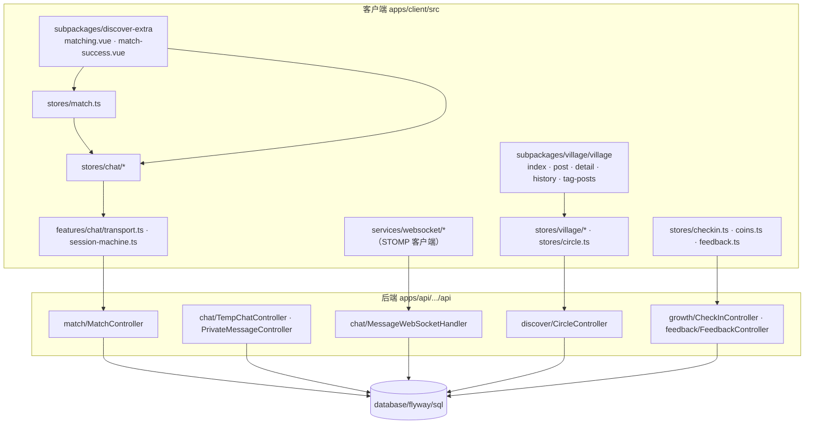

**图表来源**
- [index.ts:6-23](file://apps/client/src/stores/chat/index.ts#L6-L23)
- [websocket.ts:1-19](file://apps/client/src/services/websocket.ts#L1-L19)
- [higher-order.ts:13-30](file://apps/client/src/stores/chat/higher-order.ts#L13-L30)

**章节来源**
- [index.ts:6-23](file://apps/client/src/stores/chat/index.ts#L6-L23)
- [websocket.ts:1-19](file://apps/client/src/services/websocket.ts#L1-L19)
- [api.ts:67-107](file://apps/client/src/stores/village/api.ts#L67-L107)

## 核心组件

本节只列每个模块中**跨模块可见**的组件及其对外职责，模块内部完整清单见对应子页。

### 匹配系统

- `MatchController`（`@RequestMapping("/api/v1/matches")`）：匹配域唯一 HTTP 入口，除候选拉取外还承载 like / cancel-like / super-like / pass / rewind、liked-me、visitors、heart-signals 及其 accept/decline、icebreakers 查询共 18 个路由。
- `MatchEngine`（`@Profile("real")`）：候选集计算与打分。类注释把职责拆成四个方法：`getExcludedUserIds`（排除集合 = 自己 + 已喜欢 + 已有信号 + 已 pass）、`findAndScoreCandidates`（分页查询并按分数排序）、`calculateMatchScore`（校区/城市/兴趣标签/日程重叠四维打分）、`selectFromTopCandidates`（Top-N 随机选取）。
- `MatchPolicy`（`@Profile("real")`）：限额与前置校验，持有 `REWIND_DAILY_LIMIT`、`LIKE_DAILY_LIMIT`、`SUPER_LIKE_DAILY_LIMIT_DEFAULT` 三个业务常量及 Redis 计数器 key 前缀。
- `MatchRecorder`：注释明确「专注记录写入 + 通知推送，不包含算法逻辑」，`createMutualSignal` 负责双向喜欢的心动信号（`mutual_like`），并可按 `matchType` 区分 `super_like`。
- 客户端 `useMatchStore`（`defineStore("match")`）：滑动确认状态机，状态取值 `idle` / `checking` / `matched` / `chat_ready` / `failed`，对外只暴露 `status`、`canProceed`、`matchedUser`。

### 消息聊天系统

- `MessageWebSocketHandler`（`@Controller`）：STOMP 入站处理与出站推送。入站 `@MessageMapping("/chat/send")`，出站按目的地分四类——`/queue/messages`、`/queue/typing`、`/queue/signals`、`/queue/notifications`，并有 `sendHeartSignal` / `sendNotification` / `sendPrivateMessage` 三个面向其他模块的推送方法。
- `WebSocketConfig`：`enableSimpleBroker("/topic", "/queue")`、`setApplicationDestinationPrefixes("/app")`、`setUserDestinationPrefix("/user")`，端点 `/ws`（支持 SockJS 降级），握手期由 `JwtHandshakeInterceptor` 校验令牌。
- `TempChatController`（`/api/v1/temp-chat/sessions`）与 `PrivateMessageController`（`/api/v1/messages`）：临时匿名会话与正式私信两套 REST 契约。
- 客户端 `useChatStore`（`defineStore("chat")`）+ `chatTransport`（`createChatTransport()` 模块级单例）：会话生命周期、发送、交换、破冰话题的状态中枢。
- `session-machine.ts`：纯函数状态机，定义 `ChatPhase`（`matching` / `active` / `closing` / `closed`）与 `ContactExchangeStatus`（`idle` / `pending` / `accepted-by-self` / `accepted-by-peer` / `completed` / `rejected`）。

### 社区圈子

- `CircleController`（`/api/v1/circles`）：圈子列表、加入/退出、话题分页与创建、话题详情与回复、精选话题。
- 帖子域走 `apps/client/src/stores/village/api.ts` 中的函数化端点封装：`/posts`、`/posts/{postId}`、`/posts/{postId}/like`、`/posts/{postId}/share`、`/posts/{postId}/favorite`、`/posts/{postId}/comments`、`/posts/comments/{commentId}/like`、`/posts/history`、`/posts/hot-board`、`/posts/recommend`、`/search/posts`、`/search/hot`、`/users/{targetUserId}/follow`。
- `useCircleStore`（`defineStore("circle")`）与 `useVillageStore`（`defineStore("village")`）分别承载「兴趣圈话题」与「村庄信息流」。

### 反馈成长体系

- `CheckInController`（`/api/v1/check-in`）：`POST` 签到、`GET /status` 状态、`POST /make-up` 补签；`SocialProgressController`（`/api/v1/growth`）暴露 `GET /social-progress`。
- `RealCheckInService`：连续天数计算、补签扣费（首次免费、其后 50 积分）、`getStreakDays` / 月度签到日历等公共扩展方法。
- `FeedbackController`：`/api/v1/feedback/issues`、`/suggestions`、`/activity-proposals`、`/my-submissions`、`/images`，以及管理侧 `/api/v1/admin/feedback`、`/reply`、`/convert`。
- 客户端 `useCheckInStore`、`useCoinsStore`、`useFeedbackStore` 三个 store；签到常量 `CHECKIN_POINTS_EARNED = 5`、`MOCK_POINTS_BALANCE = 100` 定义在 `apps/client/src/constants/growth.ts`。

**章节来源**
- [MatchEngine.java:35-95](file://apps/api/src/main/java/com/campuslove/api/match/MatchEngine.java#L35-L95)
- [MatchPolicy.java:20-73](file://apps/api/src/main/java/com/campuslove/api/match/MatchPolicy.java#L20-L73)
- [MatchRecorder.java:146-171](file://apps/api/src/main/java/com/campuslove/api/match/MatchRecorder.java#L146-L171)
- [MatchController.java:50-50](file://apps/api/src/main/java/com/campuslove/api/match/MatchController.java#L50-L50)
- [MessageWebSocketHandler.java:42-114](file://apps/api/src/main/java/com/campuslove/api/chat/MessageWebSocketHandler.java#L42-L114)
- [WebSocketConfig.java:131-156](file://apps/api/src/main/java/com/campuslove/api/config/WebSocketConfig.java#L131-L156)
- [match.ts:11-95](file://apps/client/src/stores/match.ts#L11-L95)
- [session-machine.ts:1-112](file://apps/client/src/features/chat/session-machine.ts#L1-L112)
- [CircleController.java:35-168](file://apps/api/src/main/java/com/campuslove/api/discover/CircleController.java#L35-L168)
- [api.ts:67-409](file://apps/client/src/stores/village/api.ts#L67-L409)
- [RealCheckInService.java:540-559](file://apps/api/src/main/java/com/campuslove/api/growth/RealCheckInService.java#L540-L559)
- [growth.ts:34-37](file://apps/client/src/constants/growth.ts#L34-L37)

## 架构总览

四个模块共用同一条分层链路：页面只消费 store 暴露的视图模型，store 通过 `clientApi` / `chatTransport` / 函数化 api 封装访问 HTTP，实时事件走 STOMP 双通道（REST 发起 + WS 推送），后端所有业务域都是 Mock/Real 双 Bean 结构，由 Spring `@Profile` 切换。

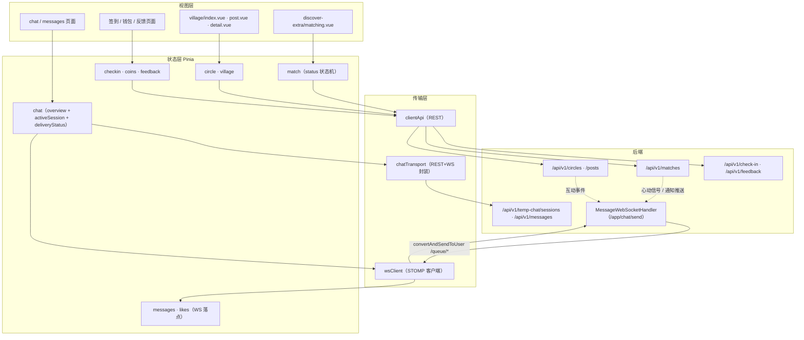

**图表来源**
- [matching.vue:5-31](file://apps/client/src/subpackages/discover-extra/discover/matching.vue#L5-L31)
- [index.ts:78-131](file://apps/client/src/stores/chat/index.ts#L78-L131)
- [store-dispatch.ts:6-30](file://apps/client/src/services/websocket/store-dispatch.ts#L6-L30)
- [MessageWebSocketHandler.java:205-271](file://apps/api/src/main/java/com/campuslove/api/chat/MessageWebSocketHandler.java#L205-L271)
- [api.ts:184-228](file://apps/client/src/stores/village/api.ts#L184-L228)

三条贯穿性设计约束值得单列：

1. **消息发送者身份不信任客户端**。WS 入站的 `senderId` 取自 STOMP 认证主体 `headerAccessor.getUser()`，未认证直接 `return`，payload 里的用户字段只作为待校验参数参与会话关系比对。
2. **落库失败不转发**。WS 侧对临时聊天与私信两类会话都先落库、后推送；落库抛错时代码注释写明「拒绝转发（避免未落库消息被传播）」。
3. **视图模型与原始数据分离**。store state 同时保存 `overview`（后端原始结构）与 `overviewView`（`toChatOverviewView` 结果），会话侧同理 `activeSession = toChatSessionView(...)`，UI 只读视图模型，便于 Mock/Real 两条数据源汇流到同一渲染口径。

**章节来源**
- [MessageWebSocketHandler.java:106-114](file://apps/api/src/main/java/com/campuslove/api/chat/MessageWebSocketHandler.java#L106-L114)
- [MessageWebSocketHandler.java:196-198](file://apps/api/src/main/java/com/campuslove/api/chat/MessageWebSocketHandler.java#L196-L198)
- [MessageWebSocketHandler.java:245-247](file://apps/api/src/main/java/com/campuslove/api/chat/MessageWebSocketHandler.java#L245-L247)
- [index.ts:79-106](file://apps/client/src/stores/chat/index.ts#L79-L106)
- [higher-order.ts:114-142](file://apps/client/src/stores/chat/higher-order.ts#L114-L142)
- [WebSocketConfig.java:123-134](file://apps/api/src/main/java/com/campuslove/api/config/WebSocketConfig.java#L123-L134)

## 详细组件分析

### 匹配系统：打分、限额与双向喜欢解锁

候选生成由 `MatchEngine` 完成。它的依赖清单（构造注入）是判断其能力边界的最直接证据：`MatchConfig`、`LikeRepository`、`HeartSignalRepository`、`PassRecordRepository`、`UserRepository`、`UserCampusProfileRepository`、`UserBasicProfileRepository`、`UserScheduleProfileRepository`、`ObjectMapper`——即匹配只读「喜欢/心动信号/pass 三类关系 + 校区/兴趣/日程三类画像」，不读聊天或社区数据。

打分逻辑在 `calculateMatchScore`（逐候选查库版）与 `calculateMatchScoreFromMaps`（预取 Map 批量版）中同构实现：同校区累加 `matchConfig.getCampusWeight()`、同城市累加 `getCityWeight()`、兴趣标签按交集个数乘 `getInterestWeight()`、日程时间窗口有交集累加 `getScheduleWeight()`。四个权重全部来自 `MatchConfig` 配置对象，代码里不出现硬编码分值；`apps/api/src/main/resources/application.yml` 的 `app.match` 段给出默认值 `campus-weight: 50`、`city-weight: 20`、`interest-weight: 10`、`schedule-weight: 15`，同段还有 `heart-signal-expire-hours: 48`（心动信号有效期）与 `candidate-page-size: 50`（候选分页大小）。日程重叠判定 `hasScheduleOverlap` 的实现是「两侧 JSON 时间窗口解析成 Map 后比较键集合是否有交集」，空/空白字符串直接判无重叠。

选取阶段 `selectFromTopCandidates` 用 `TOP_CANDIDATE_COUNT = 5`：取排序后的前 5 个（不足 5 取全部）高分候选，再用 `ThreadLocalRandom` 随机取一个，注释说明目的是「兼顾匹配质量和随机性，避免总是匹配最高分用户」。

限额由 `MatchPolicy` 承载，三个业务常量是硬边界：`REWIND_DAILY_LIMIT = 1`（每人每天最多反悔 1 次）、`LIKE_DAILY_LIMIT = 30`（普通喜欢每日 30 次）、`SUPER_LIKE_DAILY_LIMIT_DEFAULT = 10`（超级喜欢默认 10 次/日，可由配置 `app.match.super-like-daily-limit` 覆盖；注释记录其动因是「超级喜欢原为完全免费且无限量，可无限绕过普通喜欢 30 次/日限额」）。计数存 Redis，key 前缀 `rewind:count:` / `like:count:` / `super-like:count:`，TTL 36 小时，日期键格式 `yyyy-MM-dd`；Redis 不可用时降级为 `ConcurrentHashMap` 单实例内存计数。

双向喜欢解锁落在 `MatchRecorder.createMutualSignal`：注释写明「创建双向喜欢的心动信号（mutual_like）」，并把 `matchType` 参数化以区分 `super_like`（权重更高、原不受每日上限限制）。心动信号在库层的状态由 `heart_signals.status ENUM('pending','accepted','expired','declined')` + `expires_at` 约束，客户端通过 `GET /api/v1/matches/heart-signals` 读取、`POST /api/v1/matches/heart-signals/{id}/accept` 接受。

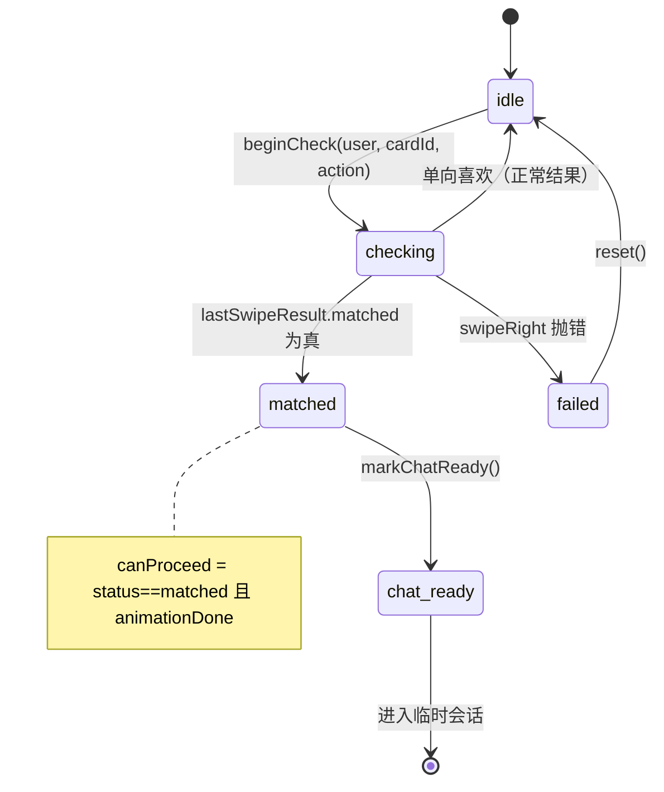

状态机的两条实现细节属于跨模块协作点：`runMatchCheck` 并不自己调喜欢接口，而是委托 `useDiscoverStore().swipeRight(pendingCardId, pendingAction === "superLike", callerSnapshot)`，再据 `discoverStore.lastSwipeResult.matched` 决定状态；`callerSnapshot` 透传是为修 URL 直达（冷启动、deck 未装载）时 `cardNotFound` 导致状态恒 `failed` 的缺陷。页面侧 `matching.vue` 还有一处竞态处理：卡片已在 `runMatchCheck` 内被 `swipeRight` 消费移除，二次滑动按幂等成功处理，且残留 `pendingCardId` 会使下次进入绕过 200ms 兜底。

**章节来源**
- [MatchEngine.java:35-95](file://apps/api/src/main/java/com/campuslove/api/match/MatchEngine.java#L35-L95)
- [MatchEngine.java:229-264](file://apps/api/src/main/java/com/campuslove/api/match/MatchEngine.java#L229-L264)
- [MatchEngine.java:280-347](file://apps/api/src/main/java/com/campuslove/api/match/MatchEngine.java#L280-L347)
- [MatchPolicy.java:20-73](file://apps/api/src/main/java/com/campuslove/api/match/MatchPolicy.java#L20-L73)
- [MatchRecorder.java:40-46](file://apps/api/src/main/java/com/campuslove/api/match/MatchRecorder.java#L40-L46)
- [MatchRecorder.java:146-171](file://apps/api/src/main/java/com/campuslove/api/match/MatchRecorder.java#L146-L171)
- [MatchController.java:148-376](file://apps/api/src/main/java/com/campuslove/api/match/MatchController.java#L148-L376)
- [application.yml:315-326](file://apps/api/src/main/resources/application.yml#L315-L326)
- [match.ts:18-95](file://apps/client/src/stores/match.ts#L18-L95)
- [matching.vue:200-260](file://apps/client/src/subpackages/discover-extra/discover/matching.vue#L200-L260)
- [V2026.05.21.0005__create_heart_signals_table.sql:1-14](file://database/flyway/sql/V2026.05.21.0005__create_heart_signals_table.sql#L1-L14)
- [V2026.05.21.0001__create_likes_table.sql:1-12](file://database/flyway/sql/V2026.05.21.0001__create_likes_table.sql#L1-L12)

### 消息聊天系统：双通道、投递状态与会话生命周期

后端 `MessageWebSocketHandler` 同时服务「临时匿名聊天」与「正式私信」两类会话，四个可选依赖说明了它的路由分叉：`TempChatSessionService` / `TempChatMessageService`（临时会话解析与落库）、`PrivateConversationRepository` / `PrivateMessageService`（私信关系校验与落库）。注释明确这些 real-profile Bean 在 mock 模式下为 `null` 时退化为仅转发（不校验/不落库）。入站校验链依次是：未认证拒绝、`content` 超 `MAX_MESSAGE_CONTENT_LENGTH = 5000` 拒绝（与 REST `SendMessageRequest @Size(max=5000)` 对齐）、`kind` 超 `MAX_MESSAGE_KIND_LENGTH = 32` 拒绝、缺 `recipientId` 拒绝、给自己发送拒绝、缺 `conversationId` 无法校验关系拒绝、ID 非数字格式拒绝、会话关系不匹配拒绝。`/chat/send` 之外的 `TYPING` 通道走同一套关系校验后推 `/queue/typing`。

出站侧三个方法是对其他模块的推送契约：`sendHeartSignal(userId, HeartSignalView)` → `/queue/signals`、`sendNotification(userId, NotificationView)` → `/queue/notifications`、`sendPrivateMessage(userId, MessageView)`。客户端 `store-dispatch.ts` 的头注释给出订阅落点：`messages` 与 `notifications` → `useMessagesStore`，`signals` → `useLikesStore` + `useMessagesStore`，`matches`（`/queue/matches`）→ `useMessagesStore` 通知，另含 `temp-chat`、`temp-chat/messages`、`checkin`、`typing` 分支。

客户端 store 的组织方式在同类中很特别：`defineStore("chat")` 的 actions 全部来自四个拆分文件，`index.ts` 只做挂载；两个高阶函数承担横切职责——`withErrorHandling` 统一 `loadingKey` 置位、`errorMessage` 清理与 `finally` 复位（非 `Error` 异常时用 `t(errorPrefixKey)` 出兜底文案，`rethrow` 供 `sendIcebreaker` 向上传播），`withMockMode` 统一 Mock/Real 分流，并在结果对象含 `id` 时 `toChatSessionView` 更新 `activeSession`、默认刷新 `loadOverview()`。

会话生命周期入口有三个，均以 `chatTransport.createSession(...)` 收口，区别只在入参来源：`startFromRecommendation(recommendedPersonId)`、`startFromSignal(signalId)`、`startFromMatch(matchId)`；三者返回 `SessionView | null`，即由匹配/推荐/心动信号域进入聊天域的三条合法路径。加载会话时 `chatTransport.loadSession(sessionId)` 成功后紧跟 `clientApi.markTempChatSessionRead(sessionId)`，置顶走 `pinTempChatSession` / `unpinTempChatSession`，结束走 `chatTransport.endSession(activeSession.id)`。

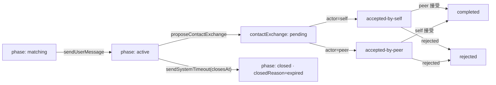

交换状态机的 `accepted-by-self` + `accepted-by-peer` → `completed` 规则在纯函数层（`respondToContactExchange`）与 store 层（`exchange.ts` 的 `exchangeTransitions` 查表）各实现一次，注释注明「infra R2-00097：状态机查表替代三元嵌套」，且 mock 分支与 real 分支（`chatTransport.respondToContactExchange(id, { actor, decision: "accept" | "reject" })`）走同一套语义。投递状态是另一处独立设计：`messageDeliveryStatus: Record<sendId, MessageDeliveryStatus>` 以客户端生成的 `send-${timestamp}` 为键持久化到本地存储，state 初始化即调 `loadMessageStatus()`，注释记录了动因（原 `sendText` 无状态持久化，刷新或切会话后用户无法感知上一条是否发送成功）。`sendText` 的返回类型也从 `void` 收紧为 `Promise<boolean>`，因为页面差分校验依赖布尔返回。

**章节来源**
- [MessageWebSocketHandler.java:47-114](file://apps/api/src/main/java/com/campuslove/api/chat/MessageWebSocketHandler.java#L47-L114)
- [MessageWebSocketHandler.java:196-271](file://apps/api/src/main/java/com/campuslove/api/chat/MessageWebSocketHandler.java#L196-L271)
- [MessageWebSocketHandler.java:296-359](file://apps/api/src/main/java/com/campuslove/api/chat/MessageWebSocketHandler.java#L296-L359)
- [MessageWebSocketHandler.java:401-441](file://apps/api/src/main/java/com/campuslove/api/chat/MessageWebSocketHandler.java#L401-L441)
- [store-dispatch.ts:6-30](file://apps/client/src/services/websocket/store-dispatch.ts#L6-L30)
- [store-dispatch.ts:76-107](file://apps/client/src/services/websocket/store-dispatch.ts#L76-L107)
- [index.ts:6-131](file://apps/client/src/stores/chat/index.ts#L6-L131)
- [higher-order.ts:30-86](file://apps/client/src/stores/chat/higher-order.ts#L30-L86)
- [higher-order.ts:114-142](file://apps/client/src/stores/chat/higher-order.ts#L114-L142)
- [store-type.ts:45-123](file://apps/client/src/stores/chat/store-type.ts#L45-L123)
- [session.ts:54-173](file://apps/client/src/stores/chat/actions/session.ts#L54-L173)
- [session.ts:204-312](file://apps/client/src/stores/chat/actions/session.ts#L204-L312)
- [exchange.ts:18-110](file://apps/client/src/stores/chat/actions/exchange.ts#L18-L110)
- [session-machine.ts:1-112](file://apps/client/src/features/chat/session-machine.ts#L1-L112)

### 社区圈子：频道聚合、发帖与互动

`village/index.vue` 的顶部是权限闸门：`isUnlocked = sessionStore.isProfileComplete`，未完善资料时展示完成度（`completionPercent`）而非内容流。频道由 `config/channels` 驱动，`currentChannelId = ref<ChannelId>(getLastChannel())` 记住上次频道，`currentChannel = getChannelConfig(currentChannelId) ?? CHANNEL_CONFIGS[0]`，再用三个 computed 做分支：`isSchoolChannel`、`isActivityChannel`、`isInterestChannel`。校区认证状态参与可见性控制：`channelLockedIds = isCampusVerified ? [] : ["school"]`，即未校园认证时「校园」频道锁定。

信息流派生完全由频道配置决定：`currentFilters` 对 `dataSource === "interest-hub"` 返回空筛选，否则按 `cat-${channel.postCategory}` + `defaultSort ?? "latest"` 组装 `PostFilters`；`displayPosts` 在 `dataSource === "hot-board"` 时直接取 `villageStore.posts`，其余走普通列表；再把结果拆成 `pinnedPosts` 与 `feedPosts` 两段渲染。切频道逻辑（`switchChannel` 区段）同样按 `interest-hub` / `hot-board` 分派到不同数据源，这正是「圈子话题」与「村庄帖子」两条数据链在页面上的汇合点。

帖子数据链在 `stores/village/api.ts` 中函数化：`fetchPostsApi`（`GET /posts?…`，参数由 `buildPostListParams` 组装）、`createPostApi`（`POST /posts`）、`fetchPostDetailApi`、`likePostApi` / `sharePostApi` / `favoritePostApi`、`fetchCommentsApi` / `createCommentApi` / `likeCommentApi`、`fetchPostHistoryApi` / `clearPostHistoryApi`、`getHotBoardApi` / `getPostRecommendApi`、`searchPostsApi` / `getHotSearchApi`、`followUserApi`。互动写入后由后端发通知/互动事件，再经 `/queue/notifications` 与 `/api/v1/notifications/interactions` 回流到消息中心。

兴趣圈话题走独立一套：`useCircleStore` 提供 `fetchCircles` / `joinCircle` / `leaveCircle` / `fetchTopics` / `createTopic` / `fetchTopicDetail` / `fetchReplies` / `replyToTopic` / `fetchFeaturedTopics` / `clearCurrentTopic`，并用 `mapToCircleItem` / `mapToTopicItem` / `mapToTopicDetail` / `mapToReplyItem` 四个映射函数把 `BackendCircleView` 等后端视图转成前端 `CircleItem` / `TopicItem` / `TopicDetail` / `ReplyItem`。后端契约是 `/api/v1/circles`：`GET` 列表、`POST /{id}/join`、`DELETE /{id}/join`、`GET|POST /{id}/topics`、`GET /topics/{id}`、`GET|POST /topics/{id}/replies`、`GET /featured`。

发帖页 `post.vue` 的圈子选择带三态渲染：`circlesLoading` → 加载态，`circlesLoadFailed` → 失败态，`joinedCircles.length` 判定 → 已加入列表，`v-else` → 空态引导；这是社区域里唯一显式建模「圈子数据加载失败」的位置。

**章节来源**
- [index.vue:58-174](file://apps/client/src/subpackages/village/village/index.vue#L58-L174)
- [index.vue:212-236](file://apps/client/src/subpackages/village/village/index.vue#L212-L236)
- [index.vue:580-720](file://apps/client/src/subpackages/village/village/index.vue#L580-L720)
- [post.vue:825-860](file://apps/client/src/subpackages/village/village/post.vue#L825-L860)
- [detail.vue:1-1](file://apps/client/src/subpackages/village/village/detail.vue#L1-L1)
- [tag-posts.vue:298-298](file://apps/client/src/subpackages/village/village/tag-posts.vue#L298-L298)
- [history.vue:144-279](file://apps/client/src/subpackages/village/village/history.vue#L144-L279)
- [api.ts:67-129](file://apps/client/src/stores/village/api.ts#L67-L129)
- [api.ts:143-228](file://apps/client/src/stores/village/api.ts#L143-L228)
- [api.ts:250-409](file://apps/client/src/stores/village/api.ts#L250-L409)
- [circle.ts:81-142](file://apps/client/src/stores/circle.ts#L81-L142)
- [circle.ts:279-420](file://apps/client/src/stores/circle.ts#L279-L420)
- [circle.ts:476-732](file://apps/client/src/stores/circle.ts#L476-L732)
- [CircleController.java:35-168](file://apps/api/src/main/java/com/campuslove/api/discover/CircleController.java#L35-L168)

### 反馈成长体系：签到、积分与提案

签到 store 的关键约束是「防双计」。`fetchStatus` 用自增令牌 `const token = ++fetchStatusToken` 比对来丢弃过期响应，并配 `AbortController` 与 `withTimeout` 做超时保护；`CHECKIN_TTL_MS = 30_000` 是签到状态的 TTL 常量。积分口径为：`pointsEarned = result.points ?? CHECKIN_POINTS_EARNED`，随后 `pointsBalance += pointsEarned`，注释解释为何不会重复累加——余额已由 `fetchStatus` 的 `data.points ?? this.pointsBalance` 同步时不再叠加。后端对应侧更严格：已签到重复提交时 `CheckInResultView` 的 `points` 直接返回 0，注释「本次无新增奖励，points 返回 0（防前端双计）」；`CheckInStatusView` 的 `points` 字段取自交友币钱包余额 `walletService.getBalance(userId)`，即「我的积分」与钱包是同一账户。

补签的成本与幂等也在服务层：首次补签免费（`used_count = 0`），其后每次 50 积分，按（用户, 日期）幂等扣减并依赖 `order_id` 唯一索引防重复扣费；余额不足时抛 `IllegalArgumentException("积分不足，本次补签需 … 积分")`。REST 面为 `POST /api/v1/check-in`、`GET /api/v1/check-in/status`、`POST /api/v1/check-in/make-up`，库表 `check_ins(user_id, consecutive_days, created_at)`。

连续天数算法：从今天往前逐天检查，今天没签但昨天有则从昨天起算，某天缺记录即中断；服务注释直言该数值「仅作视觉标识，无积分/等级影响」，并对外提供 `getStreakDays(userId)` 与按月签到日历查询扩展方法。

积分的消耗侧在 `useCoinsStore`：`UNLOCK_COST_YUAN: Record<UnlockScene, number>` 定义各解锁场景的元价，`spend(scene, targetId)` 以 `Math.round(UNLOCK_COST_YUAN[scene] * 100)` 换算为分，`buildUnlockOrderId(scene, targetId)` 生成幂等订单号，`UNLOCK_TARGET_TYPE` 把场景映射到 `LIKED_ME` / `VISITOR` 两类目标（与匹配域的 `GET /liked-me`、`GET /visitors` 对应）。余额侧 `fetchBalance` 读 `balanceCents` 并派生 `balanceYuan = balanceCents / 100`。

反馈域最小说明：`useFeedbackStore` 三个提交动作（`submitSuggestion`、`submitActivityProposal` 及问题上报）统一走 `loading` + `errorMessage` + `t("storeErrors.feedback.*")` 兜底文案模板，成功后 `await this.load()` 刷新列表，另有 `clearError`；后端把活动提案纳入运营链路，提供 `POST /api/v1/admin/activity-proposals/{id}/convert` 将提案转为活动，以及 `POST /api/v1/feedback/images` 承载截图附件。

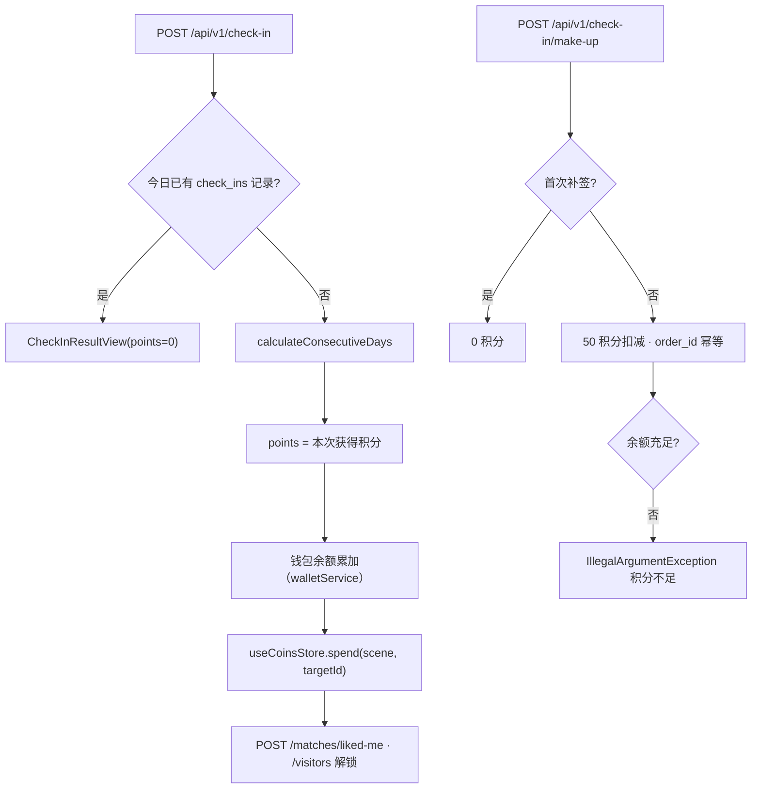

**图表来源**
- [CheckInController.java:22-79](file://apps/api/src/main/java/com/campuslove/api/growth/CheckInController.java#L22-L79)
- [RealCheckInService.java:217-250](file://apps/api/src/main/java/com/campuslove/api/growth/RealCheckInService.java#L217-L250)
- [RealCheckInService.java:436-463](file://apps/api/src/main/java/com/campuslove/api/growth/RealCheckInService.java#L436-L463)
- [coins.ts:51-190](file://apps/client/src/stores/coins.ts#L51-L190)
- [V2026.05.23.0002__create_check_ins.sql:1-10](file://database/flyway/sql/V2026.05.23.0002__create_check_ins.sql#L1-L10)

**章节来源**
- [checkin.ts:10-115](file://apps/client/src/stores/checkin.ts#L10-L115)
- [checkin.ts:286-336](file://apps/client/src/stores/checkin.ts#L286-L336)
- [checkin.ts:401-480](file://apps/client/src/stores/checkin.ts#L401-L480)
- [RealCheckInService.java:217-250](file://apps/api/src/main/java/com/campuslove/api/growth/RealCheckInService.java#L217-L250)
- [RealCheckInService.java:294-355](file://apps/api/src/main/java/com/campuslove/api/growth/RealCheckInService.java#L294-L355)
- [RealCheckInService.java:436-469](file://apps/api/src/main/java/com/campuslove/api/growth/RealCheckInService.java#L436-L469)
- [RealCheckInService.java:540-559](file://apps/api/src/main/java/com/campuslove/api/growth/RealCheckInService.java#L540-L559)
- [CheckInController.java:22-79](file://apps/api/src/main/java/com/campuslove/api/growth/CheckInController.java#L22-L79)
- [SocialProgressController.java:22-36](file://apps/api/src/main/java/com/campuslove/api/growth/SocialProgressController.java#L22-L36)
- [coins.ts:51-190](file://apps/client/src/stores/coins.ts#L51-L190)
- [feedback.ts:12-103](file://apps/client/src/stores/feedback.ts#L12-L103)
- [FeedbackController.java:60-198](file://apps/api/src/main/java/com/campuslove/api/feedback/FeedbackController.java#L60-L198)
- [growth.ts:34-37](file://apps/client/src/constants/growth.ts#L34-L37)

## 模块边界与接口契约

模块之间不存在直接函数调用，全部通过三类契约交汇：REST 路由前缀、STOMP 目的地、以及 store 之间的显式引用（`match` → `discover`、`websocket/store-dispatch` → `messages`/`likes`/`checkin`）。

### 契约面一：HTTP 路由前缀

| 模块 | 前缀 | 关键路由 |
| --- | --- | --- |
| 匹配 | `/api/v1/matches` | `GET /form-config`、`POST`、`POST /quick`、`GET /{id}`、`POST /like`、`/cancel-like`、`/super-like`、`/pass`、`/rewind`、`GET /liked-me`、`/visitors`、`/my-likes`、`POST /visit`、`GET /heart-signals`、`POST /heart-signals/{id}/accept`、`/decline`、`PUT /visitors/{id}/read`、`GET /{matchId}/icebreakers` |
| 临时聊天 | `/api/v1/temp-chat/sessions` | `POST`（建会话）、`GET /{id}`、`POST /{id}/messages`、`POST /{id}/contact-exchange/respond`、`POST /{id}/end`、`/pin`、`/unpin`、`/read`、`/messages/{messageId}/recall` |
| 私信 | `/api/v1/messages` | `GET /conversations`、`POST /conversations`、`GET /conversations/{id}/messages`、`POST /conversations/{id}/messages`、`PUT /conversations/{id}/read`、`/pin`、`/mute`、`DELETE /conversations/{id}`、`DELETE /{messageId}` |
| 聊天概览 | `/api/v1/chat` | `GET /overview` |
| 通知 | `/api/v1/notifications` | `GET`、`GET /unread-count`、`GET /list`、`GET /count`、`PUT /{id}/read`、`/{id}/read-with-user`、`/read-all` |
| 互动事件 | `/api/v1/notifications/interactions` | `GET`、`GET /unread-count`、`PUT /{eventId}/read`、`PUT /read-all` |
| 圈子 | `/api/v1/circles` | `GET` 列表、`POST /{id}/join`、`DELETE /{id}/join`、`GET /{id}/topics`、`POST /{id}/topics`、`GET /topics/{id}`、`GET /topics/{id}/replies`、`POST /topics/{id}/replies`、`GET /featured` |
| 帖子 | `/api/v1/posts` 等 | `GET /posts`、`POST /posts`、`/posts/{postId}`、`/posts/{postId}/like`、`/share`、`/favorite`、`/comments`、`/posts/comments/{commentId}/like`、`/posts/history`、`/posts/hot-board`、`/posts/recommend`、`/search/posts`、`/search/hot`、`/users/{id}/follow` |
| 签到 | `/api/v1/check-in` | `POST`、`GET /status`、`POST /make-up` |
| 成长 | `/api/v1/growth` | `GET /social-progress` |
| 反馈 | `/api/v1/feedback` | `POST /issues`、`/suggestions`、`/activity-proposals`、`/images`、`GET /my-submissions`、`GET /my-submissions/{id}`；管理侧 `/api/v1/admin/feedback`、`PUT /{id}/reply`、`POST /api/v1/admin/activity-proposals/{id}/convert` |

### 契约面二：STOMP 目的地

`WebSocketConfig` 声明的命名空间是固定契约：客户端发送前缀 `/app`、用户级前缀 `/user`、代理 `/topic`（一对多）与 `/queue`（点对点，需认证）。实际使用的目的地为 `/app/chat/send`、`/app/chat/typing`（入站）与 `/user/queue/messages`、`/user/queue/typing`、`/user/queue/signals`、`/user/queue/notifications`（出站），`store-dispatch.ts` 的分支键 `messages` / `temp-chat/messages` / `signals` / `notifications` / `matches` / `temp-chat` / `checkin` / `typing` 与之对应。

### 契约面三：模块间的写入—通知边

- 匹配 → 聊天：心动信号被接受后，聊天侧以 `startFromSignal(signalId)` 或 `startFromMatch(matchId)` 建会话，两者最终都是 `chatTransport.createSession({ signalId })` / `createSession({ matchId })`；`temp_chat_session.match_id` 注释即「关联的匹配 ID（来自 HeartSignal）」。
- 匹配 → 客户端推送：`MessageWebSocketHandler.sendHeartSignal(userId, HeartSignalView)` 把 `mutual_like` / `super_like` 信号推给被喜欢方，落点为 `useLikesStore.onNewHeartSignal`。
- 社区 → 通知：帖子/评论/点赞类互动经 `notifications` 与 `interaction_events` 两张表回流，由 `sendNotification(userId, NotificationView)` 实时推送，未读数由 `/api/v1/notifications/unread-count` 与 `/interactions/unread-count` 对账。
- 成长 → 匹配：签到积分进钱包，`useCoinsStore.spend` 的 `UNLOCK_TARGET_TYPE` 只映射到 `LIKED_ME` / `VISITOR` 两类目标，对应 `GET /api/v1/matches/liked-me` 与 `/visitors` 的付费解锁，`PUT /visitors/{id}/read` 完成已读回执。
- 聊天 → 私信：联系方式交换 `completed` 后会话升级为私信域（`/api/v1/messages` 系列），WS 侧对私信复用 `RealPrivateMessageService#sendMessage` 落库（注释记录该修复：「WS 私信仅推送不落库」导致历史、未读、预览缺失与双通道不一致）。

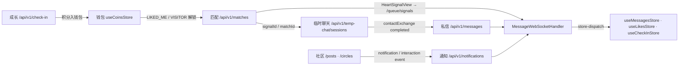

**图表来源**
- [session.ts:113-173](file://apps/client/src/stores/chat/actions/session.ts#L113-L173)
- [MessageWebSocketHandler.java:401-441](file://apps/api/src/main/java/com/campuslove/api/chat/MessageWebSocketHandler.java#L401-L441)
- [store-dispatch.ts:6-30](file://apps/client/src/services/websocket/store-dispatch.ts#L6-L30)
- [coins.ts:62-68](file://apps/client/src/stores/coins.ts#L62-L68)
- [WebSocketConfig.java:123-134](file://apps/api/src/main/java/com/campuslove/api/config/WebSocketConfig.java#L123-L134)

**章节来源**
- [MatchController.java:50-376](file://apps/api/src/main/java/com/campuslove/api/match/MatchController.java#L50-L376)
- [TempChatController.java:21-90](file://apps/api/src/main/java/com/campuslove/api/chat/TempChatController.java#L21-L90)
- [PrivateMessageController.java:37-180](file://apps/api/src/main/java/com/campuslove/api/chat/PrivateMessageController.java#L37-L180)
- [ChatController.java:15-36](file://apps/api/src/main/java/com/campuslove/api/chat/ChatController.java#L15-L36)
- [NotificationController.java:26-121](file://apps/api/src/main/java/com/campuslove/api/chat/NotificationController.java#L26-L121)
- [InteractionEventController.java:25-98](file://apps/api/src/main/java/com/campuslove/api/chat/InteractionEventController.java#L25-L98)
- [CircleController.java:35-168](file://apps/api/src/main/java/com/campuslove/api/discover/CircleController.java#L35-L168)
- [api.ts:67-409](file://apps/client/src/stores/village/api.ts#L67-L409)
- [CheckInController.java:22-79](file://apps/api/src/main/java/com/campuslove/api/growth/CheckInController.java#L22-L79)
- [SocialProgressController.java:22-36](file://apps/api/src/main/java/com/campuslove/api/growth/SocialProgressController.java#L22-L36)
- [FeedbackController.java:60-198](file://apps/api/src/main/java/com/campuslove/api/feedback/FeedbackController.java#L60-L198)
- [MatchRecorder.java:146-171](file://apps/api/src/main/java/com/campuslove/api/match/MatchRecorder.java#L146-L171)
- [V2026.05.27.0001__create_temp_chat_tables.sql:7-23](file://database/flyway/sql/V2026.05.27.0001__create_temp_chat_tables.sql#L7-L23)

## 端到端数据流

### 主链路：双向喜欢 → 心动信号 → 临时会话 → 交换 → 私信

这是四个模块里唯一完整跨越三域的链路，逐步对应到代码位置：

1. 卡片操作进入状态机：`matching.vue` 通过 `useMatchStore()` 调 `beginCheck(user, cardId, action)`，状态置 `checking`。
2. 状态机委托发现域：`runMatchCheck` 调 `discoverStore.swipeRight(pendingCardId, action === "superLike", callerSnapshot)`，结果取 `discoverStore.lastSwipeResult`；`matched` 为真则 `status = "matched"`，否则回 `idle`，异常才 `failed`。
3. 后端记账与双向解锁：`POST /api/v1/matches/like` 之后，`MatchRecorder` 在 `@Transactional` 中写 `likes`（`status ENUM('active','cancelled')`）并在存在反向喜欢时 `createMutualSignal` 生成 `heart_signals`（`status = pending`、写 `expires_at`）。
4. 实时通知对方：同一次请求链路上调用 `sendHeartSignal(userId, HeartSignalView)`，经 `convertAndSendToUser(..., "/queue/signals", signal)` 推给被喜欢方；客户端 `store-dispatch` 的 `signals` 分支把它交给 `useLikesStore.onNewHeartSignal` 与 `useMessagesStore`。
5. 接受信号并开会话：`POST /api/v1/matches/heart-signals/{id}/accept` 成功后，聊天域以 `startFromSignal(signalId)`（或匹配入口 `startFromMatch(matchId)`）调 `chatTransport.createSession({ signalId })`，落到 `POST /api/v1/temp-chat/sessions`；新行 `phase = matching`，`closes_at` 为 NOT NULL 列，其列注释定义为「会话关闭时间（24h 后自动过期）」，`match_id` 列注释为「关联的匹配 ID（来自 HeartSignal）」。
6. 消息双通道：`sendText(body)` 经 `withErrorHandling` + `withMockMode` 走 `chatTransport.pushMessage`；实时侧客户端向 `/app/chat/send` 发帧，`handleChatMessage` 从 `Principal` 取 senderId、校验会话关系、调用 `TempChatMessageService` 落库（落库失败即不转发），成功后 `convertAndSendToUser(recipientId, "/queue/messages", messageView)`，对端由 `store-dispatch` 的 `messages` 分支消费。
7. 交换与升级：任一方 `acceptExchange(actor)` → `chatTransport.respondToContactExchange(id, { actor, decision: "accept" })` → `POST /api/v1/temp-chat/sessions/{id}/contact-exchange/respond`；`self` 与 `peer` 两个方向都接受时状态到 `completed`，此后会话脱离匿名域、进入 `/api/v1/messages` 私信域，WS 私信复用 `RealPrivateMessageService#sendMessage` 完成「持久化 + 会话预览/未读更新 + 推送 MessageView」。
8. 过期回收：`TempChatCleanupService.cleanupExpiredSessions()` 以 `@Scheduled(cron = "0 0 * * * *")` 每小时扫描 `matching` / `active` 两个阶段中 `findByPhaseAndClosesAtBefore(phase, now)` 命中的会话，标记为 `expired` 并置 `closedReason = "expired"`；类注释说明这是对原「惰性标记」方案的改造（惰性标记会让过期会话长期停留在 `active` 阶段占库并拖慢会话列表查询），并用 Redisson 分布式锁保证多实例只有一个执行，客户端侧对应纯函数 `sendSystemTimeout(state, closedAt)`，把会话置为 `phase = "closed"` 且 `closedReason = "expired"`，与库层的到期终态表达同一业务含义。

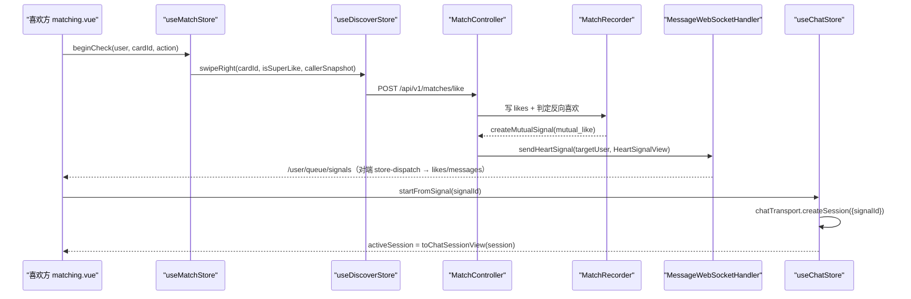

**图表来源**
- [match.ts:43-71](file://apps/client/src/stores/match.ts#L43-L71)
- [MatchRecorder.java:146-171](file://apps/api/src/main/java/com/campuslove/api/match/MatchRecorder.java#L146-L171)
- [MessageWebSocketHandler.java:401-419](file://apps/api/src/main/java/com/campuslove/api/chat/MessageWebSocketHandler.java#L401-L419)
- [store-dispatch.ts:208-236](file://apps/client/src/services/websocket/store-dispatch.ts#L208-L236)
- [session.ts:113-148](file://apps/client/src/stores/chat/actions/session.ts#L113-L148)
- [higher-order.ts:114-142](file://apps/client/src/stores/chat/higher-order.ts#L114-L142)

### 次链路：社区互动 → 通知中心

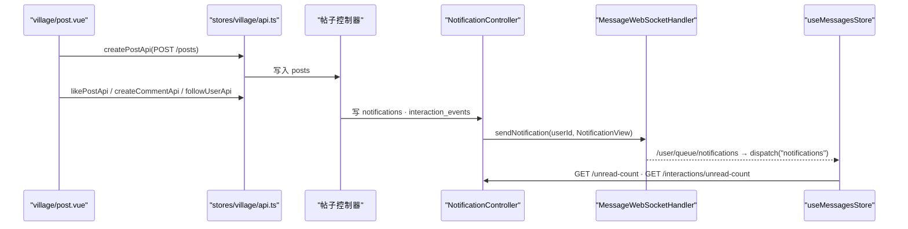

链路里有两处冗余设计是有意的：实时推送只负责「让在线用户立刻看到」，未读计数仍以 `/api/v1/notifications/unread-count` 与 `/api/v1/notifications/interactions/unread-count` 的 REST 结果为准，`notifications` 与 `interaction_events` 分表存储系统通知与互动事件，`read-with-user` 与 `read-all` 提供两种粒度回执。

**图表来源**
- [api.ts:203-409](file://apps/client/src/stores/village/api.ts#L203-L409)
- [NotificationController.java:26-121](file://apps/api/src/main/java/com/campuslove/api/chat/NotificationController.java#L26-L121)
- [InteractionEventController.java:25-98](file://apps/api/src/main/java/com/campuslove/api/chat/InteractionEventController.java#L25-L98)
- [MessageWebSocketHandler.java:419-437](file://apps/api/src/main/java/com/campuslove/api/chat/MessageWebSocketHandler.java#L419-L437)
- [store-dispatch.ts:6-30](file://apps/client/src/services/websocket/store-dispatch.ts#L6-L30)

**章节来源**
- [matching.vue:200-260](file://apps/client/src/subpackages/discover-extra/discover/matching.vue#L200-L260)
- [V2026.05.21.0001__create_likes_table.sql:1-12](file://database/flyway/sql/V2026.05.21.0001__create_likes_table.sql#L1-L12)
- [V2026.05.21.0005__create_heart_signals_table.sql:1-14](file://database/flyway/sql/V2026.05.21.0005__create_heart_signals_table.sql#L1-L14)
- [V2026.05.27.0001__create_temp_chat_tables.sql:7-23](file://database/flyway/sql/V2026.05.27.0001__create_temp_chat_tables.sql#L7-L23)
- [V2026.05.27.0001__create_temp_chat_tables.sql:48-58](file://database/flyway/sql/V2026.05.27.0001__create_temp_chat_tables.sql#L48-L58)
- [MessageWebSocketHandler.java:106-271](file://apps/api/src/main/java/com/campuslove/api/chat/MessageWebSocketHandler.java#L106-L271)
- [TempChatController.java:21-90](file://apps/api/src/main/java/com/campuslove/api/chat/TempChatController.java#L21-L90)
- [TempChatCleanupService.java:75-131](file://apps/api/src/main/java/com/campuslove/api/chat/TempChatCleanupService.java#L75-L131)
- [session-machine.ts:102-112](file://apps/client/src/features/chat/session-machine.ts#L102-L112)
- [exchange.ts:27-71](file://apps/client/src/stores/chat/actions/exchange.ts#L27-L71)
- [store-type.ts:109-122](file://apps/client/src/stores/chat/store-type.ts#L109-L122)

## 数据模型总览

四个模块的持久化边界互不重叠，全部表结构以 `database/flyway/sql/` 下的迁移脚本为唯一事实来源。下表只列跨模块可见的主键/外键式字段与状态枚举。

| 表 | 归属模块 | 关键字段与取值（源自 DDL 注释） | 迁移脚本 |
| --- | --- | --- | --- |
| `likes` | 匹配 | `user_id`（发起方）、`target_user_id`、`status ENUM('active','cancelled')` | `V2026.05.21.0001__create_likes_table.sql` |
| `heart_signals` | 匹配↔聊天 | `user_a_id`、`user_b_id`、`status ENUM('pending','accepted','expired','declined')`、`expires_at` | `V2026.05.21.0005__create_heart_signals_table.sql` |
| `pass_records` | 匹配 | 排除集合来源之一（`MatchEngine` 依赖 `PassRecordRepository`） | `V2026.05.29.0001__create_pass_records.sql` |
| `temp_chat_session` | 聊天 | `session_uid`（前端路由用）、`user_a_id`、`user_b_id`、`recommended_person_id`、`match_id`、`phase ENUM('matching','active','closed','expired')`、`closes_at`、`closed_reason`、`is_pinned`、双向 `*_unread_count`、`last_message_preview` | `V2026.05.27.0001__create_temp_chat_tables.sql` |
| `temp_chat_message` | 聊天 | `session_id`、`sender`（self/peer/system）、`kind`（text/voice/emoji/system）、`body`、`duration_seconds` | 同上 |
| `temp_chat_contact_exchange` | 聊天→私信 | 以 `session_id` 关联会话，承载联系方式交换状态 | 同上 |
| `private_conversations` / `private_messages` | 私信 | 交换完成后的正式会话与消息 | `V2026.05.24.0002__create_private_conversations.sql` |
| `interest_circles` / `circle_memberships` / `circle_topics` / `circle_replies` | 社区 | 圈子、成员关系、话题、回复四表 | `V2026.05.23.0005__create_interest_circles.sql` |
| `posts` / `comments` / `post_likes` / `post_shares` / `user_follows` | 社区 | 帖子正文、评论、点赞、分享、关注 | `V2026.05.21.0003`、`V2026.05.21.0004`、`V2026.05.26.0003`、`V2026.05.23.0006`、`V2026.05.25.0001` |
| `notifications` / `interaction_events` | 通知 | 系统通知与互动事件分表，对应 REST 的两组未读计数 | `V2026.05.23.0004`、`V2026.05.30.0004` |
| `icebreaker_topics` | 聊天 | 破冰话题表；聊天域另有 `GET /api/v1/matches/{matchId}/icebreakers` 路由对外提供话题列表 | `V2026.05.30.0003__create_icebreaker_topics.sql` |
| `check_ins` | 成长 | `user_id`、`consecutive_days INT DEFAULT 1`（注释「连续签到天数」） | `V2026.05.23.0002__create_check_ins.sql` |
| `social_progress` | 成长 | 社交进度画像 | `V2026.05.28.0002__create_social_progress.sql` |
| `feedback_tickets` | 反馈 | 问题/建议/活动提案工单 | `V2026.05.28.0001__create_feedback_tickets.sql` |

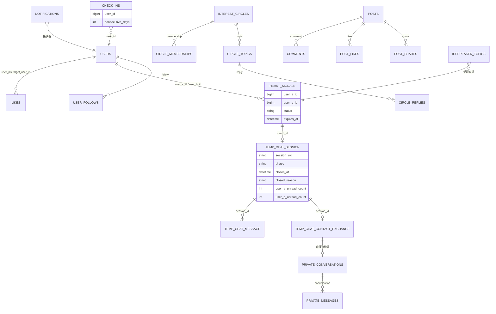

字段级要点：`temp_chat_session` 把未读计数拆成 `user_a_unread_count` / `user_b_unread_count` 两列而非共享计数，与 `is_pinned`、`last_message_preview`、`last_message_at` 一起构成会话列表所需的全部冗余字段，这正是 `withMockMode` 在每次操作后统一 `loadOverview()` 的原因。`sender` 与 `kind` 都是 `VARCHAR(16)` 且注释直接列举合法值，与客户端 `ChatMessageKind = "text" | "voice" | "emoji" | "system"`、`ChatSender = "self" | "peer" | "system"` 一一对应；`duration_seconds` 只在语音消息上有值，对应 `sendVoice(durationSeconds, tempFilePath)` 的时长参数。`temp_chat_session.phase` 含 `expired` 而客户端 `ChatPhase` 只有 `closed`，差异来自服务端把「到期」与「主动结束」在 phase 层分开、客户端只在 `closedReason` 上区分。

**图表来源**
- [V2026.05.27.0001__create_temp_chat_tables.sql:7-50](file://database/flyway/sql/V2026.05.27.0001__create_temp_chat_tables.sql#L7-L50)
- [V2026.05.21.0005__create_heart_signals_table.sql:1-14](file://database/flyway/sql/V2026.05.21.0005__create_heart_signals_table.sql#L1-L14)
- [V2026.05.23.0002__create_check_ins.sql:1-10](file://database/flyway/sql/V2026.05.23.0002__create_check_ins.sql#L1-L10)
- [session-machine.ts:1-31](file://apps/client/src/features/chat/session-machine.ts#L1-L31)

**章节来源**
- [V2026.05.21.0001__create_likes_table.sql:1-12](file://database/flyway/sql/V2026.05.21.0001__create_likes_table.sql#L1-L12)
- [V2026.05.18.0001__create_users.sql:3-3](file://database/flyway/sql/V2026.05.18.0001__create_users.sql#L3-L3)
- [V2026.05.24.0002__create_private_conversations.sql:1-17](file://database/flyway/sql/V2026.05.24.0002__create_private_conversations.sql#L1-L17)
- [V2026.05.23.0005__create_interest_circles.sql:1-41](file://database/flyway/sql/V2026.05.23.0005__create_interest_circles.sql#L1-L41)
- [V2026.05.21.0003__create_posts_table.sql:1-17](file://database/flyway/sql/V2026.05.21.0003__create_posts_table.sql#L1-L17)
- [V2026.05.28.0001__create_feedback_tickets.sql:2-2](file://database/flyway/sql/V2026.05.28.0001__create_feedback_tickets.sql#L2-L2)
- [V2026.05.28.0002__create_social_progress.sql:7-7](file://database/flyway/sql/V2026.05.28.0002__create_social_progress.sql#L7-L7)
- [V2026.05.30.0003__create_icebreaker_topics.sql:4-4](file://database/flyway/sql/V2026.05.30.0003__create_icebreaker_topics.sql#L4-L4)
- [V2026.05.29.0001__create_pass_records.sql:3-3](file://database/flyway/sql/V2026.05.29.0001__create_pass_records.sql#L3-L3)
- [V2026.05.26.0003__create_post_likes.sql:2-2](file://database/flyway/sql/V2026.05.26.0003__create_post_likes.sql#L2-L2)
- [V2026.05.25.0001__create_user_follows.sql:2-2](file://database/flyway/sql/V2026.05.25.0001__create_user_follows.sql#L2-L2)
- [V2026.05.23.0006__create_post_shares.sql:1-1](file://database/flyway/sql/V2026.05.23.0006__create_post_shares.sql#L1-L1)
- [V2026.05.23.0004__create_notifications.sql:2-2](file://database/flyway/sql/V2026.05.23.0004__create_notifications.sql#L2-L2)
- [V2026.05.30.0004__create_interaction_events.sql:3-3](file://database/flyway/sql/V2026.05.30.0004__create_interaction_events.sql#L3-L3)
- [store-type.ts:96-122](file://apps/client/src/stores/chat/store-type.ts#L96-L122)
- [index.ts:97-106](file://apps/client/src/stores/chat/index.ts#L97-L106)

## 依赖关系分析

### 后端：接口—Mock—Real 三件套

四个业务域都采用「接口 + `Mock*Service` + `Real*Service`」结构，由 Spring `@Profile` 决定注入哪个实现：匹配域 `MatchService` / `MockMatchService` / `RealMatchService` 与 `IcebreakerService` / `MockIcebreakerService` / `RealIcebreakerService`；聊天域 `TempChatService` / `MockTempChatService`、`PrivateMessageService` / `MockPrivateMessageService`、`InteractionEventService` / `MockInteractionEventService`、`NotificationService` / `RealNotificationService`；社区域 `CircleService` / `MockCircleService`；成长与反馈域 `CheckInService` / `MockCheckInService`、`AppConfigService` / `MockAppConfigService`、`FeedbackService` / `MockFeedbackService`。仓库中带 `@Profile("real")` 的文件 171 个、带 `@Profile("mock")` 的文件 50 个，说明这套双实现是全仓统一的扩展点，而非个别模块的局部技巧。

`@Profile("real")` 对上层的影响在 WS 处理器上最明显：`MessageWebSocketHandler` 的四个协作 Bean 全部是 `@Autowired(required = false)` 字段注入，注释写明 mock 模式下这些 Bean 为 `null` 时退化为仅转发。因此同一条 `/app/chat/send` 链路在两种 profile 下行为不同——real 落库+校验+推送，mock 只推送。

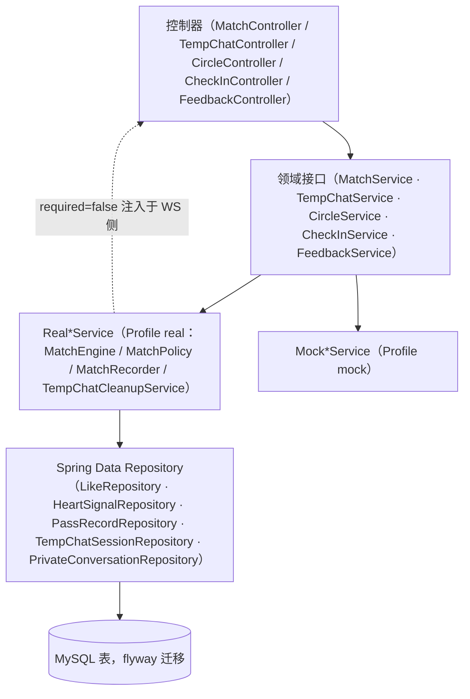

**图表来源**
- [MessageWebSocketHandler.java:55-87](file://apps/api/src/main/java/com/campuslove/api/chat/MessageWebSocketHandler.java#L55-L87)
- [MatchEngine.java:50-95](file://apps/api/src/main/java/com/campuslove/api/match/MatchEngine.java#L50-L95)
- [MatchPolicy.java:31-33](file://apps/api/src/main/java/com/campuslove/api/match/MatchPolicy.java#L31-L33)
- [TempChatCleanupService.java:43-44](file://apps/api/src/main/java/com/campuslove/api/chat/TempChatCleanupService.java#L43-L44)

### 客户端：store 依赖方向

依赖是单向的，页面 → store → 传输层，跨 store 调用集中在少数明确位置：

- `useMatchStore` → `useDiscoverStore`：`runMatchCheck` 内 `useDiscoverStore()` 后调 `swipeRight` 并读 `lastSwipeResult`，匹配域自己不持有卡片数据。
- `useChatStore` → `features/chat/transport` → `services/api`：`chatTransport = createChatTransport()` 是模块级单例，注释说明目的是「保证全局唯一，避免重复连接」；同时 `index.ts` 直接 `import { clientApi } from "../../services/api"` 用于 `getChatOverview` 与置顶/已读。
- `useChatStore` → `view-models/chat`：`toChatOverviewView` / `toChatSessionView` 是 store 与 UI 之间的转换层，`store-type.ts` 甚至用 `ReturnType<typeof toChatSessionView>` 作为类型锚点，使视图模型结构变化能在编译期暴露。
- `services/websocket/store-dispatch` → `stores/messages`、`stores/likes`、`stores/checkin`：WS 帧按目的地分派到这三个 store；分派前对帧字段做形状归一，注释理由是「确保运行时数据形状符合接口契约，避免脏数据污染 store」，且调用前用 `typeof storeAny.onNewMessage === "function"` 做方法存在性检查。
- `village/index.vue` → `config/channels` + `useSessionStore` + `useVillageStore`：频道配置驱动数据源选择，`isProfileComplete` 与 `isCampusVerified` 两个会话派生态控制内容可见性。

依赖纪律上有两点是显式写进代码的：`store-type.ts` 声明「该接口包含 state + actions 两部分，与 store 实例的公开 API 一致。当 store 结构变更时，需同步更新此接口」，即拆分文件的类型契约需人工跟维护；`index.ts` 对 mock 数据的 re-export 由通配改为逐个具名（注释 infra R2-00094：「不再通配 re-export mock-data（限制 mock 数据引用面）」），把 mock 的可达面收窄到显式导入。

**章节来源**
- [MatchEngine.java:50-95](file://apps/api/src/main/java/com/campuslove/api/match/MatchEngine.java#L50-L95)
- [MessageWebSocketHandler.java:55-87](file://apps/api/src/main/java/com/campuslove/api/chat/MessageWebSocketHandler.java#L55-L87)
- [match.ts:43-71](file://apps/client/src/stores/match.ts#L43-L71)
- [higher-order.ts:13-30](file://apps/client/src/stores/chat/higher-order.ts#L13-L30)
- [index.ts:26-66](file://apps/client/src/stores/chat/index.ts#L26-L66)
- [store-type.ts:1-26](file://apps/client/src/stores/chat/store-type.ts#L1-L26)
- [store-dispatch.ts:27-30](file://apps/client/src/services/websocket/store-dispatch.ts#L27-L30)
- [store-dispatch.ts:134-178](file://apps/client/src/services/websocket/store-dispatch.ts#L134-L178)
- [store-dispatch.ts:208-236](file://apps/client/src/services/websocket/store-dispatch.ts#L208-L236)
- [index.vue:84-135](file://apps/client/src/subpackages/village/village/index.vue#L84-L135)

## 性能考虑

### 匹配域：把逐行查库改成一次性预取

`MatchEngine` 里同时存在两份同构打分实现：`calculateMatchScore(candidateUserId, …)` 对每个候选分别走 `userCampusProfileRepository.findByUserId`、`userBasicProfileRepository.findByUserId`、`userScheduleProfileRepository.findByUserId` 三次查询；`calculateMatchScoreFromMaps(…, campusById, tagsById, scheduleById)` 接收预先组装好的三张 `Map`，打分阶段零查询。分页候选处理自然应选后者，前者更适合单点重算。`getExcludedUserIds` 的注释直接给出理由——「使用 Set 替代 List 提高查找性能」，因为排除判定是对每个候选做的成员查询。`TOP_CANDIDATE_COUNT = 5` 除了控制随机范围，注释还说明它「同时作为候选实体加载上限（投影优化用）」，即最多只为 5 个候选加载完整实体。

### 聊天域：廉价拒绝与批量清扫

`MessageWebSocketHandler` 在进入会话关系校验与落库之前先做长度检查：`content` 上限 5000、`kind` 上限 32，超长直接在入站处丢弃并记 `log.warn`，避免把无效负载带到 DB 层。过期会话的处理从「惰性标记」改为「主动清扫」：`TempChatCleanupService.cleanupExpiredSessions()` 用 `@Scheduled(cron = "0 0 * * * *")`（每小时整点）按 `matching` / `active` 两个阶段分别 `findByPhaseAndClosesAtBefore(phase, now)` 批量标记，类注释记录改造动因是惰性标记会让过期会话长期停留在 `active` 阶段「占用数据库并影响会话列表查询性能」，并且用 Redisson 分布式锁（本类 `@Profile("real")`，注释认为该 profile 下 Redisson 必可用）避免多实例重复扫描。同一文档注释还记录了调度方式选择：`fixedDelay` 起始时间依赖应用启动时刻，故用 cron。

### 客户端：连接退避与请求丢弃

STOMP 客户端常量把弱网成本压在可预测范围内：重连采用指数退避 `RECONNECT_BACKOFF_MS = 1000` 起步、`RECONNECT_MAX_INTERVAL_MS = 30000` 封顶（序列 1s/2s/4s/8s/16s/30s），`MAX_RECONNECT_ATTEMPTS = 6`，第 6 次仍失败即停止重连、等待用户操作或网络状态变化再触发；旧的固定 `RECONNECT_INTERVAL_MS = 3000` 已标 `@deprecated`。心跳 `HEARTBEAT_INTERVAL_MS = 30000`、`HEARTBEAT_TIMEOUT_MS = 10000`，并有「连续 N 个心跳窗口内未收到任何服务器消息（含 pong）才判定断线」的容错计数（infra R2-00126），避免单次抖动就重建连接。

签到 store 的读路径按「一次有效请求」设计：`CHECKIN_TTL_MS = 30_000` 的状态 TTL、`withTimeout` + `AbortController` 终止挂起请求、`fetchStatusToken` 自增令牌丢弃过期响应，三者共同保证快速切页时不会堆积重复请求。社区与私信侧统一分页：`fetchTopics(circleId, page = 1)`、`fetchReplies(topicId, page = 1)`、`fetchFeaturedTopics(page = 1)`，`/posts/hot-board` 与 `/posts/recommend` 携带 `page`/`pageSize`，钱包流水 `transactionsSize = 20`。

一处需要权衡的既有行为：`withMockMode` 默认 `shouldRefreshOverview = true`，即每次会话操作（发送、置顶、交换、结束）之后都会 `await store.loadOverview()` 拉一次全量概览。它保证 `last_message_preview`、未读计数等冗余字段与后端一致，代价是高频发送场景下的额外概览请求；调用方可以用 `options.shouldRefreshOverview: false` 关闭。

**章节来源**
- [MatchEngine.java:54-58](file://apps/api/src/main/java/com/campuslove/api/match/MatchEngine.java#L54-L58)
- [MatchEngine.java:91-96](file://apps/api/src/main/java/com/campuslove/api/match/MatchEngine.java#L91-L96)
- [MatchEngine.java:229-314](file://apps/api/src/main/java/com/campuslove/api/match/MatchEngine.java#L229-L314)
- [MessageWebSocketHandler.java:47-51](file://apps/api/src/main/java/com/campuslove/api/chat/MessageWebSocketHandler.java#L47-L51)
- [MessageWebSocketHandler.java:123-128](file://apps/api/src/main/java/com/campuslove/api/chat/MessageWebSocketHandler.java#L123-L128)
- [TempChatCleanupService.java:55-131](file://apps/api/src/main/java/com/campuslove/api/chat/TempChatCleanupService.java#L55-L131)
- [constants.ts:21-54](file://apps/client/src/services/websocket/constants.ts#L21-L54)
- [constants.ts:56-59](file://apps/client/src/services/websocket/constants.ts#L56-L59)
- [constants.ts:11-13](file://apps/client/src/services/websocket/constants.ts#L11-L13)
- [checkin.ts:10-10](file://apps/client/src/stores/checkin.ts#L10-L10)
- [checkin.ts:177-189](file://apps/client/src/stores/checkin.ts#L177-L189)
- [checkin.ts:286-292](file://apps/client/src/stores/checkin.ts#L286-L292)
- [circle.ts:420-420](file://apps/client/src/stores/circle.ts#L420-L420)
- [circle.ts:607-732](file://apps/client/src/stores/circle.ts#L607-L732)
- [api.ts:99-123](file://apps/client/src/stores/village/api.ts#L99-L123)
- [coins.ts:106-110](file://apps/client/src/stores/coins.ts#L106-L110)
- [higher-order.ts:110-142](file://apps/client/src/stores/chat/higher-order.ts#L110-L142)

## 故障排查指南

跨模块问题优先按下表定位「第一个可观测点」，再进入对应子页深查。

| 症状 | 首个判定点 | 证据位置 |
| --- | --- | --- |
| 滑动喜欢后确认动画恒不进入聊天页 | `useMatchStore.status === "failed"` 且 `lastError = "缺少匹配卡片信息"` | `match.ts` 中 `runMatchCheck` 对 `pendingCardId`/`pendingAction` 的空值分支 |
| URL 直达匹配页时恒 `failed` | `discoverStore.swipeRight` 在 mock 判定之前抛 `cardNotFound`，需透传 `callerSnapshot` | `match.ts:54-62` 注释（MP-R2-MATCHING-016） |
| 二次滑动报「卡片不存在」 | 卡片已在 `runMatchCheck` 内被消费，页面二次 `swipeRight` 需按幂等成功处理；残留 `pendingCardId` 会绕过 200ms 兜底 | `matching.vue:200-260` |
| 对端收不到 WS 消息 | 后端 `log.warn("WebSocket SEND 拒绝: …")`，按原因分九类：未认证 / content 超长 / kind 超长 / 无法获取认证用户ID / 缺 recipientId / 给自己发 / 缺 conversationId / ID 非数字 / 会话关系不匹配 | `MessageWebSocketHandler.java:112-178` |
| 消息看起来发出但历史里没有 | `SEND 落库失败，拒绝转发（避免未落库消息被传播）`；若跑 mock profile，`TempChatMessageService` 为 `null` 则仅转发不落库 | `MessageWebSocketHandler.java:196-247`、`55-87` |
| 刷新后不知道上一条是否发出去 | `messageDeliveryStatus` 是否从本地存储恢复（`loadMessageStatus()`），及 `MESSAGE_STATUS_STORAGE_KEY` / `MAX_SEND_RETRIES` 常量 | `index.ts:8`、`index.ts:97-106`、`store-type.ts:64-72` |
| 过期临时会话仍在列表里 | 每小时整点的 `cleanupExpiredSessions()`（`@Scheduled(cron = "0 0 * * * *")`）是否执行、是否为 `real` profile、Redisson 锁是否被占用 | `TempChatCleanupService.java:75-131` |
| 双方都点了接受却未完成交换 | 只有 `accepted-by-self` + `peer` 或 `accepted-by-peer` + `self` 才到 `completed`；`rejected` 是终态 | `session-machine.ts:68-100`、`exchange.ts:45-53` |
| 签到后积分加了两倍 | `pointsEarned` 是「本次获得」而非余额；重复签到后端返回 `points = 0` | `checkin.ts:473-480`、`RealCheckInService.java:217-250`、`294-316` |
| 补签报「积分不足」 | 首次免费、其后每次 50 积分，按（用户, 日期）幂等扣减并依赖 `order_id` 唯一索引 | `RealCheckInService.java:436-463` |
| 超级喜欢可无限刷 | 配置项 `app.match.super-like-daily-limit`（默认 10）是否被覆盖 | `MatchPolicy.java:43-73` |
| 限额在多实例下不一致 | Redis 不可用时 `MatchPolicy` 降级为 `ConcurrentHashMap` 本地计数，注释标注「单实例方案，生产应依赖 Redis」 | `MatchPolicy.java:62-69` |
| 校园频道点不进 | `channelLockedIds = isCampusVerified ? [] : ["school"]`；上游闸门是 `isUnlocked = sessionStore.isProfileComplete` | `index.vue:84-135` |
| 发帖页圈子列表空白 | `circlesLoading` / `circlesLoadFailed` / `joinedCircles.length` / `v-else` 四分支，失败态与空态是两套 UI | `post.vue:825-860` |
| 断网后不再收消息 | 重连阶梯 1s/2s/4s/8s/16s/30s 共 6 次，第 6 次失败后停止，需用户操作或网络状态变化再触发 | `constants.ts:21-49` |

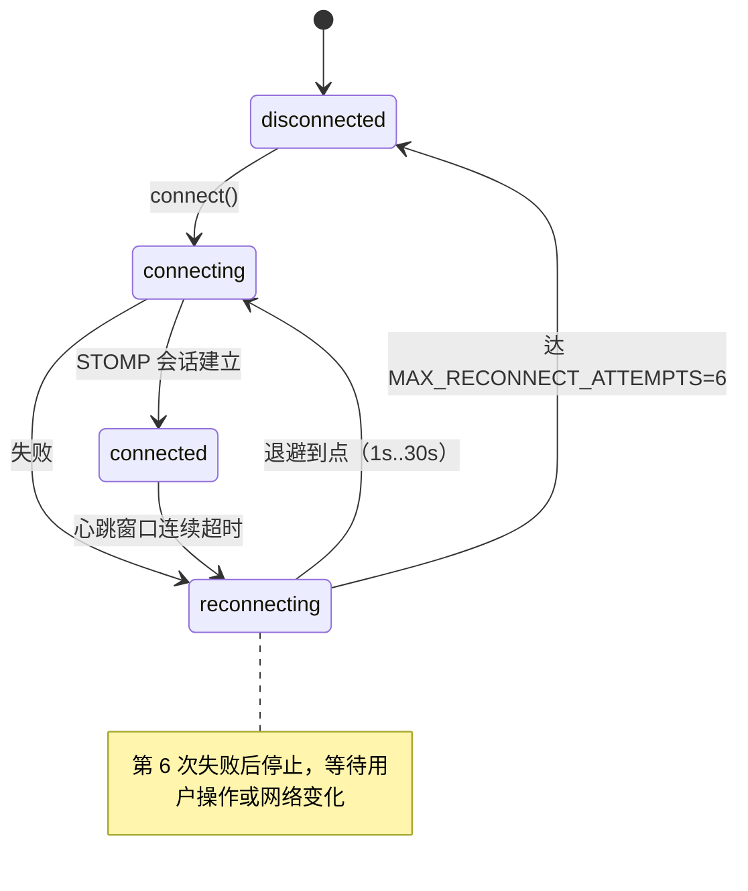

**图表来源**
- [types.ts:41-46](file://apps/client/src/services/websocket/types.ts#L41-L46)
- [constants.ts:21-49](file://apps/client/src/services/websocket/constants.ts#L21-L49)

排查顺序上的通则：先用 `GET /api/v1/chat/overview` 或 `/api/v1/temp-chat/sessions/{id}` 判断后端事实状态，再看客户端 `useChatStore.overview` / `activeSession` 是否落后；两者不一致时，问题几乎总在「WS 分支未落库」或「操作后未刷新概览」这两处，而不是渲染层。

**章节来源**
- [match.ts:43-71](file://apps/client/src/stores/match.ts#L43-L71)
- [matching.vue:200-260](file://apps/client/src/subpackages/discover-extra/discover/matching.vue#L200-L260)
- [MessageWebSocketHandler.java:112-262](file://apps/api/src/main/java/com/campuslove/api/chat/MessageWebSocketHandler.java#L112-L262)
- [TempChatCleanupService.java:75-131](file://apps/api/src/main/java/com/campuslove/api/chat/TempChatCleanupService.java#L75-L131)
- [MatchPolicy.java:43-73](file://apps/api/src/main/java/com/campuslove/api/match/MatchPolicy.java#L43-L73)
- [checkin.ts:401-480](file://apps/client/src/stores/checkin.ts#L401-L480)
- [RealCheckInService.java:217-250](file://apps/api/src/main/java/com/campuslove/api/growth/RealCheckInService.java#L217-L250)
- [RealCheckInService.java:436-463](file://apps/api/src/main/java/com/campuslove/api/growth/RealCheckInService.java#L436-L463)
- [index.vue:84-135](file://apps/client/src/subpackages/village/village/index.vue#L84-L135)
- [post.vue:825-860](file://apps/client/src/subpackages/village/village/post.vue#L825-L860)
- [session.ts:204-274](file://apps/client/src/stores/chat/actions/session.ts#L204-L274)
- [ChatController.java:15-36](file://apps/api/src/main/java/com/campuslove/api/chat/ChatController.java#L15-L36)
- [TempChatController.java:42-90](file://apps/api/src/main/java/com/campuslove/api/chat/TempChatController.java#L42-L90)

## 能力缺口登记

生成指令要求覆盖的条目里，以下几项在本仓库找不到实现证据。逐条登记判定依据，避免读者按不存在的接口去检索。

| 指令要求 | 判定 | 依据 |
| --- | --- | --- |
| 「反馈成长体系的……等级系统」 | **未实现** | `com.campuslove.api.growth` 包的类清单只有 `AppConfig*`、`CheckIn*`、`DoNotDisturb*`、`PushPreference*`、`PushSummary*`、`SocialProgress*`、`RecommendQuotaService`、`WeChatPushService` 及各自的 Mock/Real 实现，无等级实体或等级控制器；`RealCheckInService` 对连续签到天数写明「仅作视觉标识，无积分/等级影响」，并只提供 `getStreakDays` 与按月签到日历两个扩展方法。全仓库带「等级」字样的 Java 文件只有 `clientconfig/UnlockGuideStepView.java`（新手引导步骤）与上述注释；DDL 中含 `level` 的列只有 `user_basic_profile.education_level`（学历，取值 `high_school/bachelor/master/phd`），属画像字段而非成长等级。 |
| 「功能扩展点、插件机制」 | **无插件机制** | 后端 Java 源码对 `plugin` / `extension point` / `ExtensionRegistry` 零命中；客户端 `apps/client/src/plugins/` 目录仅含 `gsap.ts`（动画库注册），与业务扩展无关。当前唯一成体系的扩展点是领域服务的 Mock/Real 双 Bean + `@Profile` 切换（`@Profile("real")` 文件 171 个、`@Profile("mock")` 文件 50 个），属于「实现替换」而非「插件装载」，无运行期注册表。 |
| 「第三方集成方案」 | **仅单点封装，无统一方案** | 直接对外集成的证据是 `WeChatPushService`：两个 `@Value` 可覆盖端点 `app.wechat.access-token-url`（默认 `https://api.weixin.qq.com/cgi-bin/token?grant_type=client_credential&appid={appId}&secret={appSecret}`）与 `app.wechat.subscribe-message-url`（默认 `https://api.weixin.qq.com/cgi-bin/message/subscribe/send?access_token={accessToken}`），并暴露 `sendSubscribeMessage(openId, templateId, page, …)`。该类只服务订阅消息一条链路，仓库内没有跨模块的第三方适配接口或凭据管理层。 |
| 「消息状态管理」（服务端口径） | **只有客户端状态** | 投递状态存于客户端本地：`messageDeliveryStatus: Record<sendId, MessageDeliveryStatus>`，键为客户端生成的 `send-${timestamp}`，初始化即 `loadMessageStatus()` 回读本地存储，配套 `MESSAGE_STATUS_STORAGE_KEY` / `MAX_SEND_RETRIES` 常量。而 `temp_chat_message` 的建表列只有 `session_id`、`sender`、`kind`、`body`、`duration_seconds`、`created_at`，未出现消息状态列；撤回能力体现在路由 `POST /api/v1/temp-chat/sessions/{id}/messages/{messageId}/recall` 上，其落库效果不改变消息行的状态字段集合。 |
| 会话 `closing` 阶段的持久化 | **库层不可表示** | 客户端纯函数层的 `ChatPhase` 取值集合是 `matching`、`active`、`closing`、`closed` 四态，但 `temp_chat_session.phase` 的枚举只有 `('matching','active','closed','expired')`；清扫任务也只按 `SessionPhase.matching` 与 `SessionPhase.active` 两个阶段扫描。因此「即将关闭」这一中间态只在客户端存在，无法从后端会话行读出。 |
| 「超级喜欢扣费」的商业化闭环 | **注释标注为后续项** | `MatchPolicy` 关于 `SUPER_LIKE_DAILY_LIMIT_DEFAULT` 的注释写的是「现按配置配额（默认 10 次/日）封堵绕过，后续商业化可接入扣费」；`application.yml` 同段注释亦为「后续商业化如需扣费，可在入口接入钱包扣费」。当前只有次数配额，没有与 `useCoinsStore.spend` 相连的扣费路径（钱包扣费目前只覆盖 `LIKED_ME` / `VISITOR` 两类解锁目标）。 |
| 「兴趣标签/校区权重」的算法可解释性 | **无权重学习** | 打分是四项加权求和且权重固定（`campus-weight: 50`、`city-weight: 20`、`interest-weight: 10`、`schedule-weight: 15`），随机性只来自 `selectFromTopCandidates` 在 Top-5 内的 `ThreadLocalRandom` 选取；`MatchEngine` 的依赖清单里不存在任何行为反馈回流（浏览、聊天时长、交换成功率均不参与打分），所以指令中隐含的「算法自学习」在本模块没有实现。 |

需要说明的边界：生成指令中「深入解释匹配算法实现原理」「WebSocket 实时通信」「帖子发布与话题管理」「签到机制与积分计算」等条目**均有实现**，其逐条细节归属本分组子页（匹配系统 / 消息聊天系统 / 社区圈子 / 反馈成长体系），本页不重复。

**章节来源**
- [RealCheckInService.java:540-559](file://apps/api/src/main/java/com/campuslove/api/growth/RealCheckInService.java#L540-L559)
- [MatchPolicy.java:43-73](file://apps/api/src/main/java/com/campuslove/api/match/MatchPolicy.java#L43-L73)
- [MatchEngine.java:54-95](file://apps/api/src/main/java/com/campuslove/api/match/MatchEngine.java#L54-L95)
- [MatchEngine.java:316-328](file://apps/api/src/main/java/com/campuslove/api/match/MatchEngine.java#L316-L328)
- [WeChatPushService.java:32-54](file://apps/api/src/main/java/com/campuslove/api/growth/WeChatPushService.java#L32-L54)
- [WeChatPushService.java:178-206](file://apps/api/src/main/java/com/campuslove/api/growth/WeChatPushService.java#L178-L206)
- [application.yml:313-326](file://apps/api/src/main/resources/application.yml#L313-L326)
- [V2026.05.27.0001__create_temp_chat_tables.sql:34-41](file://database/flyway/sql/V2026.05.27.0001__create_temp_chat_tables.sql#L34-L41)
- [TempChatController.java:90-90](file://apps/api/src/main/java/com/campuslove/api/chat/TempChatController.java#L90-L90)
- [TempChatCleanupService.java:113-115](file://apps/api/src/main/java/com/campuslove/api/chat/TempChatCleanupService.java#L113-L115)
- [session-machine.ts:1-1](file://apps/client/src/features/chat/session-machine.ts#L1-L1)
- [store-type.ts:64-72](file://apps/client/src/stores/chat/store-type.ts#L64-L72)
- [index.ts:8-8](file://apps/client/src/stores/chat/index.ts#L8-L8)
- [coins.ts:62-68](file://apps/client/src/stores/coins.ts#L62-L68)
- [V2026.05.27.0001__create_temp_chat_tables.sql:14-14](file://database/flyway/sql/V2026.05.27.0001__create_temp_chat_tables.sql#L14-L14)

## 结论

四个模块的分工可以压成一句话：**匹配域产生关系，聊天域消耗关系，社区域沉淀内容，成长域计量行为并回馈到匹配域的付费解锁点**。它们之间没有任何直接调用，全部经由三类契约交汇——REST 路由前缀（`/api/v1/matches`、`/api/v1/temp-chat/sessions` 与 `/api/v1/messages`、`/api/v1/circles` 与 `/api/v1/posts`、`/api/v1/check-in` 与 `/api/v1/feedback`）、STOMP 目的地（入站 `/app/chat/send`、`/app/chat/typing`；出站 `/user/queue/messages`、`/queue/typing`、`/queue/signals`、`/queue/notifications`）、以及 store 分派表（`store-dispatch.ts` 的 `messages` / `signals` / `notifications` / `matches` / `temp-chat` / `checkin` / `typing` 分支）。

三条贯穿性的实现纪律值得在其他分组页面里被复用：身份取自认证主体而不取 payload；落库失败即不转发；store 同时保存原始数据与视图模型两份状态。另外两条值得注意：后端以「接口 + Mock/Real 双 Bean + `@Profile`」作为全仓统一的实现替换机制（171 个 real 文件对 50 个 mock 文件），客户端以高阶函数（`withErrorHandling` / `withMockMode`）收敛横切逻辑。

### 子页索引与本页边界

| 子页 | 覆盖范围（不在本页展开） | 本页对应章节 |
| --- | --- | --- |
| 匹配系统 | 候选生成与打分的完整推导、`MatchController` 逐条接口、滑动界面与 `MatchLoading` / `MatchSuccess` 组件交互、rewind/限额细则、心动信号 accept/decline 的状态迁移 | 详细组件分析·匹配系统；端到端数据流第 1–5 步 |
| 消息聊天系统 | `chatTransport` 与 STOMP 客户端逐帧实现、心跳与重连细节、会话四个 action 文件逐条说明、消息投递状态机、私信侧的未读与置顶 | 详细组件分析·消息聊天系统；依赖关系分析；性能考虑 |
| 社区圈子 | `village` 六个页面的组件级交互、频道配置全量清单、发帖与选圈三态、评论/点赞/收藏/分享/关注的接口逐条、圈子话题分页与回复 | 详细组件分析·社区圈子；端到端数据流·次链路 |
| 反馈成长体系 | 签到接口与状态 TTL 细节、补签扣费的完整事务路径、交友币钱包与解锁场景定价表、反馈工单三类提交与管理侧处理 | 详细组件分析·反馈成长体系；能力缺口登记 |

与其他分组的衔接：客户端 store 的组织与页面路由约定见「客户端应用（Uni-app）」，控制器—服务—仓储分层与事务边界见「后端API服务」，数据访问层与迁移脚本编排见该分组下的「数据访问层」页，鉴权与 `JwtHandshakeInterceptor` 的握手细节见「系统架构设计」，运营侧的圈子/帖子/举报治理见「管理后台系统」，环境准备与启动脚本见「项目概览与快速开始」。

后续维护本页的方式：新增业务域时先在「契约面一/二/三」登记它对外暴露的路由前缀、STOMP 目的地与 store 落点，再在子页展开实现；任何写进本页的数字（配额、权重、TTL、退避阶梯）都必须能在引用的源码行或 `application.yml` 行上核对。

**章节来源**
- [WebSocketConfig.java:123-156](file://apps/api/src/main/java/com/campuslove/api/config/WebSocketConfig.java#L123-L156)
- [store-dispatch.ts:6-30](file://apps/client/src/services/websocket/store-dispatch.ts#L6-L30)
- [store-dispatch.ts:76-107](file://apps/client/src/services/websocket/store-dispatch.ts#L76-L107)
- [MessageWebSocketHandler.java:106-114](file://apps/api/src/main/java/com/campuslove/api/chat/MessageWebSocketHandler.java#L106-L114)
- [MessageWebSocketHandler.java:196-198](file://apps/api/src/main/java/com/campuslove/api/chat/MessageWebSocketHandler.java#L196-L198)
- [higher-order.ts:54-142](file://apps/client/src/stores/chat/higher-order.ts#L54-L142)
- [application.yml:313-326](file://apps/api/src/main/resources/application.yml#L313-L326)
- [MatchEngine.java:280-314](file://apps/api/src/main/java/com/campuslove/api/match/MatchEngine.java#L280-L314)
- [index.ts:6-23](file://apps/client/src/stores/chat/index.ts#L6-L23)
