# WebSocket实时通信

<cite>
**本文引用的文件**
- [websocket.ts](file://apps/client/src/services/websocket.ts)
- [index.ts](file://apps/client/src/services/websocket/index.ts)
- [state-machine.ts](file://apps/client/src/services/websocket/state-machine.ts)
- [transport.ts](file://apps/client/src/services/websocket/transport.ts)
- [heartbeat.ts](file://apps/client/src/services/websocket/heartbeat.ts)
- [reconnect.ts](file://apps/client/src/services/websocket/reconnect.ts)
- [constants.ts](file://apps/client/src/services/websocket/constants.ts)
- [types.ts](file://apps/client/src/services/websocket/types.ts)
- [store-dispatch.ts](file://apps/client/src/services/websocket/store-dispatch.ts)
- [ws-message-adapter.ts](file://apps/client/src/services/websocket/ws-message-adapter.ts)
- [session.ts](file://apps/client/src/stores/session.ts)
- [websocket.spec.ts](file://apps/client/src/tests/websocket.spec.ts)
- [WebSocketConfig.java](file://apps/api/src/main/java/com/campuslove/api/config/WebSocketConfig.java)
- [JwtChannelInterceptor.java](file://apps/api/src/main/java/com/campuslove/api/config/JwtChannelInterceptor.java)
- [MessageWebSocketHandler.java](file://apps/api/src/main/java/com/campuslove/api/chat/MessageWebSocketHandler.java)
- [MessageView.java](file://apps/api/src/main/java/com/campuslove/api/chat/MessageView.java)
- [ConversationView.java](file://apps/api/src/main/java/com/campuslove/api/chat/ConversationView.java)
- [ChatMetrics.java](file://apps/api/src/main/java/com/campuslove/api/monitor/ChatMetrics.java)
- [AuthMetrics.java](file://apps/api/src/main/java/com/campuslove/api/monitor/AuthMetrics.java)
- [MatchMetrics.java](file://apps/api/src/main/java/com/campuslove/api/monitor/MatchMetrics.java)
- [RealPrivateMessageService.java](file://apps/api/src/main/java/com/campuslove/api/chat/RealPrivateMessageService.java)
</cite>

## 目录
1. [简介](#简介)
2. [项目结构](#项目结构)
3. [核心组件](#核心组件)
4. [架构总览](#架构总览)
5. [详细组件分析](#详细组件分析)
6. [STOMP 在微信小程序与 H5 的实现差异](#stomp-在微信小程序与-h5-的实现差异)
7. [连接状态机与重连机制](#连接状态机与重连机制)
8. [消息队列、发送确认与丢包处理](#消息队列发送确认与丢包处理)
9. [依赖关系分析](#依赖关系分析)
10. [配置与开关](#配置与开关)
11. [连接监控与性能指标](#连接监控与性能指标)
12. [功能开关](#功能开关)
13. [故障排查指南](#故障排查指南)
14. [附录](#附录)
15. [结论](#结论)

## 简介
本页从「核心功能模块」视角描述 Campus Love 的实时通信链路：客户端 `apps/client/src/services/websocket.ts` 与其子目录 `services/websocket/` 提供连接门面与连接状态机，服务端 `com.campuslove.api.chat.MessageWebSocketHandler` 承担会话注册与下行推送，`com.campuslove.api.monitor` 下的指标组件负责连接与消息的可观测性。文档覆盖连接建立、订阅与发布、心跳保活、断线检测、指数退避重连、发送队列与故障定位方法。

本页关注端到端链路与模块间协作。客户端页面级聊天功能（会话列表、气泡渲染、输入区）与 Uni-app 侧的 SocketTask 细节已由同目录树的另一页《WebSocket实时通信》（位于 `客户端应用（Uni-app）/核心功能模块/聊天系统/`）展开，本页不重复其组件级细节，只在需要时交叉引用。

## 项目结构

### 客户端侧
实时通信实现集中在 `apps/client/src/services/`。入口文件 `websocket.ts` 只有 20 行，是一个「向后兼容 re-export」门面：真正的实现被拆到 `services/websocket/` 目录，`export * from "./websocket/index"` 保证所有旧 `import { wsClient } from "@/services/websocket"` 的调用点无需改动。该文件头注释明确了各子模块职责划分：

| 子模块 | 职责（摘自入口文件注释） |
| --- | --- |
| `websocket/types.ts` | 类型定义（`StompFrame` / `WsConnectionState` 等） |
| `websocket/constants.ts` | 协议常量（心跳间隔 / 重连参数 / 帧分隔符等） |
| `websocket/transport.ts` | STOMP 帧编解码 + WebSocket 连接构造 |
| `websocket/state-machine.ts` | 连接状态机（状态存储与回调分发） |
| `websocket/heartbeat.ts` | 心跳管理器（ping/pong 与超时检测） |
| `websocket/reconnect.ts` | 重连管理器（次数计数与定时器） |
| `websocket/store-dispatch.ts` | Pinia Store 消息分发 |
| `websocket/index.ts` | `WebSocketClient` 主体实现 + 重新导出全部子模块 |

此外目录内还有 `websocket/ws-message-adapter.ts`，提供 `mapWsKind()`、`fromWsPayload()`、`resolveWsSessionId()` 三个纯函数，负责把下行帧负载映射为消息列表所需的 `MessageItem` 结构。

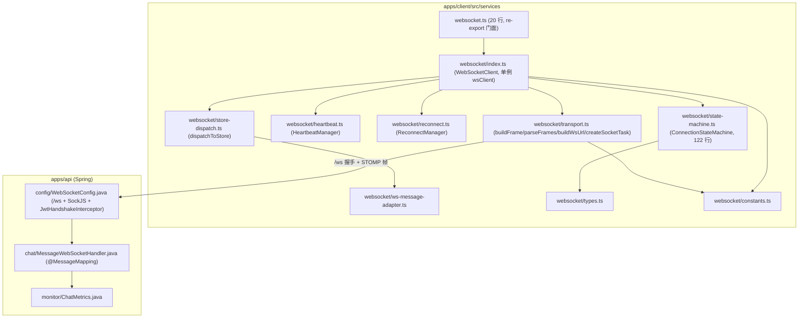

**图表来源**
- [websocket.ts:1-19](file://apps/client/src/services/websocket.ts#L1-L19)
- [state-machine.ts:1-121](file://apps/client/src/services/websocket/state-machine.ts#L1-L121)
- [index.ts:47-51](file://apps/client/src/services/websocket/index.ts#L47-L51)
- [index.ts:1013](file://apps/client/src/services/websocket/index.ts#L1013)
- [transport.ts:46-232](file://apps/client/src/services/websocket/transport.ts#L46-L232)
- [store-dispatch.ts:64](file://apps/client/src/services/websocket/store-dispatch.ts#L64)
- [ws-message-adapter.ts:36-107](file://apps/client/src/services/websocket/ws-message-adapter.ts#L36-L107)
- [constants.ts:16-78](file://apps/client/src/services/websocket/constants.ts#L16-L78)
- [MessageWebSocketHandler.java:43-85](file://apps/api/src/main/java/com/campuslove/api/chat/MessageWebSocketHandler.java#L43-L85)
- [ChatMetrics.java:24-103](file://apps/api/src/main/java/com/campuslove/api/monitor/ChatMetrics.java#L24-L103)

**章节来源**
- [websocket.ts:1-19](file://apps/client/src/services/websocket.ts#L1-L19)
- [index.ts:47-51](file://apps/client/src/services/websocket/index.ts#L47-L51)
- [index.ts:110-167](file://apps/client/src/services/websocket/index.ts#L110-L167)
- [types.ts:27-56](file://apps/client/src/services/websocket/types.ts#L27-L56)

### 服务端侧
服务端契约由 `com.campuslove.api.config.WebSocketConfig` 声明：STOMP 端点注册在 `/ws` 并启用 SockJS 回退，简单消息代理前缀为 `/topic` 与 `/queue`，应用目标前缀为 `/app`。业务上行入口是 `com.campuslove.api.chat.MessageWebSocketHandler`（`@Controller`，456 行），下行推送统一通过 `SimpMessagingTemplate.convertAndSendToUser()` 完成。

## 核心组件

实时通信由「一个客户端门面 + 五个无状态/半状态子模块 + 三个服务端组件」构成。

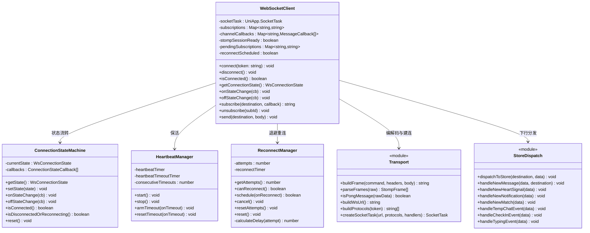

**图表来源**
- [index.ts:110-167](file://apps/client/src/services/websocket/index.ts#L110-L167)
- [index.ts:187-429](file://apps/client/src/services/websocket/index.ts#L187-L429)
- [index.ts:469-977](file://apps/client/src/services/websocket/index.ts#L469-L977)
- [state-machine.ts:27-121](file://apps/client/src/services/websocket/state-machine.ts#L27-L121)
- [heartbeat.ts:32-152](file://apps/client/src/services/websocket/heartbeat.ts#L32-L152)
- [reconnect.ts:54-172](file://apps/client/src/services/websocket/reconnect.ts#L54-L172)
- [transport.ts:46-275](file://apps/client/src/services/websocket/transport.ts#L46-L275)
- [store-dispatch.ts:64-420](file://apps/client/src/services/websocket/store-dispatch.ts#L64-L420)

- **`wsClient`（`WebSocketClient` 单例）**：`index.ts` 末尾以 `export const wsClient = new WebSocketClient()` 导出进程内唯一实例，持有 `UniApp.SocketTask`、订阅表 `subscriptions`、频道回调表 `channelCallbacks`、待补订阅表 `pendingSubscriptions` 与 `stompSessionReady` 标志。
- **`ConnectionStateMachine`**：122 行，只做「状态存储 + 回调分发」，不含业务逻辑，`setState()` 仅在状态实际变化时通知监听者，回调异常被 `try/catch` 吞掉并打印 `[WebSocket] 状态变更回调异常`。
- **`HeartbeatManager`**：维护 `heartbeatTimer`（周期发 ping）与 `heartbeatTimeoutTimer`（等 pong 超时），并用 `consecutiveTimeouts` 计数连续超时次数。
- **`ReconnectManager`**：维护 `attempts` 计数、`calculateDelay(attempt)` 退避公式与 `onExhausted` 回调（重连次数耗尽时通知业务层）。
- **`transport.ts` 纯函数群**：无状态，负责 STOMP 帧编解码与 `uni.connectSocket()` 连接构造，是「小程序 / H5 差异」被隔离的一层。
- **`store-dispatch.ts`**：把下行 destination 映射到 Pinia Store 动作，按频道分为私信、心动信号、通知、匹配、临时聊天、签到、输入中七类处理器。
- **服务端三件套**：`WebSocketConfig`（端点 `/ws` + SockJS + `JwtHandshakeInterceptor`）、`JwtChannelInterceptor`（CONNECT / SUBSCRIBE 阶段校验）、`MessageWebSocketHandler`（`@MessageMapping("/chat/send")`、`@MessageMapping("/chat/typing")` 与三类下行推送方法）。

**章节来源**
- [websocket.ts:1-19](file://apps/client/src/services/websocket.ts#L1-L19)
- [state-machine.ts:1-121](file://apps/client/src/services/websocket/state-machine.ts#L1-L121)
- [index.ts:110-167](file://apps/client/src/services/websocket/index.ts#L110-L167)
- [index.ts:1013](file://apps/client/src/services/websocket/index.ts#L1013)
- [transport.ts:17-25](file://apps/client/src/services/websocket/transport.ts#L17-L25)
- [heartbeat.ts:32-45](file://apps/client/src/services/websocket/heartbeat.ts#L32-L45)
- [reconnect.ts:54-82](file://apps/client/src/services/websocket/reconnect.ts#L54-L82)
- [store-dispatch.ts:64](file://apps/client/src/services/websocket/store-dispatch.ts#L64)
- [MessageWebSocketHandler.java:42-85](file://apps/api/src/main/java/com/campuslove/api/chat/MessageWebSocketHandler.java#L42-L85)

## 架构总览

链路分为两个认证阶段与一个消息阶段：HTTP 握手阶段用 `Sec-WebSocket-Protocol` 子协议头承载 `bearer.${token}`；STOMP 会话阶段用 CONNECT 帧的 `Authorization: Bearer ${token}`；建会话后的订阅与收发用标准 STOMP 命令。客户端 `index.ts` 头部注释即以此描述后端契约（端点 `/ws`，代理前缀 `/topic`、`/queue`，应用前缀 `/app`，用户前缀 `/user`）。

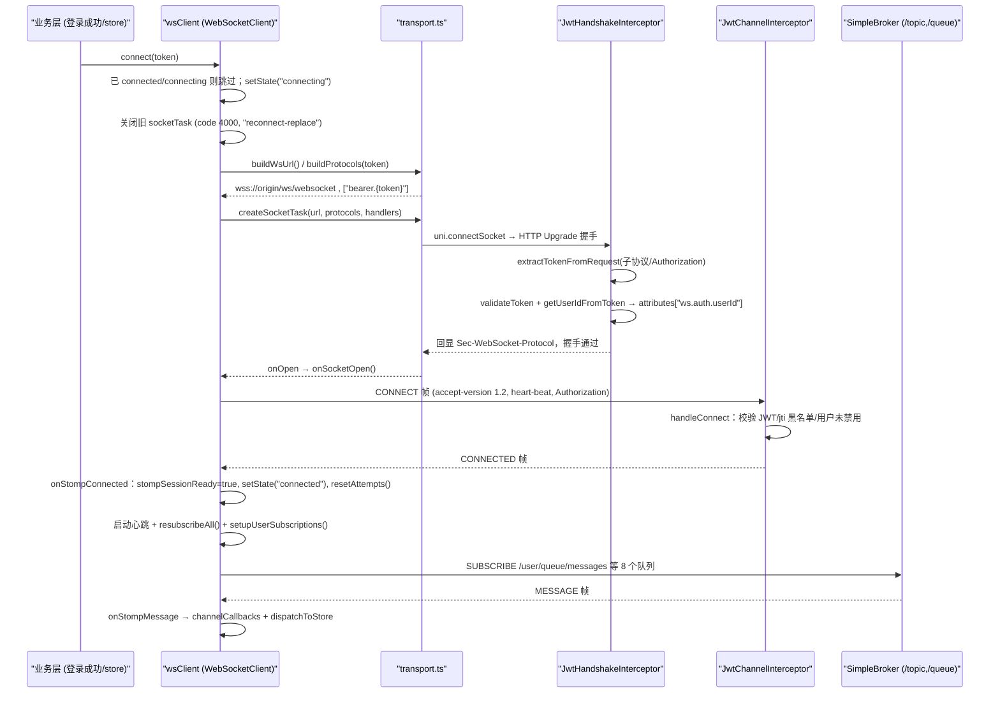

**图表来源**
- [index.ts:23-36](file://apps/client/src/services/websocket/index.ts#L23-L36)
- [index.ts:187-246](file://apps/client/src/services/websocket/index.ts#L187-L246)
- [index.ts:469-511](file://apps/client/src/services/websocket/index.ts#L469-L511)
- [index.ts:633-663](file://apps/client/src/services/websocket/index.ts#L633-L663)
- [index.ts:670-703](file://apps/client/src/services/websocket/index.ts#L670-L703)
- [index.ts:805-863](file://apps/client/src/services/websocket/index.ts#L805-L863)
- [transport.ts:182-275](file://apps/client/src/services/websocket/transport.ts#L182-L275)
- [WebSocketConfig.java:130-156](file://apps/api/src/main/java/com/campuslove/api/config/WebSocketConfig.java#L130-L156)
- [WebSocketConfig.java:200-284](file://apps/api/src/main/java/com/campuslove/api/config/WebSocketConfig.java#L200-L284)
- [JwtChannelInterceptor.java:89-191](file://apps/api/src/main/java/com/campuslove/api/config/JwtChannelInterceptor.java#L89-L191)

下行推送的生产者不止聊天模块：`MessageWebSocketHandler` 处理客户端上行，`RealPrivateMessageService`、`RealNotificationService`、`TempChatSessionService`、`TempChatMessageService`、`TempChatCleanupService` 以及匹配/签到链路（`MatchRecorder`、`MatchEventConsumer`、`CheckInEventConsumer`）都通过 `SimpMessagingTemplate.convertAndSendToUser()` 把视图对象投递到 `/queue/**`，由 Spring 的用户目的地解析映射回对应会话。

**章节来源**
- [WebSocketConfig.java:23-36](file://apps/api/src/main/java/com/campuslove/api/config/WebSocketConfig.java#L23-L36)
- [WebSocketConfig.java:130-135](file://apps/api/src/main/java/com/campuslove/api/config/WebSocketConfig.java#L130-L135)
- [index.ts:1-37](file://apps/client/src/services/websocket/index.ts#L1-L37)
- [MessageWebSocketHandler.java:42-85](file://apps/api/src/main/java/com/campuslove/api/chat/MessageWebSocketHandler.java#L42-L85)

## 详细组件分析

### WebSocketClient：连接与断开的入口

`connect(token)` 是所有链路的起点，其前置守卫与副作用顺序在 `index.ts` 中是确定的：

1. 状态守卫：当前状态为 `connected` 或 `connecting` 时打印「已存在活跃连接或正在连接中，跳过重复连接」并直接返回，杜绝并发建连。
2. 参数守卫：`token` 为空或全空白时输出 `[WebSocket] token 为空，无法建立连接` 并返回。
3. 写入上下文：`currentToken = token`、`manualClose = false`、`stompSessionReady = false`，随后 `setState("connecting")`。
4. 释放旧任务（R5 INDEP-003）：若 `socketTask` 仍存在，先以 `code: 4000, reason: "reconnect-replace"` 关闭并置空——微信小程序并发 socket 任务有上限（注释记为默认 5），重连路径不关旧任务会累积触发 `exceed max task count`，此后所有实时通道建立失败。
5. 建连：`buildWsUrl()` + `buildProtocols(token)` → `createSocketTask(...)`，四个回调分别接到 `onSocketOpen` / `onSocketMessage` / `onSocketClose` / `onSocketError`。
6. 兜底：`createSocketTask` 返回 `null`（构造抛异常）时，先把状态机置 `disconnected` 再 `handleReconnect()`。

`disconnect()` 的关键在于「先帧后关」：当 `stompSessionReady` 且 `socketTask` 存在时，发送带 `receipt: disconnect-${Date.now()}` 的 DISCONNECT 帧；随后 `cleanup()` 停心跳、取消重连定时器、清握手定时器与延迟关闭定时器；状态置 `disconnected`；最后用 `disconnectCloseTimer` 延迟 `DISCONNECT_CLOSE_DELAY_MS`（300ms）再 `closeSocket()`（`code: 1000, reason: "客户端主动关闭"`）。修复动因写在注释里：原实现发完帧立即关闭，帧大概率未发出，服务端无法感知正常下线。

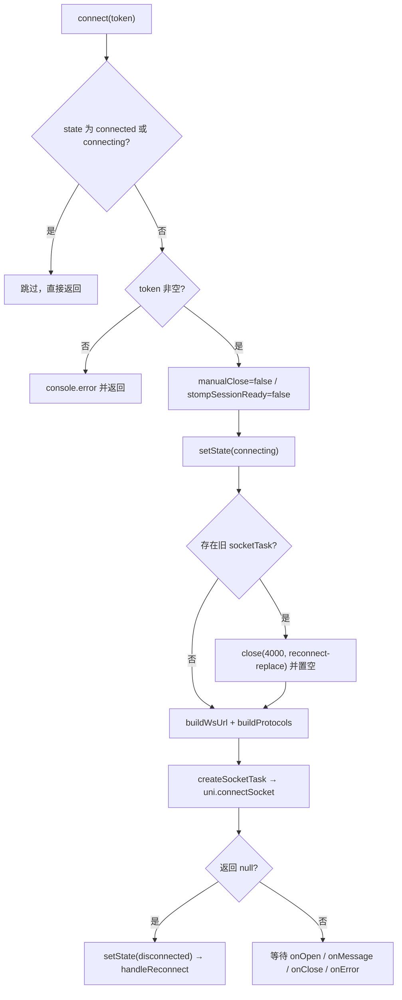

**图表来源**
- [index.ts:187-246](file://apps/client/src/services/websocket/index.ts#L187-L246)
- [index.ts:258-298](file://apps/client/src/services/websocket/index.ts#L258-L298)
- [index.ts:963-989](file://apps/client/src/services/websocket/index.ts#L963-L989)
- [transport.ts:232-275](file://apps/client/src/services/websocket/transport.ts#L232-L275)

**章节来源**
- [index.ts:65-86](file://apps/client/src/services/websocket/index.ts#L65-L86)
- [index.ts:108-167](file://apps/client/src/services/websocket/index.ts#L108-L167)
- [index.ts:187-298](file://apps/client/src/services/websocket/index.ts#L187-L298)
- [index.ts:308-334](file://apps/client/src/services/websocket/index.ts#L308-L334)

### 订阅与发送语义

`subscribe(destination, callback)` 生成 `subId = sub-${++subscriptionCounter}`（前缀常量 `SUBSCRIPTION_ID_PREFIX`），同时写入 `pendingSubscriptions`（重播用）与 `subscriptions`（活跃用），把回调 push 进 `channelCallbacks[destination]` 并单记 `subIdCallbacks[subId]`；仅当 `isConnected()`（状态机为 `connected` 且 `stompSessionReady` 双条件）为真时才立刻发 SUBSCRIBE 帧，否则留给 CONNECTED 后的 `resubscribeAll()` 补发。`unsubscribe(subId)` 按 `subIdCallbacks` 精确 splice 回调，列表为空时删除该 destination 键，以修复同 destination 多订阅时的回调泄漏。

`send(destination, body)` 在 `!isConnected() || !socketTask` 时只打印「未连接，无法发送消息」并返回；否则构造 `SEND` 帧（头含 `destination` 与 `content-type: application/json`），`body` 由 `JSON.stringify` 序列化，发送失败在 `fail` 回调中 `console.error`。

### 服务端上行入口

`MessageWebSocketHandler`（`@Controller`，455 行）暴露两个 `@MessageMapping`：

| 路由 | 方法 | 载荷字段 | 服务端动作 |
| --- | --- | --- | --- |
| `/app/chat/send` | `handleChatMessage(@Payload Map, SimpMessageHeaderAccessor)` | `conversationId` / `recipientId` / `content` / `kind` / `quoteRef` | 认证主体取 sender、限长校验、会话关系校验、委托消息服务落库并推送 |
| `/app/chat/typing` | `handleTyping(@Payload Map, SimpMessageHeaderAccessor)` | `conversationId` / `recipientId` / `typing` | 会话关系校验后转发 `{sessionId, typing, senderId}` 到 `/queue/typing` |

`handleChatMessage` 的安全与一致性要点（均可在方法体内逐行对应）：`senderId` 取自 `headerAccessor.getUser().getName()` 而非 payload；`content` 超长（`MAX_MESSAGE_CONTENT_LENGTH = 5000`，与 REST 端 `SendMessageRequest @Size(max=5000)` 对齐）或 `kind` 超长（`MAX_MESSAGE_KIND_LENGTH = 32`）直接拒绝；`senderId.equals(recipientId)` 视为非法；`conversationId` 缺失即拒绝（无法校验会话关系）。随后先尝试临时聊天会话（`tempChatSessionService.resolveSession` + `isTempChatPair`），命中则交给 `tempChatMessageService.sendMessage(conversationId, new ChatMessageRequest("self", kind|text, content, null, null), senderLong)` 落库并推送，明确不再重复推送；否则走私信会话分支（`findPrivateConversation` 支持数据库 ID 或 `conversationUid`，`isPrivatePair` 双向匹配），命中则调用 `privateMessageService.sendMessage(...)`；两条分支在落库抛异常时都「拒绝转发」，避免未落库消息被传播。当依赖 Bean 为 `null`（mock profile，`@Autowired(required = false)`）时退化为「覆盖 `payload.senderId` 后 `convertAndSendToUser(recipientId, "/queue/messages", payload)`」。

三个公开推送方法把内部服务与队列名解耦：`sendHeartSignal(String userId, HeartSignalView)` → `/queue/signals`、`sendNotification(String userId, NotificationView)` → `/queue/notifications`、`sendPrivateMessage(String userId, MessageView)` → `/queue/messages`，均在 `userId` 或视图对象为 `null` 时静默返回。

**章节来源**
- [MessageWebSocketHandler.java:21-51](file://apps/api/src/main/java/com/campuslove/api/chat/MessageWebSocketHandler.java#L21-L51)
- [MessageWebSocketHandler.java:106-274](file://apps/api/src/main/java/com/campuslove/api/chat/MessageWebSocketHandler.java#L106-L274)
- [MessageWebSocketHandler.java:291-360](file://apps/api/src/main/java/com/campuslove/api/chat/MessageWebSocketHandler.java#L291-L360)
- [MessageWebSocketHandler.java:362-455](file://apps/api/src/main/java/com/campuslove/api/chat/MessageWebSocketHandler.java#L362-L455)
- [MessageView.java:9](file://apps/api/src/main/java/com/campuslove/api/chat/MessageView.java#L9)
- [ConversationView.java:7](file://apps/api/src/main/java/com/campuslove/api/chat/ConversationView.java#L7)
- [index.ts:346-458](file://apps/client/src/services/websocket/index.ts#L346-L458)

## STOMP 在微信小程序与 H5 的实现差异

后端只暴露一个 STOMP 端点：`registry.addEndpoint("/ws")` 在挂载 `JwtHandshakeInterceptor` 之后调用 `.withSockJS()`，同时 `configureMessageBroker` 注册 `enableSimpleBroker("/topic", "/queue")`、`setApplicationDestinationPrefixes("/app")`、`setUserDestinationPrefix("/user")`。客户端侧的关键差异是：**uni-app（微信小程序）不支持 SockJS，也不支持引入原生 STOMP 库**，因此 `index.ts` 头注释明确写明「本模块手动构建 STOMP 帧，通过原始 WebSocket 文本帧发送/接收」。

| 维度 | 微信小程序（MP） | H5 / 浏览器 | 后端契约依据 |
| --- | --- | --- | --- |
| 建连 API | `uni.connectSocket({url, protocols, success, fail})` 返回 `SocketTask`，事件用 `onOpen/onMessage/onClose/onError` 注册 | 同一 API 由 uni-app H5 适配层落到原生 `WebSocket` | [transport.ts:232-275](file://apps/client/src/services/websocket/transport.ts#L232-L275) |
| 端点路径 | 原生 WebSocket 路径 `${origin}/ws/websocket`（不走 SockJS 的 `/ws/{server}/{session}/websocket` 层级） | 同左；若改用 SockJS 客户端则命中 `/ws` 的 info/ajax 轮询回退 | [transport.ts:171-189](file://apps/client/src/services/websocket/transport.ts#L171-L189)、[WebSocketConfig.java:137-156](file://apps/api/src/main/java/com/campuslove/api/config/WebSocketConfig.java#L137-L156) |
| 认证头 | 无法设自定义 HTTP 头 → 用子协议 `bearer.${token}`（`Sec-WebSocket-Protocol`） | 同样用子协议；支持自定义头的环境可用 `Authorization` | [WebSocketConfig.java:184-198](file://apps/api/src/main/java/com/campuslove/api/config/WebSocketConfig.java#L184-L198)、[transport.ts:191-203](file://apps/client/src/services/websocket/transport.ts#L191-L203) |
| 子协议回显 | 不敏感 | 原生 WebSocket 要求服务端回显所选子协议，否则协商失败、连接可能被拒（R4-00282） | [WebSocketConfig.java:229-235](file://apps/api/src/main/java/com/campuslove/api/config/WebSocketConfig.java#L229-L235) |
| 并发连接数 | SocketTask 并发有上限（注释记为默认 5），超出后报 `exceed max task count` | 无此硬上限 | [index.ts:206-216](file://apps/client/src/services/websocket/index.ts#L206-L216) |
| 心跳 | 与 H5 共用同一实现：发 `{"type":"ping"}` 文本，收 `{"type":"pong"}`；pong 不是 STOMP 帧，需在解析前拦截 | 同左；STOMP 规范的心跳空行帧后端不识别（P0 修复动因） | [heartbeat.ts:9-14](file://apps/client/src/services/websocket/heartbeat.ts#L9-L14)、[transport.ts:136-167](file://apps/client/src/services/websocket/transport.ts#L136-L167) |
| 帧分帧 | 一个 `onMessage` 回调可能携带多帧，`parseFrames` 以 `\x00` 切分后逐个处理 | 同左 | [transport.ts:82-134](file://apps/client/src/services/websocket/transport.ts#L82-L134)、[index.ts:537-540](file://apps/client/src/services/websocket/index.ts#L537-L540) |

### 连接池管理
本项目没有多连接池：`wsClient` 是模块级单例（`export const wsClient = new WebSocketClient()`），进程内只维持一条 `SocketTask`。所谓「池管理」在实现上表现为两条约束：其一，`connect()` 前置守卫使同一时刻只有一次建连在途；其二，MP 平台的 SocketTask 上限要求每次重连前显式 `close({code: 4000, reason: "reconnect-replace"})` 并清空引用，避免失败任务累积耗尽配额。

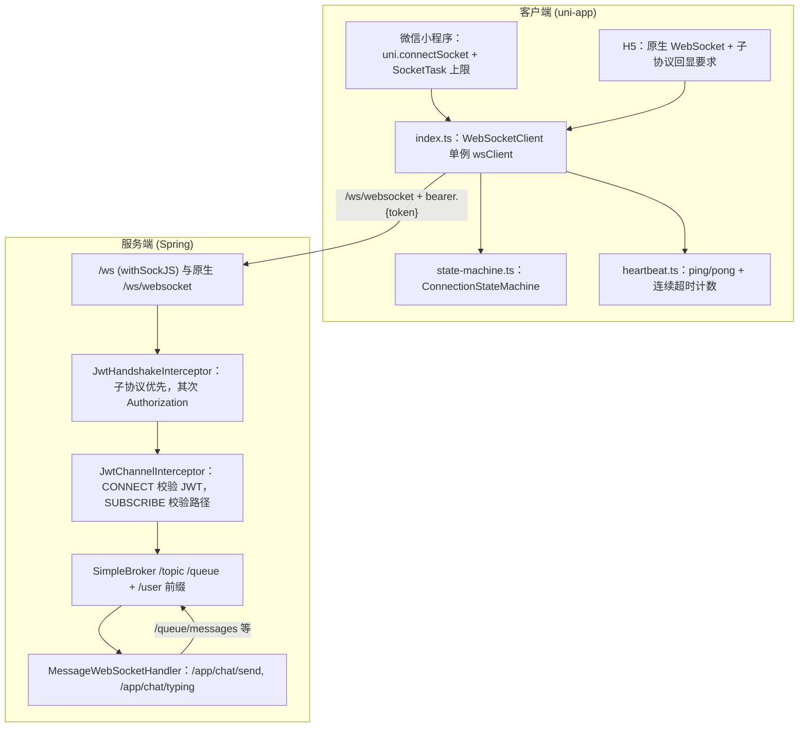

**图表来源**
- [index.ts:1-37](file://apps/client/src/services/websocket/index.ts#L1-L37)
- [index.ts:187-246](file://apps/client/src/services/websocket/index.ts#L187-L246)
- [index.ts:1013](file://apps/client/src/services/websocket/index.ts#L1013)
- [transport.ts:171-203](file://apps/client/src/services/websocket/transport.ts#L171-L203)
- [WebSocketConfig.java:130-156](file://apps/api/src/main/java/com/campuslove/api/config/WebSocketConfig.java#L130-L156)
- [WebSocketConfig.java:297-356](file://apps/api/src/main/java/com/campuslove/api/config/WebSocketConfig.java#L297-L356)
- [JwtChannelInterceptor.java:193-271](file://apps/api/src/main/java/com/campuslove/api/config/JwtChannelInterceptor.java#L193-L271)
- [MessageWebSocketHandler.java:106-108](file://apps/api/src/main/java/com/campuslove/api/chat/MessageWebSocketHandler.java#L106-L108)

**章节来源**
- [index.ts:1-37](file://apps/client/src/services/websocket/index.ts#L1-L37)
- [transport.ts:169-275](file://apps/client/src/services/websocket/transport.ts#L169-L275)
- [WebSocketConfig.java:23-36](file://apps/api/src/main/java/com/campuslove/api/config/WebSocketConfig.java#L23-L36)
- [WebSocketConfig.java:184-198](file://apps/api/src/main/java/com/campuslove/api/config/WebSocketConfig.java#L184-L198)
- [heartbeat.ts:1-15](file://apps/client/src/services/websocket/heartbeat.ts#L1-L15)

## 连接状态机与重连机制

### 状态定义
`types.ts` 把连接状态收敛为四值联合类型：`WsConnectionState = "disconnected" | "connecting" | "connected" | "reconnecting"`，初始值为 `disconnected`。规范文档里常出现的 `SUBSCRIBED`（订阅就绪）在本实现中不是一个独立状态，而是由业务层的布尔标志 `stompSessionReady` 表达：`WebSocketClient.isConnected()` 返回 `stateMachine.getState() === "connected" && stompSessionReady`，即「底层已连」与「STOMP 会话就绪」必须同时成立；`ConnectionStateMachine.isConnected()` 只看底层状态，注释明确要求业务层同时检查 `stompSessionReady`。

`ConnectionStateMachine` 只有两类职责：状态存储与回调分发。`setState()` 比较 `prevState !== state` 后才遍历回调，回调内 `try/catch` 保证单个监听者抛错不影响其他监听者；`isDisconnectedOrReconnecting()` 供错误处理路径判断「是否已经处于终态/重连态」，避免重复写状态；`reset()` 把状态写回 `disconnected` 但**不清空回调列表**（回调生命周期由外部业务层管理，状态机实例在 `wsClient` 单例中长期存活）。文件头注释记录了该模块的诞生动因：原实现在连接错误时未同步 `connectionState`，导致外部通过 `getConnectionState()` 读到不一致状态。

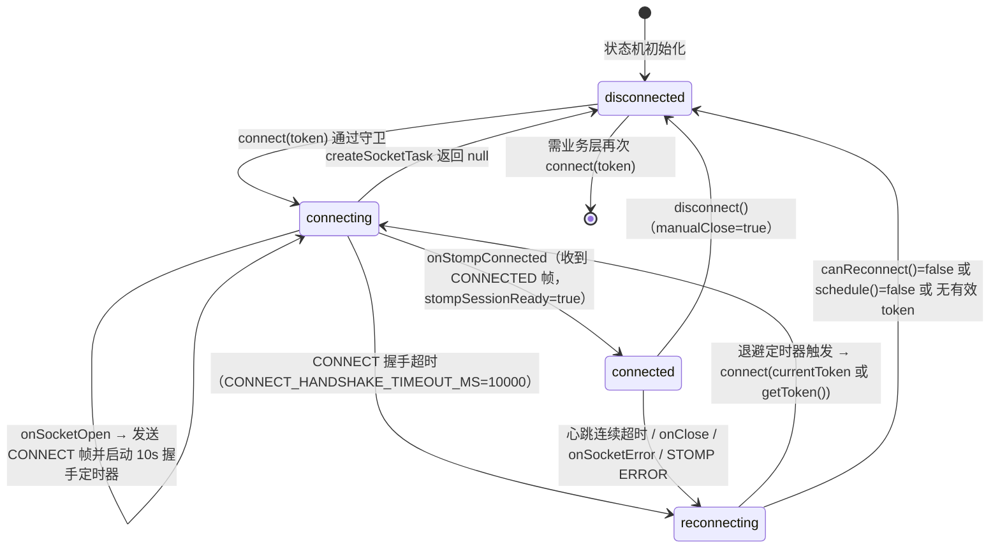

**图表来源**
- [types.ts:46-56](file://apps/client/src/services/websocket/types.ts#L46-L56)
- [state-machine.ts:27-121](file://apps/client/src/services/websocket/state-machine.ts#L27-L121)
- [index.ts:187-246](file://apps/client/src/services/websocket/index.ts#L187-L246)
- [index.ts:469-511](file://apps/client/src/services/websocket/index.ts#L469-L511)
- [index.ts:552-582](file://apps/client/src/services/websocket/index.ts#L552-L582)
- [index.ts:633-663](file://apps/client/src/services/websocket/index.ts#L633-L663)
- [index.ts:721-746](file://apps/client/src/services/websocket/index.ts#L721-L746)
- [index.ts:887-921](file://apps/client/src/services/websocket/index.ts#L887-L921)

### 触发重连的五条路径
`handleReconnect()` 是唯一的重连入口，五处调用点分别对应不同故障层：`createSocketTask` 返回 `null`、CONNECT 帧发送 `fail`、CONNECT 握手 10s 超时、`onSocketClose`（非手动）、`onSocketError`（非手动）、心跳连续超时、STOMP `ERROR` 帧（非认证类）。其内部有三道闸门：`manualClose` 为真直接返回；`reconnectScheduled` 为真直接返回（P1 修复：`error` 与 `close` 在部分平台会先后触发，原实现两处都调用 `handleReconnect`，导致 `attempts` 被双倍消耗、退避进度翻倍、最大次数提前耗尽）；`reconnectManager.canReconnect()` 为假则状态直接落回 `disconnected`。

`ReconnectManager` 的退避算法为 `delay = min(RECONNECT_BACKOFF_MS * 2^(attempt-1), RECONNECT_MAX_INTERVAL_MS)`，`calculateDelay()` 用 `Math.max(0, attempt - 1)` 防负指数；`schedule()` 先判 `attempts >= MAX_RECONNECT_ATTEMPTS`（6），超限则 `console.error("[WebSocket] 已达最大重连次数，停止重连")` 并触发 `onExhausted` 回调后返回 `false`，否则 `attempts += 1` 后按阶梯挂定时器。阶梯实值为 1000/2000/4000/8000/16000/30000 毫秒（第 6 次触顶 30s）。注释给出的设计权衡是：固定 3s 在弱网下浪费电量与服务端资源，指数退避兼顾快速恢复与降频，30s 上限避免用户长时间无感知断线。

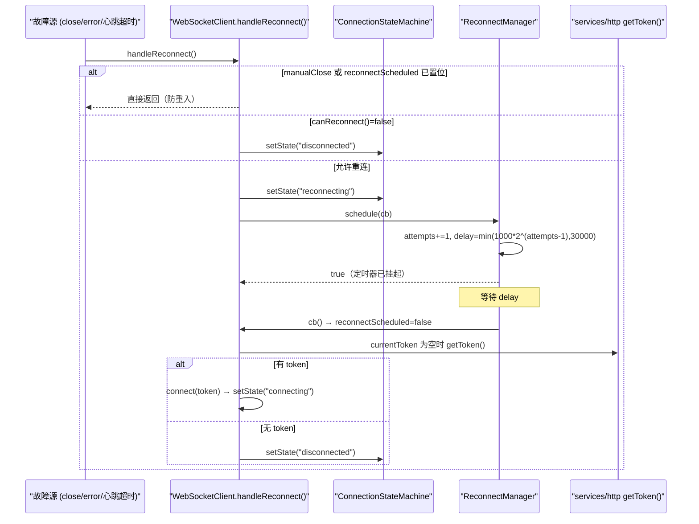

**图表来源**
- [index.ts:887-921](file://apps/client/src/services/websocket/index.ts#L887-L921)
- [index.ts:148-167](file://apps/client/src/services/websocket/index.ts#L148-L167)
- [reconnect.ts:81-142](file://apps/client/src/services/websocket/reconnect.ts#L81-L142)
- [state-machine.ts:50-64](file://apps/client/src/services/websocket/state-machine.ts#L50-L64)

### 心跳与断线检测
`HeartbeatManager.start(sendPing, onTimeout)` 在收到 CONNECTED 帧后启动：`setInterval` 每 `HEARTBEAT_INTERVAL_MS`（30000ms）调用一次 `sendPing()`（`buildPingPayload()` → `{"type":"ping"}`），并在每轮之后 `armTimeout()`；`armTimeout()` 用 `HEARTBEAT_TIMEOUT_MS`（10000ms）挂一次性定时器，超时递增 `consecutiveTimeouts`，达到 `HEARTBEAT_CONSECUTIVE_TIMEOUT_LIMIT`（2）才清零计数并触发 `onTimeout()`，否则仅输出「心跳超时（n/2），等待下一轮」。`onSocketMessage()` 对**任何**入站消息先调用 `resetTimeout()`，即清零连续超时计数并重新计时，因此服务端正常推送同样能证明链路存活。`stop()` 清理两个定时器并把计数归零，`cleanup()` 在每条断开/重连路径上统一调用。

**章节来源**
- [heartbeat.ts:1-15](file://apps/client/src/services/websocket/heartbeat.ts#L1-L15)
- [heartbeat.ts:32-142](file://apps/client/src/services/websocket/heartbeat.ts#L32-L142)
- [constants.ts:21-63](file://apps/client/src/services/websocket/constants.ts#L21-L63)
- [reconnect.ts:1-33](file://apps/client/src/services/websocket/reconnect.ts#L1-L33)
- [reconnect.ts:144-176](file://apps/client/src/services/websocket/reconnect.ts#L144-L176)
- [index.ts:519-544](file://apps/client/src/services/websocket/index.ts#L519-L544)
- [index.ts:963-972](file://apps/client/src/services/websocket/index.ts#L963-L972)

## 消息队列、发送确认与丢包处理

### 三类队列
实时链路上的「队列」在这套实现里有三个不同层面，需分开理解：

| 层面 | 载体 | 语义 | 溢出/淘汰策略 |
| --- | --- | --- | --- |
| 服务端用户队列 | Spring SimpleBroker 的 `/queue/**` + `/user` 前缀（`enableSimpleBroker("/topic", "/queue")`、`setUserDestinationPrefix("/user")`） | 每个认证会话独占，`convertAndSendToUser(userId, "/queue/xxx", view)` 由框架解析到目标会话 | 会话离线即不可达，改由 REST 拉取补数据 |
| 客户端订阅队列 | `pendingSubscriptions: Map<subId, destination>` 与 `subscriptions: Map<subId, destination>` | 记录「应当存在哪些订阅」，`resubscribeAll()` 在每次 CONNECTED 后重播 | 由 `unsubscribe(subId)` 双表删除；`isDestinationSubscribed()` 按 value 去重 |
| 客户端回调队列 | `channelCallbacks: Map<destination, MessageCallback[]>` + `subIdCallbacks: Map<subId, MessageCallback>` | 一个 destination 可有多个回调，逐个 `try/catch` 调用 | 列表为空时删除该 destination 键，修复回调泄漏 |

**发送侧没有持久化队列**：`send()` 在非 `isConnected()` 状态下只输出「未连接，无法发送消息」并返回，既不缓存也不重试；这是当前实现的明确边界，业务层（如会话页的 `wsClient.send("/app/chat/typing", ...)`）需要自行接受「未连接即丢弃」。断线期间的消息一致性由两条机制兜底：重连后 `resubscribeAll()` 恢复订阅、`handleNewMessage()` 依赖服务端落库后的历史拉取（`loadSession` 全量刷新兜底，注释见 `store-dispatch.ts`）。

### 订阅重播与去重（丢包/重复的双向修复）
`setupUserSubscriptions()` 声明 8 个用户队列，逐个用 `isDestinationSubscribed(dest)` 判重：已存在（重连场景）时不再调用 `subscribe()`，只在 `channelCallbacks` 缺失时防御性补注册，注释记录了 P0 动因——原实现每次重连都 `subscribe()`，`pendingSubscriptions` 里 `subId` 不断递增地累积重复条目，导致**单条消息被多次分发**；而更早的实现还会清空 `pendingSubscriptions`，使 `resubscribeAll()` 无内容可重播，导致**重连后订阅全丢**。R4-00175 另补齐 `matches`、`temp-chat`、`temp-chat/messages`、`checkin` 四类队列（原仅 `messages`/`signals`/`notifications`，匹配成功、临时会话新消息、签到事件的实时推送全部丢失）。

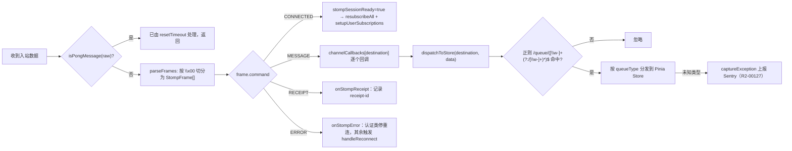

**图表来源**
- [index.ts:519-544](file://apps/client/src/services/websocket/index.ts#L519-L544)
- [index.ts:598-620](file://apps/client/src/services/websocket/index.ts#L598-L620)
- [index.ts:670-713](file://apps/client/src/services/websocket/index.ts#L670-L713)
- [index.ts:805-877](file://apps/client/src/services/websocket/index.ts#L805-L877)
- [transport.ts:82-167](file://apps/client/src/services/websocket/transport.ts#L82-L167)
- [store-dispatch.ts:64-125](file://apps/client/src/services/websocket/store-dispatch.ts#L64-L125)

### 发送确认（RECEIPT）
客户端只在两处使用 STOMP `receipt` 头：`disconnect()` 发送 `DISCONNECT` 帧时带 `receipt: disconnect-${Date.now()}`，`onStompReceipt()` 读取 `receipt-id` 并在开发环境打印「收到 RECEIPT:」。`SUBSCRIBE` 与 `SEND` 帧当前不带 `receipt`，其可靠性依赖平台层的 `socketTask.send({success, fail})` 回调：`SEND` 失败走 `console.error("[WebSocket] 发送消息失败:", err)`，`SUBSCRIBE` 失败走 `console.error("[WebSocket] SUBSCRIBE 帧发送失败: ...")`，`CONNECT` 帧发送失败直接 `handleReconnect()`。服务端的应用层确认则体现在落库语义上：`handleChatMessage` 在临时会话与私信两条分支中，若 `sendMessage` 抛异常则「拒绝转发（避免未落库消息被传播）」，即只有持久化成功的消息才会被推送到接收方队列。

### 载荷形状校验与契约漂移
`store-dispatch.ts` 的每个处理器都以类型守卫（`isMessageItem` / `isHeartSignal` / `isMessageHeartSignal` / `isSystemNotification`）替代 `as` 断言，非法形状时 `return` 并 `captureException(new Error(...), { source: "ws-store-dispatch", payload: data })`。私信载荷先经 `fromWsPayload(data, destination)` 归一（real 私信 `MessageView`、临时会话 `ChatMessageView`、mock 三形态 → 内部 `MessageItem`），这是「未读红点 BUG 1」的修复点：原实现对 raw 载荷直接跑守卫，real 载荷字段（`conversationId`/`senderId`/`messageKind`/`createdAt`）与内部字段（`sessionId`/`sender`/`kind`/`body`/`sentAt`）不匹配而被丢弃。`dispatchToStore` 的正则由 `/\/queue\/(\w+)$/` 改为支持 `-` 与 `/`，修复 `/queue/temp-chat/messages` 匹配失败导致的静默丢消息（未读红点 BUG 2）。

**章节来源**
- [index.ts:133-146](file://apps/client/src/services/websocket/index.ts#L133-L146)
- [index.ts:346-458](file://apps/client/src/services/websocket/index.ts#L346-L458)
- [index.ts:756-790](file://apps/client/src/services/websocket/index.ts#L756-L790)
- [index.ts:805-877](file://apps/client/src/services/websocket/index.ts#L805-L877)
- [transport.ts:82-167](file://apps/client/src/services/websocket/transport.ts#L82-L167)
- [store-dispatch.ts:26-125](file://apps/client/src/services/websocket/store-dispatch.ts#L26-L125)
- [store-dispatch.ts:138-203](file://apps/client/src/services/websocket/store-dispatch.ts#L138-L203)
- [ws-message-adapter.ts:36-107](file://apps/client/src/services/websocket/ws-message-adapter.ts#L36-L107)
- [MessageWebSocketHandler.java:182-273](file://apps/api/src/main/java/com/campuslove/api/chat/MessageWebSocketHandler.java#L182-L273)

## 依赖关系分析

### 客户端内部依赖
`index.ts` 是唯一持有运行时状态的模块，它从 `../http` 取 `getToken()`（重连时刷新令牌）、从 `../env` 取 `isDev`（日志收敛），并注入四个协作者：`ConnectionStateMachine`、`HeartbeatManager`（含 `buildPingPayload()`）、`ReconnectManager`、`dispatchToStore()`；底层 I/O 与协议编解码全部下沉到 `transport.ts` 的六个纯函数。`transport.ts` 反过来依赖 `../env` 的 `appEnv.apiBaseUrl` 与 `../../config/env` 的 `isDev`，形成「主体持状态、子模块无状态」的单向依赖，`constants.ts` 与 `types.ts` 被所有子模块共享。

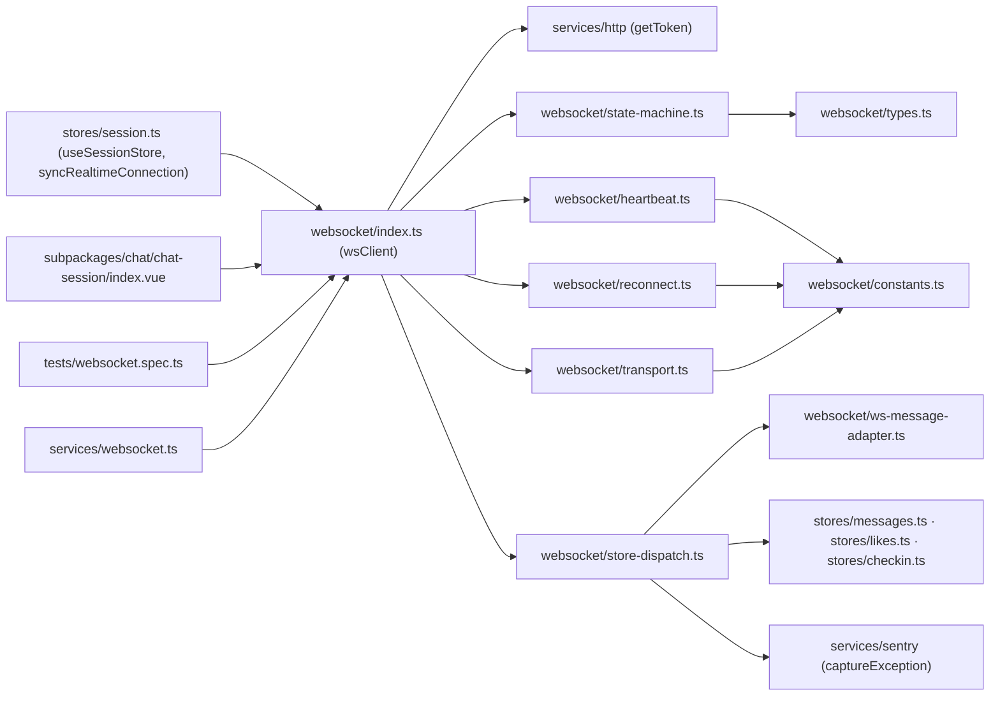

**图表来源**
- [websocket.ts:1-19](file://apps/client/src/services/websocket.ts#L1-L19)
- [index.ts:39-57](file://apps/client/src/services/websocket/index.ts#L39-L57)
- [transport.ts:17-25](file://apps/client/src/services/websocket/transport.ts#L17-L25)
- [heartbeat.ts:17-23](file://apps/client/src/services/websocket/heartbeat.ts#L17-L23)
- [reconnect.ts:28-33](file://apps/client/src/services/websocket/reconnect.ts#L28-L33)
- [store-dispatch.ts:27-44](file://apps/client/src/services/websocket/store-dispatch.ts#L27-L44)
- [session.ts:288-311](file://apps/client/src/stores/session.ts#L288-L311)

### 生命周期接线
`stores/session.ts` 的 `syncRealtimeConnection(loggedIn)` 是连接的唯一自动触发点：未登录或 `useMock()` 为真时 `wsClient.disconnect()`（注释说明 mock 模式无后端 WS，断开以避免重连噪音）；已登录且 `getToken()` 非空时 `wsClient.connect(token)`，否则同样断开。注释直陈历史动因——「原实现全仓无 `wsClient.connect()` 调用点，聊天纯 HTTP 拉取（无实时推送）」。上行调用侧，`subpackages/chat/chat-session/index.vue` 通过 `wsClient.send("/app/chat/typing", ...)` 发送输入状态；`apps/client/src/tests/websocket.spec.ts` 覆盖 `connect()`（含空 token、纯空白 token、重复 connect 换 token）、`disconnect()` 等用例，是本页行为契约的可执行来源。

### 服务端依赖
`WebSocketConfig` 通过 setter 注入 `JwtChannelInterceptor`、`JwtTokenProvider`、`Environment`，并以 `@Value("${app.mock.principal-user-id:1}")` 读取 mock 兜底用户；`configureClientInboundChannel` 把 `jwtChannelInterceptor` 注册进客户端入站通道。`MessageWebSocketHandler` 构造注入 `SimpMessagingTemplate`，其余四个协作者全部 `@Autowired(required = false)`（`TempChatSessionService`、`TempChatMessageService`、`PrivateConversationRepository`、`PrivateMessageService`），使 mock profile 下可为 `null` 并退化为仅转发。下行生产者分散在多个模块：`RealPrivateMessageService`（HTTP 与 WebSocket 两条链路复用 `sendMessage`）、`RealNotificationService`、`TempChatSessionService`、`TempChatMessageService`、`TempChatCleanupService`、`MatchRecorder`、`MatchEventConsumer`、`CheckInEventConsumer` 都直接调用 `convertAndSendToUser()`。

**章节来源**
- [index.ts:39-63](file://apps/client/src/services/websocket/index.ts#L39-L63)
- [session.ts:288-309](file://apps/client/src/stores/session.ts#L288-L309)
- [websocket.spec.ts:123-205](file://apps/client/src/tests/websocket.spec.ts#L123-L205)
- [WebSocketConfig.java:80-121](file://apps/api/src/main/java/com/campuslove/api/config/WebSocketConfig.java#L80-L121)
- [WebSocketConfig.java:174-182](file://apps/api/src/main/java/com/campuslove/api/config/WebSocketConfig.java#L174-L182)
- [MessageWebSocketHandler.java:53-87](file://apps/api/src/main/java/com/campuslove/api/chat/MessageWebSocketHandler.java#L53-L87)

## 配置与开关

### 客户端协议常量
全部集中在 `constants.ts`，无运行时环境变量注入，改动即改代码：

| 常量 | 值 | 作用 |
| --- | --- | --- |
| `FRAME_NULL_CHAR` | `"\x00"` | STOMP 帧结束标记，`parseFrames` 的切分依据 |
| `LINE_BREAK` | `"\n"` | STOMP 头/体换行符 |
| `MAX_RECONNECT_ATTEMPTS` | `6` | 与 1s/2s/4s/8s/16s/30s 阶梯一一对应，第 6 次仍失败即停止重连 |
| `RECONNECT_INTERVAL_MS` | `3000` | 已 `@deprecated`，仅为旧代码兼容保留 |
| `RECONNECT_BACKOFF_MS` | `1000` | 指数退避基础间隔（第 1 次重连） |
| `RECONNECT_MAX_INTERVAL_MS` | `30000` | 退避上限，避免长时间不重连 |
| `HEARTBEAT_INTERVAL_MS` | `30000` | ping 发送周期，同时写进 CONNECT 帧的 `heart-beat` 头 |
| `HEARTBEAT_TIMEOUT_MS` | `10000` | 单轮 pong 等待窗口 |
| `HEARTBEAT_CONSECUTIVE_TIMEOUT_LIMIT` | `2` | 连续超时容错次数（R2-00126，弱网单次丢包不断线） |
| `STOMP_VERSION` | `"1.2"` | CONNECT 帧 `accept-version` |
| `SUBSCRIPTION_ID_PREFIX` | `"sub-"` | 订阅 ID 前缀，拼接模块级自增计数 |
| `HEARTBEAT_PING_PAYLOAD` | `{"type":"ping"}` | 由 `JSON.stringify({type:"ping"})` 生成 |
| `HEARTBEAT_PONG_PAYLOAD_COMPACT` / `_SPACED` | `{"type":"pong"}` / `{"type": "pong"}` | `isPongMessage` 的两种字面匹配，另有 `JSON.parse` 兜底 |

主体类内另有两个时序常量：`DISCONNECT_CLOSE_DELAY_MS = 300`（发出 DISCONNECT 帧后延迟关闭底层连接）与 `WebSocketClient.CONNECT_HANDSHAKE_TIMEOUT_MS = 10000`（TCP 已建但 10s 内未收到 CONNECTED 帧即判失败）。日志开关为 `wsTrace()`：`isDev` 为假时直接返回，把连接/订阅类噪音收敛在开发环境，`console.error` 类保持全环境输出（infra R2-00123）。

### 服务端配置键与 profile 开关

| 配置键 / 开关 | 出处 | 语义 |
| --- | --- | --- |
| `app.websocket.allowed-origin-patterns`（回退环境变量 `WEBSOCKET_ALLOWED_ORIGIN_PATTERNS`） | `WebSocketConfig` 的 `@Value` 字段 `allowedOriginPatternsRaw` | 逗号分隔 Origin 模式；`parseOriginPatterns()` 去空白去空项；非空时 `endpoint.setAllowedOriginPatterns(patterns)` |
| Origin fail-fast | `@PostConstruct failFastWhenOriginUnconfiguredInRealProfile()` | 非 mock profile 且解析结果为空数组时抛 `IllegalStateException` 拒绝启动（2026-10-05 安全收口） |
| `app.mock.principal-user-id`（默认 `1`） | `WebSocketConfig.mockPrincipalUserId` 与 `JwtChannelInterceptor.mockPrincipalUserId` | mock 握手/CONNECT 解析不到 userId 时的兜底主体 |
| `mock` profile | `isMockProfile()` 在握手、CONNECT 两处短路 | 跳过真实 JWT 校验，保证 mock-token 可联调；客户端侧对应 `useMock()` 为真时不调用 `wsClient.connect()` |
| `Sec-WebSocket-Protocol` 回显 | `beforeHandshake` 中 `response.getHeaders().set(...)` | R4-00282：仅认证成功且客户端提供了 `bearer.{token}` 子协议时回显 |
| 订阅路径白名单 | `JwtChannelInterceptor.handleSubscribe` | 允许 `/topic/**` 与 `/user/queue/**`（简写自队列）、`/user/{自身}/queue/**`；其余一律 `MessageDeliveryException` |

**章节来源**
- [constants.ts:15-78](file://apps/client/src/services/websocket/constants.ts#L15-L78)
- [index.ts:65-83](file://apps/client/src/services/websocket/index.ts#L65-L83)
- [index.ts:166-167](file://apps/client/src/services/websocket/index.ts#L166-L167)
- [transport.ts:145-167](file://apps/client/src/services/websocket/transport.ts#L145-L167)
- [WebSocketConfig.java:43-78](file://apps/api/src/main/java/com/campuslove/api/config/WebSocketConfig.java#L43-L78)
- [WebSocketConfig.java:95-172](file://apps/api/src/main/java/com/campuslove/api/config/WebSocketConfig.java#L95-L172)
- [WebSocketConfig.java:223-289](file://apps/api/src/main/java/com/campuslove/api/config/WebSocketConfig.java#L223-L289)
- [JwtChannelInterceptor.java:35-73](file://apps/api/src/main/java/com/campuslove/api/config/JwtChannelInterceptor.java#L35-L73)
- [JwtChannelInterceptor.java:120-191](file://apps/api/src/main/java/com/campuslove/api/config/JwtChannelInterceptor.java#L120-L191)
- [JwtChannelInterceptor.java:204-271](file://apps/api/src/main/java/com/campuslove/api/config/JwtChannelInterceptor.java#L204-L271)
- [session.ts:298-309](file://apps/client/src/stores/session.ts#L298-L309)

## 连接监控与性能指标

### 服务端指标组件
`com.campuslove.api.monitor` 下的 `@Component` 指标类是实时链路的量化出口。聊天侧 `ChatMetrics` 提供 `recordMessageSent(String messageType)`、`recordMessageFailed(String reason)`、`incrementActiveSession()`、`decrementActiveSession()` 四个方法——前两者按消息类型/失败原因计数，后两者构成活跃会话（即在线长连接）的增减仪表；认证侧 `AuthMetrics` 提供 `recordLoginSuccess(Long userId)`、`recordLoginFailure(String reason)`、`recordTokenRefresh()`，与 WebSocket 建连所依赖的 JWT 签发/刷新链路共用同一指标面；匹配侧 `MatchMetrics` 提供 `recordSwipe(String direction)`、`recordMatchSuccess()`、`recordRecommendLatency(long durationMs)`，其中 `recordMatchSuccess()` 与 `MatchRecorder` 向 `/queue/matches` 的推送是同一事件的两面观测。

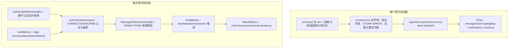

**图表来源**
- [index.ts:65-83](file://apps/client/src/services/websocket/index.ts#L65-L83)
- [index.ts:130-142](file://apps/client/src/services/websocket/reconnect.ts#L130-L142)
- [store-dispatch.ts:111-124](file://apps/client/src/services/websocket/store-dispatch.ts#L111-L124)
- [WebSocketConfig.java:254-283](file://apps/api/src/main/java/com/campuslove/api/config/WebSocketConfig.java#L254-L283)
- [JwtChannelInterceptor.java:139-191](file://apps/api/src/main/java/com/campuslove/api/config/JwtChannelInterceptor.java#L139-L191)
- [MessageWebSocketHandler.java:112-153](file://apps/api/src/main/java/com/campuslove/api/chat/MessageWebSocketHandler.java#L112-L153)
- [ChatMetrics.java:60-103](file://apps/api/src/main/java/com/campuslove/api/monitor/ChatMetrics.java#L60-L103)
- [AuthMetrics.java:63-91](file://apps/api/src/main/java/com/campuslove/api/monitor/AuthMetrics.java#L63-L91)
- [MatchMetrics.java:87-120](file://apps/api/src/main/java/com/campuslove/api/monitor/MatchMetrics.java#L87-L120)

### 关键日志锚点
排障时可直接检索以下原文（均为代码中的字面量）：客户端 `[WebSocket] 连接请求失败:`、`[WebSocket] 创建连接异常:`、`[WebSocket] 已达最大重连次数，停止重连`、`[WebSocket] 心跳连续超时，将重连`、`[WebSocket] 心跳超时（n/2），等待下一轮`、`[WebSocket] 将在 {delay}ms 后进行第 {n} 次重连（指数退避）`、`[WebSocket] STOMP ERROR:`、`[WebSocket] 认证失败，停止重连`、`[STOMP] 帧解析异常:`；服务端 `WebSocket 握手认证成功: userId=`、`WebSocket 握手拒绝: 未提供 JWT 令牌`、`WebSocket 握手拒绝: JWT 令牌无效或已过期`、`WebSocket CONNECT 认证成功: userId={}, sessionId={}`、`WebSocket CONNECT 拒绝: JWT 令牌已撤销`、`WebSocket SUBSCRIBE 拒绝: ... 尝试订阅其他用户路径`、`WebSocket SEND 拒绝: ...`。

**章节来源**
- [index.ts:80-83](file://apps/client/src/services/websocket/index.ts#L80-L83)
- [index.ts:721-746](file://apps/client/src/services/websocket/index.ts#L721-L746)
- [transport.ts:237-275](file://apps/client/src/services/websocket/transport.ts#L237-L275)
- [reconnect.ts:118-142](file://apps/client/src/services/websocket/reconnect.ts#L118-L142)
- [heartbeat.ts:94-107](file://apps/client/src/services/websocket/heartbeat.ts#L94-L107)
- [WebSocketConfig.java:259-283](file://apps/api/src/main/java/com/campuslove/api/config/WebSocketConfig.java#L259-L283)
- [JwtChannelInterceptor.java:144-191](file://apps/api/src/main/java/com/campuslove/api/config/JwtChannelInterceptor.java#L144-L191)
- [JwtChannelInterceptor.java:204-271](file://apps/api/src/main/java/com/campuslove/api/config/JwtChannelInterceptor.java#L204-L271)
- [MessageWebSocketHandler.java:401-446](file://apps/api/src/main/java/com/campuslove/api/chat/MessageWebSocketHandler.java#L401-L446)

## 功能开关
实时链路的行为并不只由传输层决定，客户端还有一层运行期功能开关来决定"这条链路是否会被业务用到"。
`apps/client/src/config/feature-flags.ts` 是全局功能控制的唯一真相源，`FeatureFlags` 接口声明了四个布尔位：
`membershipEnabled`、`heartSignalEnabled`、`villageSameCityEnabled`、`whisperEnabled`，当前取值为
`false / true / true / true`。注释明确记录了取值理由：会员入口先不上线但保留路由与后端体系，
恋爱小纸条（悄悄话付费解锁）在 B3 阶段正式开放。

对实时链路的直接影响有两条：
- `whisperEnabled` 决定付费解锁流程是否真的走通。置 `false` 时按钮只提示、不发起解锁，也就不会产生解锁成功后
  通过 `MessageWebSocketHandler.sendPrivateMessage` 下发消息的时序；置 `true` 时后端端点已就绪，消息会经由
  同一套私聊推送路径到达对方客户端。
- `heartSignalEnabled` 决定心动信号模块是否可用，对应服务端推送入口是
  `MessageWebSocketHandler.sendHeartSignal(String userId, HeartSignalView signal)`。开关关闭时前端不再触发该
  推送，链路上只剩通知与私聊两类下发。

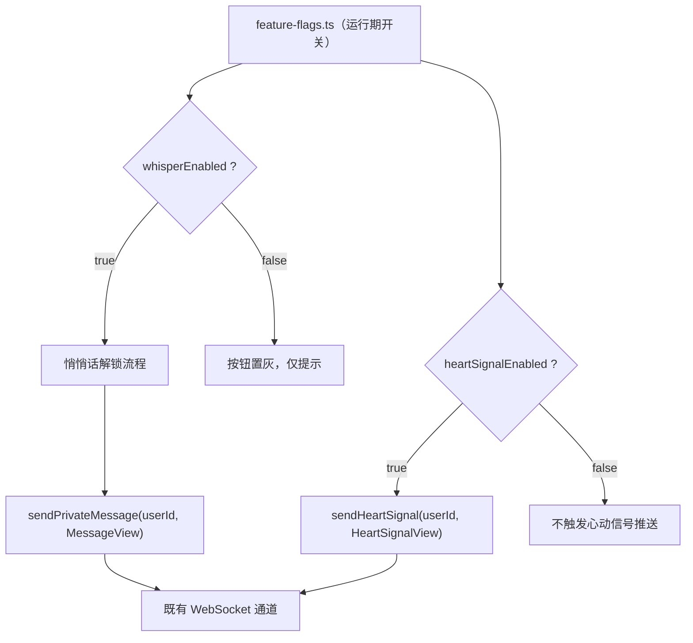

**图表来源**
- [feature-flags.ts:13-35](file://apps/client/src/config/feature-flags.ts#L13-L35)
- [MessageWebSocketHandler.java:401-446](file://apps/api/src/main/java/com/campuslove/api/chat/MessageWebSocketHandler.java#L401-L446)

**章节来源**
- [feature-flags.ts:1-35](file://apps/client/src/config/feature-flags.ts#L1-L35)
- [MessageWebSocketHandler.java:401-446](file://apps/api/src/main/java/com/campuslove/api/chat/MessageWebSocketHandler.java#L401-L446)

## 故障排查指南
按"连不上 / 连上收不到 / 收到但重复或丢失 / 指标异常"四类定位，每类给出可验证的检查点。

- 连不上（状态停在 CONNECTING 或反复回到 DISCONNECTED）
  - 先看客户端连接状态机的迁移记录，`apps/client/src/services/websocket/state-machine.ts` 中的
    `ConnectionStateMachine` 是状态的唯一持有者；若状态在鉴权后立刻回退，问题多半在服务端握手拦截器，
    而不是网络本身。
  - 服务端侧确认 `WebSocketConfig` 注册的端点与拦截器链是否生效：`JwtChannelInterceptor` 负责在建立阶段取
    token 并判定归属，token 缺失或过期会直接拒绝升级，表现为客户端拿到非 101 响应。
- 连上但收不到消息
  - 确认订阅是否真的完成（连接建立 ≠ 订阅成功），再看服务端是否走了推送分支：
    `MessageWebSocketHandler` 的 `sendNotification`、`sendPrivateMessage`、`sendHeartSignal` 三个入口
    分别对应通知、私聊、心动信号；三者都没被调用说明是业务侧没有产生事件，而不是通道故障。
  - 检查会话计数是否成对：`ChatMetrics.incrementActiveSession` 与 `decrementActiveSession` 只应在连接建立与
    断开各调用一次，计数长期偏大说明存在没有走正常关闭路径的连接。
- 丢消息或重复
  - 先看发送失败计数：`ChatMetrics.recordMessageFailed(reason)` 与 `recordMessageSent(messageType)` 的比值
    是判断"发送侧失败"还是"接收侧丢失"的第一手依据。
  - 再看重连后的补偿：重连成功后必须重新订阅并拉取增量，否则断连期间的消息不会自动补发，表现为"对方发了我
    没收到"，但服务端日志里有成功发送记录。
- 鉴权与登录态问题
  - 私聊链路的身份来自登录态。若微信登录换取会话失败，服务端 `WeChatClient.code2Session` 会抛出携带
    `errcode`/`errmsg` 的 `WeChatAuthException`，`WechatLoginException.ErrorCode` 定义了映射后的错误码与
    默认文案；此时 WebSocket 侧必然连不上，应先修登录而不是修通道。
  - 生产环境会显式禁用开发兜底：`WeChatClient.validateDevFallbackDisabledInProduction` 在检测到生产 profile
    仍开启兜底时直接失败，日志里出现该报错说明配置串了环境。

**章节来源**
- [state-machine.ts:27-121](file://apps/client/src/services/websocket/state-machine.ts#L27-L121)
- [MessageWebSocketHandler.java:401-455](file://apps/api/src/main/java/com/campuslove/api/chat/MessageWebSocketHandler.java#L401-L455)
- [ChatMetrics.java:60-111](file://apps/api/src/main/java/com/campuslove/api/monitor/ChatMetrics.java#L60-L111)
- [WeChatClient.java:83-140](file://apps/api/src/main/java/com/campuslove/api/auth/WeChatClient.java#L83-L140)
- [WechatLoginException.java:26-101](file://apps/api/src/main/java/com/campuslove/api/auth/WechatLoginException.java#L26-L101)

## 附录
术语与对照：
- **连接状态机**：客户端 `ConnectionStateMachine` 持有的连接生命周期状态集合，是本模块所有"现在能不能发"的
  判断依据。
- **心跳**：周期性的保活帧，用于让服务端与客户端及时发现半开连接；其失败计数与重连策略联动。
- **下发入口**：服务端把一条业务数据推给某个用户的三个方法
  （`sendNotification` / `sendPrivateMessage` / `sendHeartSignal`），它们共用同一条通道。
- **视图对象**：`MessageView`、`ConversationView` 等只读投影，WebSocket 帧里携带的就是这些结构，而不是
  JPA 实体本身。
- **功能开关**：`feature-flags.ts` 的运行期布尔位，决定链路是否被业务真正调用。

可延伸阅读（同目录树中的相邻页面）：
- 客户端侧的连接实现：`客户端应用（Uni-app）/API 服务层/WebSocket 实时通信`
- 后端侧的通道配置与鉴权：`系统架构设计/后端架构设计/WebSocket实时通信`
- 消息本身的落库与读取：`后端API服务/聊天与消息系统/私密消息系统`

**章节来源**
- [MessageView.java:9-31](file://apps/api/src/main/java/com/campuslove/api/chat/MessageView.java#L9-L31)
- [ConversationView.java:7-51](file://apps/api/src/main/java/com/campuslove/api/chat/ConversationView.java#L7-L51)
- [feature-flags.ts:13-35](file://apps/client/src/config/feature-flags.ts#L13-L35)

## 结论
本模块把"实时"拆成三段可验证的责任：客户端用 `ConnectionStateMachine` 统一连接生命周期，并以心跳、退避重连
保证断线后的自愈；服务端用 `WebSocketConfig` 声明端点、用 `JwtChannelInterceptor` 在握手阶段完成身份归属判定，
再由 `MessageWebSocketHandler` 的通知/私聊/心动信号三个入口把业务事件推下去；指标层由 `ChatMetrics` 记录发送
成功、失败与活跃会话数，使"收不到"这类问题可以区分是业务未产生事件，还是通道真的断了。

工程上的两个约束值得再强调：其一，帧里传的是 `MessageView`、`ConversationView` 这类投影而不是实体，避免了
持久层结构泄漏；其二，`feature-flags.ts` 决定链路是否被业务调用，排查时必须先确认开关状态，否则会误判为通道
故障。后续若引入多实例部署，服务端仍需解决同一用户多连接与跨实例路由的问题，这是当前实现没有覆盖的部分。
