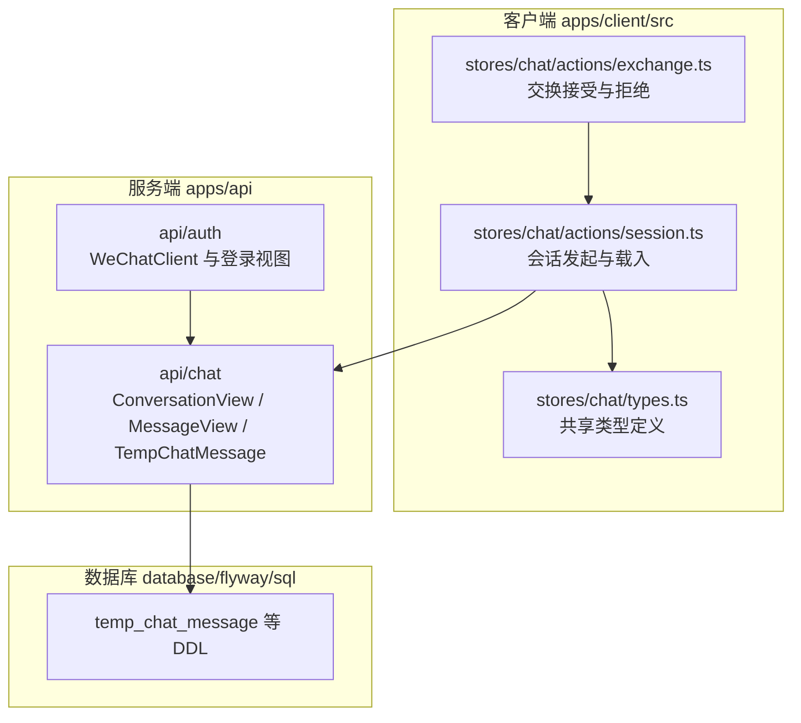
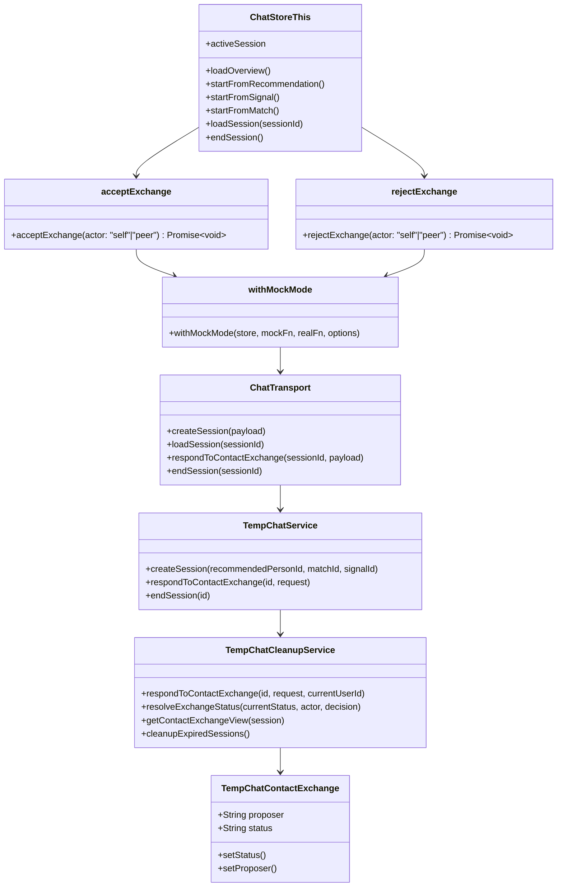
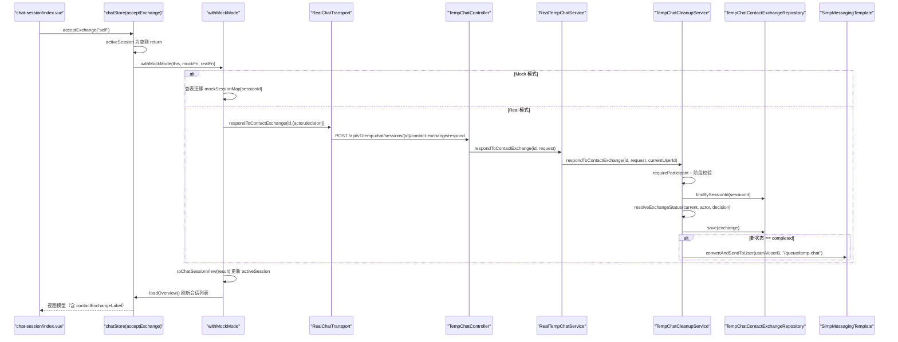
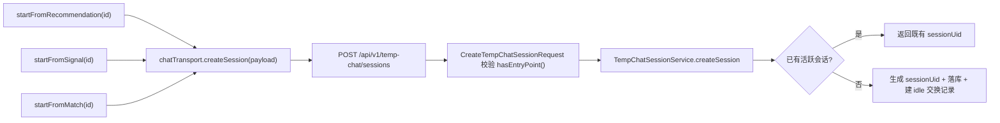
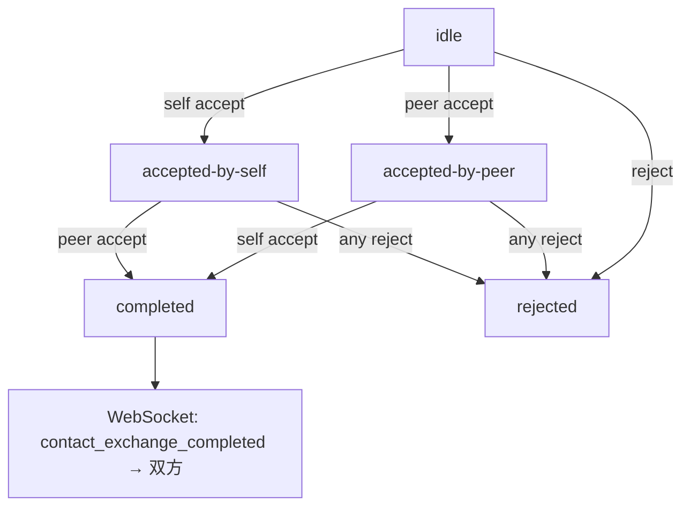
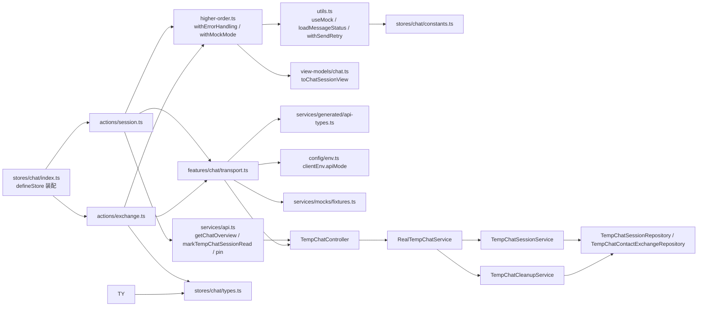
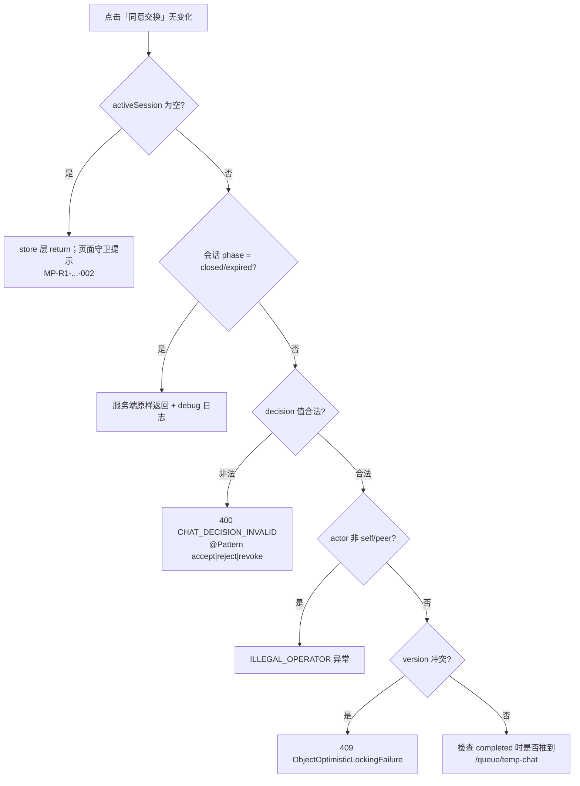

# 会话交换机制

<cite>
**本文引用的文件**
- [exchange.ts](file://apps/client/src/stores/chat/actions/exchange.ts)
- [session.ts](file://apps/client/src/stores/chat/actions/session.ts)
- [types.ts](file://apps/client/src/stores/chat/types.ts)
- [store-type.ts](file://apps/client/src/stores/chat/store-type.ts)
- [higher-order.ts](file://apps/client/src/stores/chat/higher-order.ts)
- [utils.ts](file://apps/client/src/stores/chat/utils.ts)
- [transport.ts](file://apps/client/src/features/chat/transport.ts)
- [session-machine.ts](file://apps/client/src/features/chat/session-machine.ts)
- [chat.ts (view-models)](file://apps/client/src/view-models/chat.ts)
- [status-copy.ts](file://apps/client/src/config/status-copy.ts)
- [growth.ts](file://apps/client/src/constants/growth.ts)
- [fixtures.ts](file://apps/client/src/services/mocks/fixtures.ts)
- [api-types.ts](file://apps/client/src/services/generated/api-types.ts)
- [apps/client/src/subpackages/chat/chat-session/index.vue](file://apps/client/src/subpackages/chat/chat-session/index.vue)
- [TempChatController.java](file://apps/api/src/main/java/com/campuslove/api/chat/TempChatController.java)
- [TempChatService.java](file://apps/api/src/main/java/com/campuslove/api/chat/TempChatService.java)
- [RealTempChatService.java](file://apps/api/src/main/java/com/campuslove/api/chat/RealTempChatService.java)
- [TempChatSessionService.java](file://apps/api/src/main/java/com/campuslove/api/chat/TempChatSessionService.java)
- [TempChatCleanupService.java](file://apps/api/src/main/java/com/campuslove/api/chat/TempChatCleanupService.java)
- [TempChatContactExchange.java](file://apps/api/src/main/java/com/campuslove/api/entity/TempChatContactExchange.java)
- [TempChatMessage.java](file://apps/api/src/main/java/com/campuslove/api/entity/TempChatMessage.java)
- [TempChatContactExchangeRepository.java](file://apps/api/src/main/java/com/campuslove/api/repository/TempChatContactExchangeRepository.java)
- [ChatConfig.java](file://apps/api/src/main/java/com/campuslove/api/config/ChatConfig.java)
- [V2026.05.27.0001__create_temp_chat_tables.sql](file://database/flyway/sql/V2026.05.27.0001__create_temp_chat_tables.sql)
- [V2026.07.27.0005__enum_to_varchar_check.sql](file://database/flyway/sql/V2026.07.27.0005__enum_to_varchar_check.sql)
- [V2026.07.28.0007__rebuild_indexes_after_enum_migration.sql](file://database/flyway/sql/V2026.07.28.0007__rebuild_indexes_after_enum_migration.sql)
</cite>

## 目录
1. [简介](#简介)
2. [项目结构](#项目结构)
3. [核心组件](#核心组件)
4. [架构总览](#架构总览)
5. [详细组件分析](#详细组件分析)
6. [会话状态机与生命周期](#会话状态机与生命周期)
7. [数据模型](#数据模型)
8. [依赖关系分析](#依赖关系分析)
9. [性能考虑](#性能考虑)
10. [能力缺口登记](#能力缺口登记)
11. [故障排查指南](#故障排查指南)
12. [结论](#结论)

## 简介
本页聚焦 Campus Love 恋爱小程序中「会话交换」（Exchange）这条业务链路：一次临时聊天从被发起、被接受或被拒绝，到会话对象在客户端 store 中落地并可被消息列表消费的完整机制。它回答的是业务问题而不是传输问题——传输层的帧格式、心跳与重连由同目录的 `WebSocket实时通信.md` 覆盖，本页不重复。

取证范围以事实包 #62 声明的三个依赖文件为起点（`exchange.ts`、`session.ts`、`chat/types.ts`），再向两端扩展：客户端的 store 组合与页面调用点、服务端 `com.campuslove.api.chat` 包内的视图对象与实体、以及 `database/flyway/sql` 下与临时聊天相关的 DDL。凡是仓库中找不到证据的生成指令要求（例如临时聊天 ID 的 UUID 生成算法、跨设备会话迁移、连接池管理），统一收敛到 `## 能力缺口登记` 一节逐条登记判定依据，不做推测性描述。

## 项目结构
会话交换机制的代码分布遵循「客户端 store 编排 + 服务端视图对象投影」的双侧结构，涉及的目录层级如下：



[此图为概念流程，展示三层目录的职责划分，不直接对应单一源文件的调用关系]

结构上的三个约定：

1. `apps/client/src/stores/chat/actions/` 下按领域动词切分动作文件——`session.ts` 负责会话本身的发起与载入，`exchange.ts` 负责对端发起后的接受与拒绝，二者共享 `chat/types.ts` 中的类型契约。
2. `apps/api/src/main/java/com/campuslove/api/chat/` 只放「投影」类（`ConversationView`、`MessageView`）与实体（`TempChatMessage`），不含业务编排。
3. 表结构由 Flyway 迁移脚本单向下推，实体上的 `@Table(name = "temp_chat_message")` 与迁移脚本同名，是会话数据落地的唯一位置。

**章节来源**
- [exchange.ts:1-110](file://apps/client/src/stores/chat/actions/exchange.ts#L1-L110)
- [session.ts:1-314](file://apps/client/src/stores/chat/actions/session.ts#L1-L314)
- [types.ts:1-86](file://apps/client/src/stores/chat/types.ts#L1-L86)

## 核心组件
会话交换链路由 6 类组件构成，客户端 3 类、服务端 3 类。组件职责与关键成员如下：



**图表来源**
- [exchange.ts:27-110](file://apps/client/src/stores/chat/actions/exchange.ts#L27-L110)
- [store-type.ts:82-123](file://apps/client/src/stores/chat/store-type.ts#L82-L123)
- [higher-order.ts:114-142](file://apps/client/src/stores/chat/higher-order.ts#L114-L142)
- [transport.ts:16-26](file://apps/client/src/features/chat/transport.ts#L16-L26)
- [TempChatService.java:29-49](file://apps/api/src/main/java/com/campuslove/api/chat/TempChatService.java#L29-L49)
- [TempChatCleanupService.java:167-266](file://apps/api/src/main/java/com/campuslove/api/chat/TempChatCleanupService.java#L167-L266)

组件要点：

1. `acceptExchange` / `rejectExchange`（`stores/chat/actions/exchange.ts`）：只有 `actor: "self" | "peer"` 一个入参，函数体首行做 `if (!this.activeSession) return;` 的空会话短路，随后把「本地状态迁移」与「后端调用」分别作为 `withMockMode` 的第 2、3 个实参传入。
2. `withMockMode`（`stores/chat/higher-order.ts:114-142`）：模式分流器。判定 `useMock()` 后执行对应分支，若返回值是对象且含 `id` 字段则经 `toChatSessionView` 写入 `activeSession`，再按 `shouldRefreshOverview` 决定是否 `await store.loadOverview()`。
3. `chatTransport`（`features/chat/transport.ts:30`，由 `createChatTransport()` 创建的模块级单例）：`ChatTransport` 接口同时有 `MockChatTransport` 与 `RealChatTransport` 两套实现，`respondToContactExchange` 在真实实现里落到 `POST /temp-chat/sessions/{id}/contact-exchange/respond`。
4. `TempChatController`（`api/chat/TempChatController.java`）：`@RequestMapping("/api/v1/temp-chat/sessions")`，会话建立与交换响应都在这里入站，每个方法均带 `@PreAuthorize("hasRole('USER')")`。
5. `RealTempChatService`（`@Profile("real")`）：纯编排层，`respondToContactExchange` 取 `SecurityUtils.getCurrentUserId()`，委托 `TempChatCleanupService`，再用 `TempChatSessionService.toSessionView` 投影返回。
6. `TempChatCleanupService`：既是联系交换状态机（`respondToContactExchange` + `resolveExchangeStatus`），也负责过期会话清理。

**章节来源**
- [exchange.ts:27-110](file://apps/client/src/stores/chat/actions/exchange.ts#L27-L110)
- [higher-order.ts:13-142](file://apps/client/src/stores/chat/higher-order.ts#L13-L142)
- [transport.ts:14-125](file://apps/client/src/features/chat/transport.ts#L14-L125)
- [TempChatController.java:20-98](file://apps/api/src/main/java/com/campuslove/api/chat/TempChatController.java#L20-L98)
- [RealTempChatService.java:33-134](file://apps/api/src/main/java/com/campuslove/api/chat/RealTempChatService.java#L33-L134)
- [TempChatCleanupService.java:160-253](file://apps/api/src/main/java/com/campuslove/api/chat/TempChatCleanupService.java#L160-L253)

## 架构总览
下图是一次完整「同意交换」从页面点击到双方收到 WebSocket 事件的端到端时序，覆盖客户端 store、传输层、控制器、编排服务、状态机组件与持久层。



**图表来源**
- [index.vue:1303-1321](file://apps/client/src/subpackages/chat/chat-session/index.vue#L1303-L1321)
- [exchange.ts:27-71](file://apps/client/src/stores/chat/actions/exchange.ts#L27-L71)
- [higher-order.ts:114-142](file://apps/client/src/stores/chat/higher-order.ts#L114-L142)
- [transport.ts:104-113](file://apps/client/src/features/chat/transport.ts#L104-L113)
- [TempChatController.java:57-64](file://apps/api/src/main/java/com/campuslove/api/chat/TempChatController.java#L57-L64)
- [RealTempChatService.java:103-109](file://apps/api/src/main/java/com/campuslove/api/chat/RealTempChatService.java#L103-L109)
- [TempChatCleanupService.java:166-225](file://apps/api/src/main/java/com/campuslove/api/chat/TempChatCleanupService.java#L166-L225)

三条贯穿性的架构约束：

1. **actor 的双源不一致**：客户端把 `actor` 当作请求体字段发送（`exchange.ts:66-69`），但服务端在 `TempChatCleanupService.java:184` 依据 `session.getUserAId().equals(currentUserId)` 重新推导 actor，注释明确写着「拒绝客户端传入值」。也就是说 `actor` 字段只用于 Mock 分支的本地查表，真实链路的权威判定在服务端。
2. **视图模型是唯一渲染面**：store 里 `activeSession` 存的是 `toChatSessionView()` 的返回值（`view-models/chat.ts:115-120`），它在原始 `TempChatSession` 之上追加 `contactExchangeLabel`，页面据此渲染交换状态文案。
3. **每次写操作后刷新概览**：`withMockMode` 默认 `shouldRefreshOverview = true`，交换成功后会再拉一次概览，使会话列表项的 `statusLabel` 同步。

**章节来源**
- [exchange.ts:27-71](file://apps/client/src/stores/chat/actions/exchange.ts#L27-L71)
- [TempChatCleanupService.java:166-225](file://apps/api/src/main/java/com/campuslove/api/chat/TempChatCleanupService.java#L166-L225)
- [apps/client/src/view-models/chat.ts:115-120](file://apps/client/src/view-models/chat.ts#L115-L120)

## 详细组件分析

### 会话建立的三个入口
`session.ts` 暴露三个建立函数，差别只在携带哪个入口标识，最终都汇聚到同一个传输层方法 `chatTransport.createSession`：

| 入口函数 | 入参 | Real 分支请求体 | 服务端解析方式 |
| --- | --- | --- | --- |
| `startFromRecommendation` | `recommendedPersonId` | `{ recommendedPersonId }`（`session.ts:102`） | 命中当前用户推荐列表 |
| `startFromSignal` | `signalId` | `{ signalId }`（`session.ts:137`） | 校验信号归属与 `accepted` 状态后解析对端 |
| `startFromMatch` | `matchId` | `{ matchId }`（`session.ts:173`） | 兼容旧调用，按匹配记录解析参与者 |

三者的 Mock 分支各自构造一个完整的 `TempChatSession` 字面量（`session.ts:87-99`、`122-134`、`158-170`），共同特征为：`phase: "matching"`、`messages: []`、`contactExchange: { proposer: null, status: "idle" }`、`closedReason: null`、`closesAt = new Date(Date.now() + TEMP_SESSION_DURATION_MS).toISOString()`。`TEMP_SESSION_DURATION_MS` 在 `constants/growth.ts:40` 定义为 `24 * 60 * 60 * 1000`，即客户端侧的 24 小时 TTL，与服务端 `ChatConfig.sessionExpireHours`（默认 24）语义对齐。

`startFromRecommendation` 的 Mock 分支还做一次数据解析修复：用 `mockChatOverview.recommendedPeople.find((p) => p.id === recommendedPersonId)` 取推荐人姓名/标题/可用性提示，查不到才回退 i18n 占位文案（`session.ts:84-92`）。

控制器侧的入口约束由 record 校验承担：`CreateTempChatSessionRequest` 三个字段各限 `@Size(max = 64)`，并以 `@AssertTrue` 的 `hasEntryPoint()` 强制「至少一个入口标识非空」，错误文案为 `recommendedPersonId or matchId or signalId is required`。



**图表来源**
- [session.ts:72-176](file://apps/client/src/stores/chat/actions/session.ts#L72-L176)
- [transport.ts:68-74](file://apps/client/src/features/chat/transport.ts#L68-L74)
- [TempChatController.java:36-40](file://apps/api/src/main/java/com/campuslove/api/chat/TempChatController.java#L36-L40)
- [TempChatController.java:100-113](file://apps/api/src/main/java/com/campuslove/api/chat/TempChatController.java#L100-L113)
- [TempChatSessionService.java:139-200](file://apps/api/src/main/java/com/campuslove/api/chat/TempChatSessionService.java#L139-L200)

**章节来源**
- [session.ts:72-176](file://apps/client/src/stores/chat/actions/session.ts#L72-L176)
- [growth.ts:39-40](file://apps/client/src/constants/growth.ts#L39-L40)
- [ChatConfig.java:10-25](file://apps/api/src/main/java/com/campuslove/api/config/ChatConfig.java#L10-L25)
- [TempChatController.java:36-113](file://apps/api/src/main/java/com/campuslove/api/chat/TempChatController.java#L36-L113)
- [TempChatService.java:21-29](file://apps/api/src/main/java/com/campuslove/api/chat/TempChatService.java#L21-L29)

### 会话建立的幂等与去重
`TempChatSessionService.createSession` 在生成新会话之前做两层复用检查：

1. 用户维度：`sessionRepository.findActiveByUserPair(currentUserId, partnerUserId, INACTIVE_PHASES)`，命中则直接 `toSessionView(existing.get(), currentUserId)` 返回既有会话，并写 debug 日志（`TempChatSessionService.java:148-152`）。
2. 匹配维度：仅当 `matchId` 非空时执行 `findActiveByMatchId(matchId, INACTIVE_PHASES)`，命中同样返回既有会话（`154-160`）。

因此「同一对用户反复点击开聊」不会产生第二条会话记录，也不会产生第二条交换记录——交换记录只在真正新建会话的分支里创建（`183-188`）。

对端解析失败时（`partnerUserId == null`）抛出 `IllegalArgumentException`，消息由 `ErrorMessages.RECOMMENDER_PARSE_FAILED_PREFIX` 拼接三个入口 ID，便于日志定位是哪条入口失败。心动信号入口的越权防护更严格：`resolvePartnerFromSignal` 在信号不存在、当前用户非参与者或状态不是 `HeartSignal.SignalStatus.accepted` 时抛 `ErrorMessages.SIGNAL_INVALID_OR_EXPIRED_PREFIX`，注释说明目的是「防止用户借任意 ID 与陌生人建立匿名会话」。

新建会话成功后服务端会向对端推送一条 `session_created` 事件：`messagingTemplate.convertAndSendToUser(String.valueOf(partnerUserId), "/queue/temp-chat", Map.of("type", "session_created", "sessionId", sessionUid))`（`193-197`）。

**章节来源**
- [TempChatSessionService.java:139-200](file://apps/api/src/main/java/com/campuslove/api/chat/TempChatSessionService.java#L139-L200)
- [TempChatSessionService.java:531-561](file://apps/api/src/main/java/com/campuslove/api/chat/TempChatSessionService.java#L531-L561)
- [TempChatSessionService.java:495-510](file://apps/api/src/main/java/com/campuslove/api/chat/TempChatSessionService.java#L495-L510)

### 临时会话标识（sessionUid）生成
标识生成集中在一个私有方法：

```java
private String generateSessionUid(Long userAId, Long userBId) {
    long min = Math.min(userAId, userBId);
    long max = Math.max(userAId, userBId);
    String randomSuffix = UUID.randomUUID().toString().substring(0, 8);
    return "session-" + min + "-" + max + "-" + randomSuffix;
}
```

要点（`TempChatSessionService.java:512-518`）：

- **结构**：`session-{较小用户ID}-{较大用户ID}-{8位随机后缀}`，DDL 注释给出的示例即 `session-1-2-abc12345`（`V2026.05.27.0001__create_temp_chat_tables.sql:9`）。
- **随机源**：`java.util.UUID.randomUUID()`（import 见 `TempChatSessionService.java:27`），取其字符串形式前 8 个字符（含首个 `-` 之前的 8 位十六进制）。
- **唯一性保证**：不依赖随机位不碰撞，而是依赖数据库唯一索引 `UNIQUE KEY uk_temp_chat_session_uid (session_uid)` 兜底，配合上文的两层活跃会话去重把重复概率压到「同一对用户不会二次生成」。
- **对称性**：`min/max` 归一化让 userA、userB 顺序不影响可读前缀，便于从 ID 直接看出参与者。
- **安全考虑**：ID 中暴露的是用户 ID 而非手机号/OpenID；真正的越权防护在读取侧——`getSession` 走 `resolveSessionForCurrentUser(id)`，注释标注 FIN HIGH-1「校验当前用户是否为会话参与者，防止 IDOR 越权查看他人会话」。

**章节来源**
- [TempChatSessionService.java:27-27](file://apps/api/src/main/java/com/campuslove/api/chat/TempChatSessionService.java#L27-L27)
- [TempChatSessionService.java:512-518](file://apps/api/src/main/java/com/campuslove/api/chat/TempChatSessionService.java#L512-L518)
- [TempChatSessionService.java:202-213](file://apps/api/src/main/java/com/campuslove/api/chat/TempChatSessionService.java#L202-L213)
- [V2026.05.27.0001__create_temp_chat_tables.sql:7-31](file://database/flyway/sql/V2026.05.27.0001__create_temp_chat_tables.sql#L7-L31)

### 交换决策状态机：三份实现的同一语义
「双向确认」这条规则在仓库里被实现了三次，且必须保持一致——客户端 action（Mock 分支）、mock fixtures（Mock 传输层）、服务端组件（Real 分支）。

服务端权威实现 `resolveExchangeStatus(currentStatus, actor, decision)`（`TempChatCleanupService.java:266-279`）：

- 先做入参合法性硬校验：`actor` 不是 `self` 也不是 `peer` 时抛 `IllegalArgumentException(ErrorMessages.ILLEGAL_OPERATOR_PREFIX + actor)`，注释标注这是 FIN MED-70 修复——旧实现把未知 actor 默认按 `peer` 处理，会污染状态机。
- 拒绝类判定统一覆盖三种表达：`reject`、`rejected`、`revoke` 一律返回 `rejected`（R2 review HIGH 修复：旧实现只匹配 `rejected`，导致「拒绝」被当成「接受」）。
- 接受类判定按「对方是否已接受」收敛：`actor == "self"` 时，当前状态为 `accepted-by-peer` 则 `completed`，否则 `accepted-by-self`；`actor == "peer"` 时对称处理。

客户端 action 用查表替代三元嵌套（注释标 infra R2-00097）：

```ts
const exchangeTransitions: Record<string, Record<string, TempChatSession["contactExchange"]["status"]>> = {
  self: { "accepted-by-peer": "completed", "*": "accepted-by-self" },
  peer: { "accepted-by-self": "completed", "*": "accepted-by-peer" },
};
const actorTable = exchangeTransitions[actor] ?? exchangeTransitions.self!;
const newStatus = actorTable[currentStatus] ?? actorTable["*"]!;
```

表驱动的意义在于：未知 `currentStatus` 会落到 `*` 通配行而不是抛错，因此「首次接受」与「idle 状态接受」得到同一结果 `accepted-by-self`。`rejectExchange` 不做查表，直接把状态写成 `"rejected"`（`exchange.ts:93-99`）。

第三份实现是 mock 传输层 `mockFixtures.respondToContactExchange(id, actor, decision)`（`fixtures.ts:1589-1617`），用四层三元表达同一张表，并且多一条前置规则：`current.phase === "closed"` 时直接返回克隆的当前会话，状态不变——与服务端「closed/expired 会话不允许操作联系交换」（`TempChatCleanupService.java:177-181`）呼应。

还有一处纯函数版本 `features/chat/session-machine.ts`，导出 `proposeContactExchange`（置 `status: "pending"`）与 `respondToContactExchange(state, actor, decision)`（`accepted-by-self` + `peer` → `completed` 等），其 `ContactExchangeStatus` 联合类型比后端多一个 `pending` 值（`session-machine.ts:4-10`）。



[此图为概念流程，由 exchange.ts:45-53、TempChatCleanupService.java:266-279 与 fixtures.ts:1600-1610 三处一致逻辑归纳，不直接对应单一源文件]

**章节来源**
- [exchange.ts:36-70](file://apps/client/src/stores/chat/actions/exchange.ts#L36-L70)
- [exchange.ts:87-109](file://apps/client/src/stores/chat/actions/exchange.ts#L87-L109)
- [TempChatCleanupService.java:255-279](file://apps/api/src/main/java/com/campuslove/api/chat/TempChatCleanupService.java#L255-L279)
- [fixtures.ts:1589-1617](file://apps/client/src/services/mocks/fixtures.ts#L1589-L1617)
- [session-machine.ts:1-112](file://apps/client/src/features/chat/session-machine.ts#L1-L112)

### proposer：发起方的一次性固化
`TempChatContactExchange.proposer` 语义为「发起交换请求的用户标识: self / peer」。三份实现都采用同一条固化规则 `proposer = 现值 ?? actor`：

- Mock action：`proposer: currentSession.contactExchange.proposer ?? actor`（`exchange.ts:57`、`96`）。
- mock 传输层：`proposer: current.contactExchange.proposer ?? actor`（`fixtures.ts:1615`）。
- 服务端：`String proposer = exchange.getProposer() == null ? actor : exchange.getProposer();`（`TempChatCleanupService.java:200`）。

效果是：第一个按下接受/拒绝的人被记为发起方，后续任何一方的操作都不会改写 `proposer`。会话新建时该字段留空——服务端 `contactExchange.setStatus("idle")` 并未设置 proposer（`TempChatSessionService.java:183-188`），实体列定义 `@Column(name = "proposer", length = 16)` 允许 NULL。

**章节来源**
- [exchange.ts:54-60](file://apps/client/src/stores/chat/actions/exchange.ts#L54-L60)
- [fixtures.ts:1612-1617](file://apps/client/src/services/mocks/fixtures.ts#L1612-L1617)
- [TempChatCleanupService.java:198-205](file://apps/api/src/main/java/com/campuslove/api/chat/TempChatCleanupService.java#L198-L205)
- [TempChatSessionService.java:182-188](file://apps/api/src/main/java/com/campuslove/api/chat/TempChatSessionService.java#L182-L188)
- [TempChatContactExchange.java:38-44](file://apps/api/src/main/java/com/campuslove/api/entity/TempChatContactExchange.java#L38-L44)

### 权限检查与状态同步
`respondToContactExchange` 在真正改状态之前串了四道检查（`TempChatCleanupService.java:167-205`）：

1. `currentUserId == null` → 抛 `ErrorMessages.CURRENT_USER_ID_REQUIRED`。
2. `sessionService.resolveSession(id)` 解析会话（不存在时由该方法抛出）。
3. `sessionService.requireParticipant(session, currentUserId)` —— FIN HIGH-1 参与者校验。
4. `session.getPhase()` 为 `closed` 或 `expired` → 记 debug 日志并原样返回会话，不做任何写入。

控制器层还有第五道：`@PreAuthorize("hasRole('USER')")`（`TempChatController.java:58`）。

状态同步由两处保证：写库后 `contactExchangeRepository.save(exchange)`（`205`），以及 `completed` 时对 userA、userB 各推一条 `/queue/temp-chat` 消息，载荷 `Map.of("type", "contact_exchange_completed", "sessionId", session.getSessionUid())`（`208-219`）；随后 `RealTempChatService` 调用 `sessionService.toSessionView(session, currentUserId)` 把最新实体投影回视图，客户端 `withMockMode` 再把它写入 `activeSession` 并刷新概览。

数据访问接口本身很薄：`TempChatContactExchangeRepository` 只提供 `findBySessionId`，`session_id` 上的唯一约束（`uk_temp_chat_contact_exchange_session`）保证一个会话最多一条交换记录，因此服务端在缺失记录时用 `orElseGet` 惰性补建一条 `idle` 记录（`187-196`）。

**章节来源**
- [TempChatCleanupService.java:167-225](file://apps/api/src/main/java/com/campuslove/api/chat/TempChatCleanupService.java#L167-L225)
- [TempChatController.java:57-64](file://apps/api/src/main/java/com/campuslove/api/chat/TempChatController.java#L57-L64)
- [RealTempChatService.java:103-109](file://apps/api/src/main/java/com/campuslove/api/chat/RealTempChatService.java#L103-L109)
- [higher-order.ts:132-140](file://apps/client/src/stores/chat/higher-order.ts#L132-L140)
- [V2026.05.27.0001__create_temp_chat_tables.sql:48-58](file://database/flyway/sql/V2026.05.27.0001__create_temp_chat_tables.sql#L48-L58)

## 会话状态机与生命周期
会话有两条正交的状态轴：`phase`（会话阶段）与 `contactExchange.status`（交换状态）。交换只在非终态阶段可推进，因此两条轴共同构成会话的生命周期。

### phase 轴
DDL 把 `phase` 定义为 `ENUM('matching','active','closed','expired')`，默认 `matching`（`V2026.05.27.0001__create_temp_chat_tables.sql:14`）。服务端建会话时显式 `session.setPhase(SessionPhase.matching)` 并 `setClosesAt(now.plusHours(chatConfig.getSessionExpireHours()))`（`TempChatSessionService.java:171-172`）。客户端纯函数状态机给出同样的迁移面：`createSessionState` 初始 `matching`，`sendUserMessage` 把 `phase` 提升到 `active`，`sendSystemTimeout` 置 `closed` + `closedReason: "expired"`，其 `ChatPhase` 联合类型额外含 `closing`（`session-machine.ts:1`、`33-53`、`102-112`）。

显式结束走 `endSession`：Mock 分支把本地会话写成 `phase: "closed"`、`closesAt: new Date().toISOString()`、`closedReason: "ended"`（`session.ts:302-307`），Real 分支调用 `chatTransport.endSession(id)` → `POST /temp-chat/sessions/{id}/end`，服务端注释说明「将会话阶段设为 closed，关闭原因设为 ended，并通过 WebSocket 通知对方」，推送载荷为 `Map.of("type", "session_ended", "sessionId", session.getSessionUid())`（`TempChatSessionService.java:219-239`）。

```mermaid
stateDiagram-v2
[*] --> matching : createSession()
matching --> active : 发送/接收消息
active --> closed : endSession() closedReason=ended
matching --> closed : endSession()
active --> expired : closesAt 到期
matching --> expired : closesAt 到期
closed --> [*]
expired --> [*]
note right of expired : 定时任务 cron 0 0 * * * *\n分布式锁 scheduled:tempChatCleanup
```

[此图为概念流程，phase 取值取自 DDL 与 SessionPhase 枚举用法，迁移条件综合 createSession/endSession/cleanupExpiredSessions 三处行为，不直接对应单一源文件]

### 到期与清理
`cleanupExpiredSessions()` 用 `@Scheduled(cron = "0 0 * * * *")` 每小时整点执行，流程是：`redissonClient.getLock("scheduled:tempChatCleanup")` + `tryLock(0, 30, TimeUnit.SECONDS)`，抢不到锁直接 return（多实例只跑一个）；随后对 `matching`、`active` 两个阶段分别 `findByPhaseAndClosesAtBefore(phase, now)`，逐条调用 `sessionService.markExpiredIfDue(session)`，单条 `RuntimeException` 只记 warn 不中断整批，`finally` 中解锁（FIN-00061/MED-50）。

读取路径同样带惰性过期：`getSession` 会先 `resolveSessionForCurrentUser(id)` 再 `markExpiredIfDue(session)`（`TempChatSessionService.java:207-213`），列表路径 `listSessions` 对每个会话调用 `markExpiredIfDue` 后才转摘要（`121-126`）。这意味着交换状态即使为 `accepted-by-self`，一旦会话过期也不会再被 `respondToContactExchange` 推进——服务端在阶段判断处直接原样返回。

**章节来源**
- [V2026.05.27.0001__create_temp_chat_tables.sql:7-31](file://database/flyway/sql/V2026.05.27.0001__create_temp_chat_tables.sql#L7-L31)
- [TempChatSessionService.java:162-200](file://apps/api/src/main/java/com/campuslove/api/chat/TempChatSessionService.java#L162-L200)
- [TempChatSessionService.java:121-126](file://apps/api/src/main/java/com/campuslove/api/chat/TempChatSessionService.java#L121-L126)
- [TempChatSessionService.java:207-239](file://apps/api/src/main/java/com/campuslove/api/chat/TempChatSessionService.java#L207-L239)
- [TempChatCleanupService.java:85-139](file://apps/api/src/main/java/com/campuslove/api/chat/TempChatCleanupService.java#L85-L139)
- [session.ts:290-314](file://apps/client/src/stores/chat/actions/session.ts#L290-L314)
- [session-machine.ts:1-53](file://apps/client/src/features/chat/session-machine.ts#L1-L53)
- [transport.ts:115-120](file://apps/client/src/features/chat/transport.ts#L115-L120)

### 交换状态轴与页面的可观测态
交换状态在 UI 上被翻译成文案：`toContactExchangeLabel` 把 `accepted-by-peer → 对方已同意`、`accepted-by-self → 你已同意`、`completed → 交换已完成`、`rejected → 交换已关闭`、`pending → 等待双方确认`、其余回落到 `未发起交换`（`view-models/chat.ts:64-76` + `config/status-copy.ts:23-30`）。列表项的 `statusLabel` 则优先处理 `closed`（按 `closedReason === "ended"` 区分「已结束」与「已关闭」）与 `matching`，其余情况直接复用交换标签（`view-models/chat.ts:78-90`）。

页面侧的接线纪律有两条值得注意：

- 临时会话的识别不看 `sessionType` 而看 `contactExchange` 字段是否存在——`isTempSession` 的注释记录了这次修复（原实现按 `sessionType` 判断导致 temp 会话恒判为 false）。
- `handleAcceptExchange` 在 `tempSessionUnavailable` 为真时只弹提示不发起调用，因为 store 层 `acceptExchange` 在 `activeSession` 为空时是静默 `return`（MP-R1-CHAT-CHAT-SESSION-INDEX-002）；成功后弹 `t("chat.exchangeAccepted")`，异常分支统一回落到 `chatStore.errorMessage || t("chat.operationFailed")`。

**章节来源**
- [apps/client/src/view-models/chat.ts:64-120](file://apps/client/src/view-models/chat.ts#L64-L120)
- [status-copy.ts:23-30](file://apps/client/src/config/status-copy.ts#L23-L30)
- [index.vue:870-884](file://apps/client/src/subpackages/chat/chat-session/index.vue#L870-L884)
- [index.vue:1303-1321](file://apps/client/src/subpackages/chat/chat-session/index.vue#L1303-L1321)

## 数据模型
交换机制落地的三张表由同一个迁移脚本创建，外键全部 `ON DELETE CASCADE`，会话删除即连带清理消息与交换记录。

```mermaid
erDiagram
temp_chat_session ||--o{ temp_chat_message : "session_id"
temp_chat_session ||--|| temp_chat_contact_exchange : "session_id(UNIQUE)"
temp_chat_session {
bigint id PK
varchar_64 session_uid UK "session-min-max-rand8"
bigint user_a_id
bigint user_b_id
varchar_64 recommended_person_id
varchar_64 match_id
enum phase "matching/active/closed/expired"
datetime closes_at "24h TTL"
varchar_32 closed_reason "ended/expired"
tinyint is_pinned
int user_a_unread_count
int user_b_unread_count
varchar_255 last_message_preview
}
temp_chat_contact_exchange {
bigint id PK
bigint session_id FK_UK
varchar_16 proposer "self/peer, 可空"
varchar_32 status "idle/accepted-by-self/accepted-by-peer/completed/rejected"
datetime created_at
datetime updated_at
bigint version "乐观锁"
}
temp_chat_message {
bigint id PK
bigint session_id FK
varchar_16 sender "self/peer/system"
varchar_16 kind "text/voice/emoji/system"
text body
int duration_seconds
datetime created_at
}
```

**图表来源**
- [V2026.05.27.0001__create_temp_chat_tables.sql:7-58](file://database/flyway/sql/V2026.05.27.0001__create_temp_chat_tables.sql#L7-L58)
- [TempChatMessage.java:22-81](file://apps/api/src/main/java/com/campuslove/api/entity/TempChatMessage.java#L22-L81)
- [TempChatContactExchange.java:24-70](file://apps/api/src/main/java/com/campuslove/api/entity/TempChatContactExchange.java#L24-L70)

字段与实体的对应关系：

1. `temp_chat_contact_exchange.session_id` 在实体上是 `@ManyToOne(LAZY)` + `@JoinColumn(name = "session_id", nullable = false, unique = true, foreignKey = @ForeignKey(name = "fk_temp_chat_contact_exchange_session"))`（`TempChatContactExchange.java:34-36`），Java 侧的 `unique = true` 与 DDL 的 `uk_temp_chat_contact_exchange_session` 双重声明，这正是服务端可以安全使用 `findBySessionId(...).orElseGet(惰性建记录)` 的前提。
2. `status` 默认值两侧一致：DDL `VARCHAR(32) NOT NULL DEFAULT 'idle'`，实体字段初始化 `private String status = "idle"`，服务端建会话与补建记录时都显式 `setStatus("idle")`。
3. 乐观锁：实体带 `@Version @Column(name = "version", nullable = false, columnDefinition = "BIGINT DEFAULT 0")`，注释说明冲突时抛 `ObjectOptimisticLockingFailureException` 并由 GlobalExceptionHandler 转成 HTTP 409，初值 0 对应 Flyway 版本列迁移。消息实体 `TempChatMessage` 同样带 `version`（`TempChatMessage.java:81`）以及 `recalled`、`deliveryStatus`（默认 `sent`）、`quoteSnapshot` 字段。
4. `temp_chat_session.phase` 在 Phase2 建表时是 ENUM（`V2026.05.27.0001:14`），后续迁移脚本把它列入「9 个 ENUM 列」之一转成 `VARCHAR + CHECK`（`V2026.07.27.0005__enum_to_varchar_check.sql:25-34`）；脚本注释同时记录了 MySQL 5.7 下 CHECK 被忽略、需在应用层做枚举值校验的兼容性判断。索引层由 `V2026.07.28.0007__rebuild_indexes_after_enum_migration.sql` 在枚举迁移后重建。

**章节来源**
- [V2026.05.27.0001__create_temp_chat_tables.sql:1-58](file://database/flyway/sql/V2026.05.27.0001__create_temp_chat_tables.sql#L1-L58)
- [V2026.07.27.0005__enum_to_varchar_check.sql:20-52](file://database/flyway/sql/V2026.07.27.0005__enum_to_varchar_check.sql#L20-L52)
- [V2026.07.28.0007__rebuild_indexes_after_enum_migration.sql:1-93](file://database/flyway/sql/V2026.07.28.0007__rebuild_indexes_after_enum_migration.sql#L1-L93)
- [TempChatContactExchange.java:24-131](file://apps/api/src/main/java/com/campuslove/api/entity/TempChatContactExchange.java#L24-L131)
- [TempChatMessage.java:22-98](file://apps/api/src/main/java/com/campuslove/api/entity/TempChatMessage.java#L22-L98)
- [TempChatContactExchangeRepository.java:11-20](file://apps/api/src/main/java/com/campuslove/api/repository/TempChatContactExchangeRepository.java#L11-L20)
- [TempChatSessionService.java:178-188](file://apps/api/src/main/java/com/campuslove/api/chat/TempChatSessionService.java#L178-L188)

### 视图层契约
服务端返回体是 record `TempChatSessionView`，字段顺序与 OpenAPI 生成的客户端类型一致：`id / recommendedPersonId / partnerName / partnerHeadline / availabilityHint / phase / closesAt / closedReason / messages / contactExchange`，其中交换状态由 `record ContactExchangeStateView(String proposer, String status)` 承载（`TempChatController.java:115-127`、`166-167`）。决策请求体 `ContactExchangeDecisionRequest` 为 `{ actor, decision }`，`decision` 受 `@Pattern(regexp = "accept|reject|revoke")` 约束，违规文案取 `ErrorMessages.CHAT_DECISION_INVALID`（`TempChatController.java:169-174`）。客户端 `types.ts` 不重复声明这些结构，而是直接从 `components["schemas"]` 取别名：`export type TempChatSession = Schemas["TempChatSession"]`（`types.ts:14-23`），契约变更只需改生成类型。

**章节来源**
- [TempChatController.java:100-174](file://apps/api/src/main/java/com/campuslove/api/chat/TempChatController.java#L100-L174)
- [types.ts:10-37](file://apps/client/src/stores/chat/types.ts#L10-L37)
- [transport.ts:8-16](file://apps/client/src/features/chat/transport.ts#L8-L16)

## 依赖关系分析
依赖方向是严格单向的：action → 高阶函数 → 传输层 → 控制器 → 编排服务 → 领域组件 → 持久层。



**图表来源**
- [exchange.ts:13-16](file://apps/client/src/stores/chat/actions/exchange.ts#L13-L16)
- [session.ts:13-27](file://apps/client/src/stores/chat/actions/session.ts#L13-L27)
- [higher-order.ts:13-22](file://apps/client/src/stores/chat/higher-order.ts#L13-L22)
- [utils.ts:10-16](file://apps/client/src/stores/chat/utils.ts#L10-L16)
- [transport.ts:1-6](file://apps/client/src/features/chat/transport.ts#L1-L6)
- [RealTempChatService.java:33-59](file://apps/api/src/main/java/com/campuslove/api/chat/RealTempChatService.java#L33-L59)
- [TempChatContactExchangeRepository.java:1-20](file://apps/api/src/main/java/com/campuslove/api/repository/TempChatContactExchangeRepository.java#L1-L20)

关键依赖事实：

- `exchange.ts` 只 import 三样东西：`chatTransport`/`withMockMode`（higher-order）、`mockSession1`/`mockSessionMap`（mock-data）、`TempChatSession` 与 `ChatStoreThis` 类型（`exchange.ts:13-16`），不直接依赖 HTTP 客户端 `services/api.ts`；相比之下 `session.ts` 两者都用，因为它还要调 `clientApi.getChatOverview()`、`markTempChatSessionRead()`、`pinTempChatSession()`、`unpinTempChatSession()`。
- 拆分动因写在文件头注释里：原 `chat/index.ts` 555 行、原 `chat.ts` 944 行违反单一职责，故按「类型 / 常量 / mock 数据 / 工具 / 高阶函数 / 动作」分文件；拆分后 Pinia Option API 的 `this` 推断失效，因此每个 action 都要显式 `this: ChatStoreThis`。
- `ChatStoreThis` 与 `ChatStoreLike` 是结构兼容关系（`store-type.ts:75-82` 注释明确说明），所以高阶函数只依赖最小字段集，避免 store 定义与工具函数循环引用。
- 服务端 `RealTempChatService` 的构造器注释记录了一次重要依赖修复（FIN HIGH-6）：原先用 `new` 手动实例化三个内部组件导致 `@Transactional` 代理失效，现改为注入容器 Bean；这是交换写操作事务原子性的前提。
- `RealTempChatService` 与 `MockTempChatService` 通过 `@Profile("real")` 区分，客户端的 Mock/Real 则通过 `clientEnv.apiMode` 在 `createChatTransport()` 里选择实现类——两侧各有一套 Mock 开关，互不耦合。

**章节来源**
- [exchange.ts:1-16](file://apps/client/src/stores/chat/actions/exchange.ts#L1-L16)
- [types.ts:1-16](file://apps/client/src/stores/chat/types.ts#L1-L16)
- [store-type.ts:1-129](file://apps/client/src/stores/chat/store-type.ts#L1-L129)
- [transport.ts:123-125](file://apps/client/src/features/chat/transport.ts#L123-L125)
- [RealTempChatService.java:21-59](file://apps/api/src/main/java/com/campuslove/api/chat/RealTempChatService.java#L21-L59)
- [TempChatController.java:30-34](file://apps/api/src/main/java/com/campuslove/api/chat/TempChatController.java#L30-L34)

## 性能考虑
可核实到源码的性能/可靠性设计点如下：

1. **每次写操作附带一次概览拉取**。`withMockMode` 的 `shouldRefreshOverview` 默认为 `true`（`higher-order.ts:123`），因此 `acceptExchange` / `rejectExchange` 成功后都会 `await store.loadOverview()`。代价是一次额外的概览请求，收益是列表项 `statusLabel`（例如「你已同意」）与详情态保持一致。`loadOverview` 自身显式传 `{ shouldRefreshOverview: false, shouldUpdateActiveSession: false }` 来切断递归（`session.ts:55`）。
2. **惰性关联加载**。`TempChatContactExchange.session` 声明为 `@ManyToOne(fetch = FetchType.LAZY)`（`TempChatContactExchange.java:34`），交换记录的读取走 `findBySessionId(session.getId())`，只按 `session_id` 命中唯一索引，不额外加载会话树。
3. **索引支撑的查询路径**。建表脚本为会话表准备了 `uk_temp_chat_session_uid`、`idx_temp_chat_session_phase`、`idx_temp_chat_session_closes_at` 与两个用户维度索引（`V2026.05.27.0001__create_temp_chat_tables.sql:25-30`），分别服务「按 uid 打开会话」「定时扫描过期」与「列表查询」；枚举迁移后由 `V2026.07.28.0007__rebuild_indexes_after_enum_migration.sql` 重建索引。交换表则只有 `uk_temp_chat_contact_exchange_session` 一条唯一键。
4. **并发控制两层级**。乐观锁 `@Version` 在交换记录与消息记录上均存在，冲突抛 `ObjectOptimisticLockingFailureException` 并映射为 HTTP 409（`TempChatContactExchange.java:59-70`）；跨实例的定时清理则用 Redisson `RLock("scheduled:tempChatCleanup")` + `tryLock(0, 30, TimeUnit.SECONDS)` 抢锁，抢不到就跳过本轮，避免多实例重复清理（`TempChatCleanupService.java:93-139`）。
5. **幂等键策略**。真实传输层发送消息时每次都生成随机 `Idempotency-Key: tmp-${Date.now()}-${Math.random()...}`，注释记录了历史缺陷：原字段名写成 `header` 而 `http.ts` 只消费 `headers`，导致随机键从未发出、同文案重发撞幂等锁（`transport.ts:86-91`）。交换响应端点未附带该头，语义上由服务端状态机保证幂等（同状态重复接受只会再次得到同一目标状态）。
6. **网络抖动重试与状态持久化**。`withSendRetry` 默认 `MAX_SEND_RETRIES` / `SEND_RETRY_DELAY_MS`（常量来自 `stores/chat/constants.ts`），且仅当错误对象 `category === "network"` 时重试，业务错误直接抛出（`utils.ts:70-97`）。投递状态通过 `loadMessageStatus` / `saveMessageStatus` 以 `MESSAGE_STATUS_STORAGE_KEY` 落本地存储，读写异常一律吞掉以免阻塞业务流程。注意这两项服务于消息发送链路，`exchange.ts` 未套用 `withSendRetry`。
7. **体积与字段上限**。控制器对消息体限制 `@Size(max = 5000)`、`sender` 最大 16 字符、`kind` 走 `(?i)text|voice|emoji|system` 正则、语音时长 `@Min(0) @Max(MAX_TEMP_CHAT_DURATION_SECONDS)`（常量 3600），会话入口 ID 统一 `@Size(max = 64)`，与 DDL 的 `VARCHAR(64)` 对齐。

**章节来源**
- [higher-order.ts:114-142](file://apps/client/src/stores/chat/higher-order.ts#L114-L142)
- [session.ts:40-64](file://apps/client/src/stores/chat/actions/session.ts#L40-L64)
- [TempChatContactExchange.java:24-70](file://apps/api/src/main/java/com/campuslove/api/entity/TempChatContactExchange.java#L24-L70)
- [V2026.05.27.0001__create_temp_chat_tables.sql:24-58](file://database/flyway/sql/V2026.05.27.0001__create_temp_chat_tables.sql#L24-L58)
- [TempChatCleanupService.java:93-139](file://apps/api/src/main/java/com/campuslove/api/chat/TempChatCleanupService.java#L93-L139)
- [transport.ts:82-92](file://apps/client/src/features/chat/transport.ts#L82-L92)
- [utils.ts:27-97](file://apps/client/src/stores/chat/utils.ts#L27-L97)
- [TempChatController.java:24-28](file://apps/api/src/main/java/com/campuslove/api/chat/TempChatController.java#L24-L28)
- [TempChatController.java:150-164](file://apps/api/src/main/java/com/campuslove/api/chat/TempChatController.java#L150-L164)

## 能力缺口登记
本页的生成指令提出了一组高级特性要求。下列条目在仓库中**找不到对应实现**，逐条给出检索方式与判定依据；已实现的部分不在此列（见上文各节）。

1. **会话级握手协议 / 参数协商 —— 不存在**。检索 `handshake`、`sync`、`persist`、`setStorage`、`getStorage` 于 `apps/client/src/stores/chat`，命中仅 `utils.ts:36`（读消息投递状态）与 `utils.ts:54`（写同一状态），无任何握手相关符号。会话交换走的是普通 REST 一问一答（`POST /api/v1/temp-chat/sessions/{id}/contact-exchange/respond`），请求体只有 `{ actor, decision }` 两个字符串字段，没有能力协商、协议版本或参数回执字段。
2. **临时聊天 ID 的碰撞重试与截断熵评估 —— 不存在**。`generateSessionUid` 取 `UUID.randomUUID().toString().substring(0, 8)`（`TempChatSessionService.java:512-518`），全仓库该文件内 `UUID` 只出现 2 行（import 与使用），未见第二随机源；`sessionRepository.save(session)` 周围没有针对重复键的 try/catch 或重试，唯一性完全交给 `uk_temp_chat_session_uid` 与前置的两层活跃会话去重。指令中「唯一性保证算法」应理解为「唯一索引 + 去重查询」，而非自增或冲突再采样策略。
3. **`pending`（等待双方确认）状态的服务端语义 —— 未接通**。`features/chat/session-machine.ts:55-66` 定义了 `proposeContactExchange` 会把状态置为 `pending`，`config/status-copy.ts:25` 也备好了文案「等待双方确认」，但 `resolveExchangeStatus` 的返回值域只有 `rejected / accepted-by-self / accepted-by-peer / completed`，DDL 注释的状态集合同样不含 `pending`。在 `apps` 全域检索 `proposeContactExchange` 与 `propose`，除该函数自身的定义与类型出现外，无任何 store action 或页面调用点，因此「发起方提出请求 → 对方收到待确认提示」这条产品语义目前只能由 `proposer` + `accepted-by-*` 组合近似表达。
4. **会话暂停（pause）状态 —— 不存在**。会话阶段取值由 DDL 固定为 `matching / active / closed / expired`（`V2026.05.27.0001__create_temp_chat_tables.sql:14`），客户端类型另加一个 `closing`（`session-machine.ts:1`），全域未见 `paused`。指令里的「暂停」只能对应到事实上的「到期冻结」：`markExpiredIfDue` 与 `closed/expired` 阶段拦截（`TempChatCleanupService.java:177-181`）。
5. **本地存储升级 / 跨设备会话同步 / 客户端版本兼容 —— 不存在**。`stores/chat` 唯一的本地持久化是投递状态映射表，读写都用同一个 `MESSAGE_STATUS_STORAGE_KEY`，`loadMessageStatus` 仅做 `JSON.parse` 形状校验、失败即回落空对象（`utils.ts:34-47`），没有 key 版本前缀、迁移函数或旧数据升级路径；会话本身完全由服务端下发，未见任何导出/导入或云同步调用。数据库层的版本兼容确实存在（Flyway 枚举迁移与索引重建），但那属于服务端，不是指令所指的会话数据迁移。
6. **会话连接池管理 —— 不存在**。在 `apps/**/chat/**` 检索 `pool`、`Pool` 命中 3 处且语义无关：`chat-session/index.vue:1527`、`1551` 的 `peerAvatarPool`（头像数组）与 `MessageWebSocketHandler.java:354` 的一句注释。仓库中的做法是把 `chatTransport` 做成模块级单例，注释明确写「保证全局唯一，避免重复创建连接」（`higher-order.ts:24-30`），即「单实例复用」而非「池化 + 借还 + 上限」。
7. **交换数据加密 —— 不存在**。在 `apps` 下检索 `encrypt|aes|cipher|tls|脱敏|desensitiz`，命中集中在微信支付测试（`WxPayCallbackVerifierTest.java` 的 AES-256-GCM）、`utils/form-validator.ts:91-99` 的手机号脱敏工具与个别注释；`temp_chat_contact_exchange` 的 `proposer`、`status` 与 `temp_chat_message.body` 在实体和 DDL 层均为明文列，无字段级加密器（`@Convert` / `AttributeConverter`）痕迹。
8. **交换操作审计日志 —— 仅有时间戳，无审计流水**。实体侧启用 `@EntityListeners(AuditingEntityListener.class)` + `@CreatedDate` / `@LastModifiedDate`（`TempChatContactExchange.java:15-17`、`25`、`48-58`），数据库侧有 `audit_fields` 迁移脚本；交换状态变更的痕迹只有 `updated_at` 与 `version` 自增。服务端记录的是应用日志 `log.info("会话 {} 联系交换状态更新: {} -> {}, actor={}, decision={}", ...)`（`TempChatCleanupService.java:221-222`），落日志文件而非可查询的审计表，且没有操作人 ID、来源 IP 等字段。

**章节来源**
- [TempChatSessionService.java:512-518](file://apps/api/src/main/java/com/campuslove/api/chat/TempChatSessionService.java#L512-L518)
- [session-machine.ts:1-66](file://apps/client/src/features/chat/session-machine.ts#L1-L66)
- [status-copy.ts:23-30](file://apps/client/src/config/status-copy.ts#L23-L30)
- [utils.ts:34-58](file://apps/client/src/stores/chat/utils.ts#L34-L58)
- [higher-order.ts:24-30](file://apps/client/src/stores/chat/higher-order.ts#L24-L30)
- [TempChatContactExchange.java:15-58](file://apps/api/src/main/java/com/campuslove/api/entity/TempChatContactExchange.java#L15-L58)
- [TempChatCleanupService.java:177-222](file://apps/api/src/main/java/com/campuslove/api/chat/TempChatCleanupService.java#L177-L222)
- [V2026.05.27.0001__create_temp_chat_tables.sql:14-14](file://database/flyway/sql/V2026.05.27.0001__create_temp_chat_tables.sql#L14-L14)

## 故障排查指南



[此图为概念排查流程，判定条件取自 exchange.ts、TempChatCleanupService.java 与 TempChatController.java 的实际分支，不直接对应单一源文件]

按现象定位：

- **按钮点击静默无效**：`acceptExchange` / `rejectExchange` 的第一条语句就是 `if (!this.activeSession) return;`（`exchange.ts:31-33`、`82-84`）。深链进入但 `sessionId` 已失效时，`loadSession` 的 Real 分支会显式 `this.activeSession = null` 再抛错（`session.ts:208-215`，MP-R1-SUBPACKAGES-CHAT-CHAT-SESSION-INDEX-001），残留旧会话被误用是这次修复要解决的问题。排查顺序：先看 `chatStore.errorMessage`，再看 `tempSessionUnavailable` 是否已把按钮置灰。
- **拒绝操作看起来像接受**：历史上服务端只匹配 `rejected`，而客户端与控制器枚举是 `accept|reject|revoke`，导致拒绝被当成接受（R2 review HIGH）。现由 `resolveExchangeStatus` 统一三种拒绝表达（`TempChatCleanupService.java:270-274`）。若仍复现，确认调用链是否绕过了该方法。
- **Mock 模式改错了会话**：`mockSessionMap[sessionId] ?? mockSession1`（`exchange.ts:41`、`92`）在映射表缺该 id 时会回退到共享的 `mockSession1` 并把它写回 `mockSessionMap[sessionId]`。与 `loadSession` 的 mock 分支（未知 id 返回 `null`，`session.ts:201`）行为不一致，是排查 mock 数据串会话时的第一个可疑点。
- **状态显示与实际不符**：列表文案来自 `toSessionStatusLabel`，`closed` 优先于交换状态；`phase === "matching"` 时一律显示「等待开启」而不显示交换标签（`view-models/chat.ts:78-90`）。若交换已完成但列表仍显示旧文案，先确认 `withMockMode` 是否完成了概览刷新。
- **409 / 事务失效**：交换记录带 `@Version`，并发双端同时点击会有一方收到 409；如果观察到「状态写了一半」，检查组件是否被 Spring 容器管理——`RealTempChatService` 构造器注释记录了 `new` 实例化导致 `@Transactional` 代理失效的教训（FIN HIGH-6）。
- **403 / 越权**：端点要求 `hasRole('USER')`，服务层要求 `requireParticipant`；`actor` 由服务端推导（`TempChatCleanupService.java:184`），因此伪造请求体里的 `actor` 不会改变结果，出现「对方被判成 self」应查会话的 `userAId/userBId` 与当前登录用户。
- **对方收不到完成通知**：仅在 `newStatus == "completed"` 时对 userA、userB 各推一条 `contact_exchange_completed`；`accepted-by-self` 阶段不推送（`TempChatCleanupService.java:208-219`）。传输层与订阅细节见同目录 `WebSocket实时通信.md`。
- **`decision` 校验字段名**：OpenAPI 生成类型里请求体是 `{ actor, decision }`，`decision` 取值枚举为 `accept | reject | revoke`（`api-types.ts:1501`），传 `accepted/rejected` 会被 `@NotBlank @Pattern` 拒掉；注意服务端内部状态名与请求枚举不是同一套词表。

**章节来源**
- [exchange.ts:31-41](file://apps/client/src/stores/chat/actions/exchange.ts#L31-L41)
- [session.ts:195-225](file://apps/client/src/stores/chat/actions/session.ts#L195-L225)
- [TempChatCleanupService.java:177-219](file://apps/api/src/main/java/com/campuslove/api/chat/TempChatCleanupService.java#L177-L219)
- [TempChatCleanupService.java:266-279](file://apps/api/src/main/java/com/campuslove/api/chat/TempChatCleanupService.java#L266-L279)
- [RealTempChatService.java:41-59](file://apps/api/src/main/java/com/campuslove/api/chat/RealTempChatService.java#L41-L59)
- [apps/client/src/view-models/chat.ts:78-120](file://apps/client/src/view-models/chat.ts#L78-L120)
- [TempChatController.java:57-64](file://apps/api/src/main/java/com/campuslove/api/chat/TempChatController.java#L57-L64)
- [api-types.ts:1489-1506](file://apps/client/src/services/generated/api-types.ts#L1489-L1506)
- [index.vue:911-919](file://apps/client/src/subpackages/chat/chat-session/index.vue#L911-L919)

## 结论
会话交换机制的实现重心不在「协议」而在「状态机的一致性」：同一条「双向确认、任一方拒绝即终止」的规则被写在三处——客户端 Mock 查表（`exchange.ts:45-53`）、mock fixtures（`fixtures.ts:1600-1610`）与服务端 `resolveExchangeStatus`（`TempChatCleanupService.java:266-279`），并且服务端的判定才是唯一权威：`actor` 会被重新推导，`proposer` 只固化第一次操作者，`closed/expired` 阶段一律短路。

会话建立侧的设计要点是「可重入 + 可追溯」：三个入口（推荐人 / 心动信号 / 匹配）共用一个 POST 端点并由 `hasEntryPoint()` 约束，两层活跃会话去重保证同对用户只有一条会话，`session-{min}-{max}-{uuid8}` 形式的 `sessionUid` 既是路由参数也是唯一索引；新建会话的同时必然插入一条 `idle` 交换记录，使交换状态永远有落点。生命周期则由 24 小时 TTL（客户端 `TEMP_SESSION_DURATION_MS` 与服务端 `ChatConfig.sessionExpireHours` 双写）+ 每小时 cron 清理 + 读取时惰性过期三者共同保证，越权与并发分别由 `requireParticipant`、`@PreAuthorize` 与 `@Version` 乐观锁兜住。

指令中要求的握手协商、连接池、字段加密、审计流水与跨设备会话迁移在当前代码库中没有对应实现，已逐条登记在 `## 能力缺口登记`；后续若要补齐「发起方等待对方确认」的 `pending` 语义，最小改动路径是把 `session-machine.ts` 的 `proposeContactExchange` 接入 store action 并在服务端状态机中放开该状态，同时同步 DDL 注释与 `status-copy` 文案。

**章节来源**
- [exchange.ts:45-53](file://apps/client/src/stores/chat/actions/exchange.ts#L45-L53)
- [fixtures.ts:1600-1617](file://apps/client/src/services/mocks/fixtures.ts#L1600-L1617)
- [TempChatCleanupService.java:266-279](file://apps/api/src/main/java/com/campuslove/api/chat/TempChatCleanupService.java#L266-L279)
- [TempChatSessionService.java:139-200](file://apps/api/src/main/java/com/campuslove/api/chat/TempChatSessionService.java#L139-L200)
- [session.ts:87-99](file://apps/client/src/stores/chat/actions/session.ts#L87-L99)
- [session-machine.ts:55-100](file://apps/client/src/features/chat/session-machine.ts#L55-L100)

