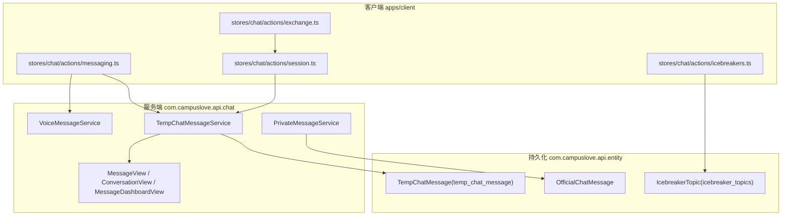
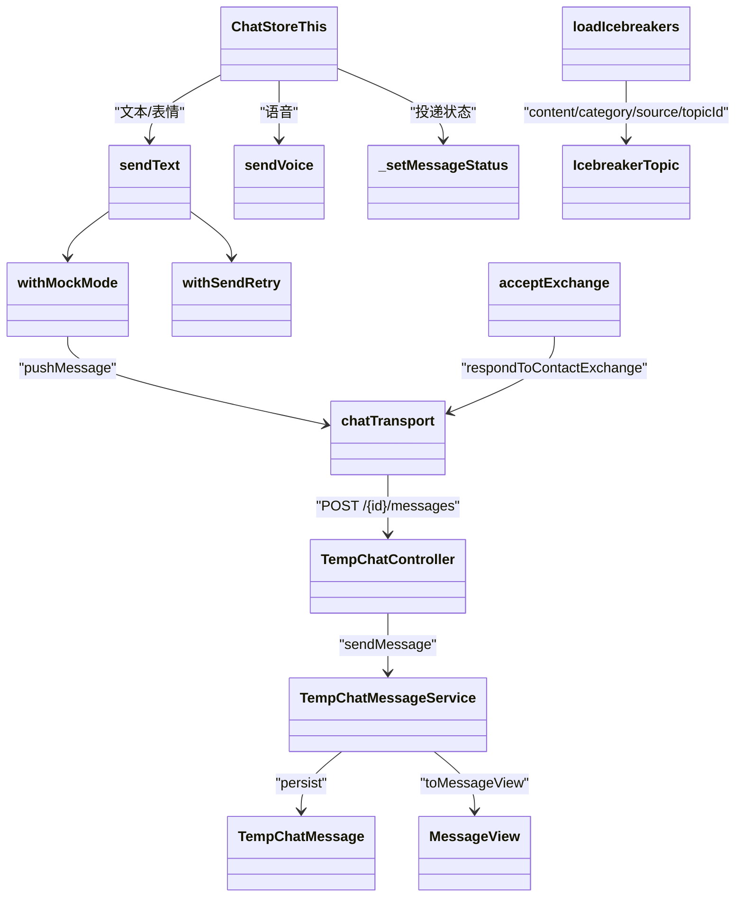
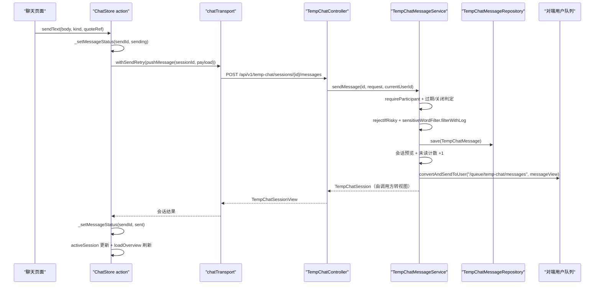
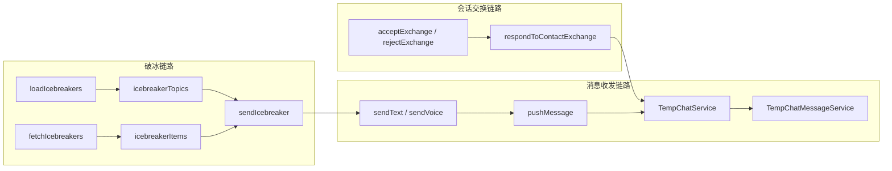
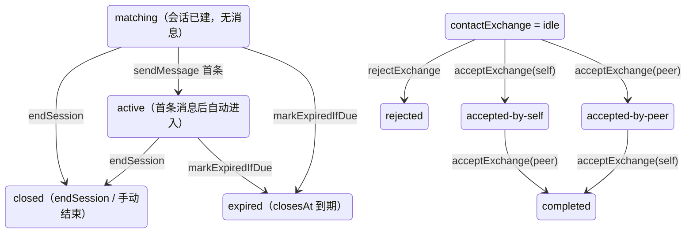
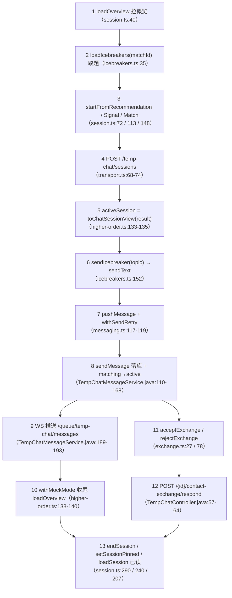
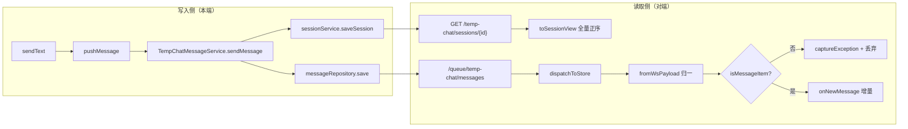
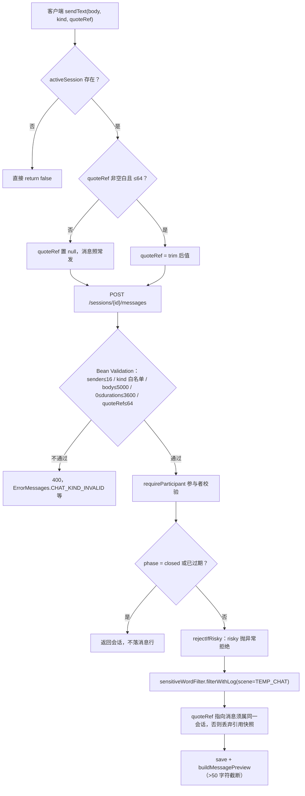
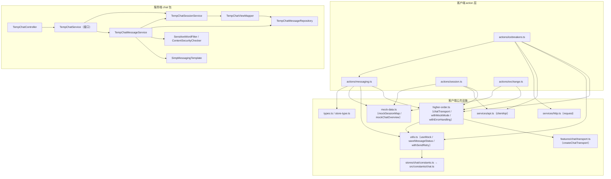
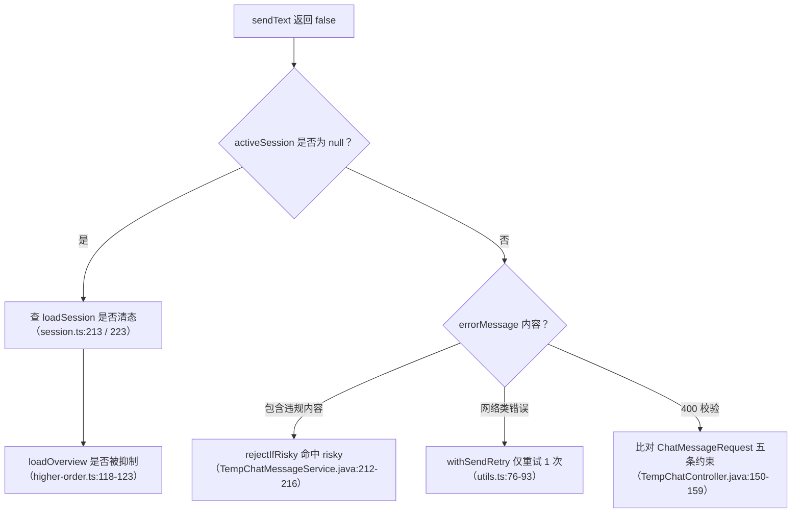

# 消息处理逻辑

<cite>
**本文引用的文件**
- [apps/client/src/stores/chat/actions/messaging.ts](file://apps/client/src/stores/chat/actions/messaging.ts)
- [apps/client/src/stores/chat/actions/session.ts](file://apps/client/src/stores/chat/actions/session.ts)
- [apps/client/src/stores/chat/actions/exchange.ts](file://apps/client/src/stores/chat/actions/exchange.ts)
- [apps/client/src/stores/chat/actions/icebreakers.ts](file://apps/client/src/stores/chat/actions/icebreakers.ts)
- [apps/client/src/stores/chat/higher-order.ts](file://apps/client/src/stores/chat/higher-order.ts)
- [apps/client/src/stores/chat/utils.ts](file://apps/client/src/stores/chat/utils.ts)
- [apps/client/src/stores/chat/types.ts](file://apps/client/src/stores/chat/types.ts)
- [apps/client/src/stores/chat/constants.ts](file://apps/client/src/stores/chat/constants.ts)
- [apps/client/src/constants/chat.ts](file://apps/client/src/constants/chat.ts)
- [apps/client/src/features/chat/transport.ts](file://apps/client/src/features/chat/transport.ts)
- [apps/client/src/services/websocket/store-dispatch.ts](file://apps/client/src/services/websocket/store-dispatch.ts)
- [apps/client/src/services/websocket/ws-message-adapter.ts](file://apps/client/src/services/websocket/ws-message-adapter.ts)
- [apps/client/src/services/api.ts](file://apps/client/src/services/api.ts)
- [apps/api/src/main/java/com/campuslove/api/chat/TempChatController.java](file://apps/api/src/main/java/com/campuslove/api/chat/TempChatController.java)
- [apps/api/src/main/java/com/campuslove/api/chat/TempChatService.java](file://apps/api/src/main/java/com/campuslove/api/chat/TempChatService.java)
- [apps/api/src/main/java/com/campuslove/api/chat/TempChatMessageService.java](file://apps/api/src/main/java/com/campuslove/api/chat/TempChatMessageService.java)
- [apps/api/src/main/java/com/campuslove/api/chat/TempChatSessionService.java](file://apps/api/src/main/java/com/campuslove/api/chat/TempChatSessionService.java)
- [apps/api/src/main/java/com/campuslove/api/chat/TempChatViewMapper.java](file://apps/api/src/main/java/com/campuslove/api/chat/TempChatViewMapper.java)
- [apps/api/src/main/java/com/campuslove/api/repository/TempChatMessageRepository.java](file://apps/api/src/main/java/com/campuslove/api/repository/TempChatMessageRepository.java)
- [apps/api/src/main/java/com/campuslove/api/match/MatchController.java](file://apps/api/src/main/java/com/campuslove/api/match/MatchController.java)
- [apps/api/src/main/java/com/campuslove/api/match/RealIcebreakerService.java](file://apps/api/src/main/java/com/campuslove/api/match/RealIcebreakerService.java)
</cite>

## 目录
1. [简介](#简介)
2. [项目结构](#项目结构)
3. [核心组件](#核心组件)
4. [架构总览](#架构总览)
5. [详细组件分析](#详细组件分析)
6. [子页索引与模块边界](#子页索引与模块边界)
7. [消息历史管理](#消息历史管理)
8. [数据处理规则](#数据处理规则)
9. [依赖关系分析](#依赖关系分析)
10. [性能考虑](#性能考虑)
11. [故障排查指南](#故障排查指南)
12. [能力缺口登记](#能力缺口登记)
13. [结论](#结论)

## 简介
本页是「消息聊天系统」下 `消息处理逻辑` 分组的总览页，负责把三条互相咬合的处理链路——消息收发、会话交换、破冰——放在同一张数据流图里说明，并为每个子能力指出唯一的深入页。页面本身不重复子页的实现细节，而是回答三个问题：一条消息从客户端 store 出发要经过哪些边界才落到数据库；会话（临时聊天）与消息（`temp_chat_message`）两个对象在链路上如何分工；破冰话题在会话建立之前和之后分别由哪个 action 触发。

链路的两侧都有真实落点。客户端一侧集中在 `apps/client/src/stores/chat/actions/` 目录的四个 action 文件：`messaging.ts`（229 行，导出 `sendText` / `sendVoice` / `_setMessageStatus`）、`session.ts`（314 行，导出 7 个会话生命周期函数）、`exchange.ts`（110 行，导出 `acceptExchange` / `rejectExchange`）、`icebreakers.ts`（188 行，导出 `loadIcebreakers` / `sendIcebreaker` / `fetchIcebreakers`）。服务端一侧集中在 `com.campuslove.api.chat` 包，核心是 `TempChatMessageService`（350 行，`sendMessage` / `recallMessage` / `buildMessagePreview`）以及视图对象 `MessageView`、`ConversationView`、`MessageDashboardView`。

**章节来源**
- [messaging.ts:55-219](file://apps/client/src/stores/chat/actions/messaging.ts#L55-L219)
- [session.ts:40-290](file://apps/client/src/stores/chat/actions/session.ts#L40-L290)
- [exchange.ts:27-78](file://apps/client/src/stores/chat/actions/exchange.ts#L27-L78)
- [icebreakers.ts:35-172](file://apps/client/src/stores/chat/actions/icebreakers.ts#L35-L172)
- [TempChatMessageService.java:44-341](file://apps/api/src/main/java/com/campuslove/api/chat/TempChatMessageService.java#L44-L341)

## 项目结构
消息处理逻辑横跨两个应用与一层持久化模型，目录边界清晰：

- 客户端 store 动作层：`apps/client/src/stores/chat/actions/`，按「会话 / 消息 / 交换 / 破冰」四种关注点分文件，每个文件只导出面向 store 的 action 函数，不直接操作网络细节。
- 服务端聊天包：`apps/api/src/main/java/com/campuslove/api/chat/`，承载服务实现（`TempChatMessageService`、`PrivateMessageService`、`VoiceMessageService`）与出参视图（`MessageView`、`ConversationView`、`MessageDashboardView`）。
- 持久化实体：`apps/api/src/main/java/com/campuslove/api/entity/`，其中 `TempChatMessage`（`@Table(name = "temp_chat_message")`）承载消息行，`IcebreakerTopic`（`@Table(name = "icebreaker_topics")`）承载破冰话题池，`OfficialChatMessage` 承载官方号单聊记录。

**图表来源**
- [TempChatMessage.java:22-81](file://apps/api/src/main/java/com/campuslove/api/entity/TempChatMessage.java#L22-L81)
- [IcebreakerTopic.java:20-73](file://apps/api/src/main/java/com/campuslove/api/entity/IcebreakerTopic.java#L20-L73)

**章节来源**
- [messaging.ts:55-219](file://apps/client/src/stores/chat/actions/messaging.ts#L55-L219)
- [session.ts:40-290](file://apps/client/src/stores/chat/actions/session.ts#L40-L290)

## 核心组件
从「一条消息的旅程」视角，本分组涉及四类组件，各自只承担链路上的一段：

- 会话编排组件（客户端）：`session.ts` 的 `loadOverview` / `startFromRecommendation` / `startFromSignal` / `startFromMatch` / `loadSession` / `setSessionPinned` / `endSession` 决定「在哪个会话里发消息」，并把结果收敛为 `activeSession` 视图模型。
- 消息投递组件（客户端）：`messaging.ts` 的 `sendText` / `sendVoice` 负责载荷组装、`sendId` 生成、投递状态跟踪；`_setMessageStatus` 是唯一写状态表的入口。
- 传输与模式组件（客户端）：`higher-order.ts` 暴露模块级单例 `chatTransport` 与两个编排函数 `withErrorHandling` / `withMockMode`；`utils.ts` 提供 `useMock`、`loadMessageStatus` / `saveMessageStatus`、`withSendRetry`。
- 服务端处理组件：`TempChatController` 提供 `/api/v1/temp-chat/sessions` 下的 9 个端点，`TempChatMessageService` 完成参与者校验、阶段流转、内容安全检查、敏感词过滤、引用快照、落库、未读计数与 WebSocket 推送；视图对象 `MessageView` / `ConversationView` / `MessageDashboardView` 是对外出参形态。

**图表来源**
- [TempChatController.java:36-97](file://apps/api/src/main/java/com/campuslove/api/chat/TempChatController.java#L36-L97)
- [TempChatMessageService.java:88-197](file://apps/api/src/main/java/com/campuslove/api/chat/TempChatMessageService.java#L88-L197)
- [higher-order.ts:114-142](file://apps/client/src/stores/chat/higher-order.ts#L114-L142)
- [MessageView.java:9-19](file://apps/api/src/main/java/com/campuslove/api/chat/MessageView.java#L9-L19)

各组件的关键契约：`SendMessageRequest`（客户端）与 `ChatMessageRequest`（服务端 record）字段一一对应，即 `sender` / `kind` / `body` / `durationSeconds` / `quoteRef`；服务端 `kind` 用 `@Pattern(regexp = "(?i)text|voice|emoji|system")` 校验，`body` 上限 `@Size(max = 5000)`，`durationSeconds` 受 `MAX_TEMP_CHAT_DURATION_SECONDS = 3600` 约束，`quoteRef` 上限 `@Size(max = 64)`。客户端 `SendMessageRequest.kind` 只允许 `text | voice | emoji`，`system` 仅由后端生成。

**章节来源**
- [messaging.ts:55-131](file://apps/client/src/stores/chat/actions/messaging.ts#L55-L131)
- [messaging.ts:145-229](file://apps/client/src/stores/chat/actions/messaging.ts#L145-L229)
- [session.ts:40-314](file://apps/client/src/stores/chat/actions/session.ts#L40-L314)
- [exchange.ts:27-110](file://apps/client/src/stores/chat/actions/exchange.ts#L27-L110)
- [icebreakers.ts:35-188](file://apps/client/src/stores/chat/actions/icebreakers.ts#L35-L188)
- [types.ts:31-62](file://apps/client/src/stores/chat/types.ts#L31-L62)
- [TempChatController.java:28-164](file://apps/api/src/main/java/com/campuslove/api/chat/TempChatController.java#L28-L164)
- [TempChatMessageService.java:88-197](file://apps/api/src/main/java/com/campuslove/api/chat/TempChatMessageService.java#L88-L197)
- [MessageView.java:9-31](file://apps/api/src/main/java/com/campuslove/api/chat/MessageView.java#L9-L31)
- [ConversationView.java:7-29](file://apps/api/src/main/java/com/campuslove/api/chat/ConversationView.java#L7-L29)

## 架构总览
整体链路是「客户端 action → 传输层 → REST 端点 → 领域服务 → 实体落库 → WebSocket 反向推送 → 对端 store」的单向环。下图给出一条文本消息在这条环上的完整旅程，标注了每一段真正执行的函数名，便于按图索骥定位代码。

**图表来源**
- [messaging.ts:55-131](file://apps/client/src/stores/chat/actions/messaging.ts#L55-L131)
- [TempChatController.java:48-55](file://apps/api/src/main/java/com/campuslove/api/chat/TempChatController.java#L48-L55)
- [TempChatMessageService.java:88-197](file://apps/api/src/main/java/com/campuslove/api/chat/TempChatMessageService.java#L88-L197)
- [higher-order.ts:114-142](file://apps/client/src/stores/chat/higher-order.ts#L114-L142)

三条链路的职责交接点固定在三个位置：会话交换只在 `chatTransport.respondToContactExchange` → `POST /{id}/contact-exchange/respond` 上闭环；破冰取题只走 `GET /matches/{matchId}/icebreakers` 与 `clientApi.getIcebreakers(peerUserId)`，而破冰发题不占独立端点，复用 `sendText` 的发送链路；会话生命周期只在 `TempChatController` 的 `create / get / end / pin / unpin / read` 六个端点上流转。

**图表来源**
- [exchange.ts:27-110](file://apps/client/src/stores/chat/actions/exchange.ts#L27-L110)
- [icebreakers.ts:35-188](file://apps/client/src/stores/chat/actions/icebreakers.ts#L35-L188)
- [TempChatController.java:57-64](file://apps/api/src/main/java/com/campuslove/api/chat/TempChatController.java#L57-L64)
- [TempChatMessageService.java:88-121](file://apps/api/src/main/java/com/campuslove/api/chat/TempChatMessageService.java#L88-L121)

**章节来源**
- [messaging.ts:88-120](file://apps/client/src/stores/chat/actions/messaging.ts#L88-L120)
- [session.ts:186-229](file://apps/client/src/stores/chat/actions/session.ts#L186-L229)
- [TempChatController.java:36-97](file://apps/api/src/main/java/com/campuslove/api/chat/TempChatController.java#L36-L97)

## 详细组件分析
本页按「链路分段」组织：每个 `###` 只界定该组件在本分组数据流中的输入、输出与交接对象，函数级实现细节由对应子页承载，此处不重复。

### 会话编排组件（session.ts）
输入是三类入口标识 `recommendedPersonId` / `signalId` / `matchId`，输出是 `activeSession` 视图模型。三个 `startFrom*` 函数共享同一收敛点：Real 分支调用 `chatTransport.createSession({ recommendedPersonId })`（`session.ts:102`）、`createSession({ signalId })`（`session.ts:137`）、`createSession({ matchId })`（`session.ts:173`），三者最终都落到同一个端点 `POST /temp-chat/sessions`（`transport.ts:68-74`），由服务端 `TempChatController.createSession` 转给 `TempChatService.createSession(recommendedPersonId, matchId, signalId)`（`TempChatController.java:36-40`、`TempChatService.java:29`）。请求体三字段各受 `@Size(max = 64)` 约束，并由 `@AssertTrue` 校验「至少给一个」——`hasEntryPoint()`（`TempChatController.java:100-113`）。

`loadSession` 是全链路唯一会把 `activeSession` 写成 `null` 的会话函数：Real 分支在 `chatTransport.loadSession` 或 `clientApi.markTempChatSessionRead` 抛错时显式置空再重抛（`session.ts:203-217`），mock 分支未知 id 返回 `null` 后同样置空并抛出「会话不存在或已失效」（`session.ts:222-225`）。这条边界直接决定 `sendText` 是走发送分支还是立刻返回 `false`（`messaging.ts:63-65`）。

`setSessionPinned` 与 `endSession` 不参与 `activeSession` 写入：前者显式传 `{ shouldRefreshOverview: true, shouldUpdateActiveSession: false }`（`session.ts:279`），后者只在会话真的结束时由服务端返回新的 `phase`。

### 消息投递组件（messaging.ts）
`sendText` 的输入是 `(body, kind, quoteRef?)`，其中 `kind` 取 `SendMessageRequest["kind"]`，即 `text | voice | emoji`（`types.ts:55`）。它先置 `sending` 状态再组装载荷，`quoteRef` 只有在非空白且长度 ≤ 64 时才下发，与服务端 `@Size(max = 64)` 同口径（`messaging.ts:83`、`TempChatController.java:158`）。Real 分支为 `withSendRetry(() => chatTransport.pushMessage(sessionId, payload))`（`messaging.ts:117-119`），`withSendRetry` 只对 `EnhancedApiError.category === "network"` 的错误重试，默认 `maxRetries = MAX_SEND_RETRIES`、`delayMs = SEND_RETRY_DELAY_MS`（`utils.ts:70-93`、`apps/client/src/constants/chat.ts`）。

`sendVoice` 与 `sendText` 的关键差异在于它有两段网络：先 `uploadVoiceFile(tempFilePath, durationSeconds)` 拿回 URL，再把这个 URL 当作 `body` 发送 `kind: "voice"`（`messaging.ts:160`、`messaging.ts:169-204`）。上传失败时它不吞异常，而是写 `errorMessage` 后 `throw`（`messaging.ts:161-165`），因此语音链路的失败由调用页面感知，而文本链路失败由 `sendText` 的返回值 `false` 表达。

`_setMessageStatus` 只做两件事：合并 `messageDeliveryStatus` 映射并 `saveMessageStatus` 落本地存储（`messaging.ts:219-229`、`utils.ts:52-58`）。它是本分组唯一的状态写入点，存储键 `MESSAGE_STATUS_STORAGE_KEY` 由 `stores/chat/constants.ts` 从 `src/constants/chat.ts` 转发（`stores/chat/constants.ts:13-17`）。

### 会话交换组件（exchange.ts）
`acceptExchange(actor)` 不查询服务端状态，而是用一张本地查表把「当前状态 + 操作者」映射成新状态：`self` 遇到 `accepted-by-peer` 则 `completed`，否则 `accepted-by-self`；`peer` 对称（`exchange.ts:45-53`）。这张表只作用于 Mock 分支；Real 分支把语义完全交给 `chatTransport.respondToContactExchange(sessionId, { actor, decision: "accept" })`（`exchange.ts:66-69`），对应 `POST /temp-chat/sessions/{id}/contact-exchange/respond`（`transport.ts:104-113`），服务端 `ContactExchangeDecisionRequest` 的 `decision` 允许 `accept|reject|revoke` 三种（`TempChatController.java:169-174`）——`revoke` 是客户端两个 action 都未使用的第三种裁决，归属会话交换子页。

### 破冰组件（icebreakers.ts）
三个函数分工明确，且共用发送出口：

- `loadIcebreakers(matchId)`：Real 走 `GET /matches/{matchId}/icebreakers`，把响应数组的 `content` 抽成 `icebreakerTopics`（`icebreakers.ts:70-75`），服务端出口是 `MatchController.getIcebreakers`（`MatchController.java:376-384`）。
- `fetchIcebreakers(peerUserId)`：走 `clientApi.getIcebreakers(peerUserId)`，同时填充 `icebreakerItems` 与「前 3 条文案」的 `icebreakerTopics`（`icebreakers.ts:179-181`）；该 API 在 Real 模式下固定返回空列表，因为后端不存在按对端用户 ID 的破冰端点（`api.ts:512-518`）。
- `sendIcebreaker(_matchId, topic)`：Real 分支直接 `await this.sendText(topic)`（`icebreakers.ts:152`），Mock 分支自己拼一条 `kind: "text"` 消息写入 `mockSessionMap` 并 `toChatSessionView` + `loadOverview`（`icebreakers.ts:121-145`）。

因此破冰不是第四条网络链路，而是消息收发链路的一个调用方。

### 横切设施与状态机
`withMockMode` 的收尾动作是链路顺序的保证：结果对象若含 `id` 就覆盖 `activeSession`，随后无条件 `await store.loadOverview()`（`higher-order.ts:133-140`）。`withErrorHandling` 则在 `finally` 中复位 `loadingKey`，并在 `rethrow` 为真时把错误继续上抛（`higher-order.ts:71-85`）——`sendIcebreaker` 用的正是 `rethrow: true`（`icebreakers.ts:106-108`）。

会话阶段与交换状态构成两个互相独立的状态机，消息链路只在 `phase` 允许时写入：

**图表来源**
- [TempChatMessageService.java:97-112](file://apps/api/src/main/java/com/campuslove/api/chat/TempChatMessageService.java#L97-L112)
- [TempChatViewMapper.java:75-77](file://apps/api/src/main/java/com/campuslove/api/chat/TempChatViewMapper.java#L75-L77)
- [exchange.ts:45-53](file://apps/client/src/stores/chat/actions/exchange.ts#L45-L53)
- [session.ts:296-313](file://apps/client/src/stores/chat/actions/session.ts#L296-L313)
- [TempChatSessionService.java:49-50](file://apps/api/src/main/java/com/campuslove/api/chat/TempChatSessionService.java#L49-L50)

图中 `matching → active` 的自动流转发生在服务端而非客户端：`TempChatMessageService.sendMessage` 检查 `phase == matching` 时执行 `session.setPhase(SessionPhase.active)`（`TempChatMessageService.java:110-112`）；`closed` 会话与已过期会话直接返回会话对象、不写消息行（`TempChatMessageService.java:97-107`）。

**章节来源**
- [session.ts:72-105](file://apps/client/src/stores/chat/actions/session.ts#L72-L105)
- [session.ts:113-140](file://apps/client/src/stores/chat/actions/session.ts#L113-L140)
- [session.ts:148-176](file://apps/client/src/stores/chat/actions/session.ts#L148-L176)
- [session.ts:186-229](file://apps/client/src/stores/chat/actions/session.ts#L186-L229)
- [session.ts:240-283](file://apps/client/src/stores/chat/actions/session.ts#L240-L283)
- [messaging.ts:55-131](file://apps/client/src/stores/chat/actions/messaging.ts#L55-L131)
- [messaging.ts:145-229](file://apps/client/src/stores/chat/actions/messaging.ts#L145-L229)
- [exchange.ts:27-110](file://apps/client/src/stores/chat/actions/exchange.ts#L27-L110)
- [icebreakers.ts:35-78](file://apps/client/src/stores/chat/actions/icebreakers.ts#L35-L78)
- [icebreakers.ts:99-162](file://apps/client/src/stores/chat/actions/icebreakers.ts#L99-L162)
- [icebreakers.ts:172-188](file://apps/client/src/stores/chat/actions/icebreakers.ts#L172-L188)
- [higher-order.ts:54-142](file://apps/client/src/stores/chat/higher-order.ts#L54-L142)
- [utils.ts:34-97](file://apps/client/src/stores/chat/utils.ts#L34-L97)
- [types.ts:31-62](file://apps/client/src/stores/chat/types.ts#L31-L62)
- [transport.ts:67-125](file://apps/client/src/features/chat/transport.ts#L67-L125)
- [TempChatController.java:36-113](file://apps/api/src/main/java/com/campuslove/api/chat/TempChatController.java#L36-L113)
- [TempChatController.java:150-174](file://apps/api/src/main/java/com/campuslove/api/chat/TempChatController.java#L150-L174)
- [TempChatMessageService.java:97-131](file://apps/api/src/main/java/com/campuslove/api/chat/TempChatMessageService.java#L97-L131)
- [api.ts:498-518](file://apps/client/src/services/api.ts#L498-L518)
- [MatchController.java:376-384](file://apps/api/src/main/java/com/campuslove/api/match/MatchController.java#L376-L384)

## 子页索引与模块边界
三个子页不是并列关系，而是一条链上的三段：**破冰机制**在会话建立前取题、建立后借道发送；**消息收发机制**承载全部写入与推送；**会话交换机制**决定会话能否被写入、以及写入完成后 `activeSession` 的状态回写。下面这张顺序图把三段串成一次完整的用户操作，编号即调用先后。

**图表来源**
- [session.ts:40-64](file://apps/client/src/stores/chat/actions/session.ts#L40-L64)
- [session.ts:72-105](file://apps/client/src/stores/chat/actions/session.ts#L72-L105)
- [session.ts:186-229](file://apps/client/src/stores/chat/actions/session.ts#L186-L229)
- [icebreakers.ts:35-78](file://apps/client/src/stores/chat/actions/icebreakers.ts#L35-L78)
- [icebreakers.ts:99-162](file://apps/client/src/stores/chat/actions/icebreakers.ts#L99-L162)
- [messaging.ts:55-131](file://apps/client/src/stores/chat/actions/messaging.ts#L55-L131)
- [exchange.ts:27-110](file://apps/client/src/stores/chat/actions/exchange.ts#L27-L110)
- [higher-order.ts:114-142](file://apps/client/src/stores/chat/higher-order.ts#L114-L142)
- [transport.ts:67-113](file://apps/client/src/features/chat/transport.ts#L67-L113)
- [TempChatController.java:36-64](file://apps/api/src/main/java/com/campuslove/api/chat/TempChatController.java#L36-L64)
- [TempChatMessageService.java:110-193](file://apps/api/src/main/java/com/campuslove/api/chat/TempChatMessageService.java#L110-L193)

三段的状态衔接规则，逐条对应到代码：

- **破冰 → 消息**：状态载体是 `icebreakerTopics`（文案数组）与 `icebreakerItems`（完整结构），由 `loadIcebreakers` 或 `fetchIcebreakers` 填充；一旦用户点选题，`sendIcebreaker` 只把 `topic` 字符串交给 `sendText`，不再携带 `matchId`（`icebreakers.ts:152`）。因此破冰话题进入消息表后就与普通文本无差别，`kind` 恒为 `text`（`icebreakers.ts:133`）。
- **会话 → 消息**：状态载体是 `activeSession`。`sendText` / `sendVoice` / `acceptExchange` / `rejectExchange` / `endSession` 五个 action 都在第一行做 `if (!this.activeSession) return`（`messaging.ts:63-65`、`messaging.ts:150-152`、`exchange.ts:31-33`、`exchange.ts:82-84`、`session.ts:291-293`），这是三条链路唯一的共享前置条件。
- **消息 → 会话**：服务端写入成功后回写 `lastMessagePreview`、`lastMessageAt` 与对端未读计数（`TempChatMessageService.java:170-183`），预览文本由 `buildMessagePreview` 按 `kind` 生成（`TempChatMessageService.java:341-349`）；客户端侧靠 `withMockMode` 的 `loadOverview` 把这份回写拉回列表。
- **交换 → 消息**：联系方式交换不写消息行，`respondToContactExchange` 只更新 `ContactExchangeStateView(proposer, status)`（`TempChatController.java:166`），页面据此决定后续能否继续发送；`TempChatCleanupService` 负责交换与过期清理，不在这三个 action 的调用面内。

模块边界（谁不做什么）：

| 子页 | 负责 | 明确不负责 |
| --- | --- | --- |
| 消息收发机制 | `sendText` / `sendVoice` / `_setMessageStatus`、`TempChatMessageService` 落库与 WS 推送、撤回 | 会话创建、交换裁决、话题选取 |
| 会话交换机制 | `TempChatSessionService` 的 `createSession / endSession / pin / unpin / markSessionRead`、`respondToContactExchange` 状态机 | 消息内容处理、投递状态表 |
| 破冰机制 | `loadIcebreakers` / `fetchIcebreakers` / `sendIcebreaker`、`RealIcebreakerService` 的话题生成 | 消息发送本身（借用 `sendText`）、消息渲染 |

**章节来源**
- [messaging.ts:63-65](file://apps/client/src/stores/chat/actions/messaging.ts#L63-L65)
- [messaging.ts:150-152](file://apps/client/src/stores/chat/actions/messaging.ts#L150-L152)
- [exchange.ts:31-33](file://apps/client/src/stores/chat/actions/exchange.ts#L31-L33)
- [exchange.ts:82-84](file://apps/client/src/stores/chat/actions/exchange.ts#L82-L84)
- [session.ts:291-293](file://apps/client/src/stores/chat/actions/session.ts#L291-L293)
- [icebreakers.ts:121-152](file://apps/client/src/stores/chat/actions/icebreakers.ts#L121-L152)
- [TempChatMessageService.java:170-193](file://apps/api/src/main/java/com/campuslove/api/chat/TempChatMessageService.java#L170-L193)
- [TempChatMessageService.java:341-349](file://apps/api/src/main/java/com/campuslove/api/chat/TempChatMessageService.java#L341-L349)
- [TempChatController.java:57-88](file://apps/api/src/main/java/com/campuslove/api/chat/TempChatController.java#L57-L88)
- [TempChatService.java:9-71](file://apps/api/src/main/java/com/campuslove/api/chat/TempChatService.java#L9-L71)
- [RealIcebreakerService.java:90-115](file://apps/api/src/main/java/com/campuslove/api/match/RealIcebreakerService.java#L90-L115)

## 消息历史管理
本仓库的消息历史采用「服务端全量返回 + WebSocket 单条增量 + 未读计数兜底」三段式，没有分页游标。

**全量加载**。会话详情由 `TempChatViewMapper.toSessionView` 组装：非过期会话用 `messageRepository.findBySessionIdOrderByCreatedAtAsc(session.getId())` 一次取回该会话全部消息行并按 `createdAt` 正序输出（`TempChatViewMapper.java:76-84`、`TempChatMessageRepository.java:22`）。`TempChatController` 暴露的 9 个端点里没有任何 `page` / `size` / `before` / `cursor` 参数（`TempChatController.java:36-97`），客户端 `chatTransport.loadSession` 也不传查询串，只有 `GET /temp-chat/sessions/{sessionId}`（`transport.ts:76-80`）。客户端侧对应的入口是 `loadSession(sessionId)`，它在 Real 分支拉全量之后紧接着调用 `clientApi.markTempChatSessionRead(sessionId)` 清未读（`session.ts:206-207`）。

**视角翻转**。落库的 `sender` 恒为 userA 视角（`self` = userA、`peer` = userB），`toSessionView` 在流转换时按查看者身份翻转：`viewerIsUserB = !session.getUserAId().equals(currentUserId)`（`TempChatViewMapper.java:80-83`）。同一条翻转规则也用在实时推送上——`sendMessage` 计算 `recipientIsUserB` 后再调 `sessionService.toMessageView(message, recipientIsUserB)`（`TempChatMessageService.java:186-188`），保证冷启动历史与在线增量在左右位置上不会互相打乱。

**增量同步**。服务端落库后经 `convertAndSendToUser(recipientId, "/queue/temp-chat/messages", messageView)` 推给对端（`TempChatMessageService.java:189-193`）。客户端订阅表把该队列映射到 `dispatchToStore`（`websocket/index.ts:831-836`），`dispatchToStore` 再按目的串路由到 `handleNewMessage`（`store-dispatch.ts:64`、`store-dispatch.ts:138`）。入站载荷先经 `fromWsPayload(data, destination)` 归一成内部 `MessageItem` 形状，再过 `isMessageItem` 守卫，两次任一失败都会 `captureException` 上报并丢弃该条（`store-dispatch.ts:145-171`），这一层存在的原因是后端三种载荷形状不一致：私信 `MessageView`、临时会话 `ChatMessageView`、mock 透传（`ws-message-adapter.ts:11-20`）。归一后若 `onNewMessage` 方法存在就走 store 的增量入口，否则回退为直接 `currentMessages.push` 并同步 `lastMessagePreview` / `lastMessageSentAt` / `unreadCount += 1`（`store-dispatch.ts:176-194`）。

**离线与补齐**。临时会话的 WS 增量有一个刻意的降级：`ChatMessageView` 不带 `sessionId`，`handleNewMessage` 在 `!item.sessionId` 时静默 return，注释写明「temp 未读以服务端计数为准，进入会话时 loadSession 全量刷新兜底」（`store-dispatch.ts:157-159`）。因此离线期间的消息不依赖客户端补拉队列，而是靠下次 `loadSession` 的全量结果 + `markTempChatSessionRead` 收敛；未读计数由服务端在写入时递增（对 userA 视角收到 `peer` 消息则 `userAUnreadCount + 1`，否则 `userBUnreadCount + 1`，`TempChatMessageService.java:176-181`）。

**图表来源**
- [TempChatMessageService.java:168-193](file://apps/api/src/main/java/com/campuslove/api/chat/TempChatMessageService.java#L168-L193)
- [TempChatViewMapper.java:69-100](file://apps/api/src/main/java/com/campuslove/api/chat/TempChatViewMapper.java#L69-L100)
- [store-dispatch.ts:138-203](file://apps/client/src/services/websocket/store-dispatch.ts#L138-L203)
- [ws-message-adapter.ts:1-40](file://apps/client/src/services/websocket/ws-message-adapter.ts#L1-L40)
- [transport.ts:76-92](file://apps/client/src/features/chat/transport.ts#L76-L92)

**撤回与历史的耦合**。`recallMessage` 把 `recalled` 置真、正文替换为 `[已撤回]` 后保存（`TempChatMessageService.java:318-320`），随后只有当会话当前预览恰好等于撤回前生成的预览时才改写预览并再 `saveSession`（`TempChatMessageService.java:316-327`），避免历史中间消息被撤回时列表预览被错误覆盖。过期会话在视图层直接返回空消息列表 `List.of()`（`TempChatViewMapper.java:76-77`），这也是深链进已过期会话时页面看到空态的根因。

**章节来源**
- [session.ts:186-229](file://apps/client/src/stores/chat/actions/session.ts#L186-L229)
- [transport.ts:76-92](file://apps/client/src/features/chat/transport.ts#L76-L92)
- [TempChatMessageService.java:176-193](file://apps/api/src/main/java/com/campuslove/api/chat/TempChatMessageService.java#L176-L193)
- [TempChatMessageService.java:261-331](file://apps/api/src/main/java/com/campuslove/api/chat/TempChatMessageService.java#L261-L331)
- [TempChatMessageRepository.java:16-54](file://apps/api/src/main/java/com/campuslove/api/repository/TempChatMessageRepository.java#L16-L54)
- [TempChatController.java:36-97](file://apps/api/src/main/java/com/campuslove/api/chat/TempChatController.java#L36-L97)
- [apps/client/src/services/websocket/index.ts:810-836](file://apps/client/src/services/websocket/index.ts#L810-L836)
- [store-dispatch.ts:138-203](file://apps/client/src/services/websocket/store-dispatch.ts#L138-L203)
- [TempChatViewMapper.java:69-100](file://apps/api/src/main/java/com/campuslove/api/chat/TempChatViewMapper.java#L69-L100)

## 数据处理规则
链路上的数据规则分四类：写入前置校验、内容清洗、去重、排序。它们分散在客户端与服务端两侧，本页统一登记，便于排错时判断「为什么这条消息被丢/被截/被拒」。

**图表来源**
- [messaging.ts:63-84](file://apps/client/src/stores/chat/actions/messaging.ts#L63-L84)
- [TempChatController.java:150-164](file://apps/api/src/main/java/com/campuslove/api/chat/TempChatController.java#L150-L164)
- [TempChatMessageService.java:88-197](file://apps/api/src/main/java/com/campuslove/api/chat/TempChatMessageService.java#L88-L197)

**写入前置校验（服务端为主）**。`ChatMessageRequest` 是唯一的入参契约：`sender` `@NotBlank @Size(max = 16)`、`kind` `@NotBlank @Pattern(regexp = "(?i)text|voice|emoji|system")`、`body` `@NotBlank @Size(max = 5000)`、`durationSeconds` `@Min(0) @Max(MAX_TEMP_CHAT_DURATION_SECONDS)`（常量值 3600）、`quoteRef` `@Size(max = 64)`（`TempChatController.java:28`、`TempChatController.java:150-164`）。客户端 `SendMessageRequest` 是它的收窄子集：`sender` 只允许 `self | peer`，`kind` 只允许 `text | voice | emoji`，注释明确「system 仅由后端生成，前端不可发送」（`types.ts:51-62`）。注意两侧长度口径不同：客户端把单条消息长度上限定为 `MESSAGE_MAX_LENGTH = 1000`，服务端契约允许 5000（`apps/client/src/constants/chat.ts`、`TempChatController.java:155`），实际生效的是更严的客户端限制。

**内容清洗**。两道，顺序固定：先 `rejectIfRisky(request.body(), currentUserId, "4")`，命中 `risky` 抛 `IllegalArgumentException("消息包含违规内容，无法发送")`，`review` 放行只记 warn（`TempChatMessageService.java:119-121`、`TempChatMessageService.java:207-221`）；再 `sensitiveWordFilter.filterWithLog(request.body(), currentUserId, "TEMP_CHAT")` 得到 `filteredBody`，后续入库、预览、推送一律用过滤后的值（`TempChatMessageService.java:123-132`、`TempChatMessageService.java:171`）。引用快照走 JSON 手工拼接，五个控制字符（反斜杠、双引号、换行、回车、制表）经 `escapeJson` 转义（`TempChatMessageService.java:150-156`、`TempChatMessageService.java:229-246`）。列表预览另有截断规则：`voice → "语音消息"`、`emoji → "表情消息"`、`system → 原文`、其余超过 50 字符截为 50 + `...`（`TempChatMessageService.java:341-349`）。

**去重**。三处，机制各不相同，且都不是数据库唯一键：

- 客户端标识去撞：模块级自增计数器 `messageIdSeq` 与 `Date.now()` 拼出 `send-${ts}-${++seq}`（`messaging.ts:35`、`messaging.ts:69`），mock 消息 id 用 `m-${ts}-${++seq}`（`messaging.ts:100`），mock 会话 id 用独立的 `mockSessionSeq`（`session.ts:30`、`session.ts:88`），解决同毫秒连发产生重复 id。
- HTTP 幂等：`pushMessage` 每次生成随机 `Idempotency-Key: tmp-${ts}-${rand}`，注释记录了修复原因——原键名写成 `header` 而 `http.ts` 只消费 `headers`，导致随机键从未发出、同文案重发撞后端幂等锁（`transport.ts:87-91`）。
- 通知级去重：WS 侧「新的匹配」通知按 `matchId` 去重，避免重复推送产生重复通知（`store-dispatch.ts:351`）；私信/临时会话消息本身没有入站去重键。

**排序与归因**。历史消息唯一排序口径是 `createdAt ASC`（`TempChatMessageRepository.java:16-54`）；同一 Repository 另提供倒序与计数方法，但视图装配只走正序那条。发送者归因在服务端重算：`sender = session.getUserAId().equals(currentUserId) ? "self" : "peer"`，客户端传的 `sender` 不被信任（`TempChatMessageService.java:116-117`）；`Long.parseLong(quoteRef)` 失败时跳过 `quoteSnapshot` 但继续发送消息（`TempChatMessageService.java:158-163`），`recallMessage` 中非法 `messageId` 则整体 no-op 返回原会话（`TempChatMessageService.java:271-280`）。

**章节来源**
- [messaging.ts:35-35](file://apps/client/src/stores/chat/actions/messaging.ts#L35-L35)
- [messaging.ts:63-84](file://apps/client/src/stores/chat/actions/messaging.ts#L63-L84)
- [messaging.ts:100-100](file://apps/client/src/stores/chat/actions/messaging.ts#L100-L100)
- [session.ts:30-30](file://apps/client/src/stores/chat/actions/session.ts#L30-L30)
- [types.ts:51-62](file://apps/client/src/stores/chat/types.ts#L51-L62)
- [constants.ts:13-17](file://apps/client/src/stores/chat/constants.ts#L13-L17)
- [apps/client/src/constants/chat.ts:13-54](file://apps/client/src/constants/chat.ts#L13-L54)
- [transport.ts:82-92](file://apps/client/src/features/chat/transport.ts#L82-L92)
- [store-dispatch.ts:328-360](file://apps/client/src/services/websocket/store-dispatch.ts#L328-L360)
- [TempChatController.java:24-28](file://apps/api/src/main/java/com/campuslove/api/chat/TempChatController.java#L24-L28)
- [TempChatController.java:150-164](file://apps/api/src/main/java/com/campuslove/api/chat/TempChatController.java#L150-L164)
- [TempChatMessageService.java:88-197](file://apps/api/src/main/java/com/campuslove/api/chat/TempChatMessageService.java#L88-L197)
- [TempChatMessageService.java:207-246](file://apps/api/src/main/java/com/campuslove/api/chat/TempChatMessageService.java#L207-L246)
- [TempChatMessageService.java:271-280](file://apps/api/src/main/java/com/campuslove/api/chat/TempChatMessageService.java#L271-L280)
- [TempChatMessageRepository.java:16-54](file://apps/api/src/main/java/com/campuslove/api/repository/TempChatMessageRepository.java#L16-L54)

## 依赖关系分析
本分组的依赖方向是单向的：四个 action 文件都不直接写 `uni.request`，全部经 `higher-order.ts`（编排）与 `features/chat/transport.ts`（传输）两个收敛点；服务端则由控制器接口把会话与消息两类职责分给两个服务。

**图表来源**
- [messaging.ts:13-32](file://apps/client/src/stores/chat/actions/messaging.ts#L13-L32)
- [session.ts:13-27](file://apps/client/src/stores/chat/actions/session.ts#L13-L27)
- [exchange.ts:13-16](file://apps/client/src/stores/chat/actions/exchange.ts#L13-L16)
- [icebreakers.ts:13-24](file://apps/client/src/stores/chat/actions/icebreakers.ts#L13-L24)
- [higher-order.ts:13-30](file://apps/client/src/stores/chat/higher-order.ts#L13-L30)
- [utils.ts:10-25](file://apps/client/src/stores/chat/utils.ts#L10-L25)
- [TempChatController.java:20-34](file://apps/api/src/main/java/com/campuslove/api/chat/TempChatController.java#L20-L34)
- [TempChatMessageService.java:43-70](file://apps/api/src/main/java/com/campuslove/api/chat/TempChatMessageService.java#L43-L70)
- [TempChatSessionService.java:45-63](file://apps/api/src/main/java/com/campuslove/api/chat/TempChatSessionService.java#L45-L63)
- [TempChatViewMapper.java:55-63](file://apps/api/src/main/java/com/campuslove/api/chat/TempChatViewMapper.java#L55-L63)

三条值得注意的依赖事实：

1. **破冰对消息收发是硬依赖，不是并行链路。** `icebreakers.ts` 在 Real 分支调用 `this.sendText(topic)`（`icebreakers.ts:152`），而 `sendText` 又依赖 `withMockMode` 的收尾刷新；`sendIcebreaker` 因此刻意不走 `withMockMode`，注释说明两分支差异过大（`icebreakers.ts:105`）。
2. **服务端内容安全检查是可选注入。** `TempChatMessageService` 用 `@Autowired(required = false)` 注入 `ContentSecurityChecker`，为 `null` 时跳过统一检查、由 `SensitiveWordFilter` 兜底（`TempChatMessageService.java:56-62`）；该类同时带 `@Profile("real")`（`TempChatMessageService.java:43`），说明 mock 环境不装配它。
3. **传输层是模块级单例，但模式在工厂里就固化了。** `chatTransport = createChatTransport()` 用 `clientEnv.apiMode` 默认值决定实例化 `RealChatTransport` 还是 `MockChatTransport`（`higher-order.ts:30`、`transport.ts:123-125`），而 action 内部又各自用 `useMock()` 选分支（`utils.ts:25`），二者来源不同（前者读 env，后者读 `stores/helpers/use-mock`），是链路排错时容易混淆的一处双重判定。

跨层依赖方面，`services/websocket` 与 `stores` 之间存在既有循环引用链——`store-dispatch` 值导入 stores、`ws-message-adapter` 同时值导入 `stores/messages`、`stores/session`、`stores/chat`（`ws-message-adapter.ts:19-28`），适配层注释明确该环「早已存在」，新增转换步骤未引入新的初始化时序问题。

**章节来源**
- [icebreakers.ts:99-162](file://apps/client/src/stores/chat/actions/icebreakers.ts#L99-L162)
- [higher-order.ts:24-30](file://apps/client/src/stores/chat/higher-order.ts#L24-L30)
- [transport.ts:123-125](file://apps/client/src/features/chat/transport.ts#L123-L125)
- [utils.ts:18-25](file://apps/client/src/stores/chat/utils.ts#L18-L25)
- [TempChatMessageService.java:43-70](file://apps/api/src/main/java/com/campuslove/api/chat/TempChatMessageService.java#L43-L70)
- [ws-message-adapter.ts:19-28](file://apps/client/src/services/websocket/ws-message-adapter.ts#L19-L28)
- [TempChatService.java:9-71](file://apps/api/src/main/java/com/campuslove/api/chat/TempChatService.java#L9-L71)

## 性能考虑
以下每条都对应仓库里已存在的实现或已知的代价，不写通用建议。

**批量操作**。链路上没有批量写端点：一条消息一次 `POST /temp-chat/sessions/{id}/messages`（`TempChatController.java:48-55`），一次交换裁决一次 `POST .../contact-exchange/respond`（`TempChatController.java:57-64`）。唯一的「批」语义在读侧——`TempChatViewMapper.toSessionView` 用一次查询取回整个会话消息再流式转换（`TempChatViewMapper.java:79-83`），客户端拿到的是 `TempChatSessionView.messages` 全量数组（`TempChatController.java:115-127`）。

**查询开销**。`TempChatMessageRepository` 专门提供了 `@EntityGraph(attributePaths = "session")` + 显式 `@Query` 的 `findWithSessionBySessionIdOrderByCreatedAtAsc`，注释写明目的是消除 `message.getSession()` 懒加载带来的 N+1，把 N 条 SQL 压成 1 条（`TempChatMessageRepository.java:32-45`）。但在 `apps/api/src/main/java` 全量检索下，该方法目前没有任何调用点——视图装配走的仍是未预加载的 `findBySessionIdOrderByCreatedAtAsc`（`TempChatViewMapper.java:79`）。这条差异是本页登记的性能改进位，而非既有优化。

**网络往返放大**。`withMockMode` 的默认参数是 `shouldRefreshOverview = true`（`higher-order.ts:123`），因此 `sendText`、`sendVoice`、`acceptExchange`、`rejectExchange`、`startFrom*`、`endSession` 每次成功都会追一次 `loadOverview()`（`higher-order.ts:138-140`），而 `loadOverview` 又打 `clientApi.getChatOverview()`（`session.ts:54`）。`loadSession` 更明显：加载会话与标记已读是两次串行请求 `await chatTransport.loadSession(...)` → `await clientApi.markTempChatSessionRead(...)`（`session.ts:206-207`）。需要抑制刷新时只能显式传选项，`setSessionPinned` 用的就是 `{ shouldRefreshOverview: true, shouldUpdateActiveSession: false }` 这种半抑制写法（`session.ts:279`）。

**重试与时延**。`withSendRetry` 默认 1 次重试、500ms 间隔，且只对 `category === "network"` 生效（`utils.ts:70-93`，常量见 `apps/client/src/constants/chat.ts`）；业务错误直接上抛，不做退避。`sendIcebreaker` 在 Real 分支捕获 `sendText` 异常后**不重抛**，注释理由是「操作部分成功，不应让调用方重试整个流程导致重复发送」（`icebreakers.ts:151-159`），这是一处有意的性能/一致性取舍。

**内存与本地存储**。投递状态表是不可变更新：每次状态变更整体复制 `messageDeliveryStatus` 并 `JSON.stringify` 全量落盘（`messaging.ts:224-228`、`utils.ts:52-58`），键为 `chat:message-delivery-status`（`apps/client/src/constants/chat.ts`）。`sendId` 生成用模块级自增计数器而非纯时间戳，避免同毫秒碰撞（`messaging.ts:35`、`messaging.ts:69`）。Mock 分支同样以「复制旧会话 + 展开 messages 数组追加」的方式更新 `mockSessionMap`（`messaging.ts:94-112`），消息量增长时是线性复制；`setSessionPinned` 的 mock 分支曾因直接改写共享常量对象造成状态残留，已改为复制对象替换数组元素（`session.ts:255-266`）。仓库代码里没有自定义缓存、对象池或垃圾回收策略配置，因此 catalog 要求的「内存管理 / GC 优化」在本分组只体现为上述不可变更新模式本身。

**渲染负载控制**。会话列表只携带预览文本而非消息体：`buildMessagePreview` 对超长文本截为 50 字符加 `...`，`voice` / `emoji` 用固定文案（`TempChatMessageService.java:341-349`）。撤回时也做了写抑制——只有当会话当前预览等于撤回前算出的预览时才更新并保存（`TempChatMessageService.java:316-327`）。语音消息正文只存上传返回的 URL，媒体本体由 `VoiceMessageService.store` 落盘、`delete` 回收（`messaging.ts:160-174`、`VoiceMessageService.java:109`、`VoiceMessageService.java:200`）。破冰话题生成侧使用 `@Transactional(readOnly = true)`，并在结果上以 `MAX_ICEBREAKERS = 3` 截断（`RealIcebreakerService.java:48`、`RealIcebreakerService.java:91-92`、`RealIcebreakerService.java:267`）。

**章节来源**
- [messaging.ts:35-35](file://apps/client/src/stores/chat/actions/messaging.ts#L35-L35)
- [messaging.ts:69-69](file://apps/client/src/stores/chat/actions/messaging.ts#L69-L69)
- [messaging.ts:94-119](file://apps/client/src/stores/chat/actions/messaging.ts#L94-L119)
- [messaging.ts:224-229](file://apps/client/src/stores/chat/actions/messaging.ts#L224-L229)
- [session.ts:54-54](file://apps/client/src/stores/chat/actions/session.ts#L54-L54)
- [session.ts:206-207](file://apps/client/src/stores/chat/actions/session.ts#L206-L207)
- [session.ts:255-279](file://apps/client/src/stores/chat/actions/session.ts#L255-L279)
- [icebreakers.ts:151-159](file://apps/client/src/stores/chat/actions/icebreakers.ts#L151-L159)
- [higher-order.ts:114-142](file://apps/client/src/stores/chat/higher-order.ts#L114-L142)
- [utils.ts:34-97](file://apps/client/src/stores/chat/utils.ts#L34-L97)
- [apps/client/src/constants/chat.ts:13-54](file://apps/client/src/constants/chat.ts#L13-L54)
- [TempChatController.java:48-64](file://apps/api/src/main/java/com/campuslove/api/chat/TempChatController.java#L48-L64)
- [TempChatMessageService.java:316-349](file://apps/api/src/main/java/com/campuslove/api/chat/TempChatMessageService.java#L316-L349)
- [TempChatMessageRepository.java:32-45](file://apps/api/src/main/java/com/campuslove/api/repository/TempChatMessageRepository.java#L32-L45)
- [TempChatViewMapper.java:75-84](file://apps/api/src/main/java/com/campuslove/api/chat/TempChatViewMapper.java#L75-L84)
- [VoiceMessageService.java:109-109](file://apps/api/src/main/java/com/campuslove/api/chat/VoiceMessageService.java#L109-L109)
- [VoiceMessageService.java:200-200](file://apps/api/src/main/java/com/campuslove/api/chat/VoiceMessageService.java#L200-L200)
- [RealIcebreakerService.java:44-92](file://apps/api/src/main/java/com/campuslove/api/match/RealIcebreakerService.java#L44-L92)

## 故障排查指南
按「现象 → 判定依据 → 定位行」组织，避免凭印象改代码。

**图表来源**
- [session.ts:186-229](file://apps/client/src/stores/chat/actions/session.ts#L186-L229)
- [messaging.ts:63-130](file://apps/client/src/stores/chat/actions/messaging.ts#L63-L130)
- [utils.ts:70-97](file://apps/client/src/stores/chat/utils.ts#L70-L97)
- [higher-order.ts:114-142](file://apps/client/src/stores/chat/higher-order.ts#L114-L142)
- [TempChatController.java:150-164](file://apps/api/src/main/java/com/campuslove/api/chat/TempChatController.java#L150-L164)
- [TempChatMessageService.java:207-221](file://apps/api/src/main/java/com/campuslove/api/chat/TempChatMessageService.java#L207-L221)

| 现象 | 根因判定 | 定位 |
| --- | --- | --- |
| 消息永远显示「发送中」 | `_setMessageStatus` 只有 `sending → sent/failed` 三处写入，异常未走到即滞留；本地存储读写异常被静默吞掉 | `messaging.ts:70`、`messaging.ts:122-126`、`utils.ts:43-46`、`utils.ts:55-57` |
| 刷新后状态全丢 | 状态表按 `sendId` 存本地，`loadMessageStatus` 读回；解析结果非对象则回退空表 | `utils.ts:34-47`、`messaging.ts:219-229` |
| 发送成功但对方没收到（离线） | temp 推送载荷不带 `sessionId`，归因失败被静默忽略；以服务端未读计数与下次全量 `loadSession` 为准 | `store-dispatch.ts:157-159`、`TempChatMessageService.java:176-181` |
| WS 新消息被丢弃且未读不 +1 | `fromWsPayload` 返回空或 `isMessageItem` 守卫失败，同时 `captureException` 上报 | `store-dispatch.ts:145-171`、`ws-message-adapter.ts:5-20` |
| 消息左右气泡颠倒 | 查看者视角翻转未生效或被绕过：历史走 `viewerIsUserB`，推送走 `recipientIsUserB` | `TempChatViewMapper.java:80-83`、`TempChatMessageService.java:186-188` |
| 400 且提示 kind 非法 | 服务端白名单 `(?i)text\|voice\|emoji\|system`，客户端只允许前三种 | `TempChatController.java:150-159`、`types.ts:51-62` |
| 400 且语音时长被拒 | `@Min(0) @Max(3600)` 与服务端共享常量约束 | `TempChatController.java:24-28`、`TempChatController.java:157` |
| 请求 200 但历史里没有这条 | 会话已过期或已关闭时 `sendMessage` 直接返回会话、不写消息行 | `TempChatMessageService.java:97-107`、`TempChatViewMapper.java:76-77` |
| 「消息包含违规内容，无法发送」 | `rejectIfRisky` 判定 `risky`；`review` 只记 warn 放行 | `TempChatMessageService.java:207-221` |
| 同文案重发被拒 | 幂等键历史缺陷：键名曾写成 `header` 导致随机键从未发出，现用 `headers` 下发 `tmp-${ts}-${rand}` | `transport.ts:86-91` |
| 语音发不出去 | 两段式：`uploadVoiceFile` 抛错即中止并 `throw`，不会退化为文本 | `messaging.ts:157-166` |
| 破冰话题列表为空 | Real 模式 `getIcebreakers(peerUserId)` 固定返回空 `items`；按 `matchId` 取题才有真实数据 | `api.ts:498-518`、`icebreakers.ts:67-75`、`MatchController.java:376-384` |
| 点破冰后无反应也不报错 | `sendIcebreaker` 捕获 `sendText` 异常后不重抛，只写 `errorMessage` | `icebreakers.ts:151-159` |
| 引用块没渲染 | 客户端把空白或超 64 的 `quoteRef` 归 null；服务端要求被引用消息属同一会话 | `messaging.ts:79-83`、`TempChatMessageService.java:140-157` |
| 撤回失败 | 四条拦截：非 `self/peer`、非本人、超 2 分钟窗口、`messageId` 非数字（后者静默 no-op） | `TempChatMessageService.java:271-313` |
| 聊天内容张冠李戴 | `activeSession` 残留：加载失败必须置空，`loadSession` 两条分支都已加此保护 | `session.ts:209-217`、`session.ts:222-225` |

**异常恢复与一致性**。`sendMessage` 与 `recallMessage` 都标了 `@Transactional`（`TempChatMessageService.java:87`、`TempChatMessageService.java:261`），消息落库与会话预览/未读更新在同一事务内提交（`TempChatMessageService.java:168-183`）；实体带 `@Version`，`save` 走 merge 返回新托管实例，代码显式接收返回值回填 id，否则视图层 `getId()` 为 null（`TempChatMessageService.java:166-168`，字段见 `TempChatMessage.java:81`）。两处 `catch (NumberFormatException)` 被逐条注释论证为「触发时尚未执行任何 DB 写操作，不存在事务部分提交风险」（`TempChatMessageService.java:159-163`、`TempChatMessageService.java:274-277`）。客户端侧的一致性靠返回值语义保证：`sendText` 返回布尔而非抛错，注释说明理由是文案差分误判会导致草稿被清空、正文丢失（`messaging.ts:61-65`）。

**章节来源**
- [messaging.ts:61-83](file://apps/client/src/stores/chat/actions/messaging.ts#L61-L83)
- [messaging.ts:157-166](file://apps/client/src/stores/chat/actions/messaging.ts#L157-L166)
- [messaging.ts:219-229](file://apps/client/src/stores/chat/actions/messaging.ts#L219-L229)
- [session.ts:206-225](file://apps/client/src/stores/chat/actions/session.ts#L206-L225)
- [icebreakers.ts:67-75](file://apps/client/src/stores/chat/actions/icebreakers.ts#L67-L75)
- [icebreakers.ts:151-159](file://apps/client/src/stores/chat/actions/icebreakers.ts#L151-L159)
- [utils.ts:34-97](file://apps/client/src/stores/chat/utils.ts#L34-L97)
- [transport.ts:86-91](file://apps/client/src/features/chat/transport.ts#L86-L91)
- [store-dispatch.ts:138-203](file://apps/client/src/services/websocket/store-dispatch.ts#L138-L203)
- [ws-message-adapter.ts:1-40](file://apps/client/src/services/websocket/ws-message-adapter.ts#L1-L40)
- [api.ts:498-518](file://apps/client/src/services/api.ts#L498-L518)
- [TempChatController.java:150-164](file://apps/api/src/main/java/com/campuslove/api/chat/TempChatController.java#L150-L164)
- [TempChatMessageService.java:87-183](file://apps/api/src/main/java/com/campuslove/api/chat/TempChatMessageService.java#L87-L183)
- [TempChatMessageService.java:207-221](file://apps/api/src/main/java/com/campuslove/api/chat/TempChatMessageService.java#L207-L221)
- [TempChatMessageService.java:261-313](file://apps/api/src/main/java/com/campuslove/api/chat/TempChatMessageService.java#L261-L313)
- [TempChatMessage.java:69-81](file://apps/api/src/main/java/com/campuslove/api/entity/TempChatMessage.java#L69-L81)
- [MatchController.java:376-384](file://apps/api/src/main/java/com/campuslove/api/match/MatchController.java#L376-L384)

## 能力缺口登记
生成指令（catalog prompt）要求的能力中，有一部分在本仓库当前实现里找不到代码证据。以下逐条登记，并给出判定依据；无证据的能力不按「已实现」描述。

| 指令要求 | 判定 | 判定依据 |
| --- | --- | --- |
| 加密传输 | **未实现**（代码层无加解密） | 客户端发送只组字面量载荷交给 `request`/`chatTransport`（`messaging.ts:74-84`、`transport.ts:82-92`）；服务端入参是 `@Valid @RequestBody ChatMessageRequest` 直绑 record（`TempChatController.java:50-53`）。链路里唯一涉及「转义」的是 `escapeJson`，其目的是防 JSON 解析错乱与注入，不是加密（`TempChatMessageService.java:223-246`） |
| 消息序列化（独立序列化层） | **无自定义实现** | 未发现消息级序列化组件：载荷形状由 OpenAPI 生成类型决定（`types.ts:10-23`），HTTP 层直接传对象（`transport.ts:69-92`）。唯一的「手工序列化」是引用快照 `String.format("{\"id\":...}")`（`TempChatMessageService.java:150-156`） |
| 消息本地持久化 | **仅投递状态持久化，消息体无本地库** | 本地存储只写 `chat:message-delivery-status` 一张状态表（`utils.ts:34-58`）；消息行的本地容器是内存对象 `mockSessionMap`，刷新即失效（`messaging.ts:94-112`）。真实模式下历史完全依赖 `loadSession` 从服务端取（`transport.ts:76-80`） |
| 分页加载 | **未实现** | `TempChatMessageRepository` 只提供全量列表、倒序列表与计数四个方法，无 `Pageable`/`Page` 签名（`TempChatMessageRepository.java:16-54`）；`TempChatController` 的 9 个端点无 `page`/`size`/`cursor` 参数（`TempChatController.java:36-97`）；`chatTransport.loadSession` 也不带查询串（`transport.ts:76-80`） |
| 增量同步（游标/断线补偿） | **只有推送式增量，无同步协议** | 服务端逐条 `convertAndSendToUser(..., "/queue/temp-chat/messages", messageView)`（`TempChatMessageService.java:189-193`），客户端逐条入列（`store-dispatch.ts:176-194`）。代码中不存在 since/cursor/seq 之类参数，也没有重连补拉逻辑；注释把断线期间的补齐直接交给「服务端未读计数 + 进会话时全量刷新」（`store-dispatch.ts:157-159`） |
| 离线消息处理 | **未实现独立机制** | 未发现离线队列、补拉端点或待同步缓存；过期会话视图甚至直接返回空消息列表（`TempChatViewMapper.java:76-77`），深链进过期会话时历史不可得 |
| 消息去重（服务端/存储层唯一键） | **未实现** | `TempChatMessage` 的字段集合是 `id / session / sender / kind / body / durationSeconds / recalled / deliveryStatus / quoteSnapshot / createdAt / version`，没有客户端消息号或幂等列可供唯一约束（`TempChatMessage.java:29-81`）。去重只发生在客户端 id 生成（`messaging.ts:35-69`）与 HTTP `Idempotency-Key`（`transport.ts:87-91`）两层 |
| 消息排序（客户端合流） | **未见合流排序代码** | 服务端读侧有唯一口径 `ORDER BY createdAt ASC`（`TempChatMessageRepository.java:32-45`、`TempChatViewMapper.java:79`），但 WS 增量入口是直接 `push` 到列表尾部或交给 `onNewMessage`，本分组内没找到插入时重排或按 `sentAt` 归并的实现（`store-dispatch.ts:176-194`） |
| 批量操作 | **未实现** | 无批量写端点，一次发送一个 POST（`TempChatController.java:48-55`）；`chat` 包内未见 `saveAll` 之类批量持久化调用，消息与会话是两次独立写（`TempChatMessageService.java:168`、`TempChatMessageService.java:183`） |
| 内存管理 / 垃圾回收策略 | **无代码证据** | 本分组不存在缓存容器、对象池或 GC 相关配置；可观测的只有不可变更新与全量 JSON 落盘两处开销（`messaging.ts:224-228`、`utils.ts:52-58`） |
| 破冰话题「随机生成」 | **仅兜底路径随机** | 随机只出现在 `getGenericIcebreakers`：`Collections.shuffle(shuffled, ThreadLocalRandom.current())` 后取前 `MAX_ICEBREAKERS` 条（`RealIcebreakerService.java:252-269`）；个性化路径按触发条件查模板，不随机（`RealIcebreakerService.java:184-232`） |

指令要求且**已落地**、但归子页展开的能力：临时聊天 ID 生成 `generateSessionUid(userAId, userBId)` 与 `resolveSession` 的 uid 优先解析（`TempChatSessionService.java:340`、`TempChatSessionService.java:513`，视图回参用 `session.getSessionUid()`，见 `TempChatViewMapper.java:88-99`）；配对验证 `requireParticipant`（`TempChatSessionService.java:381`，调用点 `TempChatMessageService.java:94`、`TempChatMessageService.java:268`）；会话建立 `createSession`（`TempChatSessionService.java:140`）；预设话题选择与上下文关联走 `findByTriggerConditionAndIsActiveTrue` 的 `common_interest / same_school / same_profession / common_circle` 模板与 `{interest}` 占位替换（`RealIcebreakerService.java:184-232`、`RealIcebreakerService.java:290-304`）；数据一致性由 `@Transactional` + `@Version` 乐观锁承担（`TempChatMessageService.java:87`、`TempChatMessage.java:81`）。

**章节来源**
- [messaging.ts:35-69](file://apps/client/src/stores/chat/actions/messaging.ts#L35-L69)
- [messaging.ts:74-112](file://apps/client/src/stores/chat/actions/messaging.ts#L74-L112)
- [messaging.ts:224-229](file://apps/client/src/stores/chat/actions/messaging.ts#L224-L229)
- [utils.ts:34-58](file://apps/client/src/stores/chat/utils.ts#L34-L58)
- [types.ts:10-23](file://apps/client/src/stores/chat/types.ts#L10-L23)
- [transport.ts:76-92](file://apps/client/src/features/chat/transport.ts#L76-L92)
- [store-dispatch.ts:157-194](file://apps/client/src/services/websocket/store-dispatch.ts#L157-L194)
- [TempChatController.java:36-97](file://apps/api/src/main/java/com/campuslove/api/chat/TempChatController.java#L36-L97)
- [TempChatMessageService.java:94-94](file://apps/api/src/main/java/com/campuslove/api/chat/TempChatMessageService.java#L94-L94)
- [TempChatMessageService.java:168-193](file://apps/api/src/main/java/com/campuslove/api/chat/TempChatMessageService.java#L168-L193)
- [TempChatMessageService.java:223-246](file://apps/api/src/main/java/com/campuslove/api/chat/TempChatMessageService.java#L223-L246)
- [TempChatMessageRepository.java:16-54](file://apps/api/src/main/java/com/campuslove/api/repository/TempChatMessageRepository.java#L16-L54)
- [TempChatMessage.java:29-81](file://apps/api/src/main/java/com/campuslove/api/entity/TempChatMessage.java#L29-L81)
- [TempChatViewMapper.java:76-99](file://apps/api/src/main/java/com/campuslove/api/chat/TempChatViewMapper.java#L76-L99)
- [TempChatSessionService.java:340-340](file://apps/api/src/main/java/com/campuslove/api/chat/TempChatSessionService.java#L340-L340)
- [TempChatSessionService.java:381-381](file://apps/api/src/main/java/com/campuslove/api/chat/TempChatSessionService.java#L381-L381)
- [RealIcebreakerService.java:184-232](file://apps/api/src/main/java/com/campuslove/api/match/RealIcebreakerService.java#L184-L232)
- [RealIcebreakerService.java:252-269](file://apps/api/src/main/java/com/campuslove/api/match/RealIcebreakerService.java#L252-L269)
- [RealIcebreakerService.java:290-304](file://apps/api/src/main/java/com/campuslove/api/match/RealIcebreakerService.java#L290-L304)

## 结论
本分组的数据流可以压缩成五条结论，每条都能在代码里指出唯一落点：

1. **三条链路只共享一个前置状态。** 消息收发、会话交换、破冰三个 action 文件各自独立，但都以 `this.activeSession` 是否为真作为第一道判定（`messaging.ts:63-65`、`messaging.ts:150-152`、`exchange.ts:31-33`、`exchange.ts:82-84`、`session.ts:291-293`），而 `activeSession` 只由 `session.ts` 的 `startFrom*` / `loadSession` 写入、由 `loadSession` 的失败分支清空。会话状态错，三条链路一起失效。
2. **破冰没有自己的传输通道。** `sendIcebreaker` 在 Real 模式复用 `sendText`（`icebreakers.ts:152`），破冰话题进入消息表后与普通文本无异（`kind` 恒为 `text`，`icebreakers.ts:133`）；它只独占读端点 `GET /matches/{matchId}/icebreakers`（`MatchController.java:376-384`），而按对端用户 ID 的 `fetchIcebreakers` 在真实模式下返回空列表（`api.ts:512-518`）。
3. **写入的真相在服务端。** 服务端重算 `sender`、执行两道内容检查、生成引用快照、落库、回写预览与未读、再推送，`sendMessage` 一个方法覆盖全链（`TempChatMessageService.java:88-197`）；客户端的 `messageDeliveryStatus` 只是展示层乐观状态，与服务端投递结果之间没有回执通道。
4. **历史管理是「全量 + 增量」而非分页。** 读侧一次取全表正序（`TempChatViewMapper.java:79`），写侧逐条 WS 推送（`TempChatMessageService.java:189-193`），中间靠服务端未读计数与进会话全量刷新收敛（`store-dispatch.ts:157-159`、`session.ts:206-207`）。分页、同步游标、服务端去重键三项在指令中被要求，但当前不存在，已逐条登记在能力缺口章节。
5. **一致性靠事务与乐观锁，不靠唯一约束。** `@Transactional` 保证消息与会话预览/未读原子提交（`TempChatMessageService.java:87`、`TempChatMessageService.java:168-183`），`@Version` 保证并发更新可检测（`TempChatMessage.java:81`）；重复消息的防线只有客户端 id 自增与 HTTP 幂等键（`messaging.ts:35-69`、`transport.ts:87-91`）。

深入阅读路径：先读消息收发机制了解发送、撤回、引用与投递状态机的函数级实现；再读会话交换机制了解 `sessionUid` 生成、参与者校验与 `contactExchange` 状态流转；最后读破冰机制了解话题模板、触发条件与个性化组合。本页只负责把三者的顺序、边界与共享状态固定下来。

**章节来源**
- [messaging.ts:55-131](file://apps/client/src/stores/chat/actions/messaging.ts#L55-L131)
- [session.ts:186-229](file://apps/client/src/stores/chat/actions/session.ts#L186-L229)
- [exchange.ts:27-110](file://apps/client/src/stores/chat/actions/exchange.ts#L27-L110)
- [icebreakers.ts:99-188](file://apps/client/src/stores/chat/actions/icebreakers.ts#L99-L188)
- [higher-order.ts:114-142](file://apps/client/src/stores/chat/higher-order.ts#L114-L142)
- [transport.ts:82-92](file://apps/client/src/features/chat/transport.ts#L82-L92)
- [store-dispatch.ts:138-203](file://apps/client/src/services/websocket/store-dispatch.ts#L138-L203)
- [api.ts:498-518](file://apps/client/src/services/api.ts#L498-L518)
- [TempChatController.java:36-97](file://apps/api/src/main/java/com/campuslove/api/chat/TempChatController.java#L36-L97)
- [TempChatMessageService.java:88-197](file://apps/api/src/main/java/com/campuslove/api/chat/TempChatMessageService.java#L88-L197)
- [TempChatViewMapper.java:69-100](file://apps/api/src/main/java/com/campuslove/api/chat/TempChatViewMapper.java#L69-L100)
- [TempChatMessageRepository.java:16-54](file://apps/api/src/main/java/com/campuslove/api/repository/TempChatMessageRepository.java#L16-L54)
- [TempChatMessage.java:29-81](file://apps/api/src/main/java/com/campuslove/api/entity/TempChatMessage.java#L29-L81)
- [MatchController.java:376-384](file://apps/api/src/main/java/com/campuslove/api/match/MatchController.java#L376-L384)

