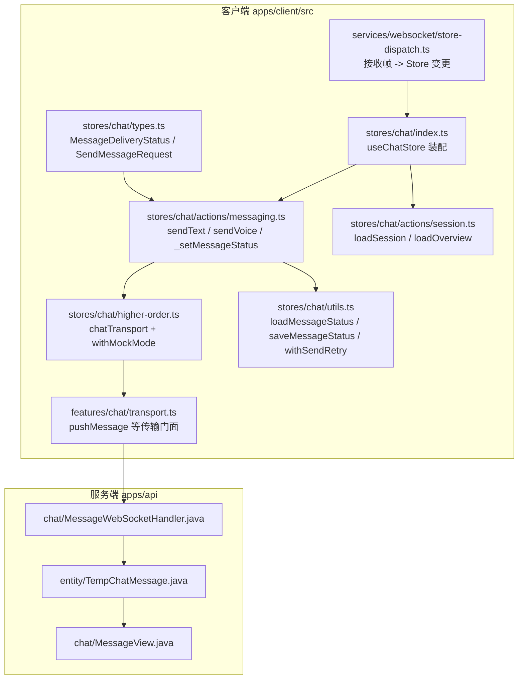
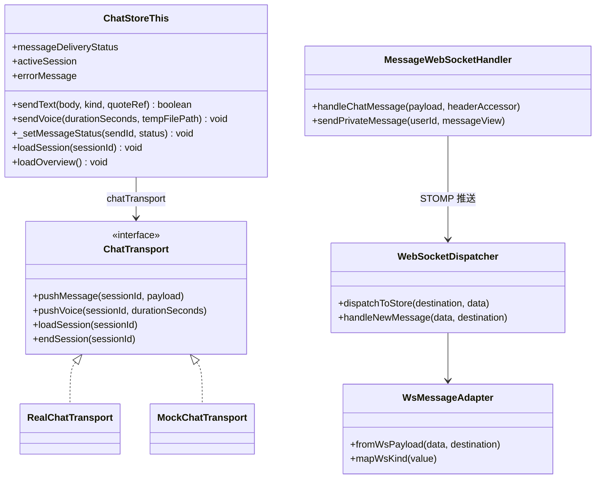
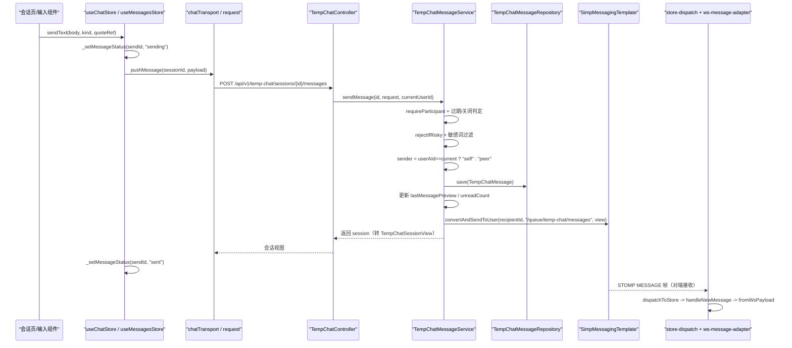
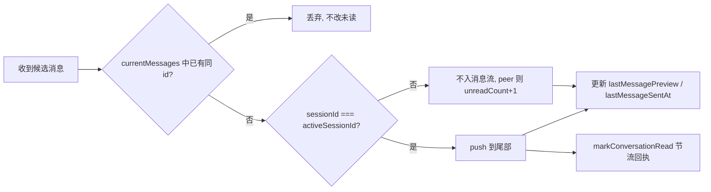
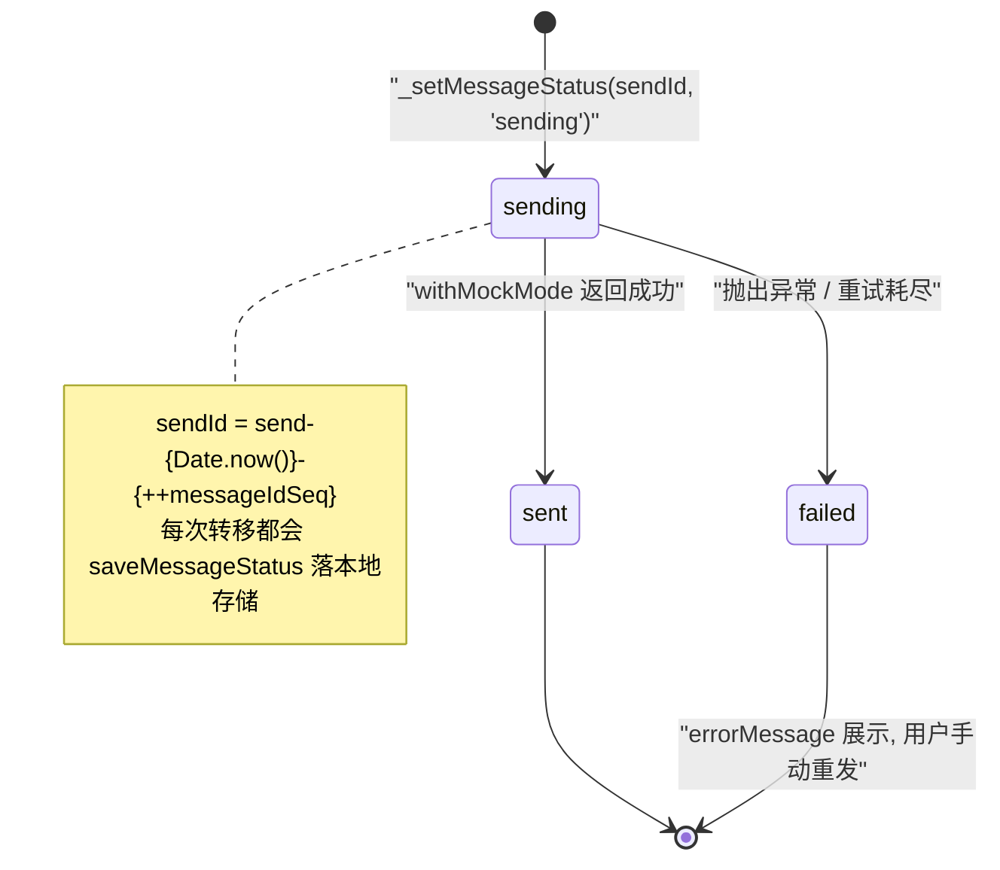
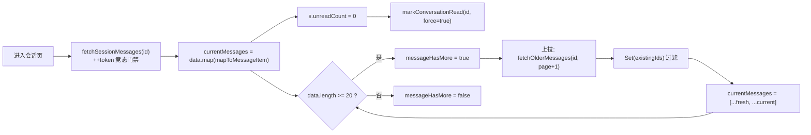
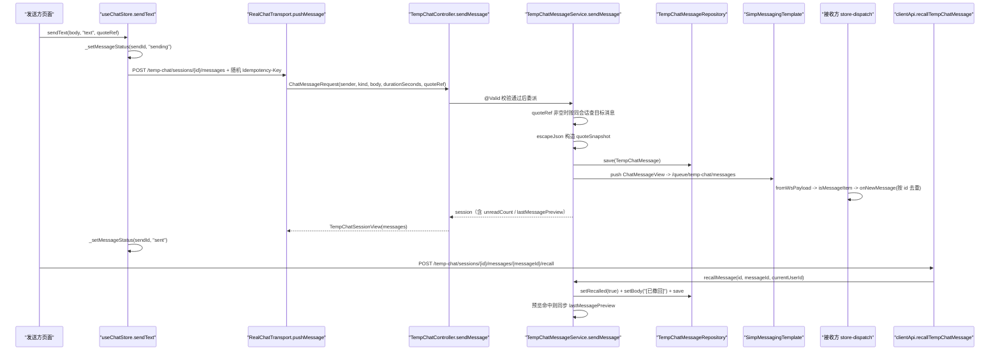
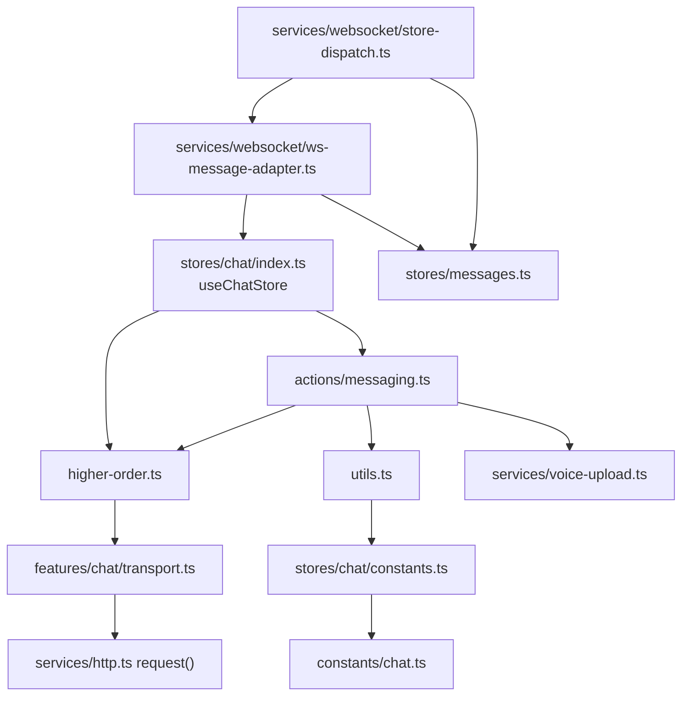
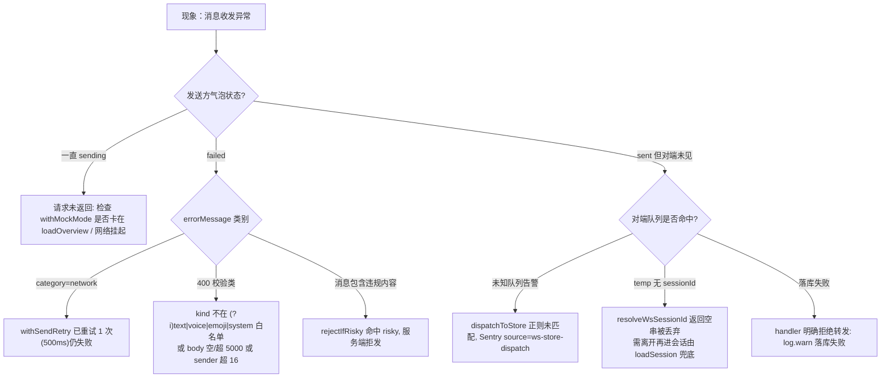

# 消息收发机制

<cite>
**本文引用的文件**
- [messaging.ts](file://apps/client/src/stores/chat/actions/messaging.ts)
- [types.ts](file://apps/client/src/stores/chat/types.ts)
- [index.ts](file://apps/client/src/stores/chat/index.ts)
- [constants.ts](file://apps/client/src/stores/chat/constants.ts)
- [store-type.ts](file://apps/client/src/stores/chat/store-type.ts)
- [utils.ts](file://apps/client/src/stores/chat/utils.ts)
- [higher-order.ts](file://apps/client/src/stores/chat/higher-order.ts)
- [mock-data.ts](file://apps/client/src/stores/chat/mock-data.ts)
- [chat.ts](file://apps/client/src/constants/chat.ts)
- [transport.ts](file://apps/client/src/features/chat/transport.ts)
- [websocket.ts](file://apps/client/src/services/websocket.ts)
- [store-dispatch.ts](file://apps/client/src/services/websocket/store-dispatch.ts)
- [ws-message-adapter.ts](file://apps/client/src/services/websocket/ws-message-adapter.ts)
- [messages.ts](file://apps/client/src/stores/messages.ts)
- [api.ts](file://apps/client/src/services/api.ts)
- [MessageWebSocketHandler.java](file://apps/api/src/main/java/com/campuslove/api/chat/MessageWebSocketHandler.java)
- [TempChatController.java](file://apps/api/src/main/java/com/campuslove/api/chat/TempChatController.java)
- [TempChatMessageService.java](file://apps/api/src/main/java/com/campuslove/api/chat/TempChatMessageService.java)
- [VoiceMessageService.java](file://apps/api/src/main/java/com/campuslove/api/chat/VoiceMessageService.java)
- [TempChatMessage.java](file://apps/api/src/main/java/com/campuslove/api/entity/TempChatMessage.java)
- [JwtTokenProvider.java](file://apps/api/src/main/java/com/campuslove/api/config/JwtTokenProvider.java)
- [WeChatClient.java](file://apps/api/src/main/java/com/campuslove/api/auth/WeChatClient.java)
</cite>

## 目录
1. [简介](#简介)
2. [项目结构](#项目结构)
3. [核心组件](#核心组件)
4. [架构总览](#架构总览)
5. [详细组件分析](#详细组件分析)
6. [消息投递状态机](#消息投递状态机)
7. [历史消息分页与拉取](#历史消息分页与拉取)
8. [端到端时序：发送、投递、撤回、引用](#端到端时序发送投递撤回引用)
9. [依赖关系分析](#依赖关系分析)
10. [性能考虑](#性能考虑)
11. [故障排查指南](#故障排查指南)
12. [能力缺口登记](#能力缺口登记)
13. [结论](#结论)

## 简介

本页聚焦 Campus Love 恋爱小程序中「临时会话消息」的**收发业务流程**：客户端如何构造并发送一条消息、投递状态如何被跟踪与持久化、失败后如何重试、服务端如何把消息写库并回推给对端、客户端如何把回推帧路由进 Pinia Store 并完成去重与排序、以及如何做撤回、引用（quoteRef）与历史分页拉取。

传输层（STOMP 帧编解码、心跳、重连状态机）已在同目录的《WebSocket实时通信》中单独成文，本页不再展开，只在需要说明「发送出口」与「接收入口」时引用其模块边界。

关键实现分布在两侧：
- 客户端：`apps/client/src/stores/chat/actions/messaging.ts`（发送与状态跟踪）、`apps/client/src/stores/chat/utils.ts`（本地存储与重试执行器）、`apps/client/src/features/chat/transport.ts`（传输层门面）、`apps/client/src/services/websocket/store-dispatch.ts`（接收分发）。
- 服务端：`apps/api/src/main/java/com/campuslove/api/chat/MessageWebSocketHandler.java`（连接与推送）、`apps/api/src/main/java/com/campuslove/api/entity/TempChatMessage.java`（消息持久化模型，含 `recalled`、`deliveryStatus`、`quoteSnapshot` 字段）。

**章节来源**
- [messaging.ts:1-54](file://apps/client/src/stores/chat/actions/messaging.ts#L1-L54)
- [types.ts:1-23](file://apps/client/src/stores/chat/types.ts#L1-L23)
- [MessageWebSocketHandler.java:42-83](file://apps/api/src/main/java/com/campuslove/api/chat/MessageWebSocketHandler.java#L42-L83)
- [TempChatMessage.java:22-81](file://apps/api/src/main/java/com/campuslove/api/entity/TempChatMessage.java#L22-L81)

## 项目结构

消息收发涉及的目录与文件职责如下（均为本仓实际路径）：



结构要点：`stores/chat/index.ts` 只做 state 与 actions 的装配，真正的发送逻辑在 `actions/messaging.ts`；`constants.ts` 已改为对 `src/constants/chat.ts` 的 re-export；`services/websocket.ts` 也已改为对 `services/websocket/index.ts` 的 re-export，两层都保留旧 import 路径兼容。

**章节来源**
- [index.ts:1-31](file://apps/client/src/stores/chat/index.ts#L1-L31)
- [messaging.ts:13-32](file://apps/client/src/stores/chat/actions/messaging.ts#L13-L32)
- [higher-order.ts:1-30](file://apps/client/src/stores/chat/higher-order.ts#L1-L30)
- [utils.ts:1-25](file://apps/client/src/stores/chat/utils.ts#L1-L25)
- [constants.ts:1-17](file://apps/client/src/stores/chat/constants.ts#L1-L17)
- [websocket.ts:1-19](file://apps/client/src/services/websocket.ts#L1-L19)

## 核心组件

消息收发链路由下列组件协作完成，每个组件的职责与可验证的公开接口如下。

| 组件 | 位置 | 职责 |
| --- | --- | --- |
| `useChatStore` | `apps/client/src/stores/chat/index.ts` | Pinia store `chat`，装配 state 与拆分后的 actions |
| `sendText` / `sendVoice` | `apps/client/src/stores/chat/actions/messaging.ts` | 生成 `sendId`、构造 `SendMessageRequest`、调用传输层、写投递状态 |
| `_setMessageStatus` | `apps/client/src/stores/chat/actions/messaging.ts` | 更新 `messageDeliveryStatus` 映射表并写本地存储 |
| `withSendRetry` | `apps/client/src/stores/chat/utils.ts` | 仅对 `category === "network"` 的错误重试的执行器 |
| `loadMessageStatus` / `saveMessageStatus` | `apps/client/src/stores/chat/utils.ts` | 以 `MESSAGE_STATUS_STORAGE_KEY` 读写本地存储 |
| `withMockMode` / `withErrorHandling` | `apps/client/src/stores/chat/higher-order.ts` | Mock/Real 分支、`activeSession` 更新、概览刷新、loading 与错误文案统一处理 |
| `chatTransport` | `apps/client/src/features/chat/transport.ts` | `ChatTransport` 门面的 `RealChatTransport` / `MockChatTransport` 实现 |
| `dispatchToStore` | `apps/client/src/services/websocket/store-dispatch.ts` | STOMP 目标路径 → 队列类型 → 处理函数 |
| `fromWsPayload` | `apps/client/src/services/websocket/ws-message-adapter.ts` | 外部推送载荷 → 内部 `MessageItem` 形状 |
| `MessageWebSocketHandler` | `apps/api/.../chat/MessageWebSocketHandler.java` | `@MessageMapping("/chat/send")` 入口、关系校验、推送 |
| `TempChatMessage` | `apps/api/.../entity/TempChatMessage.java` | 表 `temp_chat_message` 的 JPA 实体 |



**章节来源**
- [index.ts:78-131](file://apps/client/src/stores/chat/index.ts#L78-L131)
- [store-type.ts:45-123](file://apps/client/src/stores/chat/store-type.ts#L45-L123)
- [messaging.ts:55-229](file://apps/client/src/stores/chat/actions/messaging.ts#L55-L229)
- [utils.ts:34-97](file://apps/client/src/stores/chat/utils.ts#L34-L97)
- [higher-order.ts:30-142](file://apps/client/src/stores/chat/higher-order.ts#L30-L142)
- [transport.ts:16-125](file://apps/client/src/features/chat/transport.ts#L16-L125)
- [store-dispatch.ts:64-203](file://apps/client/src/services/websocket/store-dispatch.ts#L64-L203)
- [ws-message-adapter.ts:36-94](file://apps/client/src/services/websocket/ws-message-adapter.ts#L36-L94)
- [MessageWebSocketHandler.java:106-274](file://apps/api/src/main/java/com/campuslove/api/chat/MessageWebSocketHandler.java#L106-L274)

## 架构总览

系统存在两条并行且刻意对齐的消息通道：**HTTP 主通道**（临时会话走 `POST /api/v1/temp-chat/sessions/{id}/messages`，私信走 `POST /messages/conversations/{id}/messages`）与 **WebSocket 补充通道**（STOMP `/app/chat/send`）。两条通道在服务端最终汇聚到同一个消息服务，从而保证「落库 + 推送」语义一致。



三条设计约束贯穿全链路：
1. **服务端判定身份**：`senderId` 一律取自 STOMP Principal 或 JWT，不信任 payload；临时会话的 `sender` 字段由 `userAId`/`userBId` 与当前用户比对得出（FIN HIGH-3）。
2. **先落库再传播**：`MessageWebSocketHandler` 在落库失败时直接 `return`，明确拒绝转发未落库消息，避免「对方看到了但历史里没有」。
3. **双通道幂等**：POST 回包与 WS 回推可能同达，客户端一律按消息 `id` 去重后再决定是否追加。

**图表来源**
- [MessageWebSocketHandler.java:106-274](file://apps/api/src/main/java/com/campuslove/api/chat/MessageWebSocketHandler.java#L106-L274)
- [TempChatMessageService.java:87-197](file://apps/api/src/main/java/com/campuslove/api/chat/TempChatMessageService.java#L87-L197)
- [TempChatController.java:48-55](file://apps/api/src/main/java/com/campuslove/api/chat/TempChatController.java#L48-L55)
- [messaging.ts:55-131](file://apps/client/src/stores/chat/actions/messaging.ts#L55-L131)
- [store-dispatch.ts:64-203](file://apps/client/src/services/websocket/store-dispatch.ts#L64-L203)

**章节来源**
- [MessageWebSocketHandler.java:166-273](file://apps/api/src/main/java/com/campuslove/api/chat/MessageWebSocketHandler.java#L166-L273)
- [TempChatMessageService.java:87-197](file://apps/api/src/main/java/com/campuslove/api/chat/TempChatMessageService.java#L87-L197)
- [transport.ts:82-92](file://apps/client/src/features/chat/transport.ts#L82-L92)

## 详细组件分析

### 发送侧：sendText 的六步流程

`sendText` 是临时会话文本/表情消息的唯一发送入口，签名为 `sendText(this: ChatStoreThis, body: string, kind: SendMessageRequest["kind"] = "text", quoteRef?: string | null): Promise<boolean>`，其内部严格按以下顺序执行：

1. **前置短路**：`this.activeSession` 为 `null` 时立即返回 `false`，不生成 `sendId`、不产生状态写入。
2. **生成 sendId**：模板为 `send-${Date.now()}-${++messageIdSeq}`。模块级 `messageIdSeq` 计数器（infra R2-00085）用于解决同一毫秒连发时 `Date.now()` 碰撞导致的状态串号。
3. **置 sending**：调用 `_setMessageStatus(sendId, "sending")`，先让 UI 可见地进入发送中态。
4. **构造强类型载荷**：`SendMessageRequest` 显式带 `sender: "self"`、`kind`、`body`、`durationSeconds: null` 与清洗后的 `quoteRef`。清洗规则为「非空且 `trim().length <= 64` 才保留，否则置 `null`」，与后端 `ChatMessageRequest.quoteRef` 上的 `@Size(max = 64)` 同口径——注释明确说明「引用是可选语义，不能因为一个非法引用 ID 把整条消息拖进 400」。
5. **交给 withMockMode 分流**：Mock 分支直接向 `mockSessionMap[sessionId]` 追加一条 `id: m-${Date.now()}-${++messageIdSeq}`、`deliveryStatus: "sent"`、`recalled: false` 的消息并返回更新后的会话；Real 分支用 `withSendRetry` 包裹 `chatTransport.pushMessage(activeSession.id, payload)`。
6. **收尾**：成功后 `_setMessageStatus(sendId, "sent")` 返回 `true`；异常时 `_setMessageStatus(sendId, "failed")`、写入 `this.errorMessage`（`Error` 实例取 `message`，否则取 `t("chat.sendFailed")`）并返回 `false`。

返回布尔值而非 `void` 是刻意为之（MP-R2-CHAT-CHAT-SESSION-INDEX-001）：页面原先靠「`errorMessage` 文案差分」判断成败，连续两次相同错误文案会被误判为成功、随后清空草稿导致正文丢失。

**章节来源**
- [messaging.ts:34-131](file://apps/client/src/stores/chat/actions/messaging.ts#L34-L131)
- [types.ts:39-62](file://apps/client/src/stores/chat/types.ts#L39-L62)
- [TempChatController.java:150-164](file://apps/api/src/main/java/com/campuslove/api/chat/TempChatController.java#L150-L164)
- [mock-data.ts:228-248](file://apps/client/src/stores/chat/mock-data.ts#L228-L248)

### 发送侧：sendVoice 的两段式与降级

语音发送拆成「先上传拿 URL、再发 kind=voice 消息」两段。初始 `voiceBody` 取 `t("chat.voicePlaceholder")`；只有在 **非 Mock 且 `tempFilePath` 非空** 时才调用 `uploadVoiceFile(tempFilePath, durationSeconds)`，上传失败会写 `errorMessage` 并 **重新抛出**（此时消息不会发出）。随后构造 `SendMessageRequest`（不带 `quoteRef`）交给 `withMockMode`。

值得注意的两点差异：语音链路 Real 分支 **没有** 包 `withSendRetry`，且 `sendVoice` 返回 `Promise<void>`、不返回成败布尔；Mock 分支的 `id` 仅用 `m-${Date.now()}`（未拼计数器）。

H5 端 `tempFilePath` 为空时降级为占位 body，保留会话流程便于 UI 验证。服务端对应能力是 `VoiceMessageService.store(Long userId, MultipartFile file, Integer duration)` 与其 `delete(Long ownerUserId, String url)` 回收方法。

**章节来源**
- [messaging.ts:133-206](file://apps/client/src/stores/chat/actions/messaging.ts#L133-L206)
- [store-type.ts:99-108](file://apps/client/src/stores/chat/store-type.ts#L99-L108)
- [VoiceMessageService.java:109-131](file://apps/api/src/main/java/com/campuslove/api/chat/VoiceMessageService.java#L109-L131)
- [VoiceMessageService.java:200-215](file://apps/api/src/main/java/com/campuslove/api/chat/VoiceMessageService.java#L200-L215)

### 传输层：RealChatTransport 与幂等键

`chatTransport` 由 `createChatTransport(mode = clientEnv.apiMode)` 工厂产出：`mode === "real"` 返回 `RealChatTransport`，否则 `MockChatTransport`。`RealChatTransport.pushMessage` 打到 `POST /temp-chat/sessions/{sessionId}/messages`，并显式携带随机幂等键：

```ts
headers: { "Idempotency-Key": `tmp-${Date.now()}-${Math.random().toString(36).slice(2, 10)}` }
```

此处有过一次真实缺陷修复（标注 `[PRODUCT-FIX]`）：原代码写的键名是 `header`，而 `http.ts` 只消费 `headers`，随机幂等键从未真正发出，HTTP 拦截器回退到「URL+body」稳定键，导致同文案重发被后端幂等去重拦截。修复后消息发送被视为「每次独立意图」，重复发送由前端 sending 锁防重。私信侧（`useMessagesStore.sendMessage`）采用同样策略，键前缀为 `msg-`。

`MockChatTransport` 的对应实现委托 `mockFixtures.sendTempChatMessage(...)`；`pushVoice` 在两个实现里都是 `pushMessage` 的语法糖，body 走 `t("chat.voiceMessagePlaceholder", { n })` 模板。

**章节来源**
- [transport.ts:14-30](file://apps/client/src/features/chat/transport.ts#L14-L30)
- [transport.ts:41-53](file://apps/client/src/features/chat/transport.ts#L41-L53)
- [transport.ts:82-102](file://apps/client/src/features/chat/transport.ts#L82-L102)
- [transport.ts:123-125](file://apps/client/src/features/chat/transport.ts#L123-L125)
- [messages.ts:1075-1092](file://apps/client/src/stores/messages.ts#L1075-L1092)

### 服务端：/app/chat/send 的校验与分流

`MessageWebSocketHandler.handleChatMessage` 的拒绝式校验链（任一失败即 `log.warn` + `return`，不抛异常、不回错误帧）依次为：Principal 为空 → `content` 超 `MAX_MESSAGE_CONTENT_LENGTH` → `kind` 超 `MAX_MESSAGE_KIND_LENGTH` → `senderId` 空白 → `recipientId` 缺失 → 自发自收 → `conversationId` 缺失 → ID 非数字格式。通过后才进入分流：

- **临时会话**：`tempChatSessionService.resolveSession(conversationId)` 成功且 `isTempChatPair` 通过后，交 `tempChatMessageService.sendMessage(...)`；该方法内部已推送 `/queue/temp-chat/messages`，handler 显式 `return` 以避免重复推送。
- **私信会话**：`privateConversationRepository` 可用时经 `findPrivateConversation` + `isPrivatePair` 校验，再复用 `privateMessageService.sendMessage(convId, senderLong, content, kind, null, quoteRef)`（R4-00321：修复「WS 私信仅推送不落库」）。
- **兜底转发**：仅当对应服务 Bean 为 `null`（mock profile）才退化为 `payload.put("senderId", senderId)` 后 `convertAndSendToUser(recipientId, "/queue/messages", payload)`。

handler 同时暴露三个供业务层调用的推送方法：`sendHeartSignal(String userId, HeartSignalView)`、`sendNotification(String userId, NotificationView)`、`sendPrivateMessage(String userId, MessageView)`，以及 `@MessageMapping("/chat/typing")` 的瞬态输入状态转发（不落库，仅转 `/queue/typing`）。

**章节来源**
- [MessageWebSocketHandler.java:106-274](file://apps/api/src/main/java/com/campuslove/api/chat/MessageWebSocketHandler.java#L106-L274)
- [MessageWebSocketHandler.java:276-291](file://apps/api/src/main/java/com/campuslove/api/chat/MessageWebSocketHandler.java#L276-L291)
- [MessageWebSocketHandler.java:363-393](file://apps/api/src/main/java/com/campuslove/api/chat/MessageWebSocketHandler.java#L363-L393)
- [MessageWebSocketHandler.java:401-447](file://apps/api/src/main/java/com/campuslove/api/chat/MessageWebSocketHandler.java#L401-L447)

### 服务端：sendMessage 的落库副作用

`TempChatMessageService.sendMessage` 在写库前后共有 7 处副作用，顺序不可调换：参与者校验（`requireParticipant`）→ 过期标记（`markExpiredIfDue` 后直接返回会话）→ 已关闭跳过 → `matching` 阶段首条消息自动转 `active` → `sender` 服务端判定 → 内容安全（`rejectIfRisky(body, userId, "4")`，`risky` 抛 `IllegalArgumentException`，`review` 仅告警放行）+ `SensitiveWordFilter.filterWithLog(..., "TEMP_CHAT")` → 实体赋值并 `save`。

实体赋值固定为 `setDeliveryStatus("sent")`、`setRecalled(false)`、`setCreatedAt(now)`（`now` 取 `LocalDateTime.now(TimeZones.BUSINESS)`）。因实体带 `@Version`，`save` 走 merge 返回新托管实例，代码显式 `message = messageRepository.save(message)` 回填 id，否则下游 `toMessageView` 拿到的 `getId()` 为 `null`。

写库后更新会话：`lastMessagePreview = buildMessagePreview(kind, filteredBody)`、`lastMessageAt`、`updatedAt`，并按 `sender` 归属给 `userAUnreadCount` 或 `userBUnreadCount` 加一（自己发的消息也给另一侧计数）。最后以接收方视角翻转 `sender` 生成 `ChatMessageView` 并推送。

预览截断规则集中在静态方法 `buildMessagePreview`：`voice → "语音消息"`、`emoji → "表情消息"`、`system → 原文`、其余超过 50 字符截断加 `...`。

**章节来源**
- [TempChatMessageService.java:87-197](file://apps/api/src/main/java/com/campuslove/api/chat/TempChatMessageService.java#L87-L197)
- [TempChatMessageService.java:199-221](file://apps/api/src/main/java/com/campuslove/api/chat/TempChatMessageService.java#L199-L221)
- [TempChatMessageService.java:333-349](file://apps/api/src/main/java/com/campuslove/api/chat/TempChatMessageService.java#L333-L349)
- [TempChatMessage.java:54-81](file://apps/api/src/main/java/com/campuslove/api/entity/TempChatMessage.java#L54-L81)

### 接收侧：队列路由与形状收敛

`dispatchToStore(destination, data)` 用正则 `/\/queue\/([\w-]+(?:\/[\w-]+)*)$/` 提取队列名（修复「未读红点 BUG 2」：原 `/\/queue\/(\w+)$/` 无法匹配含 `-` 与 `/` 的 `temp-chat/messages`，导致临时会话新消息被静默丢弃）。`switch` 覆盖 `messages`、`temp-chat/messages`（两者同归 `handleNewMessage`）、`signals`、`notifications`、`matches`、`temp-chat`、`checkin`、`typing`；`default` 分支在 dev 下 `console.warn` 并调用 `captureException(..., { source: "ws-store-dispatch", destination })`（infra R2-00127），把「未知队列」从静默丢弃升级为可观测契约漂移告警。整个 `switch` 外层再包一层 `try/catch`，异常只 `console.error` 不外抛。

`handleNewMessage` 的处理顺序是「转换 → 归因 → 守卫 → 落库到 store」：
1. `fromWsPayload(data, destination)` 把外部载荷收敛为内部 `MessageItem`；
2. 返回 `null` 时 dev 告警 + Sentry 上报后 `return`；
3. `item.sessionId` 为空串时 **静默 return**（临时会话消息无法归因，属预期降级，未读以服务端计数为准，进入会话时由 `loadSession` 全量刷新兜底）；
4. `isMessageItem(item)` 守卫再校验一次（防御转换层自身缺陷）；
5. 若 store 暴露 `onNewMessage` 则调用它，否则直接 `currentMessages.push` 并手改会话预览与 `unreadCount += 1`。

`fromWsPayload` 区分三形态：形态 A 私信 `MessageView`（判据是同时含 `conversationId`/`senderId`/`messageKind`），把 `conversationId → sessionId`、`content → body`、`createdAt → sentAt`，并用 `senderId === currentUserId` 判定 `self`/`peer`，同时解析 `quoteContext`；形态 B/C 字段名已与 `MessageItem` 一致，透传并做 `sentAt` 数字时间戳到 ISO 的归一化，会话归因交给 `resolveWsSessionId`——仅当 `destination` 含 `temp-chat` 且 `sender === "peer"` 且 `chatStore.activeSession?.id` 存在时返回该 id，否则返回空串。`mapWsKind` 大小写不敏感地映射 `voice/emoji/activity/image`，未知一律回退 `text`（MP-R1-…-004 补 `image` 分支，避免图片消息降级为 URL 文本气泡）。

**章节来源**
- [store-dispatch.ts:1-44](file://apps/client/src/services/websocket/store-dispatch.ts#L1-L44)
- [store-dispatch.ts:64-203](file://apps/client/src/services/websocket/store-dispatch.ts#L64-L203)
- [ws-message-adapter.ts:30-114](file://apps/client/src/services/websocket/ws-message-adapter.ts#L30-L114)

### 去重与排序的真实实现

代码中的去重全部是 **基于消息 `id` 的存在性判断**，共四处独立落点：

- `useMessagesStore.onNewMessage`：`const exists = this.currentMessages.some((m) => m.id === message.id)`，仅 `!exists && isActive` 才追加。注释指明这是为了防御「WebSocket 重连重复订阅导致同一消息被推送多次」。
- `useMessagesStore.sendMessage`（私信 Real）：POST 回包与 WS 回推可能同达，用 `this.currentMessages.find((m) => m.id === mr.id)` 判重（R16，原缺陷表现为右侧双气泡）。
- `fetchOlderMessages`：分页边界可能重复，用 `new Set(this.currentMessages.map(m => m.id))` 过滤后 `[...fresh, ...current]` 合并。
- `handleNewMatch` / `handleNewNotification` 兜底分支：分别按 `matchId`、`notification.id` 去重。

排序与「时间戳冲突处理」的真实情况是：**消息流本身不做显式重排**。`currentMessages` 保持后端 `order=asc` 返回顺序加上「新消息 append 到尾部」的到达序；分页合并通过「更早的整块前置」维持升序，而非逐条按 `sentAt` 比较。会话列表才排序：`fetchSessions` 按 `id` 合并后用 `mergedById.values()` 排序（pinned/muted 字段在合并时保留），通知列表统一 `Date.parse(b.createdAt) - Date.parse(a.createdAt)` 降序。时间戳的「冲突」在前端表现为时间条分组，`fromWsPayload` 特意把数字时间戳转 ISO 以保证 `shouldShowTimeBar/formatChatTimeBar` 不错乱；服务端一侧则由 `TimeZones.BUSINESS` 统一 `createdAt` 基准。



**图表来源**
- [messages.ts:1481-1509](file://apps/client/src/stores/messages.ts#L1481-L1509)
- [messages.ts:1094-1101](file://apps/client/src/stores/messages.ts#L1094-L1101)

**章节来源**
- [messages.ts:1481-1511](file://apps/client/src/stores/messages.ts#L1481-L1511)
- [messages.ts:1094-1145](file://apps/client/src/stores/messages.ts#L1094-L1145)
- [messages.ts:651-676](file://apps/client/src/stores/messages.ts#L651-L676)
- [messages.ts:1239-1247](file://apps/client/src/stores/messages.ts#L1239-L1247)
- [store-dispatch.ts:328-369](file://apps/client/src/services/websocket/store-dispatch.ts#L328-L369)

### 撤回与引用

**撤回**：服务端 `TempChatMessageService.recallMessage(sessionId, messageId, currentUserId)` 依次做参与者校验、`messageId` 数字解析（非法则 `log.warn` 后 no-op 返回原会话）、消息归属会话校验（`filter(m -> m.getSession().getId().equals(session.getId()))`）、`sender` 必须为 `self`/`peer`（系统消息不可撤回）、只能撤回本人消息（`self` 对应 `userAId`、`peer` 对应 `userBId`，FIN HIGH-4）、`createdAt` 必须在 `RECALL_WINDOW_MINUTES = 2` 分钟窗口内。通过后 `setRecalled(true)` + `setBody("[已撤回]")` 并保存；若撤回前的预览恰等于会话当前 `lastMessagePreview`，则同步替换为撤回后的预览（infra R2-00251）。端点为 `POST /api/v1/temp-chat/sessions/{id}/messages/{messageId}/recall`，客户端封装在 `clientApi.recallTempChatMessage(sessionId, messageId)`，Mock 侧由 `mockFixtures.recallTempChatMessage` 同构实现。私信会话没有对应撤回端点，i18n 里以 `recallNotSupported` 文案表达该限制。

**引用**：临时会话侧写入字段是 `TempChatMessage.quoteSnapshot`，由 `sendMessage` 在 `quoteRef` 非空时构造 `{"id":"...","body":"...","sender":"..."}` JSON 快照。两道防线：`infra R2-00253` 要求被引用消息必须属于同一会话（`findById` + `filter` 会话 id 比对），不匹配则静默不写快照；`escapeJson` 对反斜杠、双引号、`\n`、`\r`、`\t` 逐个转义（FIN MED-36）。`NumberFormatException` 被吞掉并按「无引用」继续发送。视图侧 `ChatMessageView` 已展开为 `quoteRef`/`quoteBody`/`quoteSender` 三元组。私信侧对应字段是 `MessageView.quoteContext`，读取时由 `parsePrivateQuoteContext(raw, currentUserId)` 解析出同样三元组，`ws-message-adapter` 与 `mapToMessageItem` 共用这一个解析函数，避免两处各写一份 JSON 解析。

**章节来源**
- [TempChatMessageService.java:248-331](file://apps/api/src/main/java/com/campuslove/api/chat/TempChatMessageService.java#L248-L331)
- [TempChatMessageService.java:138-164](file://apps/api/src/main/java/com/campuslove/api/chat/TempChatMessageService.java#L138-L164)
- [TempChatController.java:90-97](file://apps/api/src/main/java/com/campuslove/api/chat/TempChatController.java#L90-L97)
- [TempChatController.java:129-148](file://apps/api/src/main/java/com/campuslove/api/chat/TempChatController.java#L129-L148)
- [api.ts:489-495](file://apps/client/src/services/api.ts#L489-L495)
- [messages.ts:352-419](file://apps/client/src/stores/messages.ts#L352-L419)
- [TempChatMessage.java:54-81](file://apps/api/src/main/java/com/campuslove/api/entity/TempChatMessage.java#L54-L81)

## 消息投递状态机

投递状态是「客户端视角的发送结论」，与后端 `temp_chat_message.delivery_status` 列（实体默认值 `"sent"`）是两套独立机制：前者存在于 Pinia state 与本地存储、以客户端 `sendId` 为键；后者由服务端在 `sendMessage` 中固定写 `"sent"`，`TempChatMessageService` 全文没有对 `deliveryStatus` 的二次更新点。



状态持久化的读写契约：

| 环节 | 实现 | 键 | 失败处理 |
| --- | --- | --- | --- |
| 写 | `saveMessageStatus(status)` | `uni.setStorageSync` | `try/catch` 吞异常，注释「写入失败忽略，避免阻塞业务流程」 |
| 读 | `loadMessageStatus()` | `uni.getStorageSync` | 仅接受 `typeof raw === "string" && raw.length > 0` 且解析结果为对象的值，否则返回 `{}` |
| 初值 | `state.messageDeliveryStatus: loadMessageStatus()` | `MESSAGE_STATUS_STORAGE_KEY = "chat:message-delivery-status"` | store 创建即恢复 |

键的类型为 `MessageDeliveryStatusMap = Record<string, MessageDeliveryStatus>`，`MessageDeliveryStatus` 是 `"sending" | "sent" | "failed"` 三值联合。`_setMessageStatus` 用展开重写整个映射（`{ ...this.messageDeliveryStatus, [sendId]: status }`）而不是原地赋值，以保证 Vue 响应式追踪到新键。

重试语义由 `withSendRetry(fn, maxRetries = MAX_SEND_RETRIES, delayMs = SEND_RETRY_DELAY_MS)` 决定：`MAX_SEND_RETRIES = 1`、`SEND_RETRY_DELAY_MS = 500`，循环 `for (attempt = 0; attempt <= maxRetries; attempt++)`。判定可重试的条件是错误对象上存在 `category` 字段且值严格等于 `"network"`（即 `EnhancedApiError`）；非网络错误或已达上限则 `break`。最终抛出 `lastError`（若是 `Error`）否则包装为 `new Error("发送失败")`。这意味着 **业务错误（如 400 内容校验、敏感词命中）不会被重试**。

**图表来源**
- [messaging.ts:67-130](file://apps/client/src/stores/chat/actions/messaging.ts#L67-L130)
- [utils.ts:52-97](file://apps/client/src/stores/chat/utils.ts#L52-L97)
- [types.ts:25-37](file://apps/client/src/stores/chat/types.ts#L25-L37)

**章节来源**
- [messaging.ts:34-35](file://apps/client/src/stores/chat/actions/messaging.ts#L34-L35)
- [messaging.ts:219-229](file://apps/client/src/stores/chat/actions/messaging.ts#L219-L229)
- [utils.ts:34-97](file://apps/client/src/stores/chat/utils.ts#L34-L97)
- [types.ts:25-37](file://apps/client/src/stores/chat/types.ts#L25-L37)
- [constants.ts:24-36](file://apps/client/src/constants/chat.ts#L24-L36)
- [index.ts:97-106](file://apps/client/src/stores/chat/index.ts#L97-L106)
- [store-type.ts:64-72](file://apps/client/src/stores/chat/store-type.ts#L64-L72)
- [TempChatMessage.java:54-58](file://apps/api/src/main/java/com/campuslove/api/entity/TempChatMessage.java#L54-L58)
- [TempChatMessageService.java:134-136](file://apps/api/src/main/java/com/campuslove/api/chat/TempChatMessageService.java#L134-L136)

## 历史消息分页与拉取

两条通道的「拉历史」策略并不相同，这一点在实现上被明确区分：

- **临时会话（chat store）**：历史消息随会话视图整体返回，不做分页。端点 `GET /api/v1/temp-chat/sessions/{id}` 的 `TempChatSessionView` 记录里直接内联 `List<ChatMessageView> messages`；客户端 `chatTransport.loadSession(sessionId)` 返回的也是完整 `TempChatSession`。因此切会话即拿到全量消息，`withMockMode` 在返回对象含 `id` 时自动 `toChatSessionView` 更新 `activeSession`。
- **私信（messages store）**：真正的分页拉取。首屏 `fetchSessionMessages(sessionId)` 打 `GET /messages/conversations/{id}/messages`（不带 page 参数，P2-13 起 `userId` 由后端 JWT 获取），回包 `map(mapToMessageItem)` 整表覆盖 `currentMessages`，并把游标重置为 `messagePage = 0`、`messageHasMore = data.length >= 20`。上拉加载更早由 `fetchOlderMessages(sessionId, page)` 承担，URL 显式携带 `?page=N&size=20&order=asc`。



竞态防护使用模块级递增令牌 `let fetchSessionMessagesToken = 0`：每次调用 `const token = ++fetchSessionMessagesToken`，在 mock 分支入口、`await` 之后、`catch` 与 `finally` 四处都比对 `token !== fetchSessionMessagesToken`，旧请求既不覆盖状态也不写 `errorMessage`；`finally` 只在 `token === fetchSessionMessagesToken` 时把 `loading` 置回 `false`。

会话归因与未读联动：`setActiveSession(sessionId | null)` 由会话页 `onShow`/`onHide` 调用，决定 WS 推送是否计入未读；进入会话时 `markConversationRead(sessionId, true)` 立即发 `PUT /messages/conversations/{id}/read`（`force` 跳过 2 秒节流），停留期间每收到一条活跃会话消息调用节流版回执。该 action 对非纯数字 `sessionId` 直接返回 `true`（临时会话 id 形如 `session-xxx`，防止误请求 404；临时会话已读走 `POST /temp-chat/sessions/{id}/read`）。

Mock 模式下 `fetchOlderMessages` 立即 `messageHasMore = false` 直接返回（注释：mock 数据量小，不做分片）；`fetchSessionMessages` 对「既不在 `mockMessages` 也不在会话列表」的未知 `sessionId` 抛 `t("chat.sessionNotExist")`，与 real 侧 404 行为对齐，避免渲染「假空会话」诱导用户对不存在的会话发言。

**图表来源**
- [messages.ts:791-838](file://apps/client/src/stores/messages.ts#L791-L838)
- [messages.ts:840-866](file://apps/client/src/stores/messages.ts#L840-L866)

**章节来源**
- [messages.ts:525-540](file://apps/client/src/stores/messages.ts#L525-L540)
- [messages.ts:791-905](file://apps/client/src/stores/messages.ts#L791-L905)
- [messages.ts:1061-1068](file://apps/client/src/stores/messages.ts#L1061-L1068)
- [TempChatController.java:42-46](file://apps/api/src/main/java/com/campuslove/api/chat/TempChatController.java#L42-L46)
- [TempChatController.java:115-127](file://apps/api/src/main/java/com/campuslove/api/chat/TempChatController.java#L115-L127)
- [transport.ts:16-26](file://apps/client/src/features/chat/transport.ts#L16-L26)
- [transport.ts:76-80](file://apps/client/src/features/chat/transport.ts#L76-L80)
- [higher-order.ts:114-142](file://apps/client/src/stores/chat/higher-order.ts#L114-L142)

## 端到端时序：发送、投递、撤回、引用

下图串起一次「带引用的发送 → 对端接收 → 撤回」的完整往返，节点全部对应真实方法与端点。



三点值得注意的语义细节：

1. **发送回执与推送是两个独立出口**。发送方拿到的是整份会话视图（`withMockMode` 据此刷新 `activeSession` 与概览），接收方拿到的是单条 `ChatMessageView` 帧；二者字段名同为 id/body/sentAt，因此 `fromWsPayload` 的形态 B 分支能透传，无需为临时会话单独建模。
2. **撤回不产生 WS 推送**。`recallMessage` 全程没有 `convertAndSendToUser` 调用，对端要看到「已撤回」需重新进入会话（`loadSession` 全量刷新）。这与发送路径「服务端负责推送」形成对照，是排查「撤回后对方仍见原文」的直接线索。
3. **引用是快照而非实时联查**。`quoteSnapshot` 在被引用消息被撤回后仍保留原文（撤回只改写该消息自身的 `body`），因为快照在发送时刻已落库到引用者的行上。

**图表来源**
- [messaging.ts:55-131](file://apps/client/src/stores/chat/actions/messaging.ts#L55-L131)
- [transport.ts:82-92](file://apps/client/src/features/chat/transport.ts#L82-L92)
- [TempChatController.java:48-55](file://apps/api/src/main/java/com/campuslove/api/chat/TempChatController.java#L48-L55)
- [TempChatController.java:90-97](file://apps/api/src/main/java/com/campuslove/api/chat/TempChatController.java#L90-L97)
- [TempChatMessageService.java:128-197](file://apps/api/src/main/java/com/campuslove/api/chat/TempChatMessageService.java#L128-L197)
- [TempChatMessageService.java:261-331](file://apps/api/src/main/java/com/campuslove/api/chat/TempChatMessageService.java#L261-L331)
- [api.ts:489-495](file://apps/client/src/services/api.ts#L489-L495)

**章节来源**
- [TempChatController.java:150-164](file://apps/api/src/main/java/com/campuslove/api/chat/TempChatController.java#L150-L164)
- [store-dispatch.ts:138-203](file://apps/client/src/services/websocket/store-dispatch.ts#L138-L203)
- [higher-order.ts:132-141](file://apps/client/src/stores/chat/higher-order.ts#L132-L141)

## 依赖关系分析

发送链路的依赖方向是严格自顶向下的：`store → actions → higher-order/utils → transport → services/http`，反向依赖仅出现在接收侧（`services/websocket/*` 主动 import store），形成一条已被注释承认的既有循环链。



关键依赖事实：

- **单例与工厂**：`chatTransport` 在 `higher-order.ts` 里以模块级常量 `createChatTransport()` 创建，注释说明「模块级单例保证全局唯一，避免重复创建连接」。模式在构造时由 `clientEnv.apiMode` 决定，运行期不切换。
- **类型单一真相源**：`stores/chat/types.ts` 的 `ChatOverview`/`ChatSessionSummary`/`TempChatSession` 全部是 `components["schemas"][...]` 的别名，来自 `services/generated/api-types`，因此后端 OpenAPI 契约变更会直接传导到发送载荷类型（`SendMessageRequest` 的注释即声明其字段与 `Schemas["ChatMessageRequest"]` 对齐）。
- **有意的循环引用**：`ws-message-adapter.ts` 同时 value-import `stores/messages`、`stores/session`、`stores/chat`，其注释明确记录「services/websocket <-> stores 的循环引用链早已存在：store-dispatch 即 value-import stores/messages」，并说明函数声明提升 + 仅在函数体内调用是为了不引入新的模块初始化时序问题。
- **服务端可选依赖**：`MessageWebSocketHandler` 的 `tempChatSessionService`、`tempChatMessageService`、`privateConversationRepository`、`privateMessageService` 四个字段均为 `@Autowired(required = false)`，因为 `TempChatMessageService` 标注 `@Profile("real")`、mock profile 下 Bean 不存在；这直接决定了 mock 模式下 WS 分支「退化为仅转发、不校验、不落库」。
- **实体依赖**：`TempChatMessage` 以 `@Table(name = "temp_chat_message")` 映射，`session` 字段是到 `TempChatSession` 的关联，`kind` 默认 `"text"`、`recalled` 默认 `false`、`deliveryStatus` 默认 `"sent"`、`version` 默认 `0L`（乐观锁，因此 `save` 必须接收返回值）。
- **认证前置**：WS 侧 `senderId` 来自 STOMP 认证 Principal，其身份由 JWT 解析得到（`JwtTokenProvider` 提供 `getUserIdFromToken`、`validateToken`、`revokeToken`），token 最初由 `code2Session` 换 openid 后的登录流程签发。

**章节来源**
- [higher-order.ts:13-30](file://apps/client/src/stores/chat/higher-order.ts#L13-L30)
- [messaging.ts:13-32](file://apps/client/src/stores/chat/actions/messaging.ts#L13-L32)
- [utils.ts:10-25](file://apps/client/src/stores/chat/utils.ts#L10-L25)
- [constants.ts:1-17](file://apps/client/src/stores/chat/constants.ts#L1-L17)
- [types.ts:10-23](file://apps/client/src/stores/chat/types.ts#L10-L23)
- [transport.ts:1-14](file://apps/client/src/features/chat/transport.ts#L1-L14)
- [ws-message-adapter.ts:21-28](file://apps/client/src/services/websocket/ws-message-adapter.ts#L21-L28)
- [store-dispatch.ts:26-44](file://apps/client/src/services/websocket/store-dispatch.ts#L26-L44)
- [MessageWebSocketHandler.java:55-89](file://apps/api/src/main/java/com/campuslove/api/chat/MessageWebSocketHandler.java#L55-L89)
- [TempChatMessageService.java:43-70](file://apps/api/src/main/java/com/campuslove/api/chat/TempChatMessageService.java#L43-L70)
- [TempChatMessage.java:22-81](file://apps/api/src/main/java/com/campuslove/api/entity/TempChatMessage.java#L22-L81)
- [JwtTokenProvider.java:242-265](file://apps/api/src/main/java/com/campuslove/api/config/JwtTokenProvider.java#L242-L265)
- [WeChatClient.java:134-145](file://apps/api/src/main/java/com/campuslove/api/auth/WeChatClient.java#L134-L145)

## 性能考虑

实现中与吞吐/延迟直接相关的量化点，全部是代码里可读到的常量与调用形态：

| 维度 | 实测取值 | 出处 |
| --- | --- | --- |
| 发送重试上限 | `MAX_SEND_RETRIES = 1`（仅网络错误） | `constants/chat.ts:33` |
| 重试间隔 | `SEND_RETRY_DELAY_MS = 500` | `constants/chat.ts:36` |
| 私信历史页大小 | `size=20`（`order=asc`） | `messages.ts:856` |
| 是否有更多判据 | `data.length >= 20` | `messages.ts:823`、`messages.ts:865` |
| 已读回执节流 | 同会话 2 秒窗口内只发一次，`force` 可穿透 | `messages.ts:898-905` |
| 概览缓存 TTL | 30 秒，下拉刷新 `force=true` 穿透 | `messages.ts:607-609` |
| 会话列表预览截断 | 超 50 字符截断加 `...` | `TempChatMessageService.java:347` |
| WS 载荷长度护栏 | `MAX_MESSAGE_CONTENT_LENGTH` / `MAX_MESSAGE_KIND_LENGTH` | `MessageWebSocketHandler.java:118-130` |

几个由实现形态决定的性能结论：

1. **每次发送都会额外拉一次概览**。`sendText`/`sendVoice` 调用 `withMockMode` 时未传 options，`shouldRefreshOverview` 默认为 `true`，因此每条消息成功后都串一次 `store.loadOverview()`。这是「列表预览即时更新」的代价；若批量发送场景需要优化，可传 `{ shouldRefreshOverview: false }` 后统一刷新，但当前代码没有这样做。
2. **投递状态表没有清理与容量控制**。`_setMessageStatus` 每次转移都 `saveMessageStatus(this.messageDeliveryStatus)`，写入的是整个映射的 `JSON.stringify`。`loadMessageStatus` 读回时也不做 TTL 或按会话裁剪，`messageIdSeq` 亦无重置逻辑，映射随会话时长单调增长，序列化成本随条目数线性上升。这是收发链路里唯一有界性缺失的存储点。
3. **去重是 O(n) 线性扫描**。`onNewMessage` 用 `currentMessages.some(...)`、`sendMessage` 用 `find(...)` 判重，仅 `fetchOlderMessages` 用 `Set` 建索引。消息流长度大且高频推送时，线性扫描会累积；未使用 `Set` 常驻索引是当前实现的可优化点。
4. **临时会话历史为整表返回**。`TempChatSessionView.messages` 内联全部消息，长会话的响应体与前端渲染压力随消息数增长，私信侧的 `page/size` 分页能力在临时会话侧不存在。
5. **接收侧无批处理**。每帧 STOMP MESSAGE 都独立走 `fromWsPayload` → 守卫 → `onNewMessage` → 可能的 `markConversationRead`，不存在合并窗口或缓冲队列；节流只作用于已读回执，不作用于消息插入本身。
6. **`escapeJson` 采用 `StringBuilder(value.length() + 16)` 预留容量**，对引用快照这类短字符串是合理的，避免了逐次扩容。

**章节来源**
- [apps/client/src/constants/chat.ts:24-39](file://apps/client/src/constants/chat.ts#L24-L39)
- [messaging.ts:219-229](file://apps/client/src/stores/chat/actions/messaging.ts#L219-L229)
- [utils.ts:34-58](file://apps/client/src/stores/chat/utils.ts#L34-L58)
- [higher-order.ts:114-142](file://apps/client/src/stores/chat/higher-order.ts#L114-L142)
- [messages.ts:607-609](file://apps/client/src/stores/messages.ts#L607-L609)
- [messages.ts:817-866](file://apps/client/src/stores/messages.ts#L817-L866)
- [messages.ts:898-905](file://apps/client/src/stores/messages.ts#L898-L905)
- [messages.ts:1481-1509](file://apps/client/src/stores/messages.ts#L1481-L1509)
- [MessageWebSocketHandler.java:118-130](file://apps/api/src/main/java/com/campuslove/api/chat/MessageWebSocketHandler.java#L118-L130)
- [TempChatMessageService.java:229-246](file://apps/api/src/main/java/com/campuslove/api/chat/TempChatMessageService.java#L229-L246)
- [TempChatMessageService.java:341-349](file://apps/api/src/main/java/com/campuslove/api/chat/TempChatMessageService.java#L341-L349)
- [TempChatController.java:115-127](file://apps/api/src/main/java/com/campuslove/api/chat/TempChatController.java#L115-L127)

## 故障排查指南



按现象定位的检查表：

| 现象 | 首查点 | 依据 |
| --- | --- | --- |
| 发送成功但历史里没有 | 服务端 `落库失败，拒绝转发` 告警日志 | `MessageWebSocketHandler.java:197-201`、`L246-L250` |
| 未读红点不实时 +1 | `fromWsPayload` 是否返回 `null`（字段名契约漂移） | `store-dispatch.ts:139-156`、`ws-message-adapter.ts:53-94` |
| 同一条消息出现两个气泡 | 是否同时命中 POST 回包与 WS 回推且 id 不一致 | `messages.ts:1094-1099`、`L1487-L1490` |
| 相同文案二次发送被拦 | `Idempotency-Key` 是否真的发出（键名必须 `headers`） | `transport.ts:87-91`、`messages.ts:1089-1091` |
| 撤回后对方仍见原文 | 撤回路径无 WS 推送，需重进会话刷新 | `TempChatMessageService.java:261-331` |
| 引用条不显示 | `quoteRef` 是否被清洗掉（空白或 `>64`）、被引用消息是否同会话 | `messaging.ts:79-83`、`TempChatMessageService.java:140-164` |
| 会话列表预览仍是已撤回内容 | 仅当旧预览与 `lastMessagePreview` 相等才替换 | `TempChatMessageService.java:316-327` |
| 语音发出但无音频 | `uploadVoiceFile` 抛错时 `sendVoice` 直接 `throw`，消息未发出 | `messaging.ts:157-166` |
| 图片消息在临时会话被拒 | `ChatMessageRequest.kind` 白名单为 `text\|voice\|emoji\|system`，不含 `image` | `TempChatController.java:153` |
| 刷新后 sending/failed 状态丢失 | `chat:message-delivery-status` 是否可解析为对象 | `utils.ts:34-47`、`index.ts:105` |

可观测性抓手：服务端全部拒绝分支都是 `log.warn` 且带 `senderId`/`conversationId`（部分带 `length`），排障应先看这些 warn 而不是异常栈——`handleChatMessage` 设计上不抛异常。客户端侧 `isDev` 下的 `console.warn` 与 `captureException`（`source: "ws-store-dispatch"`）成对出现，Sentry 事件即「契约漂移」信号；`store-dispatch` 的每个 handler 都自带 `try/catch`，异常只 `console.error`，不会中断 WS 连接。

**图表来源**
- [messaging.ts:124-130](file://apps/client/src/stores/chat/actions/messaging.ts#L124-L130)
- [utils.ts:70-97](file://apps/client/src/stores/chat/utils.ts#L70-L97)
- [TempChatMessageService.java:186-221](file://apps/api/src/main/java/com/campuslove/api/chat/TempChatMessageService.java#L186-L221)
- [store-dispatch.ts:111-124](file://apps/client/src/services/websocket/store-dispatch.ts#L111-L124)

**章节来源**
- [MessageWebSocketHandler.java:109-273](file://apps/api/src/main/java/com/campuslove/api/chat/MessageWebSocketHandler.java#L109-L273)
- [TempChatController.java:150-164](file://apps/api/src/main/java/com/campuslove/api/chat/TempChatController.java#L150-L164)
- [TempChatMessageService.java:261-331](file://apps/api/src/main/java/com/campuslove/api/chat/TempChatMessageService.java#L261-L331)
- [store-dispatch.ts:64-203](file://apps/client/src/services/websocket/store-dispatch.ts#L64-L203)
- [ws-message-adapter.ts:53-114](file://apps/client/src/services/websocket/ws-message-adapter.ts#L53-L114)
- [messaging.ts:55-206](file://apps/client/src/stores/chat/actions/messaging.ts#L55-L206)
- [transport.ts:82-92](file://apps/client/src/features/chat/transport.ts#L82-L92)
- [messages.ts:1094-1101](file://apps/client/src/stores/messages.ts#L1094-L1101)

## 能力缺口登记

生成指令（catalog prompt）中的若干要求，在本仓库的收发链路里**没有对应实现**。以下逐条给出判定依据（含取证范围与命中数），不做任何推测性描述。

1. **「时间戳冲突处理」的去重策略** —— 不存在。全链路去重一律基于消息 `id` 的存在性判断（`some`/`find`/`Set`）。取证：对 `stores/messages.ts` 以 `dedup|Set<string>|findIndex|some(|sort(|recalled|quoteRef|...` 检索，命中项中无任何时间戳比较逻辑；`sentAt` 仅做展示归一（数字时间戳转 ISO）。判定依据文件：`ws-message-adapter.ts:90-91`、`messages.ts:861-863`、`messages.ts:1487`。
2. **优先级排序** —— 不存在。取证：对 `apps/client/src/stores/chat`、`apps/client/src/features/chat`、`apps/client/src/services/websocket`、`apps/api/.../chat` 四个目录以不区分大小写正则 `encrypt|decrypt|aes|crypto|priority|优先级|outbox|pendingQueue|重投|补偿|批量发送|garbage|lru` 检索，**命中 0 条**。消息流只维持「后端 `order=asc` 返回序 + 新消息尾部追加 + 更早分片前置」。判定依据文件：`messages.ts:850-866`。
3. **分组显示** —— 仅时间维度的气泡时间条，非「消息分组」算法。取证：仓库中可见的时间条能力是 `shouldShowTimeBar` / `formatChatTimeBar`，`fromWsPayload` 的注释即为保证二者不错乱而做时间格式归一；不存在按会话/日期/发送人折叠分组的代码。判定依据文件：`ws-message-adapter.ts:88-91`。
4. **消息级重试补偿（断线重投、离线消息队列）** —— 不存在。`withSendRetry` 只在单次 `await` 内做至多 1 次、间隔 500ms 的同步重试，且仅对 `category === "network"` 生效；没有 outbox/pendingQueue 之类的待发队列（检索关键词 `outbox|pendingQueue|重投|补偿` 命中 0）。`sendVoice` 的 Real 分支甚至未包 `withSendRetry`。重连本身属传输层能力，见《WebSocket实时通信》。判定依据文件：`utils.ts:70-97`、`messaging.ts:116-119`、`messaging.ts:204`。
5. **批量发送** —— 不存在。`ChatTransport.pushMessage` 与 `POST /temp-chat/sessions/{id}/messages` 均为单条语义；私信侧 `sendMessage` 同样单条。检索关键词 `批量发送|batch`（`stores/messages.ts`）**命中 0 条**。判定依据文件：`transport.ts:19`、`TempChatController.java:48-55`。
6. **内存缓存与垃圾回收策略** —— 消息正文没有内存缓存治理。唯一 TTL 缓存是概览的 30 秒（`fetchSessions`）；`currentMessages` 整表覆盖式更新、无分页淘汰；`messageDeliveryStatus` 映射写入本地存储时既不裁剪也无过期，且检索 `garbage|lru` 命中 0。判定依据文件：`messages.ts:607-609`、`utils.ts:52-58`、`messaging.ts:224-228`。
7. **消息加密传输 / 消息级加解密** —— 收发链路内不存在。同上第 2 条的检索范围中 `encrypt|decrypt|aes|crypto` **命中 0 条**；服务端相关能力只有内容安全（`ContentSecurityChecker`、`SensitiveWordFilter`）与传输鉴权（`JwtTokenProvider`、`@PreAuthorize("hasRole('USER')")`），均非消息体加密。判定依据文件：`TempChatMessageService.java:56-62`、`TempChatMessageService.java:119-126`、`TempChatController.java:49`。
8. **隐私保护（脱敏/最小暴露）** —— 除敏感词过滤与语音文件属主校对外，收发链路没有额外脱敏实现；`quoteSnapshot` 反而会把被引用消息正文冗余存一份。判定依据文件：`TempChatMessageService.java:223-246`、`VoiceMessageService.java:200`。
9. **`delivered` / `read` 投递回执** —— 客户端只有三态 `"sending" | "sent" | "failed"`；服务端 `deliveryStatus` 列在 `TempChatMessageService` 中被固定写为 `"sent"`，全文再无第二处赋值。因此「已送达」「已读」不是本机制的状态，未读语义由会话级 `userAUnreadCount`/`userBUnreadCount` 与 `PUT /messages/conversations/{id}/read`、`POST /temp-chat/sessions/{id}/read` 承担。判定依据文件：`types.ts:31`、`TempChatMessage.java:58`、`TempChatMessageService.java:134`、`TempChatController.java:84-88`。
10. **撤回的对端实时性** —— `recallMessage` 内没有任何 `convertAndSendToUser` 调用，撤回结果不推送，依赖接收方重新 `loadSession`。判定依据文件：`TempChatMessageService.java:261-331`。
11. **图片消息在临时会话不可发送** —— `ChatMessageRequest.kind` 白名单为 `(?i)text|voice|emoji|system`，不含 `image`；而接收侧 `mapWsKind` 与私信链路都已支持 `image`（MP-R1-…-004）。这是收发两侧的能力不对称。判定依据文件：`TempChatController.java:153`、`ws-message-adapter.ts:41-43`。
12. **消息正文本地存储同步** —— 生成指令提到「本地存储同步」，实际只有**投递状态**落 `uni.setStorageSync`（键 `chat:message-delivery-status`）；消息内容不写本地存储，重进会话一律以服务端返回为准（临时会话整表、私信分页）。判定依据文件：`utils.ts:52-58`、`constants/chat.ts:30`。

**章节来源**
- [types.ts:25-37](file://apps/client/src/stores/chat/types.ts#L25-L37)
- [utils.ts:34-97](file://apps/client/src/stores/chat/utils.ts#L34-L97)
- [messaging.ts:116-119](file://apps/client/src/stores/chat/actions/messaging.ts#L116-L119)
- [messaging.ts:204-229](file://apps/client/src/stores/chat/actions/messaging.ts#L204-L229)
- [ws-message-adapter.ts:36-94](file://apps/client/src/services/websocket/ws-message-adapter.ts#L36-L94)
- [transport.ts:16-26](file://apps/client/src/features/chat/transport.ts#L16-L26)
- [messages.ts:607-609](file://apps/client/src/stores/messages.ts#L607-L609)
- [messages.ts:850-866](file://apps/client/src/stores/messages.ts#L850-L866)
- [TempChatController.java:48-55](file://apps/api/src/main/java/com/campuslove/api/chat/TempChatController.java#L48-L55)
- [TempChatController.java:84-97](file://apps/api/src/main/java/com/campuslove/api/chat/TempChatController.java#L84-L97)
- [TempChatController.java:150-164](file://apps/api/src/main/java/com/campuslove/api/chat/TempChatController.java#L150-L164)
- [TempChatMessageService.java:56-62](file://apps/api/src/main/java/com/campuslove/api/chat/TempChatMessageService.java#L56-L62)
- [TempChatMessageService.java:119-134](file://apps/api/src/main/java/com/campuslove/api/chat/TempChatMessageService.java#L119-L134)
- [TempChatMessageService.java:261-331](file://apps/api/src/main/java/com/campuslove/api/chat/TempChatMessageService.java#L261-L331)
- [TempChatMessage.java:54-58](file://apps/api/src/main/java/com/campuslove/api/entity/TempChatMessage.java#L54-L58)
- [VoiceMessageService.java:200-215](file://apps/api/src/main/java/com/campuslove/api/chat/VoiceMessageService.java#L200-L215)
- [apps/client/src/constants/chat.ts:24-36](file://apps/client/src/constants/chat.ts#L24-L36)

## 结论

本仓库的消息收发机制以「服务端权威 + 客户端三态可见」为原则组织：

- **发送侧**由 `sendText`/`sendVoice` 统一入口，`sendId` 承担客户端可追踪性，`withMockMode` 收敛 Mock/Real 差异并顺带刷新 `activeSession` 与概览，`withSendRetry` 提供有界（1 次、500ms、仅网络错误）的重试，`_setMessageStatus` + `saveMessageStatus` 把结论持久化到 `chat:message-delivery-status`。
- **传输侧**对临时会话使用 `POST /temp-chat/sessions/{id}/messages` 加随机 `Idempotency-Key`，私信使用 `POST /messages/conversations/{id}/messages`，两者都以返回的会话/消息视图驱动 UI。
- **服务端**把「校验—过滤—落库—计数—推送」编成一条不可跳过的顺序：参与者校验、会话阶段推进（`matching → active`）、`rejectIfRisky` + 敏感词、服务端判定 `sender`、`quoteSnapshot` 同会话校验与 JSON 转义、`save` 回填 id、预览与未读计数更新、最后按接收方视角推送 `ChatMessageView`。WS 入口 `/app/chat/send` 复用同一服务，且明确「落库失败即拒绝转发」。
- **接收侧**以队列正则做路由，以 `fromWsPayload` 做形状收敛，以 `isMessageItem` 做守卫，以 `onNewMessage` 做按 `id` 去重与未读联动，归因失败的临时会话消息按预期降级为「服务端计数为准 + 进会话全量刷新兜底」。
- **历史侧**私信具备 `page/size=20/order=asc` 分页与按 `Set` 去重的头部合并，临时会话为整表返回；`fetchSessionMessagesToken` 的令牌比对贯穿 mock 分支、await 之后、catch 与 finally 四处。
- **撤回与引用**分别落在 `recallMessage`（2 分钟窗口、仅本人、系统消息不可撤、预览联动）与 `quoteSnapshot`/`quoteContext`（快照式、两侧共用解析函数）。

尚未落地的能力（优先级排序、批量发送、消息级补偿与加密、`delivered/read` 回执、撤回实时推送、图片消息在临时会话的支持）已在上文逐条登记并附判定依据，可作为后续演进清单；改动其中任何一项时，应同步复核 `ChatMessageRequest` 校验注解、`mapWsKind` 白名单与 `MessageDeliveryStatus` 联合类型这三处契约汇聚点。

**章节来源**
- [messaging.ts:1-229](file://apps/client/src/stores/chat/actions/messaging.ts#L1-L229)
- [utils.ts:34-97](file://apps/client/src/stores/chat/utils.ts#L34-L97)
- [higher-order.ts:114-142](file://apps/client/src/stores/chat/higher-order.ts#L114-L142)
- [transport.ts:82-102](file://apps/client/src/features/chat/transport.ts#L82-L102)
- [MessageWebSocketHandler.java:166-273](file://apps/api/src/main/java/com/campuslove/api/chat/MessageWebSocketHandler.java#L166-L273)
- [TempChatMessageService.java:87-197](file://apps/api/src/main/java/com/campuslove/api/chat/TempChatMessageService.java#L87-L197)
- [store-dispatch.ts:64-203](file://apps/client/src/services/websocket/store-dispatch.ts#L64-L203)
- [ws-message-adapter.ts:53-114](file://apps/client/src/services/websocket/ws-message-adapter.ts#L53-L114)
- [messages.ts:791-866](file://apps/client/src/stores/messages.ts#L791-L866)

