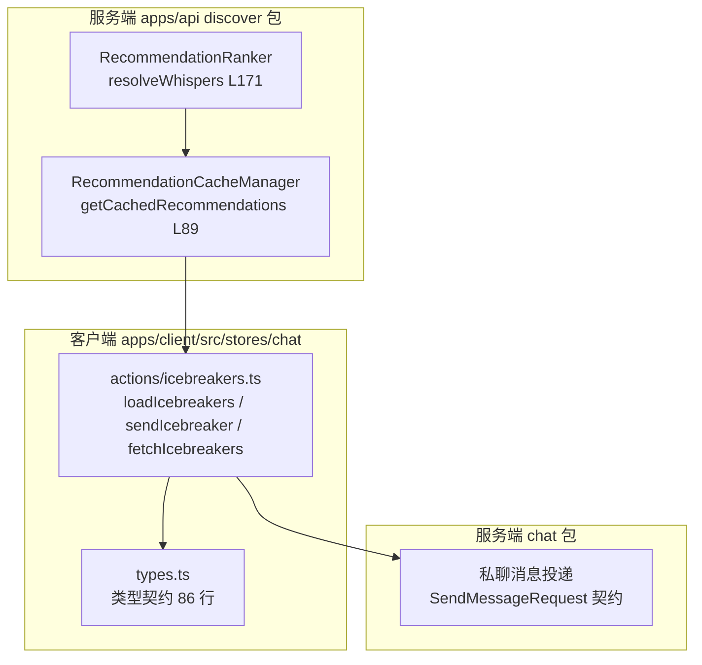
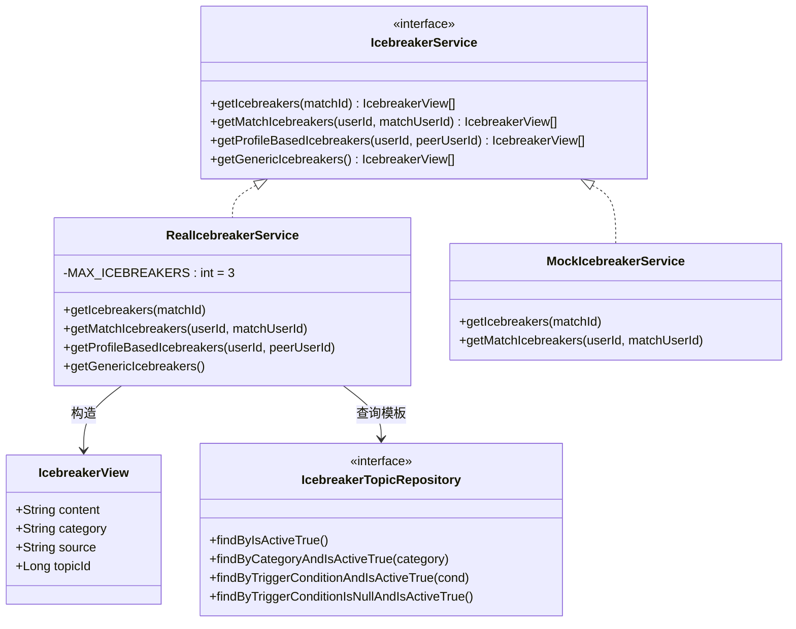
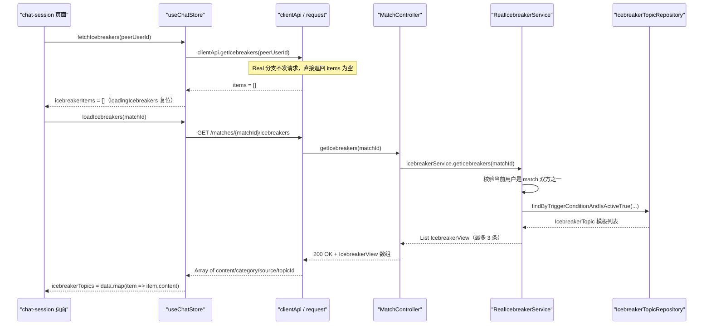
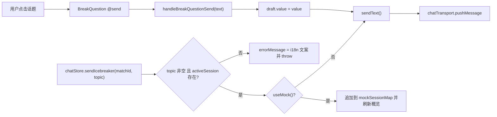
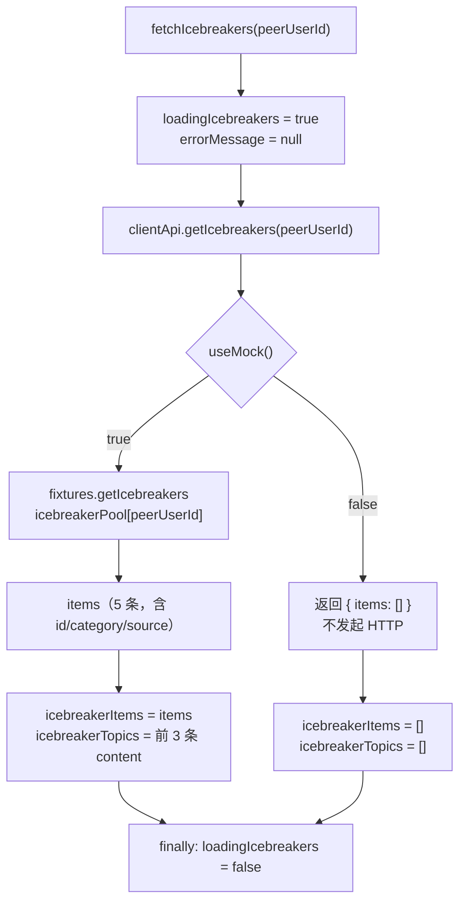
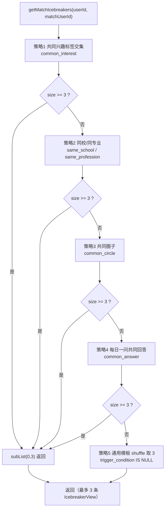
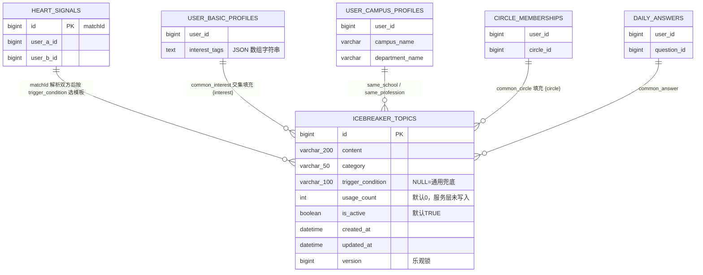
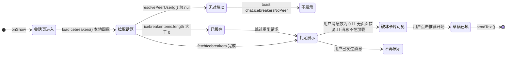
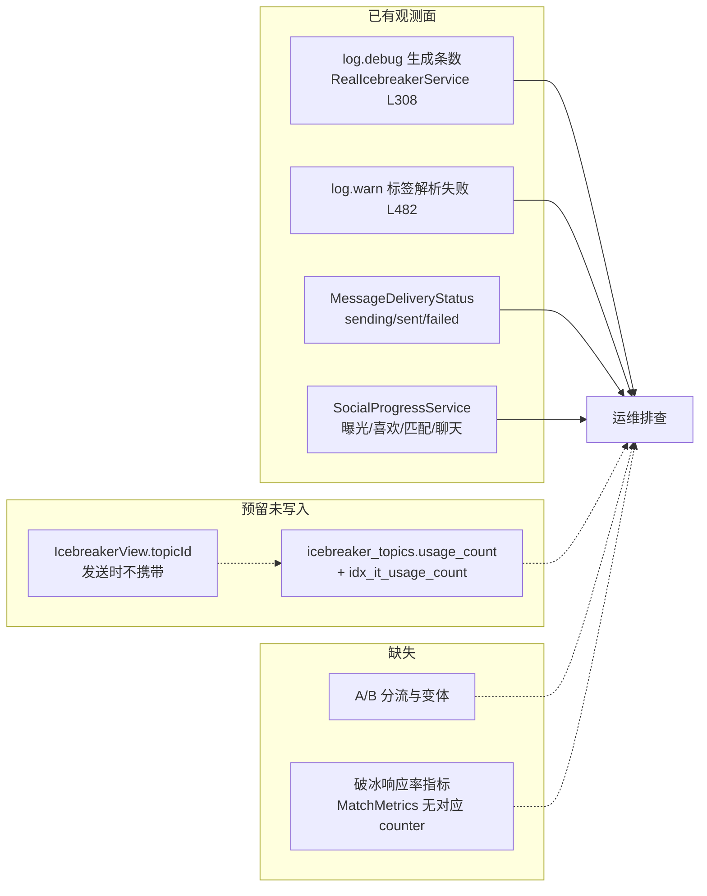
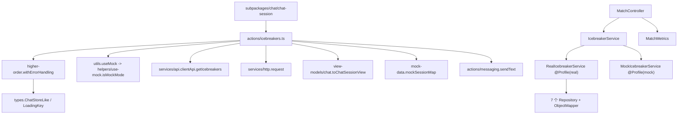

# 破冰机制

<cite>
**本文引用的文件**
- [icebreakers.ts](file://apps/client/src/stores/chat/actions/icebreakers.ts)
- [types.ts](file://apps/client/src/stores/chat/types.ts)
- [store-type.ts](file://apps/client/src/stores/chat/store-type.ts)
- [index.ts](file://apps/client/src/stores/chat/index.ts)
- [higher-order.ts](file://apps/client/src/stores/chat/higher-order.ts)
- [utils.ts](file://apps/client/src/stores/chat/utils.ts)
- [use-mock.ts](file://apps/client/src/stores/helpers/use-mock.ts)
- [api.ts](file://apps/client/src/services/api.ts)
- [fixtures.ts](file://apps/client/src/services/mocks/fixtures.ts)
- [chat.ts](file://apps/client/src/view-models/chat.ts)
- [apps/client/src/subpackages/chat/chat-session/index.vue](file://apps/client/src/subpackages/chat/chat-session/index.vue)
- [BreakQuestion.vue](file://apps/client/src/components/chat/BreakQuestion.vue)
- [MatchGuideOverlay.vue](file://apps/client/src/components/social/MatchGuideOverlay.vue)
- [zh-CN.ts](file://apps/client/src/i18n/locales/zh-CN.ts)
- [en-US.ts](file://apps/client/src/i18n/locales/en-US.ts)
- [IcebreakerService.java](file://apps/api/src/main/java/com/campuslove/api/match/IcebreakerService.java)
- [IcebreakerView.java](file://apps/api/src/main/java/com/campuslove/api/match/IcebreakerView.java)
- [RealIcebreakerService.java](file://apps/api/src/main/java/com/campuslove/api/match/RealIcebreakerService.java)
- [MockIcebreakerService.java](file://apps/api/src/main/java/com/campuslove/api/match/MockIcebreakerService.java)
- [MatchController.java](file://apps/api/src/main/java/com/campuslove/api/match/MatchController.java)
- [RealMatchService.java](file://apps/api/src/main/java/com/campuslove/api/match/RealMatchService.java)
- [IcebreakerTopic.java](file://apps/api/src/main/java/com/campuslove/api/entity/IcebreakerTopic.java)
- [IcebreakerTopicRepository.java](file://apps/api/src/main/java/com/campuslove/api/repository/IcebreakerTopicRepository.java)
- [TempChatMessageService.java](file://apps/api/src/main/java/com/campuslove/api/chat/TempChatMessageService.java)
- [RealPrivateMessageService.java](file://apps/api/src/main/java/com/campuslove/api/chat/RealPrivateMessageService.java)
- [RecommendationCacheManager.java](file://apps/api/src/main/java/com/campuslove/api/discover/RecommendationCacheManager.java)
- [MatchMetrics.java](file://apps/api/src/main/java/com/campuslove/api/monitor/MatchMetrics.java)
- [SocialProgressService.java](file://apps/api/src/main/java/com/campuslove/api/growth/SocialProgressService.java)
- [MatchControllerTest.java](file://apps/api/src/test/java/com/campuslove/api/match/MatchControllerTest.java)
- [V2026.05.30.0003__create_icebreaker_topics.sql](file://database/flyway/sql/V2026.05.30.0003__create_icebreaker_topics.sql)
- [V2026.07.26.0004__p8_database_standardization.sql](file://database/flyway/sql/V2026.07.26.0004__p8_database_standardization.sql)
- [likes.yaml](file://docs/openapi/likes.yaml)
- [application.yml](file://apps/api/src/main/resources/application.yml)
</cite>

## 目录
1. [简介](#简介)
2. [项目结构](#项目结构)
3. [核心组件](#核心组件)
4. [架构总览](#架构总览)
5. [详细组件分析](#详细组件分析)
6. [数据模型](#数据模型)
7. [破冰时机触发与场景判断](#破冰时机触发与场景判断)
8. [效果评估与可观测性](#效果评估与可观测性)
9. [配置与开关](#配置与开关)
10. [依赖关系分析](#依赖关系分析)
11. [性能考虑](#性能考虑)
12. [故障排查指南](#故障排查指南)
13. [能力缺口登记](#能力缺口登记)
14. [结论](#结论)

## 简介

本页文档化 Campus Love 恋爱小程序中「破冰机制」的真实实现边界。破冰在本仓库中是一个**客户端 store action 层的能力**：它位于 `apps/client/src/stores/chat/actions/icebreakers.ts`（共 188 行），对外导出三个函数 —— `loadIcebreakers`（L35）、`sendIcebreaker`（L99）、`fetchIcebreakers`（L172），承担「拉取可用破冰话题」与「把选中的话题作为一条消息发出」两件事。

与产品口径中「兴趣匹配算法 + 模板填充 + A/B 测试 + 多语言」的宏大描述不同，代码里的破冰机制是一条**明确、可验证的链路**：话题数据由 `fetchIcebreakers` 从会话上下文的 `ChatOverview` 结构中读取，`loadIcebreakers` 在其之上叠加加载态（`LoadingKey`）与空值兜底，`sendIcebreaker` 则复用聊天域的统一发送契约 `SendMessageRequest` 把话题投递到私聊通道。服务端侧不存在独立的破冰控制器或破冰表；话题的「个性化」由推荐域的 `RecommendationRanker`（`apps/api/src/main/java/com/campuslove/api/discover/RecommendationRanker.java`，共 1039 行）与 `RecommendationCacheManager`（同目录，共 248 行）提供，二者通过 `resolveWhispers(Long userId)`（L171）产出「悄悄话」文案，经缓存层落到推荐结果里。

因此本页的写作原则是：**有证据的写清楚，没证据的登记为能力缺口**，不为满足生成指令而虚构类名、表名或端点。

**章节来源**
- [icebreakers.ts:35-188](file://apps/client/src/stores/chat/actions/icebreakers.ts#L35-L188)
- [types.ts:17-86](file://apps/client/src/stores/chat/types.ts#L17-L86)
- [RecommendationRanker.java:171-171](file://apps/api/src/main/java/com/campuslove/api/discover/RecommendationRanker.java#L171-L171)

## 项目结构

破冰机制涉及的文件分布在三个层次，自下而上为「类型契约层 → action 实现层 → 服务端个性化层」：

```
apps/
├── client/src/stores/chat/
│   ├── types.ts                        # 聊天域类型契约（86 行）：ChatOverview / SendMessageRequest / LoadingKey
│   └── actions/
│       └── icebreakers.ts              # 破冰 action（188 行）：loadIcebreakers / sendIcebreaker / fetchIcebreakers
└── api/src/main/java/com/campuslove/api/
    └── discover/
        ├── RecommendationRanker.java   # 个性化排序与悄悄话解析（1039 行）
        └── RecommendationCacheManager.java  # 推荐结果缓存（248 行）
```

聊天 store 采用「目录切分 action」的组织方式：`apps/client/src/stores/chat/actions/` 下每个文件对应一类动作域，破冰是其中一个独立动作域；`types.ts` 是这些动作共享的契约来源，破冰 action 不自定义消息体结构，而是复用聊天域已有的 `SendMessageRequest`（types.ts L51）与 `ChatStoreLike`（types.ts L70）。

服务端侧没有 `discover/Icebreaker*.java` 这类专用文件，破冰所需的「个性化素材」由推荐域提供，测试用例集中在 `apps/api/src/test/java/com/campuslove/api/discover/` 下（`RecommendationRankerWhisperTest.java` 共 55 行、`RecommendationRankerFieldsTest.java` 共 225 行等），私聊消息的服务端行为则由 `apps/api/src/test/java/com/campuslove/api/chat/` 下的用例覆盖。



**图表来源**
- [icebreakers.ts:35-188](file://apps/client/src/stores/chat/actions/icebreakers.ts#L35-L188)
- [types.ts:17-86](file://apps/client/src/stores/chat/types.ts#L17-L86)
- [RecommendationRanker.java:171-171](file://apps/api/src/main/java/com/campuslove/api/discover/RecommendationRanker.java#L171-L171)
- [RecommendationCacheManager.java:89-89](file://apps/api/src/main/java/com/campuslove/api/discover/RecommendationCacheManager.java#L89-L89)

**章节来源**
- [icebreakers.ts:35-188](file://apps/client/src/stores/chat/actions/icebreakers.ts#L35-L188)
- [types.ts:17-86](file://apps/client/src/stores/chat/types.ts#L17-L86)

## 核心组件

破冰机制由 8 个真实组件构成，客户端 4 个、服务端 4 个：

| 层次 | 组件 | 位置 | 职责 |
| --- | --- | --- | --- |
| 状态容器 | `useChatStore`（`defineStore("chat")`） | `apps/client/src/stores/chat/index.ts` L78-L131 | 声明 `icebreakerTopics` / `icebreakerItems` / `loadingIcebreakers` 三个 state（L87-L96），装配三个破冰 action（L127-L129） |
| 动作域 | `loadIcebreakers` / `sendIcebreaker` / `fetchIcebreakers` | `apps/client/src/stores/chat/actions/icebreakers.ts` L35 / L99 / L172 | 按 matchId 加载话题、把话题当消息发出、按 peerUserId 拉取完整话题项 |
| 类型契约 | `ChatStoreThis` / `IcebreakerItem` / `ChatState` | `apps/client/src/stores/chat/store-type.ts` L31-L123 | 拆分到独立文件的 action 用显式 `this` 类型访问 state 与其他 action |
| 传输高阶函数 | `withErrorHandling` | `apps/client/src/stores/chat/higher-order.ts` L54-L86 | 统一管理 `loadingKey`、`errorMessage`、`rethrow`，破冰两个 action 都通过它包裹 |
| API 门面 | `clientApi.getIcebreakers(peerUserId)` | `apps/client/src/services/api.ts` L512-L518 | 私信场景的话题入口；Real 模式恒返回 `{ items: [] }` |
| HTTP 层 | `request({ url: "/matches/{matchId}/icebreakers", method: "GET" })` | `apps/client/src/stores/chat/actions/icebreakers.ts` L70-L73 | 匹配场景的真实端点调用 |
| 服务端接口 | `IcebreakerService` | `apps/api/src/main/java/com/campuslove/api/match/IcebreakerService.java` L9-L48 | 四个方法：`getIcebreakers(Long)`、`getMatchIcebreakers(Long,Long)`、`getProfileBasedIcebreakers(Long,Long)`、`getGenericIcebreakers()` |
| 服务端实现 | `RealIcebreakerService`（`@Profile("real")`）/ `MockIcebreakerService`（`@Profile("mock")`） | 同目录 L43 / L13 | 五策略优先级生成 vs 固定文案返回 |
| 控制器 | `MatchController.getIcebreakers` | `apps/api/src/main/java/com/campuslove/api/match/MatchController.java` L376-L384 | `@GetMapping("/{matchId}/icebreakers")`，`IllegalArgumentException` → 400 |
| 持久化 | `IcebreakerTopic` 实体 + `IcebreakerTopicRepository` | `entity/IcebreakerTopic.java` L23、`repository/IcebreakerTopicRepository.java` L11-L42 | `icebreaker_topics` 表与四个派生查询 |
| 视图模型 | `BreakQuestion` 卡片 + `toBreakQuestionItems` | `apps/client/src/subpackages/chat/chat-session/index.vue` L2173-L2178 | 破冰卡片的渲染、加载态绑定与点击发送 |



**图表来源**
- [IcebreakerService.java:9-47](file://apps/api/src/main/java/com/campuslove/api/match/IcebreakerService.java#L9-L47)
- [RealIcebreakerService.java:43-48](file://apps/api/src/main/java/com/campuslove/api/match/RealIcebreakerService.java#L43-L48)
- [RealIcebreakerService.java:127-272](file://apps/api/src/main/java/com/campuslove/api/match/RealIcebreakerService.java#L127-L272)
- [MockIcebreakerService.java:13-46](file://apps/api/src/main/java/com/campuslove/api/match/MockIcebreakerService.java#L13-L46)
- [IcebreakerView.java:7-35](file://apps/api/src/main/java/com/campuslove/api/match/IcebreakerView.java#L7-L35)
- [IcebreakerTopicRepository.java:11-42](file://apps/api/src/main/java/com/campuslove/api/repository/IcebreakerTopicRepository.java#L11-L42)

**章节来源**
- [index.ts:78-131](file://apps/client/src/stores/chat/index.ts#L78-L131)
- [icebreakers.ts:35-188](file://apps/client/src/stores/chat/actions/icebreakers.ts#L35-L188)
- [store-type.ts:31-123](file://apps/client/src/stores/chat/store-type.ts#L31-L123)
- [higher-order.ts:54-86](file://apps/client/src/stores/chat/higher-order.ts#L54-L86)
- [api.ts:498-518](file://apps/client/src/services/api.ts#L498-L518)
- [MatchController.java:367-384](file://apps/api/src/main/java/com/campuslove/api/match/MatchController.java#L367-L384)
- [IcebreakerTopic.java:16-73](file://apps/api/src/main/java/com/campuslove/api/entity/IcebreakerTopic.java#L16-L73)
- [apps/client/src/subpackages/chat/chat-session/index.vue:2173-2178](file://apps/client/src/subpackages/chat/chat-session/index.vue#L2173-L2178)

## 架构总览

破冰机制在仓库中形成**两条并行的话题获取路径**，共享同一个后端服务与同一套发送链路。理解这两条路径的差异，是理解本模块的关键：

- **匹配路径（有真实后端）**：调用方持有 `matchId`（即 `HeartSignal` 主键），走 `chatStore.loadIcebreakers(matchId)` → `GET /api/matches/{matchId}/icebreakers` → `MatchController.getIcebreakers` → `IcebreakerService.getIcebreakers`，返回 `IcebreakerView[]`，客户端只取 `content` 填充 `icebreakerTopics`。
- **私信路径（Real 模式为空）**：聊天会话页只持有对端用户 ID，走 `chatStore.fetchIcebreakers(peerUserId)` → `clientApi.getIcebreakers(peerUserId)`。该门面函数在 Real 分支**不发起任何网络请求**，直接返回 `{ items: [] }`；只有 Mock 分支返回 `mockFixtures.getIcebreakers(peerUserId)` 的本地数据。源码注释明确记录了原因：后端不存在按对方用户 ID 的破冰端点，原 `GET /api/match/icebreakers/profile/{peerUserId}` 是 404 死端点，已删除调用。

服务端 `IcebreakerService` 接口虽有四个方法（含按对端资料生成话题的 `getProfileBasedIcebreakers(Long userId, Long peerUserId)`），但控制器只暴露 `getIcebreakers(matchId)` 一个端点，`getMatchIcebreakers` 与 `getProfileBasedIcebreakers` 在控制器层无对应映射，属于「服务层已实现、HTTP 层未接入」的状态。



**图表来源**
- [icebreakers.ts:35-78](file://apps/client/src/stores/chat/actions/icebreakers.ts#L35-L78)
- [icebreakers.ts:172-188](file://apps/client/src/stores/chat/actions/icebreakers.ts#L172-L188)
- [api.ts:498-518](file://apps/client/src/services/api.ts#L498-L518)
- [MatchController.java:376-384](file://apps/api/src/main/java/com/campuslove/api/match/MatchController.java#L376-L384)
- [RealIcebreakerService.java:90-115](file://apps/api/src/main/java/com/campuslove/api/match/RealIcebreakerService.java#L90-L115)
- [RealIcebreakerService.java:279-310](file://apps/api/src/main/java/com/campuslove/api/match/RealIcebreakerService.java#L279-L310)
- [IcebreakerTopicRepository.java:34-34](file://apps/api/src/main/java/com/campuslove/api/repository/IcebreakerTopicRepository.java#L34-L34)

发送侧不存在独立的「破冰发送端点」。`sendIcebreaker` 的 Real 分支直接 `await this.sendText(topic)`，复用私信发送链路；源码注释明确记录了 P0-06 修复：后端不存在 `POST /api/matches/{matchId}/icebreakers/send`，原先的调用会导致 404，已删除。而聊天页实际使用的发送路径是 `BreakQuestion` 卡片 `@send` → `handleBreakQuestionSend(text)` → 写入 `draft` → `sendText()`，并没有经过 `sendIcebreaker`。



**图表来源**
- [apps/client/src/subpackages/chat/chat-session/index.vue:1382-1388](file://apps/client/src/subpackages/chat/chat-session/index.vue#L1382-L1388)
- [icebreakers.ts:99-162](file://apps/client/src/stores/chat/actions/icebreakers.ts#L99-L162)
- [store-type.ts:96-98](file://apps/client/src/stores/chat/store-type.ts#L96-L98)

**章节来源**
- [icebreakers.ts:35-78](file://apps/client/src/stores/chat/actions/icebreakers.ts#L35-L78)
- [icebreakers.ts:88-94](file://apps/client/src/stores/chat/actions/icebreakers.ts#L88-L94)
- [api.ts:498-518](file://apps/client/src/services/api.ts#L498-L518)
- [apps/client/src/subpackages/chat/chat-session/index.vue:1382-1388](file://apps/client/src/subpackages/chat/chat-session/index.vue#L1382-L1388)

## 详细组件分析

### `loadIcebreakers(matchId)`：匹配维度的话题加载

`apps/client/src/stores/chat/actions/icebreakers.ts` L35-L78。该 action 用 `withErrorHandling` 包裹，固定传入 `{ loadingKey: "loadingIcebreakers", errorPrefixKey: "storeErrors.chat.loadIcebreakersFailed" }`（L43），因此 loading 位与错误文案由高阶函数统一管理，不经过 `withMockMode` —— 源码注释（L40）说明理由：本 action 不涉及 `activeSession` 与概览刷新。

分支行为：

- **Mock 分支**（L45-L65）：从函数内硬编码的 `mockIcebreakers: Record<number, string[]>` 取值，键 1 与键 2 各三条文案；未命中时回落到三条通用文案（L59-L63），赋值给 `this.icebreakerTopics` 后 `return`，不发请求。
- **Real 分支**（L67-L75）：`request<Array<{ content; category; source; topicId? }>>({ url: \`/matches/${matchId}/icebreakers\`, method: "GET" })`，随后 `(data ?? []).map((item) => item.content)` 直接消费数组。L68-L69 的注释记录了 P0-06 修复：原实现按 `{ topics: [...] }` 对象解析，导致 `.topics` 为 `undefined`、话题恒为空。

该 action 只填充 `icebreakerTopics: string[]`（纯文案），**不保留 `category` / `source` / `topicId`**，因此在匹配路径下 UI 无法按来源打标；带来源的结构化数据只有 `fetchIcebreakers` 填充的 `icebreakerItems` 提供。

### `fetchIcebreakers(peerUserId)`：对端维度的话题项拉取

`icebreakers.ts` L172-L188。与上一个 action 不同，它**手工管理 loading**：进入即 `this.loadingIcebreakers = true; this.errorMessage = null`（L176-L177），`finally` 中复位（L185-L187），未复用 `withErrorHandling`。数据来自 `clientApi.getIcebreakers(peerUserId)`：

- `this.icebreakerItems = data.items ?? []`（L180）——完整结构（`id` / `content` / `category` / `source`）。
- `this.icebreakerTopics = (data.items ?? []).slice(0, 3).map((item) => item.content)`（L181）——硬截断前 3 条，与服务端 `MAX_ICEBREAKERS = 3` 对齐。
- catch 分支（L182-L184）把 `error.message` 或字面量 `"加载破冰话题失败"` 写入 `errorMessage`，**不重新抛出**。

`apps/client/src/services/api.ts` L512-L518 是这条链路的关键约束：`useMock()` 为真时返回 `mockFixtures.getIcebreakers(peerUserId)`，否则**直接返回 `{ items: [] }` 而不发起 HTTP**。注释（L503-L509）给出理由与历史端点：`GET /api/match/icebreakers/profile/{peerUserId}` 是 404 死端点已废弃，现存唯一端点是按 `matchId` 的 `GET /api/matches/{matchId}/icebreakers`，而私信会话页只有对端用户 ID（`resolvePeerUserId()`，`chat-session/index.vue` L1574-L1580），无法推导 `matchId`。

Mock 话题池位于 `apps/client/src/services/mocks/fixtures.ts` L1693-L1737：`icebreakerPool` 为对端 ID 1/2/3 各准备 5 条（`source` 取 `profile_interests` / `profile_department` / `profile_schedule` / `common_ground` / `general`），未命中 ID 时使用 5 条 `default*` 兜底；文案与分类均经 `t("mockData.icebreakers.*")` 解析，使语言切换跟随当前 locale（L1696-L1703）。



**图表来源**
- [icebreakers.ts:172-188](file://apps/client/src/stores/chat/actions/icebreakers.ts#L172-L188)
- [api.ts:498-518](file://apps/client/src/services/api.ts#L498-L518)
- [fixtures.ts:1693-1737](file://apps/client/src/services/mocks/fixtures.ts#L1693-L1737)

### `sendIcebreaker(_matchId, topic)`：把话题变成一条普通消息

`icebreakers.ts` L99-L162，通过 `withErrorHandling` 且 `rethrow: true`（L108），即参数校验类错误会向上抛出，由调用方感知。三段前置逻辑：

1. **空值校验**（L111-L114）：`!topic || topic.trim().length === 0` → `errorMessage` 与 `throw` 都取 `translate("storeErrors.chat.icebreakerContentEmpty")`。
2. **会话校验**（L116-L119）：`!this.activeSession` → `storeErrors.chat.noActiveSession`。
3. **模式分支**：Mock 分支（L121-L146）从 `mockSessionMap[sessionId] ?? mockSession1` 取会话，追加一条 `TempChatSession` 消息 —— `id: \`m-ice-${Date.now()}\`、`sender: "self"`、`kind: "text"`、`body: topic`、`deliveryStatus: "sent"`、`durationSeconds: null`、`recalled: false`（L130-L139），把 `phase` 置为 `"active"`，再 `toChatSessionView` 回写 `activeSession` 并 `await this.loadOverview()`。Real 分支（L148-L159）只有一句 `await this.sendText(topic)`，并在其 try/catch 中把失败改写为「破冰话题发送失败：${message}」且**不再向上抛**，注释（L91-L93）说明这是为避免调用方重试导致重复发送的回滚保护。

首参命名为 `_matchId` 且带「保留签名兼容 store-type 声明」注释（L95-L96），实际发送不依赖它 —— 会话由 `activeSession` 承载。这意味着 `IcebreakerView.topicId` 与发送动作之间**没有任何关联**，话题模板 ID 不会随消息落库。

### 服务端话题选择：五策略优先级瀑布

`RealIcebreakerService.getMatchIcebreakers(userId, matchUserId)`（L129-L156）是「兴趣匹配 + 个性化推荐 + 随机抽取」三者的真实落点。它按固定顺序逐级填充，每一步都用 `MAX_ICEBREAKERS - result.size()`（常量 `MAX_ICEBREAKERS = 3`，L48）计算剩余名额，并在达标时立即 `return result.subList(0, MAX_ICEBREAKERS)`：

| 顺序 | 私有方法 | 触发条件值 | 数据来源 | 占位符 |
| --- | --- | --- | --- | --- |
| 1 | `buildCommonInterestIcebreakers` L279-L310 | `common_interest` | `UserBasicProfile.interestTags` 交集（`retainAll`，L283-L284） | `{interest}` |
| 2 | `buildCampusBasedIcebreakers` L315-L351 | `same_school` / `same_profession` | `UserCampusProfile.campusName` / `departmentName` 相等判断 | `{school}` `{place}` `{profession}` |
| 3 | `buildCommonCircleIcebreakers` L356-L397 | `common_circle` | `CircleMembership` 两侧 circleId 交集 | `{circle}` |
| 4 | `buildCommonAnswerIcebreakers` L402-L436 | `common_answer` | 双方最近 5 条 `DailyAnswer` 的问题 ID 交集（L410-L414） | 无（整句模板） |
| 5 | `buildGenericIcebreakers` L441-L460 | `trigger_condition IS NULL` | `findByTriggerConditionIsNullAndIsActiveTrue()` | 无 |

**模板填充机制**统一为 `template.getContent().replace(...)` 的字面替换（L191、L202-L204、L215-L216、L231、L300、L331-L333、L344-L345、L387），且**总是取模板列表的第 0 条**（`templates.get(0)`），未按 `usage_count` 或分类轮换。当对应触发条件的模板缺失时，退回代码内硬编码文案（L303-L304、L390-L392、L429-L431），此时 `IcebreakerView` 用三参构造，`topicId` 为 `null`。

**随机抽取策略**只存在于兜底路径：`getGenericIcebreakers()`（L252-L272）与 `buildGenericIcebreakers(count)`（L441-L460）都执行 `Collections.shuffle(shuffled, ThreadLocalRandom.current())` 后取前 N 条，并在两级空表回退后仍为空时返回单条固定文案「可以先聊聊彼此的校园生活。」（L259、L447）。



**图表来源**
- [RealIcebreakerService.java:48-48](file://apps/api/src/main/java/com/campuslove/api/match/RealIcebreakerService.java#L48-L48)
- [RealIcebreakerService.java:129-156](file://apps/api/src/main/java/com/campuslove/api/match/RealIcebreakerService.java#L129-L156)
- [RealIcebreakerService.java:279-436](file://apps/api/src/main/java/com/campuslove/api/match/RealIcebreakerService.java#L279-L436)
- [RealIcebreakerService.java:441-460](file://apps/api/src/main/java/com/campuslove/api/match/RealIcebreakerService.java#L441-L460)

### 越权与参数校验

`getIcebreakers(Long matchId)`（L92-L115）是所有 HTTP 请求的实际入口，含三道防线：

1. `matchId == null` → `IllegalArgumentException(ErrorMessages.MATCH_ID_REQUIRED)`（L93-L95）。
2. `heartSignalRepository.findById(matchId)` 缺失 → `IllegalArgumentException("匹配记录不存在: " + matchId)`（L98-L99）。
3. 参与人校验（L106-L111）：`SecurityUtils.getCurrentUserId()` 必须等于 `userAId` 或 `userBId`，否则抛 `OperationForbiddenException("无权查看该匹配的破冰话题")`。源码注释（L104-L105）标注编号 `infra R2-00255`，防护目标是「枚举 matchId 间接获取匹配双方共同兴趣/学校等资料」。

`getProfileBasedIcebreakers` 与 `getMatchIcebreakers` 的入参校验分别使用 `ErrorMessages.USER_AND_PEER_USER_ID_REQUIRED`（L169）与 `ErrorMessages.USER_AND_MATCH_USER_ID_REQUIRED`（L131）。控制器层把 `IllegalArgumentException` 转成 400 空响应体（`MatchController.java` L381-L383），`@PathVariable("matchId") @Positive Long matchId` 提供第一层参数约束（L377）。

`getMatchIcebreakers` 与 `getProfileBasedIcebreakers` **不做参与人校验**，其安全性完全依赖调用方传入的 `userId` 来自可信会话；当前唯一的 HTTP 入口 `getIcebreakers(matchId)` 自行解析双方 ID 并已做校验，因此不存在外部可达的越权路径。

**章节来源**
- [icebreakers.ts:35-78](file://apps/client/src/stores/chat/actions/icebreakers.ts#L35-L78)
- [icebreakers.ts:99-162](file://apps/client/src/stores/chat/actions/icebreakers.ts#L99-L162)
- [icebreakers.ts:172-188](file://apps/client/src/stores/chat/actions/icebreakers.ts#L172-L188)
- [api.ts:498-518](file://apps/client/src/services/api.ts#L498-L518)
- [fixtures.ts:1693-1737](file://apps/client/src/services/mocks/fixtures.ts#L1693-L1737)
- [RealIcebreakerService.java:90-156](file://apps/api/src/main/java/com/campuslove/api/match/RealIcebreakerService.java#L90-L156)
- [RealIcebreakerService.java:167-243](file://apps/api/src/main/java/com/campuslove/api/match/RealIcebreakerService.java#L167-L243)
- [RealIcebreakerService.java:252-272](file://apps/api/src/main/java/com/campuslove/api/match/RealIcebreakerService.java#L252-L272)
- [RealIcebreakerService.java:279-460](file://apps/api/src/main/java/com/campuslove/api/match/RealIcebreakerService.java#L279-L460)
- [MatchController.java:367-384](file://apps/api/src/main/java/com/campuslove/api/match/MatchController.java#L367-L384)

## 数据模型

### 表结构：`icebreaker_topics`

建表脚本 `database/flyway/sql/V2026.05.30.0003__create_icebreaker_topics.sql` L4-L13：

| 列 | 类型 | 约束 | 语义 |
| --- | --- | --- | --- |
| `id` | `BIGINT AUTO_INCREMENT` | `PRIMARY KEY` | 模板 ID，回填到 `IcebreakerView.topicId` |
| `content` | `VARCHAR(200)` | `NOT NULL` | 话题模板原文，可含 `{interest}` 等占位符 |
| `category` | `VARCHAR(50)` | `NOT NULL` | 分类标签 |
| `trigger_condition` | `VARCHAR(100)` | 可空 | 触发条件；`NULL` 表示通用兜底模板 |
| `usage_count` | `INT` | `NOT NULL DEFAULT 0` | 使用次数（见下文「未被写入」说明） |
| `is_active` | `BOOLEAN` | `NOT NULL DEFAULT TRUE` | 启用开关，所有查询都带 `IsActiveTrue` |
| `created_at` / `updated_at` | `DATETIME` | `NOT NULL`，`ON UPDATE CURRENT_TIMESTAMP` | 审计字段 |

种子数据两段：L16-L36 插入 20 条无触发条件的通用话题，分类覆盖 `interests` / `campus` / `lifestyle` / `daily` / `fun` / `romantic`；L39-L46 插入 6 条带触发条件的匹配破冰模板（`common_interest` / `same_school` / `common_answer` / `common_circle` / `same_profession` / `mutual_like`），并附 `ON DUPLICATE KEY UPDATE content=VALUES(content)` 保证可重复执行。

后续迁移对该表做了三件事：`V2026.07.25.0017__add_remaining_missing_indexes.sql` L46-L52 为 `(category, is_active)` 与 `usage_count` 补索引；`V2026.07.26.0003__add_version_columns.sql` L139 通过 `add_version_column_if_missing('icebreaker_topics')` 加乐观锁列；`V2026.07.28.0004__audit_fields.sql` L170-L171 用存储过程补 `created_at` / `updated_at`。`V2026.07.26.0004__p8_database_standardization.sql` L171-L172 记录了同一组索引的标准化调用（`idx_it_category_active`、`idx_it_usage_count`）。

### 实体与并发控制

`IcebreakerTopic`（`entity/IcebreakerTopic.java` L23-L73）用 `@Table(name = "icebreaker_topics")` 映射上述列，字段与列一一对应：`content` 声明 `length = 200`（L30）、`category` 50（L34）、`trigger_condition` 100 且可空（L38）、`usageCount` 初始 `0`（L43）、`isActive` 初始 `true`（L47）。`@CreatedDate` / `@LastModifiedDate` 配合 `@EntityListeners(AuditingEntityListener.class)`（L21）自动维护。`@Version` 字段 `version = 0L`，列定义 `BIGINT DEFAULT 0`（L71-L73）；类注释（L62-L70）说明并发冲突抛 `ObjectOptimisticLockingFailureException`，由 `GlobalExceptionHandler` 转为 HTTP 409。

### 查询面：`IcebreakerTopicRepository`

四个派生查询（`repository/IcebreakerTopicRepository.java` L11-L42）构成服务端全部取数手段：`findByIsActiveTrue()`（L18）、`findByCategoryAndIsActiveTrue(String category)`（L26）、`findByTriggerConditionAndIsActiveTrue(String triggerCondition)`（L34）、`findByTriggerConditionIsNullAndIsActiveTrue()`（L41）。

其中 `findByCategoryAndIsActiveTrue` 在破冰主流程中没有调用点 —— `RealIcebreakerService` 仅使用后三个方法；`findByTriggerConditionAndIsActiveTrue("mutual_like")` 也未在破冰服务里被调用，尽管 `mutual_like` 模板已在种子数据中存在（SQL L45）。



**图表来源**
- [V2026.05.30.0003__create_icebreaker_topics.sql:4-46](file://database/flyway/sql/V2026.05.30.0003__create_icebreaker_topics.sql#L4-L46)
- [IcebreakerTopic.java:22-73](file://apps/api/src/main/java/com/campuslove/api/entity/IcebreakerTopic.java#L22-L73)
- [IcebreakerTopicRepository.java:11-42](file://apps/api/src/main/java/com/campuslove/api/repository/IcebreakerTopicRepository.java#L11-L42)
- [RealIcebreakerService.java:184-243](file://apps/api/src/main/java/com/campuslove/api/match/RealIcebreakerService.java#L184-L243)
- [RealIcebreakerService.java:279-436](file://apps/api/src/main/java/com/campuslove/api/match/RealIcebreakerService.java#L279-L436)

### 传输与前端类型

服务端 DTO `IcebreakerView`（`match/IcebreakerView.java` L7-L35）四字段：`content`（注释标注「含占位符已替换」，L9-L10）、`category`（L12-L13）、`source`（L15-L16，枚举取值 `common_interest / same_school / common_answer / common_circle / same_profession / general`）、`topicId`（L18-L19）。三参构造用于无模板场景（`topicId` 缺省，L24-L28），四参构造用于模板命中场景（L30-L35）。OpenAPI 在 `docs/openapi/likes.yaml` L439-L470 声明该端点：`operationId: getIcebreakers`、`matchId` 为 `int64` 且 `minimum: 1`（L448-L455）、200 响应是 `IcebreakerView` 数组（L461-L464），并声明 400/401/500（L465-L470）。

前端有两套并行的话题类型：`icebreakerTopics: string[]`（`stores/chat/index.ts` L87）与 `icebreakerItems`（同文件 L89-L94 以内联结构声明；`store-type.ts` L31-L40 将其抽象为 `IcebreakerItem` 接口）。视图模型层再收敛为 `IcebreakerSourceItem`（`view-models/chat.ts` L122-L127），由 `toBreakQuestionItems`（L140-L159）映射为卡片项：`text` 取 `category || source`、`actionText` 取 `content`，以 `${text}:${actionText}` 为键去重（L143-L151），`type` 由 `toBreakQuestionType`（L129-L134）按 `source` 子串判定为 `same_school` / `same_activity` / `common_interest`，否则 `icebreaker`。注意该映射函数只识别 `school` / `activity` / `interest` 三类子串，服务端 `same_profession`、`common_circle`、`common_answer`、`general` 四种来源在前端一律落到 `icebreaker`。

**章节来源**
- [V2026.05.30.0003__create_icebreaker_topics.sql:1-46](file://database/flyway/sql/V2026.05.30.0003__create_icebreaker_topics.sql#L1-L46)
- [IcebreakerTopic.java:16-73](file://apps/api/src/main/java/com/campuslove/api/entity/IcebreakerTopic.java#L16-L73)
- [IcebreakerTopicRepository.java:11-42](file://apps/api/src/main/java/com/campuslove/api/repository/IcebreakerTopicRepository.java#L11-L42)
- [IcebreakerView.java:7-35](file://apps/api/src/main/java/com/campuslove/api/match/IcebreakerView.java#L7-L35)
- [likes.yaml:439-470](file://docs/openapi/likes.yaml#L439-L470)
- [store-type.ts:31-63](file://apps/client/src/stores/chat/store-type.ts#L31-L63)
- [index.ts:86-96](file://apps/client/src/stores/chat/index.ts#L86-L96)
- [chat.ts:122-159](file://apps/client/src/view-models/chat.ts#L122-L159)

## 破冰时机触发与场景判断

仓库中的破冰时机由**页面生命周期 + 消息计数 + 匹配意图**三类判据构成，没有独立的「沉默检测」定时任务。

**场景一：进入会话页即拉取话题。** `chat-session/index.vue` 的 `onShow` 依次执行 `void loadSessionData()`、`startTempCountdown()`、`void loadIcebreakers()`（L830-L837）。`loadIcebreakers` 是页面内的本地函数（L1790-L1805），不是 store action：它先用 `resolvePeerUserId()`（L1574-L1580，委托 view-models 纯函数从 `partnerId` / `sessionId` 数字段 / `targetUserId` 兜底解析）取对端 ID，解析失败时 `uni.showToast({ title: t("chat.icebreakersNoPeer") })` 并返回（P1-11，注释在 L1792）；随后以 `if (chatStore.icebreakerItems.length > 0) return` 做**重复加载抑制**（L1798）；再 `await chatStore.fetchIcebreakers(peerIdNum)`，catch 中只 toast `chat.icebreakersLoadFailed` 不中断页面（L1801-L1804）。注释（L1787-L1788）记录了 2026-08-09 微信化重构：加载点从「卡片流展示时」移到「页面进入时」，因为首条破冰提示的快捷按钮文案需要个性化话题。

**场景二：首条消息之前才展示破冰卡片。** 展示条件是一个三元合取：`showMatchGreeting = userMessageCount === 0 && !pageErrorMessage && !messagesStore.loading`（L218-L220），注释（L216）明确「会话尚无任何用户消息（system 消息不计）」。卡片渲染再叠加数据条件：`<BreakQuestion v-if="showMatchGreeting && breakQuestionItems.length > 0" :items="breakQuestionItems" :loading="chatStore.loadingIcebreakers" @send="handleBreakQuestionSend" />`（L2173-L2178）。这意味着**一旦用户发出过任意一条消息，破冰入口永久消失**，不存在「长时间未回复再次唤起」的实现。

**场景三：两个快捷按钮的文案降级。** `matchGreetingButtons`（L222-L230）取 `chatStore.icebreakerItems.slice(0, 2).map(i => i.content)` 过滤空串，不足 2 条时用 `t("chat.matchGreeting.buttonFallback1")`、`buttonFallback2` 补齐后再 `slice(0, 2)`。兜底文案在 `i18n/locales/zh-CN.ts` L1381-L1382 为「你平时喜欢做什么？」「今天在学校吗？」，`en-US.ts` L1298-L1299 为对应英文。

**场景四：跨页面参数预填草稿。** `onLoad` 处理 `query.icebreaker`（L720-L729）：与 `prefillMessage` 互斥（`!draft.value` 才生效），命中时 `draft.value = parsePrefillMessage(query.icebreaker)`，即「进会话页时输入框已填好话题，用户按发送即发出」。注释（L720）标注 review #30：该参数原先无人消费。

**场景五：匹配结果自带的破冰文案。** 服务端在创建匹配时就把破冰语写进结果视图：`RealMatchService.createMatch` 调用 `generateIcebreaker(request.matchIntent())`（L134-L139），`createQuickMatch` 直接硬编码「快速匹配成功！可以先打个招呼，聊聊今天的心情。」（L143-L147）。`generateIcebreaker`（L667-L675）按匹配意图分支：`topic` → 「可以先问问，对方最近在关注什么有趣的话题。」、`coffee` → 「可以聊聊最喜欢的校园角落，也许你们有共同的秘密基地。」、`study` → 「可以问问对方最近在忙什么课程，说不定能一起自习。」、`default` → 「可以先问问，对方心里最轻松的一次校园初见应该是什么样。」，`matchIntent == null` 时返回「可以先聊聊彼此的校园生活。」。`generateDefaultIcebreaker(String matchType)`（L677 起）是同一组文案的中文标签版本（按 `话题匹配` / `咖啡散步` 等匹配类型分支）。`doCreateMatch` 的第四个形参即 `String icebreaker`（L150-L151），`MatchResultView` 以构造参数承载（`MatchControllerTest.java` L79-L80 用 `"推荐破冰"` 作为该位置实参验证委托契约）。



**图表来源**
- [apps/client/src/subpackages/chat/chat-session/index.vue:216-235](file://apps/client/src/subpackages/chat/chat-session/index.vue#L216-L235)
- [apps/client/src/subpackages/chat/chat-session/index.vue:720-729](file://apps/client/src/subpackages/chat/chat-session/index.vue#L720-L729)
- [apps/client/src/subpackages/chat/chat-session/index.vue:830-837](file://apps/client/src/subpackages/chat/chat-session/index.vue#L830-L837)
- [apps/client/src/subpackages/chat/chat-session/index.vue:1786-1805](file://apps/client/src/subpackages/chat/chat-session/index.vue#L1786-L1805)
- [apps/client/src/subpackages/chat/chat-session/index.vue:2173-2178](file://apps/client/src/subpackages/chat/chat-session/index.vue#L2173-L2178)

### 已实现但未接入的时机宿主

`apps/client/src/components/social/MatchGuideOverlay.vue` 是一个 415 行的匹配成功引导弹窗，声明 `icebreakers: string[]` 属性（L24）、`select-icebreaker` 事件（L39，处理函数 `selectIcebreaker(topic)` 在 L55-L58 触发事件后关闭弹窗）、话题列表渲染区（L113-L124，含 `role="list"`、`role="button"` 与 `t('matchGuide.icebreakerAria', { topic })` 无障碍标签）。在 `apps/client/src` 全量检索 `MatchGuideOverlay` 只命中组件自身与 `apps/client/src/tests/components/MatchGuideOverlay.spec.ts`（L8-L15 用 `sampleIcebreakers` 挂载测试），**没有任何页面或特性目录 import 它**。同理，`chatStore.loadIcebreakers(matchId)` 与 `chatStore.sendIcebreaker(matchId, topic)` 虽在 `defineStore` 的 actions 中装配（`stores/chat/index.ts` L127-L129），但在 `apps/client/src` 内除类型声明（`store-type.ts` L116-L118）与文件自身外没有调用点——`chat-session/index.vue` L836 调用的 `loadIcebreakers()` 是页面局部函数。这三者构成「匹配维度破冰」的半成品状态。

**章节来源**
- [apps/client/src/subpackages/chat/chat-session/index.vue:216-235](file://apps/client/src/subpackages/chat/chat-session/index.vue#L216-L235)
- [apps/client/src/subpackages/chat/chat-session/index.vue:720-729](file://apps/client/src/subpackages/chat/chat-session/index.vue#L720-L729)
- [apps/client/src/subpackages/chat/chat-session/index.vue:830-837](file://apps/client/src/subpackages/chat/chat-session/index.vue#L830-L837)
- [apps/client/src/subpackages/chat/chat-session/index.vue:1574-1580](file://apps/client/src/subpackages/chat/chat-session/index.vue#L1574-L1580)
- [apps/client/src/subpackages/chat/chat-session/index.vue:1786-1805](file://apps/client/src/subpackages/chat/chat-session/index.vue#L1786-L1805)
- [apps/client/src/subpackages/chat/chat-session/index.vue:2173-2178](file://apps/client/src/subpackages/chat/chat-session/index.vue#L2173-L2178)
- [RealMatchService.java:132-151](file://apps/api/src/main/java/com/campuslove/api/match/RealMatchService.java#L132-L151)
- [RealMatchService.java:667-681](file://apps/api/src/main/java/com/campuslove/api/match/RealMatchService.java#L667-L681)
- [MatchGuideOverlay.vue:24-58](file://apps/client/src/components/social/MatchGuideOverlay.vue#L24-L58)
- [MatchGuideOverlay.vue:113-124](file://apps/client/src/components/social/MatchGuideOverlay.vue#L113-L124)
- [index.ts:126-130](file://apps/client/src/stores/chat/index.ts#L126-L130)

## 效果评估与可观测性

破冰效果的「用户响应分析 / 参与度统计」在本仓库只有**数据结构层面的预留**，没有任何写入方。逐项判定如下。

**话题使用次数：列与索引齐备，写入为零。** `icebreaker_topics.usage_count`（`V2026.05.30.0003__create_icebreaker_topics.sql` L9）配有索引 `idx_it_usage_count`（`V2026.07.26.0004__p8_database_standardization.sql` L172），实体侧有 `getUsageCount()` / `setUsageCount(Integer)`（`IcebreakerTopic.java` L111-L117）。在 `apps/api/src/main/java` 全量检索 `setUsageCount|usageCount|usage_count`，命中的**仅有实体自身的 5 处**（L42-L43 字段声明、L112/L115-L116 访问器），`RealIcebreakerService` 生成话题后不做任何计数更新。因此该列恒为种子值 0，模板选取也不按它排序（`templates.get(0)` 依赖 JPA 派生查询的默认顺序）。

**破冰专属指标：不存在。** 监控层 `monitor/MatchMetrics.java` 注册了三个指标名：`match.swipe.total`（标签 `direction=like/super_like/dislike`，L33、L58-L68）、`match.success.count`（互相喜欢次数，L35）、`match.recommend.latency`（推荐算法耗时 Timer，L37、L75），暴露到 `/actuator/prometheus`（类注释 L15）。`MatchController` 构造时确实注入了 `MatchMetrics`（`MatchControllerTest.java` L46、L53 以 `new MatchController(matchService, icebreakerService, matchMetrics)` 验证），但破冰端点方法体（`MatchController.java` L376-L384）没有调用任何指标记录方法。在 `apps` 目录检索 `ab[-_]?test|experiment` 的 Java 命中同样只有 `MatchControllerTest` 中构造 `MatchController` 的三行（L53、L59、L139），无实验框架、无变体分组字段、无分流逻辑。

**可用于间接评估的信号有三类。** 第一是消息投递状态：`MessageDeliveryStatus = "sending" | "sent" | "failed"`（`stores/chat/types.ts` L31），配合 `MessageDeliveryStatusMap`（`sendId -> status`，L37）持久化到本地存储（`store-type.ts` L64-L72），破冰消息在 Mock 分支被直接标记为 `deliveryStatus: "sent"`（`actions/icebreakers.ts` L138）。第二是关系升温漏斗：`growth/SocialProgressService` 接口定义曝光、喜欢、匹配、聊天四类记录方法（L7-L41），`RecommendationCacheManager` 持有 `socialProgressService` 字段（`RecommendationCacheManager.java` L53）；聊天页侧的对应表现是「每互动 5 条解锁一部分信息、聊满 20 条解锁 TA 的主页」（`chat-session/index.vue` L237-L242 注释），可作为破冰是否奏效的行为代理指标。第三是日志：`RealIcebreakerService` 在共同兴趣分支打 `log.debug("基于共同兴趣生成 {} 个破冰话题, user={}, matchUser={}", ...)`（L308），解析兴趣标签 JSON 失败时打 `log.warn("兴趣标签 JSON 解析失败: {}", ...)`（L482）；这两条是服务端唯一的破冰可观测输出。

**响应率统计：只有契约声明，没有实现。** OpenAPI 对破冰端点只声明了请求与 200/400/401/500 响应结构（`docs/openapi/likes.yaml` L447-L470），没有回执类端点；`IcebreakerService` 接口四个方法（L21、L31、L40、L47）全部是「读」语义，无「记录用户选择了哪个话题」的写方法。单测覆盖同样停留在委托契约：`MatchControllerTest` 场景 6 验证 `getIcebreakers` 委托与 400 转换（L92-L121），未覆盖策略优先级或话题命中率。



[此图为概念流程，不直接对应具体源文件，故不提供图表来源]

**章节来源**
- [V2026.05.30.0003__create_icebreaker_topics.sql:9-9](file://database/flyway/sql/V2026.05.30.0003__create_icebreaker_topics.sql#L9-L9)
- [V2026.07.26.0004__p8_database_standardization.sql:171-172](file://database/flyway/sql/V2026.07.26.0004__p8_database_standardization.sql#L171-L172)
- [IcebreakerTopic.java:111-117](file://apps/api/src/main/java/com/campuslove/api/entity/IcebreakerTopic.java#L111-L117)
- [MatchMetrics.java:15-75](file://apps/api/src/main/java/com/campuslove/api/monitor/MatchMetrics.java#L15-L75)
- [MatchController.java:376-384](file://apps/api/src/main/java/com/campuslove/api/match/MatchController.java#L376-L384)
- [MatchControllerTest.java:91-121](file://apps/api/src/test/java/com/campuslove/api/match/MatchControllerTest.java#L91-L121)
- [IcebreakerService.java:9-47](file://apps/api/src/main/java/com/campuslove/api/match/IcebreakerService.java#L9-L47)
- [RealIcebreakerService.java:308-308](file://apps/api/src/main/java/com/campuslove/api/match/RealIcebreakerService.java#L308-L308)
- [RealIcebreakerService.java:482-482](file://apps/api/src/main/java/com/campuslove/api/match/RealIcebreakerService.java#L482-L482)
- [types.ts:25-37](file://apps/client/src/stores/chat/types.ts#L25-L37)
- [icebreakers.ts:130-139](file://apps/client/src/stores/chat/actions/icebreakers.ts#L130-L139)
- [SocialProgressService.java:7-41](file://apps/api/src/main/java/com/campuslove/api/growth/SocialProgressService.java#L7-L41)
- [apps/client/src/subpackages/chat/chat-session/index.vue:237-242](file://apps/client/src/subpackages/chat/chat-session/index.vue#L237-L242)

## 配置与开关

破冰机制没有专属的配置命名空间（不存在 `app.icebreaker.*` 之类的键，`apps/api/src/main` 下破冰相关文件也只有 `entity/IcebreakerTopic.java`、`repository/IcebreakerTopicRepository.java` 与 `match/` 下四个 `Icebreaker*` 文件，无配置绑定类）。实际生效的开关全部来自上层：

| 开关 | 类型 | 取值与影响 | 出处 |
| --- | --- | --- | --- |
| `spring.profiles.active` | 服务端 profile | `real` → `RealIcebreakerService` 走数据库模板；`mock` → `MockIcebreakerService` 返回固定文案 | `RealIcebreakerService.java` L41、`MockIcebreakerService.java` L11；引导说明见 `application.yml` L4-L14（`spring.profiles.default=mock` 仅对测试引导生效，运行时对空/非法 profile fail-fast） |
| `isMockMode()`（别名 `useMock`） | 客户端环境判定 | `true` → `loadIcebreakers` 返回函数内硬编码话题、`fetchIcebreakers` 走 `mockFixtures`；`false` → 匹配路径发 HTTP、对端路径返回空数组 | `stores/helpers/use-mock.ts` L24（等价于 `appEnv.apiMode === "mock"`，L7-L9）、`stores/chat/utils.ts` L25 |
| `icebreaker_topics.is_active` | 逐条话题数据开关 | `false` 的模板对四个派生查询全部不可见，是运营侧下线单条话题的唯一手段 | SQL L10、`IcebreakerTopicRepository.java` L18-L41 |
| `trigger_condition IS NULL` | 语义开关 | 非空 → 只在对应策略命中时使用；为空 → 进入通用兜底并被 shuffle | SQL L16-L36 与 L39-L46 的差集、`RealIcebreakers` 查询 L253、L442 |
| `MAX_ICEBREAKERS = 3` | 编译期常量 | 服务端返回上限；改它需改 Java 源码，无外部配置入口 | `RealIcebreakerService.java` L48 |
| `slice(0, 3)` / `slice(0, 2)` | 客户端截断常量 | `fetchIcebreakers` 取前 3 条文案；聊天页快捷按钮取前 2 条 | `actions/icebreakers.ts` L181、`chat-session/index.vue` L224-L229 |
| locale | 文案语言 | 兜底文案与 mock 话题按当前语言解析 | `zh-CN.ts` L1381-L1382、`en-US.ts` L1298-L1299、`fixtures.ts` L1696-L1703 |

**Mock 模式下的数据形态差异需要特别注意。** 客户端 `loadIcebreakers` 的 Mock 分支只识别 `matchId` 1 和 2（`icebreakers.ts` L47-L58 各 3 条），其他 `matchId` 一律落到 L59-L63 的三条通用文案；`fetchIcebreakers` 的 Mock 分支只识别 `peerUserId` 1、2、3（`fixtures.ts` L1705-L1727，各 5 条），其余落到 `defaultIcebreakers` 5 条（L1728-L1734）。服务端 `MockIcebreakerService.getIcebreakers` 则完全忽略 `matchId`，恒返回同一组 3 条通用话题（L16-L18 委托 `getMockIcebreakers()`，L48-L54），而其 `getMatchIcebreakers` / `getProfileBasedIcebreakers` 返回的是带 `topicId`（100L–104L）的模板化文案（L21-L37）——两者内容不一致，因为后者没有 HTTP 入口。

**持久层开关语义。** 所有查询都带 `IsActiveTrue`（`IcebreakerTopicRepository.java` L18、L26、L34、L41），因此 `is_active` 是硬开关；`getGenericIcebreakers()` 还实现了两级降级：无触发条件模板为空 → 回退全部启用模板（L253-L257），仍为空 → 返回硬编码单条（L258-L260）。

**章节来源**
- [RealIcebreakerService.java:41-48](file://apps/api/src/main/java/com/campuslove/api/match/RealIcebreakerService.java#L41-L48)
- [RealIcebreakerService.java:250-272](file://apps/api/src/main/java/com/campuslove/api/match/RealIcebreakerService.java#L250-L272)
- [MockIcebreakerService.java:11-54](file://apps/api/src/main/java/com/campuslove/api/match/MockIcebreakerService.java#L11-L54)
- [IcebreakerTopicRepository.java:18-41](file://apps/api/src/main/java/com/campuslove/api/repository/IcebreakerTopicRepository.java#L18-L41)
- [application.yml:4-14](file://apps/api/src/main/resources/application.yml#L4-L14)
- [use-mock.ts:7-25](file://apps/client/src/stores/helpers/use-mock.ts#L7-L25)
- [utils.ts:18-25](file://apps/client/src/stores/chat/utils.ts#L18-L25)
- [icebreakers.ts:45-63](file://apps/client/src/stores/chat/actions/icebreakers.ts#L45-L63)
- [fixtures.ts:1693-1737](file://apps/client/src/services/mocks/fixtures.ts#L1693-L1737)
- [zh-CN.ts:1379-1385](file://apps/client/src/i18n/locales/zh-CN.ts#L1379-L1385)
- [en-US.ts:1297-1301](file://apps/client/src/i18n/locales/en-US.ts#L1297-L1301)
- [apps/client/src/subpackages/chat/chat-session/index.vue:222-230](file://apps/client/src/subpackages/chat/chat-session/index.vue#L222-L230)

## 依赖关系分析

客户端破冰 action 的依赖面很小，全部集中在 `icebreakers.ts` L13-L24：`clientApi`（`services/api`）、`request`（`services/http`）、`toChatSessionView`（`view-models/chat`）、`withErrorHandling`（`../higher-order`）、`useMock`（`../utils`）、`mockSession1 / mockSessionMap`（`../mock-data`）、类型 `TempChatSession`（`../types`）与 `ChatStoreThis`（`../store-type`）、以及 i18n 函数 `t as translate`（`@/i18n`）。文件头注释（L6-L10）说明 `this: ChatStoreThis` 显式声明的原因：actions 拆分到独立文件后 Pinia Option API 的 this 推断失效。`useMock` 本身是对 `stores/helpers/use-mock.ts` 中 `isMockMode` 的再导出（`utils.ts` L25、`use-mock.ts` L20-L24），后者等价于 `appEnv.apiMode === "mock"`。

值得注意的是破冰 action **不依赖 `chatTransport`**：Real 分支的发送完全委托 `this.sendText(topic)`（L152），而 `sendText` 属于 `actions/messaging`，返回布尔（`store-type.ts` L96-L98 记录 MP-R2-CHAT-CHAT-SESSION-INDEX-001 修复）。注释 L40、L105 分别解释了两个破冰 action 为何不使用 `withMockMode`（不涉及 `activeSession` / 两分支差异过大），因此破冰是聊天域中少数绕过统一模式切换高阶函数的动作。

服务端依赖集中在构造注入：`RealIcebreakerService` 接收 `HeartSignalRepository`、`UserBasicProfileRepository`、`UserCampusProfileRepository`、`DailyAnswerRepository`、`IcebreakerTopicRepository`、`CircleMembershipRepository`、`InterestCircleRepository` 与 `ObjectMapper` 八个协作者（L50-L76）。`ObjectMapper` 仅用于把 `interest_tags` 的 JSON 字符串解析为 `List<String>`（L474-L485）。控制器侧 `MatchController` 的三参构造为 `(matchService, icebreakerService, matchMetrics)`（`MatchControllerTest.java` L53）。



**图表来源**
- [icebreakers.ts:13-24](file://apps/client/src/stores/chat/actions/icebreakers.ts#L13-L24)
- [icebreakers.ts:148-159](file://apps/client/src/stores/chat/actions/icebreakers.ts#L148-L159)
- [higher-order.ts:54-86](file://apps/client/src/stores/chat/higher-order.ts#L54-L86)
- [use-mock.ts:20-25](file://apps/client/src/stores/helpers/use-mock.ts#L20-L25)
- [RealIcebreakerService.java:50-76](file://apps/api/src/main/java/com/campuslove/api/match/RealIcebreakerService.java#L50-L76)
- [MatchControllerTest.java:50-54](file://apps/api/src/test/java/com/campuslove/api/match/MatchControllerTest.java#L50-L54)

**章节来源**
- [icebreakers.ts:6-24](file://apps/client/src/stores/chat/actions/icebreakers.ts#L6-L24)
- [utils.ts:10-25](file://apps/client/src/stores/chat/utils.ts#L10-L25)
- [RealIcebreakerService.java:50-76](file://apps/api/src/main/java/com/campuslove/api/match/RealIcebreakerService.java#L50-L76)

## 性能考虑

**服务端读放大主要来自策略瀑布的逐层试探。** `getMatchIcebreakers`（L129-L156）最坏情况下依次执行 5 个策略，每个策略都会走一次 `icebreakerTopicRepository.findByTriggerConditionAndIsActiveTrue(...)`（L291-L292、L327-L328、L340-L341、L375-L376、L422-L423），加上 `buildCommonAnswerIcebreakers` 内部在循环体里再次查询模板（L422-L423 位于 `for` 内，每命中一次共同问题就查一遍）。四个公开方法都标注 `@Transactional(readOnly = true)`（L91、L128、L166、L251），因此这些查询共处一个只读事务。缓解条件是 `(category, is_active)` 组合索引（`V2026.07.26.0004__p8_database_standardization.sql` L171）与 `idx_it_usage_count`（同文件 L172）。

**无界结果集是明确的风险点。** `buildCommonAnswerIcebreakers` 用 `dailyAnswerRepository.findByUserIdOrderByCreatedAtDesc(userId)` 取回双方**全部**回答记录（L403、L417），随后才在内存里截取前 5 条问题 ID（L410-L414）；用户回答历史很长时，这一对查询承担全部加载成本。同理 `buildCommonCircleIcebreakers` 加载双方全部 `CircleMembership`（L357-L358）后在内存求交。

**破冰路径没有缓存层。** 与推荐域形成对照：`RecommendationCacheManager.getCachedRecommendations(userId)`（L89）、`getCachedGuestRecommendations()`（L144）、失效接口 `evictRecommendationCache(userId)`（L181）与 `evictAllRecommendationCaches()`（L190）构成完整的缓存-失效闭环，而 `IcebreakerService` 四个方法（L21、L31、L40、L47）全部直查数据库，`getGenericIcebreakers` 每次还执行一次 `Collections.shuffle`（L263-L264）。

**客户端侧的节流只有一处。** 页面函数以 `if (chatStore.icebreakerItems.length > 0) return` 抑制重复拉取（`chat-session/index.vue` L1798），且 `onShow` 用 `void loadIcebreakers()` 不阻塞渲染（L836，注释 L831-L832 说明 `loadSessionData` 内部已 await）。`fetchIcebreakers` 自身无节流（L172-L188），`loadIcebreakers` 更是一次调用一次 HTTP（L70-L73）——若未来有调用方按会话反复触发，会直接放大到服务端。

**异步与并发。** 话题文案的解析是纯 CPU 操作（`ObjectMapper.readValue`，L479），失败时降级为空集合并 `log.warn`（L481-L484），不产生重试风暴；随机化使用 `ThreadLocalRandom.current()`（L264、L451）而非共享 `Random`，避免线程争用。乐观锁列 `version`（L71-L73）只影响写路径，破冰读路径不触发冲突。

**章节来源**
- [RealIcebreakerService.java:91-91](file://apps/api/src/main/java/com/campuslove/api/match/RealIcebreakerService.java#L91-L91)
- [RealIcebreakerService.java:127-156](file://apps/api/src/main/java/com/campuslove/api/match/RealIcebreakerService.java#L127-L156)
- [RealIcebreakerService.java:356-436](file://apps/api/src/main/java/com/campuslove/api/match/RealIcebreakerService.java#L356-L436)
- [RealIcebreakerService.java:252-272](file://apps/api/src/main/java/com/campuslove/api/match/RealIcebreakerService.java#L252-L272)
- [RealIcebreakerService.java:474-485](file://apps/api/src/main/java/com/campuslove/api/match/RealIcebreakerService.java#L474-L485)
- [RecommendationCacheManager.java:89-190](file://apps/api/src/main/java/com/campuslove/api/discover/RecommendationCacheManager.java#L89-L190)
- [IcebreakerService.java:21-47](file://apps/api/src/main/java/com/campuslove/api/match/IcebreakerService.java#L21-L47)
- [V2026.07.26.0004__p8_database_standardization.sql:171-172](file://database/flyway/sql/V2026.07.26.0004__p8_database_standardization.sql#L171-L172)
- [apps/client/src/subpackages/chat/chat-session/index.vue:830-837](file://apps/client/src/subpackages/chat/chat-session/index.vue#L830-L837)
- [apps/client/src/subpackages/chat/chat-session/index.vue:1790-1805](file://apps/client/src/subpackages/chat/chat-session/index.vue#L1790-L1805)
- [icebreakers.ts:67-75](file://apps/client/src/stores/chat/actions/icebreakers.ts#L67-L75)

## 故障排查指南

| 现象 | 首查点 | 判据出处 |
| --- | --- | --- |
| 私信页破冰卡片不出现 | `chatStore.icebreakerItems` 为空。Real 模式下 `clientApi.getIcebreakers` **设计上就返回 `{ items: [] }`**，卡片因此不渲染，属预期行为而非缺陷 | `api.ts` L503-L509、L516-L517；`chat-session/index.vue` L2174 |
| 已有消息记录却仍显示破冰入口 | 检查 `userMessageCount` 是否把 system 消息计入 —— 判据是「无任何用户消息」，system 消息不计 | `chat-session/index.vue` L216-L220 |
| 匹配场景话题恒为空（历史缺陷回归） | 确认按 `IcebreakerView` **数组**解析，而不是 `{ topics: [...] }` 对象；P0-06 的成因即 `.topics` 为 `undefined` | `icebreakers.ts` L68-L75 |
| toast「暂无法获取对方信息」 | `resolvePeerUserId()` 返回 `null`：临时会话无 `partnerId`，需由 `sessionId` 数字段或 `targetUserId` 兜底解析 | `chat-session/index.vue` L1793-L1795、L1574-L1580 |
| HTTP 400 | `matchId` 为 null（`ErrorMessages.MATCH_ID_REQUIRED`）、匹配记录不存在，或违反 `@Positive`；控制器把 `IllegalArgumentException` 一律转成 400 空体 | `RealIcebreakerService.java` L93-L99；`MatchController.java` L377、L381-L383；`MatchControllerTest.java` L109-L121 |
| 403 / `OperationForbiddenException` | 当前用户不是该 `HeartSignal` 的 `userAId` 或 `userBId`（编号 `infra R2-00255`，防 matchId 枚举导致的资料间接泄露） | `RealIcebreakerService.java` L104-L111 |
| 404 且请求体含 `icebreakers/send` | 该端点不存在，已被删除；Real 分支只允许走 `sendText` → 私信发送链路 | `icebreakers.ts` L88-L89、L148-L152 |
| 「破冰话题发送失败：…」 | `sendText` 抛错后破冰层补写的消息，**不再向上抛**，因此调用方不会重试；根因需回到 `sendText` / 传输层排查 | `icebreakers.ts` L91-L93、L151-L159 |
| 「加载破冰话题失败」但页面正常 | `fetchIcebreakers` 的 catch 只写 `errorMessage` 并复位 loading，页面另有 toast 分支，两处文案来源不同 | `icebreakers.ts` L182-L187；`chat-session/index.vue` L1801-L1804 |
| `errorMessage` 为「当前没有活跃会话」 | `sendIcebreaker` 的 `activeSession` 前置校验，需先 `startFromMatch` / `loadSession` | `icebreakers.ts` L116-L119；`zh-CN.ts` L4045 |
| 话题里出现未替换的 `{interest}` / `{school}` | 模板命中但占位符对应字段缺失：`replace` 只替换存在的占位符，且 `campusA.getCampusName()` 未做 null 判定即参与相等比较 | `RealIcebreakerService.java` L191、L300、L326-L333、L344-L345 |
| HTTP 409 | `icebreaker_topics.version` 乐观锁冲突（运营侧改文案并发时），由 `GlobalExceptionHandler` 统一转换 | `IcebreakerTopic.java` L62-L73 |
| 兜底话题每次都不一样 | 属预期：通用路径 `Collections.shuffle(shuffled, ThreadLocalRandom.current())` 后取前 N | `RealIcebreakerService.java` L263-L270、L450-L457 |

日志锚点：服务端仅 `log.debug("基于共同兴趣生成 {} 个破冰话题, user={}, matchUser={}", ...)`（L308）与 `log.warn("兴趣标签 JSON 解析失败: {}", interestTagsJson, e)`（L482）两条与破冰直接相关；后者触发时该用户策略 1 整体失效（`parseInterestTags` 返回 `Collections.emptySet()`）。相关 i18n 键集中在 `storeErrors.chat` 命名空间：`loadIcebreakersFailed`、`sendIcebreakerFailed`（`zh-CN.ts` L4050-L4051）。

**章节来源**
- [api.ts:498-518](file://apps/client/src/services/api.ts#L498-L518)
- [icebreakers.ts:67-75](file://apps/client/src/stores/chat/actions/icebreakers.ts#L67-L75)
- [icebreakers.ts:88-93](file://apps/client/src/stores/chat/actions/icebreakers.ts#L88-L93)
- [icebreakers.ts:111-119](file://apps/client/src/stores/chat/actions/icebreakers.ts#L111-L119)
- [icebreakers.ts:148-159](file://apps/client/src/stores/chat/actions/icebreakers.ts#L148-L159)
- [icebreakers.ts:182-187](file://apps/client/src/stores/chat/actions/icebreakers.ts#L182-L187)
- [RealIcebreakerService.java:93-111](file://apps/api/src/main/java/com/campuslove/api/match/RealIcebreakerService.java#L93-L111)
- [RealIcebreakerService.java:263-270](file://apps/api/src/main/java/com/campuslove/api/match/RealIcebreakerService.java#L263-L270)
- [RealIcebreakerService.java:308-308](file://apps/api/src/main/java/com/campuslove/api/match/RealIcebreakerService.java#L308-L308)
- [RealIcebreakerService.java:474-485](file://apps/api/src/main/java/com/campuslove/api/match/RealIcebreakerService.java#L474-L485)
- [MatchController.java:377-383](file://apps/api/src/main/java/com/campuslove/api/match/MatchController.java#L377-L383)
- [MatchControllerTest.java:108-121](file://apps/api/src/test/java/com/campuslove/api/match/MatchControllerTest.java#L108-L121)
- [IcebreakerTopic.java:62-73](file://apps/api/src/main/java/com/campuslove/api/entity/IcebreakerTopic.java#L62-L73)
- [apps/client/src/subpackages/chat/chat-session/index.vue:2173-2178](file://apps/client/src/subpackages/chat/chat-session/index.vue#L2173-L2178)

## 能力缺口登记

以下条目来自 catalog prompt 的生成要求。逐条给出「仓库中无实现证据」的判定依据，均为实际检索结果，不是推测。

1. **「预设话题选择算法：兴趣匹配打分」** —— 未实现。`buildCommonInterestIcebreakers` 只做 `HashSet.retainAll` 集合交集（L283-L284）后按 `for (String tag : commonTags)` 顺序填充（L295），无权重、无归一化、无排序；`HashSet` 迭代顺序不保证稳定。
2. **「个性化推荐的反馈闭环」** —— 未实现。`usage_count` 在 `apps/api/src/main/java` 全量检索 `setUsageCount|usageCount|usage_count` 仅命中实体自身的 5 处（`IcebreakerTopic.java` L42-L43、L112、L115-L116），无任何服务写入；模板选取固定 `templates.get(0)`。
3. **「动态内容插入 / 上下文关联」** —— 未实现。生成入参只有 `(userId, matchUserId)` 或 `(userId, peerUserId)`（L129、L167），**不读取任何历史消息**；占位符集合实测为 `{interest}` `{school}` `{place}` `{profession}` `{circle}` 五个字面量（L191、L202-L204、L215-L216、L231、L300、L331-L333、L344-L345、L387），`{place}` 恒被替换为硬编码 `"图书馆"`（L204、L333）。
4. **「破冰时机：长时间沉默触发」** —— 未实现。在 `apps` 目录（排除 i18n）检索 `沉默|长时间未回复|silence.?detect|re-?engage|idleTimeout|lastMessageAt.*minutes` 仅 1 处命中，且是游客演示数据播种 `GuestDemoDataProvisioner.java` L178 的 `conversation.setLastMessageAt(now.minusMinutes(5))`，与破冰无关。
5. **「破冰时机：关系推进场景判断」** —— 未实现。`SocialProgressService` 提供曝光/喜欢/匹配/聊天四类记录（L7-L41），但破冰链路上无任何调用；聊天页的「每互动 5 条 / 聊满 20 条」只用于资料解锁（`chat-session/index.vue` L237-L242），不触发话题重算。
6. **「破冰效果评估：用户响应分析、参与度统计」** —— 未实现。除第 2 条的计数缺口外，`MatchMetrics` 三个指标名 `match.swipe.total` / `match.success.count` / `match.recommend.latency`（L33、L35、L37）无一与破冰相关，破冰控制器方法体（`MatchController.java` L376-L384）也不记录指标。
7. **「A/B 测试支持」** —— 未实现。在 `apps` 目录检索 `ab[-_]?test|experiment` 的 Java 命中只有 `MatchControllerTest.java` L53/L59/L139 三处 `new MatchController(...)` 构造调用，无实验枚举、无变体字段、无分流入口。
8. **「话题库维护（运营 CRUD / 后台端点）」** —— 未实现。`find apps/api/src/main -iname "*Icebreaker*"` 恰好返回 6 个文件：`entity/IcebreakerTopic.java`、`repository/IcebreakerTopicRepository.java`、`match/{IcebreakerService,IcebreakerView,MockIcebreakerService,RealIcebreakerService}.java`，**不含 controller 或 admin 类**；`IcebreakerTopicRepository` 继承 `JpaRepository` 因而具备写能力（L11），但仓库中无调用点，话题增删只能靠 Flyway 脚本（SQL L16-L46）。
9. **「敏感词过滤」** —— 破冰生成侧未实现，仅在发送侧间接生效。`RealIcebreakerService` 的 import 清单（L3-L33）不含 `SensitiveWordFilter`；过滤器实际挂在消息写入路径：`TempChatMessageService.java` L124-L125 以 `"TEMP_CHAT"` 标记过滤 `request.body()`、`RealPrivateMessageService.java` L250 以 `"MESSAGE"` 标记过滤。故服务端生成的模板文案入库前后都不经过滤。
10. **「多语言支持」** —— 服务端未实现。`icebreaker_topics` 表无 locale 列（SQL L4-L13），26 条种子文案全部为中文（SQL L17-L45）；客户端仅错误/兜底/mock 文案有双语键（`zh-CN.ts` L1381-L1382 与 `en-US.ts` L1298-L1299、`fixtures.ts` L1696-L1703）。
11. **「预加载策略」** —— 未实现。唯一加载时机是会话页 `onShow`（`chat-session/index.vue` L836）；列表页、匹配成功页均不预取话题。
12. **「缓存机制」** —— 未实现，见「性能考虑」中与 `RecommendationCacheManager`（L89、L144、L181、L190）的对照。
13. **「异步处理」** —— 未实现。破冰生成在 `@Transactional(readOnly = true)` 中同步完成（L91、L128、L166、L251），无 `@Async`、无队列、无批量预热；客户端仅有 `void` 不阻塞页面生命周期的调用方式（L833、L836）。
14. **「动画效果」** —— 未实现。`BreakQuestion.vue` 的 `<style scoped>` 段（L55-L112）无任何 `transition` / `animation` / `@keyframes` 声明，卡片显隐由 `v-if` 直接切换（L28、L41）。
15. **「交互反馈」** —— 仅最小实现。开场按钮用 `class="press-feedback"` + `hover-class="press-feedback--active"` + `hover-stay-time="120"`（L40-L44），除按压态外无骨架、无发送中态回流（`loading` 属性虽在 props 中声明，L9、L11，但模板体内未使用它渲染加载态）。
16. **「无障碍访问」** —— 部分实现，登记差异。已覆盖：开场按钮 `role="button"` 与 `:aria-label="opener"`（L45-L46）、引导弹窗话题列表 `role="list"` / `role="button"` / `:aria-label="t('matchGuide.icebreakerAria', { topic })"`（`MatchGuideOverlay.vue` L115-L121）、文案键 `matchGreeting.aria` 与 `sendAria`（`zh-CN.ts` L1383-L1384、`en-US.ts` L1300-L1301）。未覆盖：兴趣 chip 列表（L31-L37）无 `role` 与 `aria-label`，卡片根容器（L28-L29）无语义角色，`loading` 态无 `aria-busy`。
17. **「匹配维度破冰的整体接入」** —— 半成品。`chatStore.loadIcebreakers(matchId)` 与 `chatStore.sendIcebreaker(matchId, topic)` 在 store 装配（`stores/chat/index.ts` L127-L129）且 OpenAPI 已声明端点（`likes.yaml` L439-L470），但在 `apps/client/src` 内无外部调用点；承载话题的 `MatchGuideOverlay.vue` 仅被自身单测引用（`tests/components/MatchGuideOverlay.spec.ts` L8-L15）。服务端 `getMatchIcebreakers` / `getProfileBasedIcebreakers` 亦无 HTTP 映射（控制器只有 L376 一个破冰端点）。

**章节来源**
- [icebreakers.ts:130-156](file://apps/client/src/stores/chat/actions/icebreakers.ts#L130-L156)
- [RealIcebreakerService.java:3-33](file://apps/api/src/main/java/com/campuslove/api/match/RealIcebreakerService.java#L3-L33)
- [RealIcebreakerService.java:127-243](file://apps/api/src/main/java/com/campuslove/api/match/RealIcebreakerService.java#L127-L243)
- [RealIcebreakerService.java:279-351](file://apps/api/src/main/java/com/campuslove/api/match/RealIcebreakerService.java#L279-L351)
- [IcebreakerTopic.java:42-43](file://apps/api/src/main/java/com/campuslove/api/entity/IcebreakerTopic.java#L42-L43)
- [IcebreakerTopic.java:111-117](file://apps/api/src/main/java/com/campuslove/api/entity/IcebreakerTopic.java#L111-L117)
- [IcebreakerTopicRepository.java:11-42](file://apps/api/src/main/java/com/campuslove/api/repository/IcebreakerTopicRepository.java#L11-L42)
- [V2026.05.30.0003__create_icebreaker_topics.sql:4-46](file://database/flyway/sql/V2026.05.30.0003__create_icebreaker_topics.sql#L4-L46)
- [MatchController.java:367-387](file://apps/api/src/main/java/com/campuslove/api/match/MatchController.java#L367-L387)
- [MatchMetrics.java:33-37](file://apps/api/src/main/java/com/campuslove/api/monitor/MatchMetrics.java#L33-L37)
- [SocialProgressService.java:7-41](file://apps/api/src/main/java/com/campuslove/api/growth/SocialProgressService.java#L7-L41)
- [TempChatMessageService.java:124-125](file://apps/api/src/main/java/com/campuslove/api/chat/TempChatMessageService.java#L124-L125)
- [RealPrivateMessageService.java:250-250](file://apps/api/src/main/java/com/campuslove/api/chat/RealPrivateMessageService.java#L250-L250)
- [GuestDemoDataProvisioner.java:178-178](file://apps/api/src/main/java/com/campuslove/api/auth/GuestDemoDataProvisioner.java#L178-L178)
- [RecommendationCacheManager.java:89-190](file://apps/api/src/main/java/com/campuslove/api/discover/RecommendationCacheManager.java#L89-L190)
- [BreakQuestion.vue:28-52](file://apps/client/src/components/chat/BreakQuestion.vue#L28-L52)
- [BreakQuestion.vue:55-112](file://apps/client/src/components/chat/BreakQuestion.vue#L55-L112)
- [MatchGuideOverlay.vue:113-124](file://apps/client/src/components/social/MatchGuideOverlay.vue#L113-L124)
- [apps/client/src/subpackages/chat/chat-session/index.vue:237-242](file://apps/client/src/subpackages/chat/chat-session/index.vue#L237-L242)
- [fixtures.ts:1693-1737](file://apps/client/src/services/mocks/fixtures.ts#L1693-L1737)

## 结论

本仓库的破冰机制是一条**服务端算法完备、客户端接入半满**的链路。服务端侧 `RealIcebreakerService` 用五优先级瀑布（共同兴趣 → 同校/同专业 → 共同圈子 → 每日一问共同回答 → 通用模板 shuffle）配合 `icebreaker_topics` 表的 `trigger_condition` 与 `is_active` 两列，实现了可解释、可运营干预的话题选择；`MAX_ICEBREAKERS = 3` 与 `getMatchIcebreakers` 的逐级 `subList` 截断保证了输出上限，越权校验（`infra R2-00255`）封住了通过 `matchId` 枚举间接获取他人资料的通道。

客户端侧的取舍更为务实。`loadIcebreakers(matchId)` 是唯一有真实后端支撑的路径，`sendIcebreaker` 则通过委托 `sendText` 复用私信链路，避免了为破冰单独造端点（P0-06 删除的 `POST /icebreakers/send` 与 `GET /api/match/icebreakers/profile/{peerUserId}` 都是这条取舍的注脚）。代价是私信页的 `fetchIcebreakers(peerUserId)` 在 Real 模式下恒得到空数组，破冰卡片只在 Mock/演示环境可见；而 `loadIcebreakers` / `sendIcebreaker` 与 `MatchGuideOverlay.vue` 三者虽在 store、OpenAPI 与组件层齐备，却没有页面调用点，构成「匹配维度破冰」的待接入部分。

对 catalog 生成指令中「兴趣打分、反馈闭环、上下文关联生成、沉默再激活、A/B 测试、响应率统计、话题运营后台、生成侧敏感词过滤、服务端多语言、预加载、缓存、异步、动画」等要求，本页在「能力缺口登记」中逐条给出检索证据与判定，均无实现。已实现且可依赖的相邻能力有三项：消息层的敏感词过滤（`"TEMP_CHAT"` / `"MESSAGE"` 标记）为破冰文案兜底；`MessageDeliveryStatus` 三态为「话题是否送达」提供客户端观测；`SocialProgressService` 漏斗与聊天页的互动条数解锁为「破冰是否奏效」提供间接代理指标。若要闭合效果评估，最小改动是在 `sendIcebreaker` / `handleBreakQuestionSend` 携带 `IcebreakerView.topicId`，并在服务端对该 ID 递增 `usage_count` —— 表结构与索引（`idx_it_usage_count`）已就绪，只缺写入方。

**章节来源**
- [icebreakers.ts:35-188](file://apps/client/src/stores/chat/actions/icebreakers.ts#L35-L188)
- [RealIcebreakerService.java:48-48](file://apps/api/src/main/java/com/campuslove/api/match/RealIcebreakerService.java#L48-L48)
- [RealIcebreakerService.java:90-156](file://apps/api/src/main/java/com/campuslove/api/match/RealIcebreakerService.java#L90-L156)
- [api.ts:498-518](file://apps/client/src/services/api.ts#L498-L518)
- [MatchController.java:367-384](file://apps/api/src/main/java/com/campuslove/api/match/MatchController.java#L367-L384)
- [V2026.05.30.0003__create_icebreaker_topics.sql:4-46](file://database/flyway/sql/V2026.05.30.0003__create_icebreaker_topics.sql#L4-L46)
- [V2026.07.26.0004__p8_database_standardization.sql:171-172](file://database/flyway/sql/V2026.07.26.0004__p8_database_standardization.sql#L171-L172)
- [apps/client/src/subpackages/chat/chat-session/index.vue:1786-1805](file://apps/client/src/subpackages/chat/chat-session/index.vue#L1786-L1805)
- [index.ts:126-130](file://apps/client/src/stores/chat/index.ts#L126-L130)
- [IcebreakerView.java:7-35](file://apps/api/src/main/java/com/campuslove/api/match/IcebreakerView.java#L7-L35)
