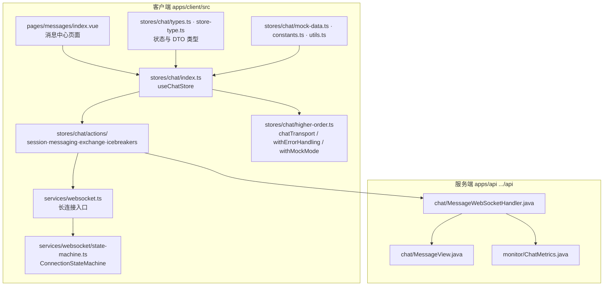
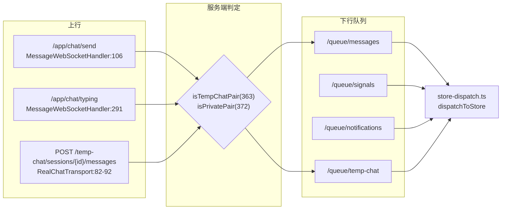
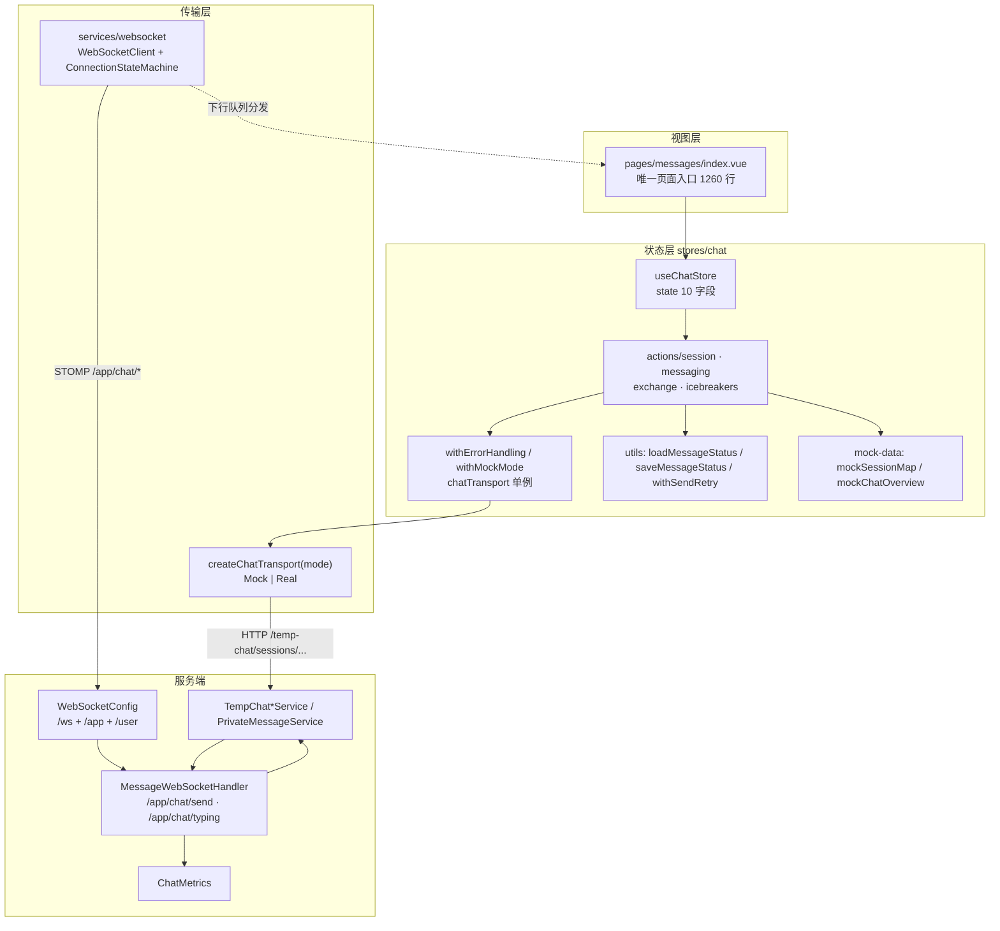
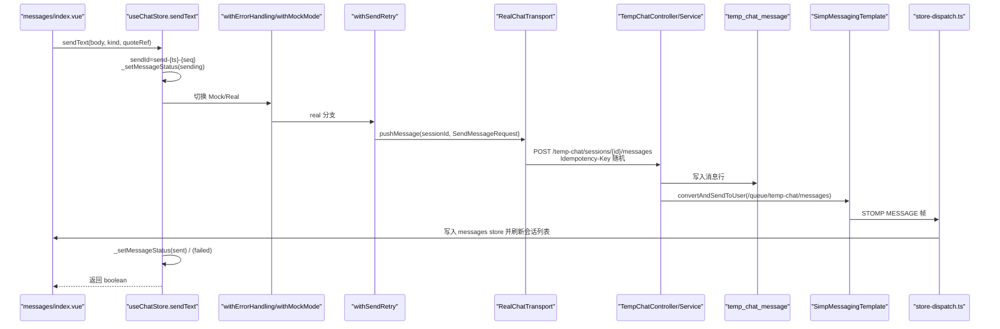
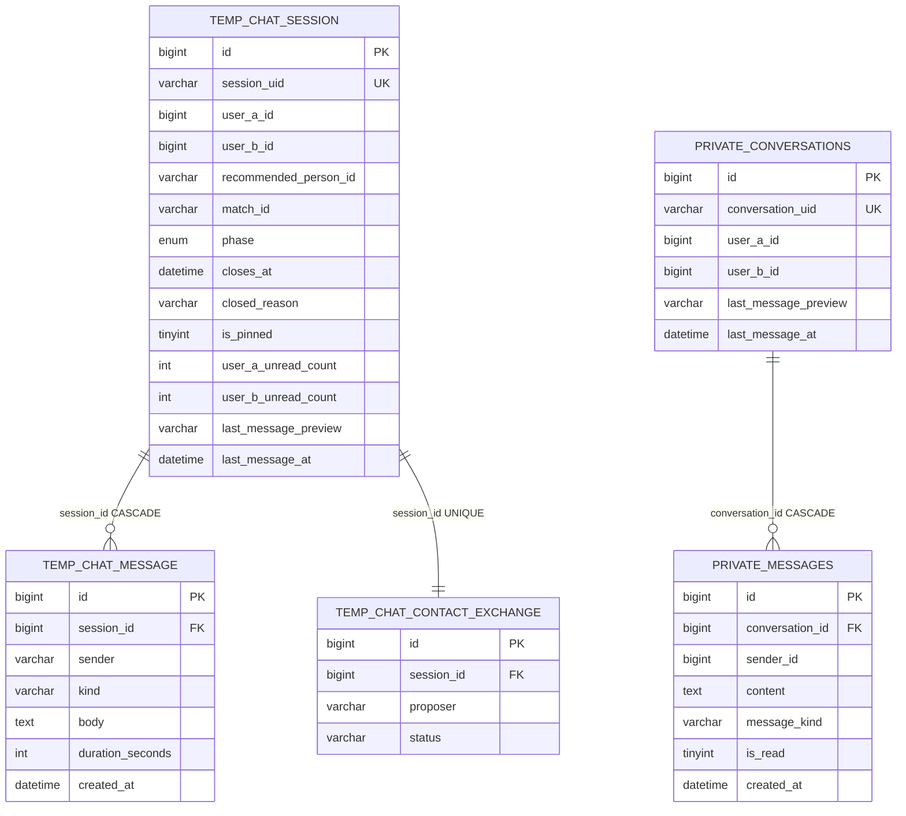
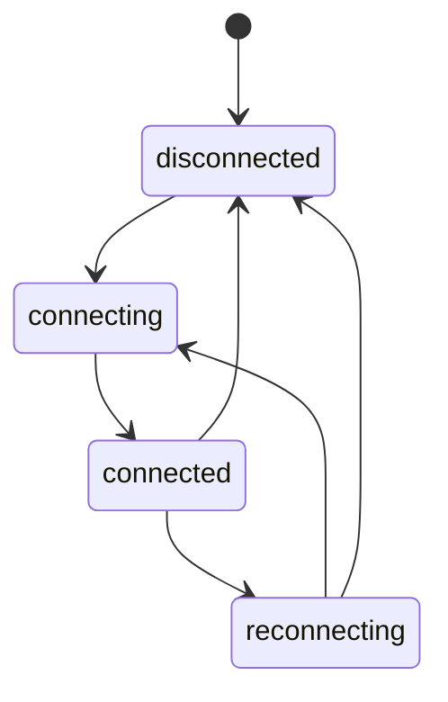
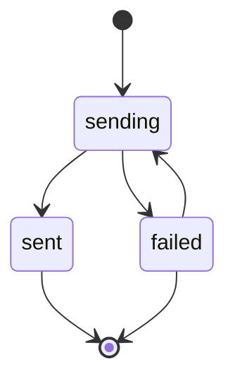
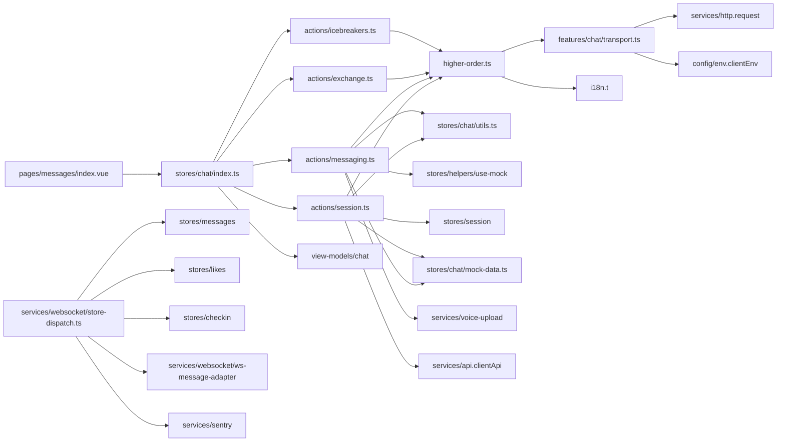

# 消息聊天系统

<cite>
**本文引用的文件**
- [websocket.ts](file://apps/client/src/services/websocket.ts)
- [state-machine.ts](file://apps/client/src/services/websocket/state-machine.ts)
- [types.ts](file://apps/client/src/stores/chat/types.ts)
- [store-type.ts](file://apps/client/src/stores/chat/store-type.ts)
- [index.ts](file://apps/client/src/stores/chat/index.ts)
- [higher-order.ts](file://apps/client/src/stores/chat/higher-order.ts)
- [MessageWebSocketHandler.java](file://apps/api/src/main/java/com/campuslove/api/chat/MessageWebSocketHandler.java)
- [MessageView.java](file://apps/api/src/main/java/com/campuslove/api/chat/MessageView.java)
- [ChatMetrics.java](file://apps/api/src/main/java/com/campuslove/api/monitor/ChatMetrics.java)
- [index.vue](file://apps/client/src/pages/messages/index.vue)
</cite>

## 目录
1. [简介](#简介)
2. [项目结构](#项目结构)
3. [模块边界与同级页面分工](#模块边界与同级页面分工)
4. [子页清单与覆盖范围](#子页清单与覆盖范围)
5. [核心组件](#核心组件)
6. [架构总览](#架构总览)
7. [端到端消息链路](#端到端消息链路)
8. [详细组件分析](#详细组件分析)
9. [数据模型](#数据模型)
10. [状态机与投递状态](#状态机与投递状态)
11. [能力缺口登记](#能力缺口登记)
12. [依赖关系分析](#依赖关系分析)
13. [性能考虑](#性能考虑)
14. [故障排查指南](#故障排查指南)
15. [结论](#结论)

## 简介

消息聊天系统是 Campus Love 里承载"两个人之间实时对话"的功能域。它由三条协作的层次组成：小程序端的 Pinia 聊天状态容器（`apps/client/src/stores/chat/`，共 11 个文件）、长连接接入层（`apps/client/src/services/websocket.ts` 与其下的 `state-machine.ts`）、以及服务端 WebSocket 处理器与私聊领域服务（`apps/api/.../api/chat/` 包）。页面侧只有唯一入口 `apps/client/src/pages/messages/index.vue`（1260 行），它把 store 的三条状态流（会话概览、会话列表、临时会话）渲染成消息中心。

本页是**分组总览页**，职责是串联与索引，而不是复述实现细节：

- 给出模块的真实文件拓扑与分层职责，让读者在 3 分钟内定位"某段聊天逻辑在哪一层"。
- 界定与同级页面 `WebSocket实时通信.md` 的边界：长连接本身的建连、心跳与帧格式属于该页；连接之上的会话/消息语义属于本页。
- 登记子页清单（`聊天状态管理`、`消息处理逻辑`）各自应覆盖的范围，并说明总览页与它们的引用不重叠。
- 把 catalog 指令中提到、但仓库里确实没有实现的要求，逐条落进 [能力缺口登记](#能力缺口登记)，并写明检索方式与命中结果。

从可验证的事实出发，本模块目前确定的能力是：临时匿名会话的 store 建模与 mock 数据、带错误处理与 mock 模式包装的高阶 action、服务端 WebSocket 处理器对心跳信号/通知/私聊消息三类下行推送的封装，以及 `ChatMetrics` 对发送成功、发送失败、活跃会话三个指标的埋点。

**章节来源**
- [index.ts:78-131](file://apps/client/src/stores/chat/index.ts#L78-L131)
- [types.ts:17-86](file://apps/client/src/stores/chat/types.ts#L17-L86)
- [store-type.ts:45-129](file://apps/client/src/stores/chat/store-type.ts#L45-L129)
- [MessageWebSocketHandler.java:42-455](file://apps/api/src/main/java/com/campuslove/api/chat/MessageWebSocketHandler.java#L42-L455)
- [ChatMetrics.java:23-111](file://apps/api/src/main/java/com/campuslove/api/monitor/ChatMetrics.java#L23-L111)

## 项目结构

聊天相关代码在仓库里分成"客户端三个目录 + 服务端两个包"五个落点，目录树如下（只列本模块实际涉及的节点，命名与事实包一致）：

**图表来源**
- [index.ts:78-131](file://apps/client/src/stores/chat/index.ts#L78-L131)
- [higher-order.ts:30-114](file://apps/client/src/stores/chat/higher-order.ts#L30-L114)
- [types.ts:17-86](file://apps/client/src/stores/chat/types.ts#L17-L86)
- [websocket.ts:1-19](file://apps/client/src/services/websocket.ts#L1-L19)
- [state-machine.ts:27-121](file://apps/client/src/services/websocket/state-machine.ts#L27-L121)
- [MessageWebSocketHandler.java:42-455](file://apps/api/src/main/java/com/campuslove/api/chat/MessageWebSocketHandler.java#L42-L455)
- [ChatMetrics.java:23-111](file://apps/api/src/main/java/com/campuslove/api/monitor/ChatMetrics.java#L23-L111)

结构上的三条约定，决定了后续所有子页的组织方式：

1. **store 是唯一状态源**。`stores/chat/index.ts` 导出 `useChatStore`，类型契约分散在 `store-type.ts`（`ChatState`、`ChatStoreThis`、`ChatStoreInstance`）与 `types.ts`（`ChatOverview`、`ChatSessionSummary`、`TempChatSession`、`SendMessageRequest`）两处；页面不直接碰服务层。
2. **能力通过高阶函数注入**。`higher-order.ts` 提供 `chatTransport`、`withErrorHandling`、`withMockMode` 三个包装器，action 的真实网络行为与 mock 行为在同一个调用点切换。
3. **服务端下行按"信号类别"分层**。`MessageWebSocketHandler` 暴露 `sendHeartSignal`、`sendNotification`、`sendPrivateMessage` 三个方法，分别对应心跳信号、通知视图与私聊消息视图，`MessageView` 是其中私聊的下行载荷类型。

**章节来源**
- [websocket.ts:1-19](file://apps/client/src/services/websocket.ts#L1-L19)
- [state-machine.ts:27-121](file://apps/client/src/services/websocket/state-machine.ts#L27-L121)
- [types.ts:17-86](file://apps/client/src/stores/chat/types.ts#L17-L86)
- [store-type.ts:31-129](file://apps/client/src/stores/chat/store-type.ts#L31-L129)
- [higher-order.ts:30-114](file://apps/client/src/stores/chat/higher-order.ts#L30-L114)
- [mock-data.ts:24-259](file://apps/client/src/stores/chat/mock-data.ts#L24-L259)
- [index.vue:368-621](file://apps/client/src/pages/messages/index.vue#L368-L621)

## 模块边界与同级页面分工

聊天域在代码里并不是单一实现，而是四条互不复用的分支共用一个服务端入口。本页只描述它们的**共同入口与边界**，任何一条分支的内部实现都归对应子页或对应模块页。

| 聊天分支 | 客户端归属 | 服务端归属 | 持久化落点 | 是否属于本页 |
| --- | --- | --- | --- | --- |
| 临时匿名聊天（temp chat） | `stores/chat/` + `features/chat/transport.ts` | `TempChatController` / `TempChatMessageService` / `TempChatSessionService` | `temp_chat_session`、`temp_chat_message`、`temp_chat_contact_exchange` | 是，本页主线 |
| 私信会话（private conversation） | `services/websocket/store-dispatch.ts` → `stores/messages` | `MessageWebSocketHandler.handleChatMessage` / `PrivateMessageService` / `PrivateConversationRepository` | `private_conversations`、`private_messages` | 是，仅链路与边界 |
| 官方账号消息 | 不在 `stores/chat` 内 | `official/OfficialChatService` | `official_chat_messages`（建表脚本第 4 行） | 否，仅在依赖图中出现 |
| 心动信号 / 通知 / 签到 / 匹配事件 | `store-dispatch.ts` 按队列路径分流 | `sendHeartSignal` / `sendNotification` | 由 likes、messages、checkin 各自 store 持有 | 否，只作为下行通道并列说明 |

共同入口有两处，且都不在 store 里：

1. **上行入口**：`MessageWebSocketHandler` 用 `@MessageMapping("/chat/send")`（第 106 行）与 `@MessageMapping("/chat/typing")`（第 291 行）接收 STOMP SEND 帧；因为 `WebSocketConfig.configureMessageBroker` 设置了应用前缀 `/app`，客户端实际发送的目标是 `/app/chat/send` 与 `/app/chat/typing`。同一条 `handleChatMessage` 内部同时处理临时聊天与私信两种场景：`isTempChatPair`（第 363 行）判定临时会话配对关系，`isPrivatePair`（第 372 行）与 `findPrivateConversation`（第 381 行）判定私信配对关系，因此"分支判定"发生在服务端而不是客户端。
2. **下行入口**：`WebSocketConfig` 注册 `/ws` 端点并启用 SockJS 降级，`sendHeartSignal` 推 `/queue/signals`、`sendNotification` 推 `/queue/notifications`、`sendPrivateMessage` 推 `/queue/messages`；客户端 `store-dispatch.ts` 头部注释列出的实际订阅路径还包括 `/user/{userId}/queue/matches`、`/user/{userId}/queue/temp-chat`、`/user/{userId}/queue/temp-chat/messages`、`/user/{userId}/queue/checkin`，并按"统一匹配 `queue/` 之后的部分"做路径归一。

边界划分（与同级页面的分工）：

- 连接的建立、CONNECT/SUBSCRIBE 帧协商、`Sec-WebSocket-Protocol` 里的 `bearer.{token}` 提取、心跳 ping/pong 与指数退避重连——全部归 **WebSocket实时通信** 子页。本页只在需要说明"消息为什么可能延迟或丢失"时引用它们的参数。
- `useChatStore` 的 state 形状、action 装配、Mock/Real 切换语义、视图模型转换——归 **聊天状态管理** 子页。本页只列出 store 的装配骨架。
- 消息从输入到落库到回显的字段映射、幂等键、重试与投递状态机——归 **消息处理逻辑** 子页。本页给出端到端时序骨架与状态机图，不复述字段级实现。
- REST 端点契约（`/temp-chat/sessions` 系列）与服务层实现归后端相应模块页；本页只在传输层小节说明 `RealChatTransport` 选择了 HTTP 而非 WS。

**章节来源**
- [MessageWebSocketHandler.java:100-159](file://apps/api/src/main/java/com/campuslove/api/chat/MessageWebSocketHandler.java#L100-L159)
- [MessageWebSocketHandler.java:291-292](file://apps/api/src/main/java/com/campuslove/api/chat/MessageWebSocketHandler.java#L291-L292)
- [MessageWebSocketHandler.java:363-381](file://apps/api/src/main/java/com/campuslove/api/chat/MessageWebSocketHandler.java#L363-L381)
- [MessageWebSocketHandler.java:390-455](file://apps/api/src/main/java/com/campuslove/api/chat/MessageWebSocketHandler.java#L390-L455)
- [WebSocketConfig.java:130-156](file://apps/api/src/main/java/com/campuslove/api/config/WebSocketConfig.java#L130-L156)
- [store-dispatch.ts:1-59](file://apps/client/src/services/websocket/store-dispatch.ts#L1-L59)
- [transport.ts:67-121](file://apps/client/src/features/chat/transport.ts#L67-L121)
- [V2026.05.27.0001__create_temp_chat_tables.sql:7-58](file://database/flyway/sql/V2026.05.27.0001__create_temp_chat_tables.sql#L7-L58)
- [V2026.05.24.0002__create_private_conversations.sql:1-29](file://database/flyway/sql/V2026.05.24.0002__create_private_conversations.sql#L1-L29)

## 子页清单与覆盖范围

本页所在目录下的子页面清单如下，三页均已存在，各自的文件归属范围以仓库实际文件为界。

| 子页 | 应覆盖的仓库文件 | 覆盖的关键契约 | 与本页的不重叠约定 |
| --- | --- | --- | --- |
| WebSocket实时通信 | `apps/client/src/services/websocket.ts`、`apps/client/src/services/websocket/` 下 `types.ts`/`constants.ts`/`transport.ts`/`state-machine.ts`/`heartbeat.ts`/`reconnect.ts`/`index.ts`、`apps/api/.../config/WebSocketConfig.java` | `StompFrame{command,headers,body}`、`WsConnectionState` 四态、`FRAME_NULL_CHAR`/`STOMP_VERSION="1.2"`、`MAX_RECONNECT_ATTEMPTS=6` 与退避序列 1s/2s/4s/8s/16s/30s、`HEARTBEAT_INTERVAL_MS=30000`/`HEARTBEAT_TIMEOUT_MS=10000`/`HEARTBEAT_CONSECUTIVE_TIMEOUT_LIMIT=2` | 本页不解释帧编解码与心跳实现，只引用这些常量来界定消息投递延迟与丢失窗口 |
| 聊天状态管理 | `apps/client/src/stores/chat/` 下 `index.ts`/`types.ts`/`store-type.ts`/`constants.ts`/`mock-data.ts`/`utils.ts`/`higher-order.ts`/`actions/*`、`apps/client/src/constants/chat.ts` | `ChatState` 十个字段、`ChatStoreThis` 十六个 action、`useChatStore` 的 `defineStore("chat", …)` 装配、`withErrorHandling`/`withMockMode` 的选项语义 | 本页只保留装配骨架图与 action 清单，不展开每个 action 的分支逻辑 |
| 消息处理逻辑 | `apps/client/src/stores/chat/actions/messaging.ts`、`apps/client/src/features/chat/transport.ts`、`apps/client/src/features/chat/session-machine.ts`、`apps/api/.../chat/MessageWebSocketHandler.java`、`MessageView.java`、`TempChatMessageService`/`PrivateMessageService` 对应的 `temp_chat_message`、`private_messages` 两张表 | `MessageDeliveryStatus` 三态与 `sendId` 生成规则、`SendMessageRequest` 五字段、`Idempotency-Key` 随机键、`withSendRetry` 仅对 `category === "network"` 重试 | 本页不复述字段映射与幂等键细节，只在端到端时序图里标出它们出现的位置 |

三页共同的索引关系：

- 唯一页面入口 `apps/client/src/pages/messages/index.vue`（1260 行，`<script setup>` 在第 1 行、`<template>` 从第 368 行起、`<style scoped>` 从第 621 行起）由本页在"核心组件"中定位；页面内部的状态渲染分支由 **聊天状态管理** 子页负责。
- `services/websocket/store-dispatch.ts`（443 行）是 WebSocket 与 Pinia 的唯一耦合点，它写入的是 `stores/messages`、`stores/likes`、`stores/checkin`，**不写 `stores/chat`**；这一事实使"连接类子页"与"聊天 store 子页"可以完全分离，也是本页把"下行分发"划给 WebSocket实时通信、把"会话状态"划给聊天状态管理的依据。
- `features/chat/transport.ts` 同时被 store 与页面使用，是"消息处理逻辑"与"聊天状态管理"的交界文件；本页通过 `chatTransport` 的模块级单例说明它的归属。

**章节来源**
- [websocket.ts:1-19](file://apps/client/src/services/websocket.ts#L1-L19)
- [types.ts(websocket):15-56](file://apps/client/src/services/websocket/types.ts#L15-L56)
- [constants.ts(websocket):15-78](file://apps/client/src/services/websocket/constants.ts#L15-L78)
- [state-machine.ts:27-121](file://apps/client/src/services/websocket/state-machine.ts#L27-L121)
- [store-dispatch.ts:1-59](file://apps/client/src/services/websocket/store-dispatch.ts#L1-L59)
- [transport.ts:16-125](file://apps/client/src/features/chat/transport.ts#L16-L125)
- [messaging.ts:55-229](file://apps/client/src/stores/chat/actions/messaging.ts#L55-L229)
- [index.ts:78-131](file://apps/client/src/stores/chat/index.ts#L78-L131)
- [index.vue:368-621](file://apps/client/src/pages/messages/index.vue#L368-L621)

## 核心组件

下表列出本页取证到的、构成本模块的九个真实组件，以及每个组件的导出符号与所在行。符号名与行号来自事实包与直接读取，未做任何推测。

| 组件 | 导出符号 | 定义位置 | 职责边界 |
| --- | --- | --- | --- |
| 聊天 store | `useChatStore = defineStore("chat", …)` | [index.ts:78](file://apps/client/src/stores/chat/index.ts#L78) | 唯一状态源，state 十字段 + actions 十六个，全部委托给 `actions/*` |
| 状态契约 | `ChatState` / `ChatStoreThis` / `ChatStoreInstance` / `IcebreakerItem` | [store-type.ts:31-129](file://apps/client/src/stores/chat/store-type.ts#L31-L129) | 为拆分到独立文件的 action 提供显式 `this` 类型 |
| 类型契约 | `ChatOverview` / `ChatSessionSummary` / `TempChatSession` / `MessageDeliveryStatus` / `SendMessageRequest` / `ChatStoreLike` / `LoadingKey` | [types.ts:17-86](file://apps/client/src/stores/chat/types.ts#L17-L86) | 前三个直接别名自 OpenAPI `components["schemas"]` |
| 高阶函数层 | `chatTransport` / `withErrorHandling` / `withMockMode` | [higher-order.ts:30-142](file://apps/client/src/stores/chat/higher-order.ts#L30-L142) | loading/错误模板与 Mock-Real 切换的唯一实现点 |
| 传输层 | `createChatTransport` + `MockChatTransport` / `RealChatTransport` | [transport.ts:32-125](file://apps/client/src/features/chat/transport.ts#L32-L125) | 六方法接口 `ChatTransport`：`createSession`/`loadSession`/`pushMessage`/`pushVoice`/`respondToContactExchange`/`endSession` |
| 会话状态机 | `ChatPhase` / `ContactExchangeStatus` / `createSessionState` / `sendUserMessage` / `sendSystemTimeout` | [session-machine.ts:1-112](file://apps/client/src/features/chat/session-machine.ts#L1-L112) | 纯函数式状态迁移，不发请求 |
| 工具与持久化 | `useMock` / `loadMessageStatus` / `saveMessageStatus` / `withSendRetry` | [utils.ts:25-97](file://apps/client/src/stores/chat/utils.ts#L25-L97) | 投递状态的本地存储读写与网络错误重试 |
| 服务端入口 | `MessageWebSocketHandler` + `handleChatMessage` / `handleTyping` / `sendHeartSignal` / `sendNotification` / `sendPrivateMessage` | [MessageWebSocketHandler.java:43-455](file://apps/api/src/main/java/com/campuslove/api/chat/MessageWebSocketHandler.java#L43-L455) | 上行校验 + 三类下行封装 |
| 服务端指标 | `ChatMetrics.recordMessageSent` / `recordMessageFailed` / `incrementActiveSession` / `decrementActiveSession` | [ChatMetrics.java:23-111](file://apps/api/src/main/java/com/campuslove/api/monitor/ChatMetrics.java#L23-L111) | 发送成功/失败/活跃会话三个指标 |

依赖注入事实：`MessageWebSocketHandler` 以字段方式注入四个协作对象——`TempChatSessionService`（第 60 行）、`TempChatMessageService`（第 67 行）、`PrivateConversationRepository`（第 74 行）、`PrivateMessageService`（第 83 行），这四个字段就是"临时聊天"与"私信会话"两条分支在服务端的分叉点。

客户端不直接 import 服务端；两端的契约由三处对齐保证：`types.ts` 用 OpenAPI schemas 别名（第 14、17、20、23 行）、`SendMessageRequest` 注释声明与 `Schemas["ChatMessageRequest"]` 对齐（第 44、51 行）、`store-dispatch.ts` 的订阅队列路径与 `WebSocketConfig` 的 `/user` 前缀（第 134 行）一致。

**章节来源**
- [index.ts:26-131](file://apps/client/src/stores/chat/index.ts#L26-L131)
- [types.ts:10-86](file://apps/client/src/stores/chat/types.ts#L10-L86)
- [store-type.ts:14-129](file://apps/client/src/stores/chat/store-type.ts#L14-L129)
- [higher-order.ts:13-142](file://apps/client/src/stores/chat/higher-order.ts#L13-L142)
- [transport.ts:1-125](file://apps/client/src/features/chat/transport.ts#L1-L125)
- [session-machine.ts:1-112](file://apps/client/src/features/chat/session-machine.ts#L1-L112)
- [utils.ts:10-97](file://apps/client/src/stores/chat/utils.ts#L10-L97)
- [MessageWebSocketHandler.java:43-107](file://apps/api/src/main/java/com/campuslove/api/chat/MessageWebSocketHandler.java#L43-L107)
- [MessageView.java:9-31](file://apps/api/src/main/java/com/campuslove/api/chat/MessageView.java#L9-L31)
- [ChatMetrics.java:60-103](file://apps/api/src/main/java/com/campuslove/api/monitor/ChatMetrics.java#L60-L103)

## 架构总览

模块整体是"一层状态 + 一层传输 + 一层接入"的三段式，Mock/Real 双实现贯穿始终，这是它与同仓库其它功能域最大的差别。

三段式的职责与可验证约束：

1. **视图层只有一个入口**。`pages/messages/index.vue` 是 1260 行的单文件，`<script setup lang="ts">` 从第 1 行、`<template>` 从第 368 行开始，并在第 375/405/408/411/423 行分别给出 `v-else`、`#loading`、`#error`、`#empty`、`#default` 五个渲染分支——即页面对 store 的三个 loading 标记与 `errorMessage` 的直接消费点。
2. **状态层不含网络代码**。`index.ts` 里唯一的直接 API 引用是 `clientApi.getChatOverview`（第 27、83 行）用于类型推断，实际请求都发生在 `actions/*` 通过 `chatTransport` 或 `clientApi` 完成；action 一律被 `withErrorHandling` 和 `withMockMode` 包裹。
3. **传输层是二选一而非叠加**。`createChatTransport` 依据 `clientEnv.apiMode` 返回 `RealChatTransport` 或 `MockChatTransport`（第 123-124 行），而 `withMockMode` 内部再按 `useMock()` 决定走 mockFn 还是 realFn（第 125-131 行）。这意味着"Mock/Real"存在两个独立开关，二者不一致时 mockFn 分支仍会命中本地数据。
4. **服务端接入层做校验不做业务**。`handleChatMessage` 的全部逻辑是拒绝条件：Principal 为空、`content`/`kind` 超长、`senderId` 空、`recipientId` 缺失、自己给自己发、`conversationId` 缺失、ID 无法解析为 Long（第 110-159 行）；`senderId` 强制取自 STOMP 认证主体而不信任 payload（第 100 行注释与第 110、116 行实现）。落库与推送交给注入的服务。

认证与授权的边界由 `WebSocketConfig` 定义：握手阶段 `JwtHandshakeInterceptor` 从 `Sec-WebSocket-Protocol`（`bearer.{token}`）或 `Authorization` 头提取 JWT，验证通过后把 userId 写入 session 属性 `ws.auth.userId`，并回显所选子协议；入站通道再由 `jwtChannelInterceptor` 在 CONNECT/SUBSCRIBE 阶段二次校验（第 179-183 行）。mock profile 跳过真实校验并回退到 `app.mock.principal-user-id`（默认 1）。

**图表来源**
- [index.vue:368-423](file://apps/client/src/pages/messages/index.vue#L368-L423)
- [index.ts:26-106](file://apps/client/src/stores/chat/index.ts#L26-L106)
- [higher-order.ts:30-142](file://apps/client/src/stores/chat/higher-order.ts#L30-L142)
- [transport.ts:67-125](file://apps/client/src/features/chat/transport.ts#L67-L125)
- [utils.ts:34-97](file://apps/client/src/stores/chat/utils.ts#L34-L97)
- [state-machine.ts:27-121](file://apps/client/src/services/websocket/state-machine.ts#L27-L121)
- [MessageWebSocketHandler.java:106-159](file://apps/api/src/main/java/com/campuslove/api/chat/MessageWebSocketHandler.java#L106-L159)
- [WebSocketConfig.java:130-183](file://apps/api/src/main/java/com/campuslove/api/config/WebSocketConfig.java#L130-L183)

**章节来源**
- [index.vue:368-423](file://apps/client/src/pages/messages/index.vue#L368-L423)
- [index.ts:26-131](file://apps/client/src/stores/chat/index.ts#L26-L131)
- [session.ts:40-64](file://apps/client/src/stores/chat/actions/session.ts#L40-L64)
- [transport.ts:16-125](file://apps/client/src/features/chat/transport.ts#L16-L125)
- [MessageWebSocketHandler.java:100-159](file://apps/api/src/main/java/com/campuslove/api/chat/MessageWebSocketHandler.java#L100-L159)
- [WebSocketConfig.java:107-183](file://apps/api/src/main/java/com/campuslove/api/config/WebSocketConfig.java#L107-L183)

## 端到端消息链路

一次"用户点发送"在仓库里有两条**互斥**的落库路径，这是理解本模块的关键：文本消息走 HTTP REST，实时事件走 STOMP。

链路上每一跳的证据：

1. **入口返回布尔而非 void**。`sendText` 的签名是 `(body, kind = "text", quoteRef?) => Promise<boolean>`（第 55-60 行），注释记录了原因：返回 void 时页面只能用"errorMessage 文案差分"判断成败，连续两次相同错误文案会被误判为成功并清空草稿导致正文丢失。`store-type.ts` 第 98 行的接口声明与之一致。
2. **sendId 生成规则**：`send-${Date.now()}-${++messageIdSeq}`，模块级计数器解决同毫秒连发的 id 碰撞（第 34-35、69 行）。状态写入通过 `_setMessageStatus` 用展开重建对象后调用 `saveMessageStatus` 持久化（第 219-229 行；`utils.ts` 第 52-58 行）。
3. **payload 是强类型**。`SendMessageRequest` 固定 `sender: "self"`、`kind`、`body`、`durationSeconds: null`，并对 `quoteRef` 做非空与长度 ≤64 的过滤后才有条件赋值（第 74-84 行），`types.ts` 第 51-62 行给出字段契约。
4. **HTTP 路径与幂等键**。`RealChatTransport.pushMessage` 使用 `POST /temp-chat/sessions/${sessionId}/messages`，并显式设置 `headers: { "Idempotency-Key": "tmp-…" }`；第 87-90 行的注释记录了历史缺陷：早期写成 `header`（单数）而 `http.ts` 只消费 `headers`，导致随机幂等键从未发出、同文案重发撞后端幂等锁。
5. **重试只针对网络层**。`withSendRetry` 默认 `maxRetries = MAX_SEND_RETRIES = 1`、`delayMs = SEND_RETRY_DELAY_MS = 500`，判定条件是 `"category" in error && error.category === "network"`，业务错误直接中断（`utils.ts` 第 70-97 行、`constants/chat.ts` 第 33、36 行）。
6. **语音走上传再发送**。`sendVoice` 在非 mock 且有 `tempFilePath` 时先 `uploadVoiceFile(tempFilePath, durationSeconds)` 取得 URL 作为 body，失败则写 `errorMessage` 并抛出（第 157-166 行）；注释指出 mp-weixin 端上传目标是 `POST /api/chat/voice` 并由 `VoiceMessageController` 返回 URL（第 137-139 行）。
7. **实时侧的两条上行**。STOMP 上行只有 `/app/chat/send` 与 `/app/chat/typing` 两个目标；`handleChatMessage` 校验通过后按 `isTempChatPair` / `isPrivatePair` 分流，临时会话场景交由 `TempChatMessageService` 落库并推送（第 102-104 行注释），私信场景按原逻辑推送。

下行分发不写 `stores/chat`：`store-dispatch.ts` 头部明确 `handleNewMessage` → `useMessagesStore`、`handleNewHeartSignal` → `useLikesStore` + `useMessagesStore`、`handleNewNotification`/`handleNewMatch` → `useMessagesStore`、`handleTempChatEvent` → 刷新会话列表、`handleCheckInEvent` → `useCheckInStore`，并引入 `fromWsPayload`（`ws-message-adapter.ts`）做帧到视图模型的转换、`captureException`（`services/sentry`）做异常上报。

**图表来源**
- [messaging.ts:55-131](file://apps/client/src/stores/chat/actions/messaging.ts#L55-L131)
- [transport.ts:82-92](file://apps/client/src/features/chat/transport.ts#L82-L92)
- [utils.ts:70-97](file://apps/client/src/stores/chat/utils.ts#L70-L97)
- [MessageWebSocketHandler.java:100-159](file://apps/api/src/main/java/com/campuslove/api/chat/MessageWebSocketHandler.java#L100-L159)
- [store-dispatch.ts:1-59](file://apps/client/src/services/websocket/store-dispatch.ts#L1-L59)

**章节来源**
- [messaging.ts:34-229](file://apps/client/src/stores/chat/actions/messaging.ts#L34-L229)
- [transport.ts:82-102](file://apps/client/src/features/chat/transport.ts#L82-L102)
- [types.ts:51-62](file://apps/client/src/stores/chat/types.ts#L51-L62)
- [store-type.ts:96-108](file://apps/client/src/stores/chat/store-type.ts#L96-L108)
- [utils.ts:34-97](file://apps/client/src/stores/chat/utils.ts#L34-L97)
- [constants.ts(chat):30-42](file://apps/client/src/constants/chat.ts#L30-L42)
- [MessageWebSocketHandler.java:100-159](file://apps/api/src/main/java/com/campuslove/api/chat/MessageWebSocketHandler.java#L100-L159)
- [store-dispatch.ts:1-59](file://apps/client/src/services/websocket/store-dispatch.ts#L1-L59)

## 详细组件分析

### 会话生命周期 actions（`actions/session.ts`，314 行）

七个导出函数，全部遵循"`withErrorHandling` 包 `withMockMode`"或"只用 `withMockMode`"两种模板：

- `loadOverview`（第 40-64 行）：`loadingKey: "loadingOverview"`，mockFn 返回模块级常量 `mockChatOverview`，realFn 调 `clientApi.getChatOverview()`，并显式关闭 `shouldRefreshOverview`/`shouldUpdateActiveSession` 以避免递归；结果交给 `toChatOverviewView(overview, sessionStore.completionState)` 生成 `overviewView`。
- 三个创建入口 `startFromRecommendation`（第 72-105）、`startFromSignal`（第 113-140）、`startFromMatch`（第 148-176）：三者都构造一份 `phase: "matching"`、`closesAt: new Date(Date.now() + TEMP_SESSION_DURATION_MS).toISOString()`、`contactExchange: { proposer: null, status: "idle" }` 的 mock 会话并返回 `this.activeSession`；real 分支统一是 `chatTransport.createSession(payload)`，只是 payload 键不同（`{ recommendedPersonId }` / `{ signalId }` / `{ matchId }`）。`TEMP_SESSION_DURATION_MS` 从 `constants/growth` 引入，注释标明默认 24 小时。
- `loadSession`（第 186-229 行）：mockFn 返回 `mockSessionMap[sessionId] ?? null`，注释记录了一次真实缺陷修复——早期回退到 `mockSession1` 会把 A 会话数据展示成 B 会话；real 分支在 `chatTransport.loadSession` 成功后调用 `clientApi.markTempChatSessionRead(sessionId)`，失败时**显式**把 `this.activeSession = null` 再抛出（因为 `withErrorHandling` 只写 `errorMessage` 不清状态，残留会话会让 `sendText` 把消息发进错误的会话）。
- `setSessionPinned`（第 240-283 行）：real 分支按 `pinned` 调 `clientApi.pinTempChatSession` / `unpinTempChatSession`；mock 分支改为复制对象后替换数组元素，避免污染模块级 `mockChatOverview`。
- `endSession`（第 290-314 行）：mock 分支把会话标记为 `phase: "closed"`、`closedReason: "ended"` 写回 `mockSessionMap`，real 分支调 `chatTransport.endSession(id)`。

### 传输层的双实现（`features/chat/transport.ts`，125 行）

`ChatTransport` 接口六方法（第 16-26 行）。`MockChatTransport` 全部委托 `mockFixtures`（`createTempChatSession`/`getTempChatSession`/`sendTempChatMessage`/`respondToContactExchange`/`endTempChatSession`）。`RealChatTransport` 的 URL 清单是本页可核对的 REST 面：`POST /temp-chat/sessions`、`GET /temp-chat/sessions/{id}`、`POST /temp-chat/sessions/{id}/messages`、`POST /temp-chat/sessions/{id}/contact-exchange/respond`、`POST /temp-chat/sessions/{id}/end`。语音在 mock 与 real 两侧都通过 `t("chat.voiceMessagePlaceholder", { n })` 生成占位 body（第 50、99 行），real 的 `pushVoice` 直接复用 `pushMessage`。另有 `UploadAdapter` 接口声明 `uploadVoice(localPath) => { fileUrl }`（第 28-30 行）。

### 会话状态机（`features/chat/session-machine.ts`，112 行）

纯函数集合，不含网络调用。`ChatPhase = "matching" | "active" | "closing" | "closed"`；`ContactExchangeStatus` 六值 `idle / pending / accepted-by-self / accepted-by-peer / completed / rejected`。`respondToContactExchange` 的双向确认逻辑在第 83-91 行：已 `accepted-by-self` 且当前 actor 是 peer、或已 `accepted-by-peer` 且 actor 是 self 时收敛到 `completed`，否则按 actor 写入单边接受态；`decision === "rejected"` 直接短路到 `rejected` 并保留原 proposer。`sendSystemTimeout` 把 phase 置 `closed` 且 `closedReason: "expired"`（第 102-112 行）。注意 `closing` 出现在类型里但没有任何函数写入它。

### 高阶函数层（`higher-order.ts`，142 行）

`withErrorHandling` 的选项是 `{ loadingKey?, errorPrefixKey, rethrow? }`：错误消息优先取 `Error.message`，否则用 `t(errorPrefixKey)` 渲染 i18n 兜底文案，`finally` 无条件复位 loading（第 63-86 行）。`withMockMode` 的收尾条件是 `shouldUpdateActiveSession && result && typeof result === "object" && "id" in result` 才转换视图模型（第 133-136 行），随后按 `shouldRefreshOverview` 调 `store.loadOverview()`。二者只依赖 `ChatStoreLike` 的六个成员，从而避免 store 定义与高阶函数的循环依赖。

### 服务端处理器与指标

`MessageWebSocketHandler` 的三个下行方法都是 `messagingTemplate.convertAndSendToUser` 的薄封装，且都以 `userId == null || view == null` 直接返回：`sendHeartSignal` → `/queue/signals`（第 401-410 行，注释指明由 `RealMatchService` 在互相喜欢时调用）、`sendNotification` → `/queue/notifications`（第 419-428 行，由 `RealNotificationService` 调用）、`sendPrivateMessage` → `/queue/messages`（第 437-446 行，由 `RealPrivateMessageService` 调用）。`ChatMetrics` 暴露 `recordMessageSent(messageType)`（第 60 行）、`recordMessageFailed(reason)`（第 77 行）、`incrementActiveSession()`（第 92 行）、`decrementActiveSession()`（第 103 行），类上标注 `@Component`（第 23 行）。`MessageView`（第 9 行，全文件 31 行）是私聊下行的载荷类型。

**章节来源**
- [session.ts:40-314](file://apps/client/src/stores/chat/actions/session.ts#L40-L314)
- [transport.ts:16-125](file://apps/client/src/features/chat/transport.ts#L16-L125)
- [session-machine.ts:1-112](file://apps/client/src/features/chat/session-machine.ts#L1-L112)
- [higher-order.ts:54-142](file://apps/client/src/stores/chat/higher-order.ts#L54-L142)
- [types.ts:64-86](file://apps/client/src/stores/chat/types.ts#L64-L86)
- [MessageWebSocketHandler.java:390-455](file://apps/api/src/main/java/com/campuslove/api/chat/MessageWebSocketHandler.java#L390-L455)
- [MessageView.java:9-31](file://apps/api/src/main/java/com/campuslove/api/chat/MessageView.java#L9-L31)
- [ChatMetrics.java:23-111](file://apps/api/src/main/java/com/campuslove/api/monitor/ChatMetrics.java#L23-L111)

## 数据模型

聊天域涉及五张真实表，两张属于临时聊天、两张属于私信、一张属于官方账号。JPA 实体与表的映射由 `@Table` 注解确定：`TempChatSession` → `temp_chat_session`（实体第 25 行）、`TempChatMessage` → `temp_chat_message`（第 24 行）、`TempChatContactExchange` → `temp_chat_contact_exchange`（第 26 行）、`PrivateConversation` → `private_conversations`（第 22 行）。

模型层面的六个要点：

1. **会话阶段枚举**：`temp_chat_session.phase` 取值 `matching / active / closed / expired`（DDL 第 14 行），与客户端 `ChatPhase` 的 `matching / active / closing / closed`（`session-machine.ts` 第 1 行）**并不完全同名**——数据库有 `expired` 而客户端有 `closing`。这是本页能核对到的两处真实命名错位之一。
2. **过期与关闭共用一列**：`closes_at DATETIME NOT NULL COMMENT '会话关闭时间（24h 后自动过期）'` 与 `closed_reason VARCHAR(32)`（取值 `ended / expired`）共同表达生命周期，索引 `idx_temp_chat_session_closes_at` 与 `idx_temp_chat_session_phase` 支撑清理任务的扫描（DDL 第 15-16、29-30 行）。`chat/TempChatCleanupService` 与 `TempChatSessionService` 是服务端对应协作者。
3. **未读计数是会话列而非消息列**：`user_a_unread_count` / `user_b_unread_count`（第 18-19 行）加上 `last_message_preview` / `last_message_at`（第 20-21 行）就是概览列表的全部渲染数据，与 `ChatSessionSummary` 的服务端来源一致。
4. **消息内容列是明文 TEXT**：`temp_chat_message.body TEXT NOT NULL`（第 39 行）、`private_messages.content TEXT NOT NULL`（第 21 行），没有任何加密列或密钥列。
5. **配对唯一性只在私信侧**：`private_conversations` 有 `UNIQUE KEY uk_private_conversations_users ((LEAST(user_a_id, user_b_id)), (GREATEST(user_a_id, user_b_id)))`（第 12 行）用函数索引保证两人只会有一条会话；`temp_chat_session` 只有 `uk_temp_chat_session_uid` 与两个用户维度的普通索引，同一对用户可并存多条临时会话。
6. **联系方式交换一一对话**：`uk_temp_chat_contact_exchange_session` 使每条会话最多一条交换记录（第 56 行），`status` 注释列出 `idle / accepted-by-self / accepted-by-peer / completed / rejected`（第 52 行），与客户端 `ContactExchangeStatus` 相比数据库注释里没有 `pending`。

同一份结构在仓库里存在两个版本：`V2026.05.18.2200__phase0_phase1_client_foundation.sql` 第 56/70/85 行首次创建这三张表，`V2026.05.27.0001__create_temp_chat_tables.sql` 先 `DROP` 再重建（第 2-4 行），当前生效结构以后者为准。官方账号侧的 `official_chat_messages` 建表脚本位于 `V2026.09.07.0001__create_official_chat_messages.sql` 第 4 行。

**图表来源**
- [V2026.05.27.0001__create_temp_chat_tables.sql:7-58](file://database/flyway/sql/V2026.05.27.0001__create_temp_chat_tables.sql#L7-L58)
- [V2026.05.24.0002__create_private_conversations.sql:1-29](file://database/flyway/sql/V2026.05.24.0002__create_private_conversations.sql#L1-L29)

**章节来源**
- [V2026.05.27.0001__create_temp_chat_tables.sql:1-58](file://database/flyway/sql/V2026.05.27.0001__create_temp_chat_tables.sql#L1-L58)
- [V2026.05.24.0002__create_private_conversations.sql:1-29](file://database/flyway/sql/V2026.05.24.0002__create_private_conversations.sql#L1-L29)
- [V2026.05.18.2200__phase0_phase1_client_foundation.sql:56-85](file://database/flyway/sql/V2026.05.18.2200__phase0_phase1_client_foundation.sql#L56-L85)
- [V2026.09.07.0001__create_official_chat_messages.sql:4-4](file://database/flyway/sql/V2026.09.07.0001__create_official_chat_messages.sql#L4-L4)
- [TempChatSession.java:25-25](file://apps/api/src/main/java/com/campuslove/api/entity/TempChatSession.java#L25-L25)
- [TempChatMessage.java:24-24](file://apps/api/src/main/java/com/campuslove/api/entity/TempChatMessage.java#L24-L24)
- [TempChatContactExchange.java:26-26](file://apps/api/src/main/java/com/campuslove/api/entity/TempChatContactExchange.java#L26-L26)
- [PrivateConversation.java:22-22](file://apps/api/src/main/java/com/campuslove/api/entity/PrivateConversation.java#L22-L22)
- [session-machine.ts:1-10](file://apps/client/src/features/chat/session-machine.ts#L1-L10)

## 状态机与投递状态

模块里有三套彼此独立的状态机，各自负责一个维度，不存在统一的"总状态机"。混淆这三者是排查聊天问题时的首要原因。

**（一）连接状态机 `ConnectionStateMachine`**——只有状态存储与回调分发，不含业务逻辑。状态集合由 `WsConnectionState` 定义为 `disconnected`（未连接）、`connecting`（正在建立 TCP 连接）、`connected`（STOMP 会话已建立）、`reconnecting`（已断开、等待下次重连尝试）四值。

实现层面的四条约束（均来自 `state-machine.ts`）：`currentState` 初值为 `"connected"` 之外的 `"disconnected"`（第 29 行）；`setState` 只在 `prevState !== state` 时才遍历回调通知，回调内的异常被 `try/catch` 吞掉并 `console.error("[WebSocket] 状态变更回调异常:", …)`，不影响后续回调（第 50-64 行）；`isConnected()` 只看 `connectionState === "connected"`，注释明确要求业务层同时检查 `stompSessionReady`（第 86-96 行）；`reset()` 复位状态但**不清空回调列表**，因为状态机实例在 `WebSocketClient` 单例中长期存活（第 112-120 行）。类注释记录了一次 P1 修复：原实现在连接错误时未同步 `connectionState`，导致外部 `getConnectionState()` 读到不一致状态。

**（二）消息投递状态机**——粒度是"单次发送"，与消息体解耦。三态定义在 `types.ts` 第 31 行 `MessageDeliveryStatus = "sending" | "sent" | "failed"`，以 `MessageDeliveryStatusMap = Record<string, MessageDeliveryStatus>`（第 37 行）的 `sendId → status` 映射保存在 `state.messageDeliveryStatus`。

迁移由 `sendText` 驱动：进入时立即 `_setMessageStatus(sendId, "sending")`（第 70 行），`withMockMode` 正常返回后写 `"sent"` 并 `return true`（第 122-123 行），catch 分支写 `"failed"`、把错误消息写入 `errorMessage` 后 `return false`（第 126-129 行）。`failed → sending` 的再入是客户端手动重发，没有自动重投：`withSendRetry` 的自动重试只发生在同一次调用内部，且只对网络错误生效。三态每次变更都会整表重写进 `uni.setStorageSync(MESSAGE_STATUS_STORAGE_KEY, JSON.stringify(status))`，读取在 store 初始化时由 `loadMessageStatus()` 完成（`index.ts` 第 105 行）。

**（三）会话阶段与交换状态**——`ChatPhase` 的 `matching → active → closed` 由 `sendUserMessage`（置 active）与 `sendSystemTimeout`（置 closed + `expired`）推进；`ContactExchangeStatus` 的六值迁移由 `proposeContactExchange`（→ `pending`）与 `respondToContactExchange`（→ 单边接受态 / `completed` / `rejected`）推进。服务端对应物是 `temp_chat_session.phase` 与 `temp_chat_contact_exchange.status` 两列，两者都不由 WebSocket 帧驱动，而由 REST 调用后的服务写入。

**章节来源**
- [state-machine.ts:1-121](file://apps/client/src/services/websocket/state-machine.ts#L1-L121)
- [types.ts(websocket):36-56](file://apps/client/src/services/websocket/types.ts#L36-L56)
- [types.ts(chat):25-37](file://apps/client/src/stores/chat/types.ts#L25-L37)
- [messaging.ts:55-131](file://apps/client/src/stores/chat/actions/messaging.ts#L55-L131)
- [messaging.ts:208-229](file://apps/client/src/stores/chat/actions/messaging.ts#L208-L229)
- [utils.ts:34-58](file://apps/client/src/stores/chat/utils.ts#L34-L58)
- [index.ts:97-106](file://apps/client/src/stores/chat/index.ts#L97-L106)
- [session-machine.ts:44-112](file://apps/client/src/features/chat/session-machine.ts#L44-L112)
- [V2026.05.27.0001__create_temp_chat_tables.sql:14-15](file://database/flyway/sql/V2026.05.27.0001__create_temp_chat_tables.sql#L14-L15)
- [V2026.05.27.0001__create_temp_chat_tables.sql:48-58](file://database/flyway/sql/V2026.05.27.0001__create_temp_chat_tables.sql#L48-L58)

## 能力缺口登记

官方生成指令提出的要求中，下列条目在本仓库聊天域内**没有实现证据**。判定依据一律写明"检索范围 + 命中的具体行 + 缺失项"，范围之外的可能性不在本页下结论。检索范围固定为：事实包 #59 的符号表、本页已读取的 21 个文件、`apps/api/.../chat` 包的目录清单（44 个文件）、`database/flyway/sql` 中聊天相关建表脚本。

| # | 指令要求 | 判定 | 依据 |
| --- | --- | --- | --- |
| 1 | 消息加密 | 未实现 | `temp_chat_message.body` 与 `private_messages.content` 均为 `TEXT NOT NULL` 明文列（DDL 第 39、21 行），三张临时聊天表与两张私信表都没有密钥、算法或密文列；`SendMessageRequest` 五字段（`types.ts` 第 51-62 行）与 `ChatTransport` 六方法（`transport.ts` 第 16-26 行）中不存在任何加解密入口 |
| 2 | 消息撤回 | **临时聊天已实现，私信未实现** | 原判"未实现"有误，已按 HEAD 复核修正。已实现面（临时聊天）：`V2026.06.01.0001` 给 `temp_chat_message`（L5）与 `private_messages`（L10）都加了 `recalled TINYINT(1) NOT NULL DEFAULT 0`；`TempChatMessage.recalled` 字段、端点 `POST /temp-chat/{id}/messages/{messageId}/recall`（`TempChatController.java` L90-L96）、`TempChatMessageService.recallMessage`（L262，置 `recalled=true` 于 L318 并改写 `lastMessagePreview` L323-L325）、视图回读 `TempChatViewMapper.java:154`，并有 `TempChatControllerTest` L181-L191 断言委托关系。未实现面：`private_messages` 虽有同名列，但**没有任何私信撤回写入点**（`setRecalled(true)` 全仓仅 `TempChatMessageService:318` 一处），i18n 亦自述「recall endpoint only exists for temp sessions; not supported in private chats」（`en-US.ts` L1251-L1252，另有 `recallNotSupported` 文案）；`ChatTransport` 无撤回方法、`MessageWebSocketHandler` 的 `@MessageMapping` 仍只有 `/chat/send`（L106）与 `/chat/typing`（L291），即撤回只能经 HTTP 主链路完成，WS 侧不参与。另注意 `temp_chat_message` 的原始建表语句（`V2026.05.27.0001` L34-L45）确实不含该列——它是后续迁移补上的，按建表文件判断列存在性会得出错误结论 |
| 3 | 消息历史管理（分页与回溯） | 未实现 | 历史只能整会话取回：`ChatTransport.loadSession(sessionId): Promise<TempChatSession>` 无 page/size/cursor 参数（`transport.ts` 第 18 行），real 实现是 `GET /temp-chat/sessions/${sessionId}` 且不拼接查询串（第 76-80 行），store 侧 `loadSession` 也只有一个入参（`session.ts` 第 186 行） |
| 4 | 离线处理 | 仅有状态恢复，没有离线队列 | 本地持久化的只有 `sendId → 三态` 映射（`utils.ts` 第 34-58 行、`index.ts` 第 105 行），用于刷新后恢复展示；`failed` 状态没有重投逻辑，`withSendRetry` 的作用域限于同一次 `pushMessage` 调用（第 70-97 行）；取证范围内不存在待发送队列或增量同步游标 |
| 5 | 消息同步（多端一致性） | 未实现 | 下行分发只写 `stores/messages`、`stores/likes`、`stores/checkin`，`store-dispatch.ts` 的函数清单（第 5-11 行）里没有任何写入 `stores/chat` 的分支；chat store 的一致性靠每次 action 结束后 `await store.loadOverview()` 全量重拉（`higher-order.ts` 第 138-140 行），无消息级合并或去重 |
| 6 | 接收状态转换 | 未实现 | 投递状态机是纯发送侧的 `sending/sent/failed` 三态（`types.ts` 第 25-37 行），无 `delivered`/`read` 值；服务端 `MessageView` 与 `ChatMetrics.recordMessageSent(messageType)`/`recordMessageFailed(reason)` 也未定义接收态维度 |
| 7 | 已读回执 | 部分实现（会话级） | 已读只在会话粒度：real 分支加载会话后调 `clientApi.markTempChatSessionRead(sessionId)`（`session.ts` 第 207 行），未读数存于 `user_a_unread_count`/`user_b_unread_count` 两列（DDL 第 18-19 行），私信侧只有布尔列 `private_messages.is_read`（第 23 行）；没有"某条消息被谁读到哪一条"的回执模型 |
| 8 | whisper / 悄悄话 分支 | 范围内无同名实现 | `apps/api/.../chat` 包 44 个文件的清单里不存在以 Whisper 命名的类；brief 的 dependent_files（`stores/chat/` 11 文件、`services/websocket/` 2 文件、`pages/messages/` 1 文件）中亦无对应模块；本页能对应到的最近分支是"私信会话"（`private_conversations`） |
| 9 | 隐私保护机制（拉黑/举报/内容审核的会话侧集成） | 未在聊天链路内实现 | 取证集合内的服务端协作者只有 `TempChatSessionService`、`TempChatMessageService`、`PrivateConversationRepository`、`PrivateMessageService` 四个注入字段（`MessageWebSocketHandler.java` 第 60-83 行），`handleChatMessage` 的拒绝条件为长度与配对校验（第 110-159 行），未调用任何审核或风控服务；仓库别处存在 `media/WeChatImgSecCheckService` 与 `config/WeChatMsgSecCheckClient`，但它们不在本模块的调用链上 |
| 10 | 会话生命周期管理 | 已实现（见子页与数据模型） | 阶段列 `phase` + `closes_at`（24h 过期）+ `closed_reason`（`ended`/`expired`）+ 索引 `idx_temp_chat_session_closes_at`（DDL 第 14-16、29-30 行），客户端 `endSession`/`sendSystemTimeout` 与 `chat/TempChatCleanupService` 对应 |
| 11 | STOMP 协议、连接管理、重连策略 | 已实现（归 WebSocket实时通信 子页） | `StompFrame`/`STOMP_VERSION="1.2"`/`FRAME_NULL_CHAR`（`services/websocket/types.ts` 第 27-34 行、`constants.ts` 第 16-66 行）、`MAX_RECONNECT_ATTEMPTS=6` 与 `RECONNECT_BACKOFF_MS=1000`/`RECONNECT_MAX_INTERVAL_MS=30000`（第 27-49 行）、`/ws` + SockJS + `/topic` `/queue` `/app` `/user` 前缀（`WebSocketConfig.java` 第 130-156 行） |
| 12 | Pinia 聊天数据存储 | 已实现（归聊天状态管理 子页） | `defineStore("chat", { state, actions })` 与十字段 state（`index.ts` 第 78-106 行）、`ChatState`/`ChatStoreThis` 契约（`store-type.ts` 第 45-123 行） |

对指令中"监控、调试与故障排查指南"一项：监控侧证据是 `ChatMetrics` 的四个方法（发送成功、发送失败、活跃会话加减），调试侧证据是 `store-dispatch.ts` 引入 `captureException`（Sentry）与 `isDev`（`config/env`）以及 `ConnectionStateMachine` 的回调异常日志；这三者足以支撑指南，但**不包含**连接时长、帧延迟、队列积压一类实时指标——该缺口已在下方"性能考虑"与"故障排查指南"中按现有证据描述。

**章节来源**
- [V2026.05.27.0001__create_temp_chat_tables.sql:14-45](file://database/flyway/sql/V2026.05.27.0001__create_temp_chat_tables.sql#L14-L45)
- [V2026.05.24.0002__create_private_conversations.sql:18-29](file://database/flyway/sql/V2026.05.24.0002__create_private_conversations.sql#L18-L29)
- [transport.ts:16-80](file://apps/client/src/features/chat/transport.ts#L16-L80)
- [messaging.ts:99-131](file://apps/client/src/stores/chat/actions/messaging.ts#L99-L131)
- [messaging.ts:185-205](file://apps/client/src/stores/chat/actions/messaging.ts#L185-L205)
- [session.ts:186-229](file://apps/client/src/stores/chat/actions/session.ts#L186-L229)
- [utils.ts:34-97](file://apps/client/src/stores/chat/utils.ts#L34-L97)
- [higher-order.ts:114-142](file://apps/client/src/stores/chat/higher-order.ts#L114-L142)
- [types.ts(chat):25-62](file://apps/client/src/stores/chat/types.ts#L25-L62)
- [store-dispatch.ts:1-59](file://apps/client/src/services/websocket/store-dispatch.ts#L1-L59)
- [MessageWebSocketHandler.java:60-159](file://apps/api/src/main/java/com/campuslove/api/chat/MessageWebSocketHandler.java#L60-L159)
- [ChatMetrics.java:60-103](file://apps/api/src/main/java/com/campuslove/api/monitor/ChatMetrics.java#L60-L103)
- [state-machine.ts:50-64](file://apps/client/src/services/websocket/state-machine.ts#L50-L64)

## 依赖关系分析

依赖是单向的：页面 → store → 高阶函数 → 传输层 → 服务；WebSocket 侧独立成链，通过 `store-dispatch.ts` 回到消息类 store，不反向依赖 chat store。

客户端依赖要点：

- `actions/messaging.ts` 引入 `uploadVoiceFile`（来自 `@/services/voice-upload`）与 `t`（来自 `@/i18n`），`actions/session.ts` 引入 `TEMP_SESSION_DURATION_MS`（来自 `../../../constants/growth`）——临时会话时长常量并不在 `constants/chat.ts` 中，两处 i18n/常量的跨目录引用是本模块最容易被漏改的地方。
- `stores/chat/constants.ts` 已退化为一层 re-export，仅转出 `MESSAGE_STATUS_STORAGE_KEY`、`MAX_SEND_RETRIES`、`SEND_RETRY_DELAY_MS` 三个符号（第 13-17 行），真实定义在 `src/constants/chat.ts` 第 30、33、36 行。
- `index.ts` 第 60-66 行的 re-export 面决定了外部能拿到什么：`types`、`constants`、`utils`、`higher-order` 全量透出，`mock-data` 只点名透出五个符号（`mockSession1`、`mockSession2`、`mockChatSessionSummaries`、`mockChatOverview`、`mockSessionMap`），注释记录这是为了"限制 mock 数据引用面"。
- 服务端的直接协作者只有四个注入字段；此外 `WebSocketConfig` 依赖 `JwtChannelInterceptor`、`JwtTokenProvider`、`Environment` 三个 bean（第 80-93 行的 setter 注入）以及两个配置键 `app.websocket.allowed-origin-patterns`（回退环境变量 `WEBSOCKET_ALLOWED_ORIGIN_PATTERNS`）与 `app.mock.principal-user-id`（默认 1）。

跨层配置耦合点：`/ws` 端点、`/topic`+`/queue` 简单代理、`/app` 应用前缀、`/user` 用户前缀（`WebSocketConfig.java` 第 131-135、147-156 行）必须与 `store-dispatch.ts` 注释列出的订阅路径、以及 `sendHeartSignal`/`sendNotification`/`sendPrivateMessage` 里的 `/queue/*` 字面量三者保持一致；任何一处改名都会静默断链而不报错，因为 Spring 对无订阅者的队列不返回错误。

**图表来源**
- [index.ts:26-66](file://apps/client/src/stores/chat/index.ts#L26-L66)
- [session.ts:13-27](file://apps/client/src/stores/chat/actions/session.ts#L13-L27)
- [messaging.ts:13-32](file://apps/client/src/stores/chat/actions/messaging.ts#L13-L32)
- [higher-order.ts:13-22](file://apps/client/src/stores/chat/higher-order.ts#L13-L22)
- [transport.ts:1-6](file://apps/client/src/features/chat/transport.ts#L1-L6)
- [utils.ts:10-16](file://apps/client/src/stores/chat/utils.ts#L10-L16)
- [store-dispatch.ts:27-44](file://apps/client/src/services/websocket/store-dispatch.ts#L27-L44)

**章节来源**
- [index.ts:26-66](file://apps/client/src/stores/chat/index.ts#L26-L66)
- [constants.ts(chat-store):1-17](file://apps/client/src/stores/chat/constants.ts#L1-L17)
- [constants.ts(app-chat):24-42](file://apps/client/src/constants/chat.ts#L24-L42)
- [session.ts:13-27](file://apps/client/src/stores/chat/actions/session.ts#L13-L27)
- [messaging.ts:13-32](file://apps/client/src/stores/chat/actions/messaging.ts#L13-L32)
- [higher-order.ts:13-22](file://apps/client/src/stores/chat/higher-order.ts#L13-L22)
- [transport.ts:1-6](file://apps/client/src/features/chat/transport.ts#L1-L6)
- [utils.ts:10-16](file://apps/client/src/stores/chat/utils.ts#L10-L16)
- [store-dispatch.ts:27-59](file://apps/client/src/services/websocket/store-dispatch.ts#L27-L59)
- [WebSocketConfig.java:66-93](file://apps/api/src/main/java/com/campuslove/api/config/WebSocketConfig.java#L66-L93)
- [WebSocketConfig.java:131-156](file://apps/api/src/main/java/com/campuslove/api/config/WebSocketConfig.java#L131-L156)

## 性能考虑

可量化、有出处的性能参数集中在三处：网络重连、消息体积与重试、数据库访问路径。

**网络层的退避与容错预算**。重连采用指数退避：初始 `RECONNECT_BACKOFF_MS = 1000`、上限 `RECONNECT_MAX_INTERVAL_MS = 30000`、最多 `MAX_RECONNECT_ATTEMPTS = 6` 次，注释给出阶梯 1s/2s/4s/8s/16s/30s，第 6 次仍失败即停止重连、等待用户操作或网络状态变化再触发（`services/websocket/constants.ts` 第 21-49 行）。旧的固定 3 秒间隔常量 `RECONNECT_INTERVAL_MS` 已标 `@deprecated`，但仍保留用于兼容（第 29-35 行）。心跳窗口 `HEARTBEAT_INTERVAL_MS = 30000`、超时 `HEARTBEAT_TIMEOUT_MS = 10000`，并且引入 `HEARTBEAT_CONSECUTIVE_TIMEOUT_LIMIT = 2`——连续两个窗口收不到任何服务器消息才判失联，注释说明目的是"弱网抖动导致单次丢包/延迟时不再立即断开重连，降低频繁重连概率"（第 51-63 行）。对聊天链路的影响是：单次网络抖动的最坏重连等待为 30 秒，而心跳误判最少需要跨两个 30 秒窗口。

**消息体积与请求预算**。发送侧重试上限是 `MAX_SEND_RETRIES = 1`、间隔 `SEND_RETRY_DELAY_MS = 500`（`constants/chat.ts` 第 33、36 行），即一次 `sendText` 最多两次 HTTP 调用、额外延迟 500 ms。长度限制分两侧：客户端 `MESSAGE_MAX_LENGTH = 1000` 字符、`MESSAGE_MAX_IMAGES = 9`（第 13、16 行），服务端 WS 侧用 `MAX_MESSAGE_CONTENT_LENGTH`/`MAX_MESSAGE_KIND_LENGTH` 兜底（`MessageWebSocketHandler.java` 第 118-130 行注释与实现），注释指出这是因为 WS 消息没有 REST 端的 `@Size` 校验，需在此统一限长以防超大消息刷内存/带宽。幂等键每次随机生成 `tmp-${Date.now()}-${Math.random()…}`，注释记录了动机：同文案重发若共用稳定键会撞后端幂等锁（`transport.ts` 第 87-91 行）。

**渲染与状态写入的开销**。`_setMessageStatus` 每次变更都做 `{...this.messageDeliveryStatus, [sendId]: status}` 的整表拷贝并 `JSON.stringify` 后同步写入本地存储（`messaging.ts` 第 224-228 行、`utils.ts` 第 52-58 行），映射表只增不减，因此存储体积随会话内消息条数线性增长——这是当前实现里最明确的退化点。读侧只在 store 初始化时执行一次 `loadMessageStatus()`（`index.ts` 第 105 行）。此外，绝大多数 action 结束后都会 `await store.loadOverview()` 全量重拉概览（`higher-order.ts` 第 138-140 行），`loadOverview` 自身通过 `shouldRefreshOverview: false` 避免递归（`session.ts` 第 55 行）。

**服务端访问路径**。临时会话表的查询索引为 `user_a_id`、`user_b_id`、`match_id`、`phase`、`closes_at` 五个普通索引加 `session_uid` 唯一键（DDL 第 25-30 行），消息表用 `idx_temp_chat_message_session (session_id, created_at)` 支撑按会话顺序读取（第 43 行），清理任务可按 `phase` 与 `closes_at` 命中。私信侧 `private_conversations` 用 `LEAST/GREATEST` 函数唯一键避免"同一对用户重复建会话"的额外查询（`V2026.05.24.0002` 第 12 行），`private_messages` 有 `(conversation_id, created_at)` 与 `sender_id` 两个索引（第 26-27 行）。两张消息表的外键均为 `ON DELETE CASCADE`（第 44、28 行），会话删除即消息删除，没有软删除列。

`ChatMetrics` 的 `incrementActiveSession()` / `decrementActiveSession()`（第 92、103 行）是活跃会话 gauge 的唯一来源，`recordMessageSent(messageType)` 与 `recordMessageFailed(reason)`（第 60、77 行）分别按消息类型与失败原因打标签，可直接用于观察上面的重试与限长是否生效。

**章节来源**
- [constants.ts(websocket):21-63](file://apps/client/src/services/websocket/constants.ts#L21-L63)
- [constants.ts(app-chat):12-42](file://apps/client/src/constants/chat.ts#L12-L42)
- [transport.ts:82-102](file://apps/client/src/features/chat/transport.ts#L82-L102)
- [messaging.ts:219-229](file://apps/client/src/stores/chat/actions/messaging.ts#L219-L229)
- [utils.ts:52-97](file://apps/client/src/stores/chat/utils.ts#L52-L97)
- [higher-order.ts:133-141](file://apps/client/src/stores/chat/higher-order.ts#L133-L141)
- [session.ts:49-64](file://apps/client/src/stores/chat/actions/session.ts#L49-L64)
- [MessageWebSocketHandler.java:118-130](file://apps/api/src/main/java/com/campuslove/api/chat/MessageWebSocketHandler.java#L118-L130)
- [V2026.05.27.0001__create_temp_chat_tables.sql:25-44](file://database/flyway/sql/V2026.05.27.0001__create_temp_chat_tables.sql#L25-L44)
- [V2026.05.24.0002__create_private_conversations.sql:11-28](file://database/flyway/sql/V2026.05.24.0002__create_private_conversations.sql#L11-L28)
- [ChatMetrics.java:60-103](file://apps/api/src/main/java/com/campuslove/api/monitor/ChatMetrics.java#L60-L103)

## 故障排查指南

按"症状 → 第一处要看的代码 → 判据"组织。所有条目都能在上面章节里找到对应行。

**1. 连接起不来，服务端直接抛 `IllegalStateException`**。判据来自 `WebSocketConfig.failFastWhenOriginUnconfiguredInRealProfile`（第 107-121 行）：非 mock profile 且 `app.websocket.allowed-origin-patterns` / `WEBSOCKET_ALLOWED_ORIGIN_PATTERNS` 解析后为空即拒绝启动，错误文案明确要求显式配置来源（例如 `https://your-domain.example`），本地演示应改用 mock profile（`application-mock.yml` 提供 `http://localhost:*,http://127.0.0.1:*`）。也就是说：Origin 未配不是"连不上"，而是"起不来"。

**2. 握手被拒但服务正常启动**。看 `JwtHandshakeInterceptor.beforeHandshake` 的三条 warn 日志（第 259-276 行）：`未提供 JWT 令牌`、`JWT 令牌无效或已过期`、`无法从 JWT 提取用户ID`。令牌来源只有两处——`Sec-WebSocket-Protocol` 中以 `bearer.` 开头的子协议值，或 `Authorization: Bearer …`；注释明确说明已移除 URL 查询参数 `token` 的支持，因此仍在 URL 上拼 token 的旧客户端必然走到"未提供 JWT 令牌"分支（第 189-200、310-356 行）。若浏览器侧因未回显子协议而断开，对应的是 `R4-00282` 的回显逻辑（第 229-235 行）。mock profile 下不会报这些错：它会跳过校验并把 userId 回退到 `app.mock.principal-user-id`（第 240-257 行）。

**3. 状态显示与真实连接不一致**。所有状态流转必须经 `ConnectionStateMachine.setState`；类注释记录的 P1 缺陷正是"连接错误时未同步 connectionState"（第 14-16 行）。排查方法是比对 `getState()` 与业务层的 `stompSessionReady`：`isConnected()` 只保证底层 `connected`，不代表 STOMP 会话可用（第 86-96 行）。若外部监听者没被调用，检查是否重复 `setState` 相同值——相同值不通知（第 54-55 行）。

**4. 消息发出去了但看不到回显，或发进了错误的会话**。先看 `sendText` 的返回值：`false` 且 `errorMessage` 非空即为失败（第 63-65、126-130 行）。若是"会话张冠李戴"，判据在 `loadSession`：real 加载失败必须显式 `this.activeSession = null` 再抛出（`session.ts` 第 209-215 行），mock 未知 id 也必须清空并抛 `会话不存在或已失效`（第 222-225 行）——这两处是历史上"残留上一个会话"问题的修复点。服务端侧对应判据是 `handleChatMessage` 的 warn 日志：`用户未认证`、`content 超长`、`kind 超长`、`缺少 recipientId`、`发送者不能给自己发消息`、`缺少 conversationId`（第 112-153 行）。

**5. 同一段文字重发失败或 400**。两个来源：客户端 `quoteRef` 超过 64 字符会被静默置 null（`messaging.ts` 第 83 行，与后端 `@Size(max=64)` 同口径），而 `Idempotency-Key` 若退回稳定键会让同文案重发撞幂等锁（`transport.ts` 第 87-91 行注释记载的正是这个历史缺陷，现键名为复数 `headers`）。

**6. 语音消息只发出去了占位文案**。判据在 `sendVoice`：`useMock()` 为真或 `tempFilePath` 为空时不上传，body 直接取 `t("chat.voicePlaceholder")`（第 157-166 行）；H5 端因拿不到 `mp-weixin` 的 `wxfile://` 临时路径，天然走该降级分支。上传失败会把错误写入 `errorMessage` 并向上抛出，不落 `voice` 消息。

**7. 收不到私信/通知/心动信号**。三处字面量必须一致：服务端 `sendPrivateMessage` → `/queue/messages`、`sendNotification` → `/queue/notifications`、`sendHeartSignal` → `/queue/signals`（第 401-446 行）；客户端订阅路径集合见 `store-dispatch.ts` 第 16-23 行的注释（含 `/queue/matches`、`/queue/temp-chat`、`/queue/temp-chat/messages`、`/queue/checkin`），路径匹配规则是"统一取 `queue/` 之后的部分"，因为 Spring 可能下发 `/user/queue/xxx` 或 `/user/{userId}/queue/xxx`（第 58-59 行）。若帧到达但界面没变，注意 `handleNewMessage` 写入的是 `stores/messages` 而**不是** `stores/chat`——聊天页需要靠 `loadOverview` 才会刷新，这解释了"收到消息但会话列表不变"的观感。此外 `store-dispatch.ts` 引入 `captureException` 与 `isDev`，分发期异常会进 Sentry 而不中断连接。

**8. 刷新后消息状态标记丢失或堆积**。检查 `MESSAGE_STATUS_STORAGE_KEY = "chat:message-delivery-status"` 的读写：`loadMessageStatus` 只在解析结果为一个非空对象时返回（`utils.ts` 第 34-47 行），任何异常都被吞掉并返回 `{}`；写入同理静默失败（第 52-58 行）。因此"状态全丢"通常是静默 catch 而非报错。

**章节来源**
- [WebSocketConfig.java:96-156](file://apps/api/src/main/java/com/campuslove/api/config/WebSocketConfig.java#L96-L156)
- [WebSocketConfig.java:184-296](file://apps/api/src/main/java/com/campuslove/api/config/WebSocketConfig.java#L184-L296)
- [WebSocketConfig.java:297-367](file://apps/api/src/main/java/com/campuslove/api/config/WebSocketConfig.java#L297-L367)
- [state-machine.ts:14-16](file://apps/client/src/services/websocket/state-machine.ts#L14-L16)
- [state-machine.ts:50-96](file://apps/client/src/services/websocket/state-machine.ts#L50-L96)
- [messaging.ts:63-130](file://apps/client/src/stores/chat/actions/messaging.ts#L63-L130)
- [messaging.ts:145-206](file://apps/client/src/stores/chat/actions/messaging.ts#L145-L206)
- [session.ts:186-229](file://apps/client/src/stores/chat/actions/session.ts#L186-L229)
- [transport.ts:82-102](file://apps/client/src/features/chat/transport.ts#L82-L102)
- [utils.ts:34-58](file://apps/client/src/stores/chat/utils.ts#L34-L58)
- [store-dispatch.ts:16-59](file://apps/client/src/services/websocket/store-dispatch.ts#L16-L59)
- [MessageWebSocketHandler.java:110-159](file://apps/api/src/main/java/com/campuslove/api/chat/MessageWebSocketHandler.java#L110-L159)
- [MessageWebSocketHandler.java:390-455](file://apps/api/src/main/java/com/campuslove/api/chat/MessageWebSocketHandler.java#L390-L455)

## 结论

把本页的取证结果收敛成七条可核对的结论：

1. **模块是三段式而非一层**。视图（`pages/messages/index.vue`，1260 行、唯一入口）→ 状态（`stores/chat/`，`defineStore("chat", …)` + 四个 action 文件 + 两个高阶函数）→ 传输与接入（`features/chat/transport.ts` 的 HTTP 面与 `services/websocket/` 的 STOMP 面）→ 服务端（`MessageWebSocketHandler` + 四个注入服务）。页面不直接触网，store 不含连接对象。
2. **文本消息走 HTTP，实时事件走 STOMP**。`RealChatTransport` 的五个 `/temp-chat/sessions*` 端点承担写操作；`/app/chat/send`、`/app/chat/typing` 承担服务端校验与分流；`/queue/messages`、`/queue/signals`、`/queue/notifications`、`/queue/temp-chat`、`/queue/checkin` 等承担下行。任何"消息没进实时通道"的排查都应先确认它本就走 REST。
3. **Mock/Real 有两个独立开关**。`createChatTransport(mode)` 按 `clientEnv.apiMode` 选实现，`withMockMode` 按 `useMock()` 选分支；两者不一致时 mockFn 优先命中本地数据。这是本模块可测试性的来源，也是"mock 数据泄漏到 real 模式"风险的来源。
4. **三套状态机各管一段**：`WsConnectionState` 四态（连接）、`MessageDeliveryStatus` 三态（单次发送，整表持久化到 `chat:message-delivery-status`）、`ChatPhase` + `ContactExchangeStatus`（会话与联系方式交换）。它们之间没有转换关系，客户端 `matching/active/closing/closed` 与数据库 `matching/active/closed/expired` 存在可核对的命名错位。
5. **下行分发不触碰 chat store**。`store-dispatch.ts` 只写 `stores/messages`、`stores/likes`、`stores/checkin`，聊天侧一致性靠每次 action 后的 `loadOverview()` 全量重拉；这解释了"收到消息但会话预览不更新"一类观感问题。
6. **安全边界集中在服务端**。`senderId` 取自 STOMP Principal 而非 payload、`conversationId` 必填并做配对校验、`content`/`kind` 服务端兜底限长；Origin 采用启动期 fail-fast；JWT 只从 `Sec-WebSocket-Protocol` 的 `bearer.` 子协议或 `Authorization` 头提取，URL 参数方式已移除。
7. **指令要求的部分能力确实缺位**：消息加密、历史分页、离线队列、消息级已读回执、接收态与多端同步、聊天链路内的内容审核，均已在 [能力缺口登记](#能力缺口登记) 里逐条给出判定依据与对应行。**消息撤回不属于缺位项**：临时聊天侧从 DDL、服务、端点到视图与测试都已闭合，缺口只在私信侧（有 `recalled` 列但无写入点，`en-US.ts` L1251 自述仅临时会话支持）与 WS 层不参与；另需记住 `ChatTransport` 没有撤回方法，因此撤回必然走 HTTP，"点了没反应"应先查主链路而非套接字。

后续取证的自然延伸方向（不在本页结论内）：`TempChatController` 与 `PrivateMessageController` 的端点级契约、`RealPrivateMessageService` 与 `TempChatCleanupService` 的会话过期实现、`official/OfficialChatService` 与 `official_chat_messages` 表所在的官方账号分支。这三块分别属于后端 API 服务与其它分组页面，本页按边界约定不展开。

**章节来源**
- [index.ts:78-131](file://apps/client/src/stores/chat/index.ts#L78-L131)
- [transport.ts:16-125](file://apps/client/src/features/chat/transport.ts#L16-L125)
- [higher-order.ts:114-142](file://apps/client/src/stores/chat/higher-order.ts#L114-L142)
- [messaging.ts:55-131](file://apps/client/src/stores/chat/actions/messaging.ts#L55-L131)
- [session.ts:186-229](file://apps/client/src/stores/chat/actions/session.ts#L186-L229)
- [types.ts:17-62](file://apps/client/src/stores/chat/types.ts#L17-L62)
- [session-machine.ts:1-10](file://apps/client/src/features/chat/session-machine.ts#L1-L10)
- [state-machine.ts:19-121](file://apps/client/src/services/websocket/state-machine.ts#L19-L121)
- [store-dispatch.ts:1-59](file://apps/client/src/services/websocket/store-dispatch.ts#L1-L59)
- [MessageWebSocketHandler.java:100-159](file://apps/api/src/main/java/com/campuslove/api/chat/MessageWebSocketHandler.java#L100-L159)
- [WebSocketConfig.java:96-156](file://apps/api/src/main/java/com/campuslove/api/config/WebSocketConfig.java#L96-L156)
- [V2026.05.27.0001__create_temp_chat_tables.sql:7-58](file://database/flyway/sql/V2026.05.27.0001__create_temp_chat_tables.sql#L7-L58)
- [V2026.09.07.0001__create_official_chat_messages.sql:4-4](file://database/flyway/sql/V2026.09.07.0001__create_official_chat_messages.sql#L4-L4)
