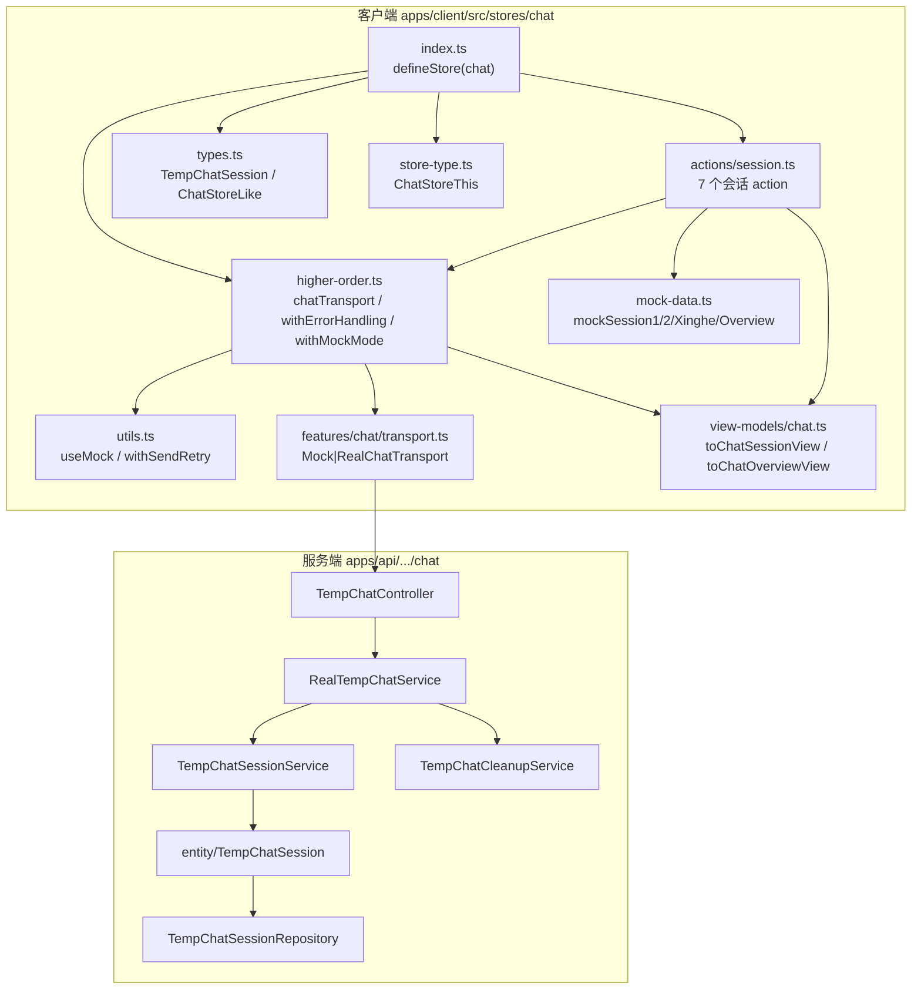
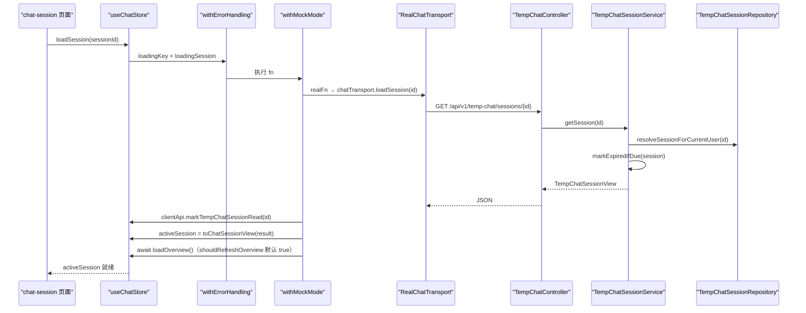
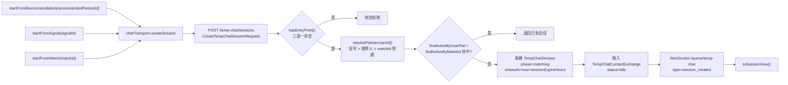
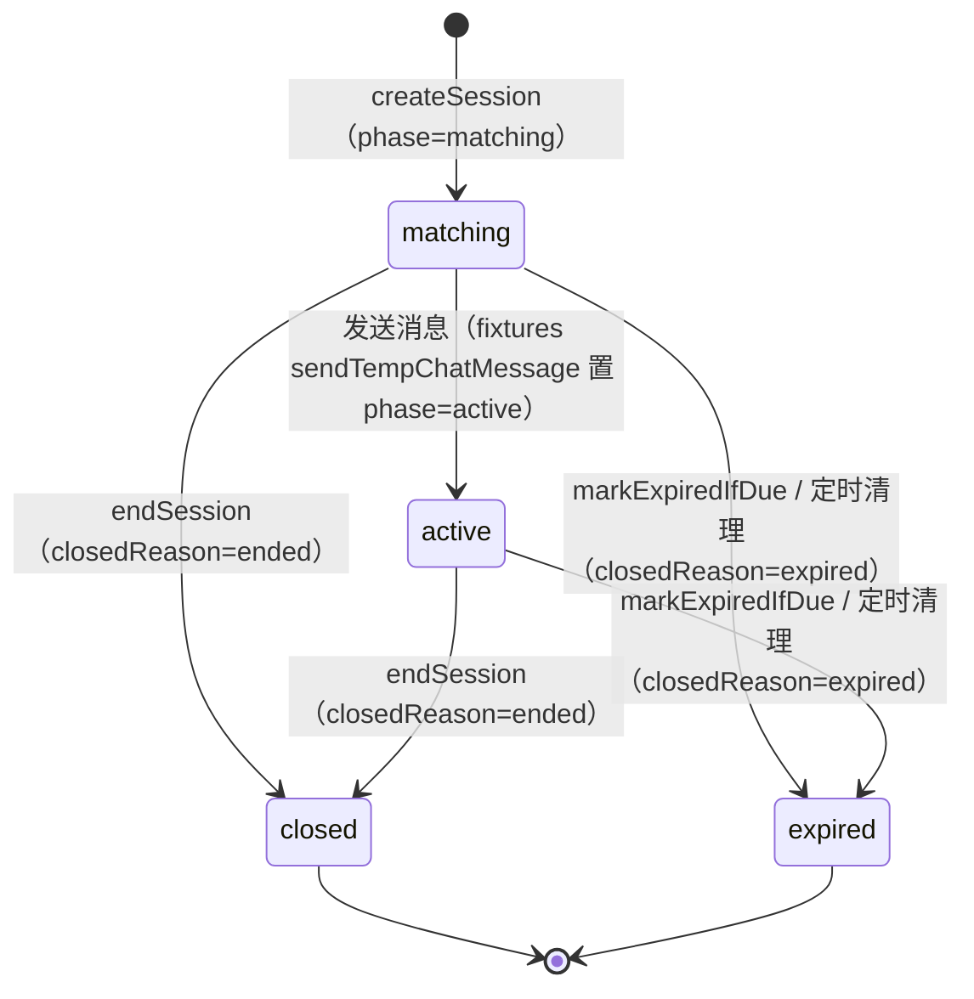
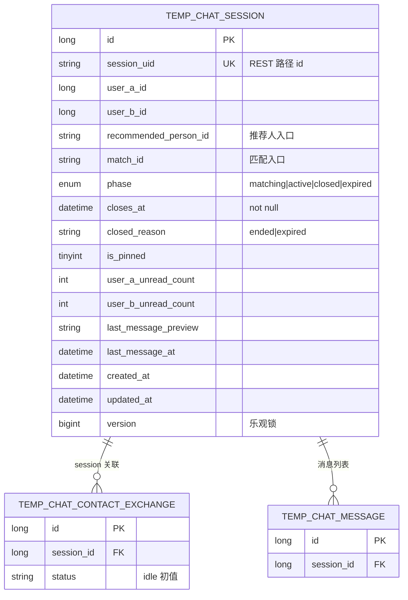
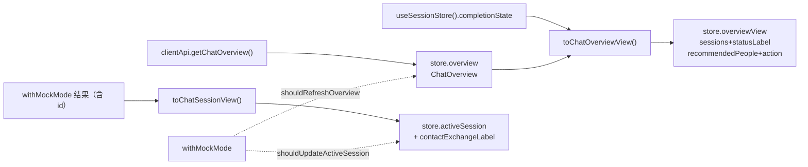
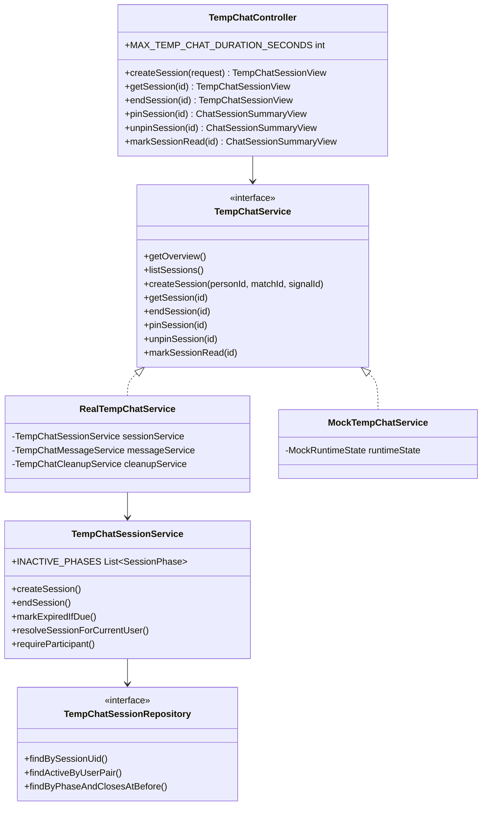
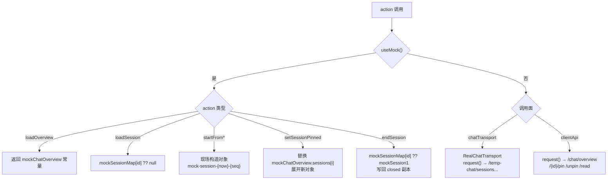
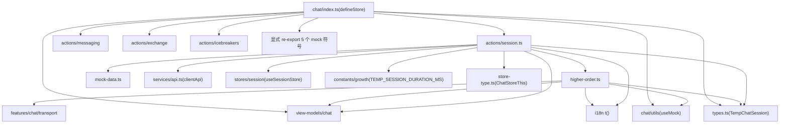
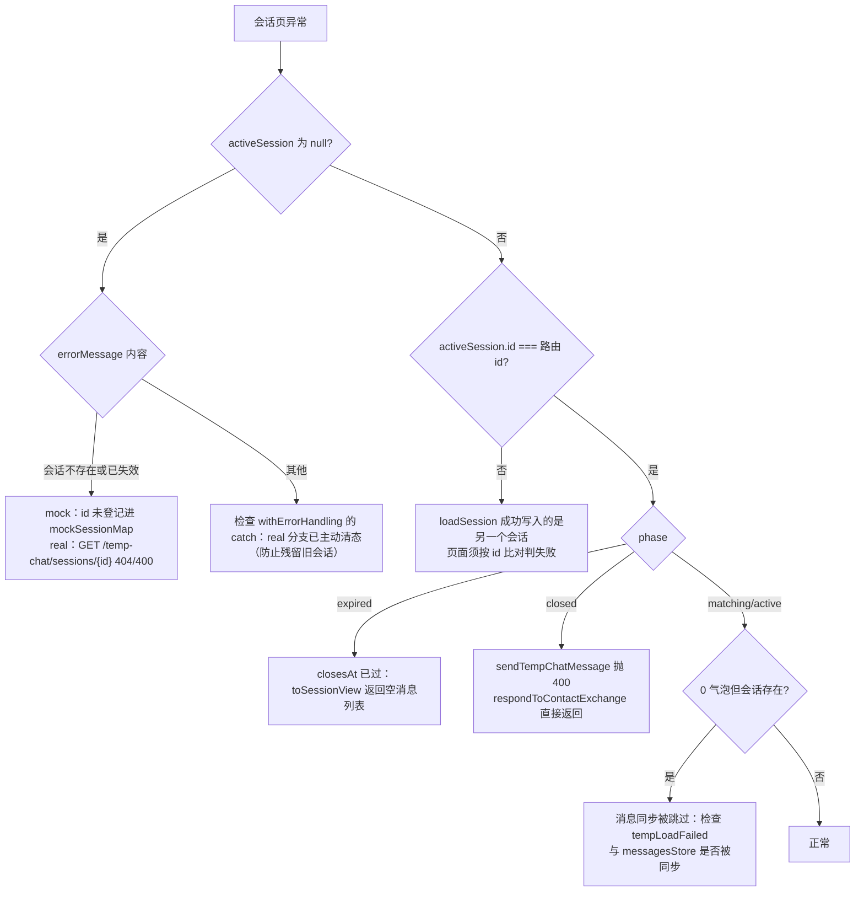

# 会话管理

<cite>
**本文引用的文件**
- [session.ts](file://apps/client/src/stores/chat/actions/session.ts)
- [higher-order.ts](file://apps/client/src/stores/chat/higher-order.ts)
- [index.ts](file://apps/client/src/stores/chat/index.ts)
- [types.ts](file://apps/client/src/stores/chat/types.ts)
- [store-type.ts](file://apps/client/src/stores/chat/store-type.ts)
- [utils.ts](file://apps/client/src/stores/chat/utils.ts)
- [constants.ts](file://apps/client/src/stores/chat/constants.ts)
- [mock-data.ts](file://apps/client/src/stores/chat/mock-data.ts)
- [transport.ts](file://apps/client/src/features/chat/transport.ts)
- [session-machine.ts](file://apps/client/src/features/chat/session-machine.ts)
- [chat.ts](file://apps/client/src/view-models/chat.ts)
- [use-mock.ts](file://apps/client/src/stores/helpers/use-mock.ts)
- [growth.ts](file://apps/client/src/constants/growth.ts)
- [api.ts](file://apps/client/src/services/api.ts)
- [fixtures.ts](file://apps/client/src/services/mocks/fixtures.ts)
- [api-types.ts](file://apps/client/src/services/generated/api-types.ts)
- [index.vue](file://apps/client/src/subpackages/chat/chat-session/index.vue)
- [feedback-growth-and-auth.yaml](file://docs/openapi/feedback-growth-and-auth.yaml)
- [TempChatController.java](file://apps/api/src/main/java/com/campuslove/api/chat/TempChatController.java)
- [TempChatService.java](file://apps/api/src/main/java/com/campuslove/api/chat/TempChatService.java)
- [RealTempChatService.java](file://apps/api/src/main/java/com/campuslove/api/chat/RealTempChatService.java)
- [TempChatSessionService.java](file://apps/api/src/main/java/com/campuslove/api/chat/TempChatSessionService.java)
- [TempChatViewMapper.java](file://apps/api/src/main/java/com/campuslove/api/chat/TempChatViewMapper.java)
- [TempChatCleanupService.java](file://apps/api/src/main/java/com/campuslove/api/chat/TempChatCleanupService.java)
- [TempChatSessionRepository.java](file://apps/api/src/main/java/com/campuslove/api/repository/TempChatSessionRepository.java)
- [TempChatSession.java](file://apps/api/src/main/java/com/campuslove/api/entity/TempChatSession.java)
- [ChatConfig.java](file://apps/api/src/main/java/com/campuslove/api/config/ChatConfig.java)
</cite>

## 目录
1. [简介](#简介)
2. [项目结构](#项目结构)
3. [核心组件](#核心组件)
4. [架构总览](#架构总览)
5. [会话生命周期：三种创建入口](#会话生命周期三种创建入口)
6. [会话加载、置顶与结束](#会话加载置顶与结束)
7. [高阶函数：withMockMode 与 withErrorHandling](#高阶函数withmockmode-与-witherrorhandling)
8. [数据模型 TempChatSession 与 phase 状态机](#数据模型-tempchatsession-与-phase-状态机)
9. [概览数据关联与 activeSession 激活机制](#概览数据关联与-activesession-激活机制)
10. [服务端会话能力：ChatService 与 Repository](#服务端会话能力chatservice-与-repository)
11. [Mock 模式会话数据生成策略](#mock-模式会话数据生成策略)
12. [依赖关系分析](#依赖关系分析)
13. [性能考虑](#性能考虑)
14. [故障排查指南](#故障排查指南)
15. [配置与开关](#配置与开关)
16. [能力缺口登记](#能力缺口登记)
17. [结论](#结论)

## 简介

会话管理是聊天状态管理中负责「一次临时聊天从诞生到关闭」的那条状态链路。客户端侧由 Pinia store `chat`（`defineStore("chat", ...)`）承载，其会话生命周期 action 全部集中在 `apps/client/src/stores/chat/actions/session.ts`（共 314 行）的 7 个导出函数中：`loadOverview`、`startFromRecommendation`、`startFromSignal`、`startFromMatch`、`loadSession`、`setSessionPinned`、`endSession`。这些 action 不直接写 try-catch 也不直接判断模式，而是统一通过 `higher-order.ts` 提供的 `withErrorHandling` 与 `withMockMode` 两个高阶函数完成 loading 状态、错误文案、Mock/Real 分支、`activeSession` 更新与概览刷新的复用。

服务端侧对应的是 `com.campuslove.api.chat` 包下的临时会话能力：`TempChatController` 暴露 REST 端点，`TempChatService` 由 `RealTempChatService` 与 `MockTempChatService` 两种实现，持久化实体为 `entity/TempChatSession`，仓储为 `repository/TempChatSessionRepository`，另有 `TempChatCleanupService` 负责过期会话清理。

本页覆盖以下内容：会话三种创建入口（推荐人、心动信号、匹配）的差异；会话加载、置顶、结束的状态转换；`TempChatSession` 数据模型与 `phase` 三态（`matching`、`active`、`closed`）的业务含义；概览数据（`ChatOverview`/`ChatSessionSummary`）与 `activeSession` 的关联及切换机制；Mock 模式下的本地数据生成策略与真实模式下的传输层调用链；以及性能、排障与能力缺口。

**章节来源**
- [session.ts:1-31](file://apps/client/src/stores/chat/actions/session.ts#L1-L31)
- [session.ts:40-40](file://apps/client/src/stores/chat/actions/session.ts#L40-L40)
- [session.ts:72-72](file://apps/client/src/stores/chat/actions/session.ts#L72-L72)
- [session.ts:113-113](file://apps/client/src/stores/chat/actions/session.ts#L113-L113)
- [session.ts:148-148](file://apps/client/src/stores/chat/actions/session.ts#L148-L148)
- [session.ts:186-186](file://apps/client/src/stores/chat/actions/session.ts#L186-L186)
- [session.ts:240-240](file://apps/client/src/stores/chat/actions/session.ts#L240-L240)
- [session.ts:290-290](file://apps/client/src/stores/chat/actions/session.ts#L290-L290)
- [higher-order.ts:1-30](file://apps/client/src/stores/chat/higher-order.ts#L1-L30)
- [index.ts:78-131](file://apps/client/src/stores/chat/index.ts#L78-L131)

## 项目结构

会话管理涉及两层目录：客户端 `apps/client/src/stores/chat/` 的模块化 store 目录，以及服务端 `apps/api/src/main/java/com/campuslove/api/chat/` 的临时会话包。

客户端 `stores/chat/` 的模块划分在 `index.ts` 顶部注释中列出：`types.ts` 提供类型、`constants.ts` 提供常量、`mock-data.ts` 提供 Mock 数据、`utils.ts` 提供工具函数、`higher-order.ts` 提供高阶函数与传输层实例、`store-type.ts` 提供 `this` 类型、`actions/session.ts` 提供会话生命周期 action。注释同时交代了拆分动机：原 `chat.ts` 单文件 944 行，拆出中间层 `index.ts` 555 行，再拆分后 `index.ts` 约 85 行（实测当前 131 行）。

服务端由 `RealTempChatService` 的类注释给出同类拆分：原 948 行 God Class 拆为 `TempChatSessionService`（会话生命周期：创建/列表/详情/结束/置顶/已读/视图转换）、`TempChatMessageService`（消息发送与撤回）、`TempChatCleanupService`（联系交换状态机与会话过期清理），`RealTempChatService` 自身只做权限校验与委托。



**图表来源**
- [index.ts:1-131](file://apps/client/src/stores/chat/index.ts#L1-L131)
- [session.ts:13-30](file://apps/client/src/stores/chat/actions/session.ts#L13-L30)
- [higher-order.ts:13-30](file://apps/client/src/stores/chat/higher-order.ts#L13-L30)
- [types.ts:10-31](file://apps/client/src/stores/chat/types.ts#L10-L31)
- [store-type.ts:45-123](file://apps/client/src/stores/chat/store-type.ts#L45-L123)
- [mock-data.ts:259-263](file://apps/client/src/stores/chat/mock-data.ts#L259-L263)
- [utils.ts:10-25](file://apps/client/src/stores/chat/utils.ts#L10-L25)
- [transport.ts:16-26](file://apps/client/src/features/chat/transport.ts#L16-L26)
- [RealTempChatService.java:21-59](file://apps/api/src/main/java/com/campuslove/api/chat/RealTempChatService.java#L21-L59)
- [TempChatController.java:20-38](file://apps/api/src/main/java/com/campuslove/api/chat/TempChatController.java#L20-L38)

**章节来源**
- [index.ts:1-30](file://apps/client/src/stores/chat/index.ts#L1-L30)
- [session.ts:1-11](file://apps/client/src/stores/chat/actions/session.ts#L1-L11)
- [higher-order.ts:1-11](file://apps/client/src/stores/chat/higher-order.ts#L1-L11)
- [RealTempChatService.java:21-35](file://apps/api/src/main/java/com/campuslove/api/chat/RealTempChatService.java#L21-L35)

## 核心组件

会话管理由 6 类组件构成，职责边界清晰：

| 组件 | 位置 | 职责 |
| --- | --- | --- |
| `useChatStore` | `apps/client/src/stores/chat/index.ts` | `defineStore("chat", ...)`，声明 `overview`/`overviewView`/`activeSession`/`loadingOverview`/`loadingSession`/`errorMessage` 等 state，并装配 `actions/session` 等 4 组 action |
| 会话 action 集 | `apps/client/src/stores/chat/actions/session.ts` | 7 个生命周期函数：`loadOverview`、`startFromRecommendation`、`startFromSignal`、`startFromMatch`、`loadSession`、`setSessionPinned`、`endSession` |
| 高阶函数 | `apps/client/src/stores/chat/higher-order.ts` | `chatTransport` 模块级单例、`withErrorHandling`（loading + 错误文案）、`withMockMode`（模式分支 + `activeSession` 更新 + 概览刷新） |
| 传输层 | `apps/client/src/features/chat/transport.ts` | `ChatTransport` 接口与 `MockChatTransport`/`RealChatTransport` 双实现，`createChatTransport(mode)` 工厂 |
| Mock 数据 | `apps/client/src/stores/chat/mock-data.ts` | `mockSession1`/`mockSession2`/`mockTempSessionXinghe`/`mockChatSessionSummaries`/`mockChatOverview`/`mockSessionMap` |
| 服务端会话编排 | `TempChatController` → `TempChatService` → `RealTempChatService` → `TempChatSessionService` | REST 端点定义、接口契约、事务边界、会话生命周期实现 |

store 的 state 形状直接决定会话管理可观测的字段：`loadingOverview`、`loadingSession`、`errorMessage`、`overview`（后端原始概览）、`overviewView`（视图模型）、`activeSession`（会话视图模型）、`messageDeliveryStatus`。`LoadingKey` 联合类型把高阶函数可操作的 loading 字段限定为 `"loadingOverview" | "loadingSession" | "loadingIcebreakers"` 三个，避免拼写错误导致的静默失效。

会话 action 之所以能脱离 `defineStore` 独立成文件，靠的是 `store-type.ts` 的 `ChatStoreThis` 接口（state + actions 全量声明）与 `types.ts` 的 `ChatStoreLike` 接口（仅声明高阶函数依赖的 5 个字段 + `loadOverview`）。`ChatStoreThis extends ChatState`，结构上兼容 `ChatStoreLike`，因此 `this` 可直接传入 `withErrorHandling` / `withMockMode`。

**章节来源**
- [index.ts:78-131](file://apps/client/src/stores/chat/index.ts#L78-L131)
- [session.ts:40-40](file://apps/client/src/stores/chat/actions/session.ts#L40-L40)
- [session.ts:72-72](file://apps/client/src/stores/chat/actions/session.ts#L72-L72)
- [session.ts:186-186](file://apps/client/src/stores/chat/actions/session.ts#L186-L186)
- [higher-order.ts:30-30](file://apps/client/src/stores/chat/higher-order.ts#L30-L30)
- [higher-order.ts:54-54](file://apps/client/src/stores/chat/higher-order.ts#L54-L54)
- [higher-order.ts:114-114](file://apps/client/src/stores/chat/higher-order.ts#L114-L114)
- [types.ts:70-86](file://apps/client/src/stores/chat/types.ts#L70-L86)
- [store-type.ts:45-123](file://apps/client/src/stores/chat/store-type.ts#L45-L123)
- [transport.ts:16-26](file://apps/client/src/features/chat/transport.ts#L16-L26)
- [mock-data.ts:24-24](file://apps/client/src/stores/chat/mock-data.ts#L24-L24)
- [TempChatController.java:20-98](file://apps/api/src/main/java/com/campuslove/api/chat/TempChatController.java#L20-L98)
- [TempChatService.java:9-71](file://apps/api/src/main/java/com/campuslove/api/chat/TempChatService.java#L9-L71)

## 架构总览

一次会话创建请求从页面到数据库的完整链路如下。客户端在 store 与传输层之间存在两条并行的模式分支：`withMockMode` 内的 `realFn` 走 `chatTransport`（工厂按 `clientEnv.apiMode` 选 `RealChatTransport` 或 `MockChatTransport`），而 `loadOverview`/`setSessionPinned` 走的是 `clientApi`，`clientApi` 自身也带 `useMock()` 分支，形成「store 级 Mock」与「api 级 Mock」两层。



**图表来源**
- [session.ts:186-229](file://apps/client/src/stores/chat/actions/session.ts#L186-L229)
- [higher-order.ts:54-86](file://apps/client/src/stores/chat/higher-order.ts#L54-L86)
- [higher-order.ts:114-142](file://apps/client/src/stores/chat/higher-order.ts#L114-L142)
- [transport.ts:76-80](file://apps/client/src/features/chat/transport.ts#L76-L80)
- [TempChatController.java:42-46](file://apps/api/src/main/java/com/campuslove/api/chat/TempChatController.java#L42-L46)
- [RealTempChatService.java:81-85](file://apps/api/src/main/java/com/campuslove/api/chat/RealTempChatService.java#L81-L85)
- [TempChatSessionService.java:202-213](file://apps/api/src/main/java/com/campuslove/api/chat/TempChatSessionService.java#L202-L213)
- [apps/client/src/view-models/chat.ts:115-120](file://apps/client/src/view-models/chat.ts#L115-L120)

端点与 store action 的对应关系是固定的：

| 客户端 action | 传输/API 调用 | 后端端点 | 服务方法 |
| --- | --- | --- | --- |
| `startFromRecommendation` | `chatTransport.createSession({recommendedPersonId})` | `POST /api/v1/temp-chat/sessions` | `TempChatSessionService.createSession` |
| `startFromSignal` | `chatTransport.createSession({signalId})` | `POST /api/v1/temp-chat/sessions` | 同上（信号入口优先解析） |
| `startFromMatch` | `chatTransport.createSession({matchId})` | `POST /api/v1/temp-chat/sessions` | 同上（matchId 兜底解析） |
| `loadSession` | `chatTransport.loadSession(id)` + `clientApi.markTempChatSessionRead(id)` | `GET /{id}` + `POST /{id}/read` | `getSession` / `markSessionRead` |
| `setSessionPinned` | `clientApi.pinTempChatSession` / `unpinTempChatSession` | `POST /{id}/pin` / `POST /{id}/unpin` | `pinSession` / `unpinSession` |
| `endSession` | `chatTransport.endSession(activeSession.id)` | `POST /{id}/end` | `endSession` |
| `loadOverview` | `clientApi.getChatOverview()` | `GET /chat/overview`（`clientApi` 侧路径） | `getOverview` |

**章节来源**
- [session.ts:186-229](file://apps/client/src/stores/chat/actions/session.ts#L186-L229)
- [higher-order.ts:114-142](file://apps/client/src/stores/chat/higher-order.ts#L114-L142)
- [transport.ts:67-125](file://apps/client/src/features/chat/transport.ts#L67-L125)
- [TempChatController.java:21-98](file://apps/api/src/main/java/com/campuslove/api/chat/TempChatController.java#L21-L98)
- [TempChatSessionService.java:94-127](file://apps/api/src/main/java/com/campuslove/api/chat/TempChatSessionService.java#L94-L127)
- [api.ts:452-484](file://apps/client/src/services/api.ts#L452-L484)

## 会话生命周期：三种创建入口

三个创建 action 形状一致：参数不同、Mock 分支不同，Real 分支统一收敛到 `chatTransport.createSession(payload)`，并且都只传一个入口字段（`recommendedPersonId` / `signalId` / `matchId`），最终 `return this.activeSession`（此时 `withMockMode` 已把结果转成视图模型写入 store）。



**图表来源**
- [session.ts:72-176](file://apps/client/src/stores/chat/actions/session.ts#L72-L176)
- [transport.ts:67-74](file://apps/client/src/features/chat/transport.ts#L67-L74)
- [TempChatController.java:36-40](file://apps/api/src/main/java/com/campuslove/api/chat/TempChatController.java#L36-L40)
- [TempChatController.java:100-113](file://apps/api/src/main/java/com/campuslove/api/chat/TempChatController.java#L100-L113)
- [TempChatSessionService.java:139-200](file://apps/api/src/main/java/com/campuslove/api/chat/TempChatSessionService.java#L139-L200)
- [TempChatSessionService.java:434-510](file://apps/api/src/main/java/com/campuslove/api/chat/TempChatSessionService.java#L434-L510)

### 入口解析的服务端优先级

`resolvePartnerUserId` 明确把心动信号放在最前：注释指出「已互动的信号对象大概率不在推荐列表中」，因此先调用 `resolvePartnerFromSignal`，命中即返回。其次是 `recommendedPersonId` 在 `recommendationService.getRecommendations(currentUserId)` 结果中按 `String.valueOf(person.id())` 比对；若推荐列表非空且未显式命中，会退回列表首位（`recommendations.get(0).id()`）。获取推荐列表时抛出的 `DataAccessException` 被捕获并降级为日志告警，不中断建会话。

第三层是 `matchId` 兜底。`resolvePartnerFromMatch` 要求 `matchId` 能 `Long.parseLong`、对应 `HeartSignal` 存在、且当前用户是 `userAId`/`userBId` 之一，否则返回 null 并记录告警；这里刻意不抛异常，因为 `matchId` 只是兜底入口。历史上曾把 `recommendedPersonId` 直接解析成任意 `userId`，导致用户可与任意人建立会话，该行为已在注释中标记为修复项并移除。三个入口都解析失败时，`createSession` 抛出带上下文的 `IllegalArgumentException`（`ErrorMessages.RECOMMENDER_PARSE_FAILED_PREFIX` + 三个 ID）。

### 幂等与去重

创建前先做两次去重查询：`findActiveByUserPair(currentUserId, partnerUserId, INACTIVE_PHASES)` 与（仅当 `matchId` 非空时）`findActiveByMatchId(matchId, INACTIVE_PHASES)`。`INACTIVE_PHASES` 定义为 `List.of(SessionPhase.closed, SessionPhase.expired)`，即 JPQL 中 `s.phase NOT IN :excludedPhases`，因此已结束/已过期的会话不会阻塞重新开聊。命中已有会话时直接 `toSessionView` 返回，不产生新记录。

新会话 UID 由 `generateSessionUid` 生成：`"session-" + min + "-" + max + "-" + randomSuffix`，其中 `randomSuffix` 是 UUID 前 8 位，用户 ID 取 min/max 保证 pair 对称。实体保存时强调必须接收 `sessionRepository.save()` 的返回值回填 id，因为 `@Version` 存在时 save 走 merge 返回新的托管实例。

### Mock 分支的差异

`startFromRecommendation` 的 Mock 分支会从 `mockChatOverview.recommendedPeople` 中按 `recommendedPersonId` 查找 `person`，用其 `name`/`headline`/`availability` 填充 `partnerName`/`partnerHeadline`/`availabilityHint`，查不到时回退到 i18n key（`chat.mockSession.newMatchName`、`chat.mockSession.newMatchHeadline`、`chat.mockSession.availabilityTonight`）；`startFromSignal` 与 `startFromMatch` 不查表，直接写 i18n 占位文案，并把 `recommendedPersonId` 分别伪造成 `rp-signal-${signalId}` 与固定串 `rp-match`。

三者都用 `mock-session-${Date.now()}-${++mockSessionSeq}` 生成 ID。`mockSessionSeq` 是模块级递增计数器（初值 0），注释标记为 infra R2-00087，用于避免同毫秒连续创建时的 ID 碰撞。`closesAt` 由 `Date.now() + TEMP_SESSION_DURATION_MS` 计算，该常量为 `24 * 60 * 60 * 1000`（24 小时），与服务端默认 `sessionExpireHours = 24` 对齐。初始状态固定为 `phase: "matching"`、`closedReason: null`、`messages: []`、`contactExchange: { proposer: null, status: "idle" }`，与服务端新建会话的默认值一致。

服务端 mock profile 下另有 `MockTempChatService`（`@Profile("mock")`）：`createSession` 按 `resolvePerson(recommendedPersonId, matchId, signalId)` 定位 mock 人物，再用 `activeSessionIdsByPersonId` 查已有会话，仅当其 `phase() != "closed"` 时复用。

**章节来源**
- [session.ts:29-30](file://apps/client/src/stores/chat/actions/session.ts#L29-L30)
- [session.ts:72-176](file://apps/client/src/stores/chat/actions/session.ts#L72-L176)
- [TempChatSessionService.java:50-50](file://apps/api/src/main/java/com/campuslove/api/chat/TempChatSessionService.java#L50-L50)
- [TempChatSessionService.java:139-200](file://apps/api/src/main/java/com/campuslove/api/chat/TempChatSessionService.java#L139-L200)
- [TempChatSessionService.java:434-518](file://apps/api/src/main/java/com/campuslove/api/chat/TempChatSessionService.java#L434-L518)
- [TempChatSessionRepository.java:45-82](file://apps/api/src/main/java/com/campuslove/api/repository/TempChatSessionRepository.java#L45-L82)
- [growth.ts:39-40](file://apps/client/src/constants/growth.ts#L39-L40)
- [ChatConfig.java:12-25](file://apps/api/src/main/java/com/campuslove/api/config/ChatConfig.java#L12-L25)
- [MockTempChatService.java:18-62](file://apps/api/src/main/java/com/campuslove/api/chat/MockTempChatService.java#L18-L62)

## 会话加载、置顶与结束

### loadSession：两段式加载与失败清态

`loadSession` 外层是 `withErrorHandling(this, { loadingKey: "loadingSession", errorPrefixKey: "storeErrors.chat.loadSessionFailed" }, fn)`，内层是 `withMockMode`（未传 options，因此 `shouldRefreshOverview` 与 `shouldUpdateActiveSession` 都取默认 `true`）。

Mock 分支只查表：`mockSessionMap[sessionId] ?? null`。注释记录了修复原因——原实现回退到 `mockSession1`，会把 A 会话的数据展示成 B 会话（「聊天内容张冠李戴」）。返回 `null` 时，action 在 `withMockMode` 之后显式 `this.activeSession = null` 并 `throw new Error("会话不存在或已失效")`。

Real 分支是两步：`chatTransport.loadSession(sessionId)` 成功后立刻 `clientApi.markTempChatSessionRead(sessionId)`；两步任一失败都进入 `catch`，先 `this.activeSession = null` 再 `throw e`。注释（MP-R1-SUBPACKAGES-CHAT-CHAT-SESSION-INDEX-001）说明了为什么必须手动清态：`withErrorHandling` 只写 `errorMessage`、不清 state，残留的上一个会话会被页面误用——渲染旧会话消息、`sendText` 把消息发进错误的会话。

页面侧的判定与这条契约耦合：`chat-session/index.vue` 在 `await chatStore.loadSession(...)` 之后用「`activeSession` 就绪且 `id` 与 URL 一致」作为确定性失败信号，失败时置 `pageErrorMessage` 与 `tempLoadFailed`，跳过把消息同步到 `messagesStore` 的步骤。

### setSessionPinned：只刷新概览

`setSessionPinned` 用 `withErrorHandling` 但**不传 `loadingKey`**（仅 `errorPrefixKey: "storeErrors.chat.updatePinnedFailed"`），并给 `withMockMode` 显式传 `{ shouldRefreshOverview: true, shouldUpdateActiveSession: false }`：置顶改变的是列表排序与摘要，不改变当前打开的会话，因此不应用返回值覆盖 `activeSession`。

Real 分支按 `pinned` 布尔分流为 `clientApi.pinTempChatSession(sessionId)` 与 `clientApi.unpinTempChatSession(sessionId)`，两者分别 POST `/temp-chat/sessions/{id}/pin` 与 `/unpin`。Mock 分支不再原地修改共享常量：修复注释指出原实现直接 `sessionSummary.pinned = pinned` 会污染模块级数据（页面销毁重建后置顶残留），现改为在 `mockChatOverview.sessions` 中 `findIndex` 后用 `{ ...原对象, pinned }` 替换数组元素，并返回 `undefined`（无 `id` 字段，天然不触发 `activeSession` 更新）。

服务端 `pinSession`/`unpinSession` 均为 `@Transactional`：`resolveSessionForCurrentUser(id)` → `setIsPinned(true/false)` → 刷新 `updatedAt` → `save` → `toSummary`。排序在仓储层完成：`findByUserIdOrderByPinnedAndLastMessage` 的 JPQL 为 `ORDER BY s.isPinned DESC, s.lastMessageAt DESC NULLS LAST, s.createdAt DESC`。

### endSession：无错误包装的收尾

`endSession` 与前两者不同，**没有 `withErrorHandling` 包裹**：先做 `if (!this.activeSession) return;` 空值守卫，随后只走 `withMockMode`（两个开关都取默认 `true`）。这意味着 Real 模式下后端异常会直接抛给调用方，页面需自行捕获；同时也不会写入 `errorMessage`、不会管理 loading。

Mock 分支把当前会话标记为结束：取 `this.activeSession!.id`，从 `mockSessionMap[sessionId] ?? mockSession1` 取基准数据，展开为 `{ phase: "closed", closesAt: new Date().toISOString(), closedReason: "ended" }` 后写回 `mockSessionMap[sessionId]`，并返回该对象。由于返回值含 `id`，`withMockMode` 会把它转成视图模型覆盖 `activeSession`，再刷新概览。这里存在一个可观察的边界：对刚由 `startFrom*` 创建、尚未写入 `mockSessionMap` 的 `mock-session-*` 会话调用 `endSession`，基准数据会回退到 `mockSession1`，即结束后的会话视图携带 `mockSession1` 的消息。

Real 分支是 `chatTransport.endSession(this.activeSession!.id)`，即 POST `/temp-chat/sessions/{id}/end`。服务端 `endSession` 具备幂等性：`phase` 已是 `closed` 或 `expired` 时只写 debug 日志并直接返回当前视图，不再改状态；否则设为 `SessionPhase.closed`、`closedReason = "ended"`、刷新 `updatedAt`、保存，并向对端 `/queue/temp-chat` 推送 `{ type: "session_ended", sessionId }`。页面调用点在 `chat-session/index.vue:1348`。



**图表来源**
- [TempChatSessionService.java:219-244](file://apps/api/src/main/java/com/campuslove/api/chat/TempChatSessionService.java#L219-L244)
- [TempChatSessionService.java:392-413](file://apps/api/src/main/java/com/campuslove/api/chat/TempChatSessionService.java#L392-L413)
- [TempChatSessionService.java:113-127](file://apps/api/src/main/java/com/campuslove/api/chat/TempChatSessionService.java#L113-L127)
- [fixtures.ts:1554-1588](file://apps/client/src/services/mocks/fixtures.ts#L1554-L1588)
- [session.ts:290-314](file://apps/client/src/stores/chat/actions/session.ts#L290-L314)
- [apps/api/src/main/java/com/campuslove/api/entity/TempChatSession.java:29-30](file://apps/api/src/main/java/com/campuslove/api/entity/TempChatSession.java#L29-L30)

**章节来源**
- [session.ts:186-229](file://apps/client/src/stores/chat/actions/session.ts#L186-L229)
- [session.ts:240-314](file://apps/client/src/stores/chat/actions/session.ts#L240-L314)
- [higher-order.ts:54-86](file://apps/client/src/stores/chat/higher-order.ts#L54-L86)
- [transport.ts:76-120](file://apps/client/src/features/chat/transport.ts#L76-L120)
- [api.ts:458-484](file://apps/client/src/services/api.ts#L458-L484)
- [TempChatController.java:66-88](file://apps/api/src/main/java/com/campuslove/api/chat/TempChatController.java#L66-L88)
- [TempChatSessionService.java:246-290](file://apps/api/src/main/java/com/campuslove/api/chat/TempChatSessionService.java#L246-L290)
- [TempChatSessionRepository.java:32-34](file://apps/api/src/main/java/com/campuslove/api/repository/TempChatSessionRepository.java#L32-L34)
- [mock-data.ts:259-263](file://apps/client/src/stores/chat/mock-data.ts#L259-L263)
- [apps/client/src/subpackages/chat/chat-session/index.vue:649-674](file://apps/client/src/subpackages/chat/chat-session/index.vue#L649-L674)
- [apps/client/src/subpackages/chat/chat-session/index.vue:1348-1348](file://apps/client/src/subpackages/chat/chat-session/index.vue#L1348-L1348)

## 高阶函数：withMockMode 与 withErrorHandling

`higher-order.ts` 的头部注释给出了拆分动机：原 `chat.ts` 单文件 944 行违反单一职责，重构后把三个跨 action 的公共部分抽到本文件——`chatTransport` 模块级单例、`withErrorHandling`、`withMockMode`。

### withErrorHandling

签名是 `withErrorHandling<T>(store: ChatStoreLike, options: { loadingKey?: LoadingKey; errorPrefixKey: string; rethrow?: boolean }, fn: () => Promise<T>): Promise<T | undefined>`。执行序列固定为四步：

1. 若传了 `loadingKey`，`store[loadingKey] = true`；
2. 无条件 `store.errorMessage = null`（清理上一次的错误）；
3. `try { return await fn(); }`；
4. `catch` 中 `store.errorMessage = error instanceof Error ? error.message : t(errorPrefixKey)`，随后 `rethrow` 为真时继续抛出，否则返回 `undefined`；`finally` 复位 loading。

三个设计细节值得注意。第一，`loadingKey` 是可选的：`setSessionPinned` 就利用这一点只借用错误处理、不占用 loading 槽位。第二，`errorPrefixKey` 虽然在类型上是必填，但只有当抛出的不是 `Error` 实例时才会被 `t()` 渲染（R4-00192 把兜底文案 i18n 化）；`loadSession` 抛出的 `new Error("会话不存在或已失效")` 走的是 `error.message` 分支。第三，返回值类型是 `T | undefined`，这使调用方必须以「state 是否被写入」而非「返回值是否为真」判定成功——`chat-session/index.vue` 用 `activeSession.id` 与 URL 比对而不是判断返回值，注释里也记录了「原 `errorMessage` 文案差分」在重进同一失效深链时因文案相同而误判成功的教训。`rethrow` 默认 `false`，会话类 action 均未开启，只有需要向上报错的 action（如破冰话题）才设为 `true`。

### withMockMode

签名是 `withMockMode<T>(store, mockFn: () => Promise<T> | T, realFn: () => Promise<T>, options = {})`，两个开关默认均为 `true`。它的价值在于把「模式判断 + activeSession 更新 + 概览刷新」三步从每个 action 里抽走：

```mermaid
flowchart TD
  S["withMockMode(store, mockFn, realFn, options)"] --> Q{"useMock()"}
  Q -- true --> MK["result = await mockFn()"]
  Q -- false --> RL["result = await realFn()"]
  MK --> C1{"shouldUpdateActiveSession<br/>&& result 是对象 && \"id\" in result"}
  RL --> C1
  C1 -- 是 --> AS["store.activeSession = toChatSessionView(result)"]
  C1 -- 否 --> C2
  AS --> C2{"shouldRefreshOverview"}
  C2 -- 是 --> LO["await store.loadOverview()"]
  C2 -- 否 --> R
  LO --> R["return result（原始数据，非视图模型）"]
```

**图表来源**
- [higher-order.ts:114-142](file://apps/client/src/stores/chat/higher-order.ts#L114-L142)
- [use-mock.ts:16-25](file://apps/client/src/stores/helpers/use-mock.ts#L16-L25)
- [apps/client/src/view-models/chat.ts:115-120](file://apps/client/src/view-models/chat.ts#L115-L120)

`activeSession` 更新采用结构判定而非类型判定：`result && typeof result === "object" && "id" in result`。由于 `T` 是泛型，实现里先 `result as unknown as TempChatSession` 再交给 `toChatSessionView`。这条判定带来两个直接后果：返回 `undefined` 的分支（如 `setSessionPinned` 的 mock/real 两边都 `return undefined`）不会污染 `activeSession`；返回 `null` 的分支（如 `loadSession` 的未知 id）同样不会写入，因此 action 必须自己做清态与抛错，这正是 `loadSession` 里 `if (!session)` 分支存在的原因。

返回值语义是**原始数据**而不是视图模型：三个 `startFrom*` action 因此忽略 `withMockMode` 的返回值，改为 `return this.activeSession`（已被高阶函数写入的视图模型）。

`loadOverview` 用 `{ shouldRefreshOverview: false, shouldUpdateActiveSession: false }` 阻断递归——`withMockMode` 内部会调用 `store.loadOverview()`，而它自己就在 `loadOverview` 里。概览视图由 action 手动转换：`toChatOverviewView(overview, sessionStore.completionState)`，其中 `completionState` 来自 `useSessionStore()`，用于给推荐人卡片计算 `action`（未完成资料时 `complete-setup`，否则 `go-chat` 且目标 `/pages/messages/index`）。

模式判定是单一真相源：`chat/utils.ts` 只做 `export const useMock = useMockShared`，后者来自 `stores/helpers/use-mock`，等价于 `config/env.ts` 的 `isMockMode`；注释记录了历史上 19 个 store 各自重复定义 `useMock()` 的问题。`chatTransport` 则由 `createChatTransport(clientEnv.apiMode)` 创建：`mode === "real"` 用 `RealChatTransport`，否则 `MockChatTransport`，后者委托 `mockFixtures`。

**章节来源**
- [higher-order.ts:1-30](file://apps/client/src/stores/chat/higher-order.ts#L1-L30)
- [higher-order.ts:33-86](file://apps/client/src/stores/chat/higher-order.ts#L33-L86)
- [higher-order.ts:88-142](file://apps/client/src/stores/chat/higher-order.ts#L88-L142)
- [session.ts:40-64](file://apps/client/src/stores/chat/actions/session.ts#L40-L64)
- [session.ts:186-229](file://apps/client/src/stores/chat/actions/session.ts#L186-L229)
- [session.ts:240-283](file://apps/client/src/stores/chat/actions/session.ts#L240-L283)
- [utils.ts:10-25](file://apps/client/src/stores/chat/utils.ts#L10-L25)
- [use-mock.ts:1-25](file://apps/client/src/stores/helpers/use-mock.ts#L1-L25)
- [transport.ts:32-65](file://apps/client/src/features/chat/transport.ts#L32-L65)
- [transport.ts:123-125](file://apps/client/src/features/chat/transport.ts#L123-L125)
- [types.ts:64-86](file://apps/client/src/stores/chat/types.ts#L64-L86)
- [apps/client/src/view-models/chat.ts:45-62](file://apps/client/src/view-models/chat.ts#L45-L62)
- [apps/client/src/subpackages/chat/chat-session/index.vue:656-666](file://apps/client/src/subpackages/chat/chat-session/index.vue#L656-L666)

## 数据模型 TempChatSession 与 phase 状态机

### 三份定义的对照

`TempChatSession` 在三处定义，必须一起阅读：

- 契约层 `docs/openapi/feedback-growth-and-auth.yaml` 声明 `phase` 的 enum 为 `[matching, active, closing, closed]`，`closedReason` 的 enum 为 `[expired, ended]` 且 `nullable: true`；required 列表包含 `id`、`recommendedPersonId`、`partnerName`、`partnerHeadline`、`availabilityHint`、`phase`、`closesAt`、`messages`、`contactExchange`，**不含** `closedReason`。
- 客户端 `api-types.ts` 由 openapi-typescript 生成，`phase: "matching" | "active" | "closing" | "closed"`、`closedReason?: "expired" | "ended" | null`，`stores/chat/types.ts` 通过 `Schemas["TempChatSession"]` 直接别名复用，不重复定义字段。
- 服务端实体 `entity/TempChatSession.java` 定义 `enum SessionPhase { matching, active, closed, expired }`，列声明为 `columnDefinition = "ENUM('matching','active','closed','expired') DEFAULT 'matching'"`，表名 `temp_chat_sessions`（`@Table(name = "temp_chat_session")`）。

契约用 `closing` 表示「即将关闭」，而实体用 `expired` 表示「已超时」，两侧集合并不重合：实体的 `expired` 不在客户端 union 中，契约的 `closing` 在服务端无处赋值。会话视图状态标签的计算方式（`toSessionStatusLabel`）只显式区分 `closed`（再按 `closedReason === "ended"` 细分）与 `matching`（`waitingOpen`），其余 phase 一律落到 `toContactExchangeLabel(session.contactExchangeStatus)`，因此 `active`、`closing`、以及后端可能返回的 `expired` 都走同一条分支。

### 字段与列的映射

服务端实体字段与列名一一对应，其中视图未暴露、但影响排序与未读徽标的列包括 `user_a_unread_count`、`user_b_unread_count`、`last_message_preview`、`last_message_at`、`is_pinned`（`TINYINT(1) DEFAULT 0`）与乐观锁 `version`（`BIGINT DEFAULT 0`）。`session_uid` 是 `nullable=false, length=64, unique=true` 的业务键（表名 `temp_chat_session`），REST 路径里的 `{id}` 使用的正是它（`findBySessionUid`）。`closes_at` 为 `nullable=false`，因此创建时必须立刻设定过期时刻。



**图表来源**
- [apps/api/src/main/java/com/campuslove/api/entity/TempChatSession.java:25-114](file://apps/api/src/main/java/com/campuslove/api/entity/TempChatSession.java#L25-L114)
- [TempChatSessionService.java:182-188](file://apps/api/src/main/java/com/campuslove/api/chat/TempChatSessionService.java#L182-L188)
- [TempChatController.java:115-127](file://apps/api/src/main/java/com/campuslove/api/chat/TempChatController.java#L115-L127)

### phase 的业务含义

`matching` 是新建会话的初始阶段：服务端 `session.setPhase(SessionPhase.matching)`，实体字段初始值同样是 `SessionPhase.matching`，客户端三个 `startFrom*` 的 mock 对象也写死 `phase: "matching"`。业务上表示「已牵线、双方尚未真正聊起来」，UI 标签为 `waitingOpen`。

`active` 由消息发送驱动：fixtures 的 `sendTempChatMessage` 在追加消息时把 `phase` 置为 `"active"`，并对 `phase === "closed"` 的会话抛出 `createMockApiError(400)`，与真实后端「已关闭会话不可发送」的语义对齐。

`closed` 有两个来源：手动 `endSession`（`closedReason = "ended"`）与联系交换/清理链路对已关闭会话的短路判定（`TempChatCleanupService.respondToContactExchange` 在 `closed` 或 `expired` 时直接返回会话，不再允许响应交换）。视图标签按 `closedReason` 区分 `ended` 与 `closed`。

`expired` 是实体的第四个状态，由两条路径写入：惰性检查 `markExpiredIfDue`（`isSessionExpired` 为真且当前不是 `expired` 时，设 `phase=expired`、`closedReason="expired"` 并保存），以及每小时整点的定时任务 `cleanupExpiredSessions`（cron `0 0 * * * *`，Redisson 分布式锁 `scheduled:tempChatCleanup`，对 `matching`、`active` 两个阶段分别调用 `findByPhaseAndClosesAtBefore(phase, now)`）。`INACTIVE_PHASES = [closed, expired]` 使这两个状态都不再阻塞重新建会话。

`closesAt` 的取值统一为「创建时刻 + 24 小时」：服务端 `now.plusHours(chatConfig.getSessionExpireHours())`（默认 24，配置前缀 `app.chat`），客户端 mock 用 `Date.now() + TEMP_SESSION_DURATION_MS`。时间基准在服务端为 `LocalDateTime.now(TimeZones.BUSINESS)`。

**章节来源**
- [feedback-growth-and-auth.yaml:2087-2124](file://docs/openapi/feedback-growth-and-auth.yaml#L2087-L2124)
- [api-types.ts:1190-1203](file://apps/client/src/services/generated/api-types.ts#L1190-L1203)
- [api-types.ts:1120-1137](file://apps/client/src/services/generated/api-types.ts#L1120-L1137)
- [types.ts:16-23](file://apps/client/src/stores/chat/types.ts#L16-L23)
- [apps/api/src/main/java/com/campuslove/api/entity/TempChatSession.java:21-114](file://apps/api/src/main/java/com/campuslove/api/entity/TempChatSession.java#L21-L114)
- [TempChatSessionService.java:162-176](file://apps/api/src/main/java/com/campuslove/api/chat/TempChatSessionService.java#L162-L176)
- [TempChatSessionService.java:392-413](file://apps/api/src/main/java/com/campuslove/api/chat/TempChatSessionService.java#L392-L413)
- [TempChatCleanupService.java:93-119](file://apps/api/src/main/java/com/campuslove/api/chat/TempChatCleanupService.java#L93-L119)
- [TempChatCleanupService.java:166-181](file://apps/api/src/main/java/com/campuslove/api/chat/TempChatCleanupService.java#L166-L181)
- [TempChatSessionRepository.java:95-95](file://apps/api/src/main/java/com/campuslove/api/repository/TempChatSessionRepository.java#L95-L95)
- [fixtures.ts:1554-1588](file://apps/client/src/services/mocks/fixtures.ts#L1554-L1588)
- [apps/client/src/view-models/chat.ts:64-90](file://apps/client/src/view-models/chat.ts#L64-L90)
- [mock-data.ts:24-32](file://apps/client/src/stores/chat/mock-data.ts#L24-L32)
- [mock-data.ts:94-102](file://apps/client/src/stores/chat/mock-data.ts#L94-L102)
- [ChatConfig.java:6-25](file://apps/api/src/main/java/com/campuslove/api/config/ChatConfig.java#L6-L25)

## 概览数据关联与 activeSession 激活机制

store 用三个字段承载会话相关数据，形成「原始 → 视图」两层：`overview`（后端原始概览，类型为 `Awaited<ReturnType<typeof clientApi.getChatOverview>> | null`）、`overviewView`（`toChatOverviewView` 的返回值）、`activeSession`（`toChatSessionView` 的返回值）。列表渲染只消费 `overviewView`，会话页只消费 `activeSession`，`overview` 保留给需要原始字段的场景（`setSessionPinned` 的 mock 分支直接改 `mockChatOverview.sessions`，而 `mockChatOverview` 正是 mock 模式下 `overview` 的数据来源）。



**图表来源**
- [session.ts:40-64](file://apps/client/src/stores/chat/actions/session.ts#L40-L64)
- [higher-order.ts:114-142](file://apps/client/src/stores/chat/higher-order.ts#L114-L142)
- [apps/client/src/view-models/chat.ts:92-120](file://apps/client/src/view-models/chat.ts#L92-L120)
- [index.ts:79-106](file://apps/client/src/stores/chat/index.ts#L79-L106)

### 概览与会话摘要的字段关联

概览结构为 `{ sessions, emptyStateLead, recommendedPeople }`。`ChatSessionSummary` 是 `TempChatSession` 的「瘦身投影」：保留 `id`、`recommendedPersonId`、`partnerName`、`partnerHeadline`、`availabilityHint`、`phase`、`closesAt`、`closedReason`，用 `lastMessagePreview`/`lastMessageSentAt` 替换整个 `messages` 数组，用 `contactExchangeStatus` 替换 `contactExchange` 对象，并追加列表专用的 `pinned` 与 `unreadCount`。`mockChatSessionSummaries` 就是这一映射的手工实现：逐字段取自 `mockSession1`/`mockSession2`，`lastMessagePreview` 手写、`lastMessageSentAt` 取 `messages[4]?.sentAt` 与 `messages[2]?.sentAt`。

服务端的对应映射在 `TempChatViewMapper.toSummary`：`partnerId` 由「当前用户是 userA 还是 userB」反向推导；`unreadCount` 取 `userAUnreadCount` 或 `userBUnreadCount` 中属于当前用户的那一列；`pinned` 用 `Boolean.TRUE.equals(session.getIsPinned())` 做空安全转换；`lastMessageAt` 为 null 时输出 null。`toSessionView` 则在过期时短路：`phase == expired || sessionExpired` 时返回 `List.of()` 作为消息列表，不查库。

`loadOverview` 之所以需要 `useSessionStore().completionState`，是因为概览视图会给每个推荐人卡片附加 `action`：资料未完善时是 `{ mode: "complete-setup", target: tasks[0].path }`，否则是 `{ mode: "go-chat", target: "/pages/messages/index" }`。这让「从推荐人开聊」的入口按钮能随引导状态改变落点。

### activeSession 的激活与切换

`activeSession` 是**单槽位**：任何一次 `withMockMode(...)` 调用只要返回值是含 `id` 的对象且未关闭 `shouldUpdateActiveSession`，就会覆盖它。因此切换会话没有专门 API，靠再次 `loadSession(newId)` 完成；`createSession` 成功后同样覆盖（三个 `startFrom*` 随后 `return this.activeSession`）。槽位被清空的时机只有两个，且都在 `loadSession` 内：Real 分支的 `catch`（加载或标记已读失败）与 mock/real 返回假值的 `if (!session)` 分支。

概览与会话的读写字段互补而不冲突：`markSessionRead` 把当前用户那侧未读计数归零后返回 `ChatSessionSummaryView`，`loadSession` 在 Real 分支调用它（结果被丢弃，仅产生副作用），紧接着 `withMockMode` 刷新概览，从而让列表上的未读徽标与刚打开的会话保持一致。置顶、结束同理——它们改变摘要，靠刷新概览让列表收敛。

页面侧还维护第三份会话数据源：`messagesStore`（私聊会话列表）。`loadSessionData()` 需要在两者之间路由：纯数字 id 与 `conv-` 前缀判为私聊，其余（如 `session-{a}-{b}-{hex}`）走临时会话链路；判定前先尝试 `messagesStore.bootstrap()` 兜底，避免深链直达时因列表未加载而误判。临时分支加载成功后调用 `syncChatStoreMessagesToMessagesStore()` 把 `chatStore` 的消息同步进 `messagesStore` 单一渲染数据源，再启动剩余时间倒计时。

**章节来源**
- [index.ts:79-106](file://apps/client/src/stores/chat/index.ts#L79-L106)
- [session.ts:40-64](file://apps/client/src/stores/chat/actions/session.ts#L40-L64)
- [session.ts:186-229](file://apps/client/src/stores/chat/actions/session.ts#L186-L229)
- [session.ts:240-283](file://apps/client/src/stores/chat/actions/session.ts#L240-L283)
- [higher-order.ts:114-142](file://apps/client/src/stores/chat/higher-order.ts#L114-L142)
- [apps/client/src/view-models/chat.ts:19-27](file://apps/client/src/view-models/chat.ts#L19-L27)
- [apps/client/src/view-models/chat.ts:45-120](file://apps/client/src/view-models/chat.ts#L45-L120)
- [api-types.ts:1115-1137](file://apps/client/src/services/generated/api-types.ts#L1115-L1137)
- [mock-data.ts:142-200](file://apps/client/src/stores/chat/mock-data.ts#L142-L200)
- [TempChatViewMapper.java:65-131](file://apps/api/src/main/java/com/campuslove/api/chat/TempChatViewMapper.java#L65-L131)
- [TempChatViewMapper.java:213-226](file://apps/api/src/main/java/com/campuslove/api/chat/TempChatViewMapper.java#L213-L226)
- [TempChatSessionService.java:94-127](file://apps/api/src/main/java/com/campuslove/api/chat/TempChatSessionService.java#L94-L127)
- [TempChatSessionService.java:277-290](file://apps/api/src/main/java/com/campuslove/api/chat/TempChatSessionService.java#L277-L290)
- [apps/client/src/subpackages/chat/chat-session/index.vue:600-674](file://apps/client/src/subpackages/chat/chat-session/index.vue#L600-L674)

## 服务端会话能力：ChatService 与 Repository

### 端点与安全

`TempChatController` 映射前缀 `/api/v1/temp-chat/sessions`，9 个端点全部标注 `@PreAuthorize("hasRole('USER')")`：`POST ""`（创建）、`GET /{id}`（详情）、`POST /{id}/messages`、`POST /{id}/contact-exchange/respond`、`POST /{id}/end`、`POST /{id}/pin`、`POST /{id}/unpin`、`POST /{id}/read`、`POST /{id}/messages/{messageId}/recall`。返回值分两类：会话级操作返回 `TempChatSessionView`（含完整消息列表与联系交换状态），摘要级操作（pin/unpin/read）返回 `ChatSessionSummaryView`。

控制器还持有两个契约细节：语音时长上限常量 `MAX_TEMP_CHAT_DURATION_SECONDS = 3600`（注释说明与 `TempChatSessionService` 的会话 TTL 语义对齐）；请求记录 `CreateTempChatSessionRequest` 的三个字段各限 `@Size(max = 64)`，并以 `@AssertTrue` 实现的 `hasEntryPoint()` 强制「三选一非空」，消息文案为 `recommendedPersonId or matchId or signalId is required`。

### 服务分层与事务边界

`TempChatService` 接口声明 11 个方法（`getOverview`、`listSessions`、`createSession`、`getSession`、`sendMessage`、`respondToContactExchange`、`endSession`、`pinSession`、`unpinSession`、`markSessionRead`、`recallMessage`），按 profile 有两个实现：`RealTempChatService`（`@Profile("real")`）与 `MockTempChatService`（`@Profile("mock")`）。

`RealTempChatService` 只做编排：`getOverview` 标 `@Transactional(readOnly = true)`，其余标 `@Transactional`；凡是「服务返回实体、控制器需要视图」的方法（`sendMessage`、`recallMessage`、`respondToContactExchange`）由本类取 `SecurityUtils.getCurrentUserId()` 后再调 `sessionService.toSessionView(session, currentUserId)`。类注释记录了 FIN HIGH-6 修复：原实现在构造器里用 `new` 创建三个子组件，导致子组件的 `@Transactional` 代理完全失效（Spring AOP 只代理容器管理的 Bean），现改为注入容器 Bean。

`TempChatSessionService` 是生命周期核心，持有 `ChatConfig`、`TempChatSessionRepository`、`TempChatMessageRepository`、`TempChatContactExchangeRepository`、`UserRepository` 与三张用户资料表仓储（basic/campus/schedule）、`RecommendationService`、`HeartSignalRepository`、`SimpMessagingTemplate`、`TempChatViewMapper`。解析入口为 `resolveSession(id)` / `resolveSessionForCurrentUser(id)` / `requireParticipant(session, userId)`，其中 `requireParticipant` 不满足时抛 `OperationForbiddenException("无权访问该会话")`，类注释把它标为 FIN HIGH-1 的 IDOR 修复。

### 仓储查询

`TempChatSessionRepository extends JpaRepository<TempChatSession, Long>`，6 个自定义方法构成会话管理的全部读路径：

| 方法 | 语义 |
| --- | --- |
| `findBySessionUid(String)` | 按业务键取会话，返回 `Optional` |
| `findByUserIdOrderByPinnedAndLastMessage(Long)` | 我参与的全部会话，`ORDER BY isPinned DESC, lastMessageAt DESC NULLS LAST, createdAt DESC` |
| `findActiveByUserIdAndRecommendedPersonId(userId, recommendedPersonId, excludedPhases)` | 按推荐人维度去重（当前未被 `createSession` 调用，建会话走 pair 维度） |
| `findActiveByUserPair(userAId, userBId, excludedPhases)` | pair 对称去重：`(A=a AND B=b) OR (A=b AND B=a)` 且 `phase NOT IN :excludedPhases` |
| `findActiveByMatchId(matchId, excludedPhases)` | 按 `matchId` 去重 |
| `findByPhaseAndClosesAtBefore(phase, cutoff)` | 定时清理入口，配合 `INACTIVE_PHASES` 之外的 `matching`/`active` 两阶段扫描 |

会话列表的 N+1 风险已在 infra R2-00240 中处理：`listSessions()` 先用 `viewMapper.loadPartnerInfoMap(...)` 批量预加载对方资料，再逐会话调用 `markExpiredIfDue` 与 `toSummary(session, currentUserId, partnerInfoMap)`；该重载在 Map 缺失时仍回退单查作为兜底。

### 与私信持久会话的并列关系

除临时会话外，仓库还有一套「持久私信会话」抽象：`RealPrivateMessageService`（803 行）与 `MockPrivateMessageService`（119 行）实现同一组方法名。真实实现的方法声明位置为 `getConversations` L108、`createOrGetConversation` L169、`getMessages` L322、`markAsRead` L357、`pinConversation` L373、`setConversationMuted` L401、`deleteConversation` L434、`softDeleteMessage` L468；mock 实现的对应声明分布在 L17、L46、L65、L88、L95、L102、L109、L116。两者在客户端由不同 store 承载（临时会话在 `chat` store，私聊会话在 `messages` store），页面用 id 形态路由，见上一节。



**图表来源**
- [TempChatController.java:20-98](file://apps/api/src/main/java/com/campuslove/api/chat/TempChatController.java#L20-L98)
- [TempChatService.java:9-71](file://apps/api/src/main/java/com/campuslove/api/chat/TempChatService.java#L9-L71)
- [RealTempChatService.java:33-133](file://apps/api/src/main/java/com/campuslove/api/chat/RealTempChatService.java#L33-L133)
- [MockTempChatService.java:18-23](file://apps/api/src/main/java/com/campuslove/api/chat/MockTempChatService.java#L18-L23)
- [TempChatSessionService.java:45-63](file://apps/api/src/main/java/com/campuslove/api/chat/TempChatSessionService.java#L45-L63)
- [TempChatSessionRepository.java:16-95](file://apps/api/src/main/java/com/campuslove/api/repository/TempChatSessionRepository.java#L16-L95)

**章节来源**
- [TempChatController.java:20-113](file://apps/api/src/main/java/com/campuslove/api/chat/TempChatController.java#L20-L113)
- [TempChatService.java:9-71](file://apps/api/src/main/java/com/campuslove/api/chat/TempChatService.java#L9-L71)
- [RealTempChatService.java:21-133](file://apps/api/src/main/java/com/campuslove/api/chat/RealTempChatService.java#L21-L133)
- [TempChatSessionService.java:45-63](file://apps/api/src/main/java/com/campuslove/api/chat/TempChatSessionService.java#L45-L63)
- [TempChatSessionService.java:94-127](file://apps/api/src/main/java/com/campuslove/api/chat/TempChatSessionService.java#L94-L127)
- [TempChatSessionService.java:335-413](file://apps/api/src/main/java/com/campuslove/api/chat/TempChatSessionService.java#L335-L413)
- [TempChatSessionRepository.java:16-95](file://apps/api/src/main/java/com/campuslove/api/repository/TempChatSessionRepository.java#L16-L95)
- [TempChatCleanupService.java:43-59](file://apps/api/src/main/java/com/campuslove/api/chat/TempChatCleanupService.java#L43-L59)
- [MockPrivateMessageService.java:17-17](file://apps/api/src/main/java/com/campuslove/api/chat/MockPrivateMessageService.java#L17-L17)
- [RealPrivateMessageService.java:108-108](file://apps/api/src/main/java/com/campuslove/api/chat/RealPrivateMessageService.java#L108-L108)
- [RealPrivateMessageService.java:169-169](file://apps/api/src/main/java/com/campuslove/api/chat/RealPrivateMessageService.java#L169-L169)
- [RealPrivateMessageService.java:373-373](file://apps/api/src/main/java/com/campuslove/api/chat/RealPrivateMessageService.java#L373-L373)

## Mock 模式会话数据生成策略

Mock 模式下会话数据有**三条独立来源**，理解它们的边界是排查「mock 下行为不一致」的关键。

第一条是 store 级 mock：`withMockMode` 在 `useMock()` 为真时执行 `mockFn`，完全不发出网络请求。`loadOverview` 返回模块级常量 `mockChatOverview`；`loadSession` 从 `mockSessionMap` 取会话；三个 `startFrom*` 现场构造 `TempChatSession` 字面量；`endSession` 改写 `mockSessionMap`。

第二条是 api 级 mock：`clientApi` 的每个方法内部也有一句 `if (useMock()) return mockFixtures.xxx()`，例如 `getChatOverview` → `mockFixtures.getChatOverview()`、`pinTempChatSession`/`unpinTempChatSession`/`markTempChatSessionRead` 同理。由于 `loadOverview` 与 `setSessionPinned` 的 Real 分支才走 `clientApi`，store 级 mock 已经把这一层挡住了；但在 `withMockMode` 之外直接调用 `clientApi` 的代码路径仍会命中 fixtures。

第三条是 transport 级 mock：`createChatTransport` 在非 `real` 模式返回 `MockChatTransport`，其 6 个方法逐一委托 `mockFixtures`（`createTempChatSession`、`getTempChatSession`、`sendTempChatMessage`、`respondToContactExchange`、`endTempChatSession`）。这条路径只在「`useMock()` 为假但 `apiMode` 为 mock」的组合下才会生效，属于防御性冗余。

### 静态 fixtures 的构造纪律

`mockSession1` 是 `phase: "active"` 的普通会话（5 条 text 消息、`contactExchange: { proposer: "peer", status: "pending" }`）；`mockSession2` 是 `phase: "matching"`，首条为 `sender: "system"`、`kind: "system"` 的匹配成功提示；`mockTempSessionXinghe` 的 id 是 `session-temp-1`、`recommendedPersonId: "user-2004"`、`partnerName: "匿名匹配 · 星河"`，含 3 条消息。`mockSessionMap` 只登记这三个键。

`mockTempSessionXinghe` 的存在本身是一次修复的记录（MP-R1-CHAT-CHAT-SESSION-INDEX-002）：消息页 fixture 定义了 `session-temp-1`，但本表此前只有 `mock-session-1/2`，导致 `chatStore.loadSession("session-temp-1")` 得 `null`，会话页消息区被清空且「同意交换/结束会话」静默无效。

ID 体系也做过对齐：`mockSession1/2` 的 `recommendedPersonId` 从 `rp-001`/`rp-002` 改为数字串 `4001`/`4002`（4001=林晓、4002=顾北），`mockChatOverview.recommendedPeople` 的 id 从 `rp-003`/`rp-004` 改为 `4003`/`4004`，以消除与 `services/mocks/fixtures.ts` 推荐人体系之间的三套 id 错位。这直接决定了 `startFromRecommendation` 的 mock 分支能否用 `recommendedPersonId` 命中 `person` 并取到真实姓名。

展示文案统一走 i18n key（`mockData.recommendedPeople.name1`、`chat.mockSession.*` 等），但文件头注释强调了一个已知限制：**mock 数据在模块加载时求值一次**，切换 locale 不会自动重算；若要实时跟随，需按 `services/mocks/fixtures.ts` 的做法改成 builder 函数在调用时解析 key。

### 动态生成策略

`startFrom*` 的 mock 分支是「每次调用现场 new 一个对象」而非改表，生成的会话不写入 `mockSessionMap`；ID 用 `mock-session-${Date.now()}-${++mockSessionSeq}` 保证同毫秒不碰撞。后果是该会话在本次会话期内可见（已进 `activeSession`），但 `loadSession(该 id)` 会得 `null`、`endSession` 会以 `mockSession1` 为基准。

`mockFixtures.createTempChatSession` 是另一套策略：先 `resolveRecommendedPerson(payload)` 解析人物，再用 `tempChatSessions.find(item => item.recommendedPersonId === person.id && item.phase !== "closed")` 做去重命中即 `clone` 返回；未命中时按 `payload.matchId ? \`session-${payload.matchId}\` : \`session-${Date.now()}\`` 生成 id，交给 `createSessionView` 构造后 `saveSession` 落库（内存数组），最终 `clone` 返回以防调用方改到共享对象。`sendTempChatMessage` 对 `phase === "closed"` 抛 `createMockApiError(400)`，其余情况把 `phase` 提升为 `"active"`、追加带随机后缀的 `m-${Date.now()}-${rand}` 消息 id，并按 `sender === "peer"` 递增 `getSessionMeta(id).unreadCount`。`endTempChatSession` 生成 `{ phase: "closed", closesAt: now, closedReason: "ended" }` 的新对象并 `saveSession`。



[此图为概念流程，不直接对应具体源文件，故不提供图表来源]

**章节来源**
- [mock-data.ts:1-33](file://apps/client/src/stores/chat/mock-data.ts#L1-L33)
- [mock-data.ts:91-102](file://apps/client/src/stores/chat/mock-data.ts#L91-L102)
- [mock-data.ts:142-200](file://apps/client/src/stores/chat/mock-data.ts#L142-L200)
- [mock-data.ts:202-263](file://apps/client/src/stores/chat/mock-data.ts#L202-L263)
- [session.ts:29-30](file://apps/client/src/stores/chat/actions/session.ts#L29-L30)
- [session.ts:77-105](file://apps/client/src/stores/chat/actions/session.ts#L77-L105)
- [session.ts:195-229](file://apps/client/src/stores/chat/actions/session.ts#L195-L229)
- [session.ts:251-280](file://apps/client/src/stores/chat/actions/session.ts#L251-L280)
- [session.ts:295-314](file://apps/client/src/stores/chat/actions/session.ts#L295-L314)
- [higher-order.ts:123-141](file://apps/client/src/stores/chat/higher-order.ts#L123-L141)
- [transport.ts:32-65](file://apps/client/src/features/chat/transport.ts#L32-L65)
- [transport.ts:123-125](file://apps/client/src/features/chat/transport.ts#L123-L125)
- [api.ts:452-484](file://apps/client/src/services/api.ts#L452-L484)
- [fixtures.ts:1536-1550](file://apps/client/src/services/mocks/fixtures.ts#L1536-L1550)
- [fixtures.ts:1551-1588](file://apps/client/src/services/mocks/fixtures.ts#L1551-L1588)
- [fixtures.ts:1622-1628](file://apps/client/src/services/mocks/fixtures.ts#L1622-L1628)
- [index.ts:62-64](file://apps/client/src/stores/chat/index.ts#L62-L64)

## 依赖关系分析

会话管理文件的 import 方向是单向的：action 依赖高阶函数与 mock 数据，高阶函数依赖类型与工具，二者都不反向依赖 store 主体。



**图表来源**
- [session.ts:13-27](file://apps/client/src/stores/chat/actions/session.ts#L13-L27)
- [higher-order.ts:13-22](file://apps/client/src/stores/chat/higher-order.ts#L13-L22)
- [index.ts:26-66](file://apps/client/src/stores/chat/index.ts#L26-L66)

关键耦合点有三处。第一，`session.ts` 同时依赖 `clientApi` 与 `chatTransport` 两套调用面：`loadOverview`/`setSessionPinned` 用前者（`getChatOverview`、`pinTempChatSession`、`unpinTempChatSession`、`markTempChatSessionRead`），创建/加载/结束用后者。这不是冗余——概览与摘要操作返回 `ChatSessionSummary`，而会话操作返回 `TempChatSession`，两者在 `api-types.ts` 中确实是不同 schema。第二，`loadOverview` 依赖 `useSessionStore().completionState`，使 chat store 与 session store 形成运行时耦合。第三，`withMockMode` 依赖 `store.loadOverview()` 方法存在（`ChatStoreLike` 已声明），因此任何绕过 `index.ts` 装配的用法都会在该处断裂。

`index.ts` 的 re-export 策略也影响依赖面：`export * from "./types"`、`"./constants"`、`"./utils"`、`"./higher-order"` 保持旧 import 路径兼容，但 mock 数据在 infra R2-00094 后改为**显式列出** 5 个符号（`mockSession1`、`mockSession2`、`mockChatSessionSummaries`、`mockChatOverview`、`mockSessionMap`），以限制 mock 数据的引用扩散。

服务端侧依赖集中在 `TempChatSessionService` 声明的 12 个协作字段上，跨包依赖只有 `RecommendationService`（`resolvePartnerUserId` 与 `getRecommendedPeople` 都调用 `getRecommendations(currentUserId)`）和 `HeartSignalRepository`（`matchId` 兜底解析）。控制器对服务只持有接口引用，profile 决定注入哪一个实现。

**章节来源**
- [session.ts:13-27](file://apps/client/src/stores/chat/actions/session.ts#L13-L27)
- [higher-order.ts:13-30](file://apps/client/src/stores/chat/higher-order.ts#L13-L30)
- [index.ts:26-66](file://apps/client/src/stores/chat/index.ts#L26-L66)
- [index.ts:107-131](file://apps/client/src/stores/chat/index.ts#L107-L131)
- [types.ts:10-23](file://apps/client/src/stores/chat/types.ts#L10-L23)
- [api-types.ts:1115-1203](file://apps/client/src/services/generated/api-types.ts#L1115-L1203)
- [TempChatSessionService.java:52-63](file://apps/api/src/main/java/com/campuslove/api/chat/TempChatSessionService.java#L52-L63)
- [TempChatSessionService.java:444-458](file://apps/api/src/main/java/com/campuslove/api/chat/TempChatSessionService.java#L444-L458)
- [TempChatSessionService.java:521-527](file://apps/api/src/main/java/com/campuslove/api/chat/TempChatSessionService.java#L521-L527)
- [TempChatController.java:30-34](file://apps/api/src/main/java/com/campuslove/api/chat/TempChatController.java#L30-L34)

## 性能考虑

### 客户端：概览刷新带来的额外往返

`withMockMode` 的 `shouldRefreshOverview` 默认为 `true`，因此每个会话写操作之后都会再执行一次 `loadOverview`。按当前装配，真实模式下的网络往返数为：`startFrom*` = 2（创建 + 概览）、`loadSession` = 3（会话详情 + 标记已读 + 概览）、`setSessionPinned` = 2（pin/unpin + 概览）、`endSession` = 2（结束 + 概览）。概览请求本身携带完整 `sessions` 与 `recommendedPeople`，在会话数增长时会成为聊天页的主要载荷。`loadOverview` 唯一显式关闭刷新的地方就是它自己（`{ shouldRefreshOverview: false, shouldUpdateActiveSession: false }`），注释写明目的是避免递归。

同一模块级单例 `chatTransport` 在 `higher-order.ts` 中创建一次，注释说明这避免了重复创建连接。

消息层还有一个与会话切换直接相关的开关：`clientApi`/`chatTransport.pushMessage` 每次发送都生成随机 `Idempotency-Key`（`tmp-${Date.now()}-${rand}`），注释记录了 `[PRODUCT-FIX]`：原写法用了 `header` 而非 `headers`（`http.ts` 只消费 `headers`），随机键从未发出，导致同文案重发撞后端幂等锁。

### 服务端：查询放大与惰性写库

会话列表是最敏感的路径。`listSessions()` 的顺序是：`findByUserIdOrderByPinnedAndLastMessage` 取全部会话 → `viewMapper.loadPartnerInfoMap(partnerIds)` 批量预加载对方资料（infra R2-00240，注释明确目的是「避免每会话 4 次查库（N+1）」）→ 逐会话 `markExpiredIfDue` + `toSummary(session, currentUserId, partnerInfoMap)`。带 Map 的 `toSummary` 重载在 Map 缺失时仍会回退 `getPartnerInfo(partnerId)` 单查。

`markExpiredIfDue` 是读路径上的写操作：仅在「已到 `closesAt` 且尚未标记」的那一次真正 `save`，其余情况只做时间比较，但方法本身标 `@Transactional`，因此列表刷新可能触发多次 UPDATE。与之互补的是定时任务 `cleanupExpiredSessions`（cron `0 0 * * * *`，Redisson 锁 `scheduled:tempChatCleanup`，`tryLock` 成功后必须在 `finally` 中 `unlock`），它让过期状态不再依赖用户访问。

`toSessionView` 对过期会话直接返回 `List.of()` 作为消息列表，跳过 `messageRepository.findBySessionIdOrderByCreatedAtAsc`。代价是会话详情接口**没有分页**：`TempChatController` 的 `GET /{id}` 一次返回全部消息，页面注释也记录了「temp-chat 的 loadSession 一次性返回全部消息，无历史分页概念」；分页能力只存在于私信侧（`RealPrivateMessageService.getMessages(conversationId, userId, Pageable, order)`）。

推荐体系与会话的交集在 `createSession`：`resolvePartnerUserId` 会调用 `recommendationService.getRecommendations(currentUserId)`，`getOverview` 里的 `getRecommendedPeople` 再调一次。推荐结果本身的缓存由 `RecommendationCacheManager.getCachedRecommendations(userId)`（L89）与 `getCachedGuestRecommendations()`（L144）承担，会话侧不再另建缓存。

**章节来源**
- [higher-order.ts:123-141](file://apps/client/src/stores/chat/higher-order.ts#L123-L141)
- [session.ts:44-56](file://apps/client/src/stores/chat/actions/session.ts#L44-L56)
- [session.ts:186-229](file://apps/client/src/stores/chat/actions/session.ts#L186-L229)
- [transport.ts:30](file://apps/client/src/features/chat/transport.ts#L30-L30)
- [transport.ts:82-92](file://apps/client/src/features/chat/transport.ts#L82-L92)
- [TempChatSessionService.java:106-127](file://apps/api/src/main/java/com/campuslove/api/chat/TempChatSessionService.java#L106-L127)
- [TempChatSessionService.java:392-419](file://apps/api/src/main/java/com/campuslove/api/chat/TempChatSessionService.java#L392-L419)
- [TempChatSessionService.java:444-458](file://apps/api/src/main/java/com/campuslove/api/chat/TempChatSessionService.java#L444-L458)
- [TempChatCleanupService.java:85-119](file://apps/api/src/main/java/com/campuslove/api/chat/TempChatCleanupService.java#L85-L119)
- [TempChatViewMapper.java:65-80](file://apps/api/src/main/java/com/campuslove/api/chat/TempChatViewMapper.java#L65-L80)
- [TempChatViewMapper.java:209-226](file://apps/api/src/main/java/com/campuslove/api/chat/TempChatViewMapper.java#L209-L226)
- [TempChatController.java:42-46](file://apps/api/src/main/java/com/campuslove/api/chat/TempChatController.java#L42-L46)
- [RealPrivateMessageService.java:322-322](file://apps/api/src/main/java/com/campuslove/api/chat/RealPrivateMessageService.java#L322-L322)
- [RecommendationCacheManager.java:89-89](file://apps/api/src/main/java/com/campuslove/api/discover/RecommendationCacheManager.java#L89-L89)
- [apps/client/src/subpackages/chat/chat-session/index.vue:414-414](file://apps/client/src/subpackages/chat/chat-session/index.vue#L414-L414)

## 故障排查指南



[此图为概念流程，不直接对应具体源文件，故不提供图表来源]

### 已修复问题的回归判据

| 症状 | 根因位置 | 判据 |
| --- | --- | --- |
| mock 下 A 会话内容显示成 B 会话 | `loadSession` mock 分支曾回退 `mockSession1` | 现返回 `null` 并清 `activeSession`；若复现，检查 `mockSessionMap` 是否登记该 id |
| `session-temp-1` 打开后消息区为空、结束/同意交换静默无效 | `mockSessionMap` 缺该键 | 已补 `mockTempSessionXinghe`，需与消息页 fixture 的 id/文案双源保持一致 |
| 置顶状态在页面销毁重建后残留 | mock 分支曾直接改共享常量对象 | 现为 `{...原对象, pinned}` 替换数组元素 |
| 同毫秒连续创建会话 ID 相同 | `Date.now()` 碰撞 | `mockSessionSeq` 递增后缀（infra R2-00087） |
| 深链直达把私聊误判为临时会话（400） | `messagesStore` 未加载导致 `session` 为 `undefined` | 先 `bootstrap()` 再判定；数字/`conv-` 前缀强制判为私聊 |
| 「0 气泡 + 破冰引导」的假空会话 | `loadSession` 经 `withErrorHandling` 吞错后仍执行同步 | 页面以 `activeSession.id` 与 URL 比对作为失败信号 |
| 首次进入倒计时恒空 | `onShow` 时 `loadSession` 在途 | 会话数据就绪后重新 `startTempCountdown()`（内部先 `clearInterval`，幂等） |
| 同文案重发消息被拒 | 随机 `Idempotency-Key` 写在 `header` 字段而从未发出 | 现为 `headers`，每次发送独立意图 |

### 服务端错误语义

`createSession` 三入口全部解析失败时抛 `IllegalArgumentException`，消息形如「前缀 + recommendedPersonId=..., matchId=..., signalId=...」；`recommendedPersonId` 未命中推荐列表时**不再**回退成任意用户，`matchId` 兜底要求信号存在且当前用户是参与者，否则只记 warn 并返回 null。越权访问他人会话由 `requireParticipant` 拦下，抛 `OperationForbiddenException("无权访问该会话")`。请求体校验失败（三入口全空、`kind` 不匹配 `text|voice|emoji|system`、`body` 超 5000、`durationSeconds` 超 `MAX_TEMP_CHAT_DURATION_SECONDS`）在进入服务前即被拒。

`endSession` 对 `closed`/`expired` 会话是幂等的：只写 debug 日志「会话 {} 已关闭/过期，无需重复结束」并返回当前视图，不重复改状态、不重复推送。

### 实时通知排查

服务端在创建与结束时向对端的用户级队列推送：`/queue/temp-chat`，载荷分别为 `{type: "session_created", sessionId}` 与 `{type: "session_ended", sessionId}`。客户端订阅分发由 `ws-store-dispatch` 处理，其中 `/user/queue/temp-chat` 的会话事件触发的是 `fetchSessions` 刷新，而 `/user/queue/temp-chat/messages`（含 `-` 与 `/` 的深链主题）需避免被正则丢弃；这两个分支在测试文件里有对应用例。若「对方开聊后我这边列表不动」，先确认订阅路径与事件 `type` 是否匹配，而不是检查 `chat` store——列表刷新走的是消息侧 store。

**章节来源**
- [session.ts:195-229](file://apps/client/src/stores/chat/actions/session.ts#L195-L229)
- [session.ts:240-283](file://apps/client/src/stores/chat/actions/session.ts#L240-L283)
- [session.ts:290-314](file://apps/client/src/stores/chat/actions/session.ts#L290-L314)
- [mock-data.ts:20-23](file://apps/client/src/stores/chat/mock-data.ts#L20-L23)
- [mock-data.ts:202-263](file://apps/client/src/stores/chat/mock-data.ts#L202-L263)
- [higher-order.ts:63-86](file://apps/client/src/stores/chat/higher-order.ts#L63-L86)
- [transport.ts:82-92](file://apps/client/src/features/chat/transport.ts#L82-L92)
- [apps/client/src/subpackages/chat/chat-session/index.vue:585-674](file://apps/client/src/subpackages/chat/chat-session/index.vue#L585-L674)
- [TempChatController.java:100-173](file://apps/api/src/main/java/com/campuslove/api/chat/TempChatController.java#L100-L173)
- [TempChatSessionService.java:139-200](file://apps/api/src/main/java/com/campuslove/api/chat/TempChatSessionService.java#L139-L200)
- [TempChatSessionService.java:215-244](file://apps/api/src/main/java/com/campuslove/api/chat/TempChatSessionService.java#L215-L244)
- [TempChatSessionService.java:381-390](file://apps/api/src/main/java/com/campuslove/api/chat/TempChatSessionService.java#L381-L390)
- [TempChatViewMapper.java:65-80](file://apps/api/src/main/java/com/campuslove/api/chat/TempChatViewMapper.java#L65-L80)
- [fixtures.ts:1554-1588](file://apps/client/src/services/mocks/fixtures.ts#L1554-L1588)
- [ws-store-dispatch.spec.ts:99-100](file://apps/client/src/tests/ws-store-dispatch.spec.ts#L99-L100)
- [ws-store-dispatch.spec.ts:129-130](file://apps/client/src/tests/ws-store-dispatch.spec.ts#L129-L130)

## 配置与开关

| 开关/配置 | 位置 | 作用 |
| --- | --- | --- |
| `clientEnv.apiMode` | `features/chat/transport.ts`（`ChatTransportMode = typeof clientEnv.apiMode`；`createChatTransport(mode = clientEnv.apiMode)`） | `mode === "real"` 选 `RealChatTransport`，否则 `MockChatTransport` |
| `isMockMode` | `stores/helpers/use-mock.ts`（`export const useMock = isMockMode`），`chat/utils.ts` 再导出 | 决定 `withMockMode` 走 `mockFn` 还是 `realFn`；也是 `clientApi` 内部 `useMock()` 分支的判定源 |
| `@Profile("real")` / `@Profile("mock")` | `RealTempChatService.java`、`TempChatCleanupService.java`、`MockTempChatService.java` | 决定注入哪一套服务端实现 |
| `app.chat.sessionExpireHours`（默认 `24`） | `config/ChatConfig.java`（`@ConfigurationProperties(prefix = "app.chat")`） | `createSession` 计算 `closesAt = now.plusHours(...)`；`TimeZones.BUSINESS` 为时间基准 |
| `TEMP_SESSION_DURATION_MS`（`24 * 60 * 60 * 1000`） | `constants/growth.ts`，由 `actions/session.ts` 导入 | 客户端 mock 会话的 `closesAt`，与服务端 TTL 语义对齐 |
| `MAX_TEMP_CHAT_DURATION_SECONDS`（`3600`） | `TempChatController` 公共常量，被 `ChatMessageRequest.durationSeconds` 的 `@Max` 引用 | 语音时长上限，注释要求与 TTL 同步评估 |
| `MESSAGE_STATUS_STORAGE_KEY` / `MAX_SEND_RETRIES` / `SEND_RETRY_DELAY_MS` | `constants/chat.ts`，`stores/chat/constants.ts` 仅 re-export | 消息投递状态持久化键与发送重试参数（`withSendRetry` 只对 `category === "network"` 的错误重试） |
| `Idempotency-Key` 请求头 | `RealChatTransport.pushMessage` | 每次发送独立幂等意图，避免同文案重发撞锁 |
| cron `0 0 * * * *` + 锁 `scheduled:tempChatCleanup` | `TempChatCleanupService.cleanupExpiredSessions` | 每小时扫描 `matching`/`active` 且 `closesAt < now` 的会话并标记过期 |
| `@PreAuthorize("hasRole('USER')")` | `TempChatController` 全部 9 个端点 | 会话端点的最小角色要求 |
| `shouldRefreshOverview` / `shouldUpdateActiveSession` | `withMockMode` 的 `options`（默认均 `true`） | 逐 action 控制是否刷新概览、是否覆盖 `activeSession` |
| `loadingKey` / `rethrow` | `withErrorHandling` 的 `options` | 是否管理 loading、是否向上抛出错误 |

mock 数据还有一处引用面开关：`index.ts` 不再 `export * from "./mock-data"`（infra R2-00094），改为显式 re-export 5 个符号，需要新增 mock 符号时必须显式加入该列表，外部才能从 `@/stores/chat` 取到。

**章节来源**
- [transport.ts:14-14](file://apps/client/src/features/chat/transport.ts#L14-L14)
- [transport.ts:88-90](file://apps/client/src/features/chat/transport.ts#L88-L90)
- [transport.ts:123-125](file://apps/client/src/features/chat/transport.ts#L123-L125)
- [higher-order.ts:114-142](file://apps/client/src/stores/chat/higher-order.ts#L114-L142)
- [utils.ts:10-25](file://apps/client/src/stores/chat/utils.ts#L10-L25)
- [utils.ts:60-97](file://apps/client/src/stores/chat/utils.ts#L60-L97)
- [use-mock.ts:16-25](file://apps/client/src/stores/helpers/use-mock.ts#L16-L25)
- [constants.ts:13-17](file://apps/client/src/stores/chat/constants.ts#L13-L17)
- [growth.ts:39-40](file://apps/client/src/constants/growth.ts#L39-L40)
- [index.ts:62-64](file://apps/client/src/stores/chat/index.ts#L62-L64)
- [ChatConfig.java:12-25](file://apps/api/src/main/java/com/campuslove/api/config/ChatConfig.java#L12-L25)
- [TempChatController.java:24-28](file://apps/api/src/main/java/com/campuslove/api/chat/TempChatController.java#L24-L28)
- [TempChatController.java:36-97](file://apps/api/src/main/java/com/campuslove/api/chat/TempChatController.java#L36-L97)
- [TempChatSessionService.java:162-172](file://apps/api/src/main/java/com/campuslove/api/chat/TempChatSessionService.java#L162-L172)
- [TempChatCleanupService.java:43-45](file://apps/api/src/main/java/com/campuslove/api/chat/TempChatCleanupService.java#L43-L45)
- [TempChatCleanupService.java:93-98](file://apps/api/src/main/java/com/campuslove/api/chat/TempChatCleanupService.java#L93-L98)
- [RealTempChatService.java:33-35](file://apps/api/src/main/java/com/campuslove/api/chat/RealTempChatService.java#L33-L35)
- [MockTempChatService.java:18-20](file://apps/api/src/main/java/com/campuslove/api/chat/MockTempChatService.java#L18-L20)

## 能力缺口登记

本页的生成指令包含若干要求，逐条核对后确认仓库中不存在对应实现。以下是判定依据，不做推测性补全。

1. **「会话持久化与缓存策略」（客户端）**：在 `apps/client/src/stores/chat` 全目录检索 `setStorageSync|getStorageSync|localStorage|cache`，命中 2 处且都在 `utils.ts`（L36 读、L54 写），键为 `MESSAGE_STATUS_STORAGE_KEY`，持久化对象是消息投递状态映射表而非会话。`activeSession`、`overview` 只在 `index.ts` 的 state 里声明初值 `null`，没有任何落盘或 TTL 缓存代码。判定：客户端不存在会话级持久化/缓存机制。
2. **「会话缓存」（服务端）**：在 `apps/api/src/main/java/com/campuslove/api/chat` 全包检索 `@Cacheable|@CacheEvict|CacheManager|RedisTemplate`，结果为 **No matches found**。该包内 Redisson 只出现在 `TempChatCleanupService`（构造器字段与 `getLock("scheduled:tempChatCleanup")`），用途是分布式锁而非缓存。判定：临时会话无缓存层。
3. **「phase 的状态值 matching、active、closed」三态描述**：实际存在第四值。契约侧 `TempChatSession.phase` 为 `matching|active|closing|closed`（`feedback-growth-and-auth.yaml` L2100-L2102、`api-types.ts` L1197），实现侧实体为 `matching|active|closed|expired`（`entity/TempChatSession.java` L29-L30、列定义 L59）。在 `apps/api/src/main/java` 检索 `closing` 只命中 `ConversationView.java` L21 的一句注释，无任何赋值点；在 `apps/client/src/stores/chat` 目录检索 `expired` 无命中（该字面量仅出现在 `stores/messages.ts` L75 的 `closedReason` 声明与心动信号枚举 `stores/likes.ts` L22 中，与会话 phase 无关）。判定：契约与实现的状态集合不一致，`closing` 在服务端无实现，`expired` 不在客户端会话 union 中。
4. **「三种入口」的端到端可用性**：`startFromSignal` 有真实调用点（`heart-signals/index.vue` L165）；对 `startFromRecommendation|startFromMatch` 在 `apps/client/src` 全量检索，命中 10 处：9 处位于 store 内部（`store-type.ts` L87/L91、`index.ts` L13/L37/L38/L110/L111、`session.ts` L72/L148），1 处是 `i18n/locales/en-US.ts` L1227 的注释，无任何页面或组件调用。判定：这两个 action 已实现并完成装配，但尚未接入 UI，也无测试用例覆盖。
5. **`setSessionPinned`（chat store）的调用点**：检索 `setSessionPinned` 在 `apps/client/src` 命中 8 处，页面侧唯一命中是 `pages/messages/index.vue` L268 调用 `messagesStore.setSessionPinned`（定义在 `stores/messages.ts` L1326），其余为 chat store 自身的声明。判定：临时会话置顶 action 已实现并可发真实端点，但当前 UI 使用的是消息侧同名方法。
6. **独立的会话状态机模块未被使用**：`features/chat/session-machine.ts` 提供 `ChatPhase`（含 `closing`）与 `createSessionState`、`sendUserMessage`、`proposeContactExchange`、`respondToContactExchange`、`sendSystemTimeout` 五个纯函数（其中 `sendSystemTimeout` 用 `closedReason: "expired"` 表达超时）。全量检索这些符号，除定义文件外只命中 `tests/chat-session-machine.spec.ts`。判定：该状态机与 `actions/session.ts` 的 store 路径并存但互不引用，store 侧直接依赖 `Schemas["TempChatSession"]`。
7. **会话详情分页**：`TempChatController` 全文（174 行）不引入 `Pageable`，`GET /{id}` 无分页参数；页面注释亦记录「temp-chat 的 loadSession 一次性返回全部消息，无历史分页概念」。判定：临时会话消息无分页/游标能力。
8. **会话删除/归档**：`TempChatService` 接口的 11 个方法中无删除或归档语义，实体也无软删标记列；对照私信侧存在 `deleteConversation`（`RealPrivateMessageService.java` L434、`MockPrivateMessageService.java` L102）。判定：临时会话只能结束或过期，不能删除。

**章节来源**
- [utils.ts:34-58](file://apps/client/src/stores/chat/utils.ts#L34-L58)
- [index.ts:79-106](file://apps/client/src/stores/chat/index.ts#L79-L106)
- [session.ts:72-72](file://apps/client/src/stores/chat/actions/session.ts#L72-L72)
- [session.ts:148-148](file://apps/client/src/stores/chat/actions/session.ts#L148-L148)
- [store-type.ts:87-95](file://apps/client/src/stores/chat/store-type.ts#L87-L95)
- [feedback-growth-and-auth.yaml:2100-2107](file://docs/openapi/feedback-growth-and-auth.yaml#L2100-L2107)
- [api-types.ts:1196-1200](file://apps/client/src/services/generated/api-types.ts#L1196-L1200)
- [apps/api/src/main/java/com/campuslove/api/entity/TempChatSession.java:29-30](file://apps/api/src/main/java/com/campuslove/api/entity/TempChatSession.java#L29-L30)
- [apps/api/src/main/java/com/campuslove/api/entity/TempChatSession.java:57-68](file://apps/api/src/main/java/com/campuslove/api/entity/TempChatSession.java#L57-L68)
- [ConversationView.java:21-21](file://apps/api/src/main/java/com/campuslove/api/chat/ConversationView.java#L21-L21)
- [session-machine.ts:1-42](file://apps/client/src/features/chat/session-machine.ts#L1-L42)
- [session-machine.ts:102-112](file://apps/client/src/features/chat/session-machine.ts#L102-L112)
- [apps/client/src/subpackages/tools/heart-signals/index.vue:165-165](file://apps/client/src/subpackages/tools/heart-signals/index.vue#L165-L165)
- [apps/client/src/pages/messages/index.vue:268-268](file://apps/client/src/pages/messages/index.vue#L268-L268)
- [TempChatService.java:9-71](file://apps/api/src/main/java/com/campuslove/api/chat/TempChatService.java#L9-L71)
- [TempChatController.java:20-98](file://apps/api/src/main/java/com/campuslove/api/chat/TempChatController.java#L20-L98)
- [RealPrivateMessageService.java:434-434](file://apps/api/src/main/java/com/campuslove/api/chat/RealPrivateMessageService.java#L434-L434)
- [MockPrivateMessageService.java:102-102](file://apps/api/src/main/java/com/campuslove/api/chat/MockPrivateMessageService.java#L102-L102)
- [TempChatCleanupService.java:59-98](file://apps/api/src/main/java/com/campuslove/api/chat/TempChatCleanupService.java#L59-L98)
- [apps/client/src/subpackages/chat/chat-session/index.vue:414-414](file://apps/client/src/subpackages/chat/chat-session/index.vue#L414-L414)

## 结论

会话管理的实现把「状态转换」和「横切关注点」分离得很干净：`actions/session.ts` 只描述每个会话操作的差异（入口参数、mock 数据来源、是否刷新概览、是否更新活跃会话），而 loading、错误文案、模式分支、视图模型转换、概览回刷这五件重复工作全部由 `withErrorHandling` 与 `withMockMode` 承担。三个 `startFrom*` 因此压缩成同一种形状，`loadSession` 与 `setSessionPinned` 只是通过 options 表达了「我不需要动 activeSession」和「我会自己刷概览」两种类外语义。

这套抽象有两条必须记住的边界。其一，`withMockMode` 用 `"id" in result` 判定是否写 `activeSession`，所以任何返回 `undefined` 或 `null` 的分支都不会动槽位，清态必须由 action 自己完成——`loadSession` 的 `catch` 与 `if (!session)` 两处显式赋值正是为此存在。其二，`withErrorHandling` 默认吞错并返回 `T | undefined`，调用方不能靠返回值判成败，页面侧改用「`activeSession` 存在且 `id` 与路由一致」这一确定性信号；与之配套的是 `endSession` 完全没有错误包装，异常直接上抛。

端到端看，会话的真相在服务端：`temp_chat_session` 表的 `phase`/`closesAt`/`closedReason` 三列决定状态，`matching → active → closed|expired` 的迁移由创建、发消息、手动结束、惰性 `markExpiredIfDue` 与每小时定时清理共同驱动；客户端不缓存会话、不持久化会话，每次写操作后靠一次概览请求重新对齐列表。契约与实现之间仍有已知缝隙（`closing` 与 `expired` 的集合差、`session-machine.ts` 的并行状态机未被 store 引用、`startFromRecommendation`/`startFromMatch` 尚无 UI 调用点），已全部登记在上一节并给出检索依据，后续接入时应先弥合这些缝隙再扩展新入口。

**章节来源**
- [session.ts:40-64](file://apps/client/src/stores/chat/actions/session.ts#L40-L64)
- [session.ts:186-229](file://apps/client/src/stores/chat/actions/session.ts#L186-L229)
- [session.ts:290-314](file://apps/client/src/stores/chat/actions/session.ts#L290-L314)
- [higher-order.ts:54-142](file://apps/client/src/stores/chat/higher-order.ts#L54-L142)
- [TempChatSessionService.java:139-244](file://apps/api/src/main/java/com/campuslove/api/chat/TempChatSessionService.java#L139-L244)
- [TempChatSessionService.java:392-413](file://apps/api/src/main/java/com/campuslove/api/chat/TempChatSessionService.java#L392-L413)
- [apps/api/src/main/java/com/campuslove/api/entity/TempChatSession.java:21-68](file://apps/api/src/main/java/com/campuslove/api/entity/TempChatSession.java#L21-L68)
- [apps/client/src/subpackages/chat/chat-session/index.vue:649-674](file://apps/client/src/subpackages/chat/chat-session/index.vue#L649-L674)
